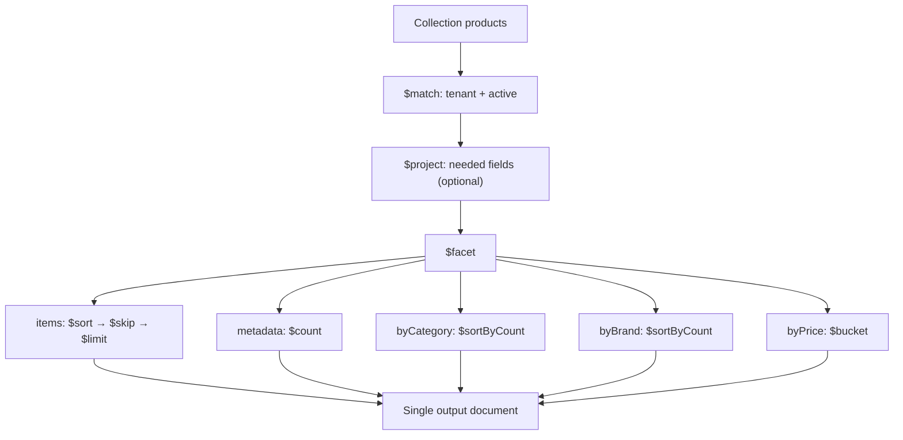

# $facet for Multiple Analyses on the Same Input

## 1. The Problem: One Filter, Multiple Data Perspectives

In an e-commerce system built with **Spring Data MongoDB**, a product listing page often needs to display several pieces of information at once:

- Matching products, sorted and paginated.
- Total number of matching products for pagination metadata.
- Product counts by **category**.
- Product counts by **brand**.
- Product distribution across **price ranges**.

If you write five independent queries, the application has to construct five similar filter criteria, send multiple round-trips to MongoDB, and assemble the responses. That can still make sense in certain cases, yet it easily introduces **inconsistent filters** across queries, extra round-trips, and coordination logic in Java.

The MongoDB Aggregation Framework provides the **`$facet`** stage, which runs **multiple independent sub-pipelines over the same set of input documents** entering that stage. One shared pipeline prepares the common input, while each branch computes a different output. Spring Data MongoDB offers `Aggregation.facet(...)` and `FacetOperation` to configure these branches in Java.

This lesson belongs to the **Advanced Aggregation** chapter of the **SPRING_DATA_MONGODB** module. It connects aggregation design with `MongoTemplate`/repository usage, DTO mapping, indexing, transactions, reactive access, testing, and performance diagnostics.

**Core idea:** `$facet` does not perform joins; it **branches the analysis** of a single input stream. Each branch receives the exact same documents reaching `$facet`, and each branch can run its own `$match`, `$group`, `$sort`, `$bucket`, or `$limit`.

## 2. Reading `$facet` Syntax

A stage has the form:

```javascript
{
  $facet: {
    products: [
      // Pipeline A: product list
    ],
    byBrand: [
      // Pipeline B: counts by brand
    ],
    byPrice: [
      // Pipeline C: counts by price range
    ]
  }
}
```

For each branch name such as `products` or `byBrand`:

1. MongoDB feeds the **same set of documents** entering `$facet` into the branch.
2. The branch executes its own stages in the declared order.
3. The branch output is collected into **an array** stored under the field named after the branch.
4. The output of `$facet` is typically **a single document** containing the corresponding result arrays.

Example output shape:

```json
{
  "products": [
    { "_id": "p-5", "name": "Headset", "price_cents": 320000 }
  ],
  "byBrand": [
    { "_id": "ACME", "count": 3 }
  ],
  "byPrice": [
    { "_id": 200000, "count": 2 }
  ]
}
```

`byBrand` is an **array of summary documents**, not an automatically generated map like `{"ACME":3}`. If your HTTP response needs a different shape, transform it in a post-`$facet` pipeline stage or in the Java DTO layer.

### 2.1. Pipeline Visualization



The branches are **independent in data and stage order**. Do not interpret this diagram as a guarantee that MongoDB runs every branch on parallel CPU threads; it depicts a shared-input analytical model, not a parallel thread-scheduling contract.

## 3. Sample Dataset: Products by Tenant, Status, Category, Brand, Price

To verify results manually, we use eight products:

| ID | Tenant | Active | Category | Brand | Price (smallest unit) |
| --- | --- | --- | --- | --- | ---: |
| p-1 | t-A | true | keyboard | ACME | 150000 |
| p-2 | t-A | true | keyboard | Zenith | 240000 |
| p-3 | t-A | true | mouse | ACME | 80000 |
| p-4 | t-A | false | mouse | Zenith | 110000 |
| p-5 | t-A | true | headset | ACME | 320000 |
| p-6 | t-A | true | headset | Nova | 90000 |
| p-7 | t-A | true | keyboard | Nova | 120000 |
| p-8 | t-B | true | keyboard | ACME | 250000 |

Insert the data in a **test database**:

```javascript
db.products.insertMany([
  {
    _id: "p-1", tenant_id: "t-A", active: true,
    name: "Keyboard A", category: "keyboard",
    brand: "ACME", price_cents: NumberLong("150000")
  },
  {
    _id: "p-2", tenant_id: "t-A", active: true,
    name: "Keyboard Z", category: "keyboard",
    brand: "Zenith", price_cents: NumberLong("240000")
  },
  {
    _id: "p-3", tenant_id: "t-A", active: true,
    name: "Mouse A", category: "mouse",
    brand: "ACME", price_cents: NumberLong("80000")
  },
  {
    _id: "p-4", tenant_id: "t-A", active: false,
    name: "Discontinued Mouse", category: "mouse",
    brand: "Zenith", price_cents: NumberLong("110000")
  },
  {
    _id: "p-5", tenant_id: "t-A", active: true,
    name: "Headset A", category: "headset",
    brand: "ACME", price_cents: NumberLong("320000")
  },
  {
    _id: "p-6", tenant_id: "t-A", active: true,
    name: "Headset N", category: "headset",
    brand: "Nova", price_cents: NumberLong("90000")
  },
  {
    _id: "p-7", tenant_id: "t-A", active: true,
    name: "Keyboard N", category: "keyboard",
    brand: "Nova", price_cents: NumberLong("120000")
  },
  {
    _id: "p-8", tenant_id: "t-B", active: true,
    name: "Tenant B Keyboard", category: "keyboard",
    brand: "ACME", price_cents: NumberLong("250000")
  }
]);
```

This lesson uses `NumberLong` for prices to illustrate integer minor units. An application handling fractional prices can use BSON Decimal128/`BigDecimal`, provided BSON types stay consistent across comparisons and buckets. Prices are assumed non-negative and in the same currency; currency conversion is outside the example's scope.

### 3.1. Shared Input Set of Exactly Six Documents

When placing before `$facet`:

```javascript
{ $match: { tenant_id: "t-A", active: true } }
```

the six input documents are `p-1`, `p-2`, `p-3`, `p-5`, `p-6`, and `p-7`.

`p-4` is excluded because it is inactive; `p-8` is excluded because it belongs to another tenant. **Every branch** receives this exact set of six documents if no other stage alters the stream before `$facet`.

## 4. Complete `mongosh` Pipeline: Five Analyses in One Query

```javascript
db.products.aggregate([
  // Mandatory filter shared across all facets.
  {
    $match: {
      tenant_id: "t-A",
      active: true
    }
  },
  {
    $facet: {
      // Branch 1: paginated products.
      items: [
        { $sort: { price_cents: -1, _id: 1 } },
        { $skip: 0 },
        { $limit: 3 },
        {
          $project: {
            _id: 1,
            name: 1,
            category: 1,
            brand: 1,
            price_cents: 1
          }
        }
      ],

      // Branch 2: total count after shared filter, unaffected by page limit.
      metadata: [
        { $count: "total" }
      ],

      // Branch 3: counts by category.
      byCategory: [
        { $sortByCount: "$category" }
      ],

      // Branch 4: counts by brand.
      byBrand: [
        { $sortByCount: "$brand" }
      ],

      // Branch 5: price histogram with fixed boundaries.
      byPrice: [
        {
          $bucket: {
            groupBy: "$price_cents",
            boundaries: [0, 100000, 200000, 400000],
            default: "other",
            output: {
              count: { $sum: 1 }
            }
          }
        }
      ]
    }
  }
]);
```

In production code, `tenant_id` must come from a trusted identity/authorization context; never let a client supply an arbitrary tenant ID as an access-control mechanism. `skip`/`limit` values must be explicitly validated and bounded.

**Distinguish shared filters from branch-specific filters:** `$match` outside `$facet` applies to all branches; `$match` inside `items` affects only the `items` branch. This distinction governs how faceted search with optional filters is built.

## 5. Reading the Output and Verifying Manually

From the dataset:

- `items` holds the three most expensive active products for tenant A: `p-5` (320000), `p-2` (240000), `p-1` (150000).
- `metadata` holds one element with `total=6`.
- `byCategory`: keyboard = 3, headset = 2, mouse = 1.
- `byBrand`: ACME = 3, Nova = 2, Zenith = 1.
- `byPrice` has three buckets, each with count = 2.

Abbreviated result:

```json
{
  "items": [
    { "_id": "p-5", "name": "Headset A", "category": "headset", "brand": "ACME", "price_cents": 320000 },
    { "_id": "p-2", "name": "Keyboard Z", "category": "keyboard", "brand": "Zenith", "price_cents": 240000 },
    { "_id": "p-1", "name": "Keyboard A", "category": "keyboard", "brand": "ACME", "price_cents": 150000 }
  ],
  "metadata": [{ "total": 6 }],
  "byCategory": [
    { "_id": "keyboard", "count": 3 },
    { "_id": "headset", "count": 2 },
    { "_id": "mouse", "count": 1 }
  ],
  "byBrand": [
    { "_id": "ACME", "count": 3 },
    { "_id": "Nova", "count": 2 },
    { "_id": "Zenith", "count": 1 }
  ],
  "byPrice": [
    { "_id": 0, "count": 2 },
    { "_id": 100000, "count": 2 },
    { "_id": 200000, "count": 2 }
  ]
}
```

This is an **illustrative JSON shape**; in `mongosh`, BSON Long values may display with Long wrappers. `$sortByCount` branches sort descending by count; when counts tie, do not rely on tie order as a business contract. Add a `$sort` stage with a secondary key if deterministic ordering is required.

### 5.1. Checking Total Count vs. Bucket Counts

In the sample data, category counts and brand counts each sum to 6 because every product has **one** category and **one** brand.

However, if each product has **multiple categories** and a branch runs `$unwind`, the sum of category counts can **exceed** the total product count. That is not necessarily a bug—it measures **group memberships** rather than unique documents. Define each metric explicitly.

## 6. Independent Sub-Pipelines: You Cannot Read Another Branch's Output

Suppose `metadata` computes the total count and `items` returns products. MongoDB **does not allow** the `items` branch to read `metadata.total` computed in the same `$facet` as a shared variable.

Incorrect mental model:

```text
$facet:
  metadata: compute total
  items: use metadata.total to limit or rank
```

Correct model:

- Each branch processes the common input independently.
- After `$facet`, use `$project` or `$set` to **combine the output arrays**.
- Or move shared logic **before `$facet`** so all branches receive it.

One branch never mutates the stream for another branch. Running `$unwind` inside `byCategory` leaves `items` seeing one document per product just as it entered `$facet`.

### 6.1. Using a Post-`$facet` Stage

```javascript
db.products.aggregate([
  { $match: { tenant_id: "t-A", active: true } },
  {
    $facet: {
      items: [
        { $sort: { price_cents: -1, _id: 1 } },
        { $limit: 3 }
      ],
      metadata: [
        { $count: "total" }
      ]
    }
  },
  {
    $project: {
      items: 1,
      total: {
        $ifNull: [
          { $arrayElemAt: ["$metadata.total", 0] },
          0
        ]
      }
    }
  }
]);
```

Result shape:

```json
{
  "items": [ { "_id": "p-5" }, { "_id": "p-2" }, { "_id": "p-1" } ],
  "total": 6
}
```

The `items` entries above are abbreviated for clarity rather than showing every shell field. `$arrayElemAt` retrieves the first element of `metadata.total`, and `$ifNull` supplies 0 when none exists.

## 7. Facets and Pagination: Why `$skip`/`$limit` Must Stay in the Right Branch

This is one of the most common use cases: **returning the current page of items alongside the total matching count in a single aggregation**.

Correct:

```javascript
[
  { $match: { tenant_id: "t-A", active: true } },
  {
    $facet: {
      items: [
        { $sort: { price_cents: -1, _id: 1 } },
        { $skip: 20 },
        { $limit: 20 }
      ],
      metadata: [
        { $count: "total" }
      ]
    }
  }
]
```

`metadata` counts **all matches after the shared filter**. `items` contains only the requested page.

Wrong when you need the overall total:

```javascript
[
  { $match: { tenant_id: "t-A", active: true } },
  { $skip: 20 },
  { $limit: 20 },
  {
    $facet: {
      items: [],
      metadata: [{ $count: "total" }]
    }
  }
]
```

In the wrong version, `metadata` counts only **the already-paginated slice**, not the total matching products. That breaks UI page-count calculations.

### 7.1. Stable Sorting Before Pagination

When sorting by `price_cents` and multiple products share the same price, tie ordering can shift. Add `_id` for a total ordering:

```javascript
{ $sort: { price_cents: -1, _id: 1 } }
```

This keeps pagination predictable **on static data**, though offset pagination can still duplicate or skip items if the collection mutates between requests. For deep scrolling with keyset cursors, design a dedicated keyset query on the sort keys rather than assuming `$facet` provides cursor pagination.

### 7.2. An Empty Page Does Not Mean Zero Total Results

With 6 products, if a client requests `skip=100`, `items` returns `[]` while `metadata` still returns `[{"total":6}]`. The API must not infer `total=0` merely because the current page is empty.

Conversely, if the shared filter matches zero documents, the `$count` branch returns an **empty array**, not `[{"total":0}]`. Apply a default value when constructing the response.

## 8. `$sortByCount`: Quick Single-Dimension Breakdown

The `$sortByCount` stage evaluates an expression, groups and counts occurrences, and sorts descending by `count`.

```javascript
{
  $facet: {
    byBrand: [
      { $sortByCount: "$brand" }
    ],
    byCategory: [
      { $sortByCount: "$category" }
    ]
  }
}
```

Semantically, it is equivalent to:

```javascript
[
  { $group: { _id: "$brand", count: { $sum: 1 } } },
  { $sort: { count: -1 } }
]
```

If deterministic ordering is needed on count ties, replace the branch with:

```javascript
byBrand: [
  { $group: { _id: "$brand", count: { $sum: 1 } } },
  { $sort: { count: -1, _id: 1 } }
]
```

Not every category facet should use `$sortByCount`. If you need multiple metrics (revenue, out-of-stock SKU count, average price), `$group` with explicit accumulators is more expressive.

### 8.1. Null, Missing, and “Other”

If documents lack `brand`, grouping by brand produces a `_id: null` bucket. Choose your UX policy:

- Display as “Unspecified.”
- Exclude documents missing `brand` inside the **brand branch** using an inner `$match`.
- Normalize data at write time or via migration.

Do not drop missing-brand products **before `$facet`** if other branches still need to count them.

## 9. `$bucket`: Grouping by Fixed Price Ranges

`$bucket` partitions documents into groups defined by explicit **boundaries**. Example:

```javascript
{
  $bucket: {
    groupBy: "$price_cents",
    boundaries: [0, 100000, 200000, 400000],
    default: "other",
    output: { count: { $sum: 1 } }
  }
}
```

The resulting ranges are:

| Price (smallest unit) | Bucket |
| --- | --- |
| From 0 to less than 100000 | `_id: 0` |
| From 100000 to less than 200000 | `_id: 100000` |
| From 200000 to less than 400000 | `_id: 200000` |
| Outside all ranges, including >= 400000 | `_id: "other"` |

Lower bounds are **inclusive**; upper bounds are **exclusive**. Boundaries must be strictly ascending. `default` catches values outside the ranges; omitting `default` when out-of-range values exist causes MongoDB to return an error.

In the filtered 6-product set, each of the first, middle, and last buckets has 2 items. `default: "other"` does not appear in the output when no product falls into it.

### 9.1. Do Not Mix Currencies

With `price_cents`, remember the unit: “100000” means **100000 minor units as modeled**, not automatically 100000 VND or 1000 USD. In multi-currency systems, never build a price histogram over amounts that have not been converted to a common unit.

### 9.2. `$bucketAuto` When Boundaries Are Unknown

`$bucketAuto` lets MongoDB estimate boundaries to split documents into a target number of groups:

```javascript
{
  $facet: {
    automaticPrices: [
      {
        $bucketAuto: {
          groupBy: "$price_cents",
          buckets: 3
        }
      }
    ]
  }
}
```

Differences:

| Criterion | `$bucket` | `$bucketAuto` |
| --- | --- | --- |
| Boundaries | Defined by the application | Computed by MongoDB from data distribution |
| Range stability across requests | Predictable when config is fixed | Can shift as data distribution changes |
| Fixed price filter UX | Best fit | Needs careful thought |
| Exploring unknown distributions | Less flexible | Helpful |

`$bucketAuto` does not guarantee equal-sized buckets, especially when many documents share identical values. When the UI encodes a price range in a URL for reuse, fixed buckets provide a cleaner contract.

## 10. Faceting Arrays and `$unwind`: Avoiding Wrong Counts

A product can carry multiple tags:

```javascript
{
  _id: "p-extra",
  tags: ["gaming", "wireless", "sale"]
}
```

To count products per **tag**, run `$unwind` inside the appropriate branch:

```javascript
db.products.aggregate([
  { $match: { tenant_id: "t-A", active: true } },
  {
    $facet: {
      byTag: [
        { $unwind: "$tags" },
        { $sortByCount: "$tags" }
      ],
      totalProducts: [
        { $count: "total" }
      ]
    }
  }
]);
```

`byTag` counts **tag occurrences after unwind**, so the sum of tag counts need not equal `totalProducts`. A product with three tags contributes to three groups. If an array can contain duplicate tags, apply `$setUnion` or normalize the data to avoid double-counting a single document.

### 10.1. Why Should `$unwind` Stay Inside Its Own Branch?

If you place `$unwind: "$tags"` **before `$facet`**, `totalProducts` counts **unwound rows** instead of original products, which can severely mislead the UI.

Correct when counting original documents:

```javascript
{
  $facet: {
    byTag: [
      { $unwind: "$tags" },
      { $sortByCount: "$tags" }
    ],
    totalProducts: [
      { $count: "total" }
    ]
  }
}
```

This is a major advantage of independent sub-pipelines: any branch can change row cardinality without affecting the others.

## 11. Faceted Search: Shared Conditions vs. Per-Branch Conditions

An e-commerce search page typically has **selected filters**. For example, a user selects:

- Tenant = `t-A` (mandatory).
- Active = true (mandatory).
- Category = `keyboard`.
- Brand = `ACME`.

If you apply **both category and brand** before `$facet`, then:

- `items` and `metadata` see only keyboard/ACME products.
- `byCategory` only shows `keyboard`, hiding other categories the user might switch to.
- `byBrand` only shows `ACME`.

Sometimes that is the desired UX (**conjunctive counts**), while many search pages require **disjunctive faceting**: the category branch is computed **without the category filter**, while keeping all other filters; and likewise for brand.

### 11.1. Designing Branch-Specific Filters

```javascript
db.products.aggregate([
  // Mandatory for all branches.
  {
    $match: {
      tenant_id: "t-A",
      active: true
    }
  },
  {
    $facet: {
      // Product list: apply all selected filters.
      items: [
        { $match: { category: "keyboard", brand: "ACME" } },
        { $sort: { price_cents: -1, _id: 1 } },
        { $limit: 20 }
      ],

      // Total: same filters as items, without limit.
      metadata: [
        { $match: { category: "keyboard", brand: "ACME" } },
        { $count: "total" }
      ],

      // Category breakdown: omit the category filter itself.
      byCategory: [
        { $match: { brand: "ACME" } },
        { $sortByCount: "$category" }
      ],

      // Brand breakdown: omit the brand filter itself.
      byBrand: [
        { $match: { category: "keyboard" } },
        { $sortByCount: "$brand" }
      ]
    }
  }
]);
```

With the sample dataset, `items` yields `p-1`; `metadata` gives `total=1`. `byCategory` for brand ACME has `keyboard=1, mouse=1, headset=1`. `byBrand` for category keyboard has `ACME=1, Zenith=1, Nova=1`.

**Never assume one counting style fits every product.** Lock down the UX contract: do facet counts reflect “after all filters” or “after all other filters except this dimension”?

### 11.2. Mandatory Access Controls Cannot Be Bypassed in a Branch

Tenant filters, product ACLs, and sensitive visibility flags must be applied in the **shared** stage or guaranteed to exist in **every branch**. Never allow client input to construct a branch `$match` that widens scope to another tenant.

When building branch-specific predicates from HTTP input, construct conditions only from allowlisted fields and validated values; never splice client-supplied raw BSON/SpEL/JSON into the pipeline.

## 12. Spring Data MongoDB: Entities and Result DTOs

### 12.1. Source Entity

```java
import org.springframework.data.mongodb.core.mapping.Document;
import org.springframework.data.mongodb.core.mapping.Field;
import org.springframework.data.mongodb.core.mapping.FieldType;
import org.springframework.data.mongodb.core.mapping.MongoId;

@Document(collection = "products")
public record ProductDocument(
    @MongoId(FieldType.STRING)
    String id,

    @Field("tenant_id")
    String tenantId,

    String name,
    String category,
    String brand,

    @Field("price_cents")
    Long priceCents,

    boolean active
) {}
```

`ProductDocument` is the source entity. Note:

- MongoDB stores `id` in `_id`.
- Java property `tenantId` maps to BSON `tenant_id`.
- Java property `priceCents` maps to BSON `price_cents`.
- When Spring Data builds a typed aggregation for this entity, mapping metadata helps operations resolve the right BSON field names.

### 12.2. DTOs for Items and Facets

A `$facet` output does not match `ProductDocument`. Define read-only DTOs/records:

```java
import java.util.List;

public record ProductHit(
    String id,
    String name,
    String category,
    String brand,
    Long priceCents
) {}

public record CountBucket(
    String id,
    long count
) {}

public record TotalCount(
    long total
) {}

public record ProductFacetResult(
    List<ProductHit> items,
    List<TotalCount> metadata,
    List<CountBucket> byCategory,
    List<CountBucket> byBrand,
    List<CountBucket> byPrice
) {}
```

These are **result model types**, not entities to pass to `save`. Different branches can have different `_id` types:

- `byCategory._id` and `byBrand._id` are strings.
- `byPrice._id` can be a **number** (boundary) or the string `"other"`.

Therefore, `CountBucket(String id, long count)` is **unsuitable** for a price bucket branch with mixed-type `_id` values unless converted explicitly. In production code, create `PriceBucket` with `Object id` (and type checks) or normalize aliases/labels in the pipeline.

**Do not** force every branch into the same record simply because each document has `_id` and `count`. The `_id` value type is part of the DTO contract.

### 12.3. Dedicated Typed DTO for Prices

```java
public record PriceBucket(
    Object id,
    long count
) {}

public record FacetResponse(
    List<ProductHit> items,
    long total,
    List<CountBucket> categories,
    List<CountBucket> brands,
    List<PriceBucket> prices
) {}
```

`FacetResponse` is a normalized HTTP response model: `metadata[0].total` becomes a scalar `total`, while the array branches remain mapped lists. For long-lived public APIs, convert bucket IDs into structured `label` + `minInclusive`/`maxExclusive` fields rather than exposing an arbitrary `Object`.

## 13. Writing `$facet` with `Aggregation.facet(...)` and `MongoTemplate`

Key Spring Data MongoDB APIs:

- `Aggregation.newAggregation(...)` builds the pipeline.
- `Aggregation.match(...)` constructs `$match`.
- `Aggregation.facet(...)` starts the branches.
- `FacetOperation.as("name")` names a branch.
- `FacetOperation.and(...)` defines the next branch.
- `Aggregation.sortByCount("field")` constructs `$sortByCount`.
- `Aggregation.bucket("field")` and `bucketAuto("field", n)` build histograms.
- `MongoTemplate.aggregate(...)` executes against the mapped collection.

### 13.1. Complete Java Method

```java
import static org.springframework.data.mongodb.core.aggregation
    .Aggregation.*;

import java.util.List;

import org.bson.Document;
import org.springframework.data.domain.Sort;
import org.springframework.data.mongodb.core.MongoTemplate;
import org.springframework.data.mongodb.core.aggregation.Aggregation;
import org.springframework.data.mongodb.core.aggregation.AggregationResults;
import org.springframework.data.mongodb.core.aggregation.FacetOperation;
import org.springframework.data.mongodb.core.query.Criteria;

public class ProductFacetReader {

    private final MongoTemplate template;

    public ProductFacetReader(MongoTemplate template) {
        this.template = template;
    }

    public Document queryForTenant(String trustedTenantId) {
        if (trustedTenantId == null
                || trustedTenantId.isBlank()) {
            throw new IllegalArgumentException(
                "Missing authenticated tenant"
            );
        }

        FacetOperation facets = facet(
            sort(Sort.by(
                Sort.Order.desc("priceCents"),
                Sort.Order.asc("id")
            )),
            skip(0L),
            limit(3L),
            project("id", "name", "category",
                    "brand", "priceCents")
        ).as("items")
         .and(count().as("total")).as("metadata")
         .and(sortByCount("category")).as("byCategory")
         .and(sortByCount("brand")).as("byBrand")
         .and(
             bucket("priceCents")
                 .withBoundaries(
                     0L, 100000L, 200000L, 400000L
                 )
                 .withDefault("other")
                 .andOutputCount().as("count")
         ).as("byPrice");

        Aggregation aggregation = newAggregation(
            match(Criteria.where("tenantId")
                .is(trustedTenantId)
                .and("active").is(true)),
            facets
        );

        AggregationResults<Document> result =
            template.aggregate(
                aggregation,
                ProductDocument.class,
                Document.class
            );

        return result.getUniqueMappedResult();
    }
}
```

**Mapping explanation:** `template.aggregate(aggregation, ProductDocument.class, Document.class)` uses `ProductDocument` as the **input domain type** so typed operations resolve BSON field names. The output type is `Document.class` because the output holds multiple summary arrays rather than a single source entity.

The example uses `import static ...Aggregation.*` for `facet`, `sort`, `skip`, `limit`, `project`, `count`, `sortByCount`, and `bucket`. Builder signatures and `aggregate` overloads can vary across library versions; verify against the Spring Data MongoDB version managed by your Spring Boot BOM.

### 13.2. Reading the `org.bson.Document` Output

```java
Document raw = reader.queryForTenant("t-A");

if (raw == null) {
    throw new IllegalStateException(
        "Aggregation returned no result document"
    );
}

List<Document> items = raw.getList(
    "items", Document.class
);

List<Document> metadata = raw.getList(
    "metadata", Document.class
);

long total = metadata.isEmpty()
    ? 0L
    : ((Number) metadata.get(0).get("total"))
        .longValue();

List<Document> categories = raw.getList(
    "byCategory", Document.class
);

List<Document> brands = raw.getList(
    "byBrand", Document.class
);

List<Document> prices = raw.getList(
    "byPrice", Document.class
);
```

This is a useful way to inspect raw BSON when learning `$facet` output shapes. In production, add a mapper converting raw documents into strongly typed DTOs, handling null/missing fields, and restricting fields exposed on public APIs.

**Warning:** `metadata` can be `[]` when zero documents match; never call `metadata.get(0)` unconditionally. Every branch is an array—even a total-count branch that holds at most one document.

## 14. Writing Conditional Facets in Java

In a real endpoint, users pick category, brand, price range, and page number. Separate:

- **Mandatory filters**: tenant, ACL/authorization, active.
- **Viewed product filters**: category, brand, price range.
- **Facet filters**: may include or exclude the dimension being counted.
- **Limits**: page size and maximum number of buckets/brands returned.

### 14.1. Explicit Query Request

```java
public record ProductFacetRequest(
    String category,
    String brand,
    Long minPriceCents,
    Long maxPriceCents,
    int page,
    int size
) {}
```

Before building the pipeline:

- Validate `page >= 0` and `1 <= size <= maxPageSize`.
- Compute `skip = (long) page * size` using `long` and check for overflow.
- Validate price bounds and currency.
- Never trust a client-sent `tenantId` for ACL enforcement.
- Never accept raw pipeline JSON from requests.

### 14.2. Keeping `Criteria` Builders Scoped Clearly

A helper can build optional selected filters:

```java
import org.springframework.data.mongodb.core.query.Criteria;

public Criteria selectedFilters(
    String category,
    String brand,
    Long minPrice,
    Long maxPrice
) {
    Criteria result = new Criteria();

    if (category != null && !category.isBlank()) {
        result.and("category").is(category.trim());
    }

    if (brand != null && !brand.isBlank()) {
        result.and("brand").is(brand.trim());
    }

    if (minPrice != null || maxPrice != null) {
        Criteria price = result.and("priceCents");
        if (minPrice != null) {
            price.gte(minPrice);
        }
        if (maxPrice != null) {
            price.lte(maxPrice);
        }
    }

    return result;
}
```

This helper covers **optional fields** only; it does not include tenant. Combine it with mandatory conditions in the outer pipeline:

```java
Criteria tenantAndActive = Criteria.where("tenantId")
    .is(trustedTenantId)
    .and("active").is(true);
```

If `byCategory` should drop the selected category while keeping brand and price, construct a separate `Criteria` instance **without category**. **Never** mutate a single `Criteria` instance across multiple branches expecting independent copies.

### 14.3. Java Structure for Disjunctive Faceting

```java
FacetOperation facets = facet(
    match(selectedFilters(
        category, brand, minPrice, maxPrice
    )),
    sort(Sort.by("name")),
    skip(offset),
    limit(size)
).as("items")
.and(
    match(selectedFilters(
        category, brand, minPrice, maxPrice
    )),
    count().as("total")
).as("metadata")
.and(
    match(selectedFilters(
        null, brand, minPrice, maxPrice
    )),
    sortByCount("category")
).as("byCategory")
.and(
    match(selectedFilters(
        category, null, minPrice, maxPrice
    )),
    sortByCount("brand")
).as("byBrand");
```

This is an illustrative snippet assuming `category`/`brand`/`minPrice`/`maxPrice`/`offset`/`size` have been validated. When no optional filter is selected, decide whether to **omit an empty `$match` stage** to avoid generating an invalid stage in your library version.

For multi-select UX (multiple brands or categories), use `in(...)` or explicit OR logic; never treat a comma-separated string as a valid MongoDB equality value.

## 15. Placing `$project` and `$set` Properly

### 15.1. Pre-Facet Projection Reduces Data Entering Multiple Branches

If source documents carry images, long descriptions, history arrays, and internal metadata, summary branches rarely need those fields.

You can place:

```javascript
{
  $project: {
    _id: 1,
    tenant_id: 1,
    active: 1,
    name: 1,
    category: 1,
    brand: 1,
    price_cents: 1
  }
}
```

**after `$match` and before `$facet`**, provided every branch still receives all fields it uses. Note, however, that the MongoDB aggregation optimizer can perform automatic projection pushdown in many cases; do not assume manually adding `$project` always makes a query faster.

If you accidentally omit `price_cents` before the facet, `byPrice` loses its input. If you drop `_id`, the paginated list loses its deterministic sort tie-breaker.

### 15.2. Projection Inside the `items` Branch

For response minimization, place `$project` inside `items` to emit only UI-needed fields:

```javascript
items: [
  { $sort: { price_cents: -1, _id: 1 } },
  { $skip: 0 },
  { $limit: 20 },
  {
    $project: {
      _id: 1,
      name: 1,
      category: 1,
      brand: 1,
      price_cents: 1
    }
  }
]
```

This `$project` does not affect the statistical branches, yet **it does not replace authorization**. Documents from other tenants must still be filtered out by mandatory access predicates.

### 15.3. Adding Scalar `total` After `$facet`

As in Section 6:

```javascript
{
  $set: {
    total: {
      $ifNull: [
        { $arrayElemAt: ["$metadata.total", 0] },
        0
      ]
    }
  }
}
```

If you keep `metadata`, the output has both the `metadata` array and the scalar `total`. Use `$project` to retain only `items`, `total`, `byCategory`, `byBrand`, and `byPrice`.

**Do not confuse** the post-`$facet` `$set` stage with `Update.set(...)` for modifying stored MongoDB documents. Here `$set` transforms the **aggregation output**, without writing to the collection.

## 16. Resource Limits: 100 MB and 16 MiB

`$facet` is powerful, but remember its limits:

1. **During `$facet` execution**, the stage's result document is subject to a **100 MB** memory limit.
2. `allowDiskUse` **does not allow `$facet` to spill to disk** to exceed this limit.
3. **The final output document** remains subject to the **16 MiB** BSON size limit.
4. Other aggregation stages have different memory policies and may spill to disk depending on server version and configuration; do not apply that assumption to `$facet` itself.

Therefore, if `items` holds hundreds of thousands of documents or `byBrand` accumulates hundreds of thousands of labels, the response can fail regardless of server RAM.

### 16.1. Why `allowDiskUse(true)` Is Not the Answer

```java
// On Spring Data versions supporting AggregationOptions:
Aggregation aggregation = newAggregation(
    match(Criteria.where("tenantId").is("t-A")),
    facets
).withOptions(
    org.springframework.data.mongodb.core.aggregation
        .AggregationOptions.builder()
        .allowDiskUse(true)
        .build()
);
```

This option can allow **supported stages** such as sort or group outside the facet to spill to disk depending on MongoDB Server, but **it cannot bypass the 100 MB `$facet` limit** or the 16 MiB final BSON limit.

To keep output bounded:

- `$match` early to reduce document volume.
- `$project` only required fields.
- `$limit` inside the `items` branch.
- Cap the number of buckets/brands in summary branches per UX needs.
- Avoid `$push: "$$ROOT"` accumulating full large documents into an array.
- Split oversized reports into separate queries or collections.
- Evaluate pre-aggregation or materialized views for hot queries.

### 16.2. Per-Branch Limit vs. Pre-Facet Limit

`{ $limit: 10 }` **before `$facet`** restricts all statistics to at most 10 documents, producing wrong counts. By contrast, `{ $limit: 10 }` inside the `items` branch caps only the item list without changing `total` or `byBrand`.

Place stages according to **metric scope**; misplacement here is usually worse than a syntax error.

## 17. Disallowed Stages Inside `$facet`

Not every aggregation stage is valid inside a `$facet` sub-pipeline. According to MongoDB documentation, restricted stages include:

- Nested `$facet` inside `$facet`.
- `$out` or `$merge` inside a branch.
- `$geoNear` inside a branch.
- Specialized stages such as `$collStats`, `$indexStats`, `$search`/`$searchMeta`, `$vectorSearch`, and certain metadata stages depending on version.

When you need `$search`, `$geoNear`, or another specialized input stage, evaluate placing it **before `$facet`** as permitted by stage-ordering rules so the shared input is branched afterward.

Never try to put `$merge` inside a branch to write reports just because `$facet` branches are “independent.” `$facet` is an **analytical and output-shaping** tool, not a mechanism for running multiple write operations.

Check the disallowed stage list for your exact MongoDB Server version, as stage support evolves across releases.

## 18. Indexes, Early `$match`, and the Query Planner

### 18.1. Putting `$facet` First Can Trigger a `COLLSCAN`

In MongoDB, when `$facet` is the very first stage, it cannot use an index to narrow the initial input stream and typically performs a collection scan. Poor pattern:

```javascript
db.products.aggregate([
  {
    $facet: {
      byBrand: [
        { $match: { tenant_id: "t-A" } },
        { $sortByCount: "$brand" }
      ],
      byCategory: [
        { $match: { tenant_id: "t-A" } },
        { $sortByCount: "$category" }
      ]
    }
  }
]);
```

Even though each branch has its own `$match`, `$facet` sits at the start of the pipeline; do not expect inner `$match` stages to initiate independent index scans like standalone queries.

### 18.2. Hoist Mandatory Filters Upfront

```javascript
db.products.aggregate([
  {
    $match: {
      tenant_id: "t-A",
      active: true
    }
  },
  {
    $facet: {
      byBrand: [{ $sortByCount: "$brand" }],
      byCategory: [{ $sortByCount: "$category" }]
    }
  }
]);
```

Create an index supporting the shared filter:

```javascript
db.products.createIndex({
  tenant_id: 1,
  active: 1
});
```

MongoDB can use the index at the pre-`$facet` `$match` and stream matching documents into the branches. `$facet` **does not force a full collection scan** when an upstream stage already uses an index. Actual index selection still depends on data distribution, selectivity, and the query planner.

### 18.3. Sorting Inside a Branch May Not Use Indexes Like a Top-Level Sort

A branch like:

```javascript
items: [
  { $sort: { price_cents: -1, _id: 1 } },
  { $limit: 20 }
]
```

executes **after documents have entered `$facet`**. Do not assume it uses an index sort the way a direct `find(...).sort(...).limit(...)` does. If sorting by price becomes a bottleneck, consider placing a suitable `$sort` **before `$facet`** to leverage an upstream index—provided business semantics stay intact and extra sorting cost does not hurt overall performance.

However, sorting the entire input stream before `$facet` when only `items` needs sorting makes every other branch consume pre-sorted input unnecessarily. Compare both options with `explain` on representative data.

### 18.4. Using `explain` to Verify Behavior

```javascript
db.products.explain("executionStats").aggregate([
  { $match: { tenant_id: "t-A", active: true } },
  {
    $facet: {
      items: [
        { $sort: { price_cents: -1, _id: 1 } },
        { $limit: 3 }
      ],
      metadata: [{ $count: "total" }],
      byBrand: [{ $sortByCount: "$brand" }]
    }
  }
]);
```

Inspect these indicators:

| Metric | What to verify |
| --- | --- |
| `IXSCAN` or `COLLSCAN` | Does the leading stage use an index? |
| `totalKeysExamined` | Are too many index keys scanned? |
| `totalDocsExamined` | Are too many documents read? |
| Sort stage | Is a branch sorting the whole input dataset in memory? |
| `nReturned` | How many output documents does `$facet` produce? |
| `executionTimeMillis` | Actual latency under representative filters and volume |
| Memory/error/usedDisk | Are stage or sort/group limits being approached? |
| p95/p99 latency | Does it meet SLAs under concurrent client traffic? |

Do not compare one `$facet` vs. five separate queries solely by counting network round-trips. Measure total latency, server CPU, memory, output size, cache hit rate, and index utilization for each approach.

## 19. Choosing the Right Design Strategy for `$facet`

### 19.1. When `$facet` Is Beneficial

- Multiple aggregations genuinely share **the same input filter**.
- Each branch outputs a **small, bounded** array.
- The UI needs multi-dimensional data in **a single response**.
- Mandatory filters are identical and easily placed before `$facet`.
- An index supports the upstream stage.
- Branches do not each require completely different index plans over independent subsets.

### 19.2. When Multiple Separate Queries May Be Better

- Each metric needs very different filters or specialized indexes.
- One heavy branch stalls the entire endpoint while fast branches wait.
- Results contain hundreds of thousands of buckets/tags, risking the 16 MiB limit.
- Different metrics need different cache TTLs.
- Reports are computed from independent snapshot or materialized tables.
- A count can be served far more cheaply from pre-materialized counters than by scanning the full input.

**Never assume `$facet` is always faster than N separate queries.** It avoids repeating the same input pass across *one pipeline*, but grouping and sorting still consume server resources and memory.

### 19.3. Splitting Hot vs. Cold Metrics

Suppose product listings update constantly while brand/category counts do not require per-second precision. You can:

- Query `items` with a dedicated index and pagination.
- Periodically snapshot facet counts if business requirements allow.
- Offload large analytical breakdowns to reporting collections.
- Reserve `$facet` for metrics that strictly require a shared base filter.

The decision depends on SLAs, consistency, and operational cost—not lines of Java code.

## 20. Reactive MongoDB: `Flux<Document>` for `$facet` Output

In a WebFlux application, `ReactiveMongoTemplate.aggregate(...)` returns a publisher of output documents.

```java
import org.bson.Document;

import org.springframework.data.mongodb.core.ReactiveMongoTemplate;
import org.springframework.data.mongodb.core.aggregation.Aggregation;
import org.springframework.data.mongodb.core.query.Criteria;
import reactor.core.publisher.Mono;

import static org.springframework.data.mongodb.core.aggregation
    .Aggregation.*;

public Mono<Document> reactiveFacets(
    ReactiveMongoTemplate template,
    String trustedTenantId
) {
    Aggregation aggregation = newAggregation(
        match(Criteria.where("tenantId")
            .is(trustedTenantId)
            .and("active").is(true)),
        facet(
            sortByCount("category")
        ).as("byCategory")
         .and(sortByCount("brand")).as("byBrand")
    );

    return template.aggregate(
        aggregation,
        ProductDocument.class,
        Document.class
    ).next();
}
```

A trailing `$facet` normally emits **one document** containing the branch arrays, so `next()` takes that first document as a `Mono<Document>`. If subsequent stages after `$facet` unwind or split that document into multiple documents, the contract changes and `next()` should not be used blindly.

**Reactive execution does not make aggregation faster.** MongoDB still reads, groups, sorts, and builds the result document. Having `Flux` in Java does not stream individual facet branches incrementally before the server finishes assembling the output document.

### 20.1. Reactive Cancellation and Timeouts

- Never call `block()` on WebFlux event-loop threads.
- Configure timeouts at the API layer and consider MongoDB `maxTime`/`maxTimeMS` where supported.
- Bound output size and server resource usage.
- Enforce tenant filtering and authorization before subscribing.
- If a subscriber cancels, do not assume server-side work stops instantaneously at the exact same moment.

## 21. Consistency and Transactions

`$facet` feeds its branches **the documents entering that stage**, which should not be confused with providing a consistent snapshot across separate API requests or replacing multi-document transactions.

Key points to clarify:

- Branches within a single aggregation produce mutually consistent numbers because they share one input stream.
- If the collection is updated/deleted/inserted while a query runs, read concern and deployment topology determine visibility guarantees.
- A page-1 request and a page-2 request seconds later can see modified data.
- `$facet` **does not** mutate data and does not implicitly start a transaction.
- When strict cross-operation snapshots are required, design read concern, sessions, transactions, or materialized snapshots accordingly.

Exploratory analytics UIs can often tolerate eventual consistency on facet counts; financial reporting or reconciliation may demand stronger guarantees, replica-set testing, and period-close procedures.

### 21.1. Transactions Are Not a Workaround for Memory Limits

Even when running inside a transaction on a supported topology, `$facet` remains bound by its memory limit and BSON output limit. Never hold long-running transactions around heavy analytical facets merely to avoid implementing caching or pre-aggregation.

For atomic multi-document writes, `MongoTransactionManager` or `ReactiveMongoTransactionManager` is the appropriate mechanism; `$facet` remains strictly a **read-side analytical** stage.

## 22. Integration Testing with Real MongoDB

Unit tests mocking `MongoTemplate` do not verify that MongoDB executes `$facet` properly, nor do they verify `@Field` mapping, boundaries, and limits. Run integration tests against a real MongoDB instance, such as Testcontainers in a Spring Boot project.

### 22.1. Testing the Facet Repository/Reader and Output

JUnit 5 example using `ProductDocument` and `ProductFacetReader` from above:

```java
import static org.assertj.core.api.Assertions.assertThat;

import java.util.List;

import org.bson.Document;
import org.junit.jupiter.api.Test;
import org.springframework.beans.factory.annotation.Autowired;
import org.springframework.boot.test.autoconfigure.data.mongo.DataMongoTest;
import org.springframework.context.annotation.Import;
import org.springframework.data.mongodb.core.MongoTemplate;

@DataMongoTest
@Import(ProductFacetReader.class)
class ProductFacetIntegrationTest {

    @Autowired MongoTemplate template;
    @Autowired ProductFacetReader reader;

    @Test
    void facetSharesTenantFilterAcrossAllBranches() {
        template.insertAll(List.of(
            new ProductDocument(
                "facet-01", "facet-tenant-A", "Keyboard A",
                "keyboard", "ACME", 150000L, true
            ),
            new ProductDocument(
                "facet-02", "facet-tenant-A", "Keyboard B",
                "keyboard", "Zenith", 240000L, true
            ),
            new ProductDocument(
                "facet-03", "facet-tenant-A", "Mouse A",
                "mouse", "ACME", 80000L, true
            ),
            new ProductDocument(
                "facet-04", "facet-tenant-A", "Mouse inactive",
                "mouse", "Zenith", 110000L, false
            ),
            new ProductDocument(
                "facet-05", "facet-tenant-A", "Headset A",
                "headset", "ACME", 320000L, true
            ),
            new ProductDocument(
                "facet-06", "facet-tenant-A", "Headset N",
                "headset", "Nova", 90000L, true
            ),
            new ProductDocument(
                "facet-07", "facet-tenant-A", "Keyboard N",
                "keyboard", "Nova", 120000L, true
            ),
            new ProductDocument(
                "facet-08", "facet-tenant-B", "Other tenant",
                "keyboard", "ACME", 250000L, true
            )
        ));

        Document result = reader.queryForTenant(
            "facet-tenant-A"
        );

        assertThat(result).isNotNull();

        List<Document> items =
            result.getList("items", Document.class);

        assertThat(items)
            .extracting(d -> d.getString("_id"))
            .containsExactly("facet-05", "facet-02", "facet-01");

        List<Document> metadata =
            result.getList("metadata", Document.class);

        assertThat(((Number) metadata.get(0).get("total"))
            .longValue()).isEqualTo(6L);

        List<Document> categories =
            result.getList("byCategory", Document.class);

        assertThat(categories)
            .anySatisfy(bucket -> {
                assertThat(bucket.getString("_id"))
                    .isEqualTo("keyboard");
                assertThat(((Number) bucket.get("count"))
                    .longValue()).isEqualTo(3L);
            });
    }
}
```

The test uses `@Import` to register `ProductFacetReader` without `@Component`. It runs the aggregation through Spring Data with entity mapping, asserting item order, total count, and a category bucket.

**Test prerequisites:** Requires a test MongoDB instance, compatible Spring Boot test dependencies, and an isolated database or cleanup of fixed IDs. Following STEP 4 authoring rules, **the integration test was not executed**; before adding it to CI, verify Spring Data version compatibility, constructors, DTO mappings, and test configuration.

### 22.2. Required Additional Test Cases

| Case | Expected outcome |
| --- | --- |
| Tenant A and B share a category | No cross-tenant data leakage |
| `active = false` | Excluded from all shared branches |
| Multiple categories/brands | Bucket counts match the dataset |
| `items` limit 3 | Only three items returned; metadata still counts all |
| Large `items` skip | `items` empty; `total` unchanged |
| Filter matches nothing | `metadata` array empty; API normalizes `total=0` |
| Price exactly on boundary | Price 100000 lands in the bucket starting at 100000 |
| Out-of-range price | Falls into `default` or errors per design |
| Null/missing or wrong-type price | Clear policy: exclude, normalize, or fail |
| Product with `tags` array | `$unwind` inside `byTag` only; `totalProducts` uninflated |
| Selected brand/category | Verifies conjunctive vs. disjunctive behavior |
| Branch with many groups | Bucket/output count bounded appropriately |
| `@Field` renames | `tenant_id` and `price_cents` mapped accurately |
| Reactive facet | Correct output shape without blocking |
| Pipeline index | `explain` confirms shared predicates can use an index |

### 22.3. Testing in `mongosh` Before DTO Mapping

A solid diagnostic routine when DTO mapping fails:

1. Run the shell pipeline directly with actual BSON field names.
2. Note the exact `_id` types in each bucket.
3. Run the corresponding Spring Data typed pipeline.
4. Inspect the actual command received by MongoDB via command monitoring in a safe environment.
5. If BSON is right but the DTO is wrong, check constructors, aliases, types, and null/missing handling.
6. If BSON itself is wrong, inspect `$match`, `$project`, and pre-facet stage order.

**Never** fix a DTO by coercing every `_id` to String without realizing a branch emits numbers or objects. Mapping must mirror the actual output schema.

## 23. Common Mistakes

**Mistake 1: Assuming `$facet` emits one result document per product.** No; a facet stage emits a single document containing multiple result arrays.

**Mistake 2: Placing `$limit` before `$facet` and using `$count` for the total.** That makes `total` count only the truncated slice.

**Mistake 3: Thinking the `items` branch can read the count branch's metadata inside the same facet.** No; branches are independent. Combine outputs in a stage after `$facet`.

**Mistake 4: Assuming a leading `$facet` automatically uses per-branch indexes efficiently.** A leading `$facet` risks `COLLSCAN`; put the shared `$match` first.

**Mistake 5: Thinking `allowDiskUse(true)` solves all facet memory errors.** No; `$facet` cannot spill to disk past its 100 MB limit, and final output remains capped at 16 MiB.

**Mistake 6: Omitting `$limit` inside the `items` branch.** Result arrays can grow huge and hit BSON/memory limits.

**Mistake 7: Placing `$unwind` globally when only `byTag` needs it.** That multiplies document totals and corrupts other facet counts.

**Mistake 8: Calling `metadata.get(0)` without checking for an empty array.** `$count` emits no document when zero documents match.

**Mistake 9: Mapping `byPrice._id` to `String` without accounting for numeric bounds.** Bucket IDs can be numbers or the string default.

**Mistake 10: Equating summed category counts with total items.** When documents hold multiple tags/categories or missing values, sums can differ.

**Mistake 11: Forgetting tenant constraints on every branch or before `$facet`.** This risks exposing data from other tenants.

**Mistake 12: Using `$bucketAuto` for URL-pinned fixed price filters.** Dynamic boundaries shift as the dataset changes.

**Mistake 13: Treating `$facet` as always cheaper than multiple queries.** It saves round-trips, yet still runs multiple branches and may lose per-branch index plans.

**Mistake 14: Believing reactive `Flux` streams individual branches early before server assembly finishes.** `$facet` still constructs a single combined document.

**Mistake 15: Treating multi-branch output in one request as a permanent transactional snapshot.** Separate requests can observe data changes; consistency requires explicit design.

## 24. Hands-On Lab

1. Insert the eight sample products in a test database with accurate `tenant_id`, `active`, and `price_cents`.
2. Run `$match` alone to verify the shared input contains **6 documents**.
3. Run `$facet` with `items`, `metadata`, `byCategory`, `byBrand`, and `byPrice`.
4. Compute expected results by hand and compare: 3 items, total 6, categories (3/2/1), brands (3/2/1), price buckets (2/2/2).
5. Move `$skip`/`$limit` before `$facet` to observe the broken total, then restore it inside `items`.
6. Try `$bucketAuto` with 3 buckets and compare with fixed buckets.
7. Add a product with a `tags` array, place `$unwind` inside `byTag`, and test placing it mistakenly before `$facet`.
8. Add selections `category=keyboard`, `brand=ACME`; compare conjunctive and disjunctive faceting.
9. Implement the pipeline using `Aggregation.facet(...).as(...).and(...).as(...)` and execute via `MongoTemplate.aggregate(...)`.
10. Map `org.bson.Document` into DTOs and handle empty `metadata`.
11. Create an index on `tenant_id`/`active` and run `explain("executionStats")` before and after adding the shared `$match`.
12. Trim projections/outputs, bound bucket counts, and observe server resource usage.
13. Write a `@DataMongoTest` covering tenant isolation, limits, counts, boundaries, and mapping.
14. If using reactive, try `ReactiveMongoTemplate.aggregate(...)` and consume the output as `Mono<Document>`.
15. Identify when to **split queries or precompute** rather than growing a single facet further.

## 25. Pre-Deployment Checklist

| Check | Question |
| --- | --- |
| Shared filter | Are tenant, ACL, and active placed upfront and applied to all branches? |
| Metric scope | Should total, categories, and brands share one input or use per-branch filters? |
| Branches | Are branches independent without assuming shared state inside `$facet`? |
| Pagination | Are sort/skip/limit inside `items` so `count` is not truncated? |
| Sorting | Does sort include an ID tie-breaker when stability matters? |
| Buckets | Are boundaries ascending, currency units consistent, and `default` handled? |
| Arrays | Is `$unwind` isolated to the branch that needs it, with clear count semantics? |
| Output | Is every branch treated as an array, empty metadata handled, and BSON types checked? |
| Limits | Respects 100 MB non-spilling `$facet` limit and 16 MiB final BSON limit? |
| Indexes | Is `$match` placed before `$facet` and the actual plan checked? |
| DTOs | Are facet outputs kept separate from source entities, with accurate `_id` mapping? |
| Security | Are clients prevented from injecting raw pipelines or overriding tenant? |
| Data hygiene | Are null/missing fields, BSON types, currencies, and stale data handled? |
| Reactive | Non-blocking; not confusing facet output with incremental per-branch streaming? |
| Consistency | Are snapshots or period-closed reports required? |
| Testing | Fixed dataset, zero matches, limits, buckets, tenant isolation, and mapping covered? |
| Monitoring | Measured p95/p99 latency, docs/keys examined, CPU, memory, and output bytes? |

## 26. Official Documentation and Version Compatibility

`$facet` has been supported since **MongoDB 3.4**; Spring Data MongoDB provides `FacetOperation`/`Aggregation.facet(...)` in releases supporting facet aggregation. Builder signatures, projection mapping, and `aggregate` overloads depend on the Spring Data version managed in your project; always verify against the documentation for your actual dependency version.

Official sources:

- [MongoDB Manual — `$facet` aggregation stage](https://www.mongodb.com/docs/manual/reference/operator/aggregation/facet/)
- [MongoDB Manual — `$bucket`](https://www.mongodb.com/docs/manual/reference/operator/aggregation/bucket/)
- [MongoDB Manual — `$bucketAuto`](https://www.mongodb.com/docs/manual/reference/operator/aggregation/bucketAuto/)
- [MongoDB Manual — `$sortByCount`](https://www.mongodb.com/docs/manual/reference/operator/aggregation/sortByCount/)
- [MongoDB Manual — Aggregation Pipeline Limits](https://www.mongodb.com/docs/manual/core/aggregation-pipeline-limits/)
- [MongoDB Manual — Explain Results](https://www.mongodb.com/docs/manual/reference/explain-results/)
- [Spring Data MongoDB — Aggregation Framework Support](https://docs.spring.io/spring-data/mongodb/reference/mongodb/aggregation-framework.html)
- [Spring Data MongoDB — Aggregation API](https://docs.spring.io/spring-data/mongodb/reference/api/java/org/springframework/data/mongodb/core/aggregation/Aggregation.html)
- [Spring Data MongoDB — FacetOperation API](https://docs.spring.io/spring-data/mongodb/reference/api/java/org/springframework/data/mongodb/core/aggregation/FacetOperation.html)

**Conclusion:** `$facet` runs **multiple independent analyses over the same input document set** and returns a single document containing result arrays, making it well-suited for UIs needing items, totals, category/brand breakdowns, and price histograms together. Place **mandatory filters before `$facet`**, keep **page sort/skip/limit** inside the `items` branch, decide explicitly between **conjunctive and disjunctive** counting, handle empty metadata, arrays, and BSON types properly, and bound outputs to stay within the **100 MB facet / 16 MiB BSON** limits. Through `Aggregation.facet(...)` and `MongoTemplate.aggregate(...)`, Spring Data MongoDB provides a domain-mapped Java API; correctness and performance must still be verified via indexes, `explain`, and integration tests on real data.
