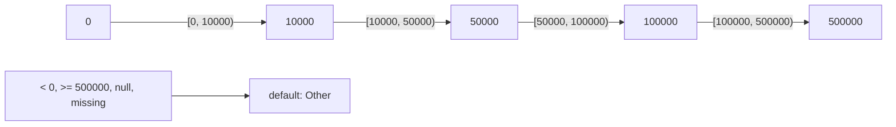

# $bucket, $bucketAuto, and Range-Based Grouping

In **Spring Data MongoDB**, the Aggregation Framework turns raw documents into statistics, reports, and analytics without loading every record into Java. Two stages especially suited for building **histograms**, price bands, age groups, or time intervals are **`$bucket`** and **`$bucketAuto`**.

Both take a `groupBy` expression and produce **one summary document per non-empty bucket**, yet they determine intervals differently:

- **`$bucket`**: the application **explicitly specifies boundaries** (`boundaries`), making it ideal for fixed price bands or age brackets that must stay consistent across reports.
- **`$bucketAuto`**: MongoDB **computes boundaries from the current dataset**, attempting to distribute documents as evenly as possible across the requested number of buckets.
- Both can compute `count`, `sum`, `avg`, `min`, `max`, and value collections via **accumulators**.

This lesson belongs to the **Advanced Aggregation** chapter of the **SPRING_DATA_MONGODB** module—covering query design, aggregation, indexing, transactions, reactive access, testing, and data performance diagnostics. We progress from real BSON and `mongosh` commands to `MongoTemplate.aggregate(...)`, then examine Java mapping, edge cases, summary pagination, performance, and integration testing.

## 1. A Price-Band Analysis Problem

Suppose a `products` collection holds products across multiple tenants. A reporting page needs the count of published products in these price brackets:

- From **0** up to (under) **10,000** VND.
- From **10,000** up to (under) **50,000** VND.
- From **50,000** up to (under) **100,000** VND.
- From **100,000** up to (under) **500,000** VND.
- Values **outside those ranges**, including missing or invalid prices.

Meanwhile, a data-exploration view wants to split **valid product prices into roughly four groups with nearly equal document counts**, regardless of where the interval boundaries land.

These two requirements are different:

| Business question | Right stage | Why |
| --- | --- | --- |
| How many products cost 0–10,000, 10,000–50,000, …? | `$bucket` | Boundaries are defined by business rules |
| Create four roughly equal-sized groups to observe distribution | `$bucketAuto` | Boundaries depend on current data |
| Compare the exact same price bands across two months | `$bucket` | Ranges must **stay fixed** for valid comparison |
| Suggest price ranges when exploring a new dataset | `$bucketAuto` | Good initial boundaries are not yet known |
| Data has many identical prices | Either, watch `$bucketAuto` | Tied values can prevent auto-balancing |
| Need to display empty price ranges too | Post-aggregation handling | `$bucket` does not emit documents for empty buckets |

**“Auto” is not always better.** If a sales report relies on fixed price bands, shifting boundaries from day to day causes readers to miscompare trends.

## 2. Sample Data: Valid Prices and Boundary Edge Cases

Each product has `tenant_id`, `status`, `sku`, and `price_cents`. To avoid currency rounding errors in the examples, we use **`long`/BSON Long** representing the smallest monetary unit; `price_cents` is a technical field name for the chosen unit. Real VND applications might use integer `price_vnd`, or `Decimal128` for multi-currency decimals; what matters is using **one consistent unit** across both stored data and boundaries.

In `mongosh` on a test database:

```javascript
db.products.insertMany([
  { tenant_id: "T1", status: "PUBLISHED", sku: "A", price_cents: NumberLong("0") },
  { tenant_id: "T1", status: "PUBLISHED", sku: "B", price_cents: NumberLong("2500") },
  { tenant_id: "T1", status: "PUBLISHED", sku: "C", price_cents: NumberLong("10000") },
  { tenant_id: "T1", status: "PUBLISHED", sku: "D", price_cents: NumberLong("10000") },
  { tenant_id: "T1", status: "PUBLISHED", sku: "E", price_cents: NumberLong("25000") },
  { tenant_id: "T1", status: "PUBLISHED", sku: "F", price_cents: NumberLong("49999") },
  { tenant_id: "T1", status: "PUBLISHED", sku: "G", price_cents: NumberLong("50000") },
  { tenant_id: "T1", status: "PUBLISHED", sku: "H", price_cents: NumberLong("99999") },
  { tenant_id: "T1", status: "PUBLISHED", sku: "I", price_cents: NumberLong("100000") },
  { tenant_id: "T1", status: "PUBLISHED", sku: "J", price_cents: NumberLong("250000") },
  { tenant_id: "T1", status: "PUBLISHED", sku: "K", price_cents: NumberLong("300000") },
  { tenant_id: "T1", status: "PUBLISHED", sku: "L", price_cents: NumberLong("499999") },
  { tenant_id: "T1", status: "PUBLISHED", sku: "M", price_cents: NumberLong("500000") },
  { tenant_id: "T1", status: "PUBLISHED", sku: "N", price_cents: NumberLong("-1000") },
  { tenant_id: "T1", status: "PUBLISHED", sku: "O", price_cents: null },
  { tenant_id: "T1", status: "PUBLISHED", sku: "P" },
  { tenant_id: "T2", status: "PUBLISHED", sku: "OTHER-TENANT", price_cents: NumberLong("2500") },
  { tenant_id: "T1", status: "DRAFT", sku: "DRAFT", price_cents: NumberLong("10000") }
]);
```

The **T1/PUBLISHED** subset contains **16 documents**. Products `M` (500,000), `N` (negative), `O` (BSON Null), and `P` (missing field) represent boundary/outlier cases.

**Safety rule:** Every tenant chart must include a `$match` using the tenant from the authenticated context—never trust an arbitrary client-supplied tenant parameter. `$bucket` does not restrict scope on its own; omitting `$match` aggregates data across all organizations.

## 3. Structure of the $bucket Stage

MongoDB syntax:

```javascript
{
  $bucket: {
    groupBy: "$price_cents",
    boundaries: [
      NumberLong("0"),
      NumberLong("10000"),
      NumberLong("50000"),
      NumberLong("100000"),
      NumberLong("500000")
    ],
    default: "Other",
    output: {
      count: { $sum: 1 },
      totalPrice: { $sum: "$price_cents" },
      skus: { $push: "$sku" }
    }
  }
}
```

Components:

| Property | Role | Important notes |
| --- | --- | --- |
| `groupBy` | Field path or aggregation expression determining the bucket | Field paths must start with `$` |
| `boundaries` | Array of **at least two** values in **ascending** order | Adjacent boundaries form each interval |
| `default` | `_id` value of the bucket receiving out-of-range or mismatched-type inputs | Optional, but omitting it can cause errors |
| `output` | Accumulators computing count, sum, average, lists, etc. | When specified, you must **explicitly declare `count`** if you want it |

Boundaries should use compatible BSON types in strictly ascending order; MongoDB allows mixing **BSON numeric types** under numeric comparison rules, though you should never mix numbers with strings or Dates to define price ranges.

### Lower-Closed, Upper-Open Intervals

With boundaries `[0, 10000, 50000, 100000, 500000]`, there are **four** main buckets:

```text
[0, 10000)       meaning 0 <= price < 10000
[10000, 50000)   meaning 10000 <= price < 50000
[50000, 100000)  meaning 50000 <= price < 100000
[100000, 500000) meaning 100000 <= price < 500000

"Other": outside the four intervals above
```

This is a **half-open interval**, which is critical right at boundary values:

- Price **0** goes into bucket `0`.
- Price **10,000** goes into bucket `10,000`, **not** bucket `0`.
- Price **50,000** goes into bucket `50,000`.
- Price **100,000** goes into bucket `100,000`.
- Price **500,000** falls into **none** of the main buckets: it is the **final open upper bound**, so it lands in `"Other"` when `default` is set.



The diagram above illustrates the partitioning. Every document belongs to **exactly one** bucket according to `groupBy`, or to the `default` bucket if configured and the value lies outside the main intervals.

## 4. Running $bucket in mongosh

Build a pipeline with a leading `$match` to enforce tenant isolation and narrow the dataset:

```javascript
db.products.aggregate([
  {
    $match: {
      tenant_id: "T1",
      status: "PUBLISHED"
    }
  },
  {
    $bucket: {
      groupBy: "$price_cents",
      boundaries: [
        NumberLong("0"),
        NumberLong("10000"),
        NumberLong("50000"),
        NumberLong("100000"),
        NumberLong("500000")
      ],
      default: "Other",
      output: {
        count: { $sum: 1 },
        totalPrice: { $sum: "$price_cents" },
        skus: { $push: "$sku" }
      }
    }
  }
]);
```

Representative output (the order of elements inside `skus` is not a contract without an explicit input sort):

```javascript
{ _id: NumberLong("0"), count: 2, skus: ["A", "B"], ... }
{ _id: NumberLong("10000"), count: 4, skus: ["C", "D", "E", "F"], ... }
{ _id: NumberLong("50000"), count: 2, skus: ["G", "H"], ... }
{ _id: NumberLong("100000"), count: 4, skus: ["I", "J", "K", "L"], ... }
{ _id: "Other", count: 4, skus: ["M", "N", "O", "P"], ... }
```

The `count` values are **deterministic** for the 16 documents described:

| Bucket `_id` | Range / Meaning | Documents |
| --- | --- | ---: |
| `0` | [0, 10,000) | **2** |
| `10000` | [10,000, 50,000) | **4** |
| `50000` | [50,000, 100,000) | **2** |
| `100000` | [100,000, 500,000) | **4** |
| `"Other"` | Out of range, BSON Null, or missing price | **4** |
| **Total** | | **16** |

**Note:** `totalPrice` on the `default` bucket also sums any **numeric** values inside it—for the sample data, `500000 + (-1000)`—while null/missing values contribute nothing to numeric summation. If `default` should represent only “invalid prices” or outliers should be excluded from monetary totals, filter or normalize **before** `$bucket` or separate invalid records.

### $bucket Does Not Emit Empty Buckets

If `[50,000, 100,000)` receives zero documents, the stage **omits the document** with `_id=50000`. A dashboard that needs to render every configured price band must:

1. Maintain the **canonical list of boundaries** in the service/configuration.
2. Map returned buckets onto that list.
3. Fill `count = 0` for any missing intervals.
4. Keep the `default` bucket separate from the main price bands.

Do not mistake a missing bucket for MongoDB ignoring your range definition; that is simply how aggregation handles empty groups.

## 5. Without default: Out-of-Range Data Fails the Stage

If you omit `default` while leaving products `M`, `N`, `O`, and `P` in the input:

```javascript
db.products.aggregate([
  { $match: { tenant_id: "T1", status: "PUBLISHED" } },
  {
    $bucket: {
      groupBy: "$price_cents",
      boundaries: [
        NumberLong("0"),
        NumberLong("10000"),
        NumberLong("50000"),
        NumberLong("100000"),
        NumberLong("500000")
      ]
    }
  }
]);
```

MongoDB **can raise an error** because documents fall outside all declared intervals. Omitting `default` does not mean “silently skip invalid inputs.”

Two sound strategies exist depending on business needs:

**Strategy A — Retain and monitor outliers:** specify `default: "Other"` as above, optionally breaking down error causes in a separate pipeline.

**Strategy B — Filter valid inputs beforehand:**

```javascript
db.products.aggregate([
  {
    $match: {
      tenant_id: "T1",
      status: "PUBLISHED",
      price_cents: {
        $gte: NumberLong("0"),
        $lt: NumberLong("500000")
      }
    }
  },
  {
    $bucket: {
      groupBy: "$price_cents",
      boundaries: [
        NumberLong("0"),
        NumberLong("10000"),
        NumberLong("50000"),
        NumberLong("100000"),
        NumberLong("500000")
      ]
    }
  }
]);
```

Here only the **12 valid documents** pass the first `$match`, so the stage needs no `default`. MongoDB evaluates values using BSON comparison order; when schemas are inconsistent (e.g., prices stored as strings in some documents), **check types** with `$type`/schema validation and plan a migration rather than relying on plain range predicates to enforce clean-data policies.

**Risk with missing fields:** If `price_cents` is null or absent, `"$price_cents"` falls outside the numeric ranges. A `default` value protects the pipeline from failing on those documents. Statistically, however, you must decide whether “no price” means excluded, erroneous, or a separately displayed group.

## 6. Rules for Choosing default and Boundary Types

`boundaries` must satisfy:

- At least **two** values.
- Strictly **ascending** order, with each adjacent pair defining a non-empty range.
- Comparable under MongoDB rules; using consistent price/Date types avoids subtle bugs.

`default` must be either **less than** the first boundary or **greater than or equal to** the last boundary if it shares a comparable domain, or use a **different BSON type** to separate out-of-range records. With numeric boundaries, using the String `"Other"` is common and readable.

```javascript
// Valid: String default with numeric boundaries.
{ $bucket: {
    groupBy: "$price_cents",
    boundaries: [0, 100, 400],
    default: "Other"
}}

// Invalid: default falls inside the declared numeric range.
// { $bucket: { groupBy: "$price_cents",
//              boundaries: [0, 100, 400], default: 200 } }
```

Do not use `"Other"` if your output DTO blindly assumes `_id` is always `Long` without handling Strings. A String `default` produces a **polymorphic `_id`**, not a mapping flaw in MongoDB.

## 7. Structure of the $bucketAuto Stage

`$bucketAuto` does not accept a `boundaries` array. Instead, it takes a target bucket count:

```javascript
{
  $bucketAuto: {
    groupBy: "$price_cents",
    buckets: 4,
    output: {
      count: { $sum: 1 },
      averagePrice: { $avg: "$price_cents" },
      minPrice: { $min: "$price_cents" },
      maxPrice: { $max: "$price_cents" }
    }
  }
}
```

MongoDB **derives intervals automatically** from the documents arriving from prior stages. Unlike `$bucket`:

- The resulting `_id` is an **object** with `min` and `max`, not a single lower bound.
- For **all buckets except the last**, the interval is `[min, max)`.
- For the **last bucket**, the interval is **`[min, max]`**—**the upper bound is inclusive**.
- The goal is balancing document counts across groups, **not** creating equal-width price intervals.
- Actual bucket count **may be fewer** than `buckets` when there are too few documents, too few distinct values, or `granularity` constraints.

On the sample data, **filter valid prices first** so invalid, negative, or null records do not skew the auto-generated intervals:

```javascript
db.products.aggregate([
  {
    $match: {
      tenant_id: "T1",
      status: "PUBLISHED",
      price_cents: {
        $gte: NumberLong("0"),
        $lt: NumberLong("500000")
      }
    }
  },
  {
    $bucketAuto: {
      groupBy: "$price_cents",
      buckets: 4,
      output: {
        count: { $sum: 1 },
        averagePrice: { $avg: "$price_cents" }
      }
    }
  }
]);
```

**12 documents** enter the auto stage. Expected output is **up to 4** intervals with document counts distributed as evenly as possible. **Never hardcode exact min/max bounds**, because the server computes them from data distribution and granularity settings.

### Interpreting the Output

A result document looks like:

```javascript
{
  _id: {
    min: NumberLong("10000"),
    max: NumberLong("50000")
  },
  count: 4,
  averagePrice: /* mean value inside the bucket */
}
```

This is a **shape example**, not a guaranteed set of bounds or counts from `$bucketAuto`. When building APIs or charts, preserve `_id.min`, `_id.max`, and the inclusive/exclusive rule for the final bucket.

**Do not convert the last bucket into a half-open interval by adding “+1” across all types.** For `Date`, `Decimal128`, floats, or large numbers, the notion of a “next unit” may not apply. Expose an explicit `upperInclusive` flag on the response if needed.

## 8. $bucketAuto Does Not Guarantee Exactly N Buckets or N/4 Documents

Consider duplicate values:

```javascript
db.products.insertMany([
  { tenant_id: "T1", status: "PUBLISHED", price_cents: NumberLong("10000") },
  { tenant_id: "T1", status: "PUBLISHED", price_cents: NumberLong("10000") },
  { tenant_id: "T1", status: "PUBLISHED", price_cents: NumberLong("10000") }
]);
```

When many documents share the **exact same `groupBy` value**, MongoDB cannot split identical values across disjoint value-based intervals. As a result, one bucket may hold more documents, or fewer buckets than requested may be produced.

```text
buckets: 4
does NOT mean:
  - Always returns 4 documents.
  - Each bucket always holds exactly 25% of the dataset.
  - Every interval has the same width.
  - Boundaries remain identical across runs.
```

When `groupBy` has low cardinality (e.g., `status` with only three distinct values), asking for 10 buckets makes little sense. Use `$group` by status or `$bucket` for known groups instead.

## 9. Granularity: Rounding Auto Boundaries to Preferred Number Series

For auto-generated charts, intervals such as `[1749, 5837)` can look awkward to users. `$bucketAuto` supports a `granularity` option to align boundaries to **preferred number series**:

```javascript
db.products.aggregate([
  {
    $match: {
      tenant_id: "T1",
      status: "PUBLISHED",
      price_cents: {
        $gte: NumberLong("0"),
        $lt: NumberLong("500000")
      }
    }
  },
  {
    $bucketAuto: {
      groupBy: "$price_cents",
      buckets: 4,
      granularity: "R5",
      output: {
        count: { $sum: 1 }
      }
    }
  }
]);
```

MongoDB supports granularity series such as `R5`, `R10`, `R20`, `R40`, `R80`, `1-2-5`, `E6`, `E12`, `E24`, `E48`, `E96`, `E192`, and `POWERSOF2` depending on server version and documentation. Each series defines preferred step values for boundaries.

| Granularity | When to consider |
| --- | --- |
| `R5` / `R10` | Numeric distributions with coarse or few ticks |
| `1-2-5` | Clean 1–2–5 × powers-of-10 intervals |
| `E24`, other E series | Standard steps from server-supported series |
| `POWERSOF2` | Distributions following powers of 2 |
| Unset | Accept boundaries computed directly from data |

**Crucial requirement:** use `granularity` only when **all `groupBy` values are numeric and contain no NaN**, and check version-specific restrictions for each series. Dates, strings, documents/arrays, or nulls in the input make `granularity` unsuitable. Some preferred series can also produce **fewer buckets** or less even counts.

`granularity` is not `$bucket`'s `withBoundaries`: it merely **guides auto boundaries toward a number series** rather than guaranteeing four specific application-chosen bounds.

## 10. Remember to Declare count When Customizing output

In both stages, when **`output` is omitted**, MongoDB automatically generates a `count` field per bucket. Once **`output` is specified**, only the declared accumulators appear (besides `_id`).

```javascript
// No output declared:
{ $bucketAuto: {
    groupBy: "$price_cents",
    buckets: 4
}}
// Default output includes count.

// Output declares only average:
{ $bucketAuto: {
    groupBy: "$price_cents",
    buckets: 4,
    output: { averagePrice: { $avg: "$price_cents" } }
}}
// No count field, because count was not declared.

// Want both:
{ $bucketAuto: {
    groupBy: "$price_cents",
    buckets: 4,
    output: {
      count: { $sum: 1 },
      averagePrice: { $avg: "$price_cents" }
    }
}}
```

Common accumulators:

| Accumulator | Meaning | Caution |
| --- | --- | --- |
| `{ $sum: 1 }` | Number of documents in the bucket | Not the sum of prices |
| `{ $sum: "$price_cents" }` | Sum of numeric prices | Null/missing values contribute nothing |
| `{ $avg: "$price_cents" }` | Mean price | Avoid dividing manually by total count when nulls exist |
| `{ $min: "$price_cents" }` | Minimum value in the group | Mixed types follow BSON comparison order |
| `{ $max: "$price_cents" }` | Maximum value | Verify unit normalization |
| `{ $push: "$sku" }` | Array of SKUs in the bucket | Large arrays increase memory and payload size |
| `{ $addToSet: "$sku" }` | Set of distinct SKUs by BSON equality | Order is not guaranteed |

For a plain histogram chart, **just `count` and bounds** are usually enough. Never `$push` tens of thousands of documents into each bucket when the frontend only renders bar heights.

## 11. Java Entity Mapping in Spring Data MongoDB

`Product` entity:

```java
import org.bson.types.ObjectId;
import org.springframework.data.annotation.Id;
import org.springframework.data.mongodb.core.mapping.Document;
import org.springframework.data.mongodb.core.mapping.Field;

@Document(collection = "products")
public class Product {
    @Id
    private ObjectId id;

    @Field("tenant_id")
    private String tenantId;

    private String status;

    private String sku;

    @Field("price_cents")
    private Long priceCents;

    public Product() {}

    public ObjectId getId() { return id; }
    public String getTenantId() { return tenantId; }
    public String getStatus() { return status; }
    public String getSku() { return sku; }
    public Long getPriceCents() { return priceCents; }
}
```

`Long` is used instead of primitive `long` because the sample collection contains BSON Null and documents missing `price_cents`. Mapping to `long` can turn missing fields into `0` in Java, blurring the distinction between **“actual price 0”** and **“no price set.”**

In Spring Data typed aggregation:

- `Criteria.where("tenantId")` is translated by the converter to `tenant_id`.
- `Aggregation.bucket("priceCents")` maps to `groupBy: "$price_cents"`.
- `andOutput("priceCents")` resolves the Java property when used with the domain type and aggregation context.
- `AggregationResults<Document>` fits well when bucket `_id` values are numeric or min/max objects, unlike the `Product` entity schema.

**Do not use the `Product` entity as the bucket result type**: the output of `$bucket`/`$bucketAuto` is a new aggregated document lacking the fields of an ordinary product.

## 12. Spring Data: Aggregation.bucket with Fixed Boundaries

The API in `org.springframework.data.mongodb.core.aggregation.Aggregation` supports a fluent builder:

```java
import java.util.List;
import org.bson.Document;
import org.springframework.data.domain.Sort;
import org.springframework.data.mongodb.core.MongoTemplate;
import org.springframework.data.mongodb.core.aggregation.Aggregation;
import org.springframework.data.mongodb.core.aggregation.AggregationResults;
import org.springframework.data.mongodb.core.query.Criteria;

public class PriceHistogramService {
    private final MongoTemplate template;

    public PriceHistogramService(MongoTemplate template) {
        this.template = template;
    }

    public List<Document> fixedPriceHistogram(String authorizedTenant) {
        Aggregation pipeline = Aggregation.newAggregation(
            Aggregation.match(
                Criteria.where("tenantId").is(authorizedTenant)
                    .and("status").is("PUBLISHED")
            ),
            Aggregation.bucket("priceCents")
                .withBoundaries(
                    0L, 10_000L, 50_000L, 100_000L, 500_000L
                )
                .withDefault("Other")
                .andOutputCount().as("count")
                .andOutput("priceCents").sum().as("totalPrice"),
            Aggregation.sort(Sort.Direction.ASC, "_id")
        );

        AggregationResults<Document> result =
            template.aggregate(pipeline, Product.class, Document.class);

        return result.getMappedResults();
    }
}
```

Chain walkthrough:

1. `Aggregation.match(...)` narrows documents to the current tenant and target status.
2. `Aggregation.bucket("priceCents")` selects the **Java property** to group by.
3. `withBoundaries(...)` defines four intervals from five boundary marks.
4. `withDefault("Other")` catches out-of-range, missing, or mismatched-type values.
5. `andOutputCount().as("count")` emits `$sum: 1`.
6. `andOutput("priceCents").sum().as("totalPrice")` computes the sum of prices per bucket.
7. `Aggregation.sort(..., "_id")` orders results for display, keeping in mind that `_id` now includes both **numbers and a String** (the default bucket).

**Result data type:** `_id` inside `Document` can be `Long`/`Number` or the `String` `"Other"`. Never write a DTO forcing every `_id` to `long`, or mapping the default bucket will fail.

### Display Order Note

After `$bucket`, numeric buckets normally sort ascending by `_id`, whereas `"Other"` is a String; BSON comparison defines a cross-type ordering. An API can separate `"Other"` and append it last intentionally instead of relying on server cross-type sort order.

If empty buckets must be rendered, the server returns fewer than four numeric buckets; the service can iterate over the canonical lower bounds and fill `0` for absent entries.

## 13. Spring Data: Aggregation.bucketAuto with Target Bucket Count

Use `Aggregation.bucketAuto("priceCents", 4)` instead of `bucket(...).withBoundaries(...)`:

```java
import java.util.List;
import org.bson.Document;
import org.springframework.data.mongodb.core.aggregation.Aggregation;
import org.springframework.data.mongodb.core.aggregation.AggregationResults;
import org.springframework.data.mongodb.core.MongoTemplate;
import org.springframework.data.mongodb.core.query.Criteria;

public class AdaptiveHistogramService {
    private final MongoTemplate template;

    public AdaptiveHistogramService(MongoTemplate template) {
        this.template = template;
    }

    public List<Document> adaptivePrices(String authorizedTenant) {
        Aggregation pipeline = Aggregation.newAggregation(
            Aggregation.match(
                Criteria.where("tenantId").is(authorizedTenant)
                    .and("status").is("PUBLISHED")
                    .and("priceCents").gte(0L).lt(500_000L)
            ),
            Aggregation.bucketAuto("priceCents", 4)
                .andOutputCount().as("count")
                .andOutput("priceCents").avg().as("averagePrice")
        );

        AggregationResults<Document> result =
            template.aggregate(pipeline, Product.class, Document.class);
        return result.getMappedResults();
    }
}
```

Differences from fixed buckets:

- No `withBoundaries(...)`.
- No `default`; if nulls/outliers must be handled, **preprocess with `$match`, `$project`, or split into `$facet` branches** per requirements.
- `_id` is a document holding `min` and `max`; read into `Document` or a DTO with a `Range` object.
- Fewer than 4 buckets may be returned. Even when asking for 4, code must handle 1–3 buckets gracefully.

### Adding Granularity in Spring Data

```java
import org.springframework.data.mongodb.core.aggregation.BucketAutoOperation;

// Replacement operation for the bucketAuto line in the pipeline:
var operation = Aggregation.bucketAuto("priceCents", 4)
    .withGranularity(BucketAutoOperation.Granularities.R5)
    .andOutputCount().as("count")
    .andOutput("priceCents").avg().as("averagePrice");
```

`R5` selects clean Renard-series boundaries. It does not guarantee perfectly balanced bucket counts, especially with duplicate prices or when the requested bucket count exceeds the series resolution.

**Validate input data** before enabling granularity: grouped values must be numeric with no NaN; check additional constraints for each series against your server version's docs.

## 14. Returning DTOs: Fixed Bucket vs. Auto Bucket

Because `_id` shapes differ, do not force both results into one Java class with a simple `Long id`.

For a fixed bucket with a String default:

```java
public record FixedBucketView(
    Object key,
    long count,
    long totalPrice
) {}
```

Mapping from `Document`:

```java
import java.util.List;
import org.bson.Document;

List<FixedBucketView> views = rawBuckets.stream()
    .map(bucket -> new FixedBucketView(
        bucket.get("_id"),
        ((Number) bucket.get("count")).longValue(),
        ((Number) bucket.get("totalPrice")).longValue()
    ))
    .toList();
```

`rawBuckets` is the output from `fixedPriceHistogram(...)`. Using `Object key` illustrates mapping-level handling; production code can use a sealed representation or `OTHER` enum + numeric lower bound, or display labels derived from canonical boundaries.

For an auto bucket:

```java
public record AutoBucketView(
    Number min,
    Number max,
    boolean upperInclusive,
    long count
) {}
```

Mapping `_id`:

```java
List<Document> raw = adaptiveHistogramService.adaptivePrices(tenantId);

List<AutoBucketView> views = new java.util.ArrayList<>();

for (int i = 0; i < raw.size(); i++) {
    Document row = raw.get(i);
    Document range = row.get("_id", Document.class);

    views.add(new AutoBucketView(
        (Number) range.get("min"),
        (Number) range.get("max"),
        i == raw.size() - 1, // Last bucket has an inclusive upper bound.
        ((Number) row.get("count")).longValue()
    ));
}
```

This assumes the server returns buckets ordered by boundary, which matches `$bucketAuto`'s output behavior; if subsequent pipeline stages re-sort the buckets, determine which bucket is last by price range rather than list index.

**Never store auto-bucket `min` and `max` as “permanent IDs” in the database.** As the product catalog changes, boundaries shift; tokens, caches, and dashboards should tie to a snapshot or reporting timestamp when comparison is needed.

## 15. Distinguishing $bucket, $bucketAuto, and $group

`$group` groups by **exact key values or expressions**, while `$bucket` and `$bucketAuto` group **a value domain** into intervals.

```javascript
// $group: product counts at each exact price.
db.products.aggregate([
  { $match: { tenant_id: "T1", status: "PUBLISHED" } },
  { $group: { _id: "$price_cents", count: { $sum: 1 } } }
]);

// $bucket: product counts in fixed price intervals.
// $bucketAuto: split into intervals computed by MongoDB from data.
```

| Capability | `$group` | `$bucket` | `$bucketAuto` |
| --- | --- | --- | --- |
| Exact grouping by key | **Yes** | Not primary purpose | Not primary purpose |
| Grouping by predefined intervals | Requires manual range expression | **Most natural** | Bounds shift dynamically |
| Roughly equal document counts per group | Does not do automatically | Depends on given boundaries | **Stage's goal** |
| Count/sum/avg | Yes | Yes | Yes |
| Outlier handling via default bucket | Manual design | **Yes** | No stage-level `default` |
| Emit empty buckets | Not automatic | Not automatic | Not automatic |
| Output `_id` | Group key value | Lower bound or default value | `{min, max}` |

When building reports with predefined brackets, never call `$bucketAuto` and persist its current intervals as a “price-band definition”; the next execution can emit different boundaries.

## 16. Using $facet for Multiple Groupings Over the Same Input

A dashboard sometimes needs fixed bands, adaptive bands, and data-quality counts (missing or negative prices) simultaneously. `$facet` runs multiple aggregation branches **over the same initial input**.

`mongosh` example:

```javascript
db.products.aggregate([
  {
    $match: {
      tenant_id: "T1",
      status: "PUBLISHED"
    }
  },
  {
    $facet: {
      fixed: [
        {
          $bucket: {
            groupBy: "$price_cents",
            boundaries: [
              NumberLong("0"),
              NumberLong("10000"),
              NumberLong("50000"),
              NumberLong("100000"),
              NumberLong("500000")
            ],
            default: "Other",
            output: { count: { $sum: 1 } }
          }
        }
      ],
      adaptive: [
        {
          $match: {
            price_cents: {
              $gte: NumberLong("0"),
              $lt: NumberLong("500000")
            }
          }
        },
        {
          $bucketAuto: {
            groupBy: "$price_cents",
            buckets: 4,
            output: { count: { $sum: 1 } }
          }
        }
      ],
      quality: [
        {
          $group: {
            _id: null,
            totalInput: { $sum: 1 }
          }
        }
      ]
    }
  }
]);
```

The `$facet` output is **one document** containing the arrays `fixed`, `adaptive`, and `quality`. Each branch receives only the documents passing the leading `$match` and can apply further branch-specific filters.

**Do not confuse `$facet` with “automatic transaction snapshots.”** It is an aggregation pipeline evaluated under the current read concern, not a cross-API-call immutable snapshot guarantee. Furthermore, `$facet` has memory and BSON document limits; never attach huge `$push` arrays to its output.

In Spring Data MongoDB, you can build these branches with `Aggregation.facet(...)`, checking builder APIs for your library version and mapping results to dedicated DTOs rather than `Product`.

## 17. groupBy Is an Expression, Not Necessarily a Plain Field

Both stages accept an **expression** for `groupBy`, so stored BSON fields do not have to match the reporting unit directly.

For instance, if the source stores minor units while the dashboard groups by a larger unit:

```javascript
db.products.aggregate([
  {
    $match: {
      tenant_id: "T1",
      status: "PUBLISHED",
      price_cents: { $gte: NumberLong("0") }
    }
  },
  {
    $bucket: {
      groupBy: { $divide: ["$price_cents", 100] },
      boundaries: [0, 100, 500, 1000, 5000],
      default: "Other",
      output: { count: { $sum: 1 } }
    }
  }
]);
```

Here, `boundaries` are **no longer in the same unit** as raw `price_cents`; they apply to **the quotient**. When rendering the chart, document the unit and rounding policy clearly. With Decimal128 currency, verify division and type behavior so binary precision loss or mixed numeric types do not sneak in.

You can also compute a normalized intermediate field with `Aggregation.project(...)` and then invoke `bucket("normalizedPrice")` or `bucketAuto("normalizedPrice", n)`. That is often cleaner to read and test than embedding long expressions directly inside the bucket stage.

**Time-based example:** group documents into monthly/daily ranges using BSON Date boundaries:

```javascript
db.orders.aggregate([
  {
    $bucket: {
      groupBy: "$created_at",
      boundaries: [
        ISODate("2026-01-01T00:00:00Z"),
        ISODate("2026-02-01T00:00:00Z"),
        ISODate("2026-03-01T00:00:00Z")
      ],
      default: "OutsidePeriod",
      output: { count: { $sum: 1 } }
    }
  }
]);
```

The two buckets correspond to January and February (in **UTC** in this example). For local timezones and DST, compute boundaries in the business timezone or use `$dateTrunc`/date expressions. Never use `$bucketAuto` when you want “one bucket per calendar month,” because auto-bucketing splits by document density rather than calendar months.

## 18. $sort, Indexes, and Stage Ordering

An analytical pipeline should normally open with a selective `$match` before running blocking stages:

```javascript
db.products.aggregate([
  { $match: {
      tenant_id: "T1",
      status: "PUBLISHED",
      price_cents: { $gte: NumberLong("0") }
  }},
  { $bucketAuto: {
      groupBy: "$price_cents",
      buckets: 4,
      output: { count: { $sum: 1 } }
  }}
]);
```

A candidate compound index:

```javascript
db.products.createIndex(
  { tenant_id: 1, status: 1, price_cents: 1 },
  { name: "products_tenant_status_price" }
);
```

Why:

1. `tenant_id` and `status` act as equality filters.
2. `price_cents` supports the range filter in `$match` to shrink the input stream.
3. The server can use the index to locate initial documents, though **the bucket stage still has to aggregate every selected document**.

**Never claim an index turns `$bucketAuto` into an instant lookup.** The algorithm must inspect the `groupBy` distribution of all matching documents; `$bucketAuto` and `$bucket` are memory-intensive stages. Adding a preceding `$sort` that cannot use an index adds further sorting cost.

### Memory Limits

Per MongoDB documentation, `$bucket` and `$bucketAuto` are subject to aggregation stage memory limits (typically around **100 MB per stage**, depending on configuration and version):

- `$bucket` may require `allowDiskUse` to spill if it exceeds memory limits.
- `$bucketAuto` can use temporary files above the threshold under `allowDiskUseByDefault`/`allowDiskUse` rules.
- Returning huge `skus`/document arrays can also hit the **16 MiB** BSON output limit.
- `$facet` carries its own limits; never rely on `allowDiskUse` to bypass them.

Prefer counts, sums, and averages over `$push`-ing whole entities, filter tenant/status upfront, and use batch/reporting pipelines suited to actual data volume.

## 19. AggregationOptions in Spring Data and Explaining the Query

For heavy aggregations, `MongoTemplate` lets you set aggregation options, such as enabling disk use when stages need it:

```java
import org.springframework.data.mongodb.core.aggregation.Aggregation;
import org.springframework.data.mongodb.core.aggregation.AggregationOptions;

AggregationOptions options = AggregationOptions.builder()
    .allowDiskUse(true)
    .build();

Aggregation pipelineWithOptions = pipeline.withOptions(options);
```

`pipeline` is the `Aggregation` built earlier. This returns **a configured pipeline** for execution, not an index creation command. Operational policy should still consider disk space, concurrency, and query timeouts; do not turn on `allowDiskUse` as a substitute for data optimization.

To measure on MongoDB, run `explain` on the equivalent pipeline:

```javascript
db.products.explain("executionStats").aggregate([
  { $match: {
      tenant_id: "T1",
      status: "PUBLISHED",
      price_cents: { $gte: NumberLong("0"), $lt: NumberLong("500000") }
  }},
  { $bucketAuto: {
      groupBy: "$price_cents",
      buckets: 4
  }}
]);
```

Observe:

- Does the query plan show `IXSCAN` or `COLLSCAN` for the initial filter?
- Are `totalDocsExamined`/`totalKeysExamined` disproportionately large compared to the expected input?
- What is the stage execution cost, memory usage, or disk spill?
- Do the post-`$match` document count and output bucket count match assumptions?
- What are p95/p99 latency and server load under concurrent dashboard traffic?

**Tiny datasets cannot prove an index works well.** Since bucket stages are used on large datasets, benchmark with representative volume and scoped tenant/time windows.

## 20. Integration Testing with Real BSON Data

Unit tests mocking `MongoTemplate` only verify method calls; they do not verify:

- That `@Field("price_cents")` maps properly when calling `Aggregation.bucket("priceCents")`.
- Which bucket receives values right on boundaries.
- Whether null/missing/out-of-range documents hit `default` or get filtered.
- That `$bucketAuto` outputs `_id.min`/`_id.max` and bucket counts as expected.
- That `count` still appears when custom `output` is specified.
- That typed aggregation into `Document` gives the dashboard everything it needs.

Use a dedicated MongoDB instance for integration tests (e.g., Testcontainers) with raw BSON documents to test exact server storage shapes.

### 20.1. Testing $bucket with Five Deterministic Groups

```java
import static org.assertj.core.api.Assertions.assertThat;

import java.util.List;
import java.util.UUID;
import org.bson.Document;
import org.bson.types.ObjectId;
import org.junit.jupiter.api.Test;
import org.springframework.beans.factory.annotation.Autowired;
import org.springframework.boot.test.autoconfigure.data.mongo.DataMongoTest;
import org.springframework.data.mongodb.core.MongoTemplate;
import org.springframework.data.mongodb.core.aggregation.Aggregation;
import org.springframework.data.mongodb.core.query.Criteria;

@DataMongoTest
class ProductBucketIntegrationTest {
    @Autowired MongoTemplate template;

    @Test
    void fixedBucketUsesHalfOpenRangesAndDefault() {
        String tenant = "test-" + UUID.randomUUID();
        String other = "other-" + UUID.randomUUID();

        template.getCollection("products").insertMany(List.of(
            raw(tenant, "PUBLISHED", "A", 0L, true),
            raw(tenant, "PUBLISHED", "B", 2_500L, true),
            raw(tenant, "PUBLISHED", "C", 10_000L, true),
            raw(tenant, "PUBLISHED", "D", 10_000L, true),
            raw(tenant, "PUBLISHED", "E", 25_000L, true),
            raw(tenant, "PUBLISHED", "F", 49_999L, true),
            raw(tenant, "PUBLISHED", "G", 50_000L, true),
            raw(tenant, "PUBLISHED", "H", 99_999L, true),
            raw(tenant, "PUBLISHED", "I", 100_000L, true),
            raw(tenant, "PUBLISHED", "J", 250_000L, true),
            raw(tenant, "PUBLISHED", "K", 300_000L, true),
            raw(tenant, "PUBLISHED", "L", 499_999L, true),
            raw(tenant, "PUBLISHED", "M", 500_000L, true),
            raw(tenant, "PUBLISHED", "N", -1_000L, true),
            raw(tenant, "PUBLISHED", "O", null, true),
            raw(tenant, "PUBLISHED", "P", null, false),
            raw(other, "PUBLISHED", "OTHER", 2_500L, true),
            raw(tenant, "DRAFT", "DRAFT", 10_000L, true)
        ));

        Aggregation aggregation = Aggregation.newAggregation(
            Aggregation.match(
                Criteria.where("tenantId").is(tenant)
                    .and("status").is("PUBLISHED")
            ),
            Aggregation.bucket("priceCents")
                .withBoundaries(
                    0L, 10_000L, 50_000L, 100_000L, 500_000L
                )
                .withDefault("Other")
                .andOutputCount().as("count")
        );

        List<Document> rows = template.aggregate(
            aggregation, Product.class, Document.class
        ).getMappedResults();

        assertThat(rows).hasSize(5);
        assertThat(countAt(rows, 0L)).isEqualTo(2);
        assertThat(countAt(rows, 10_000L)).isEqualTo(4);
        assertThat(countAt(rows, 50_000L)).isEqualTo(2);
        assertThat(countAt(rows, 100_000L)).isEqualTo(4);
        assertThat(countOther(rows)).isEqualTo(4);
    }

    static Document raw(
            String tenant, String status, String sku,
            Long price, boolean hasPriceField) {

        Document d = new Document("_id", new ObjectId())
            .append("tenant_id", tenant)
            .append("status", status)
            .append("sku", sku);
        if (hasPriceField) {
            d.append("price_cents", price);
        }
        return d;
    }

    static long countAt(List<Document> rows, long lowerBound) {
        return rows.stream()
            .filter(d -> d.get("_id") instanceof Number)
            .filter(d ->
                ((Number) d.get("_id")).longValue() == lowerBound
            )
            .mapToLong(d ->
                ((Number) d.get("count")).longValue()
            )
            .findFirst()
            .orElseThrow();
    }

    static long countOther(List<Document> rows) {
        return rows.stream()
            .filter(d -> "Other".equals(d.get("_id")))
            .mapToLong(d ->
                ((Number) d.get("count")).longValue()
            )
            .findFirst()
            .orElseThrow();
    }
}
```

This test verifies that all 16 documents of the target tenant/status are classified into five buckets, with zero leakage from other tenants or statuses. Helpers read numeric `_id` via `Number` to avoid coupling test DTOs strictly to BSON Int64 vs. Int32.

### 20.2. Testing $bucketAuto via Invariants Instead of Fixed Bounds

With `$bucketAuto`, avoid asserting **exact** algorithm-chosen boundaries (unless a specific server version guarantees a stricter contract tested separately).

```java
import static org.assertj.core.api.Assertions.assertThat;

import java.util.List;
import org.bson.Document;
import org.springframework.data.mongodb.core.aggregation.Aggregation;
import org.springframework.data.mongodb.core.query.Criteria;

// Add this method to ProductBucketIntegrationTest,
// after inserting the 12 valid prices as in the previous test.
void verifyAutoInvariant(String tenant) {
    Aggregation aggregation = Aggregation.newAggregation(
        Aggregation.match(
            Criteria.where("tenantId").is(tenant)
                .and("status").is("PUBLISHED")
                .and("priceCents").gte(0L).lt(500_000L)
        ),
        Aggregation.bucketAuto("priceCents", 4)
            .andOutputCount().as("count")
    );

    List<Document> rows = template.aggregate(
        aggregation, Product.class, Document.class
    ).getMappedResults();

    assertThat(rows.size()).isBetween(1, 4);

    long total = rows.stream()
        .mapToLong(d -> ((Number) d.get("count")).longValue())
        .sum();
    assertThat(total).isEqualTo(12);

    for (Document row : rows) {
        Document range = row.get("_id", Document.class);
        assertThat(range).containsKeys("min", "max");
        assertThat(row.get("count")).isInstanceOf(Number.class);
    }
}
```

The snippet above is a **verification helper** without a standalone `@Test` annotation because it relies on previously inserted data and the class's `template`. When practicing, call it inside a `@Test` that inserts the fixture or create a dedicated setup fixture.

Additional invariants worth verifying:

- Every valid price falls into **one** bucket and summed counts equal the filtered input document count.
- `min/max` ranges are ascending and non-overlapping; the last bucket's upper bound is inclusive.
- Bucket count `<= buckets`, not necessarily equal.
- Duplicate prices do not cause classification errors or “lost” documents.
- Null/missing values are not silently treated as price 0.
- `granularity` is only applied to valid numeric inputs.

## 21. Common Mistakes and How to Avoid Them

| Mistake | Consequence | Fix |
| --- | --- | --- |
| Assuming boundary values land in the left bucket | Wrong counts at 10,000, 50,000, … | Remember `$bucket` uses `[lower, upper)` |
| Assuming the final upper bound of `$bucket` is inclusive | Products priced at 500,000 get misgrouped | Use `default`, raise the last bound intentionally, or prefilter |
| Omitting `default` when outliers/nulls exist | Pipeline can fail | Set `default` or `$match` valid data upfront |
| Placing `default` between boundaries | Stage configuration error | Pick a value outside the entire range or of another BSON type |
| Expecting `$bucket` to emit empty buckets with count 0 | Dashboard misses defined brackets | Fill zero-count buckets in the service layer |
| Using `$bucketAuto` for charts needing fixed ticks | Ranges shift day-to-day/month-to-month | Use `$bucket` with business-defined boundaries |
| Expecting auto to always emit N equal buckets | Breaks when many prices tie | Check cardinality and accept fewer buckets |
| Applying `granularity` to Date/null/non-numeric `groupBy` | Query error or invalid config | Use only on clean numeric data |
| Omitting `count` when custom `output` is declared | Output loses `count` field | Add `count: {$sum:1}` / `andOutputCount()` |
| Mapping both fixed and auto buckets to `Long id` DTO | Fails when `_id` is Object or String | Use separate DTOs or a controlled union schema |
| Reading `Product` entity as aggregation result | Mapping does not match bucket output | Read `Document` or an aggregation DTO |
| Using raw BSON names inside typed DSL with `@Field` renames | Query/stage targets wrong field | Use Java property names with typed `Aggregation` and test raw BSON |
| Forgetting tenant `$match` before bucket | Cross-tenant data leakage | Enforce auth-context tenant at the start of the pipeline |
| `$push`-ing whole documents into bucket output | High RAM, large payload, BSON limit risk | Emit only count/sum/avg or bounded samples |
| Expecting an index to eliminate bucketing work | Slow dashboard on large data | `$match` early, index inputs, run `explain`, benchmark |
| Pinning auto-bucket bounds in tests on a small dataset | Brittle tests across versions/data | Assert invariants and totals rather than algorithm-chosen bounds |

## 22. Self-Check Exercises

**1.** `$bucket` boundaries are `[0, 100, 200]`. Which bucket gets a document with price `100`?  
**Answer:** Bucket `_id=100`, because the lower bound is inclusive and the upper bound is exclusive.

**2.** With the same boundaries, how is a document with price `200` handled when `default` is omitted?  
**Answer:** It is out of range and can cause the pipeline to error; the final upper bound of `$bucket` is exclusive.

**3.** Why can `$bucketAuto` return fewer than 5 buckets even with `buckets:5`?  
**Answer:** Too few distinct values or documents, or `granularity` constraints prevent splitting into that many valid intervals.

**4.** Is the upper bound of `$bucketAuto`'s final bucket inclusive or exclusive?  
**Answer:** **Inclusive**—unlike all preceding buckets.

**5.** With `output:{averagePrice:{$avg:"$price_cents"}}`, does `count` appear automatically?  
**Answer:** No. You must explicitly declare `count:{$sum:1}` or the corresponding DSL call.

**6.** Which stage should be used to compare the same four fixed price bands across two months?  
**Answer:** `$bucket` with identical boundaries.

**7.** Can you set `granularity:"R5"` for `groupBy:"$created_at"` (BSON Date)?  
**Answer:** No; `$bucketAuto` `granularity` targets numeric values and has specific input constraints.

**8.** Why does `$bucket` over price boundaries require a consistent currency representation?  
**Answer:** Mixing BSON types, currencies, or storing prices as Strings makes comparisons, sums, and grouping wrong or unpredictable.

**9.** Should you `$push:"$$ROOT"` of all products into a histogram that only displays counts?  
**Answer:** No; it increases memory and result payload unnecessarily for a count chart.

**10.** When calling `Aggregation.bucket("priceCents")` on `Product.class` with `@Field("price_cents")`, which field does MongoDB actually read?  
**Answer:** `price_cents`, resolved through the Spring Data mapping context.

## 23. Extended Lab and References

**Lab exercise:** Using a `products` collection on a development/testing MongoDB instance:

1. Insert sample products priced at 0, 10,000, 50,000, 100,000, 500,000, negative, null, and missing field.
2. Write `$bucket` with fixed boundaries; confirm `[2, 4, 2, 4]` and `Other=4` for the target tenant/status.
3. Remove `default` to observe the error on out-of-range inputs, then fix it with an upfront `$match` for valid inputs.
4. Write `$bucketAuto` with `buckets:4` and assert total count equals 12, allowing fewer than 4 buckets when distribution shifts.
5. Try `granularity:"R5"` and `"POWERSOF2"`, comparing boundaries, bucket count, and balance.
6. Implement Spring Data `Aggregation.bucket(...)` and `Aggregation.bucketAuto(...)` using the `Product` entity; inspect the raw BSON query and `Document` result.
7. Try a `Decimal128` price field with matching boundaries without mixing currencies.
8. Use `$facet` to return fixed histogram, adaptive histogram, and total input count in a single response.
9. Create index `{tenant_id:1,status:1,price_cents:1}`, run `explain("executionStats")` on a sufficiently large dataset, and compare before vs. after.
10. Design DTOs that clearly express inclusive/exclusive bounds, timezone/currency units, and handle shifting inputs between runs.

**Official documentation for syntax and version verification:**

- [MongoDB — `$bucket` aggregation stage](https://www.mongodb.com/docs/manual/reference/operator/aggregation/bucket/).
- [MongoDB — `$bucketAuto` aggregation stage](https://www.mongodb.com/docs/manual/reference/operator/aggregation/bucketauto/).
- [Spring Data MongoDB — Aggregation Framework Support](https://docs.spring.io/spring-data/mongodb/reference/mongodb/aggregation-framework.html).
- [Spring Data MongoDB — BucketOperation API](https://docs.spring.io/spring-data/mongodb/reference/api/java/org/springframework/data/mongodb/core/aggregation/BucketOperation.html).
- [Spring Data MongoDB — BucketAutoOperation API](https://docs.spring.io/spring-data/mongodb/reference/api/java/org/springframework/data/mongodb/core/aggregation/BucketAutoOperation.html).

**Conclusion:** `$bucket` groups by **fixed intervals** specified by the application with **inclusive** lower bounds and **exclusive** upper bounds; `$bucketAuto` creates **dynamic intervals** attempting to balance document counts, with the final bucket's upper bound **inclusive**. In Spring Data MongoDB, `Aggregation.bucket(...)` and `Aggregation.bucketAuto(...)` build these stages using an entity-mapped DSL; combine them with a tenant-scoped `$match`, consistent units/BSON types, explicit null/outlier policies, explicit accumulators, and boundary-value tests. Effective optimization spans not just indexing, but also input document volume, memory limits, result shaping, and reporting contracts as data evolves.
