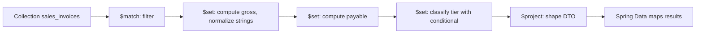

# Arithmetic, String, Conditional, and Type-Conversion Expressions

## 1. Goal: Turning Raw Data into Business-Meaningful Output

In **Spring Data MongoDB**, aggregation is not limited to `$group` or document counting. A pipeline can derive computed columns, normalize display names, classify invoices, and coerce heterogeneous BSON types before returning data to the application.

Suppose a sales system needs to display a list of paid invoices with these fields:

- **Customer name with leading/trailing whitespace trimmed**.
- **Gross amount** = quantity × unit price.
- **Payable amount** = gross amount − discount + shipping fee.
- **Tier classification** `HIGH`, `MEDIUM`, `LOW` based on payable amount.
- **Type-checked values**, especially when reading legacy records where numbers were stored as strings.

If you call `find` and compute everything in Java, the application must fetch full source documents and duplicate the same rules across every consumer. Aggregation lets you push part of this transformation down to the **MongoDB server** and map the results into DTOs via `MongoTemplate`, repositories, or reactive APIs. In return, you must understand expression semantics, BSON types, null/missing behavior, monetary precision, error handling, and query optimization.

This lesson belongs to the **Advanced Aggregation** chapter of the **SPRING_DATA_MONGODB** module. The four main operator groups are:

1. **Arithmetic:** `$add`, `$subtract`, `$multiply`, `$divide`, `$mod`, `$abs`, `$round`, and related operators.
2. **Strings:** `$trim`, `$concat`, `$toLower`, `$toUpper`, `$substrCP`, `$strLenCP`, `$split`.
3. **Conditionals:** `$cond`, `$switch`, `$ifNull`, and comparison/logical expressions.
4. **Type conversion:** `$convert`, `$toInt`, `$toLong`, `$toDecimal`, `$toString`, `$toDate`, `$type`.

The lesson concludes with a `mongosh` pipeline, Spring Data MongoDB code, integration tests, common data traps, and performance diagnostics.

## 2. Expressions vs. Stages (Pipeline Operations)

In MongoDB aggregation, a **stage** controls document flow; an **expression** computes a value inside a stage.

```javascript
db.sales_invoices.aggregate([
  { $match: { tenantId: "tenant-a", status: "PAID" } },
  {
    $set: {
      grossAmount: {
        $multiply: ["$quantity", "$unitPrice"]
      }
    }
  },
  {
    $project: {
      _id: 0,
      invoiceId: "$_id",
      grossAmount: 1
    }
  }
]);
```

In this example:

| Component | Role |
| --- | --- |
| `$match` | Stage filtering which invoices to evaluate |
| `$set` | Stage adding or overwriting fields in **intermediate documents** |
| `$multiply` | Expression returning a numeric product of two operands |
| `"$quantity"` | Field path reading the `quantity` field |
| `"$unitPrice"` | Field path reading the unit price of the current document |
| `$project` | Stage shaping the final output structure |
| `"invoiceId": "$_id"` | Expression reading `_id` and assigning it to a new name |

An aggregation containing only read/transform stages **does not modify source documents**. `$set` inside a pipeline adds a field in the result stream; it differs from the update operator `{$set: ...}` used with `updateOne`. Only write stages such as `$merge` or `$out` (with appropriate permissions and configuration) persist pipeline output back to a collection.



**Note:** Within the same `$set` stage, do not write a second expression assuming it can read a field just created by the first expression in that same stage. To reference a newly computed field, place the dependent expression in a **subsequent stage** or nest the calculation directly.

## 3. Designing Sample Data and Expected Results

### 3.1. Invoice Documents

Assume the application stores prices using BSON **Decimal128** to support decimal arithmetic in monetary calculations:

```javascript
db.sales_invoices.insertMany([
  {
    _id: "invoice-101",
    tenantId: "tenant-a",
    status: "PAID",
    currency: "VND",
    customerName: "  Nguyễn An  ",
    quantity: NumberInt("2"),
    unitPrice: NumberDecimal("120000.00"),
    discountAmount: NumberDecimal("20000.00"),
    shippingFee: NumberDecimal("10000.00")
  },
  {
    _id: "invoice-102",
    tenantId: "tenant-a",
    status: "PAID",
    currency: "VND",
    customerName: "  Tran Binh ",
    quantity: NumberInt("1"),
    unitPrice: NumberDecimal("80000.00"),
    discountAmount: null,
    shippingFee: NumberDecimal("5000.00")
  },
  {
    _id: "invoice-103",
    tenantId: "tenant-a",
    status: "DRAFT",
    currency: "VND",
    customerName: "  Legacy  ",
    quantity: "2",
    unitPrice: "invalid-value"
  },
  {
    _id: "invoice-201",
    tenantId: "tenant-b",
    status: "PAID",
    currency: "VND",
    customerName: "  Outside tenant ",
    quantity: NumberInt("9"),
    unitPrice: NumberDecimal("990000.00")
  }
]);
```

The values in `invoice-103` intentionally have wrong types for use in the legacy conversion section; it carries `status=DRAFT` so it does **not** break the main pipeline for PAID invoices.

### 3.2. Calculate Manually Before Writing the Pipeline

| Invoice | Gross = quantity × unitPrice | Discount | Shipping | Payable |
| --- | ---: | ---: | ---: | ---: |
| `invoice-101` | 240,000 | 20,000 | 10,000 | **230,000** |
| `invoice-102` | 80,000 | 0 (intentional null replacement) | 5,000 | **85,000** |

Suppose the tier policy is:

- `HIGH`: payable amount **200,000 or greater**.
- `MEDIUM`: from **100,000 to under 200,000**.
- `LOW`: **under 100,000**.

Expected output: `invoice-101` is `HIGH`; `invoice-102` is `LOW`. Invoices from other tenants or not in `PAID` status must not be returned.

In this learning example, VND is stored as Decimal128 with two fractional digits. In production, explicitly specify currency units, rounding rules, taxes, refunds, signed discounts, and exchange-rate lock times before building reports.

## 4. Arithmetic Expressions in Aggregation

### 4.1. Addition, Subtraction, Multiplication, and Division

Arithmetic expressions typically accept an **array of operands** or a single operand depending on the operator:

```javascript
{
  $project: {
    _id: 0,
    a: 1,
    b: 1,
    total: { $add: ["$a", "$b"] },
    difference: { $subtract: ["$a", "$b"] },
    product: { $multiply: ["$a", "$b"] },
    quotient: { $divide: ["$a", "$b"] }
  }
}
```

| Expression | Example with `a=12`, `b=3` | Result |
| --- | --- | ---: |
| `{$add:["$a","$b"]}` | 12 + 3 | 15 |
| `{$subtract:["$a","$b"]}` | 12 − 3 | 9 |
| `{$multiply:["$a","$b"]}` | 12 × 3 | 36 |
| `{$divide:["$a","$b"]}` | 12 ÷ 3 | 4 |
| `{$mod:["$a","$b"]}` | 12 mod 3 | 0 |

**Do not confuse** the `$add` expression with the `$addFields` stage, or `$multiply` computation with updating stored fields in source documents.

In the invoice problem:

```javascript
{
  $multiply: ["$quantity", "$unitPrice"]
}
```

returns `240000.00` for `invoice-101` (in the appropriate numeric type).

### 4.2. Guarding Against Division by Zero First

Never pass a potentially zero denominator directly to `$divide`:

```javascript
// May fail when totalQuantity = 0:
{
  $divide: ["$totalRevenue", "$totalQuantity"]
}
```

If business logic wants `null` when unit average cannot be computed:

```javascript
{
  $cond: [
    { $eq: ["$totalQuantity", 0] },
    null,
    { $divide: ["$totalRevenue", "$totalQuantity"] }
  ]
}
```

`$cond` chooses between two expressions based on a boolean condition. You must still define what **missing**, BSON null, or wrong-type denominators mean; handle each case explicitly on source data rather than treating every invalid value as 0.

### 4.3. Absolute Value, Rounding, and Modulo

```javascript
{
  $project: {
    absoluteAdjustment: { $abs: "$adjustment" },
    roundedAverage: { $round: ["$average", 2] },
    roundedUp: { $ceil: "$average" },
    roundedDown: { $floor: "$average" },
    remainder: { $mod: ["$quantity", 3] }
  }
}
```

`$round` rounds to the specified decimal places; for **midpoint ties**, MongoDB uses *round to nearest even* (banker's rounding). This may differ from tax, invoicing, or display rounding policies required by a business.

For example, rounding 2.5 to an integer yields 2 instead of 3. If business rules demand half-up or another policy, define and verify the calculation explicitly rather than relying on `$round` implicitly.

### 4.4. Exponents and Domain-Bounded Math

MongoDB also provides expressions such as `$pow` and `$sqrt`. Use them when scoring or engineering formulas genuinely require them:

```javascript
{
  $project: {
    squared: { $pow: ["$value", 2] },
    root: { $sqrt: "$nonNegativeValue" }
  }
}
```

Critical input constraint: negative inputs to square root or overly large values can trigger errors, overflow, or unexpected results. Constrain input domains at write time, query time, or inside the expression.

## 5. Decimals and BSON Numeric Types

### 5.1. Not Everything That “Looks Like a Number” Has the Same Type

These documents differ in BSON:

```javascript
[
  { _id: "a", amount: NumberInt("1200") },
  { _id: "b", amount: NumberLong("1200") },
  { _id: "c", amount: 1200.0 },
  { _id: "d", amount: NumberDecimal("1200.00") },
  { _id: "e", amount: "1200" }
]
```

MongoDB supports numeric types including Int32, Int64, Double, and Decimal128. The string `"1200"` **does not automatically become a number** just because it contains digits. Using wrong-typed fields in arithmetic expressions can error or yield unexpected results.

`NumberDecimal` supports base-10 decimals, yet **does not have infinite precision**; Decimal128 still has digit and exponent limits. `Double` cannot represent many decimal fractions accurately, so avoid it as the default for money when decimal precision matters.

### 5.2. Spring Data Mapping from BigDecimal to Decimal128

Java entity:

```java
package example.invoice;

import java.math.BigDecimal;
import org.springframework.data.mongodb.core.mapping.Document;
import org.springframework.data.mongodb.core.mapping.Field;
import org.springframework.data.mongodb.core.mapping.FieldType;
import org.springframework.data.mongodb.core.mapping.MongoId;

@Document(collection = "sales_invoices")
public record Invoice(
    @MongoId(FieldType.STRING) String id,
    String tenantId,
    String status,
    String currency,
    String customerName,
    int quantity,
    @Field(targetType = FieldType.DECIMAL128) BigDecimal unitPrice,
    @Field(targetType = FieldType.DECIMAL128) BigDecimal discountAmount,
    @Field(targetType = FieldType.DECIMAL128) BigDecimal shippingFee
) {}
```

`@Field(targetType = FieldType.DECIMAL128)` specifies the target BSON type when Spring Data writes `BigDecimal` fields. Never assume pre-existing legacy documents are automatically migrated to Decimal128: inspect raw BSON and converter rules in your system.

In MongoDB expression examples, use `NumberDecimal("0")` or matching Decimal128 constants alongside Decimal128 monetary values, instead of accidentally writing a Double literal `0.0` that induces unwanted type promotion.

### 5.3. Keep Multiplication and Totals Consistent in Units

If `quantity` is item count and `unitPrice` is **price per unit**, `$multiply` yields a monetary amount. If `discountAmount` is an **absolute discount amount**, the formula is:

\[
\text{payable} = \text{quantity}\times\text{unitPrice}
 - \text{discountAmount} + \text{shippingFee}.
\]

If the system instead stores `discountRate` (e.g., 0.15), the formula changes:

\[
\text{payable} = \text{gross}\times(1-\text{discountRate})+\text{shippingFee}.
\]

Never confuse a rate with an absolute amount. Field names and test fixtures should clarify units; a pipeline that runs without errors can still produce wrong invoices if a percentage rate is subtracted as a VND amount.

## 6. String Expressions: Normalization and Display Labels

### 6.1. $trim: Stripping Leading and Trailing Whitespace

```javascript
{
  $set: {
    customerNameClean: {
      $trim: { input: "$customerName" }
    }
  }
}
```

With `customerName = "  Nguyễn An  "`, the result is `"Nguyễn An"`. `$trim` does not collapse multiple internal spaces into one, nor does it guarantee normalizing arbitrary Unicode whitespace or character forms per application locale rules.

Variants:

```javascript
{
  $project: {
    leftTrimmed: { $ltrim: { input: "$customerName" } },
    rightTrimmed: { $rtrim: { input: "$customerName" } },
    trimmedCustom: {
      $trim: {
        input: "$code",
        chars: " -"
      }
    }
  }
}
```

`chars` specifies the **set of characters** stripped from the ends, not a literal substring that must match whole. Use carefully on codes where hyphens are meaningful.

### 6.2. $concat: Joining Multiple Parts

```javascript
{
  $project: {
    customerLabel: {
      $concat: [
        { $ifNull: ["$customerNameClean", "Unnamed"] },
        " / ",
        "$status"
      ]
    }
  }
}
```

**Null trap:** `$concat` returns `null` if any operand evaluates to null or missing. Always wrap optional string parts in `$ifNull` with an explicit fallback.

If an input field is a number, convert it with `$toString` or `$convert` before `$concat`; `$concat` does not auto-format arbitrary BSON types.

### 6.3. $toLower and $toUpper

```javascript
{
  $project: {
    upperStatus: { $toUpper: "$status" },
    lowerCurrency: { $toLower: "$currency" }
  }
}
```

These expressions work well for ASCII codes like `PAID`, `VND`, or `abc-123`. **For accented Vietnamese text and general user text**, do not assume `$toLower`/`$toUpper` performs locale-aware Unicode case mapping or normalization like a dedicated text library; MongoDB documents these operators as having well-defined behavior for **ASCII**. For searching personal or place names, design collation, Unicode normalization, and domain rules explicitly.

### 6.4. $substrCP and $strLenCP for Unicode

```javascript
{
  $project: {
    preview: { $substrCP: ["$customerNameClean", 0, 5] },
    lengthCodePoints: { $strLenCP: "$customerNameClean" }
  }
}
```

The **CP** suffix stands for **Unicode code points**, unlike UTF-8 bytes. `$substrBytes` and `$strLenBytes` operate on raw bytes and can split multi-byte accented characters improperly.

Even so, **a code point is not always a grapheme cluster** (a user-perceived character). An accented letter can be encoded as a single precomposed code point or as a base letter plus combining marks. Therefore, when safe visual truncation is required, handle it in the application layer using a proper Unicode library.

### 6.5. Splitting and Replacing Strings

```javascript
{
  $project: {
    parts: { $split: ["$skuPath", "/"] },
    cleanedCode: {
      $replaceAll: {
        input: "$legacyCode",
        find: " ",
        replacement: ""
      }
    }
  }
}
```

`$split` returns an array of substrings, while `$replaceAll` replaces matching substrings. Stripping all spaces from a SKU can alter code semantics: only do this when domain rules allow it.

Several string operators require **String** inputs; use controlled `$convert` when collections contain inconsistent historical data.

## 7. Conditionals: $cond, $switch, and $ifNull

### 7.1. $cond: if–then–else

MongoDB supports two `$cond` syntaxes:

```javascript
{
  $cond: [
    { $gte: ["$payable", NumberDecimal("200000")] },
    "HIGH",
    "NORMAL"
  ]
}
```

and the object form:

```javascript
{
  $cond: {
    if: { $gte: ["$payable", NumberDecimal("200000")] },
    then: "HIGH",
    else: "NORMAL"
  }
}
```

Both express the same logic: evaluate a condition and return one of two branches. Comparison expressions include `$eq`, `$ne`, `$gt`, `$gte`, `$lt`, and `$lte`; logical expressions include `$and`, `$or`, and `$not`.

### 7.2. $switch: Multi-Branch Classification

Classifying orders into three tiers:

```javascript
{
  $switch: {
    branches: [
      {
        case: {
          $gte: ["$payable", NumberDecimal("200000")]
        },
        then: "HIGH"
      },
      {
        case: {
          $gte: ["$payable", NumberDecimal("100000")]
        },
        then: "MEDIUM"
      }
    ],
    default: "LOW"
  }
}
```

MongoDB evaluates branches in order and picks the first branch whose condition is true. **Order higher thresholds before lower ones**: checking `>=100000` first would classify every HIGH invoice as MEDIUM.

When no branch matches and `default` is omitted, `$switch` raises an error. Specify a default driven by business policy rather than relying on an accidental fallback.

### 7.3. $ifNull: Default Values for null/missing

```javascript
{
  $set: {
    discountSafe: {
      $ifNull: [
        "$discountAmount",
        NumberDecimal("0")
      ]
    }
  }
}
```

`$ifNull` treats both BSON null and missing fields as candidates for replacement by the fallback value. For `invoice-102`, discount becomes 0 per the **chosen business rule**.

**Warning:** only default to 0 when the domain permits it. If `discountAmount` is missing due to an ingestion bug, silently treating it as 0 corrupts reports. For unnormalized financial records, **flagging errors for reconciliation** is often safer than coercing to 0.

In MongoDB 5.0+, `$ifNull` also accepts a list of multiple input expressions, returning the first non-null value before the final fallback. For compatibility with older versions, stick to the two-argument form or nested `$ifNull`.

### 7.4. Null Is Not false and Missing Is Not 0

Consider three documents:

```javascript
{ _id: "a", discountAmount: null }
{ _id: "b" }
{ _id: "c", discountAmount: NumberDecimal("0") }
```

`$ifNull` produces 0 for all three, yet **the underlying data differs**. If a report needs to count orders missing discount info, compute a separate indicator or query with `$type`/`$exists` before applying fallbacks. Never erase missing-data signals prior to data-quality checks.

## 8. Type Conversion: $convert and Shorthand Operators

### 8.1. $convert with Explicit Error Policies

MongoDB lets you specify how to convert an expression to a target BSON type:

```javascript
{
  $convert: {
    input: "$legacyPrice",
    to: "decimal",
    onError: null,
    onNull: null
  }
}
```

| Component | Meaning |
| --- | --- |
| `input` | Value to convert (field path or expression) |
| `to` | Target type such as `"int"`, `"long"`, `"double"`, `"decimal"`, `"string"`, `"date"` where supported |
| `onError` | Value returned if **conversion fails** |
| `onNull` | Value returned when input is **null or missing** |

If `onError` is omitted, an invalid conversion normally **fails the entire pipeline**. If `onNull` is omitted, null/missing input normally yields null. In financial pipelines, `onError: null` paired with an invalid-record flag is usually safer than `onError: NumberDecimal("0")`, because synthetic zeros can silently distort summed reports.

### 8.2. Shorthand Operators

```javascript
{
  $project: {
    quantityInt: { $toInt: "$legacyQuantity" },
    quantityLong: { $toLong: "$legacyQuantity" },
    priceDecimal: { $toDecimal: "$legacyPrice" },
    priceString: { $toString: "$unitPrice" },
    normalizedDate: { $toDate: "$legacyDate" }
  }
}
```

`$toX` shorthands are convenient when inputs are **guaranteed convertible**. They lack the explicit `onError` and `onNull` controls of `$convert`. A single legacy value like `"invalid-value"` causes `$toDecimal` to fail the entire query.

Use `$convert` when you need **one malformed document not to crash the whole report**, then isolate which records require reconciliation.

### 8.3. Conversion Does Not Mutate Source Documents

```javascript
{
  $set: {
    normalizedPrice: {
      $convert: {
        input: "$legacyPrice",
        to: "decimal",
        onError: null,
        onNull: null
      }
    }
  }
}
```

`normalizedPrice` exists only in the pipeline output unless followed by a write stage. A document stored with `legacyPrice: "1200.00"` remains a String. **Aggregation is not a migration**; permanent normalization requires a dedicated update/migration plan with rollback verification.

### 8.4. Avoid Reckless Numeric Coercion in Reports

Watch out for these edge cases:

- `$toInt` on floating-point numbers **truncates fractional parts** rather than rounding by business rules.
- Converting values outside Int32/Int64 bounds can throw errors.
- Converting `Double` to Decimal128 cannot recover decimal precision already lost in binary representation.
- Converting Strings depends on valid formatting; thousands separators, currency symbols, or locale commas cause conversion failures.
- Converting `Date` to String changes the BSON type and does not produce user-friendly localized formatting automatically.

For monetary requirements, prioritize **enforcing clean types on write**. `$convert` is a transition tool for analyzing legacy data or shaping read models, not an excuse to store mixed types in the same field.

## 9. Checking Types Before Computing: $type and $isNumber

When a collection has multi-schema history, inspect BSON types before evaluating sensitive expressions.

```javascript
db.sales_invoices.aggregate([
  {
    $project: {
      _id: 1,
      quantityType: { $type: "$quantity" },
      priceType: { $type: "$unitPrice" },
      priceIsNumber: { $isNumber: "$unitPrice" }
    }
  }
]);
```

`$type` in aggregation returns `"missing"` when a field does not exist, distinguishing it from `"null"`. `$isNumber` checks whether an input is any BSON numeric type, which is helpful before running arithmetic.

### 9.1. Separating Valid and Invalid Records

Example converting legacy data and isolating unconvertible records:

```javascript
db.sales_invoices.aggregate([
  {
    $set: {
      unitPriceDecimal: {
        $convert: {
          input: "$unitPrice",
          to: "decimal",
          onError: null,
          onNull: null
        }
      }
    }
  },
  {
    $set: {
      priceValid: {
        $ne: ["$unitPriceDecimal", null]
      }
    }
  },
  {
    $project: {
      _id: 1,
      unitPriceType: { $type: "$unitPrice" },
      unitPriceDecimal: 1,
      priceValid: 1
    }
  }
]);
```

In the fixture, `invoice-103` has `unitPrice="invalid-value"`, so `unitPriceDecimal` becomes null and `priceValid=false`. Rather than loading all records into Java, you can add `$match: {priceValid:false}` to list only records needing cleanup.

**Do not conflate two meanings**: a failed conversion vs. an original BSON null. To classify root causes, keep the original `$type` alongside a separate flag, or build an error status via `$switch`.

## 10. Converting Dates and Date Strings

Aggregation provides `$toDate`, `$dateFromString`, and `$dateToString`, and **they are not interchangeable**.

```javascript
{
  $project: {
    parsedTime: {
      $dateFromString: {
        dateString: "$paidAtText",
        format: "%Y-%m-%d %H:%M:%S",
        timezone: "Asia/Ho_Chi_Minh",
        onError: null,
        onNull: null
      }
    },
    paidDay: {
      $dateToString: {
        format: "%Y-%m-%d",
        date: "$paidAt",
        timezone: "Asia/Ho_Chi_Minh"
      }
    }
  }
}
```

`$dateFromString` parses a string into a BSON Date, accepting `format` and `timezone` when the string lacks offset info. Never pass a conflicting `timezone` if the input string already includes an offset or `Z`. `$dateToString` **produces a String for display or grouping**—it is no longer a BSON Date for chronological comparison.

In Spring Data MongoDB, `Instant` fields typically map to BSON Date under standard converters. If legacy documents store timestamps as Strings, verify whether they represent UTC or local wall time before converting, or timestamps will shift.

For business-day reports, set the timezone in `$dateToString` or `$dateTrunc`, and filter using half-open ranges `[from, toExclusive)` derived from the user's calendar. Formatting to `YYYY-MM-DD` alone does not fix timezone bugs in source data.

## 11. Complete Pipeline Combining All Four Expression Groups

This section ties the techniques together to read the invoice list matching the manual verification in Section 3.

### 11.1. Step 1: Filter Before Computing

```javascript
{
  $match: {
    tenantId: "tenant-a",
    status: "PAID",
    currency: "VND"
  }
}
```

Placing `$match` early lets MongoDB leverage indexes and shrinks the set entering calculations. This filter intentionally excludes the DRAFT invoice with wrong-typed `unitPrice` and the other tenant's invoice. Still, **filtering out invalid statuses does not replace data-quality monitoring**, because even PAID invoices can carry bad data in real systems.

### 11.2. Step 2: Normalize Name, Compute Gross, Handle Nullable Fields

```javascript
{
  $set: {
    customerNameClean: {
      $trim: { input: "$customerName" }
    },
    grossAmount: {
      $multiply: ["$quantity", "$unitPrice"]
    },
    discountSafe: {
      $ifNull: ["$discountAmount", NumberDecimal("0")]
    },
    shippingSafe: {
      $ifNull: ["$shippingFee", NumberDecimal("0")]
    }
  }
}
```

Here, every new field depends only on **existing input fields**, so they can all be computed in the same stage.

### 11.3. Step 3: Compute Payable Amount

```javascript
{
  $set: {
    payable: {
      $add: [
        {
          $subtract: [
            "$grossAmount",
            "$discountSafe"
          ]
        },
        "$shippingSafe"
      ]
    }
  }
}
```

This stage references the three fields computed in the previous stage. Result: `invoice-101` payable = 230,000; `invoice-102` payable = 85,000.

### 11.4. Step 4: Classify Tier and Build Label

```javascript
{
  $set: {
    tier: {
      $switch: {
        branches: [
          {
            case: {
              $gte: ["$payable", NumberDecimal("200000")]
            },
            then: "HIGH"
          },
          {
            case: {
              $gte: ["$payable", NumberDecimal("100000")]
            },
            then: "MEDIUM"
          }
        ],
        default: "LOW"
      }
    },
    highValue: {
      $gte: ["$payable", NumberDecimal("200000")]
    },
    customerLabel: {
      $concat: [
        "$customerNameClean",
        " / ",
        "$status"
      ]
    }
  }
}
```

`highValue` uses a comparison expression directly since it already evaluates to a Boolean; there is no need to wrap every boolean check inside `$cond`.

### 11.5. Step 5: Shape Output and Sort

```javascript
{
  $project: {
    _id: 0,
    id: "$_id",
    customerName: "$customerNameClean",
    grossAmount: 1,
    payable: 1,
    tier: 1,
    highValue: 1,
    customerLabel: 1
  }
}
```

Followed by:

```javascript
{ $sort: { payable: -1, id: 1 } }
```

Adding `id` as a tie-breaker makes ordering deterministic when invoices share the same `payable`. If an API paginates across live mutating data, a cursor/keyset or snapshot strategy is still needed; a tie-breaker alone does **not** solve concurrent inserts/updates.

### 11.6. Complete mongosh Command

```javascript
db.sales_invoices.aggregate([
  {
    $match: {
      tenantId: "tenant-a",
      status: "PAID",
      currency: "VND"
    }
  },
  {
    $set: {
      customerNameClean: {
        $trim: { input: "$customerName" }
      },
      grossAmount: {
        $multiply: ["$quantity", "$unitPrice"]
      },
      discountSafe: {
        $ifNull: ["$discountAmount", NumberDecimal("0")]
      },
      shippingSafe: {
        $ifNull: ["$shippingFee", NumberDecimal("0")]
      }
    }
  },
  {
    $set: {
      payable: {
        $add: [
          { $subtract: ["$grossAmount", "$discountSafe"] },
          "$shippingSafe"
        ]
      }
    }
  },
  {
    $set: {
      tier: {
        $switch: {
          branches: [
            {
              case: { $gte: ["$payable", NumberDecimal("200000")] },
              then: "HIGH"
            },
            {
              case: { $gte: ["$payable", NumberDecimal("100000")] },
              then: "MEDIUM"
            }
          ],
          default: "LOW"
        }
      },
      highValue: {
        $gte: ["$payable", NumberDecimal("200000")]
      },
      customerLabel: {
        $concat: ["$customerNameClean", " / ", "$status"]
      }
    }
  },
  {
    $project: {
      _id: 0,
      id: "$_id",
      customerName: "$customerNameClean",
      grossAmount: 1,
      payable: 1,
      tier: 1,
      highValue: 1,
      customerLabel: 1
    }
  },
  { $sort: { payable: -1, id: 1 } }
]);
```

Expected output values:

```javascript
[
  {
    id: "invoice-101",
    customerName: "Nguyễn An",
    grossAmount: NumberDecimal("240000.00"),
    payable: NumberDecimal("230000.00"),
    tier: "HIGH",
    highValue: true,
    customerLabel: "Nguyễn An / PAID"
  },
  {
    id: "invoice-102",
    customerName: "Tran Binh",
    grossAmount: NumberDecimal("80000.00"),
    payable: NumberDecimal("85000.00"),
    tier: "LOW",
    highValue: false,
    customerLabel: "Tran Binh / PAID"
  }
]
```

Decimal128 scale representation can vary depending on arithmetic operations and input scales; compare **numeric values** in tests rather than assuming every JSON string always carries two decimal places. `$project`/`$set` leave source invoices untouched.

## 12. Spring Data MongoDB: Mapping the Pipeline to a DTO

### 12.1. Result DTO, Not an Entity to Save

```java
package example.invoice;

import java.math.BigDecimal;

public record InvoiceReportRow(
    String id,
    String customerName,
    BigDecimal grossAmount,
    BigDecimal payable,
    String tier,
    boolean highValue,
    String customerLabel
) {}
```

`payable` is computed from an expression and **does not exist in the source document**. Never construct an `Invoice` from this DTO and call `save` as if it were a full entity. A report row is a **read model**.

### 12.2. Using AggregationOperation with Explicit BSON Documents

Spring Data offers DSL builders such as `Aggregation.match`, `Aggregation.project`, `ArithmeticOperators`, `StringOperators`, and `ConditionalOperators`. For pipelines with deeply nested expressions, an illustrative choice that maps 1-to-1 to `mongosh` is declaring `AggregationOperation` lambdas returning BSON `Document`s.

The example below keeps **BSON field names identical to Java property names** and uses `org.bson.types.Decimal128` for monetary constants, avoiding implicit conversion ambiguity for `BigDecimal` literals in raw expressions:

```java
package example.invoice;

import java.util.List;
import org.bson.Document;
import org.bson.types.Decimal128;
import org.springframework.data.domain.Sort;
import org.springframework.data.mongodb.core.MongoTemplate;
import org.springframework.data.mongodb.core.aggregation.Aggregation;
import org.springframework.data.mongodb.core.aggregation.AggregationOperation;
import org.springframework.data.mongodb.core.query.Criteria;
import org.springframework.stereotype.Service;

@Service
public class InvoiceAggregationService {

    private final MongoTemplate template;

    public InvoiceAggregationService(MongoTemplate template) {
        this.template = template;
    }

    public List<InvoiceReportRow> report(
            String authorizedTenantId) {

        if (authorizedTenantId == null
                || authorizedTenantId.isBlank()) {
            throw new IllegalArgumentException(
                "Invalid tenantId"
            );
        }

        Decimal128 zero = Decimal128.parse("0");
        Decimal128 medium = Decimal128.parse("100000");
        Decimal128 high = Decimal128.parse("200000");

        AggregationOperation deriveFields = context ->
            new Document("$set",
                new Document("customerNameClean",
                    new Document("$trim",
                        new Document("input", "$customerName")))
                    .append("grossAmount",
                        new Document("$multiply",
                            List.of("$quantity", "$unitPrice")))
                    .append("discountSafe",
                        new Document("$ifNull",
                            List.of("$discountAmount", zero)))
                    .append("shippingSafe",
                        new Document("$ifNull",
                            List.of("$shippingFee", zero)))
            );

        AggregationOperation calculatePayable = context ->
            new Document("$set",
                new Document("payable",
                    new Document("$add", List.of(
                        new Document("$subtract", List.of(
                            "$grossAmount", "$discountSafe"
                        )),
                        "$shippingSafe"
                    ))
                )
            );

        AggregationOperation classify = context ->
            new Document("$set",
                new Document("tier",
                    new Document("$switch",
                        new Document("branches", List.of(
                            new Document("case",
                                new Document("$gte",
                                    List.of("$payable", high)))
                                .append("then", "HIGH"),
                            new Document("case",
                                new Document("$gte",
                                    List.of("$payable", medium)))
                                .append("then", "MEDIUM")
                        )).append("default", "LOW")
                    )
                ).append("highValue",
                    new Document("$gte", List.of("$payable", high))
                ).append("customerLabel",
                    new Document("$concat", List.of(
                        "$customerNameClean", " / ", "$status"
                    ))
                )
            );

        AggregationOperation shape = context ->
            new Document("$project",
                new Document("_id", 0)
                    .append("id", "$_id")
                    .append("customerName", "$customerNameClean")
                    .append("grossAmount", 1)
                    .append("payable", 1)
                    .append("tier", 1)
                    .append("highValue", 1)
                    .append("customerLabel", 1)
            );

        Aggregation pipeline = Aggregation.newAggregation(
            Aggregation.match(
                Criteria.where("tenantId").is(authorizedTenantId)
                    .and("status").is("PAID")
                    .and("currency").is("VND")
            ),
            deriveFields,
            calculatePayable,
            classify,
            shape,
            Aggregation.sort(
                Sort.by(
                    Sort.Order.desc("payable"),
                    Sort.Order.asc("id")
                )
            )
        );

        return template.aggregate(
            pipeline,
            "sales_invoices",
            InvoiceReportRow.class
        ).getMappedResults();
    }
}
```

Key takeaways:

1. `Aggregation.match` narrows by tenant/status/currency right at the start.
2. Custom `AggregationOperation` stages build raw BSON `Document`s, so **paths inside expressions must match actual MongoDB field names**. If an entity uses `@Field("unit_price")`, keeping `"$unitPrice"` in a raw stage will not be auto-translated.
3. `Decimal128` constants preserve decimal intent when comparing thresholds and replacing nulls with 0.
4. Each computation depending on an earlier stage's derived field sits in **its own stage**.
5. `template.aggregate(..., "sales_invoices", InvoiceReportRow.class)` targets the collection name and result DTO; raw stages do not perform automatic input entity field mapping the way typed aggregation does.
6. `authorizedTenantId` must originate from the server's auth context. Never construct BSON strings from client-supplied tenants or arbitrary field names.
7. For large result sets, add `$limit`, pagination, or streaming rather than always returning an unbounded `List`.

Once the pipeline is clear, you can replace raw stages with Spring Data's strongly typed builders, making field-path refactoring safer wherever mapping metadata applies.

### 12.3. Equivalent Expressions via the DSL

Spring Data MongoDB provides specialized operator builders:

```java
import java.math.BigDecimal;
import org.bson.types.Decimal128;
import org.springframework.data.mongodb.core.aggregation.Aggregation;
import org.springframework.data.mongodb.core.aggregation.ArithmeticOperators;
import org.springframework.data.mongodb.core.aggregation.ConditionalOperators;

// Compute gross = quantity * unitPrice:
var grossExpression =
    ArithmeticOperators.Multiply
        .valueOf("quantity")
        .multiplyBy("unitPrice");

// Handle null/missing discount:
var discountExpression =
    ConditionalOperators.ifNull("discountAmount")
        .then(Decimal128.parse("0"));

// Put expressions into a new stage:
var addFields = Aggregation.addFields()
    .addFieldWithValue("grossAmount", grossExpression)
    .addFieldWithValue("discountSafe", discountExpression)
    .build();
```

This illustrates **part** of a pipeline rather than a complete service. Spring Data also provides `StringOperators`, `ComparisonOperators`, and `ConditionalOperators`; exact method signatures vary by Spring Data version. For nested expressions, verify the emitted BSON and run integration tests, especially around Decimal128 and field aliases.

### 12.4. @Aggregation Annotation on Repositories

For **fixed** pipelines, you can declare `@Aggregation` on a repository method and bind parameters, whereas long expressions, multi-branch conditionals, or dynamic filters are usually cleaner in a service using DSL or custom repositories.

```java
import java.util.List;
import org.springframework.data.mongodb.repository.Aggregation;
import org.springframework.data.mongodb.repository.MongoRepository;

public interface InvoiceRepository
        extends MongoRepository<Invoice, String> {

    @Aggregation(pipeline = {
        "{ '$match': { 'tenantId': ?0, 'status': 'PAID' } }",
        "{ '$project': { '_id': 0, 'id': '$_id', " +
            "'grossAmount': { '$multiply': [" +
                "'$quantity', '$unitPrice' ] } } }"
    })
    List<InvoiceGrossRow> grossByTenant(String tenantId);
}
```

With DTO:

```java
package example.invoice;

import java.math.BigDecimal;

public record InvoiceGrossRow(
    String id,
    BigDecimal grossAmount
) {}
```

This is solely a **gross** query, not the full discounted/tiered report; do not assume this short snippet implements all requirements from Section 11. Parameter binding `?0` avoids string concatenation on untrusted input, yet **does not enforce tenant authorization on its own**.

## 13. Reactive Aggregation Reuses the Same Expressions

`ReactiveMongoTemplate.aggregate(...)` returns `Flux<T>` instead of a synchronous `List<T>`. Stages, expressions, and BSON rules **remain identical** in reactive mode:

```java
import org.springframework.data.mongodb.core.ReactiveMongoTemplate;
import org.springframework.data.mongodb.core.aggregation.Aggregation;
import reactor.core.publisher.Flux;

// aggregation is the pipeline built identically to Section 12.
Flux<InvoiceReportRow> rows =
    reactiveMongoTemplate.aggregate(
        aggregation,
        "sales_invoices",
        InvoiceReportRow.class
    );
```

`Flux` supports reactive I/O and downstream backpressure, yet **does not make server-side expressions cheaper on MongoDB**. Pipelines with `$sort`, `$group`, or heavy conversions across many documents still consume server CPU and memory.

Calling:

```java
Mono<List<InvoiceReportRow>> all = rows.collectList();
```

collects all emitted items into an in-memory `List` in the application. For large datasets, paginate, limit, or stream with bounded memory.

In WebFlux services, avoid calling `block()` to force synchronous execution. Also note that conversion errors inside the pipeline surface as an **error signal**, not a fallback value, unless `onError` is explicitly configured.

## 14. Where to Place Expressions and How They Affect Indexes

### 14.1. Filter on Stored Source Fields Before Computing Derived Fields

A candidate index for the main pipeline:

```javascript
db.sales_invoices.createIndex(
  { tenantId: 1, status: 1, currency: 1 },
  { name: "by_tenant_status_currency" }
);
```

`$match` on stored fields can leverage an index when query and selectivity align. If you instead filter by:

```javascript
{
  $match: {
    payable: { $gte: NumberDecimal("200000") }
  }
}
```

`payable` is a **pipeline-computed field**, not a stored field; filtering on it must happen after the stage that computes `payable`. An index on the source collection cannot automatically serve an index scan for freshly computed values.

If filtering by `payable` is frequent and expensive, consider persisting `payable` on the document or maintaining a materialized summary, keeping it consistently updated whenever components change.

### 14.2. Early $project Is Not Always Faster

`$project` produces cleaner, smaller outputs, yet the MongoDB optimizer automatically prunes unused fields in many pipelines. Never insert extra `$project` stages early merely assuming fewer fields automatically cuts CPU; measure first. Distinguish:

- **Cardinality:** number of documents passing through each stage.
- **Document width:** size/fields of intermediate documents.
- **Expression cost:** regexes, conversions, string manipulations, arithmetic, and conditionals.
- **Blocking stages:** `$sort`/`$group` needing in-memory state.

Across millions of documents, prioritize shrinking cardinality with an early indexed `$match`, then evaluate the cost of truly necessary expressions.

### 14.3. Running Explain on an Equivalent Pipeline

```javascript
db.sales_invoices.explain("executionStats").aggregate([
  {
    $match: {
      tenantId: "tenant-a",
      status: "PAID",
      currency: "VND"
    }
  },
  {
    $set: {
      grossAmount: {
        $multiply: ["$quantity", "$unitPrice"]
      }
    }
  },
  { $sort: { grossAmount: -1 } },
  { $limit: 20 }
]);
```

This is an **abbreviated diagnostic pipeline**, not the complete `payable` report. Inspect the query plan, docs examined, index keys examined, stage timings, and memory/spill stats if reported by your MongoDB version.

Never assume aggregation is faster than `find` simply because output row count is small. Sorting by a computed field without direct index support can still be very expensive.

## 15. Malformed Data: Reports Need an Explicit Error Policy

### 15.1. Do Not Silently Coerce Errors to Zero

Suppose a PAID invoice has `unitPrice: "invalid-value"`. If the pipeline uses:

```javascript
{
  $convert: {
    input: "$unitPrice",
    to: "decimal",
    onError: NumberDecimal("0"),
    onNull: NumberDecimal("0")
  }
}
```

the report **keeps running while silently understating revenue**. Picking 0 here is not merely technical: it alters accounting truth.

Safer strategy:

1. Convert into a new field with `onError: null`.
2. Record a `conversionOk` flag and error category (missing/null/invalid).
3. Surface malformed documents separately for repair or reconciliation.
4. Compute revenue only over verified records while reporting the count of excluded records.

If business policy requires failing the entire report on corrupt data, let conversion throw and handle the failure in the service layer. Either way, document and test the contract.

### 15.2. Diagnostic Order When Expressions Have Multiple Error Sources

When a report produces wrong values:

```text
1. Are tenant/status/currency filters accurate?
2. Do fields exist and what are their actual BSON types?
3. Do quantity/unitPrice/discount/shipping share the right units?
4. Do arithmetic expressions divide by zero, overflow, or hit nulls?
5. Does $switch order thresholds from highest to lowest?
6. Does $concat receive any null/missing operands?
7. Is $convert masking bad data with fallback defaults?
8. Does the output DTO match projected field names and types?
9. Are indexes and $sort introducing unexpected cost?
```

For critical data pipelines, track metrics: total input documents, invalid documents, eligible documents, output rows, and runtime. Checking `matchedCount` or final row count alone is insufficient for data-quality control.

## 16. Integration Testing: Decimal128 Values, Nulls, Tiers, and Tenant Isolation

### 16.1. Why Test Both Raw BSON and DTOs?

Unit tests on Java functions verify arithmetic formulas, yet **do not verify** that MongoDB executes `$multiply`, `$convert`, `$switch`, or maps Decimal128 into `BigDecimal` accurately.

Integration tests should:

1. Insert documents with Decimal128 and null discounts.
2. Include documents from another tenant or non-matching status.
3. Run `MongoTemplate.aggregate`.
4. Assert computed amounts, tiers, and trimmed names.
5. Verify source documents remain unaltered by the read pipeline.
6. Insert wrong-typed legacy records to test the conversion error policy.

### 16.2. JUnit 5 with @DataMongoTest

```java
package example.invoice;

import static com.mongodb.client.model.Filters.eq;
import static org.junit.jupiter.api.Assertions.*;

import java.math.BigDecimal;
import java.util.List;
import java.util.UUID;
import org.bson.Document;
import org.bson.types.Decimal128;
import org.junit.jupiter.api.Test;
import org.springframework.beans.factory.annotation.Autowired;
import org.springframework.boot.test.autoconfigure.data.mongo.DataMongoTest;
import org.springframework.context.annotation.Import;
import org.springframework.data.mongodb.core.MongoTemplate;

@DataMongoTest
@Import(InvoiceAggregationService.class)
class InvoiceAggregationTest {

    @Autowired
    MongoTemplate template;

    @Autowired
    InvoiceAggregationService service;

    @Test
    void computesDecimalAmountsAndTiersWithoutChangingSource() {
        String suffix = UUID.randomUUID().toString();
        String tenant = "t-" + suffix;
        String highId = "high-" + suffix;
        String lowId = "low-" + suffix;

        template.insert(new Invoice(
            highId, tenant, "PAID", "VND",
            "  Nguyễn An  ", 2,
            new BigDecimal("120000.00"),
            new BigDecimal("20000.00"),
            new BigDecimal("10000.00")
        ));

        template.insert(new Invoice(
            lowId, tenant, "PAID", "VND",
            "  Tran Binh ", 1,
            new BigDecimal("80000.00"),
            null,
            new BigDecimal("5000.00")
        ));

        template.insert(new Invoice(
            "other-" + suffix, "other-" + suffix,
            "PAID", "VND", "Outside", 9,
            new BigDecimal("900000.00"),
            null, null
        ));

        List<InvoiceReportRow> rows = service.report(tenant);

        assertEquals(2, rows.size());
        InvoiceReportRow high = rows.get(0);
        InvoiceReportRow low = rows.get(1);

        assertEquals(highId, high.id());
        assertEquals("Nguyễn An", high.customerName());
        assertEquals("HIGH", high.tier());
        assertTrue(high.highValue());
        assertEquals(
            0,
            high.grossAmount().compareTo(
                new BigDecimal("240000")
            )
        );
        assertEquals(
            0,
            high.payable().compareTo(
                new BigDecimal("230000")
            )
        );

        assertEquals(lowId, low.id());
        assertEquals("LOW", low.tier());
        assertFalse(low.highValue());
        assertEquals(
            0,
            low.payable().compareTo(
                new BigDecimal("85000")
            )
        );

        Document source = template
            .getCollection("sales_invoices")
            .find(eq("_id", highId))
            .first();

        assertNotNull(source);
        assertInstanceOf(
            Decimal128.class, source.get("unitPrice")
        );
        assertFalse(source.containsKey("payable"));
        assertEquals("  Nguyễn An  ",
            source.getString("customerName"));
    }
}
```

`BigDecimal.compareTo` compares numerical value without requiring equal scale like `BigDecimal.equals`. The test checks **raw BSON Decimal128** and proves the pipeline never writes `payable` back to the source document.

`@DataMongoTest` does not start a MongoDB instance automatically in every setup. You need a test MongoDB instance or Testcontainers matching your Spring Boot/driver versions. Build and test execution were not run during authoring of this lesson.

### 16.3. Testing Conversion Errors Without Breaking the Pipeline

Dedicated test for a legacy field:

```java
@Test
void convertInvalidLegacyAmountToNullWithExplicitPolicy() {
    String suffix = UUID.randomUUID().toString();
    String id = "legacy-" + suffix;

    template.getCollection("sales_invoices").insertOne(
        new Document("_id", id)
            .append("tenantId", "t-" + suffix)
            .append("status", "DRAFT")
            .append("legacyPrice", "invalid-value")
    );

    org.springframework.data.mongodb.core.aggregation.AggregationOperation
        conversion = context -> new Document(
            "$project",
            new Document("_id", 0)
                .append("normalizedPrice", new Document(
                    "$convert",
                    new Document("input", "$legacyPrice")
                        .append("to", "decimal")
                        .append("onError", null)
                        .append("onNull", null)
                ))
        );

    var pipeline =
        org.springframework.data.mongodb.core.aggregation.Aggregation
            .newAggregation(
                org.springframework.data.mongodb.core.aggregation.Aggregation
                    .match(
                        org.springframework.data.mongodb.core.query.Criteria
                            .where("_id").is(id)
                    ),
                conversion
            );

    List<Document> output = template.aggregate(
        pipeline, "sales_invoices", Document.class
    ).getMappedResults();

    assertEquals(1, output.size());
    assertNull(output.get(0).get("normalizedPrice"));
}
```

This illustrative test goes **inside `InvoiceAggregationTest`** above. Here, `aggregate` takes a collection name string directly without an entity input type to translate Java `id` to `_id`, so `Criteria.where("_id").is(id)` uses the **actual BSON field name**. This highlights a key difference between **entity-typed queries** and **collection-name aggregations**.

### 16.4. Additional Edge Cases to Cover

| Test case | What to verify |
| --- | --- |
| Quantity = 0 | Gross = 0; confirm whether business policy permits such invoices |
| Negative values or discount > gross | Explicit validation or business adjustment rule |
| Valid String `unitPrice` | `$convert` parses per expected format |
| Invalid String `unitPrice` | `onError` handles cleanly; error record is identifiable |
| Missing/BSON null `unitPrice` | `onNull` handled distinctly from valid records |
| Missing `shippingFee` | `$ifNull` applies 0 only if policy allows |
| Payable exactly 100,000 | Classified as MEDIUM |
| Payable exactly 200,000 | Classified as HIGH |
| Extreme monetary values | Explicit error policy, no silent overflow |
| Accented names and combining marks | Trim works; do not assume full Unicode case mapping |
| Null string inside `$concat` | Fallback or null handling works as designed |
| Valid records in another tenant | Excluded from results |
| Tied `payable` values | Deterministic secondary sort by ID |

## 17. Security Rules and Input Validation

Aggregation expressions execute inside the database, so letting clients pass arbitrary field paths or operators is dangerous. Never build raw BSON/JSON by concatenating user input.

```java
// Never do this with a client-chosen fieldName:
String raw = "{ $set: { value: '$" + fieldName + "' } }";
```

Instead:

- Use an **allowlist** for permitted fields, filters, and sort keys;
- Bind **values** for tenant, time bounds, and predicates via proper typed APIs;
- Cap pipeline size, topN, pagination bounds, and string lengths;
- Enforce authorization in the service layer;
- Handle type errors and log safely without exposing sensitive data;
- Never allow users to submit pipelines with `$function` or arbitrary stages without strict privilege and resource controls;
- Test actual BSON field names whenever `@Field`, converters, or type aliases are involved.

**Aggregation is not an authorization layer.** A `$match: {tenantId: ...}` stage is only safe if `tenantId` comes from a trusted auth context and every read path enforces it consistently.

## 18. Common Mistakes

| Symptom | Likely cause | Fix |
| --- | --- | --- |
| Pipeline crashes on one legacy invoice | `$toDecimal` fails on malformed String | Use `$convert` with an explicit `onError` policy |
| Report runs but revenue is abnormally low | Invalid data coerced to 0 | Flag and reconcile malformed records |
| Invoice classified MEDIUM instead of HIGH | `$switch` checks smaller threshold first | Order thresholds from largest to smallest |
| `$concat` yields null | One operand is null or missing | Wrap with `$ifNull` or validate inputs |
| Vietnamese text case-folding fails | Assumed Unicode/locale `$toUpper` | Use an appropriate Unicode text library |
| String truncation splits display characters | Used byte length or confused code points with graphemes | Use a proper Unicode segmentation tool |
| `payable` is null despite valid gross | Null discount/shipping without fallback | Inspect all operands and `$ifNull` |
| Wrong tier right at 100k/200k | Confused `$gt` and `$gte` | Test exact boundary values |
| Second stage misses newly computed field | Referenced derived field in the same `$set` | Split into sequential stages |
| Raw query cannot find `id` | MongoDB stores `_id`, not `id` | Distinguish typed mapping from raw BSON |
| DTO receives null fields | `$project` name/type mismatch with DTO | Inspect raw aggregation output and test mapping |
| Results have unexpected non-Decimal128 types | Collection contains Double/String or custom converters | Check `$type`, raw BSON, and schema |
| Slow aggregation despite small output | Computes/converts/sorts many docs without leading index | `$match` early, run `explain`, measure memory |
| Dates shifted by hours | Parsed String/Date with wrong timezone | Verify source timezone and test boundaries |
| Reactive query still saturates MongoDB CPU | Computation stages run on MongoDB | Optimize the pipeline, don't just switch to `Flux` |

### Diagnostic Checklist

1. Work out the **business formula by hand** on a few sample documents.
2. Verify actual field names and BSON types, especially money and dates.
3. Inspect intermediate stage output after each `$set` or `$project`.
4. Check null/missing behavior and `$ifNull`/`$convert` fallbacks.
5. Verify `$switch` branch order and `$gte`/`$lt` boundaries.
6. Compare raw BSON output against the Java DTO.
7. Verify tenant filtering/authorization and ensure no untrusted field names are interpolated.
8. Run `explain` and check stage cardinality, CPU/memory, and sort costs.
9. Verify conversion error policies are not masking corrupt source data.

## 19. Practice Exercises

### Exercise 1 — Arithmetic Formula

Create three invoices with varying quantity, unit price, discount, and shipping fee. Write `$set` to compute gross/payable and `$project` to return them. Test `unitPrice=0`, `quantity=0`, and discount greater than gross; document the business policy.

### Exercise 2 — Division and Rounding

From total revenue and quantity, compute average price. Use `$cond` to prevent division by zero and `$round` to two decimal places. Test exact midpoint values to observe round-half-to-even behavior.

### Exercise 3 — Strings and Unicode

Create strings with leading/trailing spaces, precomposed Vietnamese characters, and combining diacritics. Test `$trim`, `$concat`, `$strLenCP`, `$substrCP`, and `$strLenBytes`. Compare byte length, code point length, and visual characters.

### Exercise 4 — switch and Classification Boundaries

Create payable values of 99,999, 100,000, 199,999, and 200,000. Write `$switch` for HIGH/MEDIUM/LOW; deliberately reverse branch order to observe the bug, then fix it. Test null/missing `payable` and decide whether it maps to “unknown” or LOW.

### Exercise 5 — Converting Legacy Data

Insert documents with `legacyAmount` set to `"1200.00"`, `"invalid-value"`, BSON null, and missing field. Contrast `$toDecimal` with `$convert` using `onError/onNull`. Build a report accepting only valid records while reporting the invalid record count separately.

### Exercise 6 — Spring Data and DTOs

Reproduce the revenue pipeline using `MongoTemplate.aggregate` and `InvoiceReportRow`. Verify source Decimal128, output `BigDecimal`, amounts, tiers, and tenant isolation. If `@Field` renames a BSON field, update raw stages to use the stored BSON name.

### Exercise 7 — Performance

Generate a sizeable test dataset and an index on `tenantId/status/currency`. Compare placing `$match` before vs. after expensive expressions using `explain("executionStats")`, measuring examined docs and latency. Inspect the impact of sorting by the computed `payable` field.

### Self-Check Questions

- Does the `$set` stage inside an aggregation update source documents like `updateOne`?
- Why split into multiple stages when a second expression reads a value produced by an earlier expression?
- What is the difference between `$multiply` and `$sum`?
- When is `$cond` needed to guard `$divide`?
- What tie-breaking rule does `$round` apply to exact midpoints?
- Why can `$concat` return null even when other string segments are valid?
- Does `$substrCP` guarantee never splitting a Unicode grapheme cluster?
- In what order does `$switch` evaluate branches?
- Does `$ifNull` distinguish a missing field from BSON null?
- What advantage does `$convert` offer over `$toDecimal` on legacy data?
- Does converting a rounded `Double` to Decimal128 restore lost decimal precision?
- Why might `$sort` on computed `payable` fail to use a source collection index like sorting on a stored field?
- Does reactive aggregation automatically reduce CPU load on the MongoDB server?

## Key Takeaways

In **Spring Data MongoDB**, aggregation expressions transform source documents into rich read models: **arithmetic** for sums/differences/products, **strings** for normalization and labels, **conditionals** for branching, and **type conversions** for heterogeneous BSON. Always distinguish **stages from expressions**, order dependent stages sequentially, separate **null/missing/invalid** states, and keep **currency units, Decimal128, timezones, Unicode, and boundaries** consistent. Never mask corrupt data behind reckless defaults; verify raw BSON, DTOs, and edge-case fixtures. When tuning, filter early with `$match` and indexes, check `explain`, and remember that pipeline computations and sorting on derived fields still consume MongoDB server resources.

## References

- [Spring Data MongoDB Reference — Aggregation Framework Support](https://docs.spring.io/spring-data/mongodb/reference/mongodb/aggregation-framework.html)
- [Spring Data MongoDB API — ArithmeticOperators](https://docs.spring.io/spring-data/mongodb/docs/current/api/org/springframework/data/mongodb/core/aggregation/ArithmeticOperators.html)
- [Spring Data MongoDB API — ConditionalOperators](https://docs.spring.io/spring-data/mongodb/docs/current/api/org/springframework/data/mongodb/core/aggregation/ConditionalOperators.html)
- [Spring Data MongoDB API — StringOperators](https://docs.spring.io/spring-data/mongodb/docs/current/api/org/springframework/data/mongodb/core/aggregation/StringOperators.html)
- [MongoDB Manual — Aggregation Expressions](https://www.mongodb.com/docs/manual/reference/operator/aggregation/)
- [MongoDB Manual — $convert](https://www.mongodb.com/docs/manual/reference/operator/aggregation/convert/)
- [MongoDB Manual — $switch](https://www.mongodb.com/docs/manual/reference/operator/aggregation/switch/)
- [MongoDB Manual — Aggregation Pipeline Optimization](https://www.mongodb.com/docs/manual/core/aggregation-pipeline-optimization/)
