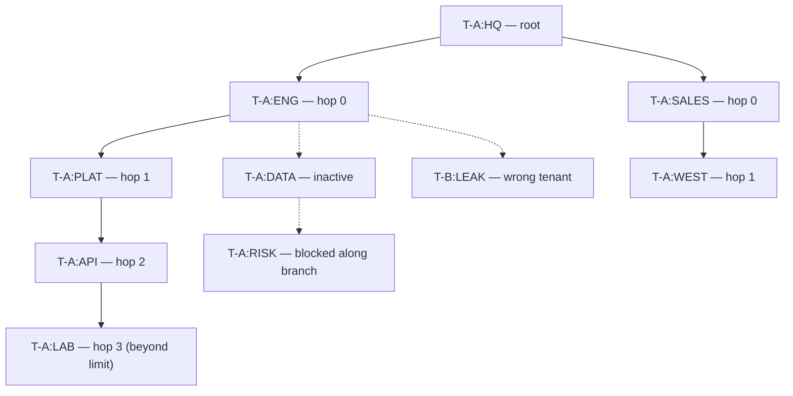

# `$graphLookup` and Bounded Graph Traversal

In MongoDB, many relationships cannot fit in a single document: organizational units have parent units, role groups inherit from other groups, categories have parent categories, or tasks depend on upstream tasks. While `$lookup` joins across one relationship hop, when an application needs to follow **multiple consecutive hops**, MongoDB provides the **`$graphLookup`** aggregation stage to traverse references recursively within a collection.

The real challenge goes beyond getting the pipeline to run. An unbounded recursive query can visit thousands of nodes, cross into another tenant's data, get tripped up by cycles, exhaust memory, or return an unordered array. In **Spring Data MongoDB**, you also need to map `GraphLookupOperation` cleanly to BSON, understand `maxDepth`/`depthField`, and write thorough integration tests.

This lesson belongs to the **Advanced Aggregation** chapter of the `SPRING_DATA_MONGODB` module, where learners connect, map documents, and operate on MongoDB via `MongoTemplate` or repositories alongside querying, indexing, transactions, reactive access, testing, and performance diagnostics. The core focus here is **bounded, verifiable graph traversal that strictly respects data boundaries**.

After this lesson, you will be able to:

- Know when to choose `$graphLookup` over `$lookup` or iterative Java queries.
- Explain `from`, `startWith`, `connectFromField`, `connectToField`, and `as` accurately.
- Understand `maxDepth = 0`, 0-based `depthField`, and why a depth cap **differs** from a node-count cap.
- Traverse both **descendants** and **ancestors** over the same data model without inverting edge direction.
- Apply `restrictSearchWithMatch` for tenant/status isolation and recognize its limitation regarding outer document fields.
- Use `Aggregation.graphLookup(...)` with `MongoTemplate`, test against real MongoDB, and reason about indexes, memory, cycles, and sharding.

## 1. How Graph Traversal Differs from a Regular Join

Suppose an organization stores units in an `orgUnits` collection. Each document stores `key` (a unique business identifier) and `parentKey` (its parent's key):

```text
T-A:HQ
├── T-A:ENG
│   ├── T-A:PLAT
│   │   └── T-A:API
│   │       └── T-A:LAB
│   └── T-A:DATA (inactive)
│       └── T-A:RISK
└── T-A:SALES
    └── T-A:WEST
```

Document `T-A:API` only stores `parentKey = "T-A:PLAT"`. It does not embed all ancestors or descendants; relationships are resolved by following links.

| Question | Usually best choice | Why |
| --- | --- | --- |
| Find the direct parent of `T-A:API` | `$lookup` or `findOne` by key | Needs only **one hop** |
| Find all ancestors up to 3 levels | **`$graphLookup`** | Must climb parent → grandparent → … |
| Find all descendants of `T-A:HQ` down 2 levels | **`$graphLookup`** | Must traverse top-down across multiple tiers |
| Fixed, very shallow tree depth | Nested `$lookup` or targeted queries possible | Fixed depth can be simpler in some models |
| Weighted graph traversal / optimal shortest path | Dedicated graph algorithms usually needed | `$graphLookup` is not Dijkstra/A* or weighted shortest-path |

`$graphLookup` returns a **flat array of visited nodes**—it does not construct a nested tree object, does not validate acyclicity, and does not guarantee sorted array order. If an API requires a nested tree, rebuild it in application code from `key/parentKey` or shape via appropriate DTOs.

### 1.1. Graphs, Trees, and Imperfect Data

An ideal tree has one root, one parent per non-root node, and no cycles. Real collections, however, can contain:

- **Orphans**: `parentKey` pointing to a deleted or not-yet-imported node.
- **Cycles**: A points to B, B to C, C to A.
- **Cross-tenant edges**: a tenant B node mistakenly pointing to a tenant A parent.
- **Duplicate business keys**: multiple nodes sharing the same `key` without a unique index.
- **Inactive intermediate nodes**: a deactivated node with active descendants beneath it.

Because of these real-world anomalies, pipelines require **depth caps, tenant boundaries, status filters, indexes, and adversarial tests**, not just happy-path trees.

## 2. `$graphLookup` Syntax and Traversal Direction

BSON stage skeleton:

```javascript
{
  $graphLookup: {
    from: "orgUnits",
    startWith: "$key",
    connectFromField: "key",
    connectToField: "parentKey",
    as: "descendants",
    maxDepth: 2,
    depthField: "hop",
    restrictSearchWithMatch: {
      tenantId: "T-A",
      active: true
    }
  }
}
```

Parameters:

| Field | Required? | Meaning in this example |
| --- | --- | --- |
| `from` | Yes | MongoDB collection to search for next hops; must be in the same database |
| `startWith` | Yes | Expression evaluated on the **input document**; `"$key"` reads the root's key |
| `connectFromField` | Yes | Field on **each matched node** used to continue to the next hop |
| `connectToField` | Yes | Field in `from` matched against the current lookup value |
| `as` | Yes | Output array field attached to the input document |
| `maxDepth` | No | Maximum recursion depth, non-negative integer |
| `depthField` | No | Field added to each matched node recording 0-based hop depth |
| `restrictSearchWithMatch` | No | MongoDB filter applied **during** traversal to candidate nodes |

To reason about direction, don't just memorize “From/To.” Ask:

1. Starting from the root document, **what value** does `startWith` read?
2. Which **field in `from`** (`connectToField`) is matched against that value?
3. Once a node is found, **which field on that new node** (`connectFromField`) supplies the next lookup value?

### 2.1. Top-Down: Parent to Children

With `key` and `parentKey`, to find children of root `T-A:HQ`:

```text
startWith = "T-A:HQ"
      ↓ matched against connectToField = parentKey
T-A:ENG (parentKey = "T-A:HQ")
T-A:SALES (parentKey = "T-A:HQ")
      ↓ read connectFromField = key from each newly matched node
T-A:PLAT, T-A:WEST, ...
```

So **descendant traversal** uses:

```javascript
startWith: "$key",
connectFromField: "key",
connectToField: "parentKey"
```

### 2.2. Bottom-Up: Child to Ancestors

To find ancestors of `T-A:API`, start with `parentKey = "T-A:PLAT"` and match documents whose `key` equals that value:

```javascript
startWith: "$parentKey",
connectFromField: "parentKey",
connectToField: "key"
```

Once `PLAT` is found, MongoDB reads `PLAT.parentKey = "T-A:ENG"` and repeats. **Swapping the two connect fields reverses traversal direction** over the exact same collection.

### 2.3. `startWith` Can Evaluate to an Array

When a node has multiple outgoing edges (e.g., `dependencyKeys: ["TASK-A","TASK-B"]`), `startWith` can return an array and `$graphLookup` branches out from every element. Similarly, if `connectFromField` is an array, all elements are followed.

This supports general multi-edge graphs, yet can create a huge **branching factor**. `maxDepth` only bounds hop count, **not the number of nodes visited at each hop**.

## 3. Small Fixture for Testing Every Traversal Case

We use **11 documents** in one collection. `key` values carry a tenant prefix; `_id` serves as storage ID:

```javascript
// Run only on an isolated test database with an empty/resettable collection.
db.orgUnits.insertMany([
  { _id: "A-0", key: "T-A:HQ",    tenantId: "T-A", parentKey: null,
    name: "HQ",           active: true },
  { _id: "A-1", key: "T-A:ENG",   tenantId: "T-A", parentKey: "T-A:HQ",
    name: "Engineering",  active: true },
  { _id: "A-2", key: "T-A:SALES", tenantId: "T-A", parentKey: "T-A:HQ",
    name: "Sales",        active: true },
  { _id: "A-3", key: "T-A:PLAT",  tenantId: "T-A", parentKey: "T-A:ENG",
    name: "Platform",     active: true },
  { _id: "A-4", key: "T-A:WEST",  tenantId: "T-A", parentKey: "T-A:SALES",
    name: "West",         active: true },
  { _id: "A-5", key: "T-A:DATA",  tenantId: "T-A", parentKey: "T-A:ENG",
    name: "Data",         active: false },
  { _id: "A-6", key: "T-A:RISK",  tenantId: "T-A", parentKey: "T-A:DATA",
    name: "Risk",         active: true },
  { _id: "A-7", key: "T-A:API",   tenantId: "T-A", parentKey: "T-A:PLAT",
    name: "API",          active: true },
  { _id: "A-8", key: "T-A:LAB",   tenantId: "T-A", parentKey: "T-A:API",
    name: "Lab",          active: true },
  { _id: "B-0", key: "T-B:HQ",    tenantId: "T-B", parentKey: null,
    name: "HQ B",         active: true },
  { _id: "B-1", key: "T-B:LEAK",  tenantId: "T-B", parentKey: "T-A:ENG",
    name: "Wrong link",   active: true }
]);
```

`T-B:LEAK` intentionally points to a parent in T-A. This is an **adversarial fixture**, not a recommended data pattern. Production write paths must reject cross-tenant edges; prefixing keys with tenant IDs **does not automatically keep data clean**.

To prevent duplicate business keys:

```javascript
db.orgUnits.createIndex(
  { key: 1 },
  { unique: true }
);
```

In models where keys are only unique **within a tenant** (without a tenant prefix), use a compound unique index `{tenantId:1,key:1}` and design join conditions carefully. Here `key` includes the tenant and is globally unique for easy verification.

### 3.1. Compute Expected Output Manually First

From root `T-A:HQ`, traversing only **active nodes in T-A**:

| Depth `hop` | Matched nodes | Reason |
| ---: | --- | --- |
| 0 | `T-A:ENG`, `T-A:SALES` | `parentKey = "T-A:HQ"` |
| 1 | `T-A:PLAT`, `T-A:WEST` | Children of ENG or SALES, active |
| 2 | `T-A:API` | Child of PLAT |
| 3 | `T-A:LAB` | Beyond `maxDepth: 2` |

`T-A:DATA` is excluded because `active: false`. Because the DATA branch is pruned, `T-A:RISK` is also excluded even though RISK itself is active. `T-B:LEAK` must not enter the result because it belongs to tenant T-B.

With `maxDepth: 2`, the result must contain **exactly five nodes**: ENG, SALES, PLAT, WEST, API. Root HQ is **not** counted as a descendant in this valid tree.

### 3.2. Depth Diagram



Dashed edges indicate data **not traversed** under this lesson's filters and limits. When designing APIs, never assume a field named `descendants` implies tenant, active, or depth enforcement on its own: the pipeline must enforce all of them explicitly.

## 4. Bounded Descendant Traversal Pipeline

Start by selecting one root document with `$match`, then run `$graphLookup` on `orgUnits`:

```javascript
const tenantId = "T-A"; // Already authorized value.
const rootKey = "T-A:HQ";

const pipeline = [
  {
    $match: {
      tenantId: tenantId,
      key: rootKey,
      active: true
    }
  },
  {
    $graphLookup: {
      from: "orgUnits",
      startWith: "$key",
      connectFromField: "key",
      connectToField: "parentKey",
      as: "descendants",
      maxDepth: 2,
      depthField: "hop",
      restrictSearchWithMatch: {
        tenantId: tenantId,
        active: true
      }
    }
  }
];

const result = db.orgUnits.aggregate(pipeline).toArray();
printjson(result);
```

The output holds **one root document** (HQ) with a five-element `descendants` array; abbreviated example:

```javascript
[
  {
    _id: "A-0",
    key: "T-A:HQ",
    tenantId: "T-A",
    name: "HQ",
    active: true,
    descendants: [
      // Order is NOT guaranteed:
      { key: "T-A:ENG",   hop: NumberLong("0") },
      { key: "T-A:SALES", hop: NumberLong("0") },
      { key: "T-A:PLAT",  hop: NumberLong("1") },
      { key: "T-A:WEST",  hop: NumberLong("1") },
      { key: "T-A:API",   hop: NumberLong("2") }
    ]
  }
]
```

This is an **abbreviated illustration**, not the complete BSON document: real array elements also contain `_id`, `tenantId`, `parentKey`, `name`, and `active`. MongoDB **does not guarantee element order** inside `as`, so never write tests relying on the printed order above.

### 4.1. Verifying Node Count and Depths

```javascript
const roots = db.orgUnits.aggregate(pipeline).toArray();

if (roots.length !== 1) {
  throw new Error("Expected exactly one root");
}

const descendants = roots[0].descendants;
print("Node count:", descendants.length); // 5

printjson(
  descendants.map(node => ({
    key: node.key,
    hop: Number(node.hop)
  })).sort((a, b) => a.hop - b.hop || a.key.localeCompare(b.key))
);
```

Expected after **sorting explicitly in JavaScript**:

| `key` | `hop` |
| --- | ---: |
| `T-A:ENG` | 0 |
| `T-A:SALES` | 0 |
| `T-A:PLAT` | 1 |
| `T-A:WEST` | 1 |
| `T-A:API` | 2 |

If a `T-B` node appears, `restrictSearchWithMatch` is missing or wrong. If `DATA` appears, the `active` filter was omitted. If `LAB` appears, check `maxDepth` or how depth is interpreted.

### 4.2. Inspecting Each Stage Like a Normal Pipeline

```javascript
// Step 1: verify root selection only.
db.orgUnits.aggregate([pipeline[0]]).toArray();

// Step 2: root + descendants.
db.orgUnits.aggregate(pipeline).toArray();

// Step 3: unwind array to inspect individual nodes.
db.orgUnits.aggregate([
  ...pipeline,
  { $unwind: "$descendants" },
  { $project: {
      _id: 0,
      key: "$descendants.key",
      name: "$descendants.name",
      hop: "$descendants.hop"
  } },
  { $sort: { hop: 1, key: 1 } }
]).toArray();
```

`$unwind` expands `descendants` into five rows; the trailing `$sort` **sorts those unwound rows** without sorting the nested array on an unwound-free root document.

## 5. `maxDepth`, `depthField`, and Three Distinct Kinds of “Limits”

`maxDepth` caps **the number of recursive hops from the start** as counted by MongoDB, where the initial lookup has `depth = 0`:

| `maxDepth` | Expected valid nodes from fixture | Node count |
| ---: | --- | ---: |
| 0 | ENG, SALES | 2 |
| 1 | ENG, SALES, PLAT, WEST | 4 |
| 2 | ENG, SALES, PLAT, WEST, API | 5 |
| 3 | Above plus LAB | 6 |

Because depth is **0-based**, `maxDepth: 0` **does not mean “traverse nothing”**: it performs **one lookup step**, equivalent to traversing a single edge in MongoDB terminology.

### 5.1. `depthField` Is Metadata on Each Matched Node

`depthField: "hop"` attaches a `hop` field to **each document inside the `descendants` array**, stored as BSON `NumberLong`. It **does not add `hop` to the root document** and does not build a nested tree.

For instance, `T-A:PLAT` has `hop=1` because it was reached from ENG, which was reached directly from HQ (`hop=0`). If a UI wants 1-based depth (“2 edges from root”), display `level = hop + 1`, keeping UI numbering distinct from MongoDB's 0-based counter.

### 5.2. `maxDepth` Does Not Cap Node Count

Suppose a root has 100 children, and each child has 100 children:

```text
maxDepth: 0 → up to 100 nodes
maxDepth: 1 → up to 100 + 10,000 nodes
maxDepth: 2 → up to 100 + 10,000 + 1,000,000 nodes
```

Depth bounds stop runaway chain length, **not fan-out explosion**. Adding `$limit: 10` **after `$graphLookup`** caps the number of *root* or unwound output rows depending on placement—it **does not stop the server from traversing far more than 10 nodes**. Applying `$slice` to the result array trims payload only after traversal finishes.

Therefore, applications need **three distinct layers of bounds**:

1. **Input/root limits**: select a small number of roots via `$match` and pagination.
2. **Traversal limits**: small `maxDepth`, tight `restrictSearchWithMatch` filters, and indexes.
3. **Resource/output limits**: timeouts, node/byte budgets, concurrency limits, caches/materialized views, or batched BFS when a hard node cap is mandatory.

MongoDB `$graphLookup` **has no `maxNodes` equivalent to `maxDepth`**. When a hard invariant like “visit at most 500 nodes” is required, use controlled level-by-level BFS or pre-materialized relationships instead of relying on post-traversal `$slice`.

### 5.3. Never Rely on `depthField` for Array Order

`$graphLookup`'s output array **is not sorted by `hop`**. To return `hop ASC, key ASC`:

```javascript
db.orgUnits.aggregate([
  ...pipeline,
  { $unwind: "$descendants" },
  { $sort: {
      "descendants.hop": 1,
      "descendants.key": 1
  } },
  { $project: {
      _id: 0,
      key: "$descendants.key",
      parentKey: "$descendants.parentKey",
      name: "$descendants.name",
      hop: "$descendants.hop"
  } }
]).toArray();
```

On MongoDB versions supporting `$sortArray`, you can sort the array in place inside `$set`/`$project`, checking version compatibility and cost on large arrays. For APIs returning a flat list, `$unwind + $sort + $project` is straightforward to verify.

## 6. `restrictSearchWithMatch` Filters **During Traversal**

Suppose we filter the root by `tenantId = "T-A"` **without** `restrictSearchWithMatch`. Another tenant's node could mistakenly store `parentKey = "T-A:ENG"` like `T-B:LEAK` in our fixture. When graph traversal joins on `parentKey`, that T-B node still gets pulled in.

Thus, a **`$match` before `$graphLookup` does not filter the documents visited during recursion**.

Safer pipeline:

```javascript
{
  $graphLookup: {
    from: "orgUnits",
    startWith: "$key",
    connectFromField: "key",
    connectToField: "parentKey",
    as: "descendants",
    maxDepth: 2,
    depthField: "hop",
    restrictSearchWithMatch: {
      tenantId: "T-A",
      active: true
    }
  }
}
```

### 6.1. The Filter Does More Than Hide Nodes: It **Prunes Paths**

`T-A:DATA` is inactive. With `active: true` in `restrictSearchWithMatch`, DATA **is never visited**, so `T-A:RISK` beneath DATA is **never reached via that branch**, even though RISK itself is active.

This distinction is critical. These two rules **are not equivalent**:

- **“Traverse only active nodes”**: put `active: true` in `restrictSearchWithMatch`, blocking traversal through inactive nodes.
- **“Allow traversing through inactive nodes, but return only active nodes”**: traverse with tenant restriction only and filter the result array afterward—bearing higher traversal cost and carefully checking whether showing descendants under deactivated nodes matches domain policy.

If organizational policy states “an inactive department hides its entire subtree,” filtering inside traversal is exact. If a report needs all active employees even under a temporarily suspended unit, filtering `active` inside traversal will **miss** valid records.

### 6.2. `restrictSearchWithMatch` Cannot Arbitrarily Reference Root Fields

This is a **query filter**, not a subpipeline accepting `let` variables like pipeline `$lookup`. MongoDB does not evaluate aggregation expressions referencing outer root fields inside `restrictSearchWithMatch`.

**Misleading** example:

```javascript
restrictSearchWithMatch: {
  tenantId: "$tenantId"
}
// "$tenantId" is treated as a LITERAL STRING here,
// not replaced with the root document's tenantId.
```

For an API serving a caller authenticated as `T-A`, bind the **verified value** `"T-A"` when constructing the pipeline. However, if a single pipeline processes **multiple roots across different tenants**, never assume `restrictSearchWithMatch` binds each root's `tenantId` dynamically.

Appropriate patterns by architecture:

1. Execute pipelines **per tenant**, taking the tenant from the security context and binding it in both `$match` and `restrictSearchWithMatch`.
2. Embed **tenant inside join keys** and validate edges on write—while still testing isolation.
3. If complex root-correlated rules are required, revisit the data model, split queries per tenant, or perform controlled application-side traversal.

**Never concatenate public input into JSON strings for `tenantId`.** In Java, build `Criteria` from validated values so the driver encodes BSON safely and prevents query injection.

### 6.3. Post-`$graphLookup` Filtering Does Not Replace Traversal Filtering

Example:

```javascript
{ $set: {
    descendants: {
      $filter: {
        input: "$descendants",
        as: "node",
        cond: { $eq: ["$$node.tenantId", "T-A"] }
      }
    }
} }
```

This stage strips `T-B` nodes **from the output array**, yet it is **too late to prevent `$graphLookup` from traversing through them**. If a `T-B` node has further edges, traversal may already have walked out-of-scope data. Access rules must be enforced **before and during traversal**, not solely at the end.

## 7. Traversing Ancestors: Reversing Join Direction

A frequent requirement: “Which parent units does `T-A:API` belong to, up to 3 levels up?” Over the same data, start from `parentKey` and match documents by `key`.

```javascript
db.orgUnits.aggregate([
  {
    $match: {
      tenantId: "T-A",
      key: "T-A:API",
      active: true
    }
  },
  {
    $graphLookup: {
      from: "orgUnits",
      startWith: "$parentKey",
      connectFromField: "parentKey",
      connectToField: "key",
      as: "ancestors",
      maxDepth: 2,
      depthField: "hop",
      restrictSearchWithMatch: {
        tenantId: "T-A",
        active: true
      }
    }
  },
  { $unwind: "$ancestors" },
  { $sort: { "ancestors.hop": 1 } },
  { $project: {
      _id: 0,
      key: "$ancestors.key",
      name: "$ancestors.name",
      hop: "$ancestors.hop"
  } }
]).toArray();
```

Expected:

| `key` | `hop` | Meaning |
| --- | ---: | --- |
| `T-A:PLAT` | 0 | Direct parent of API |
| `T-A:ENG` | 1 | Grandparent |
| `T-A:HQ` | 2 | Next ancestor up |

Quick directional cheat sheet:

| Direction | `startWith` | `connectFromField` | `connectToField` |
| --- | --- | --- | --- |
| Descendants | `"$key"` | `"key"` | `"parentKey"` |
| Ancestors | `"$parentKey"` | `"parentKey"` | `"key"` |

### 7.1. When a Parent Does Not Exist

If API's `parentKey` points to `T-A:MISSING` with no matching document, `ancestors` is empty (or contains only nodes reached before the broken link). `$graphLookup` does not synthesize a “missing” placeholder for broken links.

If an API must still return the root even when it has no ancestors, **avoid default `$unwind`** so the root is not dropped. Either return the `ancestors` array directly or unwind with `preserveNullAndEmptyArrays` under an explicit output contract.

### 7.2. Multiple Parents (DAGs)

In graphs with multiple parents, `parentKeys` can be an array. `startWith: "$parentKeys"` and `connectFromField: "parentKeys"` traverse all branches; however, the output does not indicate **which path** reached a node, especially when multiple paths converge on the same node.

`depthField` records traversal hop depth on each returned node, yet **does not replace full edge/path provenance** when auditing “which specific permission chain granted access.” For path-provenance requirements, store explicit paths/edges or run specialized graph logic.

## 8. Cycles, Orphan Data, and Reference Keys

### 8.1. Why `maxDepth` Is Still Required Even When Data “Is a Tree”

Applications may intend a strict tree, yet MongoDB enforces no foreign-key constraints between `parentKey` and `key`. A bad import or update can introduce a cycle.

Suppose in a test we change `T-A:HQ.parentKey` to `"T-A:API"`:

```text
HQ → ENG → PLAT → API → HQ
```

This creates a cycle under “HQ is parent of ENG,” “ENG is parent of PLAT,” “PLAT is parent of API,” and “API becomes parent of HQ.” Traversing descendants from HQ can reach HQ again **as a child referenced from API** if `maxDepth` is large enough.

MongoDB tracks visited nodes internally to avoid infinite looping, **yet the output can violate tree assumptions** and even include the root itself when cyclic edges exist. `maxDepth` remains a crucial operational safeguard.

### 8.2. Do Not Rely on `$graphLookup` to Validate Tree Integrity

`$graphLookup` matches fields recursively—it does not verify that:

- Every node has at most one valid parent.
- Roots truly have no parent.
- Every parent belongs to the same tenant.
- No cycles exist anywhere.
- All parents are active and present.

Enforce these invariants on **write paths** and via reconciliation jobs. You can use traversal queries as a diagnostic signal, for example:

```javascript
// After traversal, check if the root unexpectedly appears in descendants.
db.orgUnits.aggregate([
  { $match: { key: "T-A:HQ", tenantId: "T-A" } },
  {
    $graphLookup: {
      from: "orgUnits",
      startWith: "$key",
      connectFromField: "key",
      connectToField: "parentKey",
      as: "descendants",
      maxDepth: 10,
      restrictSearchWithMatch: { tenantId: "T-A" }
    }
  },
  {
    $project: {
      _id: 0,
      rootKey: "$key",
      hasRootInDescendants: {
        $in: ["$key", "$descendants.key"]
      }
    }
  }
]).toArray();
```

This is a **diagnostic check** for cycles reachable within 10 hops from the chosen root, not a full-graph acyclicity proof. Cycles deeper than `maxDepth` or disconnected from that root will go unseen.

**Never mutate `parentKey` in production just to test cycle behavior.** Test cycles only inside an isolated database/collection with dedicated fixtures, then restore cleanly.

### 8.3. Preventing Cycles on Write

Before changing node A's parent to node B, a sensible guard is **checking whether B appears among A's descendants**. If so, making B the parent of A would introduce a cycle.

Note, however, that a separate **read-then-write** check has a race condition under concurrent updates. Where strict graph invariants are critical, use transactions, optimistic versioning, or serialize graph mutations per tenant/org alongside domain constraints.

A unique index on `key` prevents duplicate keys, **not cycles** or cross-tenant parents. Write handlers should look up parents by **`tenantId + key`**, check active status, cap depth, and forbid self-parenting.

### 8.4. Orphans and Deleted Nodes

An orphan `{key:"T-A:ORPHAN", parentKey:"T-A:REMOVED"}` never attaches to the HQ tree because `$graphLookup` only follows existing nodes. If you need to detect **all nodes unreachable from a valid root**, traversing from one root alone is insufficient; run a tenant-scoped reconciliation check instead.

Never set an enormous `maxDepth` trying to sweep for orphans/cycles indiscriminately. Combine schema checks, indexes, and bounded per-tenant audits.

## 9. Spring Data MongoDB: `GraphLookupOperation` in `MongoTemplate`

Spring Data supports `Aggregation.graphLookup(...)` and `GraphLookupOperation`, eliminating manual JSON string assembly for standard stages. The main builder chain follows:

```text
Aggregation.graphLookup(collection)
  .startWith(startProperty)
  .connectFrom(fromProperty)
  .connectTo(toProperty)
  .maxDepth(nonNegativeLong)
  .depthField(outputDepthField)
  .restrict(criteria)
  .as(outputArrayField)
```

Join field names match property/field names; using `key` and `parentKey` **with identical Java and BSON names** avoids `@Id` ↔ `_id` confusion. `startWith("key")` in the builder is a **field reference**, rendering as `"$key"` in BSON rather than the literal string `"key"`.

### 9.1. Source Entity and Result DTO

```java
import org.springframework.data.mongodb.core.mapping.Document;
import org.springframework.data.mongodb.core.mapping.MongoId;

@Document(collection = "orgUnits")
public record OrgUnit(
        @MongoId String id,
        String key,
        String tenantId,
        String parentKey,
        String name,
        boolean active
) {}
```

After `$unwind` and `$project` on `descendants`, the output **is no longer a full `OrgUnit`**. Define a dedicated DTO:

```java
public record OrgHop(
        String key,
        String parentKey,
        String name,
        long hop
) {}
```

`long hop` matches MongoDB's BSON `NumberLong` emitted by `depthField`. `OrgHop` is a read-only aggregation record; **never pass projected results to `save`** on `orgUnits`.

### 9.2. Service Traversing Descendants to a Maximum Depth

```java
import java.util.List;
import org.springframework.data.domain.Sort;
import org.springframework.data.mongodb.core.MongoTemplate;
import org.springframework.data.mongodb.core.aggregation.Aggregation;
import org.springframework.data.mongodb.core.aggregation.GraphLookupOperation;
import org.springframework.data.mongodb.core.query.Criteria;
import org.springframework.stereotype.Service;

@Service
public class OrgTraversalService {

    private final MongoTemplate template;

    public OrgTraversalService(MongoTemplate template) {
        this.template = template;
    }

    public List<OrgHop> descendants(
            String authorizedTenantId,
            String rootKey,
            long maxDepth
    ) {
        if (authorizedTenantId == null
                || authorizedTenantId.isBlank()
                || rootKey == null || rootKey.isBlank()
                || maxDepth < 0 || maxDepth > 3) {
            throw new IllegalArgumentException(
                    "Invalid tenant, root, or depth");
        }

        Criteria rootFilter = Criteria.where("tenantId")
                .is(authorizedTenantId)
                .and("key").is(rootKey)
                .and("active").is(true);

        Criteria traversalFilter = Criteria.where("tenantId")
                .is(authorizedTenantId)
                .and("active").is(true);

        GraphLookupOperation traversal = Aggregation
                .graphLookup("orgUnits")
                .startWith("key")
                .connectFrom("key")
                .connectTo("parentKey")
                .maxDepth(maxDepth)
                .depthField("hop")
                .restrict(traversalFilter)
                .as("descendants");

        Aggregation pipeline = Aggregation.newAggregation(
                Aggregation.match(rootFilter),
                traversal,
                Aggregation.unwind("descendants"),
                Aggregation.sort(Sort.by(
                        Sort.Order.asc("descendants.hop"),
                        Sort.Order.asc("descendants.key"))),
                Aggregation.project()
                        .and("descendants.key").as("key")
                        .and("descendants.parentKey").as("parentKey")
                        .and("descendants.name").as("name")
                        .and("descendants.hop").as("hop")
                        .andExclude("_id")
        );

        return template.aggregate(
                pipeline, "orgUnits", OrgHop.class
        ).getMappedResults();
    }
}
```

Example call inside an injected service/controller/test:

```java
List<OrgHop> hops = orgTraversalService.descendants(
        "T-A", "T-A:HQ", 2);

// Expected 5 rows, ordered by hop then key:
// T-A:ENG (0), T-A:SALES (0),
// T-A:PLAT (1), T-A:WEST (1), T-A:API (2).
```

Notice the service **does not let clients pass arbitrary `maxDepth`**; it caps `0..3` to bound resources. Real limits depend on tree fan-out, latency budgets, and access policy.

**Note:** `template.aggregate(pipeline, "orgUnits", OrgHop.class)` uses an explicit collection name. Because `@MongoId` is not part of the traversal fields, we avoid `id` ↔ `_id` mapping surprises inside `GraphLookupOperation`. If your schema uses `@Field` to rename `key` or `parentKey`, inspect the generated BSON pipeline and verify mapping behavior for your Spring Data version.

### 9.3. Preserving the Root When There Are No Descendants

The service above uses default `Aggregation.unwind("descendants")`. If a root has zero active descendants, **zero rows are returned**. That can fit an API returning only child nodes.

If the API must return **the root alongside its `descendants` array**, skip `$unwind` and map into a DTO such as:

```java
import java.util.List;
import org.bson.Document;

public record OrgTreeResult(
        String key,
        String name,
        List<Document> descendants
) {}
```

In production, replace raw `Document` inside the DTO with a structured record. When no descendants exist, the array is empty—distinct from a nonexistent root (where aggregation returns zero documents). Wrap results explicitly if callers must distinguish the two.

### 9.4. Traversing Ancestors with the Same Builder

Simply swap `startWith`, `connectFrom`, and `connectTo`:

```java
GraphLookupOperation ancestors = Aggregation
        .graphLookup("orgUnits")
        .startWith("parentKey")
        .connectFrom("parentKey")
        .connectTo("key")
        .maxDepth(2)
        .depthField("hop")
        .restrict(Criteria.where("tenantId").is("T-A")
                .and("active").is(true))
        .as("ancestors");
```

Starting from `T-A:API`, the array holds PLAT (0), ENG (1), and HQ (2). The root `$match` must still enforce the authenticated tenant. When no valid parent exists, the result is an empty array, not an exception.

## 10. Indexes for Traversal: Each Hop Performs Another Lookup

`$graphLookup` repeatedly matches against `connectToField`. Therefore, indexing **the target field searched at each hop** is crucial:

| Direction | Join pair | Lookup condition on next node | Candidate index to evaluate |
| --- | --- | --- | --- |
| Descendants | `connectFromField: "key"`, `connectToField: "parentKey"` | `parentKey = current node's key` plus tenant/active | `{tenantId:1, parentKey:1, active:1}` or workload variant |
| Ancestors | `connectFromField: "parentKey"`, `connectToField: "key"` | `key = current node's parentKey` plus tenant/active | Unique `{key:1}` or `{tenantId:1,key:1}` per schema |
| Root match | `$match {tenantId, key, active}` | Selects starting node before traversal | Unique key and selective filters |

For our fixture:

```javascript
// Unique business key.
db.orgUnits.createIndex(
  { key: 1 },
  { unique: true }
);

// Supports looking up children by parentKey of visited nodes.
db.orgUnits.createIndex({
  tenantId: 1,
  parentKey: 1,
  active: 1
});
```

**Do not recreate duplicate indexes** in real environments: the unique key index was created with the fixture, and the snippet above summarizes the index design to verify. Compound index key order depends on equality selectivity and workload; no single order fits every collection.

### 10.1. Why Is a `parentKey` Index Critical for Descendants?

Every descendant hop asks “which nodes have `parentKey` equal to this key?” Without an index, recursive steps can scan huge numbers of documents repeatedly at every level.

When traversing ancestors, each hop asks “which node has `key` equal to this `parentKey`?” With a unique index on `key`, each hop looks up at most one parent. Both directions have **very different fan-out and performance profiles**: climbing single-parent ancestors is a narrow chain, whereas descending can fan out across thousands of branches.

### 10.2. `explain` and Plan-Reading Limits

On supported MongoDB versions, run:

```javascript
db.orgUnits.explain("executionStats").aggregate([
  { $match: { tenantId: "T-A", key: "T-A:HQ", active: true } },
  {
    $graphLookup: {
      from: "orgUnits",
      startWith: "$key",
      connectFromField: "key",
      connectToField: "parentKey",
      as: "descendants",
      maxDepth: 2,
      depthField: "hop",
      restrictSearchWithMatch: {
        tenantId: "T-A",
        active: true
      }
    }
  }
]);
```

Depending on server version and optimizer, `$graphLookup` explain details may report documents/keys examined, timings, and traversal stats. Do not assume every MongoDB version prints identical `executionStats` layouts or shows every hop as a neat standalone `IXSCAN`.

Monitor **actual request latency**, returned node count, depth, breadth, number of roots traversed, memory/CPU, and connection pool saturation. Explain numbers on 11 documents look very different from production workloads.

## 11. Memory, Result Limits, and MongoDB Versions

A common design mistake is assuming `maxDepth: 2` is small and therefore automatically cheap. If each node has hundreds of children, total nodes explode rapidly within two or three hops.

### 11.1. BSON Output Size Limit

`$graphLookup` attaches the `descendants` array to **one root document**. If that array grows huge, the output document hits the **16 MiB BSON document size limit**. This failure is separate from stage execution memory limits.

Suppose a root has 300,000 descendants, each carrying heavy metadata: even `maxDepth: 1` or `2` can overflow 16 MiB. Adding `$project` **after `$graphLookup`** trims fields only after traversal has already built the array—it never caps how many nodes are visited.

For wide trees, consider:

- Trimming stored metadata per node or moving large metadata into a separate collection.
- Bounding root inputs, depth, and node status/types in `restrictSearchWithMatch`.
- Serving tree levels lazily or using budgeted batched BFS.
- Materialized path or ancestor-array schemas when read patterns justify it.
- Caching small trees or tenant snapshots with invalidation on hierarchy changes.

### 11.2. `allowDiskUse` **Does Not Behave Identically Across All Versions**

Current MongoDB docs and versioned manuals document **differences** in how `$graphLookup` handles high memory consumption:

- In versions/execution paths supporting disk spill, the stage can write temporary files past roughly **100 MiB** and fail if `allowDiskUse: false`.
- Older version manuals (e.g., the 8.0 branch) document `$graphLookup` as having a **hard ~100 MiB memory limit** that may not benefit from `allowDiskUse: true`, even when other stages in the same pipeline do.

Therefore, **never promise that enabling `allowDiskUse(true)` prevents `$graphLookup` memory errors**. Check the manual for your **exact MongoDB Server version**, inspect explain/metrics, and bound traversals from the start.

```javascript
db.orgUnits.aggregate(pipeline, {
  allowDiskUse: true,
  maxTimeMS: 5000
});
```

These are `mongosh` command options, not excuses to skip schema design or depth caps. `maxTimeMS` bounds server execution time, yet does not replace HTTP/client timeouts, memory caps, or cancellation policies.

### 11.3. Timeouts and Concurrent Requests

A hierarchy view that runs fast in tests can slow down when:

- A root has thousands of children or deep levels.
- Many users open the full tree concurrently without caching.
- Indexes on `connectToField` do not match traversal predicates.
- Collections are sharded with network hops or resource contention.
- Nodes carry large fields that the driver must deserialize.

Budget **`maxDepth`, concurrent requests, timeouts, and payload sizes**, applying per-tenant rate limits if needed. For UI tree browsers, **lazy-loading one level as the user expands nodes** is far more predictable than loading an entire organization in one call.

### 11.4. Sharding and Transactions

Per MongoDB documentation, starting in **MongoDB 5.1**, the `from` collection in `$graphLookup` **can be a sharded collection**. However, **you cannot use `$graphLookup` inside a transaction when targeting a sharded collection**.

In Spring applications using MongoDB `@Transactional`, **never assume** every `$graphLookup` runs inside a transaction like a regular query, especially if `from` is sharded. Verify topology, MongoDB version, and transaction boundaries before designing transactional graph workflows.

Even outside transactions, a long traversal does not freeze relationships against concurrent parent edits. When reports require strict point-in-time snapshots, use supported read concerns/snapshots or versioned data within deployment constraints.

### 11.5. Collation and Views

When `from` is a view or multiple views appear in `$lookup`/`$graphLookup`, MongoDB requires matching collations per documentation. With string join keys, casing and collation differences can behave unpredictably if display names are used as keys.

For example, use a normalized key `"T-A:ENG"` instead of the display name `"Engineering"` as the join field. **Never use user-edited display names as reference keys**; use stable, formatted unique identifiers.

## 12. Alternative Data Models When Recursive Queries Get Expensive

`$graphLookup` is not mandatory for every hierarchy. Depending on read paths and update frequency, other schemas can fit better:

| Model | Stored data | Strengths | Trade-offs |
| --- | --- | --- | --- |
| **Parent reference** (this lesson) | Each node holds `parentKey` | Moving a single edge is simple and compact | Multi-level reads need `$graphLookup` or multi-step queries |
| **Materialized path** | Each node stores `"/HQ/ENG/PLAT"` | Subtree queries via prefix match with proper indexes | Re-parenting must update paths across the subtree |
| **Ancestor array** | Each node stores `ancestorKeys[]` | Fast ancestor checks via array queries | Moving a node must update many descendants |
| **Nested tree document** | Parent embeds children inside one doc | Very fast single-doc reads for tiny trees | 16 MiB BSON cap; complex concurrent updates |
| **Level-by-level by `parentKey`** | Parent reference + children API | Bounds nodes per request; natural for lazy-loading UIs | Multiple round-trips if whole graph is needed |
| **Cache / materialized view** | Precomputed snapshot | Fast repeated reads | Needs accurate update/invalidation logic |

**Practical guidance:** if UI only expands nodes one level at a time, `find({tenantId,parentKey}).limit(...)` is easier to bound than full `$graphLookup`. For shallow ancestor chains or tight subtree reports, `$graphLookup` with `maxDepth` and `restrictSearchWithMatch` is concise. For hot, rarely changing trees, caching or ancestor paths can outperform repeated traversals.

### 12.1. Do Not Confuse `$lookup` with `$graphLookup`

`$lookup` joins directly referenced documents (or via subpipeline) across **one level**. `$graphLookup` continues recursively from newly matched nodes with `maxDepth`, `depthField`, and traversal filtering.

If a requirement only needs “the direct parent of API,” a single `$lookup` or `key = parentKey` query is simpler. If it needs “the parent chain up to root,” use `$graphLookup`. **Never add complexity merely to use an advanced stage.**

### 12.2. Do Not Equate Graph Traversal with Shortest-Path Search

`$graphLookup` gathers nodes reachable from the starting point. It is not a weighted path optimizer, does not emit every traversed edge sequence, and does not explain which branch granted reachability.

If a product needs **shortest path**, **lowest cost**, exact **per-path steps**, or explicit permission-chain auditing, revisit the algorithm and edge model—such as storing explicit edges/paths or running graph algorithms in application code.

## 13. Integration Testing Against Real MongoDB

A unit test mocking `MongoTemplate` only proves `aggregate(...)` was called. It **does not verify** traversal direction, `maxDepth`, `hop` types, inactive-branch pruning, or that `restrictSearchWithMatch` blocks cross-tenant links.

Always write **integration tests against a real, isolated MongoDB Server** (e.g., Testcontainers) using a compact fixture like Section 3. The snippet below targets Spring Boot 3.x, Java 17+, and `@DataMongoTest`.

### 13.1. Seeding 11 Nodes via Spring Data Mapping

```java
import java.util.List;
import org.junit.jupiter.api.BeforeEach;
import org.junit.jupiter.api.Test;
import org.springframework.beans.factory.annotation.Autowired;
import org.springframework.boot.test.autoconfigure.data.mongo.DataMongoTest;
import org.springframework.data.mongodb.core.MongoTemplate;
import org.springframework.data.mongodb.core.query.Query;

@DataMongoTest
class OrgGraphLookupIntegrationTest {

    @Autowired MongoTemplate template;

    private OrgTraversalService traversal;

    private static OrgUnit unit(
            String id, String key, String tenant,
            String parent, String name, boolean active
    ) {
        return new OrgUnit(id, key, tenant, parent, name, active);
    }

    @BeforeEach
    void seed() {
        traversal = new OrgTraversalService(template);

        // ONLY in an isolated test database: wipes the fixture collection.
        template.remove(new Query(), OrgUnit.class);
        template.insertAll(List.of(
                unit("A-0", "T-A:HQ", "T-A", null, "HQ", true),
                unit("A-1", "T-A:ENG", "T-A", "T-A:HQ", "Engineering", true),
                unit("A-2", "T-A:SALES", "T-A", "T-A:HQ", "Sales", true),
                unit("A-3", "T-A:PLAT", "T-A", "T-A:ENG", "Platform", true),
                unit("A-4", "T-A:WEST", "T-A", "T-A:SALES", "West", true),
                unit("A-5", "T-A:DATA", "T-A", "T-A:ENG", "Data", false),
                unit("A-6", "T-A:RISK", "T-A", "T-A:DATA", "Risk", true),
                unit("A-7", "T-A:API", "T-A", "T-A:PLAT", "API", true),
                unit("A-8", "T-A:LAB", "T-A", "T-A:API", "Lab", true),
                unit("B-0", "T-B:HQ", "T-B", null, "HQ B", true),
                unit("B-1", "T-B:LEAK", "T-B", "T-A:ENG", "Wrong tenant", true)
        ));
    }

    // Tests in the following subsections belong inside this class.
}
```

`@DataMongoTest` loads the MongoDB test slice, **which does not automatically start a local MongoDB Server** everywhere. Configure an isolated test URI/container and test dependencies, and never run `template.remove(new Query(), OrgUnit.class)` on shared or production databases.

### 13.2. Testing Depths 0, 1, 2 and Output Order

Add these methods **inside the test class above**:

```java
import static org.assertj.core.api.Assertions.assertThat;

@Test
void maxDepthZeroMeansDirectChildren() {
    List<OrgHop> rows = traversal.descendants(
            "T-A", "T-A:HQ", 0);

    assertThat(rows).extracting(OrgHop::key)
            .containsExactly("T-A:ENG", "T-A:SALES");
    assertThat(rows).extracting(OrgHop::hop)
            .containsExactly(0L, 0L);
}

@Test
void maxDepthOneReturnsChildrenAndGrandchildren() {
    List<OrgHop> rows = traversal.descendants(
            "T-A", "T-A:HQ", 1);

    assertThat(rows).extracting(OrgHop::key)
            .containsExactly(
                    "T-A:ENG", "T-A:SALES",
                    "T-A:PLAT", "T-A:WEST");
    assertThat(rows).extracting(OrgHop::hop)
            .containsExactly(0L, 0L, 1L, 1L);
}

@Test
void maxDepthTwoStopsBeforeLab() {
    List<OrgHop> rows = traversal.descendants(
            "T-A", "T-A:HQ", 2);

    assertThat(rows).extracting(OrgHop::key)
            .containsExactly(
                    "T-A:ENG", "T-A:SALES",
                    "T-A:PLAT", "T-A:WEST",
                    "T-A:API");

    assertThat(rows).extracting(OrgHop::hop)
            .containsExactly(0L, 0L, 1L, 1L, 2L);
}
```

Assertions use `containsExactly` because the service explicitly sorts by `hop` and `key`. If testing the raw `descendants` array straight out of `$graphLookup` **without sorting**, use `containsExactlyInAnyOrder` or convert to a map; never assert an order MongoDB does not guarantee.

### 13.3. Testing Tenant Isolation and Inactive Branches

```java
@Test
void inactiveBranchAndForeignTenantAreNotTraversed() {
    List<OrgHop> rows = traversal.descendants(
            "T-A", "T-A:HQ", 3);

    assertThat(rows).extracting(OrgHop::key)
            .contains("T-A:LAB")
            .doesNotContain(
                    "T-A:DATA",
                    "T-A:RISK",
                    "T-B:LEAK");
}

@Test
void rootOutsideAuthorizedTenantDoesNotMatch() {
    List<OrgHop> rows = traversal.descendants(
            "T-B", "T-A:HQ", 2);

    assertThat(rows).isEmpty();
}
```

The first test proves DATA is excluded and RISK **is never reached** through the inactive branch, even at `maxDepth = 3`. The second verifies the root `$match` enforces the authorized tenant.

A helpful companion test is **intentionally omitting the tenant restriction in a characterization test** to see `T-B:LEAK` appear, demonstrating why filtering the root alone is insufficient—never use the unguarded version in real APIs.

### 13.4. Standalone Test for Ancestor Traversal

To test the upward direction, build an aggregation from `T-A:API`:

```java
import java.util.List;
import org.bson.Document;
import org.springframework.data.mongodb.core.aggregation.Aggregation;
import org.springframework.data.mongodb.core.aggregation.GraphLookupOperation;
import org.springframework.data.mongodb.core.query.Criteria;

@Test
void ancestorsFollowParentKeyUpward() {
    GraphLookupOperation ancestors = Aggregation
            .graphLookup("orgUnits")
            .startWith("parentKey")
            .connectFrom("parentKey")
            .connectTo("key")
            .maxDepth(2)
            .depthField("hop")
            .restrict(Criteria.where("tenantId").is("T-A")
                    .and("active").is(true))
            .as("ancestors");

    Aggregation pipeline = Aggregation.newAggregation(
            Aggregation.match(Criteria.where("tenantId").is("T-A")
                    .and("key").is("T-A:API")),
            ancestors
    );

    Document root = template.aggregate(
            pipeline, "orgUnits", Document.class)
            .getUniqueMappedResult();

    assertThat(root).isNotNull();
    List<Document> found = root.getList(
            "ancestors", Document.class);

    assertThat(found).extracting(x -> x.getString("key"))
            .containsExactlyInAnyOrder(
                    "T-A:PLAT", "T-A:ENG", "T-A:HQ");

    assertThat(found).extracting(x ->
            ((Number) x.get("hop")).longValue())
            .containsExactlyInAnyOrder(0L, 1L, 2L);
}
```

`containsExactlyInAnyOrder` is used because `$graphLookup` **does not guarantee array order**. To assert exact `(key, hop)` pairs, map `found` into `Map<String, Long>` instead of asserting two separate lists when multiple branches exist.

### 13.5. Testing Cycles and Depth Bounds

In an **isolated test with its own data**, create a cycle by updating the root's parent:

```java
import org.springframework.data.mongodb.core.query.Update;
import org.springframework.data.mongodb.core.query.Query;

@Test
void cycleCanReturnRootAsDescendantWithoutInfiniteTraversal() {
    template.updateFirst(
            Query.query(Criteria.where("key").is("T-A:HQ")),
            new Update().set("parentKey", "T-A:API"),
            OrgUnit.class);

    List<OrgHop> rows = traversal.descendants(
            "T-A", "T-A:HQ", 3);

    // API -> HQ forms a cycle; at hop=3, root HQ can reappear.
    assertThat(rows).extracting(OrgHop::key)
            .contains("T-A:HQ");
}
```

Because the service's root filter checks `active/tenant/key`, HQ is still selected after changing its `parentKey`, and traversal loops back to HQ via API at hop 3. This illustrates why **traversal output must not be assumed to form a valid tree**; prevent cycles on write in production.

Because these tests share a `@BeforeEach` collection reset, running test classes **in parallel against the same database** causes interference. Use separate databases/containers per suite, disable parallel execution on the shared collection, or isolate fixtures by test run.

### 13.6. Verifying Real Data and BSON Types

To inspect `depthField` BSON typing:

```javascript
db.orgUnits.aggregate([
  { $match: { key: "T-A:HQ" } },
  {
    $graphLookup: {
      from: "orgUnits",
      startWith: "$key",
      connectFromField: "key",
      connectToField: "parentKey",
      as: "nodes",
      maxDepth: 0,
      depthField: "hop",
      restrictSearchWithMatch: { tenantId: "T-A", active: true }
    }
  },
  { $unwind: "$nodes" },
  { $project: {
      _id: 0,
      key: "$nodes.key",
      hop: "$nodes.hop",
      hopType: { $type: "$nodes.hop" }
  } }
]);
```

Expect `hopType: "long"` per MongoDB docs. If a Java DTO hits a mapping error, inspect raw `Document`s to separate server output from converter behavior. Avoid forcing `Integer` when the source emits `NumberLong`.

## 14. Verifying Empty Results and Schema Errors

| Scenario | Expected behavior | How to verify |
| --- | --- | --- |
| No root matches tenant/key | `$match` yields zero docs | Service returns empty list or not-found per contract |
| Root exists with zero children | `descendants: []` | Flat output after default `$unwind` is empty |
| `parentKey` points to missing node | Branch terminates at broken link | Detect orphans via reconciliation job |
| Inactive node with active children | `active` traversal filter prunes entire branch | Test DATA/RISK |
| Foreign-tenant node points into current tenant | Tenant restriction excludes it | Test B-1 |
| `maxDepth = 0` | Still performs one lookup hop | ENG/SALES at hop 0 |
| Negative or over-budget `maxDepth` | Validation rejects before querying | Assert `IllegalArgumentException` |
| Duplicate `key` in collection | Can produce unexpected duplicate paths | Unique index and data audit |
| `parentKey` has wrong BSON type | Fails to match despite identical display string | Inspect `$type` in `mongosh` |
| Cycle | Breaks tree property; root may reappear | Test in isolated DB |
| Huge fan-out | High RAM, timeouts, oversized payload | Bound roots/depth; measure; consider lazy-loading |

### 14.1. `String` Is Not `ObjectId`

BSON String `"507f1f77bcf86cd799439011"` **does not equal** `ObjectId("507f1f77bcf86cd799439011")`. If `key` is a String while another document stores `parentKey` as an ObjectId, traversal joins will not match.

Check types with:

```javascript
db.orgUnits.aggregate([
  { $match: { tenantId: "T-A" } },
  { $project: {
      _id: 0,
      key: 1,
      keyType: { $type: "$key" },
      parentKey: 1,
      parentType: { $type: "$parentKey" }
  } },
  { $limit: 20 }
]);
```

If you see `keyType: "string"` paired with `parentType: "objectId"` in the same model, normalize the schema or migrate cleanly. Never sprinkle `$toString` across traversal hops expecting indexes and uniqueness to behave identically.

## 15. Common `$graphLookup` Mistakes

| Mistake | Consequence | Fix |
| --- | --- | --- |
| Swapping `connectFromField` and `connectToField` | Traverses backwards, often yielding `[]` | Sketch one edge `parentKey → key` and trace 2–3 nodes |
| Writing `startWith: "key"` in raw BSON | Searches literal `"key"` instead of field value | Use `startWith: "$key"` in `mongosh`; Java builder takes field ref |
| Thinking `maxDepth: 0` traverses nothing | Misunderstands returned node count | Test direct children at depth 0 |
| Setting large `maxDepth` “just to be safe” | Fan-out blows up RAM/CPU | Cap per workload or lazy-load level by level |
| Filtering tenant only in root `$match` | Foreign-tenant nodes can still be traversed | Use `restrictSearchWithMatch` plus write-side key/edge guards |
| Putting `"$tenantId"` in `restrictSearchWithMatch` | Matches literal string `"$tenantId"`, not root's tenant | Bind verified tenant as a BSON literal |
| Putting `active: true` in `restrictSearchWithMatch` when expecting pass-through | Drops active descendants under inactive parents | Clarify semantics; separate traversal filter from output filter |
| Relying on MongoDB's returned `descendants` order | Flaky tests and random UI order | `$unwind + $sort` or version-supported `$sortArray` |
| Using `$limit` after `$graphLookup` to limit traversed nodes | Server still visits all nodes before limiting | Use budgeted BFS or precomputed models |
| Running from hundreds of roots at once | Multiplies traversal cost across roots | Limit/paginate roots, cache, or redesign API |
| Missing index on `connectToField` | Each recursive hop is slow | Index `parentKey` (descendants) or `key` (ancestors) |
| Keeping large metadata fields on tree nodes | Result array balloons toward 16 MiB BSON cap | Keep tree nodes slim; split heavy fields or lazy-load |
| Assuming cycles are harmless because of `maxDepth` | Output ceases to be a valid tree; root can reappear | Validate edges on write and test cycles |
| Mixed BSON types between `parentKey` and `key` | Empty traversal despite matching strings | Standardize BSON types and check `$type` |
| Thinking `allowDiskUse: true` always prevents RAM errors | Spill behavior and hard caps vary by server version | Check exact version docs, shrink traversal, benchmark |
| Using `$graphLookup` inside a transaction on sharded `from` | Unsupported by MongoDB Server | Check topology and version constraints |
| Mapping root + descendants back to entity and calling `save` | Risks overwriting partial or computed fields | Use read-only DTOs; never save aggregation outputs |
| Treating `depthField` as full path provenance | Does not reveal which edges led to a node | Store explicit paths/edges when auditing provenance |
| Mocking `MongoTemplate` only | Misses server-side version/type/direction bugs | Add real-MongoDB integration tests |

### 15.1. Question-by-Question Debugging Workflow

Suppose querying from HQ omits API, even though UI data shows API is a descendant:

1. Verify `$match` actually finds root HQ. If no root matches, `$graphLookup` never runs for it.
2. Run with `maxDepth: 0`—do ENG/SALES appear? If not, check `startWith`, `connectToField`, BSON types, or `restrictSearchWithMatch`.
3. Temporarily test `maxDepth: 1` **on a test database**—do PLAT and WEST appear?
4. If PLAT is missing, inspect `PLAT.parentKey`, `PLAT.active`, and `PLAT.tenantId`; do not blindly raise `maxDepth`.
5. At `maxDepth: 2`, API must appear if PLAT has `key = "T-A:PLAT"` and API has the matching `parentKey`.
6. If results break only after `$unwind/$project`, check `descendants.key` paths rather than changing `$graphLookup`.
7. Once correctness is confirmed, verify indexes and traversal cost with `explain`.

This workflow isolates **the first broken stage**. Skipping level-0 verification often causes type or tenant errors to be misdiagnosed as `maxDepth` bugs.

### 15.2. Multiple Causes for an Empty Result

`descendants: []` can occur because:

- The root genuinely has no children.
- Child `parentKey` does not match parent `key`.
- Children belong to another tenant or are inactive and pruned by `restrictSearchWithMatch`.
- For ancestor traversal, the root has no parent or its parent is missing.
- Casing or BSON types differ between keys.

**Never guess “just increase `maxDepth`”** when the very first hop matches nothing. Check a single hop directly via `find({parentKey:"T-A:HQ"})` and then add tenant/active predicates.

## 16. Hands-On Exercise: Role-Group Inheritance Traversal

A system stores role groups in `roleGroups`:

```javascript
[
  { _id: "role-admin", tenantId: "T-A",
    key: "T-A:ADMIN", parentKey: null, active: true },
  { _id: "role-editor", tenantId: "T-A",
    key: "T-A:EDITOR", parentKey: "T-A:ADMIN", active: true },
  { _id: "role-reviewer", tenantId: "T-A",
    key: "T-A:REVIEWER", parentKey: "T-A:EDITOR", active: true },
  { _id: "role-guest", tenantId: "T-A",
    key: "T-A:GUEST", parentKey: "T-A:REVIEWER", active: true }
]
```

Here we use a **single-parent inheritance tree** (not a full authorization engine). Problem: starting from `T-A:GUEST`, find ancestor groups up to depth 2 within tenant `T-A`.

### 16.1. Write the Pipeline and Predict Output Before Running

```javascript
db.roleGroups.aggregate([
  { $match: {
      tenantId: "T-A",
      key: "T-A:GUEST",
      active: true
  } },
  { $graphLookup: {
      from: "roleGroups",
      startWith: "$parentKey",
      connectFromField: "parentKey",
      connectToField: "key",
      as: "ancestors",
      maxDepth: 2,
      depthField: "hop",
      restrictSearchWithMatch: {
        tenantId: "T-A",
        active: true
      }
  } },
  { $unwind: "$ancestors" },
  { $sort: { "ancestors.hop": 1 } },
  { $project: {
      _id: 0,
      key: "$ancestors.key",
      hop: "$ancestors.hop"
  } }
]);
```

Expected output:

| Group | `hop` |
| --- | ---: |
| `T-A:REVIEWER` | 0 |
| `T-A:EDITOR` | 1 |
| `T-A:ADMIN` | 2 |

Why does `maxDepth: 2` return **three ancestor levels**? Because MongoDB numbers the first direct lookup as `hop = 0`. If the UI calls REVIEWER “level 1,” display `hop + 1`, without altering `maxDepth` semantics without updating tests.

### 16.2. Introducing an Inactive Node

If `T-A:EDITOR.active = false` and `restrictSearchWithMatch.active = true`, climbing from GUEST reaches REVIEWER (`hop = 0`) and **stops at EDITOR** because it is filtered out. ADMIN is **never reached along this branch**.

That matches a rule “an inactive role blocks inherited permissions,” yet breaks a rule “skip inactive role while still inheriting higher roles.” **Never drive authorization decisions with `$graphLookup` before defining exact semantics** and testing disabled intermediate nodes.

### 16.3. Extending to a Multi-Parent DAG

If a role group can inherit from multiple groups, replace `parentKey` with `parentKeys[]` and adjust joins accordingly. On multi-path DAGs, never rely solely on `depthField` to explain “which edge granted this permission.”

A production authorization engine also handles **deny/allow precedence, validity windows, tenant status, and auditing**. `$graphLookup` only collects linked nodes—it never replaces application security policy.

## 17. Self-Check Questions

1. **Does `maxDepth: 0` return direct children?** Yes, the first lookup hop gets `hop=0`.
2. **Is `depthField` added to the root or to each matched node?** To each node inside the `as` array.
3. **Is `$match {tenantId:"T-A"}` before `$graphLookup` enough for tenant isolation?** No; you must also filter inside traversal and validate edges/keys on writes.
4. **Can you write `restrictSearchWithMatch: {tenantId:"$tenantId"}` to bind each root's tenant?** No; `"$tenantId"` is a literal string inside the query filter.
5. **Does `maxDepth: 2` mean at most two nodes are returned?** No; it caps hop depth, while node count depends on fan-out.
6. **Does `$limit: 10` after `$graphLookup` stop MongoDB from visiting more than 10 nodes?** No.
7. **Does `$graphLookup` return the array pre-sorted in BFS order?** No output ordering is guaranteed.
8. **If an intermediate node is inactive, does `active: true` in `restrictSearchWithMatch` hide active descendants below it?** Yes, because traversal stops at the pruned node.
9. **To find ancestors of API, should `startWith` read `key` or `parentKey`?** `parentKey`.
10. **In descendant traversal, is the critical index on `parentKey` or only `key`?** An index supporting lookups on `parentKey`, combined with tenant/active per workload.
11. **Can a cycle cause the root itself to appear inside `descendants`?** Yes, if edges form a loop back to the root within `maxDepth`.
12. **Does `allowDiskUse: true` guarantee `$graphLookup` never hits memory limits?** No; behavior depends on server version, so enforce traversal budgets.
13. **Can `$graphLookup` run inside a transaction targeting a sharded `from` collection?** Per MongoDB docs, that combination is unsupported.
14. **Can unwound/projected output be saved back as an `OrgUnit` entity?** No; it is an incomplete read DTO.

## 18. Checklist for Implementing Bounded `$graphLookup`

1. **One hop or multiple hops?** For one hop, prefer `$lookup` or a direct query first.
2. **Have you sketched the edges?** Confirm `startWith`, `connectFromField`, and `connectToField` match direction.
3. **Are roots narrowly selected?** Filter tenant, key, and status before `$graphLookup`; avoid scanning all roots.
4. **Is tenant taken from the security context?** Never trust raw tenant input.
5. **Does `restrictSearchWithMatch` block cross-tenant and invalid states?** Do not rely solely on post-traversal filtering.
6. **Are inactive-node semantics settled?** Prune the subtree or hide only from output?
7. **Is `maxDepth` bounded and tested at 0/1/2?** Never let users pass unbounded depths.
8. **Need a hard node-count limit?** `maxDepth` does not provide one; use batched BFS or node budgets.
9. **Is `depthField` interpreted accurately?** 0-based, BSON `NumberLong`.
10. **Distinguished “root not found” from “root has no descendants”?** Watch out for `$unwind`.
11. **Need sorted output?** The `as` array has no guaranteed order.
12. **Unique keys and `connectToField` indexes in place?** Verify both descendant and ancestor directions.
13. **Verified join key BSON types?** Never mix String and ObjectId.
14. **Tested cycles, orphans, inactive nodes, and cross-tenant edges?** Don't test only ideal trees.
15. **Checked 16 MiB payload and fan-out risk?** Benchmark on production-like shapes.
16. **Verified MongoDB version, sharding, transactions, and `allowDiskUse` behavior?** Constraints differ by deployment.
17. **Added real-MongoDB integration tests?** Assert node counts, hops, and BSON shapes instead of mocks alone.
18. **Evaluated lazy-loading, materialized paths, or caching?** Pick the model matching read/write frequency.

**Rule of thumb:** `$graphLookup` starts from `startWith`, matches `connectToField`, and reads `connectFromField` on matched nodes to continue. Bound it with **`maxDepth`** (0-based hops), filter **during traversal** with `restrictSearchWithMatch`, and index **the target lookup field**. It is a **connected-node collector**—it does not enforce tree validity, sort outputs, cap total node count, or isolate tenants by itself. Start with a small edge-case fixture before running on real data.

### Official References

- [MongoDB Manual — `$graphLookup`](https://www.mongodb.com/docs/manual/reference/operator/aggregation/graphlookup/): field definitions, 0-based depth, traversal filtering, memory/sharding limits, and ordering.
- [MongoDB Manual v8.0 — `$graphLookup`](https://www.mongodb.com/docs/v8.0/reference/operator/aggregation/graphlookup/): version 8.0 constraints, especially `allowDiskUse`/memory.
- [Spring Data MongoDB — Aggregation Framework Support](https://docs.spring.io/spring-data/mongodb/reference/mongodb/aggregation-framework.html): `Aggregation`, `MongoTemplate.aggregate`, and supported operations.
- [Spring Data MongoDB — `GraphLookupOperation` API](https://docs.spring.io/spring-data/mongodb/docs/current/api/org/springframework/data/mongodb/core/aggregation/GraphLookupOperation.html): fluent builder and BSON stage.
- [Spring Data MongoDB — `GraphLookupOperationBuilder` API](https://docs.spring.io/spring-data/mongodb/docs/current/api/org/springframework/data/mongodb/core/aggregation/GraphLookupOperation.GraphLookupOperationBuilder.html): `maxDepth`, `depthField`, `restrict`, and `as`.
- [MongoDB Manual — Aggregation Pipeline Limits](https://www.mongodb.com/docs/manual/core/aggregation-pipeline-limits/): aggregation resource limits.
- [MongoDB Manual — Query Plans/`explain`](https://www.mongodb.com/docs/manual/reference/explain-results/): execution stats and runtime inspection.
