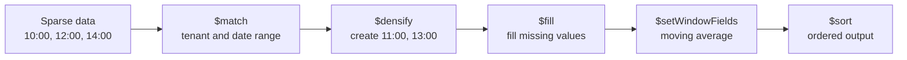

# $setWindowFields, densify, and fill in Supported Versions

## 1. Context: Analyzing Time Series with Gaps

An IoT platform sends temperature readings from multiple sensors to MongoDB. Sensor A has readings at 10:00, 12:00, and 14:00, with no document at 11:00. Other times a document exists, yet its measured value is `null`. The application needs to:

1. Compute a **moving average**, cumulative sum, or previous reading per sensor.
2. Generate missing timestamps to represent an hourly grid.
3. Fill missing values by business rule, such as carrying forward the last observation or linear interpolation.

The three corresponding aggregation stages in MongoDB are:

| Stage | Purpose | Creates new documents? | Fills null values? |
| --- | --- | --- | --- |
| `$setWindowFields` | Evaluates expressions over a **window of documents** per partition | No | Can use window operators like `$linearFill`/`$locf` on supported versions |
| `$densify` | Generates **missing documents** along numeric or time steps | **Yes** | Does not infer measurement values for created documents |
| `$fill` | Populates `null` or **missing** fields on existing documents | No | **Yes**, via constant/expression, `locf`, or `linear` |



**Distinguish two kinds of gaps:**

- *Missing document*: no data point exists at that timestamp. `$fill` alone **cannot create** that document; `$densify` or another timeline source is needed.
- *Missing value*: a document exists at that timestamp, yet the measurement field is `null` or absent. `$fill` populates it according to your chosen rule.

In Spring Data MongoDB, these stages run through `MongoTemplate.aggregate(...)` or `ReactiveMongoTemplate.aggregate(...)`. Entity mapping, repositories, and testing/performance principles still apply, though complex pipelines generally call for `MongoTemplate` rather than derived query method names.

## 2. Version Matrix and Prerequisites

Never write a pipeline assuming every MongoDB deployment supports newer stages. **MongoDB Server version** determines operator validity, while **Spring Data MongoDB version** determines which fluent DSL builders exist.

| Component | Introduced in MongoDB | Significance |
| --- | --- | --- |
| `$setWindowFields` | **5.0** | Window functions over partitions |
| `$densify` | **5.1** | Generates documents along numeric/time intervals |
| `$fill` | **5.3** | Fills null/missing fields via value or `linear`/`locf` |
| `$setWindowFields` in transactions and `snapshot` read concern | **From 5.3** | Earlier versions restricted transaction/`snapshot` usage |
| `$densify` with `bounds: [x, x]` | **Changed in 8.0** | From 8.0, equal bounds are treated as empty; older versions emitted a point at `x` |
| `$fill` linear interpolation when partitions share identical `sortBy` values | **Improved in 8.0.20** | Verify behavior on earlier versions when interpolating across multiple partitions simultaneously |

**Prerequisite for the full lab:** MongoDB Server **5.3 or newer** with compatible Java Driver and Spring Data. Because `linear` behavior across multiple sensors with identical timestamps changed across server versions, this lesson uses `locf` in the multi-sensor pipeline and demonstrates `linear` on **a single filtered sensor** so results do not depend on that version detail.

Check server version in `mongosh`:

```javascript
db.version()
db.adminCommand({ buildInfo: 1 }).version
```

In production, never grant unnecessary admin commands to application accounts. If the server does not support a stage, **no Java DSL tweak can make an older server execute it**. Upgrade the server per plan or implement a fallback (application-side windowing/gap filling, batched queries, or pre-normalized time series).

Official MongoDB references for exact syntax, constraints, and version notes:

- `$setWindowFields`: https://www.mongodb.com/docs/manual/reference/operator/aggregation/setwindowfields/
- `$densify`: https://www.mongodb.com/docs/manual/reference/operator/aggregation/densify/
- `$fill`: https://www.mongodb.com/docs/manual/reference/operator/aggregation/fill/

## 3. Hourly Data Model and Sample Fixture

Collection `sensor_readings` stores readings for multiple tenants, using **BSON Date** for timestamps, nullable `Double` for measurements, and BSON String for IDs. `tenant_id` is mandatory so analytics never mix organizations.

| BSON Field | Meaning |
| --- | --- |
| `_id` | Unique reading ID |
| `tenant_id` | Owning tenant |
| `sensor_id` | Sensor ID within tenant |
| `recorded_at` | Measurement timestamp (UTC) |
| `observed_c` | Temperature in °C, nullable |

### Seeding Lab Data in `mongosh`

**Run only on an isolated test database.** Do not re-run `insertMany` if these IDs already exist:

```javascript
use sensor_aggregation_demo

db.sensor_readings.insertMany([
  {
    _id: "A-10", tenant_id: "TENANT-A", sensor_id: "A",
    recorded_at: ISODate("2026-11-01T10:00:00Z"),
    observed_c: 10.0
  },
  {
    _id: "A-12", tenant_id: "TENANT-A", sensor_id: "A",
    recorded_at: ISODate("2026-11-01T12:00:00Z"),
    observed_c: 14.0
  },
  {
    _id: "A-13", tenant_id: "TENANT-A", sensor_id: "A",
    recorded_at: ISODate("2026-11-01T13:00:00Z"),
    observed_c: null
  },
  {
    _id: "A-14", tenant_id: "TENANT-A", sensor_id: "A",
    recorded_at: ISODate("2026-11-01T14:00:00Z"),
    observed_c: 18.0
  },
  {
    _id: "B-10", tenant_id: "TENANT-A", sensor_id: "B",
    recorded_at: ISODate("2026-11-01T10:00:00Z"),
    observed_c: 20.0
  },
  {
    _id: "B-12", tenant_id: "TENANT-A", sensor_id: "B",
    recorded_at: ISODate("2026-11-01T12:00:00Z"),
    observed_c: 26.0
  },
  {
    _id: "B-14", tenant_id: "TENANT-A", sensor_id: "B",
    recorded_at: ISODate("2026-11-01T14:00:00Z"),
    observed_c: 30.0
  },
  {
    _id: "OTHER-11", tenant_id: "TENANT-B", sensor_id: "A",
    recorded_at: ISODate("2026-11-01T11:00:00Z"),
    observed_c: 999.0
  }
])
```

Visual grid for **TENANT-A**:

| UTC Hour | A: raw reading | B: raw reading |
| --- | ---: | ---: |
| 10:00 | 10 | 20 |
| 11:00 | *(missing document)* | *(missing document)* |
| 12:00 | 14 | 26 |
| 13:00 | *null inside document* | *(missing document)* |
| 14:00 | 18 | 30 |

Data point `TENANT-B/A/11:00 = 999` checks **cross-tenant isolation**: despite sharing `sensor_id = "A"` right inside the time span, it must never enter TENANT-A's pipeline.

Consistent analysis interval:

```javascript
const start = ISODate("2026-11-01T10:00:00Z");
const endExclusive = ISODate("2026-11-01T15:00:00Z");
```

In `$densify`, **lower bound is inclusive and upper bound is exclusive** when `bounds` is an explicit array. Thus `[10:00, 15:00)` produces hourly grid ticks at 10:00, 11:00, 12:00, 13:00, and 14:00—not 15:00.

## 4. `$setWindowFields`: Partitions, Sorting, and Windows

`$setWindowFields` computes values for **each document** based on neighboring documents inside the same **partition**. Unlike `$group`, it **preserves every input document** and appends computed fields.

```javascript
{
  $setWindowFields: {
    partitionBy: "$sensor_id",
    sortBy: { recorded_at: 1 },
    output: {
      rolling_avg: {
        $avg: "$observed_c",
        window: { documents: [-2, 0] }
      }
    }
  }
}
```

Meaning:

- `partitionBy`: groups documents belonging to the same sensor so they influence only that partition. In multi-tenant apps, filter tenant upfront and/or **include tenant in the partition key**.
- `sortBy`: defines ordering within each partition; `recorded_at: 1` sorts chronologically ascending.
- `output`: fields added via window operators.
- `documents: [-2, 0]`: the current document plus **up to two preceding documents**, regardless of how far apart their timestamps are.

### 4.1. Running Sum, Moving Average, and Previous Value

Running on sensor A to see results while gaps still exist:

```javascript
db.sensor_readings.aggregate([
  { $match: { tenant_id: "TENANT-A", sensor_id: "A" } },
  {
    $setWindowFields: {
      partitionBy: "$sensor_id",
      sortBy: { recorded_at: 1 },
      output: {
        running_sum: {
          $sum: "$observed_c",
          window: { documents: ["unbounded", "current"] }
        },
        mean_last_3_documents: {
          $avg: "$observed_c",
          window: { documents: [-2, 0] }
        },
        previous_value: {
          $shift: {
            output: "$observed_c",
            by: -1,
            default: null
          }
        }
      }
    }
  },
  {
    $project: {
      _id: 0,
      recorded_at: 1,
      observed_c: 1,
      running_sum: 1,
      mean_last_3_documents: 1,
      previous_value: 1
    }
  },
  { $sort: { recorded_at: 1 } }
])
```

Expected results for A before `$densify`/`$fill`:

| Hour | `observed_c` | `running_sum` | Mean of up to 3 docs | `previous_value` |
| --- | ---: | ---: | ---: | ---: |
| 10:00 | 10 | 10 | 10 | null |
| 12:00 | 14 | 24 | 12 | 10 |
| 13:00 | null | 24 | 12 | 14 |
| 14:00 | 18 | 42 | 16 | null |

`$sum`/`$avg` ignore null values per accumulator rules; `$shift` takes the value of the **immediately preceding document**, so at 14:00 `previous_value` is `null` (from 13:00), without skipping backward to find the last non-null reading.

**Note:** `$shift` does not accept an explicit `window` because it uses an **implicit window**. Ranking operators like `$rank`, `$denseRank`, and `$documentNumber` also have their own restrictions; never blindly copy `window: {documents: ...}` from `$avg` onto every operator.

### 4.2. How `documents` Differs from `range`

These two window types answer **two different questions**:

| Type | Example | Meaning |
| --- | --- | --- |
| `documents` | `[-2, 0]` | Two preceding *documents* plus current, regardless of timestamp spacing |
| `range` with time | `[-2, 0], unit: "hour"` | Documents whose timestamps lie within **two hours before through current** |

Time-range window example:

```javascript
{
  $setWindowFields: {
    partitionBy: "$sensor_id",
    sortBy: { recorded_at: 1 },
    output: {
      avg_last_2_hours: {
        $avg: "$observed_c",
        window: { range: [-2, 0], unit: "hour" }
      }
    }
  }
}
```

For time-range windows, the sort field must be **Date**; there can be **only one `sortBy` field**, sorted ascending. Range endpoints are **inclusive**, unlike the exclusive upper bound of an array `$densify.bounds`. Never combine `documents` and `range` in one window.

### 4.3. Output Ordering and Duplicate Timestamps

`$setWindowFields` **does not guarantee output document order**, even though it uses `sortBy` internally. Add a final `$sort` when the API requires ordered rows. Also, if one sensor can emit multiple readings with identical timestamps, a `documents` window or `$shift` becomes non-deterministic. Enforce a unique key on `(tenant_id, sensor_id, recorded_at)` or add a deterministic tie-breaker where operator semantics permit.

### 4.4. `partitionBy` Is Not Tenant Isolation

`partitionBy` only scopes window calculations; it does not run `$match`, enforce permissions, or cap data volume. If you omit the tenant filter and two tenants share a sensor ID inside one partition, their averages mix together. For multi-tenant data, filter by trusted tenant upfront and include the full business key in `partitionBy`.

## 5. `$densify`: Generating Missing Ticks

`$densify` takes a **numeric or Date** axis field and creates missing documents at intervals of `step`:

```javascript
{
  $densify: {
    field: "recorded_at",
    partitionByFields: ["tenant_id", "sensor_id"],
    range: {
      step: 1,
      unit: "hour",
      bounds: [start, endExclusive]
    }
  }
}
```

- `field`: name of the field to densify, **without a `$` prefix**; must be BSON Date here.
- `partitionByFields`: fields forming the partition key; documents are generated on an independent grid per tenant/sensor pair.
- `step: 1` and `unit: "hour"`: hourly cadence. For Date fields, `unit` is mandatory and `step` must be a valid integer.
- `bounds`: generation range—an explicit `[start, endExclusive]` array, `"full"`, or `"partition"`.

Running standalone on TENANT-A:

```javascript
const start = ISODate("2026-11-01T10:00:00Z");
const endExclusive = ISODate("2026-11-01T15:00:00Z");

db.sensor_readings.aggregate([
  {
    $match: {
      tenant_id: "TENANT-A",
      sensor_id: { $in: ["A", "B"] },
      recorded_at: { $gte: start, $lt: endExclusive }
    }
  },
  {
    $densify: {
      field: "recorded_at",
      partitionByFields: ["tenant_id", "sensor_id"],
      range: {
        step: 1,
        unit: "hour",
        bounds: [start, endExclusive]
      }
    }
  },
  { $sort: { sensor_id: 1, recorded_at: 1 } }
])
```

### 5.1. Expected Generated Documents

For the sample data and bounds above:

| Partition | Original docs in range | Generated timestamps |
| --- | --- | --- |
| TENANT-A / A | 10:00, 12:00, 13:00, 14:00 | **11:00** |
| TENANT-A / B | 10:00, 12:00, 14:00 | **11:00, 13:00** |

After `$densify`, the stream holds **10 documents** instead of the original 7 for TENANT-A. Document **A/13:00 with `observed_c: null`** is **not a missing timestamp**, so `$densify` does not create a duplicate there. The three newly created documents lack `observed_c`, because `$densify` **does not interpolate values**.

A generated document resembles:

```javascript
{
  tenant_id: "TENANT-A",
  sensor_id: "A",
  recorded_at: ISODate("2026-11-01T11:00:00Z")
  // No observed_c; no original reading _id.
}
```

**Never assume generated documents inherit extra metadata from nearby real documents.** Fields outside `partitionByFields` and `field`—such as `device_model`, `customer_id`, or `quality_code`—are absent on synthetic documents. If later stages need them, define how they are derived, defaulted, or filled.

### 5.2. `"full"`, `"partition"`, and Explicit Bounds

| `range.bounds` | Meaning | Operational risk |
| --- | --- | --- |
| `[start, endExclusive]` | Grid covers the explicit interval; upper bound **exclusive** | Requires accurate range and timezone calculation |
| `"full"` | Spans global min/max of `field` across the entire stream | One sensor with old/future timestamps can explode document generation for all others |
| `"partition"` | Spans min/max per partition | Avoids cross-partition stretching, though a sparse partition can still grow large |

`$densify` is not a filter: **documents outside `bounds` still pass through**, so apply an explicit `$match` on timestamp and tenant as required by your semantics.

**The upper bound of array `bounds` is exclusive**, unlike the inclusive `range` bounds of `$setWindowFields`. `[x, x]` changed behavior between pre-8.0 and 8.0+; avoid zero-width array bounds to represent a single point across server versions.

### 5.3. Densifying Numeric Sequences Instead of Dates

`$densify` also works on numeric sequences:

```javascript
db.metric_samples.aggregate([
  {
    $densify: {
      field: "sequence",
      partitionByFields: ["device_id"],
      range: { step: 1, bounds: [1, 6] }
    }
  }
])
```

This example targets a separate `metric_samples` collection with a BSON Number `sequence`; it illustrates syntax and **is not meant to run directly on `sensor_readings`**. For numeric fields, `unit` is omitted and `[1, 6]` generates integers 1 up to (excluding) 6.

### 5.4. When Should You Avoid Densifying?

Over multi-year spans at 1-second resolution, generated documents explode. MongoDB Server caps documents generated by `$densify` (default `internalQueryMaxAllowedDensifyDocs` is 500,000 in reference docs) and fails pipelines exceeding it.

Never blindly raise that server parameter as a “fix.” Instead, shrink the time window, pick coarser granularity, filter tenants/sensors early, enforce query quotas, or pre-aggregate minute/hour buckets. Estimate point count before running:

\[
\text{expected points per partition}
\approx
\frac{\text{interval length}}{\text{step}}
\]

This formula is approximate when calendar boundaries, DST, irregular inputs, or variable-length units like months apply; never compute month counts by dividing milliseconds.

## 6. `$fill`: Populating Null or Missing Fields

After `$densify`, we have a complete timestamp grid with missing measurements. `$fill` syntax:

```javascript
{
  $fill: {
    partitionByFields: ["tenant_id", "sensor_id"],
    sortBy: { recorded_at: 1 },
    output: {
      observed_c: { method: "locf" }
    }
  }
}
```

`$fill` supports two strategies:

1. **Value/expression**: `{ value: expression }` fills nulls/missing fields with a constant or expression.
2. **Series method**: `{ method: "locf" }` (last observation carried forward) or `{ method: "linear" }` (linear interpolation).

`partitionBy` and `partitionByFields` are **mutually exclusive**; omitting partitioning treats the entire stream as one partition. In multi-tenant workloads, that is dangerous—partition by the full key and filter tenant in `$match`.

### 6.1. Filling a Constant Default

```javascript
db.sensor_readings.aggregate([
  { $match: { tenant_id: "TENANT-A" } },
  {
    $fill: {
      output: {
        observed_c: { value: -999.0 }
      }
    }
  }
])
```

This shows **field filling**: `null` becomes `-999`, while **11:00 still has no document** unless `$densify` ran first. A sentinel like `-999` must only be an agreed marker—never feed it into temperature averages as a real reading. Often it is better to leave `null` with a quality flag when “unknown” differs from `0`.

### 6.2. `locf` — Carry Forward the Last Valid Observation

Run `$densify` first, then `$fill`:

```javascript
const start = ISODate("2026-11-01T10:00:00Z");
const endExclusive = ISODate("2026-11-01T15:00:00Z");

db.sensor_readings.aggregate([
  {
    $match: {
      tenant_id: "TENANT-A",
      recorded_at: { $gte: start, $lt: endExclusive }
    }
  },
  {
    $densify: {
      field: "recorded_at",
      partitionByFields: ["tenant_id", "sensor_id"],
      range: {
        step: 1, unit: "hour",
        bounds: [start, endExclusive]
      }
    }
  },
  {
    $fill: {
      partitionByFields: ["tenant_id", "sensor_id"],
      sortBy: { recorded_at: 1 },
      output: {
        observed_c: { method: "locf" }
      }
    }
  },
  {
    $project: {
      _id: 0,
      sensor_id: 1,
      recorded_at: 1,
      observed_c: 1
    }
  },
  { $sort: { sensor_id: 1, recorded_at: 1 } }
])
```

Expected output:

| UTC Hour | A after `locf` | B after `locf` |
| --- | ---: | ---: |
| 10:00 | 10 | 20 |
| 11:00 | **10** | **20** |
| 12:00 | 14 | 26 |
| 13:00 | **14** (replaced null) | **26** |
| 14:00 | 18 | 30 |

`locf` takes **the most recent prior non-null value** in the same partition without crossing sensors. If a gap occurs at the **start of a partition** before any valid reading, the field remains `null`; `locf` never looks ahead into the future.

### 6.3. `linear` — Interpolating Between Two Valid Endpoints

`linear` linearly interpolates null/missing values between **two valid surrounding observations** along `sortBy`. Below we filter to sensor A alone to avoid multi-partition identical-timestamp caveats on older server versions:

```javascript
const start = ISODate("2026-11-01T10:00:00Z");
const endExclusive = ISODate("2026-11-01T15:00:00Z");

db.sensor_readings.aggregate([
  {
    $match: {
      tenant_id: "TENANT-A",
      sensor_id: "A",
      recorded_at: { $gte: start, $lt: endExclusive }
    }
  },
  {
    $densify: {
      field: "recorded_at",
      partitionByFields: ["tenant_id", "sensor_id"],
      range: {
        step: 1, unit: "hour",
        bounds: [start, endExclusive]
      }
    }
  },
  {
    $fill: {
      partitionByFields: ["tenant_id", "sensor_id"],
      sortBy: { recorded_at: 1 },
      output: {
        observed_c: { method: "linear" }
      }
    }
  },
  { $sort: { recorded_at: 1 } }
])
```

Results:

| Hour | Original value | Value after `linear` | Reason |
| --- | ---: | ---: | --- |
| 10:00 | 10 | 10 | Observed reading |
| 11:00 | missing doc | **12** | Midpoint between 10 and 14 |
| 12:00 | 14 | 14 | Observed reading |
| 13:00 | null | **16** | Midpoint between 14 and 18 |
| 14:00 | 18 | 18 | Observed reading |

With `method: "linear"`, `sortBy` must have **exactly one field**, with **no duplicate sort values inside a partition**. Because linear interpolation requires two surrounding endpoints, leading or trailing gaps remain `null`. On servers **prior to 8.0.20**, verify behavior when interpolating multiple partitions that share timestamps; MongoDB release notes document improvements for this case in 8.0.20.

Interpolation is an **estimate**, not a physical measurement. Across long outages, linear interpolation can mask real anomalies (such as a failed sensor during an equipment fault). Cap maximum gap lengths, flag imputed values, and never cite interpolated numbers as proof of observed events.

### 6.4. `$fill` Never Creates Documents or Writes Back to the Collection

Even after running `$densify` + `$fill`, synthetic documents in the pipeline **are not inserted into `sensor_readings`**, and filled values **do not overwrite nulls in stored documents**. These stages serve analytical reads and presentation. Persisting interpolated series requires a dedicated write workflow with validation, auditing, idempotency, and clear data lineage.

## 7. Combined Pipeline: Filter → Densify → Fill → Window

This is the main application pipeline of the lesson. It:

1. Filters by tenant, sensor list, and time window.
2. Marks `source_record = true` on **existing** documents.
3. Generates missing hourly timestamps.
4. Fills missing values with `locf`, **partitioned by tenant/sensor**.
5. Computes a moving average over **up to three consecutive post-densify documents**.
6. Flags `synthetic` on documents generated by `$densify`.
7. Projects required fields and sorts by sensor and timestamp.

```javascript
const start = ISODate("2026-11-01T10:00:00Z");
const endExclusive = ISODate("2026-11-01T15:00:00Z");

const pipeline = [
  {
    $match: {
      tenant_id: "TENANT-A",
      sensor_id: { $in: ["A", "B"] },
      recorded_at: { $gte: start, $lt: endExclusive }
    }
  },
  { $set: { source_record: true } },
  {
    $densify: {
      field: "recorded_at",
      partitionByFields: ["tenant_id", "sensor_id"],
      range: {
        step: 1,
        unit: "hour",
        bounds: [start, endExclusive]
      }
    }
  },
  {
    $fill: {
      partitionByFields: ["tenant_id", "sensor_id"],
      sortBy: { recorded_at: 1 },
      output: {
        observed_c: { method: "locf" }
      }
    }
  },
  {
    $setWindowFields: {
      partitionBy: {
        tenant: "$tenant_id",
        sensor: "$sensor_id"
      },
      sortBy: { recorded_at: 1 },
      output: {
        moving_avg_3: {
          $avg: "$observed_c",
          window: { documents: [-2, 0] }
        }
      }
    }
  },
  {
    $set: {
      synthetic: { $ne: ["$source_record", true] }
    }
  },
  {
    $project: {
      _id: 0,
      tenant_id: 1,
      sensor_id: 1,
      recorded_at: 1,
      observed_c: 1,
      moving_avg_3: 1,
      synthetic: 1
    }
  },
  { $sort: { sensor_id: 1, recorded_at: 1 } }
];

db.sensor_readings.aggregate(pipeline);
```

### 7.1. Expected Results

With the sample data, the pipeline emits **10 documents** (five ticks per sensor):

| Sensor | Hour | Value after `locf` | `synthetic` | Approx. `moving_avg_3` |
| --- | --- | ---: | --- | ---: |
| A | 10:00 | 10 | false | 10 |
| A | 11:00 | 10 | **true** | 10 |
| A | 12:00 | 14 | false | 11.333 |
| A | 13:00 | 14 | **false** | 12.667 |
| A | 14:00 | 18 | false | 15.333 |
| B | 10:00 | 20 | false | 20 |
| B | 11:00 | 20 | **true** | 20 |
| B | 12:00 | 26 | false | 22 |
| B | 13:00 | 26 | **true** | 24 |
| B | 14:00 | 30 | false | 27.333 |

`synthetic = true` marks **documents newly created by `$densify`**. A/13:00 was already an existing document with `null`, so `$fill` sets it to 14 and `synthetic = false`. Thus **“had its value filled”** and **“synthesized document”** are two distinct attributes.

If the product must distinguish **measured vs. estimated**, capture a quality flag before `$fill`—e.g., `original_value_missing`—alongside `source_record`. Never treat `synthetic: false` here as proof that the temperature was physically measured.

### 7.2. Why Place the Window After `$fill`?

Running `$setWindowFields` before `$densify`, `documents: [-2, 0]` at A/12:00 sees only 10:00 and 12:00, giving mean **12**. After creating 11:00 and filling with `locf`, the window at 12:00 sees **10, 10, 14**, giving roughly **11.333**.

Both numbers can be valid, answering **two different questions**:

- Window **before** densify/fill: mean over raw observed documents.
- Window **after** densify/fill: mean over the hourly-normalized series under the fill policy.

Agree on KPI definitions upfront. Never label an average computed over imputed points as “mean of raw observed readings.”

### 7.3. Densify First, Fill Second

If `$fill` runs before `$densify`, A/13:00 gets 14 while A/11:00 **does not exist yet**. The subsequent `$densify` creates A/11:00 with missing `observed_c`, leaving a gap unless a second `$fill` runs.

Therefore, for “complete hourly grid with filled values,” **`$densify → $fill`** is the right order.

### 7.4. Never Drop the Final `$sort`

`$densify` does not guarantee output order, and `$setWindowFields` **does not guarantee final output order** despite its internal `sortBy`. The final `$sort` establishes the API's ordering contract. If real data can contain duplicate tenant/sensor/timestamp records, define deduplication or secondary tie-breaking rules.

## 8. Spring Data MongoDB: Entity and Execution

The following example uses **Java 17+**, `spring-boot-starter-data-mongodb`, and `MongoTemplate`. The server must support `$setWindowFields`, `$densify`, and `$fill` (MongoDB **5.3+** for all three). Newer Spring Data versions may offer `DensifyOperation`/`FillOperation` builders; to avoid version-specific DSL coupling, this example uses **`AggregationOperation` returning BSON `Document`** for the advanced stages.

### 8.1. `SensorReading` Entity

```java
package com.example.sensors;

import java.time.Instant;
import org.springframework.data.mongodb.core.mapping.Document;
import org.springframework.data.mongodb.core.mapping.Field;
import org.springframework.data.mongodb.core.mapping.FieldType;
import org.springframework.data.mongodb.core.mapping.MongoId;

@Document(collection = "sensor_readings")
public class SensorReading {

    @MongoId(FieldType.STRING)
    private String id;

    @Field("tenant_id")
    private String tenantId;

    @Field("sensor_id")
    private String sensorId;

    @Field("recorded_at")
    private Instant recordedAt;

    @Field("observed_c")
    private Double observedC;

    protected SensorReading() {}

    public String getId() { return id; }
    public String getTenantId() { return tenantId; }
    public String getSensorId() { return sensorId; }
    public Instant getRecordedAt() { return recordedAt; }
    public Double getObservedC() { return observedC; }
}
```

Wrapper `Double` distinguishes “present document with null measurement” from `0.0`; using primitive `double` would silently turn missing values into `0.0`.

### 8.2. Service Building and Executing the Pipeline

```java
package com.example.sensors;

import java.time.Instant;
import java.util.Date;
import java.util.List;
import org.bson.Document;
import org.springframework.data.mongodb.core.MongoTemplate;
import org.springframework.data.mongodb.core.aggregation.Aggregation;
import org.springframework.data.mongodb.core.aggregation.AggregationOperation;
import org.springframework.data.mongodb.core.aggregation.AggregationResults;
import org.springframework.data.mongodb.core.query.Criteria;
import org.springframework.stereotype.Service;

@Service
public class SensorAggregationService {

    private final MongoTemplate template;

    public SensorAggregationService(MongoTemplate template) {
        this.template = template;
    }

    public List<Document> hourlySeries(
            String authorizedTenantId,
            List<String> sensorIds,
            Instant start,
            Instant endExclusive) {

        if (authorizedTenantId == null
                || authorizedTenantId.isBlank()
                || sensorIds == null || sensorIds.isEmpty()
                || sensorIds.size() > 20
                || sensorIds.stream().anyMatch(
                    id -> id == null || id.isBlank())
                || start == null || endExclusive == null
                || !start.isBefore(endExclusive)) {
            throw new IllegalArgumentException(
                "Invalid aggregation parameters");
        }

        // Demo threshold: cap query span at 24 hours.
        if (java.time.Duration.between(start, endExclusive)
                .compareTo(java.time.Duration.ofHours(24)) > 0) {
            throw new IllegalArgumentException(
                "Time range exceeds query budget");
        }

        List<Date> bounds = List.of(
            Date.from(start), Date.from(endExclusive));

        AggregationOperation flagSource = context ->
            new Document("$set",
                new Document("source_record", true));

        AggregationOperation densify = context ->
            new Document("$densify",
                new Document("field", "recorded_at")
                    .append("partitionByFields",
                        List.of("tenant_id", "sensor_id"))
                    .append("range",
                        new Document("step", 1)
                            .append("unit", "hour")
                            .append("bounds", bounds)));

        AggregationOperation fill = context ->
            new Document("$fill",
                new Document("partitionByFields",
                    List.of("tenant_id", "sensor_id"))
                    .append("sortBy",
                        new Document("recorded_at", 1))
                    .append("output",
                        new Document("observed_c",
                            new Document("method", "locf"))));

        AggregationOperation window = context ->
            new Document("$setWindowFields",
                new Document("partitionBy",
                    new Document("tenant", "$tenant_id")
                        .append("sensor", "$sensor_id"))
                    .append("sortBy",
                        new Document("recorded_at", 1))
                    .append("output",
                        new Document("moving_avg_3",
                            new Document("$avg", "$observed_c")
                                .append("window",
                                    new Document("documents",
                                        List.of(-2, 0))))));

        AggregationOperation flagSynthetic = context ->
            new Document("$set",
                new Document("synthetic",
                    new Document("$ne",
                        List.of("$source_record", true))));

        AggregationOperation resultFields = context ->
            new Document("$project",
                new Document("_id", 0)
                    .append("tenant_id", 1)
                    .append("sensor_id", 1)
                    .append("recorded_at", 1)
                    .append("observed_c", 1)
                    .append("moving_avg_3", 1)
                    .append("synthetic", 1));

        AggregationOperation sortResult = context ->
            new Document("$sort",
                new Document("sensor_id", 1)
                    .append("recorded_at", 1));

        // Only the match stage below uses Java property names;
        // raw stages above use physical BSON field names.
        Aggregation pipeline = Aggregation.newAggregation(
            Aggregation.match(
                Criteria.where("tenantId").is(authorizedTenantId)
                    .and("sensorId").in(sensorIds)
                    .and("recordedAt").gte(start).lt(endExclusive)
            ),
            flagSource,
            densify,
            fill,
            window,
            flagSynthetic,
            resultFields,
            sortResult
        );

        AggregationResults<Document> results =
            template.aggregate(
                pipeline, SensorReading.class, Document.class);

        return results.getMappedResults();
    }
}
```

**Key technical point:** `Criteria.where("tenantId")` inside `Aggregation.match` uses entity metadata to translate to `tenant_id`. Custom stages constructing `new Document(...)` use **physical BSON field names** (`recorded_at`, `sensor_id`, `observed_c`). Never write `"$recordedAt"` inside raw expressions expecting Spring Data to translate it automatically to `"$recorded_at"`.

Demo call:

```java
List<Document> output = service.hourlySeries(
    "TENANT-A",
    List.of("A", "B"),
    Instant.parse("2026-11-01T10:00:00Z"),
    Instant.parse("2026-11-01T15:00:00Z")
);
```

**Never expose raw `Document` directly as a public API response**: in production, map to a DTO and enforce a field allowlist. This service returns `Document` so learners can inspect exact BSON shapes after aggregation.

### 8.3. Checking Spring Data API Compatibility

Spring Data MongoDB builders evolve across library releases. Some versions provide fluent DSLs for `$setWindowFields`, `$densify`, and `$fill`; always check method signatures for your exact version. Using explicit `AggregationOperation` keeps stage syntax close to MongoDB, yet **does not replace** verifying BSON structure, access control, and server compatibility.

For custom stages, never assume automatic property mapping or query optimization identical to typed `Criteria` queries. Here all custom stage names match physical BSON fields; verify the pipeline against a compatible MongoDB Server rather than relying solely on Java compilation.

## 9. Integration Testing: Outputs, Partitions, and Source Data

To test newer stages, **run against a real supporting MongoDB Server**, not just a mocked `MongoTemplate`. A unit test stubbing `List<Document>` cannot prove `$densify` generates the right ticks, `$fill` stays inside partitions, or windows compute accurately.

Tests should run against an isolated test MongoDB instance (e.g., Testcontainers running **5.3+**) with Spring Boot 3.x `@DataMongoTest`. Remember `@DataMongoTest` does not start a compatible MongoDB automatically; provide the test URI/container.

### 9.1. Test Data and Key Assertions

Using Section 3's dataset, core assertions:

| Scenario | Expected |
| --- | --- |
| A/11:00 missing document | Present after densify, `synthetic = true`, `observed_c = 10` after locf |
| A/13:00 existing doc with `observed_c = null` | Not synthesized, `synthetic = false`, `observed_c = 14` after locf |
| B/13:00 missing document | Synthesized, `observed_c = 26` |
| TENANT-B/A/11:00 = 999 | **Excluded** from TENANT-A output and never affects fill/window |
| A/12:00 after densify + locf | `moving_avg_3 = (10 + 10 + 14) / 3` |
| Stored MongoDB collection | No new A/11:00 document inserted; A/13:00 remains null |

### 9.2. `@DataMongoTest` Template

Integration test pairing with `SensorReading` and `SensorAggregationService` above:

```java
package com.example.sensors;

import java.time.Instant;
import java.util.ArrayList;
import java.util.Date;
import java.util.List;
import org.bson.Document;
import org.junit.jupiter.api.BeforeEach;
import org.junit.jupiter.api.Test;
import org.springframework.beans.factory.annotation.Autowired;
import org.springframework.boot.test.autoconfigure.data.mongo.DataMongoTest;
import org.springframework.data.mongodb.core.MongoTemplate;

import static org.assertj.core.api.Assertions.assertThat;

@DataMongoTest
class SensorAggregationIntegrationTest {

    @Autowired
    MongoTemplate template;

    private SensorAggregationService service;

    private final Instant start =
        Instant.parse("2026-11-01T10:00:00Z");
    private final Instant endExclusive =
        Instant.parse("2026-11-01T15:00:00Z");

    @BeforeEach
    void seedIsolatedDatabase() {
        // DANGER: deleteMany wipes the entire collection.
        // Run ONLY against an isolated test database!
        template.getCollection("sensor_readings")
            .deleteMany(new Document());

        List<Document> records = new ArrayList<>();
        records.add(row(
            "A-10", "TENANT-A", "A", 10, 10.0));
        records.add(row(
            "A-12", "TENANT-A", "A", 12, 14.0));
        records.add(row(
            "A-13", "TENANT-A", "A", 13, null));
        records.add(row(
            "A-14", "TENANT-A", "A", 14, 18.0));
        records.add(row(
            "B-10", "TENANT-A", "B", 10, 20.0));
        records.add(row(
            "B-12", "TENANT-A", "B", 12, 26.0));
        records.add(row(
            "B-14", "TENANT-A", "B", 14, 30.0));
        records.add(row(
            "OTHER-11", "TENANT-B", "A", 11, 999.0));

        template.getCollection("sensor_readings")
            .insertMany(records);
        service = new SensorAggregationService(template);
    }

    static Document row(
            String id, String tenant, String sensor,
            int hour, Double observed) {
        return new Document("_id", id)
            .append("tenant_id", tenant)
            .append("sensor_id", sensor)
            .append("recorded_at",
                Date.from(Instant.parse(String.format(
                    "2026-11-01T%02d:00:00Z", hour))))
            .append("observed_c", observed);
    }

    static Document findAt(
            List<Document> rows, String sensor, int hour) {
        Date timestamp = Date.from(Instant.parse(
            String.format("2026-11-01T%02d:00:00Z", hour)));
        return rows.stream()
            .filter(d -> sensor.equals(d.getString("sensor_id")))
            .filter(d -> timestamp.equals(d.getDate("recorded_at")))
            .findFirst().orElseThrow();
    }

    @Test
    void densifyProducesOnlyExpectedHourlyBuckets() {
        List<Document> rows = service.hourlySeries(
            "TENANT-A", List.of("A", "B"), start, endExclusive);

        assertThat(rows).hasSize(10);
        assertThat(rows)
            .extracting(d -> d.getString("tenant_id"))
            .containsOnly("TENANT-A");

        Document a11 = findAt(rows, "A", 11);
        Document b13 = findAt(rows, "B", 13);

        assertThat(a11.getBoolean("synthetic")).isTrue();
        assertThat(b13.getBoolean("synthetic")).isTrue();
        assertThat(((Number) a11.get("observed_c")).doubleValue())
            .isEqualTo(10.0);
        assertThat(((Number) b13.get("observed_c")).doubleValue())
            .isEqualTo(26.0);
    }

    @Test
    void existingNullValueIsFilledButNotSynthetic() {
        List<Document> rows = service.hourlySeries(
            "TENANT-A", List.of("A"), start, endExclusive);

        Document a13 = findAt(rows, "A", 13);

        assertThat(a13.getBoolean("synthetic")).isFalse();
        assertThat(((Number) a13.get("observed_c")).doubleValue())
            .isEqualTo(14.0);

        Document a12 = findAt(rows, "A", 12);
        double mean = ((Number) a12.get("moving_avg_3"))
            .doubleValue();
        assertThat(mean)
            .isCloseTo(34.0 / 3.0,
                org.assertj.core.data.Offset.offset(0.000001));
    }

    @Test
    void aggregationDoesNotWriteSyntheticRowsToCollection() {
        service.hourlySeries(
            "TENANT-A", List.of("A", "B"), start, endExclusive);

        long stored = template.getCollection("sensor_readings")
            .countDocuments(new Document(
                "tenant_id", "TENANT-A"));
        assertThat(stored).isEqualTo(7);

        Document originalA13 =
            template.getCollection("sensor_readings")
                .find(new Document("_id", "A-13"))
                .first();
        assertThat(originalA13).isNotNull();
        assertThat(originalA13.get("observed_c")).isNull();
    }
}
```

**Test safety warning:** `deleteMany(new Document())` removes **every document** in the connected collection across all tenants. Run only against a completely isolated test database; never run on production or shared databases.

### 9.3. Additional Cases to Test

1. Duplicate timestamps inside a partition: verify `$fill.linear` and window order; enforce unique index or deduplicate data.
2. `linear` lacking two surrounding observations: field stays null rather than extrapolating edges.
3. Partition containing only nulls: `locf` does not invent numeric measurements.
4. Lower/upper bounds and timezone: never generate a tick at `endExclusive`.
5. Service limits (24-hour span and max 20 sensors): reject over-budget requests.
6. Renaming `@Field` in the entity: catches raw BSON stages diverging from entity schema.
7. Older server version: tests surface unsupported stage errors clearly rather than silently altering meaning.
8. Wrong-typed sensor timestamps (String instead of Date): clean or quarantine before `$densify`.
9. Large-scale pipeline: measure memory, latency, and generated row count rather than extrapolating from eight sample docs.

## 10. Performance, Indexes, and Resource Limits

`$setWindowFields` buffers window state, `$densify` can **expand document count sharply**, and `$fill` tracks prior/next points per partition. These stages are powerful for analytics, yet are never free in CPU, RAM, I/O, or latency.

### 10.1. Indexes for the Opening Filter

For workloads filtering by tenant, sensor, and time range, a candidate compound index is:

```javascript
db.sensor_readings.createIndex(
  {
    tenant_id: 1,
    sensor_id: 1,
    recorded_at: 1
  },
  {
    name: "sensor_tenant_id_time",
    unique: true
  }
)
```

Only create a `unique` index when domain rules truly guarantee **one reading per tenant/sensor/timestamp**. Clean up existing duplicates first. If a sensor legitimately emits multiple samples per timestamp, include `sample_id` in the unique key and normalize/aggregate before interpolating.

This index helps `$match` resolve tenant, sensor list, and time range efficiently. It does not make `$densify` or `$fill` constant-time, nor does it replace capping generated point counts.

### 10.2. Estimating Cost Before Execution

Suppose the service allows 20 sensors across 24 hours at 1-hour resolution. The theoretical grid budget is:

\[
20 \times 24 = 480\ \text{grid points in the output}
\]

This assumes each sensor has data in range, no duplicates exist, and each tick maps to one document. With more sensors, longer spans, or minute/second cadence, intermediate row counts grow rapidly. Distinguish:

- **Input rows**: documents kept by `$match`.
- **Generated rows**: synthetic documents created by `$densify`.
- **Output rows**: documents remaining after `$fill`, windowing, projection, and limits.

A trailing `$limit` trims only final results—**it does not guarantee skipping earlier generation work**. Bound tenant, sensors, time window, and resolution **before** `$densify`.

### 10.3. Using `explain` to Inspect the Query Plan

On read-only pipelines, run explain to examine scanning and stage costs:

```javascript
const start = ISODate("2026-11-01T10:00:00Z");
const endExclusive = ISODate("2026-11-01T15:00:00Z");

db.sensor_readings.explain("executionStats").aggregate([
  {
    $match: {
      tenant_id: "TENANT-A",
      sensor_id: "A",
      recorded_at: { $gte: start, $lt: endExclusive }
    }
  },
  {
    $densify: {
      field: "recorded_at",
      partitionByFields: ["tenant_id", "sensor_id"],
      range: {
        step: 1, unit: "hour",
        bounds: [start, endExclusive]
      }
    }
  }
])
```

Depending on version and engine, `explain` reports `winningPlan`, `IXSCAN`/`COLLSCAN`, `totalKeysExamined`, `totalDocsExamined`, `nReturned`, and stage stats. Compare against end-to-end application latency; `explain` does not include network transfer, BSON-to-Java mapping, or JSON serialization.

### 10.4. Sorting, Memory, and Disk Spill

Window evaluation may sort documents by partition and timestamp. Stages can consume significant memory or spill to disk depending on server version, pipeline shape, and `allowDiskUse`. **Enabling disk spill does not make a multi-million-point densify safe**: bound inputs, outputs, and execution time.

Key metrics to monitor:

| Metric | Why |
| --- | --- |
| `aggregation_duration_ms` p50/p95/p99 | End-to-end pipeline latency |
| `source_rows` | Documents matched from the collection |
| `synthetic_rows` | Amplification caused by `$densify` |
| `filled_values` / `missing_after_fill` | Series completeness after filling |
| `rows_per_partition` | Spots anomalous sensors or time ranges |
| `memory_spill` / disk I/O | Sorts or windows exceeding RAM thresholds |
| `query_timeout` & unsupported-stage errors | Tracks version and resource limits |

Never use unbounded tenant or sensor IDs as high-cardinality metric labels; put correlation IDs in controlled logs and aggregate metrics by service/pipeline type.

## 11. Reactive Aggregation and Streaming Results

In **Spring WebFlux**, `ReactiveMongoTemplate.aggregate(...)` returns `Flux<T>` instead of `AggregationResults<T>`. All stages still execute on **MongoDB**, not as Java operations on WebFlux threads.

You can reuse the `Aggregation` builder from Section 8 in a reactive reader:

```java
import org.bson.Document;
import org.springframework.data.mongodb.core.ReactiveMongoTemplate;
import org.springframework.data.mongodb.core.aggregation.Aggregation;
import reactor.core.publisher.Flux;

public final class ReactiveSensorReader {
    private final ReactiveMongoTemplate template;

    public ReactiveSensorReader(ReactiveMongoTemplate template) {
        this.template = template;
    }

    public Flux<Document> run(Aggregation pipeline) {
        return template.aggregate(
            pipeline, SensorReading.class, Document.class);
    }
}
```

`pipeline` must be constructed from **validated** inputs with tenant `$match` and sensor/time limits just like the synchronous service. Never execute arbitrary client-provided stages.

**Three misconceptions to avoid:**

1. **Reactive does not offload windowing to the client.** MongoDB still executes `$densify`, `$fill`, and `$setWindowFields`, subject to server version, indexes, and RAM.
2. **Backpressure does not stop server-side densification before emission.** Requesting only a few elements downstream does not necessarily stop the server from materializing large intermediate grids.
3. **Never call `block()` inside reactive request handlers.** Avoid unbounded `collectList()` on large pipelines and enforce output/timeout budgets.

To export years of data, never stream a 1-second grid in one giant `Flux`. Slice queries into manageable chunks, cache/precompute rollups, or adjust resolution. When processing multiple partitions concurrently, throttle concurrency against MongoDB and preserve series consistency.

## 12. Common Pitfalls and Differences

| Symptom | Likely cause | Fix |
| --- | --- | --- |
| MongoDB throws `Unrecognized pipeline stage` | Server too old for `$densify` or `$fill` | Check version; require MongoDB 5.3+ for the full pipeline |
| `$densify` errors on type | `recorded_at` stored as String instead of Date, or mismatched bounds | Normalize to BSON Date and match bound types |
| `$densify` generates too many docs | Span too wide, step too small, or unintended `"full"` bounds | Bound inputs and point counts; use explicit array bounds |
| Missing timestamps still lack documents | Ran `$fill` without `$densify` | Run `$densify` before `$fill` or use another grid source |
| New documents exist yet `observed_c` is missing | Ran `$densify` without `$fill` | Append `$fill` after `$densify` |
| Leading nulls remain unfilled | `locf` has no prior reading; `linear` lacks two endpoints | Define an edge-gap policy; never blindly extrapolate |
| `linear` errors on sort | Multiple `sortBy` fields or duplicate timestamps in partition | Use a single sort field and deduplicate timestamps |
| Multi-partition `linear` with equal timestamps behaves oddly | Version-dependent behavior, improved in 8.0.20 | Test on your exact server or process per partition |
| Moving average does not match “last 2 hours” | Used `documents: [-2, 0]` instead of time `range` | Pick document-count vs. time-range window per requirement |
| Moving averages bleed across sensors/tenants | Missing `partitionBy` or omitted tenant from key | Filter tenant and include full key in `partitionBy` |
| Output arrives out of order | Assumed window `sortBy` or `$densify` preserves final order | Add a trailing `$sort` stage |
| Extra or missing point at upper bound | Confused exclusive `$densify.bounds` with inclusive window `range` | Write explicit boundary tests |
| Slow query despite indexed `$match` | `$densify` generates huge points or window uses heavy CPU/RAM | Monitor generated points, adjust cadence, run `explain` |
| Java code behaves differently from `mongosh` | Raw `Document` used Java property names instead of BSON | Cross-check `@Field` and inspected server commands |
| Collection unchanged after calling `aggregate` | Read pipelines do not mutate source data | Expected behavior; build explicit writes if persistence is needed |
| Public API leaks internal fields | Returned raw `Document` without projection | Map to DTOs with a strict field allowlist |

### When to Use `$setWindowFields` Alone?

If data is already uniformly sampled or you only want running totals over **actual observed documents**, skip `$densify` and `$fill`. For example, “average of the last 3 measurements” needs only `$match → $setWindowFields → $project`. Synthesizing rows changes KPI meaning if business logic requires observed data only.

### When to Use `$fill` Without `$densify`?

If writers already guarantee a document for **every** hour and only some readings are null, `$fill` alone suffices. `$densify` is needed only when **documents/timestamps themselves** are missing.

### When Are Both Stages Inappropriate?

In transactional or audited systems requiring “numbers must be observed, never estimated,” `locf`/`linear` can **mislead readers**. When reporting downtime or gaps, you can densify while leaving `null` plus a quality flag, or emit gap alerts without inventing values.

## 13. Practice Exercises and Answers

### Exercise 1. Two Types of Gaps

**Question:** A/11:00 has no document; A/13:00 has a document with `observed_c = null`. What does each stage do?

**Answer:** `$densify` generates the A/11:00 document without filling any measurement. `$fill` populates missing values on both A/11:00 and A/13:00 per method, yet cannot create A/11:00 on its own.

### Exercise 2. Document-Count Window

**Question:** A has three readings: 10:00 = 10, 12:00 = 14, 14:00 = 18. What points does `documents: [-2, 0]` average at 14:00?

**Answer:** All three **documents** (10:00, 12:00, 14:00), giving `(10 + 14 + 18) / 3 = 14`. It does not mean “past two hours” when data is sparse.

### Exercise 3. Hourly Time Range

**Question:** How do you configure a window averaging documents from two hours ago through the current reading?

**Answer:** `window: { range: [-2, 0], unit: "hour" }` with a single ascending Date `sortBy` field. Window range bounds are **inclusive**, unlike `$densify.bounds`.

### Exercise 4. LOCF

**Question:** Given A/10:00 = 10, A/12:00 = 14, missing A/11:00, and null A/13:00, what are the values at 11:00 and 13:00 after `densify → fill locf`?

**Answer:** 11:00 = **10** (carried from 10:00), 13:00 = **14** (carried from 12:00).

### Exercise 5. Linear Interpolation

**Question:** A/10:00 = 10, A/12:00 = 14, A/14:00 = 18. After hourly densify and linear fill, what are 11:00 and 13:00?

**Answer:** 11:00 = **12**, 13:00 = **16**. These are **estimated values**, not observed measurements.

### Exercise 6. Leading Nulls in a Partition

**Question:** A series starts with 10:00 = null, 11:00 = null, 12:00 = 20. Will `locf` fill the first two ticks?

**Answer:** No, because there is no prior valid reading. Define an explicit business rule for leading gaps instead of defaulting silently to 0.

### Exercise 7. Tenant Isolation

**Question:** Two tenants both have sensor ID `"A"`. What is the risk of `$setWindowFields.partitionBy = "$sensor_id"` across the whole collection?

**Answer:** Readings from both tenants mix inside the same partition. Filter by authenticated tenant upfront and/or partition by `(tenant_id, sensor_id)`.

### Exercise 8. Version Compatibility

**Question:** Does MongoDB 5.0 support the full `$setWindowFields → $densify → $fill` pipeline?

**Answer:** No. `$setWindowFields` arrived in 5.0, `$densify` in 5.1, and `$fill` in 5.3. You need MongoDB **5.3+** for all three stages.

### Exercise 9. Output Ordering

**Question:** After `$densify` and `$setWindowFields(sortBy: {recorded_at: 1})`, can you rely on MongoDB returning sorted documents?

**Answer:** No. Append a final `$sort: {sensor_id: 1, recorded_at: 1}` to enforce output ordering.

### Exercise 10. KPI Accuracy

**Question:** Before filling, A/12:00 has two observed docs (10, 14) averaging 12. After densify/locf, what is the three-doc average at 12:00, and are the two results contradictory?

**Answer:** After densify/locf, the sequence is `10, 10, 14`, averaging **11.333**. The two metrics operate on **different datasets** and do not contradict each other—document clearly whether a KPI measures observed or imputed series.

## 14. Production Deployment Checklist

1. **Verify server version.** `$setWindowFields` needs 5.0+, `$densify` 5.1+, `$fill` 5.3+; watch 8.0/8.0.20 changes.
2. **Separate missing documents from missing fields.** Densify only when timestamps/sequence ticks are absent.
3. **Standardize BSON types.** Dates as BSON Date, readings as numeric or null; never mix String and Date.
4. **Use complete partition keys.** Tenant + sensor/device + any business dimensions that must stay isolated.
5. **Specify cadence and bounds.** Document `step`, `unit`, timezone, and `$densify`'s exclusive upper bound.
6. **Justify `locf` or `linear`.** Never present interpolated values as raw measurements; cap max gap lengths where appropriate.
7. **Pick the right window mode.** `documents` for row counts; `range` for value/time intervals.
8. **Align stage order with metric semantics.** Pre-fill vs. post-fill windows answer different questions.
9. **Filter tenant and time before `$densify`.** Prevent point explosion and cross-tenant leakage.
10. **Add a trailing `$sort`.** Window `sortBy` does not guarantee final output order.
11. **Control output shape.** Use DTOs/allowlists and synthetic/imputed flags where helpful.
12. **Budget point generation.** Bound sensor count, granularity, and time span; monitor `synthetic_rows`.
13. **Index the leading `$match`.** Check `explain` on representative data and guard against duplicate timestamps.
14. **Integration test on real MongoDB.** Use a compatible server version and test nulls, bounds, cross-tenant isolation, and source immutability.
15. **Remember reactive does not remove resource limits.** Use `ReactiveMongoTemplate` where suitable while still bounding the pipeline.

## 15. Conclusion

`$setWindowFields`, `$densify`, and `$fill` address **three distinct analytical tasks** in MongoDB: computing over **sliding windows**, synthesizing **missing timeline ticks**, and populating **null/missing values**. For sparse time series, `$match → $densify → $fill → $setWindowFields` fits well when KPIs measure a **cadence-normalized series**; when KPIs must reflect raw observations only, run window calculations directly on observed documents without adding synthetic points.

In Spring Data MongoDB, express these pipelines via `Aggregation`/`MongoTemplate` or their reactive counterparts, using DSL builders where supported or explicit BSON `Document` `AggregationOperation`s. Always verify your **MongoDB server version**, isolate tenants, define imputation semantics explicitly, bound generated document counts, validate indexes, and test against a real MongoDB instance. **Aggregation never alters stored source data**, and filled numbers are synthetic artifacts of your processing rules—never equate them with physical measurements.
