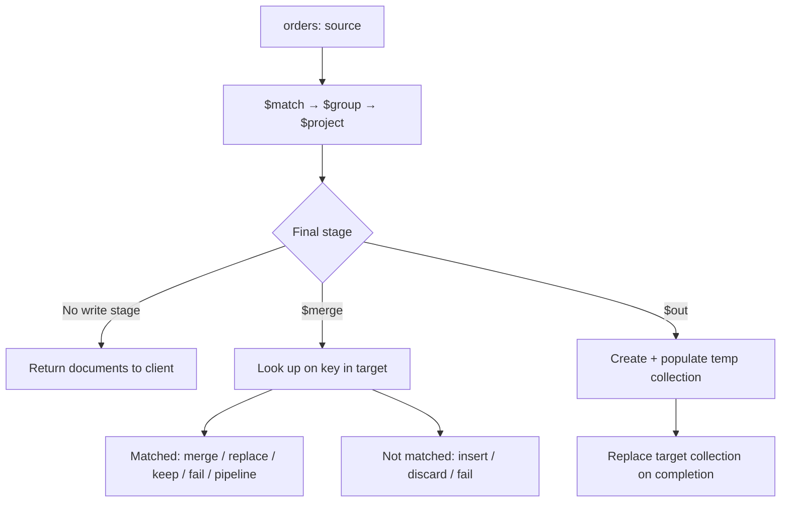
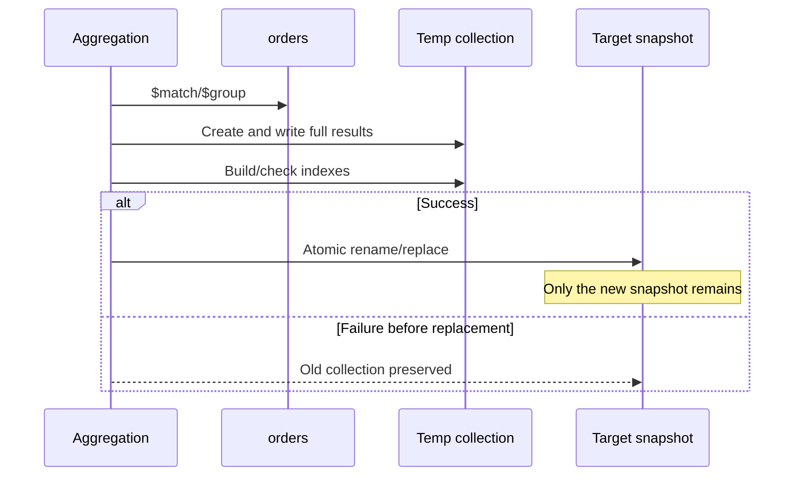

# $merge, $out, and Write-Enabled Aggregation Pipeline Scope

In **Spring Data MongoDB**, aggregation is typically used to **read and transform documents** using stages such as `$match`, `$group`, `$project`, and `$sort`. However, two stages—**`$merge`** and **`$out`**—can also **write results to a collection**. A pipeline containing them does not merely return a list of DTOs: it becomes a data-mutating job subject to rules on write permissions, schema, indexes, failures, and re-runnability.

- **`$merge`** looks up the target document by the `on` identifier key and then **inserts, merges, replaces, keeps existing, discards, or fails**, depending on the configured options.
- **`$out`** builds a new set of result documents and, if the target collection already exists, **replaces that entire collection** when computation completes successfully.
- **Both must be placed at the end of the pipeline** and **cannot run inside a MongoDB transaction**. The atomicity of an individual operation or collection replacement does not imply the entire business workflow is transactional.

This lesson belongs to the **Advanced Aggregation** chapter of the **SPRING_DATA_MONGODB** module: connections, document mapping, `MongoTemplate`/repository operations, aggregation and index design, working with transactions/reactive drivers, testing, and performance diagnostics. We will build a daily revenue table, test both write approaches, and analyze the boundaries that affect report consistency.

## 1. From read-only aggregation to write-enabled aggregation

Read-only pipeline:

```javascript
db.orders.aggregate([
  { $match: { status: "PAID" } },
  { $group: { _id: "$tenant_id", paidOrders: { $sum: 1 } } }
]);
```

It returns results to mongosh/the driver and **creates no collection**. Simply adding a final stage changes the semantics:

```javascript
// Merge each summary document by _id.
db.orders.aggregate([
  { $match: { status: "PAID" } },
  { $group: { _id: "$tenant_id", paidOrders: { $sum: 1 } } },
  { $merge: "tenant_paid_counts" }
]);

// Replace the entire snapshot collection with the full new result set.
db.orders.aggregate([
  { $match: { status: "PAID" } },
  { $group: { _id: "$tenant_id", paidOrders: { $sum: 1 } } },
  { $out: "tenant_paid_snapshot" }
]);
```

Even though the prefix is identical, **the write target and how existing data is handled** are different.



Some read stages may execute on a secondary depending on read preference/topology, but **the write portion of `$merge`/`$out` must still go through primary mechanisms and appropriate write privileges**. They cannot be treated as read-only operations just because they are invoked through an `aggregate` method.

## 2. Comparing write scope

| Aspect | `$merge` | `$out` |
| --- | --- | --- |
| Intent | Update or insert individual result documents | Refresh the entire result set in the target collection |
| Matching | `on` field(s), requiring a corresponding unique index | No matching key |
| Existing target documents | Controlled by `whenMatched` | Old collection is replaced upon completion |
| Result documents absent from target | Controlled by `whenNotMatched` | Appear in the new collection |
| Stale documents no longer produced by the pipeline | **Remain** unless cleaned up separately | **Disappear** after the collection is replaced |
| When a stage fails midway | `$merge` writes before the failure may remain | Old target collection is preserved if replacement has not completed |
| Sharded output collection | Supported, subject to key/index conditions | Not supported |
| Inside a MongoDB transaction | No | No |
| Position | Must be the last stage | Must be the last stage |

**Selection rule:** refreshing a **complete** set where replacing the target is allowed → consider `$out`; recomputing a subset of keys in a shared summary table → consider `$merge`.

## 3. Sample dataset: revenue report by tenant/day

Suppose the `orders` collection stores:

```javascript
db.orders.insertMany([
  {
    _id: ObjectId("674000000000000000001001"),
    tenant_id: "T1", status: "PAID", total_vnd: NumberLong("100000"),
    paid_at: ISODate("2026-11-18T01:00:00Z")
  },
  {
    _id: ObjectId("674000000000000000001002"),
    tenant_id: "T1", status: "PAID", total_vnd: NumberLong("200000"),
    paid_at: ISODate("2026-11-18T14:00:00Z")
  },
  {
    _id: ObjectId("674000000000000000001003"),
    tenant_id: "T1", status: "PAID", total_vnd: NumberLong("400000"),
    paid_at: ISODate("2026-11-19T02:00:00Z")
  },
  {
    _id: ObjectId("674000000000000000001004"),
    tenant_id: "T1", status: "PAID", total_vnd: NumberLong("50000"),
    paid_at: ISODate("2026-11-19T12:00:00Z")
  },
  {
    _id: ObjectId("674000000000000000001005"),
    tenant_id: "T1", status: "NEW", total_vnd: NumberLong("900000"),
    paid_at: null
  },
  {
    _id: ObjectId("674000000000000000001006"),
    tenant_id: "T2", status: "PAID", total_vnd: NumberLong("500000"),
    paid_at: ISODate("2026-11-18T08:00:00Z")
  }
]);
```

Expected aggregation:

| Tenant | UTC Day | PAID Orders | Revenue VND |
| --- | --- | ---: | ---: |
| T1 | 2026-11-18 | 2 | 300.000 |
| T1 | 2026-11-19 | 2 | 450.000 |
| T2 | 2026-11-18 | 1 | 500.000 |

Orders with status `NEW` are excluded. The day is determined using `$dateToString` with timezone `UTC`. In production systems, you must choose a **business timezone**, currency unit, and paid-timestamp definition that stay consistent across every run.

**Only use this dataset on a test MongoDB instance**; do not insert directly into a production collection.

## 4. Build and verify the read-only pipeline prefix first

Before writing to the target collection, verify the filters and sums:

```javascript
db.orders.aggregate([
  {
    $match: {
      status: "PAID",
      paid_at: { $type: "date" },
      total_vnd: { $type: "number" }
    }
  },
  {
    $group: {
      _id: {
        tenant: "$tenant_id",
        day: {
          $dateToString: {
            format: "%Y-%m-%d",
            date: "$paid_at",
            timezone: "UTC"
          }
        }
      },
      ordersCount: { $sum: 1 },
      revenueVnd: { $sum: "$total_vnd" }
    }
  },
  {
    $project: {
      _id: 0,
      tenant_id: "$_id.tenant",
      day: "$_id.day",
      orders_count: "$ordersCount",
      revenue_vnd: "$revenueVnd"
    }
  },
  { $sort: { tenant_id: 1, day: 1 } }
]);
```

Invariants to verify:

1. `$match` only accepts `PAID` orders with a valid date and numeric value; string/null values must be handled separately if legacy schemas are inconsistent.
2. Tenant is included in the **group key**, preventing revenue from being summed across organizations.
3. `day` is timezone-consistent; do not change the logic between two versions of the report.
4. `_id: 0` strips the intermediate group ID, avoiding attempts to write a mismatched `_id` when using an `on` key other than `_id`.
5. The output has `tenant_id`, `day`, `orders_count`, and `revenue_vnd` with the expected types.

The read-only stage results must contain exactly **three documents** matching the table in section 3. Only after confirming correctness should you append a write stage.

## 5. Structure of $merge

```javascript
{
  $merge: {
    into: "daily_sales",
    on: ["tenant_id", "day"],
    whenMatched: "merge",
    whenNotMatched: "insert"
  }
}
```

You can use `into: {db:"reporting",coll:"daily_sales"}` to target a collection in another database **within the same MongoDB deployment** when permitted. `$merge` accepts the following fields:

| Field | Role |
| --- | --- |
| `into` | Target collection/database |
| `on` | Field or set of fields serving as a **unique** identifier to locate matching records |
| `whenMatched` | Policy when a result record matches an existing document |
| `whenNotMatched` | Policy when a new key does not exist in the target |
| `let` | Optional variables for an aggregation update pipeline `whenMatched` |

By default `whenMatched="merge"` and `whenNotMatched="insert"`. For an unsharded target, `on` defaults to `_id`; for a sharded target, the shard key fields and `_id` determine the default identifier. When using a different business key, **declare `on` explicitly**.

The shorthand `{ $merge: "tenant_paid_counts" }` is suitable when `_id` is already the unique key of the output.

## 6. Unique index for the $merge key

For `on:["tenant_id","day"]`, a unique index **matching that exact set of fields** must exist on the target collection:

```javascript
db.daily_sales.createIndex(
  { tenant_id: 1, day: 1 },
  { unique: true, name: "tenant_day_unique" }
);
```

Requirements that are easily overlooked:

- The index must be **unique** and contain only the fields used in `on`; an index with a third extra field cannot substitute for it.
- The index collation must match the aggregation collation.
- The index may be sparse, but **cannot be partial** if used to back the `on` constraint of `$merge`.
- The `on` value cannot be an array. On server **8.0 and earlier**, `on` fields cannot be null/missing; **from 8.1 onward**, null/missing cases are supported if the corresponding index is **non-sparse**.
- If the output is sharded, the `on` set must include **all shard key fields**.
- If the output collection does not yet exist and `on` is not `_id`, create the collection/unique index before running: MongoDB does not automatically infer and create a compound unique business index.

When `on` does not include `_id`, avoid forwarding an arbitrary `_id` from input documents into the output, because `$merge` can fail when attempting to modify an existing document's immutable ID. That is why we added `$project:{_id:0}`.

## 7. Using $merge to update daily_sales

With the prepared dataset, execute:

```javascript
db.orders.aggregate([
  {
    $match: {
      status: "PAID",
      paid_at: { $type: "date" },
      total_vnd: { $type: "number" }
    }
  },
  {
    $group: {
      _id: {
        tenant: "$tenant_id",
        day: {
          $dateToString: {
            format: "%Y-%m-%d",
            date: "$paid_at",
            timezone: "UTC"
          }
        }
      },
      ordersCount: { $sum: 1 },
      revenueVnd: { $sum: "$total_vnd" }
    }
  },
  {
    $project: {
      _id: 0,
      tenant_id: "$_id.tenant",
      day: "$_id.day",
      orders_count: "$ordersCount",
      revenue_vnd: "$revenueVnd"
    }
  },
  {
    $merge: {
      into: "daily_sales",
      on: ["tenant_id", "day"],
      whenMatched: "merge",
      whenNotMatched: "insert"
    }
  }
]);
```

Then **query the target collection separately**:

```javascript
db.daily_sales.find(
  {},
  { _id: 0, tenant_id: 1, day: 1, orders_count: 1, revenue_vnd: 1 }
).sort({ tenant_id: 1, day: 1 });
```

After one successful run, three records appear as shown in the table above. Re-running when the source has not changed **updates the aggregated values**, rather than adding onto the previous values by default.

`whenMatched="merge"` overwrites the fields carried by the result document while **preserving other fields** on the existing document. For instance, a pre-existing `review_status` field in `daily_sales` remains intact if it does not appear in the pipeline result document.

## 8. whenMatched: merge, replace, keepExisting, fail, and pipeline

If the target output contains:

```javascript
{
  _id: ObjectId("674000000000000000002001"),
  tenant_id: "T1",
  day: "2026-11-18",
  orders_count: 1,
  revenue_vnd: NumberLong("100000"),
  review_status: "APPROVED"
}
```

and the new pipeline produces:

```javascript
{
  tenant_id: "T1",
  day: "2026-11-18",
  orders_count: 2,
  revenue_vnd: NumberLong("300000")
}
```

then:

| `whenMatched` | Effect |
| --- | --- |
| `"merge"` | Updates `orders_count/revenue_vnd`; **preserves `review_status`** |
| `"replace"` | Replaces the document; `review_status` may be lost because it is absent from the new output |
| `"keepExisting"` | Keeps the old document untouched; does not refresh metrics |
| `"fail"` | Raises an error when encountering a record matching `on` |
| Pipeline | Computes changes from both the new result and existing document data |

`replace` cannot change `_id` or the shard key of an existing document. If `on` does not contain `_id`, exclude mismatched `_id` values from the output before merging.

### whenMatched as an update pipeline

```javascript
{
  $merge: {
    into: "daily_sales",
    on: ["tenant_id", "day"],
    whenMatched: [
      {
        $set: {
          orders_count: "$$new.orders_count",
          revenue_vnd: "$$new.revenue_vnd",
          refresh_source: "aggregation"
        }
      }
    ],
    whenNotMatched: "insert"
  }
}
```

Inside a `whenMatched` update pipeline, `$$new` refers to the **aggregation result** document (unless overridden via `let`), whereas `"$orders_count"` generally references the **existing target** document. Allowed stages inside this update pipeline are restricted to `$set`/`$addFields`, `$project`/`$unset`, and `$replaceRoot`/`$replaceWith`; arbitrary aggregation stages are not permitted.

If refreshing **full revenue**, **assign** the recomputed value. Do not `$add` the result onto the old total, or every re-run will inflate revenue artificially.

## 9. whenNotMatched: insert, discard, fail

| Mode | When the `on` key is absent | Meaning |
| --- | --- | --- |
| `"insert"` | Inserts a new document | Suitable when a tenant/day appears for the first time |
| `"discard"` | Drops the unmatched result | Only updates already-existing keys |
| `"fail"` | Raises an error | Disallows keys that were not pre-provisioned |

**Critical:** a `"fail"` error **does not roll back** documents that `$merge` has already written earlier in the run. It does not provide transaction atomicity spanning the entire pipeline.

Having a unique index matching `on` on the target collection **does not guarantee** all other unique constraints pass. If an output document violates a second unique index or schema validation rule, `$merge` can fail after earlier documents have already been updated.

## 10. $merge does not remove old rows no longer in the source

Suppose `daily_sales` already holds T1/day 18, T1/day 19, and T2/day 18. After a data correction, T1 **no longer has** any PAID orders on day 19. On the next run:

```text
New pipeline output:
  T1/2026-11-18
  T2/2026-11-18

Existing daily_sales collection:
  T1/2026-11-18
  T1/2026-11-19    <-- Absent from new pipeline
  T2/2026-11-18

After $merge:
  T1/2026-11-18   (refreshed)
  T1/2026-11-19   (may still remain: stale)
  T2/2026-11-18   (refreshed)
```

`$merge` only processes **documents emitted by the pipeline**; it does not implicitly delete keys that vanished.

Approaches:

1. If you need a **completely fresh snapshot**, use `$out` when replacing the whole collection is permitted.
2. If refreshing only one tenant, run `$merge` and then **clean up stale records scoped by tenant and runId** in a separate step.
3. If source data changes continuously, use CDC/outbox or a reconciliation job with watermarks and idempotency mechanisms.
4. If reporting requirements forbid stale data at publication time, use **versioned result/staging collections and publish a version only after verification**.

Do not sweep-delete all summary records missing from the output of **T1 alone**, because that would delete T2's data.

## 11. $out: refreshing the target collection

Syntax:

```javascript
// Output in the same database:
{ $out: "tenant_paid_snapshot" }

// Output in another database within the same MongoDB deployment:
{ $out: { db: "reporting", coll: "tenant_paid_snapshot" } }
```

When the target collection already exists, MongoDB:

1. Creates a **temporary collection**.
2. Copies **index definitions** from the existing collection.
3. Writes result documents into the temporary collection, enforcing validation and unique constraints.
4. Once the pipeline finishes successfully, uses an **atomic rename/replace** on the target collection.

If an error occurs while building data or indexes, the existing collection **is not partially replaced**. If the target does not yet exist, it is exposed as a new collection only after the job succeeds.



This is an **atomic replacement of the target collection**, not a multi-collection transaction. It does not "freeze" the source data for the duration of the job, and it **cannot run inside a MongoDB transaction**.

## 12. $out example: removing stale snapshots

```javascript
db.orders.aggregate([
  { $match: { status: "PAID" } },
  {
    $group: {
      _id: "$tenant_id",
      paidOrders: { $sum: 1 },
      paidRevenueVnd: { $sum: "$total_vnd" }
    }
  },
  { $out: "tenant_paid_snapshot" }
]);
```

The sample data produces:

| `_id` tenant | paidOrders | paidRevenueVnd |
| --- | ---: | ---: |
| T1 | 4 | 750.000 |
| T2 | 1 | 500.000 |

If `tenant_paid_snapshot` previously held a row `_id="OLD_TENANT"` that no longer exists in the source, after `$out` succeeds that row **is gone**.

**Multi-tenant warning:** if you add `$match:{tenant_id:"T1"}` at the beginning of this pipeline and still `$out` to a **shared** collection, the entire target collection will be **replaced with T1-only results**, wiping out T2. Filtering properly by tenant **is not enough** to make `$out` safe on a shared collection.

## 13. Limitations of $out

Key limitations to know:

- Cannot output to a **sharded collection**; the input collection may be sharded. When the output requires sharding, consider `$merge`.
- Cannot output to a **capped collection**.
- Cannot be used inside a **transaction**, view definition, or nested pipeline of `$lookup`, `$facet`, or `$unionWith`.
- Can fail if the output violates a **unique index** or **schema validation** on the target collection; in that case the old collection is preserved.
- With **MongoDB Search indexes**, replacing a collection may require dropping/recreating search indexes per server documentation; consider `$merge` if you do not want to replace the collection/index metadata.
- Certain **time series output** forms of `$out` are version-dependent (from MongoDB 7.0.3/7.1 for specific options); do not apply standard collection examples without verifying your infrastructure.
- Components depending on collection identity, change streams, or metadata must be tested when the collection is replaced.

**Do not manually `drop` the target collection before running `$out`**. Doing so throws away the guarantee that old results stay intact if the job fails.

## 14. Do not use $merge/$out inside a MongoDB transaction

Both are **aggregation write stages** restricted at the MongoDB Server level, even when Spring configures `MongoTransactionManager`:

```java
import org.springframework.transaction.annotation.Transactional;

// Wrong: do not put a pipeline containing $merge/$out inside an active transaction.
@Transactional(transactionManager = "mongoTransactionManager")
public void refresh() {
    // mongoTemplate.aggregate(pipelineWithMergeOrOut, ...);
}
```

If a workflow requires multi-document atomicity:

- Use standard update/insert operations inside an appropriate MongoDB transaction rather than placing `$merge`/`$out` inside one.
- Or use a staging → validate → publish-version workflow to produce **auditable report snapshots**.
- Accept that `$merge` may perform partial writes before a failure; design retry and reconciliation policies accordingly.
- Accept that `$out` is atomic only at the level of **replacing the output collection**, not the entire surrounding workflow.

**Do not confuse transactions with idempotency.** A refresh job that recomputes and assigns totals may be safer to re-run than an accumulating job, though correctness still depends on inputs, keys, write permissions, and error handling.

## 15. Write scope: tenant, database, and permissions

A pipeline starts at an **input collection**, yet `into`/`$out` can write to **another target collection or database** within the same deployment.

```javascript
{
  $merge: {
    into: { db: "reporting", coll: "daily_sales" },
    on: ["tenant_id", "day"],
    whenMatched: "merge",
    whenNotMatched: "insert"
  }
}
```

Safety conditions:

1. The tenant must come from an authenticated context; never trust an arbitrary tenant supplied by the client.
2. For shared summary collections, the `on` key must include the tenant.
3. Target database/collection names must come from an **allowlist or backend configuration**, never concatenated directly from user input.
4. The MongoDB user needs read permission on the input and write/create/rename permissions on the target as required by the operation; apply **least privilege**.
5. Test permissions against both **source and output collections**, not just a single `find`.
6. If multiple report versions coexist, distinguish `runId`/schema version clearly in keys or metadata.

A structurally valid pipeline can still cause **multi-tenant data leaks** if it lacks a filter or writes to an improperly scoped target.

## 16. Concurrency, repeated jobs, and changing sources

While a pipeline runs, source data can change according to MongoDB's read concern and consistency semantics. Operational risks:

- An order transitions `NEW → PAID` while the aggregation job is reading, causing the report to reflect a set inconsistent with a single "intended point in time" if no snapshot policy is used.
- Two `$merge` jobs targeting the same collection can interleave outputs from two points in time; `whenMatched:"merge"` alone provides no job-wide lock.
- Two competing `$out` jobs may finish out of order, publishing a snapshot computed from **older** data last.
- Writing `$merge` back into the **same source collection** risks the *Halloween problem*: documents move physically and get re-read/re-updated, or even loop.

Mitigations: job locks, `runId`, `snapshotAsOf`, watermarks, and publishing only reconciled versions; avoid `source=destination` unless specifically designed for it. For scheduled data, schedule jobs carefully and alert when the last refresh grows stale.

## 17. Entities and mapping in Spring Data MongoDB

Source entity:

```java
import java.time.Instant;
import org.bson.types.ObjectId;
import org.springframework.data.annotation.Id;
import org.springframework.data.mongodb.core.mapping.Document;
import org.springframework.data.mongodb.core.mapping.Field;

@Document(collection = "orders")
public class Order {
    @Id
    private ObjectId id;

    @Field("tenant_id")
    private String tenantId;

    private String status;

    @Field("total_vnd")
    private long totalVnd;

    @Field("paid_at")
    private Instant paidAt;

    public Order() {}

    public ObjectId getId() { return id; }
    public String getTenantId() { return tenantId; }
    public String getStatus() { return status; }
    public long getTotalVnd() { return totalVnd; }
    public Instant getPaidAt() { return paidAt; }
}
```

In a **typed aggregation** with `Order.class`, Spring Data applies mapping metadata:

- `Criteria.where("tenantId")` maps to BSON `tenant_id`.
- `Aggregation.group("tenantId")` uses the proper BSON field when grouping.
- `Aggregation.group(...).sum("totalVnd")` can apply the `total_vnd` mapping.
- `Aggregation.out("tenant_paid_snapshot")` specifies the target collection name, not a property name.
- With raw `Aggregation.stage("...")`, do not assume fields inside the JSON string go through mapping automatically; write **actual BSON field names**.

Documents produced after `$group`/`$merge` no longer follow the `Order` schema. When reading the report table, use `Document` or a dedicated DTO with matching fields instead of forcing them into the source entity.

## 18. Spring Data: basic MergeOperation

`MergeOperation.mergeInto(String)` is the shorthand API for `$merge` defaults:

```java
import org.bson.Document;
import org.springframework.data.mongodb.core.MongoTemplate;
import org.springframework.data.mongodb.core.aggregation.Aggregation;
import org.springframework.data.mongodb.core.aggregation.MergeOperation;
import org.springframework.data.mongodb.core.query.Criteria;

public class TenantSummaryJob {
    private final MongoTemplate template;

    public TenantSummaryJob(MongoTemplate template) {
        this.template = template;
    }

    public void refreshPaidCounts() {
        Aggregation pipeline = Aggregation.newAggregation(
            Aggregation.match(
                Criteria.where("status").is("PAID")
            ),
            Aggregation.group("tenantId")
                .count().as("paidOrders"),
            MergeOperation.mergeInto("tenant_paid_counts")
        );

        // Has a write stage: do not use the return value as a summary list.
        template.aggregate(pipeline, Order.class, Document.class);
    }
}
```

`Aggregation.group("tenantId")` places the tenant name in `_id`. `MergeOperation.mergeInto(...)` defaults to `_id` as the key on an unsharded output, so subsequent runs update the same tenant rather than creating duplicates.

When reading back the results:

```java
import org.bson.Document;
import org.springframework.data.mongodb.core.query.Query;

var summary = template.find(
    new Query(),
    Document.class,
    "tenant_paid_counts"
);
```

This is solely an illustration; production APIs should enforce tenant filters/limits and authorization when reading reports.

**Limitation:** a tenant that no longer has PAID orders will not produce a `$group` row, and its old summary row may still linger in the output.

## 19. Spring Data: MergeOperation builder with custom on

When the pipeline emits `tenant_id` and `day` output fields, use the builder:

```java
import org.springframework.data.mongodb.core.aggregation.MergeOperation;

MergeOperation mergeDailySales = MergeOperation.builder()
    .intoCollection("daily_sales")
    .on("tenant_id", "day")
    .build();
```

This uses the defaults `whenMatched:"merge"` and `whenNotMatched:"insert"`. On Spring Data versions supporting raw stages, you can combine them:

```java
import org.bson.Document;
import org.springframework.data.mongodb.core.aggregation.Aggregation;

Aggregation pipeline = Aggregation.newAggregation(
    Aggregation.stage("""
      { "$match": {
          "status": "PAID",
          "paid_at": { "$type": "date" },
          "total_vnd": { "$type": "number" }
      } }
      """),
    Aggregation.stage("""
      { "$group": {
          "_id": {
              "tenant": "$tenant_id",
              "day": {
                  "$dateToString": {
                      "format": "%Y-%m-%d",
                      "date": "$paid_at",
                      "timezone": "UTC"
                  }
              }
          },
          "ordersCount": { "$sum": 1 },
          "revenueVnd": { "$sum": "$total_vnd" }
      } }
      """),
    Aggregation.stage("""
      { "$project": {
          "_id": 0,
          "tenant_id": "$_id.tenant",
          "day": "$_id.day",
          "orders_count": "$ordersCount",
          "revenue_vnd": "$revenueVnd"
      } }
      """),
    mergeDailySales
);

template.aggregate(pipeline, "orders", Document.class);
```

This example mixes the DSL builder with raw BSON. The unique index `{tenant_id:1,day:1}` must exist on `daily_sales` before running with a compound `on` key. Stages passed to `Aggregation.stage(...)` use **BSON names**—do not mix `tenantId` and `tenant_id` inconsistently.

## 20. Spring Data: $out with Aggregation.out

Spring Data MongoDB provides `Aggregation.out("collection")`:

```java
import org.bson.Document;
import org.springframework.data.mongodb.core.aggregation.Aggregation;
import org.springframework.data.mongodb.core.query.Criteria;

public void refreshTenantSnapshot(MongoTemplate template) {
    Aggregation pipeline = Aggregation.newAggregation(
        Aggregation.match(Criteria.where("status").is("PAID")),
        Aggregation.group("tenantId")
            .count().as("paidOrders")
            .sum("totalVnd").as("paidRevenueVnd"),
        Aggregation.out("tenant_paid_snapshot")
    );

    template.aggregate(pipeline, Order.class, Document.class);
}
```

This example aggregates **all tenants** in the input collection. If `tenant_paid_snapshot` is shared across tenants, do **not** restrict `$match` to T1 alone unless you deliberately want the target to contain only T1.

To select another database on supported versions, `OutOperation` offers the `in(...)` method:

```java
Aggregation.out("tenant_paid_snapshot").in("reporting");
```

**A pipeline with a write stage is not an API that returns the count of written records.** Once `aggregate` finishes, read the output collection and reconcile separately.

## 21. ReactiveMongoTemplate: subscription and write scope

In WebFlux, `ReactiveMongoTemplate.aggregate(...)` returns a `Flux`:

```java
import org.bson.Document;
import org.springframework.data.mongodb.core.ReactiveMongoTemplate;
import org.springframework.data.mongodb.core.aggregation.Aggregation;
import reactor.core.publisher.Mono;

Mono<Void> refreshReactively(
        ReactiveMongoTemplate template,
        Aggregation pipeline) {
    return template.aggregate(
            pipeline, "orders", Document.class
        )
        .then();
}
```

The publisher must be **subscribed** for the operation to execute in the reactive model. Do not call `subscribe()` fire-and-forget inside a service and return success early, do not call `block()` on an event loop, and do not swallow terminal errors from the publisher.

**Do not use `ReactiveMongoTransactionManager` to wrap `$merge` or `$out` pipelines**; the ban on running inside transactions is a server-level restriction independent of sync vs. reactive execution.

## 22. Monitoring, idempotency, and post-write reconciliation

A write-enabled aggregation usually does not return a list of summary documents like a read-only pipeline. Signals to record:

- Terminal success/error of the aggregate command.
- `runId`, batch timestamp, schema version, source/target collections, and tenant scope.
- Follow-up queries reading output keys by `on` to verify counts/totals.
- Count of stale or missing records after a refresh run.
- Alerts when snapshots become too old, when jobs fail, or when summaries diverge from source data.

When a network error happens while waiting for acknowledgment, you cannot automatically tell how many records were written. `$merge` may have applied some documents; `$out` may have already completed replacing the collection even if the client missed the ack. **Reconcile the current state** and rely on an idempotent recompute pipeline before retrying.

If `whenMatched` accumulates values, retries can corrupt figures. When doing full recomputation, assign `new total` rather than adding `new total + old total`.

## 23. Indexes, explain, and performance

A large reporting pipeline still needs an early selective `$match`:

```javascript
db.orders.createIndex(
  { status: 1, paid_at: 1, tenant_id: 1 },
  { name: "orders_paid_range_tenant" }
);
```

This index is only a **candidate** for workloads filtering `status=PAID` and a `paid_at` range. If queries routinely pin a specific tenant, field order in the index may need adjustment.

Use a **read-only** pipeline to measure:

```javascript
db.orders.explain("executionStats").aggregate([
  {
    $match: {
      status: "PAID",
      paid_at: {
        $gte: ISODate("2026-11-18T00:00:00Z"),
        $lt: ISODate("2026-11-20T00:00:00Z")
      }
    }
  },
  {
    $group: {
      _id: "$tenant_id",
      paidOrders: { $sum: 1 }
    }
  }
]);
```

Inspect `winningPlan`, `IXSCAN`/`COLLSCAN`, `totalKeysExamined`, `totalDocsExamined`, group cardinality, and memory/spill behavior. Never leave a write stage on a diagnostic pipeline targeting production.

The cost of `$merge` includes lookups/updates against the unique `on` index; the cost of `$out` includes materializing new documents, rebuilding indexes, and replacing the collection. `$group` can also consume significant memory; `allowDiskUse` should be evaluated against actual infrastructure rather than treated as a substitute for proper filters and indexes.

## 24. Integration test: $merge updating the same key

Mocking `MongoTemplate` does not prove BSON mapping, unique key enforcement, or write semantics. Use a real MongoDB instance dedicated to testing, such as Testcontainers. A test using the default `_id` key:

```java
import static org.assertj.core.api.Assertions.assertThat;

import java.util.List;
import org.bson.Document;
import org.bson.types.ObjectId;
import org.junit.jupiter.api.Test;
import org.springframework.beans.factory.annotation.Autowired;
import org.springframework.boot.test.autoconfigure.data.mongo.DataMongoTest;
import org.springframework.data.mongodb.core.MongoTemplate;
import org.springframework.data.mongodb.core.aggregation.Aggregation;
import org.springframework.data.mongodb.core.aggregation.MergeOperation;
import org.springframework.data.mongodb.core.query.Criteria;

@DataMongoTest
class MergeAggregationIntegrationTest {
    @Autowired MongoTemplate template;

    @Test
    void rerunUpdatesSameSummaryDocument() {
        String tenant = "test-" + new ObjectId().toHexString();
        String target = "test_merge_" + new ObjectId().toHexString();
        ObjectId id1 = new ObjectId();
        ObjectId id2 = new ObjectId();

        template.getCollection("orders").insertMany(List.of(
            new Document("_id", id1)
                .append("tenant_id", tenant)
                .append("status", "PAID")
                .append("total_vnd", 100_000L),
            new Document("_id", id2)
                .append("tenant_id", tenant)
                .append("status", "NEW")
                .append("total_vnd", 200_000L)
        ));

        Aggregation pipeline = Aggregation.newAggregation(
            Aggregation.match(
                Criteria.where("tenantId").is(tenant)
                    .and("status").is("PAID")
            ),
            Aggregation.group("tenantId")
                .count().as("paidOrders"),
            MergeOperation.mergeInto(target)
        );

        template.aggregate(pipeline, Order.class, Document.class);

        Document first = template.getCollection(target)
            .find(new Document("_id", tenant)).first();
        assertThat(first).isNotNull();
        assertThat(((Number) first.get("paidOrders")).longValue())
            .isEqualTo(1L);

        template.getCollection("orders").updateOne(
            new Document("_id", id2),
            new Document("$set", new Document("status", "PAID"))
        );

        template.aggregate(pipeline, Order.class, Document.class);

        Document after = template.getCollection(target)
            .find(new Document("_id", tenant)).first();
        assertThat(after).isNotNull();
        assertThat(((Number) after.get("paidOrders")).longValue())
            .isEqualTo(2L);
        assertThat(template.getCollection(target).countDocuments())
            .isEqualTo(1L);
    }
}
```

What this test proves: Spring mapping translates `tenantId` to `tenant_id`, the output `_id` stays stable across `$group`, and the second refresh updates `paidOrders=1` to `2` instead of creating a duplicate tenant document.

Tests run against an isolated database; if multiple tests share the `orders` collection, use unique IDs/tenants and manage cleanup across the test suite.

## 25. Integration test: $out replacing the snapshot

```java
import static org.assertj.core.api.Assertions.assertThat;

import org.bson.Document;
import org.bson.types.ObjectId;
import org.junit.jupiter.api.Test;
import org.springframework.beans.factory.annotation.Autowired;
import org.springframework.boot.test.autoconfigure.data.mongo.DataMongoTest;
import org.springframework.data.mongodb.core.MongoTemplate;
import org.springframework.data.mongodb.core.aggregation.Aggregation;
import org.springframework.data.mongodb.core.query.Criteria;

@DataMongoTest
class OutAggregationIntegrationTest {
    @Autowired MongoTemplate template;

    @Test
    void completedOutRemovesStaleTargetDocument() {
        String tenant = "test-" + new ObjectId().toHexString();
        String target = "test_out_" + new ObjectId().toHexString();

        template.getCollection("orders").insertOne(
            new Document("_id", new ObjectId())
                .append("tenant_id", tenant)
                .append("status", "PAID")
                .append("total_vnd", 300_000L)
        );
        template.getCollection(target).insertOne(
            new Document("_id", "STALE").append("paidOrders", 999)
        );

        Aggregation pipeline = Aggregation.newAggregation(
            Aggregation.match(
                Criteria.where("tenantId").is(tenant)
                    .and("status").is("PAID")
            ),
            Aggregation.group("tenantId")
                .count().as("paidOrders"),
            Aggregation.out(target)
        );

        template.aggregate(pipeline, Order.class, Document.class);

        assertThat(template.getCollection(target)
            .find(new Document("_id", "STALE")).first())
            .isNull();

        Document newSummary = template.getCollection(target)
            .find(new Document("_id", tenant)).first();

        assertThat(newSummary).isNotNull();
        assertThat(((Number) newSummary.get("paidOrders")).longValue())
            .isEqualTo(1L);
    }
}
```

**Note:** this test intentionally filters for one tenant before `$out`, because `target` is a test collection **dedicated to this test run**. Never replicate this structure on a shared multi-tenant output collection in production.

Additional tests to include:

1. `$merge` with `on:["tenant_id","day"]` lacking a unique index must fail.
2. `whenMatched:"merge"` preserves old metadata; `"replace"` drops fields absent from the result.
3. `$merge` when a group disappears from the input: the old record **is not automatically deleted**.
4. Successful `$out` removes stale records.
5. `$out` failing due to unique index/validation: the old target collection stays intact.
6. Two tenants: refreshing T1 via `$merge` leaves T2's data untouched.
7. A pipeline containing a write stage inside a transaction must be rejected by MongoDB.
8. For sharded output: `$out` is invalid; `$merge` requires the shard key inside `on`.
9. An unsubscribed reactive publisher must not be considered a completed job.

## 26. Common implementation mistakes

| Mistake | Consequence | How to avoid |
| --- | --- | --- |
| Placing a stage after `$merge` or `$out` | Invalid pipeline | Write stage must be the **last stage** |
| Using `$out` into a shared collection after filtering for T1 only | Wipes out T2 reports | Use `$merge` per tenant or a separate target |
| Assuming `$merge` deletes groups that no longer appear | Stale records persist | Clean up separately by scope or use a snapshot |
| Compound `on` without a matching unique index | `$merge` fails | Create a unique index matching the exact fields/collation |
| Using `on:"day"` across multiple tenants | Key collision and overwritten metrics | Use `["tenant_id","day"]` |
| Passing a mismatched `_id` into `$merge` on other fields | Immutable ID error | `$project:{_id:0}` when appropriate |
| Using `replace` while expecting old metadata to stay | Lost fields | Choose `merge` or an update pipeline |
| Using `keepExisting` for metrics that need refreshing | Metrics never update | Choose merge/replace appropriately |
| Accumulating inside a recompute job | Numbers inflate on every run | Assign new totals idempotently |
| Assuming `"fail"` rolls back prior writes | Partial write | Reconciliation/staging job |
| Wrapping a write pipeline in `@Transactional` | Rejected by MongoDB | Execute outside transactions |
| Assuming `$out` atomicity covers source/other targets too | Misunderstood atomic boundary | Only the target collection is replaced upon completion |
| `$out` to a sharded collection | Unsupported command | Consider `$merge` |
| Treating the `aggregate` return value as write count | Does not reflect write count | Query/reconcile separately |
| Raw stage using `tenantId` instead of BSON `tenant_id` | Wrong results | Use actual BSON names in raw JSON |
| Running concurrent jobs to the same target uncoordinated | Interleaved writes or stale snapshot published last | Job locks, `runId`, versioning |
| `$merge` back into the input collection itself | Halloween problem | Avoid `source=destination` |
| Allowing clients to specify arbitrary target collections | Destructive writes | Allowlist and least privilege |

## 27. Self-assessment

**1.** What is the core difference between `$merge` and `$out`?  
**Answer:** `$merge` updates/inserts **individual documents present in the pipeline result**; `$out` replaces **the entire target collection** upon success.

**2.** If a day no longer has any PAID orders, does `$merge` delete that day's report row?  
**Answer:** It does not delete it automatically; stale records must be handled separately.

**3.** Why does `$merge on:["tenant_id","day"]` require a unique index?  
**Answer:** To uniquely identify the target document for each `on` key.

**4.** How do `whenMatched:"merge"` and `"replace"` differ?  
**Answer:** `merge` keeps pre-existing target fields not present in the output; `replace` can remove them.

**5.** What happens if you run `$out` into a shared collection after filtering only T1?  
**Answer:** It replaces the collection with T1's results only, wiping out T2's results.

**6.** Can these stages be used inside `@Transactional`?  
**Answer:** No, MongoDB does not support `$merge`/`$out` inside transactions.

**7.** If `$out` fails while building the temporary collection due to a unique index error, is the old collection partially replaced?  
**Answer:** No; when replacement does not complete, the existing collection is preserved.

**8.** Can `$out` write to a sharded output collection?  
**Answer:** No. `$merge` supports sharded output subject to `on`/shard key/index requirements.

**9.** In WebFlux, does creating a `Flux` immediately execute an `$out` job?  
**Answer:** No; it requires a subscription and monitoring of the terminal signal.

**10.** Why strip `$group`'s `_id` when using tenant/day in `on` instead?  
**Answer:** To avoid attempting to update an `_id` that does not match the existing target document.

## 28. Hands-on lab and references

**Hands-on lab:** Create a dedicated test MongoDB database. Insert the 6 orders from section 3; verify the read-only pipeline and the three revenue groups. Create the unique index on `daily_sales` and execute `$merge`. Update one order and re-run to confirm totals refresh; switch all orders of one day to NEW to observe a stale record. Next, run `$out` into a **dedicated test snapshot collection** and verify the stale row is removed. Experiment with `whenMatched:"merge"`/`"replace"` alongside metadata fields, trigger a unique index conflict, test T1/T2 isolation, and measure `explain("executionStats")` on the read-only portion of the pipeline.

**Official documentation:**

- [MongoDB — `$merge` aggregation stage](https://www.mongodb.com/docs/manual/reference/operator/aggregation/merge/).
- [MongoDB — `$out` aggregation stage](https://www.mongodb.com/docs/manual/reference/operator/aggregation/out/).
- [Spring Data MongoDB — Aggregation Framework Support](https://docs.spring.io/spring-data/mongodb/reference/mongodb/aggregation-framework.html).
- [Spring Data MongoDB — MergeOperation API](https://docs.spring.io/spring-data/mongodb/reference/api/java/org/springframework/data/mongodb/core/aggregation/MergeOperation.html).
- [Spring Data MongoDB — OutOperation API](https://docs.spring.io/spring-data/mongodb/docs/current/api/org/springframework/data/mongodb/core/aggregation/OutOperation.html).

**Conclusion:** `$merge` and `$out` turn aggregation into a **write operation**. `$merge` merges by an `on` key backed by a unique index and **does not automatically delete** records that disappear from the source; `$out` builds a new result set and **replaces the entire target collection** upon successful completion. Both must be the **final stage** and cannot run inside MongoDB transactions. In Spring Data MongoDB, choose the right `MergeOperation`/`Aggregation.out` API and validate BSON mapping, tenant scoping, indexes, write permissions, idempotency strategy, reconciliation, and integration tests before running against real data.
