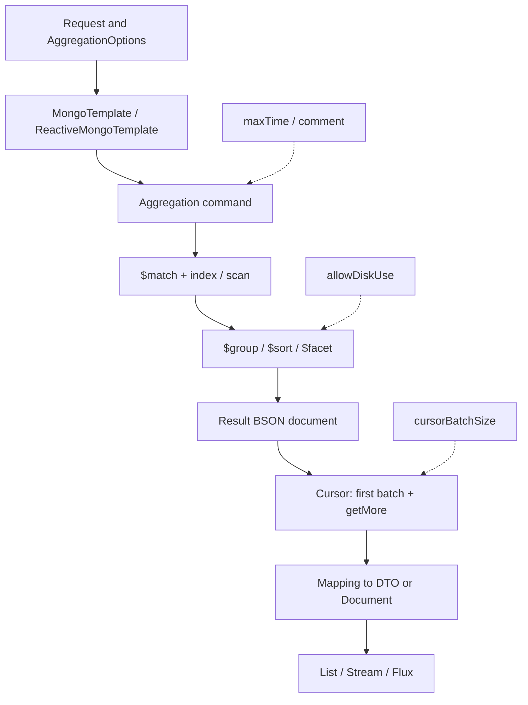

# AggregationOptions, allowDiskUse, Batch Size, and Resource Limits

## 1. The problem: accurate reports that are slow, memory-heavy, or fail

An e-commerce system uses **Spring Data MongoDB** to store orders. Early on, a regional revenue report only processes a few thousand documents:

```javascript
db.orders.aggregate([
  { $match: { tenant_id: "tenant-A", status: "PAID" } },
  {
    $group: {
      _id: "$region",
      orderCount: { $sum: 1 },
      revenue: { $sum: "$total_amount" }
    }
  },
  { $sort: { revenue: -1 } }
]);
```

As order volume grows into the millions and reports become more complex, several problems appear:

- `$sort` or `$group` consumes excessive memory on the MongoDB side.
- Pipelines have too many stages, too many groups, or accumulate large arrays.
- Responses contain large documents that exceed the BSON limit.
- The application calls `getMappedResults()` and holds too many Java objects in RAM.
- Long-running read jobs execute without any maximum execution time set on the API.
- Developers increase `batchSize`, expecting it to reduce the memory used by `$group`, when in reality the two are unrelated.
- The `allowDiskUse` flag is enabled, yet a stage like `$facet` still fails with a resource error.

To control execution behavior, Spring Data MongoDB provides **`AggregationOptions`**, attached to an `Aggregation` before calling `MongoTemplate.aggregate(...)` or `ReactiveMongoTemplate.aggregate(...)`.

This lesson belongs to the **Advanced Aggregation** chapter of the **SPRING_DATA_MONGODB** module. Beyond `AggregationOptions`, the content connects pipeline design with queries, indexes, transactions, reactive access, testing, and performance diagnostics.

**Objective:** understand when to use `allowDiskUse`, `cursorBatchSize`, `maxTime`, and related options; recognize MongoDB resource limits; and select appropriate result-consumption strategies rather than treating a single option as a silver bullet.

## 2. Four distinct resource layers in an aggregation

Before tuning performance, separate the layers:

| Layer | Examples | What consumes resources? | Appropriate control |
| --- | --- | --- | --- |
| **Data access** | `$match`, index scan | Number of documents/index keys read | Indexes, filters, projections, `explain` |
| **Pipeline processing** | `$sort`, `$group`, `$setWindowFields` | Server memory and potentially temporary disk space | Stage design, `allowDiskUse` where supported |
| **BSON output** | `$group` with large `$push`, `$facet` | Size of each result document | Trim arrays, group differently, cap output; cannot exceed BSON limit |
| **Transport and consumption** | Cursor, `getMore`, Java mapping | Network batches, cursors, application RAM | `cursorBatchSize`, stream/reactive, close cursors |

Additionally, there are **execution duration** (`maxTime`) and **observability mechanisms** (comments, explain, profiler).

A pipeline can have low server memory usage yet return millions of documents and exhaust application RAM. Conversely, a pipeline returning just ten rows may still sort or group across millions of input documents.

### 2.1. Lifecycle diagram



**Do not confuse them:** `cursorBatchSize` governs how **already-produced results** are fetched over the cursor; it does not constrain `$group` to keep only that many documents in RAM.

## 3. Sample dataset and BSON mapping of `OrderDocument`

The examples use these fields:

| Java property | BSON field | Meaning |
| --- | --- | --- |
| `id` | `_id` | String order ID |
| `tenantId` | `tenant_id` | Tenant-based data partitioning |
| `status` | `status` | `PAID`, `CANCELLED`, etc. |
| `region` | `region` | Order region |
| `totalAmount` | `total_amount` | Monetary amount stored as BSON Decimal128 |
| `placedAt` | `placed_at` | BSON Date |

### 3.1. Source entity

```java
import java.math.BigDecimal;
import java.time.Instant;

import org.springframework.data.mongodb.core.mapping.Document;
import org.springframework.data.mongodb.core.mapping.Field;
import org.springframework.data.mongodb.core.mapping.FieldType;
import org.springframework.data.mongodb.core.mapping.MongoId;

@Document(collection = "orders")
public record OrderDocument(
    @MongoId(FieldType.STRING)
    String id,

    @Field("tenant_id")
    String tenantId,

    String status,
    String region,

    @Field(
        value = "total_amount",
        targetType = FieldType.DECIMAL128
    )
    BigDecimal totalAmount,

    @Field("placed_at")
    Instant placedAt
) {}
```

`@Field("total_amount")` sets the stored field name, while `targetType=FieldType.DECIMAL128` declares the intent to store monetary values as BSON decimal. Legacy data stored as double or string still requires dedicated inspection and migration; annotations do not automatically convert existing BSON documents.

### 3.2. Seeding data with `mongosh` on a test database

```javascript
db.orders.insertMany([
  {
    _id: "o-1", tenant_id: "tenant-A",
    status: "PAID", region: "north",
    total_amount: NumberDecimal("100000.00"),
    placed_at: ISODate("2026-11-18T01:00:00Z")
  },
  {
    _id: "o-2", tenant_id: "tenant-A",
    status: "PAID", region: "north",
    total_amount: NumberDecimal("200000.00"),
    placed_at: ISODate("2026-11-18T02:00:00Z")
  },
  {
    _id: "o-3", tenant_id: "tenant-A",
    status: "PAID", region: "south",
    total_amount: NumberDecimal("150000.00"),
    placed_at: ISODate("2026-11-18T03:00:00Z")
  },
  {
    _id: "o-4", tenant_id: "tenant-A",
    status: "PAID", region: "south",
    total_amount: NumberDecimal("50000.00"),
    placed_at: ISODate("2026-11-18T04:00:00Z")
  },
  {
    _id: "o-5", tenant_id: "tenant-A",
    status: "PAID", region: "north",
    total_amount: NumberDecimal("300000.00"),
    placed_at: ISODate("2026-11-18T05:00:00Z")
  },
  {
    _id: "o-6", tenant_id: "tenant-A",
    status: "CANCELLED", region: "north",
    total_amount: NumberDecimal("900000.00"),
    placed_at: ISODate("2026-11-18T06:00:00Z")
  },
  {
    _id: "o-7", tenant_id: "tenant-B",
    status: "PAID", region: "north",
    total_amount: NumberDecimal("999999.00"),
    placed_at: ISODate("2026-11-18T07:00:00Z")
  }
]);
```

With the filter `tenant_id="tenant-A"` and `status="PAID"`:

- The `north` region has 3 orders totaling `600000.00`.
- The `south` region has 2 orders totaling `200000.00`.
- Cancelled orders and tenant B orders are **excluded**.

This tiny dataset is only for verifying **correctness**. Never use it to conclude that an index or `allowDiskUse` performs adequately at multi-million-document scale.

## 4. What is `AggregationOptions` and where is it attached?

In Spring Data MongoDB, **`AggregationOptions`** describes execution options for the aggregate command, separated from the business stages.

```java
import java.time.Duration;

import org.springframework.data.mongodb.core.aggregation
    .AggregationOptions;

AggregationOptions options = AggregationOptions.builder()
    .allowDiskUse(true)
    .cursorBatchSize(100)
    .maxTime(Duration.ofSeconds(5))
    .build();
```

Attaching options to an `Aggregation`:

```java
import org.springframework.data.mongodb.core.aggregation
    .Aggregation;
import org.springframework.data.mongodb.core.query.Criteria;

Aggregation aggregation = Aggregation.newAggregation(
    Aggregation.match(
        Criteria.where("tenantId").is("tenant-A")
    ),
    Aggregation.limit(20)
).withOptions(options);
```

The snippet above uses `match` and `limit` as two concrete stages solely to show how options are attached; the full reporting pipeline in section 5 adds `group` and `sort`. Then invoke:

```java
template.aggregate(
    aggregation,
    OrderDocument.class,
    org.bson.Document.class
);
```

**Distinguish:**

- `Aggregation.newAggregation(...)` builds **the stages** and defines computation logic.
- `AggregationOptions.builder()` creates **execution metadata** for the command.
- `aggregation.withOptions(options)` attaches that metadata to the pipeline.
- `MongoTemplate.aggregate(...)` executes the command and maps results.

Once an `Aggregation` exists, creating a different `AggregationOptions` instance elsewhere does not mutate the active pipeline; you must attach the desired options instance.

### 4.1. Common options

| Option | Primary effect | Caveat |
| --- | --- | --- |
| `allowDiskUse(true/false)` | Permits certain stages to spill to temporary disk when exceeding memory thresholds | Does not apply to every stage, does not bypass the 16 MiB BSON limit |
| `cursorBatchSize(n)` | Requests the result cursor batch size | Not the same as `$limit`; does not turn `List` into a stream |
| `maxTime(Duration)` | Server-managed execution time limit | Does not replace HTTP/client timeouts |
| `collation(...)` | Locale-specific string comparison/sorting rules | Must match the index collation when index optimization is needed |
| `comment(...)` (where supported) | Trace label attached to the command | Must not contain sensitive data |
| `explain(...)` (where supported) | Requests execution plan information | Not a regular business DTO result |
| Domain type mapping options | Strictness when translating Java property names to BSON | Depends on version and pipeline |

**Check the Javadoc of your exact dependency version:** builder method signatures, overloads, and supported options vary across Spring Data MongoDB releases. The examples here focus on options common in modern releases.

## 5. Complete Java pipeline with `MongoTemplate`

A service class reading per-tenant reports:

```java
import java.time.Duration;
import java.util.List;

import org.bson.Document;
import org.springframework.data.domain.Sort;
import org.springframework.data.mongodb.core.MongoTemplate;
import org.springframework.data.mongodb.core.aggregation.Aggregation;
import org.springframework.data.mongodb.core.aggregation.AggregationOptions;
import org.springframework.data.mongodb.core.query.Criteria;

public final class OrderRevenueReader {

    private final MongoTemplate template;

    public OrderRevenueReader(MongoTemplate template) {
        this.template = template;
    }

    public List<Document> revenueByRegion(
        String trustedTenantId
    ) {
        if (trustedTenantId == null
                || trustedTenantId.isBlank()) {
            throw new IllegalArgumentException(
                "Missing authenticated tenant"
            );
        }

        AggregationOptions options = AggregationOptions
            .builder()
            .allowDiskUse(true)
            .cursorBatchSize(100)
            .maxTime(Duration.ofSeconds(5))
            .build();

        Aggregation aggregation = Aggregation.newAggregation(
            Aggregation.match(
                Criteria.where("tenantId").is(trustedTenantId)
                    .and("status").is("PAID")
            ),
            Aggregation.group("region")
                .count().as("orderCount")
                .sum("totalAmount").as("revenue"),
            Aggregation.sort(
                Sort.by(
                    Sort.Order.desc("revenue"),
                    Sort.Order.asc("_id")
                )
            ),
            Aggregation.limit(20)
        ).withOptions(options);

        return template.aggregate(
            aggregation,
            OrderDocument.class,
            Document.class
        ).getMappedResults();
    }
}
```

Passing `OrderDocument.class` as the input domain type enables Spring Data to map:

- `tenantId` to BSON `tenant_id`.
- `totalAmount` to BSON `total_amount` inside `$group`.
- `id`/`_id` according to mapping metadata when referenced.

`Aggregation.group("region")` places the grouping key in the output `_id` field. With the sample data, the result contains two documents:

```javascript
[
  {
    _id: "north",
    orderCount: 3,
    revenue: NumberDecimal("600000.00")
  },
  {
    _id: "south",
    orderCount: 2,
    revenue: NumberDecimal("200000.00")
  }
]
```

If using a result DTO instead of `Document.class`, ensure matching aliases/constructors and verify `_id`, `Decimal128`, and count numeric types in tests.

**Note on `allowDiskUse(true)`:** this code demonstrates configuration. With only seven sample documents, MongoDB has no reason to spill to disk. Setting the flag does not mean disk was actually used.

## 6. What does `allowDiskUse` allow on the server?

Several aggregation stages can be **blocking stages**: they must retain enough intermediate state to proceed or finish a step, such as sorting a large set or grouping across vast numbers of keys.

In modern MongoDB, when certain stages exceed their memory threshold (commonly documented around **100 MB** for specific stages), they can:

- Fail with an error when disk use is disallowed.
- Write temporary working data to disk (*spill*) when supported by the server/stage and permitted by the `allowDiskUse` policy.

Example in `mongosh`:

```javascript
db.orders.aggregate(
  [
    { $match: { tenant_id: "tenant-A", status: "PAID" } },
    {
      $group: {
        _id: "$region",
        total: { $sum: "$total_amount" }
      }
    },
    { $sort: { total: -1 } }
  ],
  {
    allowDiskUse: true
  }
);
```

**`allowDiskUse=true` grants permission to use temporary disk space when needed**, not a directive forcing every stage to write to disk. When workloads are small or indexes/optimizer rewrites reduce memory usage sufficiently, the pipeline completes entirely in RAM.

### 6.1. From MongoDB 6.0: server default policy may differ

On MongoDB 6.0 and later, the server parameter **`allowDiskUseByDefault`** controls whether supported stages may spill when crossing the threshold without each command explicitly setting `allowDiskUse:true`.

Thus, distinguish three cases:

1. Server default **disallows** spill: setting `allowDiskUse:true` permits supported stages to spill.
2. Server default **allows** spill: commands omitting the option may spill per server policy.
3. Command explicitly sets `allowDiskUse:false`: overrides the default, causing stages exceeding the memory cap to fail rather than spill.

Exact behavior depends on MongoDB Server, stage, and version; never rely on a default remembered from another machine. Verify the actual version and environment configuration.

### 6.2. Why enabling `allowDiskUse` is not a "performance fix"

Spilling can turn an "exceeded memory limit for sort" error into a completed query, at a cost:

- Temporary disk I/O overhead.
- Longer latency from writing and reading intermediate data.
- Resource contention when many reports run concurrently.
- Risk of hitting container temporary disk or storage limits.
- Interactions with indexes, collations, group cardinality, and sort order.

If a pipeline spills consistently, prioritize evaluating indexes, early `$match`, projections, group cardinality, pre-aggregation, or reporting architecture before throwing more disk capacity at it.

### 6.3. Not every stage can spill

Stages permitted to spill under server policy may include specific forms of `$sort`, `$group`, and others documented per release. Do not assume **every** MongoDB stage shares the same spill mechanism.

In particular, **`$facet` has its own limit and cannot use `allowDiskUse` to bypass its internal stage memory cap**. Section 11 explains this.

## 7. Pinpointing memory pressure: sort, group, and cardinality

Two pipelines that both return two rows can have dramatically different memory footprints.

### 7.1. `$sort` across many documents

```javascript
db.orders.aggregate([
  { $match: { tenant_id: "tenant-A" } },
  { $sort: { placed_at: -1, _id: -1 } },
  { $limit: 100 }
]);
```

With an index matching both the filter and sort, MongoDB can avoid an unindexed blocking sort. For example:

```javascript
db.orders.createIndex({
  tenant_id: 1,
  placed_at: -1,
  _id: -1
});
```

An unindexed sort may have to buffer intermediate records. Under certain conditions, the optimizer can optimize `$sort` + `$limit` using a top-K strategy rather than buffering every sorted document. Never **assume** every pipeline with `$limit` avoids memory pressure; intervening stages can block that optimization.

### 7.2. `$group` with high-cardinality keys or huge array accumulation

```javascript
db.orders.aggregate([
  { $match: { tenant_id: "tenant-A" } },
  {
    $group: {
      _id: "$region",
      orderCount: { $sum: 1 },
      revenue: { $sum: "$total_amount" }
    }
  }
]);
```

When `region` has only a handful of values, the group table stays tiny. Switching the key to `customer_id` or a nearly unique per-document identifier can push group count into the millions, inflating retained state.

An anti-pattern that rapidly bloats outputs:

```javascript
db.orders.aggregate([
  { $match: { tenant_id: "tenant-A" } },
  {
    $group: {
      _id: "$tenant_id",
      allOrders: { $push: "$$ROOT" }
    }
  }
]);
```

This pushes every document into **one array inside a single group document**. On large datasets, even with disk spill enabled, the output document can breach the **16 MiB BSON** cap. Neither `cursorBatchSize` nor `allowDiskUse` fixes this.

### 7.3. Compute only the required metrics

If you only need revenue and order counts, use `$sum`/`$count` instead of `$push: "$$ROOT"` and counting in Java. If you need one representative latest order per region, consider `$first`/`$top` accumulators (depending on server version) or a proper pre-group sort instead of collecting entire raw documents.

**Choosing the right output shape matters more than a runtime flag.**

## 8. `cursorBatchSize`: per-batch size, not total limit

Aggregations can return results via a **cursor**. MongoDB delivers an initial batch on the command response, and the client pulls subsequent batches via `getMore` as needed.

In Spring Data:

```java
AggregationOptions options = AggregationOptions.builder()
    .cursorBatchSize(200)
    .build();
```

In `mongosh`:

```javascript
db.orders.aggregate(
  [
    { $match: { tenant_id: "tenant-A", status: "PAID" } },
    { $project: { _id: 1, region: 1, total_amount: 1 } }
  ],
  {
    cursor: { batchSize: 200 }
  }
);
```

**A batch size of 200 does not limit total results to 200 documents.** It is a requested document count per cursor round-trip; actual batch sizes remain bounded by byte limits, data payload sizes, and server/driver behavior. A batch can contain fewer documents than requested.

### 8.1. Comparing `$limit`, `cursorBatchSize`, and `skip`

| Setting | What does it actually do? |
| --- | --- |
| `Aggregation.limit(200)` / `$limit: 200` | Caps the **number of pipeline documents** passing that position |
| `Aggregation.skip(200)` / `$skip: 200` | Drops a number of pipeline documents at that position |
| `cursorBatchSize(200)` | Requests **documents per batch** over the result cursor |
| `$sort` | Orders pipeline documents, potentially consuming memory |
| `aggregateStream(...)` | Lets the application stream results incrementally; cursor must be closed |
| Reactive `aggregate(...)` | Publisher emitting result documents via the reactive driver |

**`$limit` placement is part of query semantics.** Placing `$limit` before `$group` aggregates only a slice of the input; placing it after `$group` caps **the number of output groups**. Never insert an early limit solely to save memory if doing so breaks report accuracy.

### 8.2. Why a larger batch is not automatically faster

- Too small a batch: excessive `getMore` round-trips and network overhead.
- Too large a batch: larger memory spikes on receipt and higher tail latency for clients processing items sequentially.
- Very large documents: the batch byte limit is reached before the requested document count.
- Early consumer termination: a huge batch fetches data that goes unused.
- Tiny result sets: large batch settings make practically no difference.

Measure against real outputs and real networks. No single batch size fits every report.

## 9. Batch size does not turn `getMappedResults()` into streaming

This is a critical trap with `MongoTemplate`:

```java
List<Document> rows = template.aggregate(
    aggregation,
    OrderDocument.class,
    Document.class
).getMappedResults();
```

`getMappedResults()` returns a materialized **`List`** of every result document. Even with a small `cursorBatchSize`, a massive result set will still fill application RAM.

Compare two pipelines:

```javascript
// A: Returns two group documents -> tiny List.
db.orders.aggregate([
  { $match: { tenant_id: "tenant-A", status: "PAID" } },
  { $group: { _id: "$region", count: { $sum: 1 } } }
]);

// B: Returns every matching order -> List can be huge.
db.orders.aggregate([
  { $match: { tenant_id: "tenant-A", status: "PAID" } },
  { $project: { _id: 1, region: 1 } }
]);
```

Pipeline B can return millions of documents. Lowering `batchSize` to 50 **does not** stop `getMappedResults()` from collecting all of them into a single `List`.

If a use case needs to process the full stream sequentially, consider `aggregateStream(...)`; if an API only needs a page, use `$sort`/`$skip`/`$limit` or an appropriate scrolling strategy.

## 10. `aggregateStream` and cursor lifecycle

Imperative Spring Data MongoDB provides **`MongoTemplate.aggregateStream(...)`** to receive a `java.util.stream.Stream` instead of materializing all results upfront.

```java
import java.util.stream.Stream;

import org.bson.Document;
import org.springframework.data.mongodb.core.MongoTemplate;
import org.springframework.data.mongodb.core.aggregation.Aggregation;

public void exportRegionRows(
    MongoTemplate template,
    Aggregation aggregation
) {
    try (Stream<Document> stream = template.aggregateStream(
            aggregation,
            OrderDocument.class,
            Document.class
    )) {
        stream.forEach(row -> {
            // Process one result document at a time; avoid holding the full List.
            System.out.println(row.toJson());
        });
    }
}
```

**Important:** `Stream` backs an underlying cursor/resource and must be closed via `try-with-resources`. Printing BSON here is purely illustrative; production exporters should never log raw orders or personal data. Real exporters need encrypted output, downstream backpressure, mid-stream error handling, and checkpoints.

### 10.1. Streaming does not fix server memory limits

Streaming avoids keeping **the entire output** in Java heap. It does not make server-side `$sort` or `$group` operate in constant memory.

```text
Server:
  may still need to complete a large sort/group
  before emitting qualifying result documents

Client:
  receives batch by batch, maps, and consumes sequentially
  instead of buffering everything into a List
```

These are two independent concerns. Likewise, if a pipeline creates a single group document with a 20 MiB array, streaming cannot deliver a document exceeding the BSON limit.

### 10.2. Do not leave cursors open indefinitely

An open cursor consumes server resources and is subject to idle timeouts and session lifecycles. If a job runs for hours, relying on a single long-lived cursor makes recovery after transient disconnects difficult.

Considerations:

- Split the job into chunks with durable checkpoints.
- Iterate by a stable keyset/ID where data and sort order permit.
- Project only the fields actually needed.
- Enforce execution timeouts and output caps.
- Close the stream on exceptions or user cancellation.

A cursor **does not** guarantee exactly-once delivery when exporting to external systems. You must implement business-level idempotency and checkpointing.

## 11. The 100 MB limit and the `$facet` exception

`$facet` produces **a single output document containing result arrays for each branch**. It is handy when an API wants both paginated items and summary counts in one pass, yet it carries strict resource limits.

Per MongoDB documentation:

1. During `$facet` execution, the document produced by the stage is capped at approximately **100 MB**.
2. **`$facet` cannot spill to disk** to bypass that limit, **even with `allowDiskUse:true`**.
3. The final output document must still obey the **16 MiB** BSON limit.
4. An unbounded `items` branch or a stats branch generating hundreds of thousands of buckets can push the stage or response past those caps.

Dangerous example:

```javascript
db.orders.aggregate(
  [
    { $match: { tenant_id: "tenant-A" } },
    {
      $facet: {
        allOrders: [
          // No $limit; can accumulate a massive output array.
          { $project: { _id: 1, status: 1, total_amount: 1 } }
        ],
        totals: [
          { $group: { _id: "$status", count: { $sum: 1 } } }
        ]
      }
    }
  ],
  { allowDiskUse: true }
);
```

`allowDiskUse:true` does not turn `allOrders` into an independent streaming cursor. `$facet` still builds one document holding **arrays**.

### 11.1. The right fix

```javascript
db.orders.aggregate([
  { $match: { tenant_id: "tenant-A" } },
  {
    $facet: {
      items: [
        { $sort: { placed_at: -1, _id: -1 } },
        { $limit: 20 },
        { $project: { _id: 1, status: 1, total_amount: 1 } }
      ],
      totals: [
        { $group: { _id: "$status", count: { $sum: 1 } } }
      ]
    }
  }
]);
```

Limit the `items` branch, but do **not** put `$limit:20` before `$facet` if `totals` must cover the whole tenant. If `totals` still creates too many groups, constrain/choose appropriate dimensions or split into separate queries.

### 11.2. `$facet` at the start of a pipeline and indexes

If `$facet` is the first stage, MongoDB may perform a collection scan rather than leveraging indexes for filters buried inside branches. Putting `$match` **before `$facet`** allows index usage and shrinks input across every branch.

However, a `$sort` inside a facet branch does not automatically exploit collection indexes the way a pre-facet sort can. Inspect `explain` rather than guessing from existing collection indexes.

## 12. The 16 MiB BSON document limit: a boundary no option can raise

MongoDB enforces a maximum size of **16 MiB** for any standard **BSON document**. This applies both to stored documents and to each aggregation result document emitted at the end of a pipeline.

Common pitfalls:

- `$group` with `$push: "$$ROOT"` building an unbounded array.
- `$lookup` embedding giant arrays of joined documents in one parent document.
- `$facet` packing large branch arrays into a single document.
- `$setWindowFields` or `$project` accumulating oversized nested payloads, depending on design.
- Collapsing many small documents into a single giant array document.

**`cursorBatchSize` only controls documents per batch**; it cannot split **a single 20 MiB BSON document** into two valid chunks inside the same query.

Misguided expectation:

```text
Aggregation produces one 20 MiB document
      ↓
cursorBatchSize(1)
      ↓
Still exceeds the BSON limit for that document.
```

The fix is to **redesign the output shape**:

1. Emit multiple small result documents instead of one document holding an unbounded array.
2. Trim fields with `$project` and apply `$limit` at the right stage.
3. Use pagination/keyset navigation or partition by time/region.
4. Pre-aggregate into small, stable snapshots.
5. Never `$push: "$$ROOT"` when only a few fields are required.

## 13. Pipeline stage count limit

Modern MongoDB enforces a limit of **1,000 stages** in a single aggregation pipeline. Dynamically constructed pipelines assembled from hundreds of filters or branches must not assume the server accepts unlimited stages.

Example from an uncontrolled query builder:

```text
$match
$project
$match
$project
... repeated thousands of times from a config loop ...
```

The problem is not just hitting the hard limit. Long before 1,000 stages, parsing, optimizing, maintaining, and debugging the pipeline becomes painful.

Solutions:

- Combine `$match` predicates when semantics allow.
- Use one `$project`/`$set` with clear expressions instead of generating chains of redundant stages.
- Do not append a new stage per HTTP form field.
- Review dynamically generated pipelines with the same rigor as application source code.
- Bound depth, branch count, and input complexity.
- Split into multiple queries/steps when the algorithm genuinely warrants it.

Note that MongoDB's optimizer can **merge, reorder, and transform stages**; the declared stage count does not always equal the execution plan stage count. Check your MongoDB Server version and stage-limit documentation.

## 14. `maxTime`: MongoDB server-side execution budget

A pipeline may stay well within memory limits yet still run too long due to broad scans, sorts, or expensive joins.

```java
AggregationOptions options = AggregationOptions.builder()
    .allowDiskUse(true)
    .cursorBatchSize(100)
    .maxTime(Duration.ofSeconds(5))
    .build();
```

This sets the server-side limit via the `maxTimeMS` command option:

```javascript
db.orders.aggregate(
  [
    { $match: { tenant_id: "tenant-A", status: "PAID" } },
    { $group: { _id: "$region", total: { $sum: "$total_amount" } } }
  ],
  { maxTimeMS: 5000 }
);
```

When the server detects the operation exceeded the budget at an interrupt checkpoint, the client receives a timeout error. This is **not** a guarantee that the overall HTTP call completes within five seconds.

### 14.1. Distinguish four kinds of timeouts

| Kind | Scope | Key point |
| --- | --- | --- |
| `AggregationOptions.maxTime` / `maxTimeMS` | Server execution duration per command semantics | Excludes HTTP serialization, Java mapping, network jitter |
| Driver socket/read timeout | Client waiting on I/O from MongoDB | Can fire while the server is still working |
| HTTP/gateway timeout | End-to-end request duration at app/gateway | Does not guarantee the server stopped simultaneously |
| Reactor `timeout(...)` | Publisher observation window at the reactive layer | Does not replace `maxTimeMS` |

For multi-`getMore` cursors, check exact `maxTimeMS` semantics across batches against your driver and server version. Never treat `maxTimeMS` as "an absolute wall clock covering all Java work and every cursor batch."

### 14.2. Choosing thresholds by workload

Examples:

- Interactive dashboard: tight bounds aligned with UI SLAs.
- Nightly reporting job: longer budget allowed, paired with checkpoints and overload protection.
- Reconciliation query: correctness outranks latency; do not truncate data just to hit a tight deadline.

Never hardcode a single global threshold for every endpoint. Measure p95/p99 latency, identify bottlenecks, set appropriate budgets, and monitor timeout counts in production.

**Never blindly retry in an infinite loop** when a heavy aggregation times out; fix the query/index or move it to an appropriate background job.

## 15. Collation, comments, and hints: related operational options

### 15.1. Collation and grouping/sorting strings

When grouping customer names or sorting accented place names, collation changes how MongoDB compares strings. On supported Spring Data versions:

```java
import org.springframework.data.mongodb.core.query.Collation;

AggregationOptions options = AggregationOptions.builder()
    .collation(Collation.of("vi").strength(2))
    .build();
```

For instance, `locale="vi"` with `strength=2` typically distinguishes accents while staying case-insensitive under ICU rules. Do not mistake collation for full-text search, Unicode normalization, or fuzzy matching.

To use an index for string filters/sorts, **the query collation and index collation must be compatible**. An index built with simple binary collation will not automatically accelerate a sort using Vietnamese collation.

### 15.2. Comments for tracing

In Spring Data MongoDB versions supporting `comment` on the builder, you can tag aggregations with a static label:

```java
AggregationOptions options = AggregationOptions.builder()
    .comment("revenue-by-region-v1")
    .build();
```

Comments help identify commands in the profiler, diagnostic logs, or command monitoring depending on configuration. They do not alter `$group` algorithms and must never contain usernames, tokens, emails, order payloads, or raw requests.

If your dependency version lacks the builder method, inspect its Javadoc rather than injecting unsupported raw options.

### 15.3. Hints and execution plans

A hint forces MongoDB to use a specific index during collection access when supported by the command. It is a diagnostic tool or a measured workaround, **never** a substitute for sound index design.

```javascript
db.orders.aggregate(
  [
    { $match: { tenant_id: "tenant-A", status: "PAID" } },
    { $group: { _id: "$region", total: { $sum: "$total_amount" } } }
  ],
  {
    hint: "idx_orders_tenant_status",
    comment: "revenue-by-region-index-test"
  }
);
```

The index must exist and satisfy the query. An invalid hint fails the command. Only keep a hint after comparing real execution plans with and without it.

## 16. Indexes usually matter more than `allowDiskUse`

For a report filtering by tenant and status:

```javascript
db.orders.createIndex({
  tenant_id: 1,
  status: 1,
  region: 1
});
```

An index lets `$match` reduce scanned documents and optimize data access. However, it **does not automatically eliminate memory used by `$group`**, because group outputs are computed across many documents.

A `$sort` on an indexed collection field before grouping can leverage an index when key order and filters align. Conversely, sorting by `revenue` **after `$group`** sorts **newly computed aggregate values**, so no source-collection index covers that synthetic field directly.

### 16.1. Place `$match` early without changing semantics

```javascript
[
  { $match: { tenant_id: "tenant-A", status: "PAID" } },
  {
    $group: {
      _id: "$region",
      orderCount: { $sum: 1 },
      revenue: { $sum: "$total_amount" }
    }
  },
  { $sort: { revenue: -1 } }
]
```

Moving `$match` on `tenant_id` after `$group` (when `tenant_id` is no longer in the group output) breaks correctness and can yield wrong or empty results. Never "optimize" by arbitrarily reordering stages.

When filtering on aggregated values, `$match` **must follow `$group`** targeting output fields like `revenue`—a completely different condition from input filtering.

### 16.2. Reduce field count and input size

Sometimes adding `$project` before grouping trims unnecessary fields forwarded downstream. MongoDB's optimizer also performs projection pushdown automatically in many cases; measure rather than assuming extra `$project` stages always speed things up.

Above all, avoid dragging large arrays of images, logs, or subdocuments into `$push` or `$facet` when a report only needs counts and sums.

## 17. Inspecting `explain("executionStats")` and disk spill

Run the pipeline in `mongosh`:

```javascript
db.orders.explain("executionStats").aggregate(
  [
    { $match: { tenant_id: "tenant-A", status: "PAID" } },
    {
      $group: {
        _id: "$region",
        orderCount: { $sum: 1 },
        revenue: { $sum: "$total_amount" }
      }
    },
    { $sort: { revenue: -1 } }
  ],
  { allowDiskUse: true }
);
```

Fields to inspect vary by execution engine and MongoDB version:

| Signal | What to verify |
| --- | --- |
| `IXSCAN`, `COLLSCAN` | Did the collection access stage use an index? |
| `totalKeysExamined` | How many index keys were scanned? |
| `totalDocsExamined` | How many source documents were read? |
| Sort / group stages | Which stages consume memory? |
| `usedDisk` / spill metrics (when present) | Did any stage spill to temporary disk? |
| `executionTimeMillis` | Execution cost of the run |
| `nReturned` | Output document counts across stages |
| `maxTimeMS` / timeout errors | Was a time cap applied and triggered? |

Explain output schemas vary across versions and engines; do not write brittle parsers assuming one fixed `winningPlan` layout.

### 17.1. Profiler and diagnostic logs

MongoDB's profiler and diagnostic logs can record disk-spilling aggregations via relevant indicators. Outside `explain`, track command monitoring and operational metrics:

- Rate of pipelines hitting timeouts or memory limits.
- Spill counts/volumes when telemetry is available.
- MongoDB CPU, RAM, and temporary disk utilization.
- Mean, p95, and p99 latencies.
- Returned BSON byte sizes and `getMore` batch counts.
- JVM heap usage and result DTO mapping time.
- Failure/cancellation rate of export jobs.

Never log raw query parameters containing personal data in production without masking policies and proper access controls.

### 17.2. Two measurements required when tuning batch size

When changing `cursorBatchSize(50)` to `cursorBatchSize(500)`, measure at least:

1. **Server side:** `getMore` counts, MongoDB load, pipeline duration, memory/spill.
2. **Application side:** CPU, JVM heap, total consumption time, throughput, latency, and downstream backpressure.

If a pipeline emits only 5 result documents, comparing batchSize 50 vs. 500 provides virtually no useful evidence. Evaluate batch tuning on workloads with **many result documents**.

## 18. Selecting options by workload profile

### 18.1. Interactive dashboard

Goal: small responses, low latency, minimal blast radius.

```java
AggregationOptions dashboardOptions =
    AggregationOptions.builder()
        .allowDiskUse(false)
        .cursorBatchSize(50)
        .maxTime(Duration.ofSeconds(2))
        .build();
```

This is a **sample policy**, not a rigid mandate. If a dashboard stage genuinely requires spilling on production data, `allowDiskUse(false)` will fail the query; revisit indexes, cardinality, pre-aggregation, or resource policy instead.

For dashboards, pair `$limit`/projections wisely and forbid facet branches returning unbounded arrays.

### 18.2. Batch exports

Goal: process many rows, keep Java RAM flat, support checkpoints.

```java
AggregationOptions exportOptions =
    AggregationOptions.builder()
        .allowDiskUse(true)
        .cursorBatchSize(200)
        .maxTime(Duration.ofMinutes(2))
        .build();
```

Use `aggregateStream` or a reactive pipeline with **controlled consumption** instead of collecting into a `List`. Never assume 2 minutes is always sufficient; long exports may require keyset/chunked partitioning and resumability.

### 18.3. Offline reporting

Goal: accurate numbers over large ranges, higher latency tolerated.

Recommended practices:

- Partition work by time window or tenant.
- Persist partial outputs idempotently.
- Pre-aggregate or materialize views per consistency requirements.
- Cap concurrency so multiple jobs do not contend on disk spill simultaneously.
- Avoid long-lived read transactions unless strictly required.
- Attach dedicated job metrics and alerts.

**Tailor options to each SLA and pipeline profile**—do not blindly give every endpoint `allowDiskUse(true)`, `batchSize(10_000)`, and a massive `maxTime` just because one report needs them.

## 19. ReactiveMongoTemplate and resource limits

In WebFlux, `ReactiveMongoTemplate.aggregate(...)` returns a publisher emitting result documents.

```java
import java.time.Duration;

import org.bson.Document;
import org.springframework.data.mongodb.core.ReactiveMongoTemplate;
import org.springframework.data.mongodb.core.aggregation.Aggregation;
import org.springframework.data.mongodb.core.aggregation.AggregationOptions;
import org.springframework.data.mongodb.core.query.Criteria;
import reactor.core.publisher.Flux;

public Flux<Document> reactiveRevenueByRegion(
    ReactiveMongoTemplate template,
    String trustedTenantId
) {
    AggregationOptions options = AggregationOptions.builder()
        .allowDiskUse(true)
        .cursorBatchSize(50)
        .maxTime(Duration.ofSeconds(5))
        .build();

    Aggregation agg = Aggregation.newAggregation(
        Aggregation.match(
            Criteria.where("tenantId").is(trustedTenantId)
                .and("status").is("PAID")
        ),
        Aggregation.group("region")
            .count().as("orderCount")
            .sum("totalAmount").as("revenue")
    ).withOptions(options);

    return template.aggregate(
        agg,
        OrderDocument.class,
        Document.class
    );
}
```

Key notes:

- `Flux<Document>` lets callers consume results incrementally as a reactive stream.
- `cursorBatchSize` affects how the driver pulls result batches, not `$group` semantics.
- Calling `collectList()` on a publisher yielding millions of results still buffers them all in RAM.
- A `$facet` emitting one giant document still hits the BSON/output limit; reactive execution does not split it into multiple documents.
- Never call `block()` on a WebFlux event loop thread.

### 19.1. Timeouts and retries in reactive flows

```java
return reactiveRevenueByRegion(template, tenantId)
    .timeout(Duration.ofSeconds(8));
```

Reactor's `timeout` is not equivalent to MongoDB's `maxTime`. When a request cancels, inspect driver cancellation behavior; never assume the server halts immediately or releases all memory at the exact instant downstream unsubscribes.

For **read-only** aggregations, bounded retries with backoff may suit transient faults, keeping heavy-query cost in mind. For pipelines containing `$out`/`$merge`, the operation **is no longer a pure read**, so retries require analyzing idempotency and write state.

### 19.2. Reactive transactions are a separate mechanism

If a reactive workflow requires MongoDB transactions, use `ReactiveMongoTransactionManager` and the appropriate reactive context. `AggregationOptions.allowDiskUse` does not start a transaction; `cursorBatchSize` does not grant multi-request snapshot isolation.

## 20. Transactions, read concern, and consistent reporting

Aggregation is usually a read-oriented analysis. However, results can be affected by concurrent collection mutations across runs or mid-execution depending on read concern and deployment topology.

**Do not assume `$group` or `$facet` creates an automatic cross-request snapshot.**

When business rules require period-end figures:

- Define the exact cutoff timestamp and tenant scope.
- Select appropriate read concern/sessions for replica sets or sharded clusters.
- Consider transactions/snapshot reads when strict point-in-time accuracy is required and resources permit.
- Avoid stretching long transactions just to mask a reporting architecture lacking snapshots.
- Consider storing immutable verified report snapshots after reconciliation.

An aggregation containing write stages like `$merge`/`$out` follows its own rules and restrictions (stage position, transaction ban, retry semantics). Do not treat every `Aggregation` pipeline as purely read-only.

### 20.1. Security and tenant isolation

Resource options never relax security requirements:

```java
Criteria.where("tenantId").is(trustedTenantId)
```

The tenant constraint must originate from a trusted source, never placed in an optional branch that a client can toggle off. Alongside `maxTime`, enforce page-size caps, allowed filter shapes, authorization checks, and concurrency limits so one report cannot starve shared resources.

## 21. Integration testing `AggregationOptions`

Unit tests that construct an `AggregationOptions` object only prove Java fields were populated; verifying that MongoDB actually runs the pipeline, honors BSON mapping, and receives the command options requires integration tests against a real MongoDB instance (such as Testcontainers).

### 21.1. Verifying results on a small dataset

JUnit 5 + Spring Boot `@DataMongoTest` example. In real projects, isolate the test database or clean up test IDs cleanly:

```java
import static org.assertj.core.api.Assertions.assertThat;

import java.math.BigDecimal;
import java.time.Instant;
import java.util.List;

import org.bson.Document;
import org.junit.jupiter.api.Test;
import org.springframework.beans.factory.annotation.Autowired;
import org.springframework.boot.test.autoconfigure.data.mongo.DataMongoTest;
import org.springframework.data.mongodb.core.MongoTemplate;
import org.springframework.data.domain.Sort;
import org.springframework.data.mongodb.core.aggregation.Aggregation;
import org.springframework.data.mongodb.core.aggregation.AggregationOptions;
import org.springframework.data.mongodb.core.query.Criteria;

@DataMongoTest
class AggregationResourceOptionsTest {

    @Autowired
    MongoTemplate template;

    @Test
    void aggregatesCorrectlyWithExecutionOptions() {
        String tenant = "aggregation-options-test";

        template.insertAll(List.of(
            new OrderDocument(
                "aggregation-opt-01", tenant, "PAID", "north",
                new BigDecimal("100000.00"),
                Instant.parse("2026-11-18T01:00:00Z")
            ),
            new OrderDocument(
                "aggregation-opt-02", tenant, "PAID", "north",
                new BigDecimal("200000.00"),
                Instant.parse("2026-11-18T02:00:00Z")
            ),
            new OrderDocument(
                "aggregation-opt-03", tenant, "PAID", "south",
                new BigDecimal("150000.00"),
                Instant.parse("2026-11-18T03:00:00Z")
            ),
            new OrderDocument(
                "aggregation-opt-04", tenant, "CANCELLED", "north",
                new BigDecimal("900000.00"),
                Instant.parse("2026-11-18T04:00:00Z")
            )
        ));

        AggregationOptions options = AggregationOptions.builder()
            .allowDiskUse(true)
            .cursorBatchSize(1)
            .maxTime(java.time.Duration.ofSeconds(10))
            .build();

        Aggregation agg = Aggregation.newAggregation(
            Aggregation.match(
                Criteria.where("tenantId").is(tenant)
                    .and("status").is("PAID")
            ),
            Aggregation.group("region")
                .count().as("orderCount")
                .sum("totalAmount").as("revenue"),
            Aggregation.sort(
                Sort.by(Sort.Order.desc("revenue"))
            )
        ).withOptions(options);

        List<Document> results = template.aggregate(
            agg, OrderDocument.class, Document.class
        ).getMappedResults();

        assertThat(results).hasSize(2);

        assertThat(results.get(0).getString("_id"))
            .isEqualTo("north");
        assertThat(((Number) results.get(0).get("orderCount"))
            .longValue()).isEqualTo(2L);

        assertThat(
            results.get(0).get("revenue")
        ).isNotNull();
    }
}
```

This sample test verifies filtering, grouping, sorting, and output values. It does **not** prove actual disk spill occurred (the dataset is too small), nor does it verify `batchSize=1` triggered a `getMore` round-trip. To verify wire-level command options, attach MongoDB Java Driver **command monitoring** in tests and inspect `aggregate`/`getMore` events for the expected parameters.

### 21.2. Adding Decimal128 assertions aligned with data schema

When `total_amount` is stored as BSON Decimal128, check the monetary type in raw results; note that `MongoTemplate.aggregate(..., Document.class)` may apply converters/mappers depending on configuration. Verify real BSON types directly via driver/shell when needed, for instance:

```javascript
db.orders.aggregate([
  {
    $match: {
      tenant_id: "aggregation-options-test",
      status: "PAID"
    }
  },
  {
    $group: {
      _id: "$region",
      revenue: { $sum: "$total_amount" }
    }
  },
  {
    $project: {
      revenueType: { $type: "$revenue" },
      revenue: 1
    }
  }
]);
```

When all `total_amount` inputs are Decimal128, the expected sum type is `decimal`. If legacy documents contain strings or nulls, design explicit validation/migration policies rather than silently dropping mismatched amounts.

### 21.3. Test cases to cover

| Scenario | What to verify |
| --- | --- |
| `allowDiskUse(true)` | Option is sent; pipeline computes accurate results |
| `allowDiskUse(false)` | Accurate results on small input; do not try to OOM CI |
| `cursorBatchSize(1)` | On multi-row results, `getMore` is observable via command monitoring |
| `getMappedResults()` | Returns a complete `List`, not a lazy stream |
| `aggregateStream(...)` | Consumes rows and closes resources properly |
| `maxTime` | Command receives the limit; avoid destructive load tests to force timeouts |
| Decimal128 sums in `$group` | Totals suffer no double/string drift |
| `$sort + $limit` | Correct sort order and result count |
| Unbounded `$facet` branches | Analyze output-bloat risk rather than crashing CI |
| Output > 16 MiB | Recognize boundary in an isolated test if truly required without overloading shared infra |
| Other tenant / CANCELLED | Never leak into metrics |
| Reactive aggregation | Correct publisher shape; non-blocking |
| Indexes and explain | `$match` uses indexes on representative data |
| Connection timeout/cancellation | Application handles errors, closes cursors, and reports status properly |

### 21.4. Testing memory pressure in a controlled environment

When you need to test genuine disk spill:

- Use a sufficiently large dataset in a **dedicated** performance environment—never against production.
- Know the exact MongoDB Server version, deployment topology, `allowDiskUseByDefault` setting, and stage under test.
- Monitor `usedDisk`/spill metrics and temporary disk usage throughout the test.
- Compare latency, memory, and results with vs. without indexes.
- Do not make "trying to build a >16 MiB document" a routine benchmark exercise.
- Enforce strict time caps and safe test-data cleanup.

If a pipeline only survives via disk spill and runs painfully slow, take it as a signal to improve the **data model or reporting strategy**, not just provision more memory.

## 22. Common pitfalls

**Pitfall 1 — "`allowDiskUse(true)` gives MongoDB unlimited RAM."** False. It only allows supported stages to spill; many other resource bounds still apply.

**Pitfall 2 — "`allowDiskUse(true)` guarantees faster pipelines."** False. Disk I/O can slow queries down; it is a fallback mechanism for memory caps, not an automatic speedup.

**Pitfall 3 — "`cursorBatchSize(100)` caps results at 100 documents."** False. You need `$limit` in the right pipeline position.

**Pitfall 4 — "Small batch sizes guarantee the JVM won't run out of memory."** False when `getMappedResults()` buffers the entire output into a `List`.

**Pitfall 5 — "`aggregateStream` fixes server `$sort` and `$group` memory limits."** False. It only addresses **client-side output consumption**.

**Pitfall 6 — "A 20 MiB document can be streamed across two batches."** False. A cursor cannot split a single document past the BSON limit.

**Pitfall 7 — "`$facet` will spill if `allowDiskUse` is enabled."** False. `$facet`'s ~100 MB internal stage limit cannot be bypassed with that flag.

**Pitfall 8 — "`$limit` before `$group` only cuts cost without changing numbers."** Wrong. It aggregates only an arbitrary subset of inputs.

**Pitfall 9 — "An index on `region` helps sort revenue computed in `$group`."** Not directly; `revenue` is a newly aggregated value.

**Pitfall 10 — "`maxTime` is an exact HTTP deadline."** False. It is a server-side command execution bound under MongoDB semantics.

**Pitfall 11 — "MongoDB 6.0+ always requires `allowDiskUse(true)` to spill."** Not necessarily; `allowDiskUseByDefault` may already permit spilling when omitted.

**Pitfall 12 — "`$facet` lets every branch use its own collection index."** False once facet receives the upstream document stream; place `$match` and indexes upstream.

**Pitfall 13 — "Reactive `Flux` makes MongoDB process fewer documents automatically."** False. Query plans and aggregation semantics do not change by switching to reactive drivers.

**Pitfall 14 — "Setting options alone makes any public reporting endpoint safe."** False. You also need authorization, rate limiting, constrained query shapes, output caps, and observability.

**Pitfall 15 — "`explain` on a dev laptop accurately predicts production."** False. Dataset size, indexes, server version, concurrency, and hardware all differ.

## 23. Troubleshooting workflow when aggregation is slow or fails resource limits

Start from the **observed symptom** rather than dialing every option up blindly.

### Case A — Sort/group exceeds memory limit

1. Identify the failing stage and MongoDB version.
2. Check whether `$match` can move earlier.
3. Verify whether an index supports the filter and sort.
4. Reduce group cardinality or intermediate retained data.
5. If supported by the stage/server, test `allowDiskUse(true)` in a test environment.
6. Observe disk spill and latency; decide whether pre-aggregation is warranted.

### Case B — Document too large error

1. Inspect the pipeline for `$push: "$$ROOT"`, huge `$lookup` arrays, or unbounded `$facet` outputs.
2. Identify which stage produces a document breaching BSON 16 MiB.
3. Redesign output into multiple smaller documents or cap arrays semantically.
4. Do not try raising `cursorBatchSize` or turning on disk spill to breach a hard limit.

### Case C — MongoDB is fast, but the API runs out of RAM

1. Check whether `getMappedResults()` or `collectList()` is called on an oversized result set.
2. Switch to streaming/reactive with sequential item processing and proper cursor closing.
3. Add projections and output limits appropriate to the use case.
4. Chunk jobs with checkpoints when resumability is needed.
5. Measure JVM heap, object allocations, BSON sizes, and `getMore` counts.

### Case D — API-side timeouts

1. Distinguish server `maxTimeMS` errors, driver socket I/O timeouts, and gateway timeouts.
2. Use `explain("executionStats")` to inspect scans/indexes instead of merely bumping timeouts.
3. Monitor concurrency and temporary disk saturation when multiple queries spill concurrently.
4. Separate SLA budgets for dashboards vs. offline batch jobs.
5. Never blindly retry a heavy aggregation, especially if it contains write stages.

## 24. Hands-on exercises

1. Insert the seven sample documents and verify the BSON type of `total_amount` via `$type`.
2. Run the `$match → $group → $sort` report in `mongosh` and calculate north/south totals by hand.
3. Write the equivalent pipeline using `Aggregation.newAggregation(...)`.
4. Attach `AggregationOptions.builder().allowDiskUse(true).cursorBatchSize(100).maxTime(Duration.ofSeconds(5)).build()`.
5. Run `MongoTemplate.aggregate(...).getMappedResults()` and inspect the mapped DTO/`Document`.
6. Seed additional regions to generate many output rows, vary `cursorBatchSize`, and observe `getMore` using driver command monitoring.
7. Try `aggregateStream` and ensure proper closing with `try-with-resources`.
8. Move `$limit` before vs. after `$group` and explain why accuracy changes.
9. Test `$sort` on an indexed input field vs. `$sort` on an aggregated metric; inspect `explain` for both.
10. Build a `$facet` with a limited `items` branch and an unlimited `count` branch; explain the 100 MB / 16 MiB boundaries.
11. Create `{tenant_id:1,status:1}` and compare `totalKeysExamined` vs. `totalDocsExamined`.
12. Test `maxTime` safely and inspect the command payload rather than crashing the server to force a timeout.
13. Port the query to `ReactiveMongoTemplate.aggregate(...)`, avoiding `collectList` on large outputs.
14. Write an integration test on an isolated test MongoDB verifying tenant scoping, monetary types, totals, and options.
15. Draft a comparison table selecting option profiles for dashboards, exports, and offline reports.

## 25. Pre-production checklist for aggregations

| Question | What to verify |
| --- | --- |
| Is the pipeline semantically accurate? | `$match`/`$group`/`$sort`/`$limit` are in the right order |
| Is output bounded? | Never generates a BSON document exceeding 16 MiB |
| Uses `$facet`? | Array branches are bounded; 100 MB non-spill cap respected |
| Contains RAM-heavy stages? | Know which stages support `allowDiskUse` |
| Actually spilling? | Verify via `usedDisk`/spill telemetry, don't guess from flags |
| Which MongoDB Server version? | Check `allowDiskUseByDefault` and pipeline stage limits |
| Is batch size justified? | Tunes `getMore` round-trips, not mistaken for total limit |
| Output consumption method? | `List`, stream, or reactive chosen appropriately |
| Are streams closed? | `try-with-resources`/cancellation properly handled |
| Is `maxTime` reasonable? | Derived from SLA and p95/p99; distinguished from client timeout |
| Collation/index compatible? | Indexes align with filters, sorts, and locale if used |
| Tenant-scoped? | Filter built from trusted context with zero data leakage |
| Strongly typed DTO? | Decimal128/long, null/missing, and aliases covered by tests |
| Transactional? | Used only when truly required; options do not imply transactions |
| Observability in place? | Explain plans, docs/keys examined, spill, bytes, error rates |
| Sufficient tests? | Mapping, isolated performance tests, and resource limits tested safely |

## 26. Version-specific references

Exact APIs and limits depend on **MongoDB Server**, **MongoDB Java Driver**, and **Spring Data MongoDB** versions. When migrating across environments, consult the Javadoc for your exact dependencies rather than relying blindly on examples from the newest release.

Official documentation sources:

- [Spring Data MongoDB — Aggregation Framework](https://docs.spring.io/spring-data/mongodb/reference/mongodb/aggregation-framework.html)
- [Spring Data MongoDB — AggregationOptions Javadoc](https://docs.spring.io/spring-data/mongodb/reference/api/java/org/springframework/data/mongodb/core/aggregation/AggregationOptions.html)
- [Spring Data MongoDB — AggregationOptions.Builder Javadoc](https://docs.spring.io/spring-data/mongodb/reference/api/java/org/springframework/data/mongodb/core/aggregation/AggregationOptions.Builder.html)
- [Spring Data MongoDB — MongoTemplate Aggregation](https://docs.spring.io/spring-data/mongodb/reference/mongodb/aggregation-framework.html)
- [MongoDB Manual — Aggregation Pipeline Limits](https://www.mongodb.com/docs/manual/core/aggregation-pipeline-limits/)
- [MongoDB Manual — `$facet`](https://www.mongodb.com/docs/manual/reference/operator/aggregation/facet/)
- [MongoDB Manual — `allowDiskUseByDefault`](https://www.mongodb.com/docs/manual/reference/parameters/#mongodb-parameter-param.allowDiskUseByDefault)
- [MongoDB Manual — Aggregation Method](https://www.mongodb.com/docs/manual/reference/method/db.collection.aggregate/)
- [MongoDB Manual — Explain Results](https://www.mongodb.com/docs/manual/reference/explain-results/)

**Conclusion:** `AggregationOptions` lets you configure how MongoDB executes and returns aggregation results. **`allowDiskUse`** only permits supported stages to spill, **`cursorBatchSize`** tunes cursor fetch batches without limiting total documents, and **`maxTime`** enforces a server-side execution budget. Hard bounds like the **16 MiB single-BSON-document limit**, **100 MB non-spilling internal `$facet` cap**, and stage limits still hold. For reliable aggregations, prioritize semantically accurate pipelines, appropriate `$match`/indexes/projections, bounded outputs, resource-managed streaming/reactive consumption, and validation via `explain` plus integration tests on real MongoDB.
