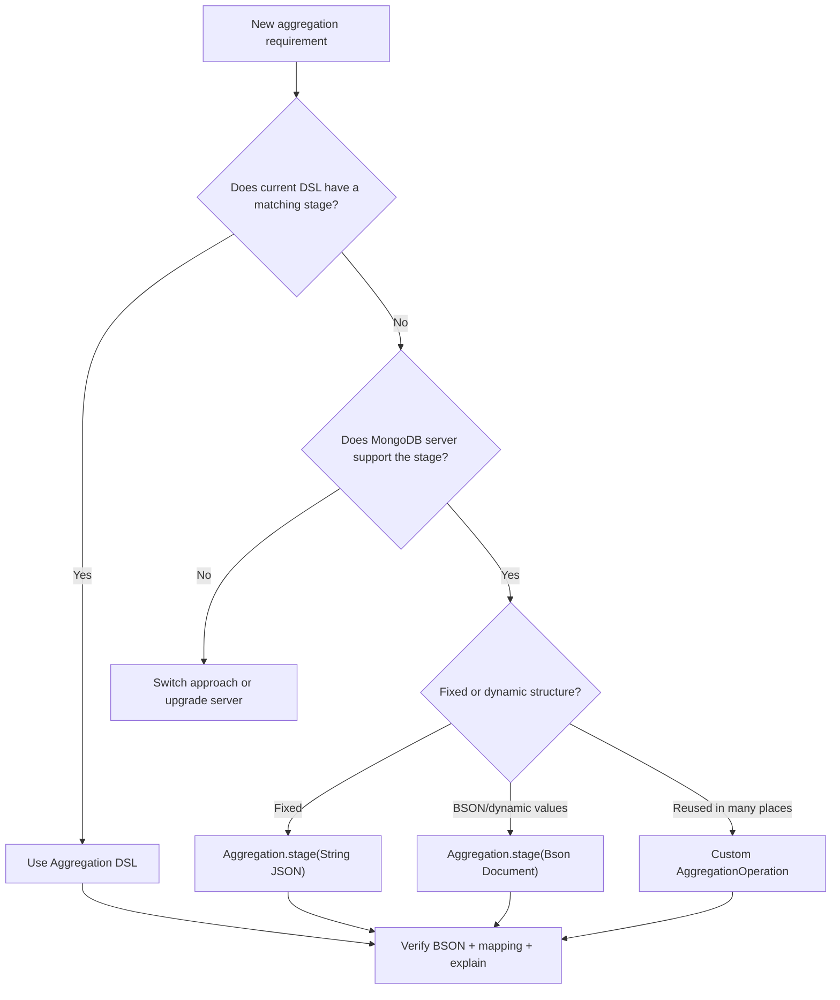

# Stages Without a DSL: Using AggregationOperation or Explicit JSON/BSON

## 1. The problem: MongoDB has a stage that Spring Data lacks a builder for

Spring Data MongoDB provides a fluent DSL for many aggregation stages such as `$match`, `$group`, `$lookup`, `$setWindowFields`, `$densify`, `$sort`, and `$project`. However, **MongoDB server and the Spring Data library have separate release lifecycles**. Some stages already exist on the server but are not yet represented by a dedicated builder in your current Spring Data version, while others only run on specific deployment platforms.

For example, MongoDB introduced **`$fill` in version 5.3** to fill missing or null values. The stage DSL list in current Spring Data MongoDB documentation includes `DensifyOperation` and `SetWindowFieldsOperation`, yet does not list a corresponding `FillOperation`. You **do not need to wait for a DSL upgrade** to use `$fill`: you can insert an explicit JSON or BSON stage directly into the same pipeline.

Three common approaches:

1. **`Aggregation.stage(String json)`:** declares a MongoDB stage via JSON, concise for fixed structures.
2. **`Aggregation.stage(Bson bson)`:** passes BSON constructed in Java via `Document` or a compatible `Bson` type, convenient for dynamic values while preserving exact BSON types.
3. **Custom `AggregationOperation`:** encapsulates a stage into a reusable class or lambda with access to `AggregationOperationContext` if metadata mapping is needed.

**The goal of this lesson is not to invent a new query language.** You only extend the pipeline where needed, keep existing DSL stages in DSL form, and govern explicit stages carefully for mapping, server versions, correctness, and performance.

In the **Mini Commerce** system of the `SPRING_DATA_MONGODB` module, we will query `Order` documents, fill missing `discount_amount` values, compute net amounts for reporting, and verify the BSON types. The same principles apply to `Product`, `Customer`, `MongoTemplate`/repository queries, reactive access, indexes, transactions, and performance diagnostics.

### Learning objectives

After this lesson, you will be able to:

- Distinguish a **pipeline stage** from an **aggregation expression/operator** and check whether a DSL is genuinely missing in your project's version.
- Write `Aggregation.stage(String)` and `Aggregation.stage(Bson)` accurately, knowing these APIs were introduced in **Spring Data MongoDB 4.0**.
- Implement a reusable `AggregationOperation` with `toDocument(AggregationOperationContext)`, understanding when context helps and the limits of automatic mapping.
- Distinguish **Java property names** from **BSON field names** when mixing DSL and explicit stages.
- Use `$fill`, understanding `value`, `method: "locf"/"linear"`, and how it differs from `$ifNull`/`$densify`.
- Preserve monetary precision with `BigDecimal`/BSON `Decimal128` when building custom stages.
- Avoid passing arbitrary JSON, field paths, stage operators, or pipeline parameters from HTTP requests directly to MongoDB.
- Verify server capabilities, runtime errors, stage ordering, memory usage, indexes, `explain` plans, and data safety.
- Write integration tests running against a real MongoDB instance and assert BSON/DTO outputs.

**Prerequisites:** Java 17+, Spring Boot with Spring Data MongoDB, familiarity with `@Document`, `@Id`, `@Field`, `MongoTemplate`, `Aggregation`, and `Query`/`Criteria`. The `$fill` examples require **MongoDB server 5.3 or newer**; `Aggregation.stage(...)` examples require **Spring Data MongoDB 4.0 or newer**. If your project runs older versions, see the compatibility section.

## 2. Decision table: which escape hatch should you choose?

| Scenario | Recommended choice | Reason |
| --- | --- | --- |
| Stage already has a stable DSL (`$match`, `$group`, `$lookup`, etc.) | Spring Data DSL | Typed API, uses mapping/metadata where supported |
| Stage lacks a DSL and has a **fixed** structure | `Aggregation.stage(String)` | Concise, easy to compare against `mongosh` |
| Stage lacks a DSL and config values are **Java/BSON values** | `Aggregation.stage(Bson)` | Easily preserves `Decimal128`, `Date`, and `Document` types |
| New stage reused across multiple services | Custom `AggregationOperation` class | Centralizes validation and stage construction |
| Spring Data version **prior to 4.0** | Custom `AggregationOperation` | `Aggregation.stage(...)` does not exist yet |
| Need full driver control without Spring entity mapping | `MongoCollection.aggregate(List<Bson>)` | Complete raw BSON control |
| Platform-specific or MongoDB Search stage | Verify platform support, then use an explicit stage if appropriate | Having a Java API does not mean the server can execute it |
| Only need to turn `null` into a default inside a projection | DSL `$ifNull` / `$project` | No new stage needed when semantics already match |

**Key distinction:** `$fill` is a **pipeline stage**; `$ifNull` is an **expression** used inside `$project`/`$set`. Never place `$ifNull` at the top level of a stage like `{ "$ifNull": ... }`: MongoDB requires every stage to begin with a valid stage operator.



## 3. Mini Commerce: order reporting dataset

We are building a screen summarizing **PAID** orders for a store. Each `Order` document has `total_amount`, while `discount_amount` may be:

- **Missing:** legacy documents from before promotions existed.
- **Null:** imported documents containing the field with no value.
- **Decimal128:** newer records storing an explicit discount amount.

The report requires treating missing/null discounts as **0.00** and computing:

\[
\text{netAmount} = \text{totalAmount} - \text{discountAmount}
\]

### 3.1. Order entity and @Field

```java
package com.example.minicommerce.domain;

import java.math.BigDecimal;
import java.time.Instant;

import org.springframework.data.annotation.Id;
import org.springframework.data.mongodb.core.mapping.Document;
import org.springframework.data.mongodb.core.mapping.Field;
import org.springframework.data.mongodb.core.mapping.FieldType;

@Document(collection = "orders")
public class Order {

    @Id
    private String id;

    @Field("tenant_id")
    private String tenantId;

    private String status;

    @Field("placed_at")
    private Instant placedAt;

    @Field(name = "total_amount", targetType = FieldType.DECIMAL128)
    private BigDecimal totalAmount;

    @Field(name = "discount_amount", targetType = FieldType.DECIMAL128)
    private BigDecimal discountAmount;

    public Order() {}

    public String getId() { return id; }
    public String getTenantId() { return tenantId; }
    public String getStatus() { return status; }
    public Instant getPlacedAt() { return placedAt; }
    public BigDecimal getTotalAmount() { return totalAmount; }
    public BigDecimal getDiscountAmount() { return discountAmount; }
}
```

Keep this mapping in mind:

| Java property | BSON key in MongoDB |
| --- | --- |
| `id` | `_id` |
| `tenantId` | `tenant_id` |
| `status` | `status` |
| `placedAt` | `placed_at` |
| `totalAmount` | `total_amount` |
| `discountAmount` | `discount_amount` |

These BSON names are the **actual data contract**. `Aggregation.stage(String/Bson)` will not automatically rewrite `"discountAmount"` into `"discount_amount"` for you.

### 3.2. BSON fixtures in mongosh

Run on a **dedicated test database**:

```javascript
use mini_commerce

db.orders.insertMany([
  {
    _id: "order-stage-101",
    tenant_id: "shop-a",
    status: "PAID",
    placed_at: ISODate("2026-11-19T09:00:00Z"),
    total_amount: NumberDecimal("300.00")
    // discount_amount is missing
  },
  {
    _id: "order-stage-102",
    tenant_id: "shop-a",
    status: "PAID",
    placed_at: ISODate("2026-11-19T10:00:00Z"),
    total_amount: NumberDecimal("200.00"),
    discount_amount: null
  },
  {
    _id: "order-stage-103",
    tenant_id: "shop-a",
    status: "PAID",
    placed_at: ISODate("2026-11-19T11:00:00Z"),
    total_amount: NumberDecimal("500.00"),
    discount_amount: NumberDecimal("25.00")
  },
  {
    _id: "order-stage-104",
    tenant_id: "shop-b",
    status: "PAID",
    placed_at: ISODate("2026-11-19T12:00:00Z"),
    total_amount: NumberDecimal("999.00")
  },
  {
    _id: "order-stage-105",
    tenant_id: "shop-a",
    status: "PLACED",
    placed_at: ISODate("2026-11-19T13:00:00Z"),
    total_amount: NumberDecimal("40.00")
  }
]);
```

`insertMany` is not idempotent on duplicate `_id` values; use an isolated fixture/collection. Never execute test deletes or seed commands against production.

Expected results for `tenant_id = "shop-a"` and `status = "PAID"`:

| Order | totalAmount | discountAmount after fill | netAmount |
| --- | ---: | ---: | ---: |
| `order-stage-101` | 300.00 | 0.00 | 300.00 |
| `order-stage-102` | 200.00 | 0.00 | 200.00 |
| `order-stage-103` | 500.00 | 25.00 | 475.00 |

`order-stage-104` is excluded by tenant; `order-stage-105` is excluded by status. **`$fill` inside a read aggregation never modifies the stored `Order` documents on disk**. It only transforms intermediate documents flowing through the pipeline.

## 4. Writing native $fill in mongosh

Before moving to Java, build a clear MongoDB pipeline:

```javascript
db.orders.aggregate([
  {
    $match: {
      tenant_id: "shop-a",
      status: "PAID"
    }
  },
  {
    $fill: {
      output: {
        discount_amount: { value: NumberDecimal("0.00") }
      }
    }
  },
  {
    $project: {
      _id: 0,
      orderId: "$_id",
      totalAmount: "$total_amount",
      discountAmount: "$discount_amount",
      netAmount: {
        $subtract: ["$total_amount", "$discount_amount"]
      }
    }
  },
  { $sort: { orderId: 1 } }
]);
```

Stages:

1. `$match` filters only orders matching the target tenant and status.
2. `$fill` fills `discount_amount = Decimal128(0.00)` on missing/null documents; the existing `25.00` value stays intact.
3. `$project` renames fields and computes `netAmount`.
4. `$sort` ensures deterministic ordering for verification and reporting.

### 4.1. Why use Decimal128 for zero?

In MongoDB, `0` is an integer literal; `0.00` in plain JavaScript typically evaluates to a Number/Double. When financial fields store BSON Decimal128, pass an explicit **Decimal128** rather than relying on implicit type coercion:

```javascript
NumberDecimal("0.00")
```

In Java, the equivalent representation is `new Decimal128(new BigDecimal("0.00"))`. This keeps tests reading `discount_amount`/`netAmount` type-consistent and avoids accidentally feeding a String `"0.00"` into arithmetic subtraction.

### 4.2. How does $fill differ from $ifNull?

To substitute a **default value directly inside a projection**, you can use the expression:

```javascript
{
  $project: {
    totalAmount: "$total_amount",
    discountAmount: {
      $ifNull: ["$discount_amount", NumberDecimal("0.00")]
    }
  }
}
```

For the simple case here, `$ifNull` works as well. **Never force `$fill` solely for the sake of practicing DSL extensions.** `$fill` shines when filling values across ordered sequences of documents using **`method: "locf"`** (last observation carried forward) or **`method: "linear"`** (linear interpolation), where a plain per-document `$ifNull` cannot express the same semantics.

## 5. Approach 1: Aggregation.stage(String JSON)

Available since **Spring Data MongoDB 4.0**, `Aggregation.stage(String json)` appends a stage from raw JSON:

```java
import java.util.List;

import org.springframework.data.mongodb.core.MongoTemplate;
import org.springframework.data.mongodb.core.aggregation.Aggregation;
import org.springframework.data.mongodb.core.aggregation.AggregationOperation;
import org.springframework.data.mongodb.core.aggregation.AggregationResults;
import org.springframework.data.mongodb.core.query.Criteria;

import com.example.minicommerce.domain.Order;

public List<OrderNetView> report(String tenantId, MongoTemplate template) {
    AggregationOperation fillDiscount = Aggregation.stage("""
        {
          "$fill": {
            "output": {
              "discount_amount": {
                "value": { "$numberDecimal": "0.00" }
              }
            }
          }
        }
        """);

    AggregationOperation projectNet = Aggregation.stage("""
        {
          "$project": {
            "_id": 0,
            "orderId": "$_id",
            "totalAmount": "$total_amount",
            "discountAmount": "$discount_amount",
            "netAmount": {
              "$subtract": ["$total_amount", "$discount_amount"]
            }
          }
        }
        """);

    Aggregation pipeline = Aggregation.newAggregation(
        Aggregation.match(
            Criteria.where("tenantId").is(tenantId)
                .and("status").is("PAID")),
        fillDiscount,
        projectNet,
        Aggregation.stage(
            "{ '$sort': { 'orderId': 1 } }")
    );

    AggregationResults<OrderNetView> results =
        template.aggregate(
            pipeline, Order.class, OrderNetView.class);

    return results.getMappedResults();
}
```

This illustrates a service method with `OrderNetView` imported. Java text blocks require Java 15+ (the lesson assumes Java 17+). The literal `{ "$numberDecimal": "0.00" }` uses **MongoDB Extended JSON**, parsed by the BSON parser into Decimal128 rather than passing an object with a `$numberDecimal` key to `$fill` as an operator.

### 5.1. Why does $match use Java property names while $fill uses BSON keys?

`Aggregation.match(Criteria.where("tenantId").is(tenantId))` is mapped by Spring Data against `Order.class`, turning `tenantId` into `tenant_id`.

By contrast, **the `Aggregation.stage(...)` API documentation explicitly states that field mapping against the domain type or prior stages is not performed** for this stage. Therefore, you must write:

```javascript
{ "$fill": { "output": { "discount_amount": { "value": 0 } } } }
```

and must not assume:

```javascript
{ "$fill": { "output": { "discountAmount": { "value": 0 } } } }
```

The second JSON snippet will **create or overwrite a brand-new BSON field `discountAmount`** without touching the real `discount_amount` field. This bug is dangerous because it rarely throws an exception: numbers silently come out wrong while the pipeline runs cleanly.

### 5.2. Pros and limitations of JSON Strings

**Pros:** easy to compare side-by-side with `mongosh` pipelines, convenient for static stages and long expressions that rarely change.

**Limitations:** field names are unchecked by the compiler, `@Field` annotations are not automatically applied, string concatenation makes dynamic parameter binding unsafe, syntax errors only surface at runtime, and it cannot verify whether the MongoDB server supports the stage.

**Rule of thumb:** keep JSON stages in reviewed constants/helpers and use DSL `Criteria` for user-supplied filters wherever possible. Never concatenate raw HTTP request inputs into JSON stages.

## 6. Report DTO: do not save aggregation outputs

`OrderNetView` is a **read model**, not an aggregate root:

```java
package com.example.minicommerce.service;

import java.math.BigDecimal;

public class OrderNetView {
    private String orderId;
    private BigDecimal totalAmount;
    private BigDecimal discountAmount;
    private BigDecimal netAmount;

    public OrderNetView() {}

    public String getOrderId() { return orderId; }
    public void setOrderId(String value) { orderId = value; }
    public BigDecimal getTotalAmount() { return totalAmount; }
    public void setTotalAmount(BigDecimal value) { totalAmount = value; }
    public BigDecimal getDiscountAmount() { return discountAmount; }
    public void setDiscountAmount(BigDecimal value) {
        discountAmount = value;
    }
    public BigDecimal getNetAmount() { return netAmount; }
    public void setNetAmount(BigDecimal value) { netAmount = value; }
}
```

Match aliases in `$project` to the DTO property names. Because `$project` sets `"_id": 0`, the output no longer carries MongoDB's `_id`; `orderId` is a plain projected field.

**Never call `repository.save(...)` on data read via aggregation or projection.** This DTO omits most `Order` fields; mapping it back to an entity and saving will wipe out omitted fields by replacing the document.

## 7. Approach 2: Aggregation.stage(Bson) with Document

When dynamic values with strict BSON types are needed, construct the stage in Java:

```java
import java.math.BigDecimal;
import org.bson.Document;
import org.bson.types.Decimal128;
import org.springframework.data.mongodb.core.aggregation.Aggregation;
import org.springframework.data.mongodb.core.aggregation.AggregationOperation;

Decimal128 zero = new Decimal128(
    new BigDecimal("0.00"));

Document stage = new Document(
    "$fill",
    new Document("output",
        new Document("discount_amount",
            new Document("value", zero)))
);

AggregationOperation fillDiscount =
    Aggregation.stage(stage);
```

`org.bson.Document` implements the `Bson` interface, matching the `Aggregation.stage(Bson)` overload. This API has also been available since Spring Data MongoDB 4.0.

The Java snippet produces the exact same structure as:

```javascript
{
  $fill: {
    output: {
      discount_amount: { value: NumberDecimal("0.00") }
    }
  }
}
```

### 7.1. Why is Document usually better than building JSON strings?

| Case | String JSON concatenation | Building Document/Bson |
| --- | --- | --- |
| Decimal128 | Easy to write `"0.00"` or `0.0` by mistake | Passes explicit `Decimal128` |
| Instant/Date | Requires exact Extended JSON syntax | Uses `java.util.Date` / appropriate BSON codec |
| Deeply nested expressions | Easy to misplace braces or quotes | Clear programmatic Java structure |
| Dynamic config values | Vulnerable to JSON injection if concatenated | Java values are encoded directly as BSON |
| Dynamic field paths/operators | Still dangerous | **Still requires an allowlist**, because keys are query structure |
| Review/reuse | Great for short static JSON | Great for parameterized helpers |

**Never equate "Document is safer than string concatenation" with "all user inputs are safe."** If a caller controls key names, operators, or whole stage shapes, they can still alter pipeline semantics even without string concatenation.

### 7.2. Helper restricting allowed fillable fields

```java
import java.math.BigDecimal;
import java.util.Set;

import org.bson.Document;
import org.bson.types.Decimal128;
import org.springframework.data.mongodb.core.aggregation.Aggregation;
import org.springframework.data.mongodb.core.aggregation.AggregationOperation;

public final class FillStages {

    private static final Set<String> ALLOWED_FIELDS =
        Set.of("discount_amount", "shipping_fee");

    private FillStages() {}

    public static AggregationOperation zeroMoneyIfMissing(
            String bsonField) {

        if (!ALLOWED_FIELDS.contains(bsonField)) {
            throw new IllegalArgumentException(
                "Unsupported BSON field");
        }

        Decimal128 zero = new Decimal128(
            new BigDecimal("0.00"));

        Document stage = new Document("$fill",
            new Document("output",
                new Document(bsonField,
                    new Document("value", zero))));

        return Aggregation.stage(stage);
    }
}
```

This helper operates on **BSON field names**, not Java property names. In larger codebases, define an enum of allowed fields mapped to BSON keys instead of letting callers pass raw strings.

## 8. Approach 3: Implementing a custom AggregationOperation

When a stage is reused frequently or needs encapsulated validation, create a dedicated class:

```java
package com.example.minicommerce.aggregation;

import java.math.BigDecimal;
import java.util.Objects;

import org.bson.Document;
import org.bson.types.Decimal128;
import org.springframework.data.mongodb.core.aggregation.AggregationOperation;
import org.springframework.data.mongodb.core.aggregation.AggregationOperationContext;

/**
 * $fill targeting the orders discount_amount BSON field.
 * Requires MongoDB >= 5.3.
 */
public final class FillDiscountOperation
        implements AggregationOperation {

    private final Decimal128 fallback;

    public FillDiscountOperation(BigDecimal value) {
        Objects.requireNonNull(value, "value");
        if (value.signum() < 0) {
            throw new IllegalArgumentException(
                "Discount fallback must be non-negative");
        }
        this.fallback = new Decimal128(value);
    }

    @Override
    public String getOperator() {
        return "$fill";
    }

    @Override
    public Document toDocument(
            AggregationOperationContext context) {

        return new Document("$fill",
            new Document("output",
                new Document("discount_amount",
                    new Document("value", fallback))));
    }
}
```

Usage:

```java
AggregationOperation fill =
    new FillDiscountOperation(new BigDecimal("0.00"));

Aggregation agg = Aggregation.newAggregation(
    Aggregation.match(
        Criteria.where("tenantId").is("shop-a")
            .and("status").is("PAID")),
    fill,
    Aggregation.stage(
        "{ '$project': { '_id': 0, " +
        "'orderId': '$_id', " +
        "'discountAmount': '$discount_amount' } }")
);
```

### 8.1. What does this interface actually define?

`AggregationOperation` represents a single pipeline operation. Primary methods:

- `toDocument(AggregationOperationContext)`: renders the stage `Document`. Still retained for compatibility, though **marked deprecated in recent Spring Data releases** in favor of `toPipelineStages(...)` under newer contracts.
- `toPipelineStages(AggregationOperationContext)`: allows one operation to emit one or more stages; the default implementation typically delegates to `toDocument(...)`.
- `getOperator()`: returns the stage name, e.g., `"$fill"`, helping the library identify the operator without rendering the full document.

The class above implements `toDocument(...)` because it is concise, works across many versions, and emits a single stage. If your compiler warns about deprecation, check your exact version's contract and implement `toPipelineStages(...)` as appropriate; **do not** remove `toDocument(...)` if your version's interface still requires implementing it.

### 8.2. Why does AggregationOperationContext exist?

The context provides access to pipeline metadata and field references, including:

```java
AggregationOperation mapped = context -> {
    Document stage = new Document(
        "$match", new Document("tenantId", "shop-a"));

    return context.getMappedObject(stage);
};
```

`getMappedObject(...)` can apply context-driven mapping to recognized structures. However, **never assume the context understands the full syntax of a brand-new stage**, especially fields acting as **output keys** in `$fill`, `$$var` variables, or specialized expressions. For stages unrecognized by the DSL, the safe approach is to use **verified BSON keys**, combine them with DSL stages where supported, and verify the rendered BSON via integration tests.

In `FillDiscountOperation` above, we deliberately return a `Document` with the schema-verified `discount_amount` key rather than calling `context.getMappedObject(...)` and "hoping the framework renames it."

### 8.3. A custom operation does not automatically expose fields

A `$set`/`$fill` stage can introduce new fields; Spring Data also tracks **field exposure** across aggregation operations. `Aggregation.stage(...)` and simple custom operations **do not automatically inform** subsequent DSL stages that a new field now exists.

In complex pipelines where downstream stages reference newly produced fields:

- Use explicit BSON aliases in raw `$project`/`$sort` where needed.
- Or implement the appropriate exposure interfaces in advanced custom operations.
- Inspect the rendered pipeline and run integration tests.
- If you want stricter field checks, evaluate `strictMapping`, bearing in mind that it **does not turn raw JSON stages into mapped DSL operations**.

## 9. Mixing DSL and raw stages in the same pipeline

Recommended structure:

```text
Typed/DSL $match (using Java property + mapping)
         |
         v
Raw $fill (BSON field discount_amount)
         |
         v
Raw $project (referencing BSON total_amount/discount_amount)
         |
         v
Raw $sort or context-verified DSL stage
         |
         v
Read-only DTO
```

**Do not rewrite every stage as a raw `Document` just because one stage lacks a DSL.** For example, `Aggregation.match(Criteria.where("tenantId")...)` is far easier to maintain than duplicating raw JSON `$match` blocks across every service.

### 9.1. Field-naming trap after custom stages

Given:

```java
@Field("discount_amount")
private BigDecimal discountAmount;
```

When writing `$fill`, compare these two options:

```javascript
// Matches the BSON schema:
{ $fill: { output: { discount_amount: { value: NumberDecimal("0.00") } } } }

// Violates the schema when discountAmount is only a Java property:
{ $fill: { output: { discountAmount: { value: NumberDecimal("0.00") } } } }
```

In the broken snippet, MongoDB has no knowledge of `@Field` and introduces a separate `discountAmount` field in intermediate documents, leaving two fields or causing subtraction to produce null.

### 9.2. strictMapping does not replace testing raw stages

`TypedAggregation`/`AggregationOptions` supports domain mapping rules. Since Spring Data MongoDB 3.2, unrecognized field references **no longer fail by default** the way they once did; enabling `strictMapping` restores stricter checks for mapped operations.

```java
import org.springframework.data.mongodb.core.aggregation.Aggregation;
import org.springframework.data.mongodb.core.aggregation.AggregationOptions;

AggregationOptions options = AggregationOptions.builder()
    .strictMapping()
    .build();

Aggregation checked = aggregation.withOptions(options);
```

Here `aggregation` is an already-built pipeline. `strictMapping()` **does not guarantee** validating or translating field names inside `Aggregation.stage(String/Bson)`, because raw stage APIs preserve BSON/JSON verbatim. Enabling `noMapping()` disables mapping for the entire pipeline—use it only if you deliberately write every field name in raw BSON across all stages.

## 10. Sequence-based $fill: locf and linear

Mini Commerce also has a `product_signals` collection tracking daily catalog quality scores. Some days are missing values or hold `null`.

```javascript
db.product_signals.insertMany([
  {
    _id: "signal-1",
    tenant_id: "shop-a",
    sku: "KBD-001",
    measured_at: ISODate("2026-11-17T00:00:00Z"),
    quality_score: 80
  },
  {
    _id: "signal-2",
    tenant_id: "shop-a",
    sku: "KBD-001",
    measured_at: ISODate("2026-11-18T00:00:00Z"),
    quality_score: null
  },
  {
    _id: "signal-3",
    tenant_id: "shop-a",
    sku: "KBD-001",
    measured_at: ISODate("2026-11-19T00:00:00Z"),
    quality_score: 90
  }
]);
```

### 10.1. LOCF: carry forward the last known value

```javascript
db.product_signals.aggregate([
  { $match: { tenant_id: "shop-a", sku: "KBD-001" } },
  {
    $fill: {
      partitionByFields: ["tenant_id", "sku"],
      sortBy: { measured_at: 1 },
      output: {
        quality_score: { method: "locf" }
      }
    }
  },
  { $sort: { measured_at: 1 } }
]);
```

With the fixture, `quality_score` on Nov 18 is filled with **80**. `locf` only draws from an earlier **known value within the same partition**; if no prior value exists, leading documents stay null.

### 10.2. Linear: interpolate between two observations

```javascript
db.product_signals.aggregate([
  { $match: { tenant_id: "shop-a", sku: "KBD-001" } },
  {
    $fill: {
      partitionByFields: ["tenant_id", "sku"],
      sortBy: { measured_at: 1 },
      output: {
        quality_score: { method: "linear" }
      }
    }
  },
  { $sort: { measured_at: 1 } }
]);
```

With evenly spaced dates between Nov 17 and Nov 19, linear interpolation sets Nov 18's score to **85**. `linear` imposes constraints on `sortBy` (single field, no duplicate sort values within a partition), and MongoDB refines certain behaviors across versions. Consult the `$fill` docs for your **running server version** before relying on interpolation.

**Do not confuse `$fill` with `$densify`:** `$fill` populates **null/missing fields inside existing documents**, whereas `$densify` **synthesizes new documents** to fill gaps along a time or numeric axis. If Nov 18 had no document at all, `$fill` alone will not conjure a document for that day.

### 10.3. From JSON to Spring Data

```java
AggregationOperation fillScore = Aggregation.stage("""
    {
      "$fill": {
        "partitionByFields": ["tenant_id", "sku"],
        "sortBy": { "measured_at": 1 },
        "output": {
          "quality_score": { "method": "locf" }
        }
      }
    }
    """);
```

This illustrates a stage missing from the supported DSL list; field paths use **actual BSON names**. If `quality_score` is a metric whose domain rules forbid carrying yesterday's score forward, do **not** pick LOCF just because it is convenient: the gap-filling method is a data-analytics decision, not an arbitrary Spring Data setting.

## 11. A special case: MongoDB Search / Atlas

Spring Data allows registering stages lacking a DSL, such as `$search` on platforms providing **MongoDB Search**. However, **having a Java API does not mean any MongoDB server can run that stage**.

Conceptual example for a `products` collection with a configured `product_name_search` search index:

```java
Aggregation searchPipeline = Aggregation.newAggregation(
    Aggregation.stage("""
        {
          "$search": {
            "index": "product_name_search",
            "text": {
              "query": "keyboard",
              "path": "name"
            }
          }
        }
        """),
    Aggregation.limit(10)
);
```

**Precondition:** the database/deployment must support MongoDB Search and the index must exist; do not treat this example as universally available on every standalone MongoDB Community instance. The `$search` stage obeys strict **placement rules** (typically required as the first stage in its pipeline). Do not place `$match` before `$search`, as that is generally invalid; move selective filters into `compound.filter` using Search syntax where needed.

Important distinctions:

- `$search` executes against dedicated search indexes and analyzers.
- Traditional `$text` and text indexes have different semantics.
- `$regex` generally cannot substitute for full-text/fuzzy search.
- Passing an explicit stage does not magically enable search engines on the server.

Never embed credentials, tokens, internal payloads, or arbitrary request-supplied stage JSON into Search definitions.

## 12. When bypassing Spring DSL altogether: MongoDB Java Driver

If you truly need a pure BSON pipeline with manual control over every field name, use the native driver directly:

```java
import java.math.BigDecimal;
import java.util.ArrayList;
import java.util.List;

import com.mongodb.client.MongoCollection;
import com.mongodb.client.model.Aggregates;
import com.mongodb.client.model.Filters;

import org.bson.Document;
import org.bson.conversions.Bson;
import org.bson.types.Decimal128;

MongoCollection<Document> orders =
    mongoTemplate.getCollection("orders");

Document fillStage = new Document("$fill",
    new Document("output",
        new Document("discount_amount",
            new Document("value",
                new Decimal128(new BigDecimal("0.00"))))));

Document projectStage = Document.parse("""
    {
      "$project": {
        "_id": 0,
        "orderId": "$_id",
        "discountAmount": "$discount_amount"
      }
    }
    """);

List<Bson> pipeline = List.of(
    Aggregates.match(Filters.and(
        Filters.eq("tenant_id", "shop-a"),
        Filters.eq("status", "PAID"))),
    fillStage,
    projectStage
);

List<Document> results =
    orders.aggregate(pipeline).into(new ArrayList<>());
```

**Difference from `MongoTemplate.aggregate(..., Order.class, ...)`:** raw driver `MongoCollection<Document>` does not apply `@Field("tenant_id")`, custom converters, entity callbacks, or Spring Data auditing. Every key in this pipeline must be the **BSON key**.

The native driver helps for bleeding-edge stages, pipelines stitched from BSON fragments, or server features without DSL backing. In applications using Spring Data everywhere else, `Aggregation.stage(...)` for **the few missing stages** is usually preferable to discarding `MongoTemplate` completely.

## 13. Stage ordering: the DSL cannot fix wrong placement

A pipeline can be syntactically valid yet produce wrong results when stages sit in the wrong order.

### 13.1. Place $match as early as possible without changing semantics

```javascript
[
  { $match: { tenant_id: "shop-a", status: "PAID" } },
  { $fill: { output: { discount_amount: { value: NumberDecimal("0.00") } } } },
  { $project: { orderId: "$_id", discountAmount: "$discount_amount" } }
]
```

Filtering `tenant_id/status` before `$fill` shrinks the working set. However, if a pipeline compares across groups or windows spanning multiple statuses before filtering, moving `$match` too early changes the inputs feeding the fill stage. **Optimize only after locking down semantics**.

### 13.2. $project can strip fields needed downstream

```javascript
[
  { $project: { _id: 0, orderId: "$_id" } },
  { $fill: { output: { discount_amount: { value: NumberDecimal("0.00") } } } }
]
```

Here `$project` dropped `total_amount`, leaving downstream stages unable to compute net totals. A raw stage cannot recover fields stripped upstream.

### 13.3. Stages with mandatory positions

Certain stages obey strict structural rules:

- `$search` on supported deployments normally must appear first.
- `$geoNear` has position and index preconditions.
- `$out`/`$merge` are write stages and must sit at the **end of the pipeline**.
- `$fill` with `method: "linear"/"locf"` requires an explicit valid sort definition; never rely on natural storage order.

`Aggregation.stage(...)` does not check all of these rules at compile time. The server determines at execution time whether the pipeline is valid and supported on that deployment.

## 14. Never concatenate dynamic JSON from requests

A dangerous API pattern:

```java
// DO NOT DO THIS: letting clients control raw aggregation stages.
String rawStage = request.getStageJson();
AggregationOperation operation =
    Aggregation.stage(rawStage);
```

This **anti-pattern** assumes `request` exposes `getStageJson()`. If clients can supply arbitrary stages, they can probe restricted fields, trigger resource-exhausting pipelines, or slip in write stages such as `$merge`/`$out` in unsafe contexts.

### 14.1. Safe pattern

```java
public List<OrderNetView> reportForTenant(
        String verifiedTenantId,
        MongoTemplate template) {

    if (verifiedTenantId == null
            || verifiedTenantId.isBlank()) {
        throw new IllegalArgumentException(
            "Tenant is required");
    }

    Aggregation pipeline = Aggregation.newAggregation(
        Aggregation.match(
            Criteria.where("tenantId").is(verifiedTenantId)
                .and("status").is("PAID")),
        FillStages.zeroMoneyIfMissing("discount_amount"),
        Aggregation.stage("""
            {
              "$project": {
                "_id": 0,
                "orderId": "$_id",
                "totalAmount": "$total_amount",
                "discountAmount": "$discount_amount",
                "netAmount": {
                  "$subtract": [
                    "$total_amount",
                    "$discount_amount"
                  ]
                }
              }
            }
            """)
    );

    return template.aggregate(
        pipeline, Order.class, OrderNetView.class)
        .getMappedResults();
}
```

**`verifiedTenantId` must come from the security context or a trusted backend source**, never an unverified request body field. Raw stage components must be constants or produced by helpers enforcing a **field allowlist**. When an API needs dynamic sorting, allowlist field names and sort directions instead of accepting arbitrary JSON.

### 14.2. MongoDB JSON injection and expression injection

Even when building `Document` objects, the following positions represent **query structure**, not plain data values:

- Stage operator names: `"$fill"`, `"$project"`, `"$lookup"`.
- BSON field names: `"discount_amount"`.
- Field paths: `"$customerId"` or `"$$variable"`.
- Expressions: `"$subtract"`, `"$cond"`.
- Foreign collections in `$lookup` and target names in `$out`/`$merge`.

**Value binding alone is insufficient** if untrusted input governs query structure. Model allowed parameters via typed schemas/DTOs and let the service decide operators and field paths.

## 15. Version compatibility: three layers to verify

| Component | What to verify | Consequence if mismatched |
| --- | --- | --- |
| MongoDB server | Supports `$fill` from **5.3+** | Unrecognized stage error at aggregate execution |
| Spring Data MongoDB | `Aggregation.stage(String/Bson)` from **4.0+** | Code fails to compile against older APIs |
| Deployment platform | MongoDB Search/specialized stages require matching runtime | Stage fails despite valid JSON |
| MongoDB Java Driver | Compatible `Document`, BSON codecs, Extended JSON | Wrong types or parse/serialization failures |
| Java runtime | Text blocks `"""` require Java **15+** | Compiler error on older JDKs |
| Schema mapping | `@Field` matches actual BSON keys | Pipeline returns null or writes wrong fields |

### 15.1. Spring Data versions prior to 4.0

If `Aggregation.stage(...)` is unavailable, implement `AggregationOperation`:

```java
AggregationOperation fill = context ->
    new Document("$fill",
        new Document("output",
            new Document("discount_amount",
                new Document("value",
                    new Decimal128(
                        new BigDecimal("0.00"))))));
```

This snippet requires importing `AggregationOperation`, `Document`, `Decimal128`, and `BigDecimal`. It is a **Spring Data API escape hatch**, yet it **does not relax the MongoDB server ≥ 5.3 requirement**. On older servers, either fall back to server-supported stages/expressions or upgrade MongoDB.

### 15.2. Newer versions do not mean every stage stays raw forever

Modern Spring Data releases already support many previously unmapped stages like `$densify`, `$setWindowFields`, and `$unionWith`. Before writing a custom wrapper:

1. Check the DSL stage list for your current dependency version.
2. Search `Aggregation` builders and `*Operation` classes.
3. Resort to raw stages only when the DSL genuinely lacks the stage or cannot express the required semantics.
4. After upgrading Spring Data, consider migrating custom stages to the official DSL when it lowers mapping and maintenance risk.

Never label a stage "permanently unsupported by DSL" as an immutable fact—library coverage evolves across releases.

## 16. Options, performance, and explain

### 16.1. Add indexes where they can help

`$fill` does not replace an index supporting `$match`. For Order reports:

```javascript
db.orders.createIndex({
  tenant_id: 1,
  status: 1,
  placed_at: 1
});
```

Filters on `tenant_id + status` can exploit this index; if a report sorts by `placed_at`, the trailing key can help as well. Still, never assume this single index optimizes every `$fill` pipeline, especially when partition keys, sort keys, and cardinalities differ.

### 16.2. Enforce time limits and disk use when appropriate

```java
import java.time.Duration;

import org.springframework.data.mongodb.core.aggregation.Aggregation;
import org.springframework.data.mongodb.core.aggregation.AggregationOptions;

AggregationOptions options = AggregationOptions.builder()
    .maxTime(Duration.ofSeconds(5))
    .allowDiskUse(true)
    .build();

Aggregation guarded = aggregation.withOptions(options);
```

`allowDiskUse(true)` only helps stages capable of spilling to disk when needed; it **does not** fix broken field mapping, invalid stage operators, 16 MiB document limits, or missing indexes. `maxTime` bounds long-running server work, without replacing rate limiting, pagination, or sensible pipeline design.

### 16.3. Inspect executionStats in mongosh

```javascript
db.orders.explain("executionStats").aggregate([
  {
    $match: {
      tenant_id: "shop-a",
      status: "PAID"
    }
  },
  {
    $fill: {
      output: {
        discount_amount: {
          value: NumberDecimal("0.00")
        }
      }
    }
  },
  {
    $project: {
      _id: 0,
      orderId: "$_id",
      netAmount: {
        $subtract: [
          "$total_amount",
          "$discount_amount"
        ]
      }
    }
  }
]);
```

Inspect:

| Metric / characteristic | Question |
| --- | --- |
| `winningPlan` / `IXSCAN` / `COLLSCAN` | Did the leading `$match` use an index? |
| `totalKeysExamined` | How many index entries were scanned? |
| `totalDocsExamined` | How many documents were read? |
| `nReturned` | How many documents exited the pipeline? |
| Stage-level statistics | Do `$fill` or sorts consume excessive memory or time? |
| `usedDisk` (if present) | Did any stage spill? |
| `executionTimeMillis` | Latency of the explain run; validate under realistic load |

Explain JSON formats vary across MongoDB versions—never hardcode brittle paths. On a tiny fixture of a few orders, choosing `COLLSCAN` can be totally reasonable; performance evaluation requires realistic data distributions and document counts.

### 16.4. Watch cardinality when using locf/linear

For partitioned and sorted `$fill`, operate over a bounded time window. Blindly inserting `$limit` at the start of the pipeline can drop prior/subsequent observations required by LOCF or linear interpolation; that alters correctness rather than merely optimizing execution.

When combining `$densify` with `$fill`, document counts can expand significantly. Check generated document bounds, memory, sort cost, and output sizes before running across multi-year histories.

## 17. Read vs. write? How $fill differs from $merge and $out

`$fill` inside a read aggregation **never updates the source collection**. Persisting computed results requires `$merge` or `$out`, which is a separate architectural decision:

```javascript
// Illustrative shape only; DO NOT run in production.
db.orders.aggregate([
  { $match: { tenant_id: "shop-a", status: "PAID" } },
  { $fill: { output: { discount_amount: {
      value: NumberDecimal("0.00")
  } } } },
  { $merge: {
      into: "orders_report_cache",
      on: "_id",
      whenMatched: "replace",
      whenNotMatched: "insert"
  } }
]);
```

The command above creates or replaces documents in `orders_report_cache`, requiring attention to `whenMatched` policies, unique indexes on `on`, transaction restrictions, write permissions, and idempotency. Just because `Aggregation.stage(...)` accepts raw `$merge` **does not make it read-only**.

Never allow reporting APIs to accept arbitrary `$out`/`$merge` stages from callers. For interactive reports, return DTOs and **omit write stages**.

## 18. ReactiveMongoTemplate: identical semantics, Flux output

With reactive Spring Data MongoDB:

```java
import reactor.core.publisher.Flux;

import org.springframework.data.mongodb.core.aggregation.Aggregation;
import org.springframework.data.mongodb.core.query.Criteria;

Aggregation pipeline = Aggregation.newAggregation(
    Aggregation.match(
        Criteria.where("tenantId").is("shop-a")
            .and("status").is("PAID")),
    Aggregation.stage("""
        {
          "$fill": {
            "output": {
              "discount_amount": {
                "value": { "$numberDecimal": "0.00" }
              }
            }
          }
        }
        """),
    Aggregation.stage("""
        {
          "$project": {
            "_id": 0,
            "orderId": "$_id",
            "netAmount": {
              "$subtract": [
                "$total_amount",
                "$discount_amount"
              ]
            }
          }
        }
        """)
);

Flux<OrderNetView> views =
    reactiveMongoTemplate.aggregate(
        pipeline, Order.class, OrderNetView.class);
```

`reactiveMongoTemplate` is an injected bean in a WebFlux service; the publisher executes only when subscribed. Never call `block()` on an event-loop thread. **Reactive drivers change neither mapping behavior nor `$fill` server version requirements**, nor do they endow an unindexed pipeline with an index.

Testing with Reactor:

```java
import reactor.test.StepVerifier;

StepVerifier.create(views.collectList())
    .assertNext(rows -> {
        org.junit.jupiter.api.Assertions.assertFalse(
            rows.isEmpty());
    })
    .verifyComplete();
```

This is a minimal skeleton; real integration tests should verify numeric calculations, tenant isolation, and ordering when the API sorts output.

## 19. Unit testing stage structure before hitting the server

`Aggregation.stage(String/Bson)` builds an `AggregationOperation`. You can inspect the rendered BSON of an individual stage directly:

```java
import static org.junit.jupiter.api.Assertions.*;

import java.util.List;

import org.bson.Document;
import org.junit.jupiter.api.Test;
import org.springframework.data.mongodb.core.aggregation.Aggregation;
import org.springframework.data.mongodb.core.aggregation.AggregationOperation;

class FillStageUnitTest {

    @Test
    void createsOneFillStageWithExpectedField() {
        AggregationOperation stage = Aggregation.stage("""
            {
              "$fill": {
                "output": {
                  "discount_amount": {
                    "value": { "$numberDecimal": "0.00" }
                  }
                }
              }
            }
            """);

        List<Document> documents = stage.toPipelineStages(
            Aggregation.DEFAULT_CONTEXT);

        assertEquals(1, documents.size());
        assertTrue(documents.get(0).containsKey("$fill"));

        Document fill = documents.get(0)
            .get("$fill", Document.class);
        Document output = fill.get("output", Document.class);

        assertTrue(output.containsKey("discount_amount"));
        assertFalse(output.containsKey("discountAmount"));
    }
}
```

This test catches basic mistakes (invalid JSON, wrong BSON keys) yet **does not** prove the server supports `$fill`, that the DSL filter maps `tenantId`, or that money math works. You still need the integration test below.

## 20. Integration testing against real MongoDB

Use **MongoDB server 5.3+**, an isolated database, or Testcontainers. The test below inserts raw BSON to prove:

- `Criteria.where("tenantId")` maps accurately to `tenant_id`.
- `Aggregation.stage` explicitly targets `discount_amount`.
- Both missing and `null` fields are filled to Decimal128 `0.00`.
- Existing discounts stay intact.
- Other tenants and non-PAID orders are excluded.
- `$fill` transforms only **pipeline results**, leaving source orders unchanged.

### 20.1. Complete integration test

```java
package com.example.minicommerce;

import static org.junit.jupiter.api.Assertions.*;

import java.math.BigDecimal;
import java.util.List;
import java.util.Map;
import java.util.function.Function;
import java.util.stream.Collectors;

import org.bson.Document;
import org.bson.types.Decimal128;
import org.junit.jupiter.api.Test;
import org.springframework.beans.factory.annotation.Autowired;
import org.springframework.boot.test.context.SpringBootTest;
import org.springframework.data.mongodb.core.MongoTemplate;
import org.springframework.data.mongodb.core.aggregation.Aggregation;
import org.springframework.data.mongodb.core.query.Criteria;

import com.example.minicommerce.domain.Order;

@SpringBootTest
class RawAggregationStageIntegrationTest {

    @Autowired
    MongoTemplate template;

    @Test
    void fillDiscountUsesBsonAliasesAndKeepsSourceUnchanged() {
        List<String> ids = List.of(
            "raw-stage-test-1",
            "raw-stage-test-2",
            "raw-stage-test-3",
            "raw-stage-test-other-tenant",
            "raw-stage-test-not-paid");

        var orders = template.getCollection("orders");
        Document onlyFixture = new Document(
            "_id", new Document("$in", ids));

        orders.deleteMany(onlyFixture);
        try {
            orders.insertMany(List.of(
                order(ids.get(0), "shop-a", "PAID",
                    "300.00", null, false),
                order(ids.get(1), "shop-a", "PAID",
                    "200.00", null, true),
                order(ids.get(2), "shop-a", "PAID",
                    "500.00", "25.00", true),
                order(ids.get(3), "shop-b", "PAID",
                    "999.00", null, false),
                order(ids.get(4), "shop-a", "PLACED",
                    "40.00", null, false)
            ));

            Aggregation aggregation = Aggregation.newAggregation(
                Aggregation.match(
                    Criteria.where("id").in(ids)
                        .and("tenantId").is("shop-a")
                        .and("status").is("PAID")),
                Aggregation.stage("""
                    {
                      "$fill": {
                        "output": {
                          "discount_amount": {
                            "value": {
                              "$numberDecimal": "0.00"
                            }
                          }
                        }
                      }
                    }
                    """),
                Aggregation.stage("""
                    {
                      "$project": {
                        "_id": 0,
                        "orderId": "$_id",
                        "discountAmount": "$discount_amount",
                        "netAmount": {
                          "$subtract": [
                            "$total_amount",
                            "$discount_amount"
                          ]
                        }
                      }
                    }
                    """)
            );

            List<Document> actual = template.aggregate(
                aggregation, Order.class, Document.class)
                .getMappedResults();

            assertEquals(3, actual.size());

            Map<String, Document> byId = actual.stream()
                .collect(Collectors.toMap(
                    item -> item.getString("orderId"),
                    Function.identity()));

            assertMoney("0.00", byId.get(ids.get(0)),
                "discountAmount");
            assertMoney("0.00", byId.get(ids.get(1)),
                "discountAmount");
            assertMoney("25.00", byId.get(ids.get(2)),
                "discountAmount");

            assertMoney("300.00", byId.get(ids.get(0)),
                "netAmount");
            assertMoney("200.00", byId.get(ids.get(1)),
                "netAmount");
            assertMoney("475.00", byId.get(ids.get(2)),
                "netAmount");

            Document source = orders.find(
                new Document("_id", ids.get(0))).first();
            assertNotNull(source);
            assertFalse(source.containsKey("discount_amount"));

        } finally {
            orders.deleteMany(onlyFixture);
        }
    }

    private static Document order(
            String id, String tenant, String status,
            String total, String discount,
            boolean includeDiscountField) {

        Document document = new Document("_id", id)
            .append("tenant_id", tenant)
            .append("status", status)
            .append("total_amount",
                decimal(total));

        if (includeDiscountField) {
            document.append("discount_amount",
                discount == null ? null : decimal(discount));
        }
        return document;
    }

    private static Decimal128 decimal(String text) {
        return new Decimal128(new BigDecimal(text));
    }

    private static void assertMoney(
            String expected, Document row, String field) {
        assertNotNull(row);
        Decimal128 actual = row.get(field, Decimal128.class);
        assertNotNull(actual, "Missing Decimal128: " + field);
        assertEquals(
            0, new BigDecimal(expected)
                .compareTo(actual.bigDecimalValue()));
    }
}
```

The test reads `Document` results instead of a DTO so it can inspect exact `Decimal128` types. Mapping into `OrderNetView` at the service layer is a separate step verifying `Decimal128 → BigDecimal` conversion.

**Note:** since `@SpringBootTest` configurations can differ across environments, point tests at a dedicated test database, verify the MongoDB server meets version requirements, and never run against production. Clean up only the fixture IDs—never `drop()` the whole collection.

### 20.2. Testing missed mapping failures

In a separate test, replace `"discount_amount"` in the raw stage with `"discountAmount"` and inspect the output. Typical failure mode:

- MongoDB creates a new `discountAmount` field.
- `$project` still reads `"$discount_amount"`, so orders missing that field stay null/missing.
- `$subtract` fails to yield the expected net amount.

Never assert merely that a pipeline ran without throwing: assert **exact business values per Order**. Alias bugs usually surface as **silent data errors**, not syntax exceptions.

### 20.3. Testing server compatibility

In CI spanning multiple MongoDB versions, tag `$fill` tests to run only against supporting servers. Use a build matrix targeting supported MongoDB versions; when running under an unsupported profile, **never catch the failure exception and report it as a passing business test**.

## 21. Required test matrix

| Scenario | Expected outcome |
| --- | --- |
| Valid JSON stage | Produces one `$fill` stage |
| BSON stage from `Document` | Preserves `Decimal128(0.00)` |
| `@Field("tenant_id")` | DSL `Criteria.where("tenantId")` filters accurately |
| Raw stage using `discount_amount` | Reads and fills the true BSON field |
| Raw stage using wrong `discountAmount` | Test catches corrupted calculations |
| Missing discount | Filled to `0.00` in output only |
| BSON Null discount | Filled to `0.00` |
| Existing `25.00` discount | Preserved as `25.00` |
| Other tenant | Excluded from report |
| Non-PAID status | Excluded |
| `$fill` performs no DB write | Source document stays untouched |
| `locf` with prior observation | Carries forward previous value |
| `linear` with two endpoints | Interpolates along sort axis |
| Missing entire day document | `$fill` does not synthesize new documents |
| Server older than 5.3 | Recognizes unsupported feature; uses appropriate fallback |
| Un-allowlisted request JSON | API rejects arbitrary raw stages |
| DTO output | Aliases and monetary types map accurately |
| Reactive `Flux` | Non-blocking, identical results |
| Explain/indexes | Filter stage selects an appropriate plan on realistic data |

## 22. Common issues and fixes

| Symptom | Root cause | Fix |
| --- | --- | --- |
| `Aggregation.stage` method missing | Spring Data MongoDB prior to 4.0 | Use custom `AggregationOperation` or upgrade version |
| Server rejects unrecognized `$fill` | MongoDB older than 5.3 | Upgrade server or use supported approach |
| JSON stage compiles yet fails at runtime | Invalid stage JSON/BSON syntax | Validate in `mongosh` and unit-test stage rendering |
| `discountAmount` is null after fill | Raw stage used Java name instead of BSON | Use `discount_amount` and assert raw results |
| `@Field` has no effect in stage | `Aggregation.stage` bypasses domain mapping | Write explicit BSON field names |
| `strictMapping` misses raw stage bug | Validates only context-mapped portions | Integration test raw BSON and aliases |
| String `"0.00"` breaks arithmetic | Monetary field stored as BSON String | Use Decimal128 |
| Using `double` for currency | Binary floating-point drift | `BigDecimal` → `Decimal128`, enforce schema checks |
| `locf` carries unrelated values | Missing/wrong partition or sort | Specify `partitionByFields` and valid `sortBy` |
| `linear` errors on sort | Duplicate or invalid `sortBy` keys | Check version-specific `$fill` rules |
| Expected `$fill` to create missing dates | Confused with `$densify` | Add `$densify` when documents must be generated |
| `$search` fails to execute | Deployment lacks MongoDB Search or index | Verify deployment tier and search index |
| `$search` complains about stage order | Placed `$match` ahead of `$search` | Keep `$search` first and move filters into Search syntax |
| Pipeline slow despite Java DSL | Poor query shape, indexes, or cardinality | Run `explain`; syntax does not dictate speed |
| `allowDiskUse` fails to resolve error | Mapping bug, server constraint, or 16 MiB cap | Fix root cause instead of blindly throwing resources at it |
| API overloaded by heavy pipelines | Client controls stages/fields/paths | Enforce allowlists, input bounds, timeouts, and output caps |
| Report overwrites collection | Unintended `$merge`/`$out` stage | Separate read/write privileges and review stages |
| Reused custom operation fails intermittently | Shared mutable state or unstable aliases | Make helpers immutable and test across versions |
| Tests only check "no exception thrown" | Silent data errors go undetected | Assert exact BSON values and business numbers |

## 23. Hands-on exercises

**Exercise 1 — Verify DSL coverage.** Check your project's Spring Data MongoDB version. Locate `Aggregation.stage(String/Bson)` and all available `*Operation` classes. Document why `$fill` needs a custom stage or is already covered by DSL in your version.

**Exercise 2 — Three ways to author the same stage.** Build `$fill` for `discount_amount` using (a) JSON text block, (b) `Document/Bson`, and (c) `FillDiscountOperation`. Compare `toPipelineStages(...)` against expected BSON.

**Exercise 3 — Property vs. BSON mapping.** Annotate `Order.tenantId` with `@Field("tenant_id")`. Combine `Aggregation.match(Criteria.where("tenantId")...)` with raw `$fill`. Prove the DSL maps `tenantId` while the raw stage must use `discount_amount`.

**Exercise 4 — Decimal128.** Store `total_amount` and `discount_amount` as BSON Decimal128. Test three Orders: missing, null, and `25.00`. Compute `netAmount` and assert every value using `BigDecimal.compareTo`.

**Exercise 5 — LOCF.** Seed `product_signals` with two SKUs and daily quality measurements. Fill gaps via `$fill.method = "locf"` partitioned by SKU, confirming one SKU's score never bleeds into another SKU.

**Exercise 6 — Linear and densify.** Omit entire day documents. Use `$densify` to materialize missing date buckets over a bounded range, then apply `$fill` linear interpolation. Compare with `$fill` alone and analyze document-expansion cost.

**Exercise 7 — Security.** Attempt submitting `"$merge"` as a field name, arbitrary stage JSON, or disallowed fields over HTTP. Harden the service to accept only an enum of allowed fields/types and derive the tenant filter strictly from security context.

**Exercise 8 — Performance.** Create `{ tenant_id: 1, status: 1, placed_at: 1 }`. Run `explain("executionStats")` on a large dataset before and after adding `$fill`, comparing keys/docs examined, duration, and memory usage.

**Exercise 9 — Reactive.** Port the pipeline to `ReactiveMongoTemplate.aggregate(...)`, test with `StepVerifier`, verify cross-tenant isolation, and ensure zero `block()` calls.

**Bonus exercise — Platform-exclusive stages.** If MongoDB Search is available, add `$search` via `Aggregation.stage(String)` at position 0 with a valid search index and metadata checks. Otherwise, explain why it cannot execute locally and complete the exercises using `$fill`.

### Self-check questions

1. Why can MongoDB server expose a stage before Spring Data has a DSL builder for it?
2. Which Spring Data MongoDB release introduced `Aggregation.stage(String)`/`stage(Bson)`?
3. What must an `AggregationOperation` implement to represent a stage?
4. Why does `AggregationOperationContext` help with mapping yet fail to guarantee understanding every raw stage?
5. How does `@Field("discount_amount")` affect DSL stages vs. raw BSON stages?
6. Why does `"$numberDecimal"` in Extended JSON behave differently from the String literal `"0.00"`?
7. When is `$ifNull` sufficient and when is `$fill` actually needed?
8. How does `$fill.method = "locf"` differ from `"linear"`?
9. How does `$fill` differ from `$densify` regarding document generation?
10. Why must `$fill` tests require MongoDB server ≥ 5.3?
11. Does `strictMapping` validate raw JSON stages?
12. Why must raw stage JSON never be accepted from HTTP clients?
13. Why do `$merge`/`$out` carry fundamentally different security implications from `$fill`?
14. Which metrics diagnose missing indexes or memory exhaustion in a pipeline?
15. When should custom stages be replaced with official DSL operations after a framework upgrade?

**Expected outcome:** learners confidently use **`AggregationOperation` and explicit JSON/BSON** to adopt MongoDB stages lacking DSL builders while upholding schema accuracy, BSON types, tenant isolation, server compatibility, performance, and test rigor. This enables controlled extensibility of Spring Data MongoDB without abandoning the DSL or exposing raw dynamic queries directly to clients.

## References

- [Spring Data MongoDB — Aggregation Framework Support](https://docs.spring.io/spring-data/mongodb/reference/mongodb/aggregation-framework.html): list of currently supported DSL stages, registering unsupported stages, and typed mapping.
- [Spring Data MongoDB — Aggregation API](https://docs.spring.io/spring-data/mongodb/reference/api/java/org/springframework/data/mongodb/core/aggregation/Aggregation.html): `stage(String)`, `stage(Bson)`, `newAggregation`, and pipeline options.
- [Spring Data MongoDB — AggregationOperation API](https://docs.spring.io/spring-data/mongodb/reference/api/java/org/springframework/data/mongodb/core/aggregation/AggregationOperation.html): `toDocument`, `toPipelineStages`, `getOperator`.
- [Spring Data MongoDB — AggregationOperationContext API](https://docs.spring.io/spring-data/mongodb/reference/api/java/org/springframework/data/mongodb/core/aggregation/AggregationOperationContext.html): `getMappedObject` and field references.
- [Spring Data MongoDB — AggregationOptions](https://docs.spring.io/spring-data/mongodb/reference/api/java/org/springframework/data/mongodb/core/aggregation/AggregationOptions.Builder.html): `strictMapping`, `noMapping`, `maxTime`, and `allowDiskUse`.
- [MongoDB Manual — $fill](https://www.mongodb.com/docs/manual/reference/operator/aggregation/fill/): `output.value`, `locf`, `linear`, partitioning/sorting, and MongoDB version requirements.
- [MongoDB Manual — $densify](https://www.mongodb.com/docs/manual/reference/operator/aggregation/densify/): generating documents for gaps in a data series.
- [MongoDB Manual — Aggregation Stages](https://www.mongodb.com/docs/manual/reference/mql/aggregation-stages/): stages supported by MongoDB server.
- [MongoDB Manual — Aggregation Pipeline Limits](https://www.mongodb.com/docs/manual/core/aggregation-pipeline-limits/): memory, stage count limits, and BSON output bounds.
- [MongoDB Manual — Explain Results](https://www.mongodb.com/docs/manual/reference/explain-results/): `winningPlan`, `executionStats`, and performance diagnostics.
