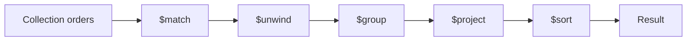

# Declaring @Aggregation with One or Multiple Stages

## 1. Goal: aggregation directly on the repository

Suppose the application needs to find orders of a tenant by status, calculate total revenue per status, or aggregate the quantity of ordered products by SKU. If you only need to find documents by a condition, query derivation such as `findByTenantIdAndStatus(...)` is usually sufficient. However, when you have to use `$group`, `$unwind`, `$project`, `$sort`, or combine multiple stages, a derived method name becomes unsuitable.

Spring Data MongoDB provides the **`org.springframework.data.mongodb.repository.Aggregation`** annotation to declare a MongoDB aggregation pipeline directly on a **repository method**. The pipeline can contain **one stage** or **multiple stages**, and also supports binding method parameters into values in the JSON.

For example:

```java
@Aggregation("{ '$match': { 'tenantId': ?0, 'status': ?1 } }")
List<OrderDocument> findMatchingOrders(
    String tenantId,
    String status
);
```

or:

```java
@Aggregation(pipeline = {
    "{ '$match': { 'tenantId': ?0, 'status': ?1 } }",
    "{ '$sort': { 'createdAt': -1, '_id': -1 } }",
    "{ '$limit': 10 }"
})
List<OrderDocument> findRecentOrders(
    String tenantId,
    String status
);
```

This lesson belongs to the **Aggregation repository** chapter in the **SPRING_DATA_MONGODB** module. The module teaches how to use Spring Data MongoDB to connect, map documents, and work with MongoDB through `MongoTemplate` or repositories; while also practicing queries, aggregation, indexes, transactions, reactive access, testing, and data performance diagnostics.

After this lesson, you will be able to:

1. Distinguish `@Aggregation` from `@Query` and from `MongoOperations.aggregate(...)`.
2. Declare a single stage via `@Aggregation("...")`, or multiple stages with `pipeline = { ... }`.
3. Bind `?0`, `?1`, and Java parameters into BSON values in `$match`, `$limit`, and appropriate stages.
4. Read returned data as an entity, DTO, or grouped/aggregated result.
5. Distinguish Java property names, BSON fields, and new alias names after `$project`/`$group`.
6. Know when to use a fixed annotation and when to switch to `MongoTemplate` to build dynamic pipelines.
7. Test multi-tenancy, empty data, sorted results, indexes, and reactive behavior.

**Key focus:** Each element declared in `pipeline` is **one complete MongoDB stage**, and the stages are executed **in the order written**. A single JSON snippet containing multiple `$match`, `$group`, `$sort` keys is not an equivalent representation.

## 2. What is MongoDB aggregation?

A MongoDB aggregation pipeline is a list of **stages**. Each stage receives a stream of documents from the previous stage and produces a new stream.



Common stages:

| Stage | Role |
| --- | --- |
| `$match` | Filter documents by condition |
| `$project` | Select, rename, or compute result fields |
| `$unwind` | Split array elements into individual documents in the stream |
| `$group` | Group by key and compute accumulators such as `$sum`, `$avg` |
| `$sort` | Sort the current results |
| `$skip` | Skip the first N results of the current stream |
| `$limit` | Limit the number of results passed forward |
| `$count` | Count the number of documents reaching the count stage |
| `$facet` | Run multiple pipeline branches on the input set |
| `$lookup` | Combine data from another collection when the problem requires it |

Not every stage preserves the count, shape, or data type of the documents. For example:

- `$match` can filter out documents.
- `$unwind` can produce **multiple results** from a single source document.
- `$group` can produce **one document per group**, no longer having the original entity structure.
- `$project` can transform field names and omit `_id`.

Therefore, the **repository method return type** must match the **shape of the final pipeline result**, rather than simply always being the domain entity.

### 2.1. Comparing mongosh and repository

In mongosh:

```javascript
db.orders.aggregate([
  { $match: { tenantId: "tenant-a", status: "PAID" } },
  { $sort: { createdAt: -1, _id: -1 } },
  { $limit: 10 }
]);
```

In a Java repository, the same idea:

```java
@Aggregation(pipeline = {
    "{ '$match': { 'tenantId': ?0, 'status': ?1 } }",
    "{ '$sort': { 'createdAt': -1, '_id': -1 } }",
    "{ '$limit': 10 }"
})
List<OrderDocument> paidOrders(
    String tenantId, String status
);
```

The annotation **declares the pipeline in Java source code**; Spring Data builds and sends the aggregate command to the MongoDB server. This is not a mechanism that fetches the entire collection into Java and then filters, sorts, or groups in memory.

## 3. Sample data throughout the lesson

### 3.1. Creating the BSON fixture

Example `orders` collection:

```javascript
db.orders.insertMany([
  {
    _id: "ord-101",
    tenantId: "tenant-a",
    status: "PAID",
    amount_vnd: NumberLong("100000"),
    customer: { display_name: "An" },
    items: [
      { sku_code: "BOOK-A", quantity: 1 },
      { sku_code: "BOOK-B", quantity: 2 }
    ],
    createdAt: ISODate("2026-11-18T08:00:00Z")
  },
  {
    _id: "ord-102",
    tenantId: "tenant-a",
    status: "PAID",
    amount_vnd: NumberLong("200000"),
    customer: { display_name: "Bình" },
    items: [
      { sku_code: "BOOK-A", quantity: 2 }
    ],
    createdAt: ISODate("2026-11-19T09:00:00Z")
  },
  {
    _id: "ord-103",
    tenantId: "tenant-a",
    status: "PAID",
    amount_vnd: NumberLong("300000"),
    customer: { display_name: "Ân" },
    items: [
      { sku_code: "BOOK-A", quantity: 3 },
      { sku_code: "BOOK-C", quantity: 1 }
    ],
    createdAt: ISODate("2026-11-20T08:00:00Z")
  },
  {
    _id: "ord-104",
    tenantId: "tenant-a",
    status: "NEW",
    amount_vnd: NumberLong("50000"),
    customer: { display_name: "Cúc" },
    items: [
      { sku_code: "BOOK-A", quantity: 4 }
    ],
    createdAt: ISODate("2026-11-20T09:00:00Z")
  },
  {
    _id: "ord-201",
    tenantId: "tenant-b",
    status: "PAID",
    amount_vnd: NumberLong("900000"),
    customer: { display_name: "Dũng" },
    items: [
      { sku_code: "BOOK-A", quantity: 100 }
    ],
    createdAt: ISODate("2026-11-20T10:00:00Z")
  }
]);
```

This is **learning data**; do not run it against a production collection or a collection that already has duplicate IDs. It intentionally includes:

- Three PAID orders belonging to tenant-a: total amount **600,000 VND**.
- One NEW order belonging to tenant-a: **50,000 VND**.
- One PAID order for tenant-b: **900,000 VND**, which must be excluded from tenant-a reports.
- An `items` array to demonstrate `$unwind`.

### 3.2. Entity and BSON mapping

```java
package com.example.orders.persistence;

import java.time.Instant;
import java.util.List;
import org.springframework.data.mongodb.core.mapping.Document;
import org.springframework.data.mongodb.core.mapping.Field;
import org.springframework.data.mongodb.core.mapping.FieldType;
import org.springframework.data.mongodb.core.mapping.MongoId;

@Document(collection = "orders")
public record OrderDocument(
    @MongoId(FieldType.STRING) String id,
    String tenantId,
    String status,
    @Field("amount_vnd") long amountVnd,
    CustomerSnapshot customer,
    List<OrderLine> items,
    Instant createdAt
) {}

record CustomerSnapshot(
    @Field("display_name") String displayName
) {}

record OrderLine(
    @Field("sku_code") String sku,
    int quantity
) {}
```

| Java property name | BSON path |
| --- | --- |
| `id` | `_id` |
| `amountVnd` | `amount_vnd` |
| `customer.displayName` | `customer.display_name` |
| `items.sku` | `items.sku_code` |
| `items.quantity` | `items.quantity` |
| `createdAt` | `createdAt` |

In mongosh, use **BSON fields**. In Spring Data, parts of the pipeline can be mapped based on the metadata of the input entity. However, when writing aggregation JSON in an annotation, you need to inspect the **actual BSON sent**, especially after `$group`/`$project`, when the intermediate schema differs from the entity.

## 4. Preparing the repository and imports

### 4.1. Distinguishing @Aggregation and the Aggregation class

In Spring Data MongoDB there are two different APIs:

```java
// Annotation placed on a repository method:
import org.springframework.data.mongodb.repository.Aggregation;

// Class for MongoTemplate's pipeline DSL (do not import simultaneously
// under the same simple name in the same Java file):
// org.springframework.data.mongodb.core.aggregation.Aggregation
```

**`@Aggregation`** is an annotation. **`Aggregation`** in `core.aggregation` is a class for building pipelines programmatically when using `MongoOperations.aggregate(...)`.

If you need both in one file, use the fully qualified name for one of them or split the code into appropriate classes.

### 4.2. Minimal repository interface

```java
package com.example.orders.persistence;

import java.util.List;
import org.springframework.data.repository.Repository;
import org.springframework.data.mongodb.repository.Aggregation;

public interface OrderAggregationRepository
        extends Repository<OrderDocument, String> {

    @Aggregation(
        "{ '$match': { 'tenantId': ?0, 'status': ?1 } }"
    )
    List<OrderDocument> matching(
        String tenantId, String status
    );
}
```

Here `Repository<OrderDocument, String>` is a marker interface: it does not automatically expose all operations of `MongoRepository`. Spring Data creates a proxy to execute the method. The name `matching` does not need to start with `findBy` because an annotation already defines the query.

For read-only use cases, you can choose a narrow repository contract. If the real application needs full CRUD, using `MongoRepository<OrderDocument, String>` is also valid; that choice is independent of whether `@Aggregation` is present.

## 5. Single stage: @Aggregation with one JSON stage

### 5.1. Using $match only

```java
@Aggregation("{ '$match': { 'tenantId': ?0, 'status': ?1 } }")
List<OrderDocument> findByTenantAndStatusViaAggregation(
    String tenantId, String status
);
```

With `("tenant-a", "PAID")`, the query is equivalent in intent to:

```javascript
db.orders.aggregate([
  { $match: { tenantId: "tenant-a", status: "PAID" } }
]);
```

The result contains three documents `ord-101`, `ord-102`, `ord-103`, but **has no guaranteed order** when `$sort` is not declared. If the UI displays items chronologically, you need to add a sort stage.

### 5.2. Annotation.value and pipeline

`@Aggregation("...")` is shorthand for a pipeline declaration. With multiple stages, the `pipeline` attribute is typically used:

```java
@Aggregation(pipeline = {
    "{ '$match': { 'tenantId': ?0, 'status': ?1 } }"
})
List<OrderDocument> sameFilter(String tenantId, String status);
```

Both forms in this example represent **a single `$match` stage**. Do not confuse the `{...}` braces of a Java annotation array with JSON braces.

### 5.3. A single stage does not mean always using @Aggregation

If you only need `$match`, a repository method:

```java
List<OrderDocument> findByTenantIdAndStatus(
    String tenantId, String status
);
```

is usually easier to read. `@Aggregation` is most useful when you need aggregation semantics such as grouping, unwinding, complex projections, or an explicit fixed pipeline. Do not choose the annotation simply because it is newer than a derived query.

## 6. Multiple stages: each element is one complete stage

### 6.1. A pipeline that sorts and limits

```java
@Aggregation(pipeline = {
    "{ '$match': { 'tenantId': ?0, 'status': ?1 } }",
    "{ '$sort': { 'createdAt': -1, '_id': -1 } }",
    "{ '$limit': 2 }"
})
List<OrderDocument> latestTwoByStatus(
    String tenantId, String status
);
```

With tenant-a and PAID, the fixture returns in order:

```text
ord-103  2026-11-20T08:00:00Z
ord-102  2026-11-19T09:00:00Z
```

Stages are written in order:

```text
$match: tenant + status
          ↓
$sort: createdAt DESC, _id DESC
          ↓
$limit: 2
          ↓
Mapping to List<OrderDocument>
```

### 6.2. Mistake of splitting one stage across multiple strings

**Incorrect** example:

```java
// NOT valid: the elements are fragments of a single JSON stage.
@Aggregation(pipeline = {
    "{ '$match': {",
    "  'tenantId': ?0,",
    "  'status': ?1",
    "} }"
})
List<OrderDocument> broken(String tenant, String status);
```

Spring Data **does not concatenate** four String elements into one JSON object. It treats them as separate stages, so they do not satisfy a valid pipeline structure.

Correct version:

```java
@Aggregation(pipeline = {
    "{ '$match': { 'tenantId': ?0, 'status': ?1 } }"
})
List<OrderDocument> valid(String tenant, String status);
```

**Code review rule:** Each element of `pipeline = {...}` must be independently parseable as a **BSON document stage**. If you need long JSON, consider Java text blocks depending on your Java version, or move to `MongoTemplate` to avoid hard-to-maintain annotations.

### 6.3. Stage order changes the result

The following two pipelines are not equivalent:

```javascript
// Two newest PAID orders.
[
  { $match: { tenantId: "tenant-a", status: "PAID" } },
  { $sort: { createdAt: -1, _id: -1 } },
  { $limit: 2 }
]

// Take two PAID documents first, then sort those two documents.
[
  { $match: { tenantId: "tenant-a", status: "PAID" } },
  { $limit: 2 },
  { $sort: { createdAt: -1, _id: -1 } }
]
```

In the second pipeline, `$limit` does not select by "newest" because sorting runs afterward. Always describe the intent of each stage in words to avoid logic errors even when the JSON is valid.

## 7. Parameter binding: ?0, ?1, ?2...

### 7.1. How parameters are indexed

Spring Data uses **0-based** indexing, based on the method parameter list:

```java
@Aggregation(pipeline = {
    "{ '$match': { 'tenantId': ?0, 'status': ?1, 'amount_vnd': { '$gte': ?2 } } }",
    "{ '$sort': { 'createdAt': -1, '_id': -1 } }",
    "{ '$limit': 50 }"
})
List<OrderDocument> paidFromAmount(
    String tenantId,       // ?0
    String status,         // ?1
    long minimumAmountVnd  // ?2
);
```

When called with `("tenant-a", "PAID", 150000L)`, only `ord-102` and `ord-103` meet the minimum amount condition. The pipeline sorts newest first, so the result is `ord-103` then `ord-102`.

### 7.2. Parameters in $limit

A limit can be declared from a method argument when the repository query binding version in use supports that numeric representation:

```java
@Aggregation(pipeline = {
    "{ '$match': { 'tenantId': ?0, 'status': ?1 } }",
    "{ '$sort': { 'createdAt': -1, '_id': -1 } }",
    "{ '$limit': ?2 }"
})
List<OrderDocument> latestWithLimit(
    String tenantId, String status, int limit
);
```

**Do not pass arbitrary limit values directly from the client.** The application service layer must reject `limit <= 0`, enforce an upper bound such as 100, and handle invalid cases. `$limit` requires an appropriate numeric value; parameter binding does not replace input validation.

### 7.3. Binding is not JSON string concatenation

Do not do:

```java
// Anti-pattern: do not concatenate raw input into a JSON pipeline.
// String json = "{ '$match': { 'status': '" + input + "' } }";
```

When using `?0`, Spring Data binds the argument into a query value with appropriate handling/escaping. That is different from letting users send raw JSON, stage names, or field paths and concatenating them into the annotation.

### 7.4. BSON types must be compatible

Parameters of types `Instant`, `ObjectId`, `UUID`, enums, or custom value objects must be represented as the exact BSON type stored in the field:

| Java/value type | What to verify |
| --- | --- |
| `String` ID | Does the collection store `_id` as String or ObjectId? |
| `Instant` | BSON Date or ISO string from a legacy system? |
| `long` | BSON Int64/numeric type and precision |
| `enum` | String name or custom converter? |
| `UUID` | Representation and binary subtype |
| `null` | Null/missing semantics differ when filtering |

For example, the model uses `@MongoId(FieldType.STRING)` for `id`, so the fixture stores `_id` as a BSON String. A filter in mongosh using `ObjectId("...")` will not match the corresponding String ID.

## 8. Query parameters and SpEL in aggregation

Spring Data MongoDB supports SpEL expressions in appropriate repository query strings, typically seen in the form `?#{...}`. SpEL is evaluated at the **application layer**, not as an aggregation expression running on the MongoDB server.

A conceptual example:

```java
@Aggregation(pipeline = {
    "{ '$match': { 'tenantId': ?#{[0]}, 'status': ?#{[1]} } }",
    "{ '$count': 'total' }"
})
List<CountRow> countUsingSpel(
    String tenantId, String status
);
```

To use this snippet, you need the `CountRow` DTO defined in section 12. In a simple case like the above, **`?0`/`?1` is easier to understand**, so SpEL is unnecessary.

### 8.1. Two different expression layers

| Syntax | Who processes it? | Meaning |
| --- | --- | --- |
| `?0` | Spring Data parameter binder | First method parameter |
| `?#{[0]}` | Application-side SpEL | Expression accessing the parameter |
| `"$status"` | MongoDB aggregation engine | Reference to the `status` field of the current document |
| `"$$NOW"` | MongoDB aggregation context | System variable in an appropriate expression |
| `{ '$sum': '$amount_vnd' }` | MongoDB aggregation engine | Sum the amount field |
| `{ '$literal': '$foo' }` | MongoDB aggregation engine | Literal String value `"$foo"` instead of a field reference |

Do not use SpEL to pretend to compute over fields of the current document: method-level SpEL does not have access to the MongoDB document currently being processed.

### 8.2. String data starting with $

When an **aggregation expression** receives a String such as `"$special"`, MongoDB may interpret it as a field reference. If the goal is a literal string, use `$literal` in the appropriate place:

```javascript
[
  { $set: { note: { $literal: "$special" } } }
]
```

In ordinary `$match` equality, a String parameter is simply a comparison value. In `$project`, `$set`, or `$add` expressions, you must clearly understand expression syntax. Parameter binding helps avoid arbitrary JSON concatenation, but it does not replace choosing the right aggregation expression semantics.

### 8.3. Security principles

- Do not evaluate arbitrary SpEL sent by clients.
- Do not let clients choose arbitrary field paths, stages, or raw JSON.
- Allow only a **predefined set of filters/sorts**.
- Tenant ID must come from an authenticated context or undergo authorization checks.
- Test inputs containing quotes, `$` signs, and special BSON types.

## 9. $group: aggregating multiple orders into one result

This is a primary reason to use `@Aggregation` on a repository.

Requirement: for each status of tenant-a, return the **order count and total amount**.

### 9.1. mongosh pipeline

```javascript
db.orders.aggregate([
  { $match: { tenantId: "tenant-a" } },
  {
    $group: {
      _id: "$status",
      orders: { $sum: 1 },
      totalVnd: { $sum: "$amount_vnd" }
    }
  },
  {
    $project: {
      _id: 0,
      status: "$_id",
      orders: 1,
      totalVnd: 1
    }
  },
  { $sort: { totalVnd: -1, status: 1 } }
]);
```

Result from the fixture:

```javascript
[
  { status: "PAID", orders: 3, totalVnd: NumberLong("600000") },
  { status: "NEW",  orders: 1, totalVnd: NumberLong("50000") }
]
```

### 9.2. Result DTO

After `$group`, the output is no longer an `OrderDocument`. Use a DTO:

```java
package com.example.orders.persistence;

public record StatusRevenue(
    String status,
    long orders,
    long totalVnd
) {}
```

### 9.3. Repository @Aggregation with four stages

```java
@Aggregation(pipeline = {
    "{ '$match': { 'tenantId': ?0 } }",
    "{ '$group': { '_id': '$status', 'orders': { '$sum': 1 }, 'totalVnd': { '$sum': '$amount_vnd' } } }",
    "{ '$project': { '_id': 0, 'status': '$_id', 'orders': 1, 'totalVnd': 1 } }",
    "{ '$sort': { 'totalVnd': -1, 'status': 1 } }"
})
List<StatusRevenue> revenueByStatus(String tenantId);
```

Key points to understand:

1. `$match` filters out other tenants' data **before aggregating**.
2. `$group` creates groups by status and computes order count/total amount.
3. `$project` renames the group `_id` into the `status` field matching the DTO.
4. `$sort` sorts the **aggregated records** by `totalVnd`.

**Do not omit the `$project` stage and assume `StatusRevenue.status` will automatically receive the group:** the output of `$group` carries the `_id` key. Mapping may have special rules depending on the DTO, but explicit projection makes the BSON contract easier to read and test.

### 9.4. Numeric types and data discrepancies

`$sum` operates on numeric BSON values. If some legacy documents store `amount_vnd` as a String, or the sum exceeds the range of `long`, the result may not fit the DTO. Standardize the schema, consider `Decimal128`/`BigDecimal` if monetary logic requires different precision/range, and test boundary data.

## 10. $unwind: total product quantity by SKU

Each order has an `items` array. When you need the total quantity of BOOK-A across all PAID orders for tenant-a, you must iterate through the **array elements**.

### 10.1. mongosh pipeline

```javascript
db.orders.aggregate([
  { $match: { tenantId: "tenant-a", status: "PAID" } },
  { $unwind: "$items" },
  {
    $group: {
      _id: "$items.sku_code",
      quantity: { $sum: "$items.quantity" }
    }
  },
  {
    $project: {
      _id: 0,
      sku: "$_id",
      quantity: 1
    }
  },
  { $sort: { quantity: -1, sku: 1 } }
]);
```

The fixture returns:

| SKU | Total quantity |
| --- | ---: |
| BOOK-A | 6 |
| BOOK-B | 2 |
| BOOK-C | 1 |

BOOK-A from the NEW order of tenant-a or from tenant-b is not included, because `$match` already excluded those orders.

### 10.2. Dedicated DTO for the result

```java
package com.example.orders.persistence;

public record SkuQuantity(String sku, long quantity) {}
```

### 10.3. Repository declaration

```java
@Aggregation(pipeline = {
    "{ '$match': { 'tenantId': ?0, 'status': ?1 } }",
    "{ '$unwind': '$items' }",
    "{ '$group': { '_id': '$items.sku_code', 'quantity': { '$sum': '$items.quantity' } } }",
    "{ '$project': { '_id': 0, 'sku': '$_id', 'quantity': 1 } }",
    "{ '$sort': { 'quantity': -1, 'sku': 1 } }"
})
List<SkuQuantity> quantityBySku(
    String tenantId, String status
);
```

In raw JSON `@Aggregation`, paths are expressed using the **BSON field names of the fixture**, specifically `items.sku_code`. If you use complex Spring Data mapping aliases, inspect the command actually sent because some APIs apply query/field mapping based on entity metadata; **do not infer from the annotation string alone** that every path will be kept verbatim or that every alias will be translated automatically.

### 10.4. $unwind changes the counting unit

If an order has two line items, after `$unwind` there can be two documents in the stream. A `$count` after `$unwind` counts **line items**, not the original number of orders. The same rule applies once `$group` has produced one document per group.

## 11. $project: result mapping and computation

### 11.1. Selecting fewer fields

Suppose you only need a list of IDs, customer names, and amounts:

```javascript
db.orders.aggregate([
  { $match: { tenantId: "tenant-a", status: "PAID" } },
  {
    $project: {
      _id: 0,
      orderId: "$_id",
      displayName: "$customer.display_name",
      amountVnd: "$amount_vnd"
    }
  },
  { $sort: { orderId: 1 } }
]);
```

The output has the shape:

```javascript
{
  orderId: "ord-101",
  displayName: "An",
  amountVnd: NumberLong("100000")
}
```

This is no longer an `OrderDocument` because `_id`, `tenantId`, `status`, and other fields are not retained. Reading into a full entity and calling `save` later is dangerous. It is better to use a DTO.

### 11.2. DTO projection

```java
public record OrderSummary(
    String orderId,
    String displayName,
    long amountVnd
) {}
```

In a Java project, place the public record in its corresponding `OrderSummary.java` file.

### 11.3. Multi-stage repository projection

```java
@Aggregation(pipeline = {
    "{ '$match': { 'tenantId': ?0, 'status': ?1 } }",
    "{ '$project': { '_id': 0, 'orderId': '$_id', 'displayName': '$customer.display_name', 'amountVnd': '$amount_vnd' } }",
    "{ '$sort': { 'orderId': 1 } }"
})
List<OrderSummary> summaries(String tenantId, String status);
```

**Alias note:** The final `$sort` stage uses `orderId` — **the new output field after `$project`**, not `_id`, which was excluded. You must distinguish between the source schema and the intermediate schema when building multi-stage pipelines.

## 12. $count: counting by filter or by previous stage

### 12.1. Repository count using aggregation

If you need to return the document count for a filter:

```java
package com.example.orders.persistence;

public record CountRow(long total) {}
```

```java
@Aggregation(pipeline = {
    "{ '$match': { 'tenantId': ?0, 'status': ?1 } }",
    "{ '$count': 'total' }"
})
List<CountRow> countByTenantAndStatusAgg(
    String tenantId, String status
);
```

With `tenant-a` and `PAID`, the list contains one element `CountRow(3)`. Using `List<CountRow>` here clearly illustrates the case where **no output document is returned**.

### 12.2. When there are no results

With `status="UNKNOWN"`, `$match` returns nothing. `$count` on an empty input set **does not produce a `{total:0}` document**; the repository typically receives an empty list.

The caller can handle it:

```java
List<CountRow> rows =
    repository.countByTenantAndStatusAgg(
        authenticatedTenantId,
        "UNKNOWN"
    );

long total = rows.isEmpty() ? 0L : rows.get(0).total();
```

In the example, `repository` is an injected `OrderAggregationRepository` bean. If the API simply needs to count by a filter, a derived count method or `MongoOperations.count(...)` is usually shorter than `@Aggregation`. Use `$count` when the goal is counting **after other stages** or combining with a facet.

### 12.3. Counting groups after $group

```javascript
db.orders.aggregate([
  { $match: { tenantId: "tenant-a" } },
  { $group: { _id: "$status" } },
  { $count: "numberOfStatuses" }
]);
```

The fixture has two statuses `PAID` and `NEW` for tenant-a, so the result is `numberOfStatuses = 2`. If the count is placed right after `$match`, the result is **4 orders**.

## 13. Sort, skip, limit, and Pageable/Sort parameters

### 13.1. Explicit sort and limit in the annotation

For stable reports, the easiest way to review is to state everything explicitly:

```java
@Aggregation(pipeline = {
    "{ '$match': { 'tenantId': ?0 } }",
    "{ '$sort': { 'createdAt': -1, '_id': -1 } }",
    "{ '$skip': ?1 }",
    "{ '$limit': ?2 }"
})
List<OrderDocument> pageWithFixedSort(
    String tenantId, long offset, int pageSize
);
```

The application service must validate `offset >= 0`, `pageSize > 0`, and deep-paging limits. If a method returns an entire `List` without a `$limit`, it can load a huge number of documents into memory.

### 13.2. Repository aggregation with Pageable and Sort

Spring Data MongoDB can handle special parameters such as `Sort`/`Pageable` for many repository aggregation methods. However, **support and how sort/skip/limit are appended to the pipeline depend on the version**, and special care is usually needed when the pipeline already contains `$group` or `$project`.

One API form you may encounter:

```java
import org.springframework.data.domain.Sort;

@Aggregation(pipeline = {
    "{ '$match': { 'tenantId': ?0, 'status': ?1 } }"
})
List<OrderDocument> findWithRequestedSort(
    String tenantId, String status, Sort sort
);
```

When invoked, the sort is applied to the **final output** of the pipeline. If the output has already been grouped by status or projected with renamed fields, a sort by an original Java property may be wrong or meaningless.

**Priority for this lesson:** Learn to write `$sort`/`$skip`/`$limit` explicitly in `pipeline`. When using framework `Sort` or `Pageable` parameters, check the documentation for your exact version and inspect the actual BSON command to avoid appending duplicate pagination.

### 13.3. Do not assume Page<T> is supported

A repository aggregation method should not arbitrarily declare `Page<StatusRevenue>` assuming Spring Data will automatically run a corresponding count pipeline. **`Page<T>` is not directly supported for annotated repository aggregations in common Spring Data generations**; support for return types such as `Slice`/`Window` must also be verified against your specific dependencies and APIs.

If you need a page + total for a complex pipeline, consider:

- Two queries: one pipeline to fetch content, one count pipeline.
- One `$facet` pipeline returning `items` and `metadata`.
- A custom repository fragment using `MongoOperations` when you need full control over count calculation, output, and options.

Do not use `List.size()` to infer the total number of filtered documents when the `List` only holds a single page.

## 14. $facet: page content and total count

An admin API often needs both the **page content** and the **total number of matching records after filtering**. `$facet` runs two sub-pipelines on the same dataset that passed `$match`.

### 14.1. mongosh pipeline

```javascript
db.orders.aggregate([
  { $match: { tenantId: "tenant-a", status: "PAID" } },
  {
    $facet: {
      items: [
        { $sort: { createdAt: -1, _id: -1 } },
        { $skip: 1 },
        { $limit: 2 },
        {
          $project: {
            _id: 0,
            orderId: "$_id",
            amountVnd: "$amount_vnd"
          }
        }
      ],
      metadata: [
        { $count: "total" }
      ]
    }
  }
]);
```

The fixture yields `ord-102` then `ord-101` for the `items` branch; the `metadata` branch contains `{ total: 3 }`. Because `metadata` is in a separate branch, it is not affected by the `$skip`/`$limit` in the `items` branch.

### 14.2. Declaring with @Aggregation

```java
@Aggregation(pipeline = {
    "{ '$match': { 'tenantId': ?0, 'status': ?1 } }",
    "{ '$facet': { 'items': [ { '$sort': { 'createdAt': -1, '_id': -1 } }, { '$skip': ?2 }, { '$limit': ?3 }, { '$project': { '_id': 0, 'orderId': '$_id', 'amountVnd': '$amount_vnd' } } ], 'metadata': [ { '$count': 'total' } ] } }"
})
List<org.bson.Document> pageWithTotal(
    String tenantId, String status,
    long offset, int pageSize
);
```

The facet pipeline is **one JSON stage**, even though inside it contains **two sub-pipeline arrays**. Having multiple stages inside a facet does not turn each sub-stage into an outer element in `@Aggregation.pipeline`.

In production, the result DTO should have an explicit contract (for example `items: List<OrderSummary>` and `metadata: List<CountRow>`). With `Document`, check nested mapping, especially when using reactive access and changing projection schemas.

### 14.3. Empty metadata and resource limits

If there are no matching orders, the `metadata` branch usually returns an empty array. The caller must treat it as `total=0` instead of unconditionally accessing the first element.

`$facet` has memory/result-size limits and can make sorting inside branches less able to leverage indexes than separate pipelines. Therefore, **one round trip is not guaranteed to be faster than two queries**. For large datasets, benchmark and run `explain`.

## 15. When annotation pipelines become too long

The examples above already show that long JSON strings are hard to maintain when:

- There are many optional filters with dozens of combinations.
- You need to add multiple `$lookup`, `$facet`, or nested expressions.
- There is dynamic pagination paired with an independent count.
- You need collation, hint, allowDiskUse, read preference, or special options.
- You need controlled use of custom metadata/converters.
- You need complex tenant/security conditions and stage-by-stage testing.

In these cases, a **custom repository fragment** with `MongoOperations`/`MongoTemplate` is usually easier to read and test than cramming everything into `@Aggregation(pipeline = {...})`.

### 15.1. MongoOperations example using the DSL

```java
import java.util.List;
import org.springframework.data.domain.Sort;
import org.springframework.data.mongodb.core.MongoOperations;
import org.springframework.data.mongodb.core.aggregation.Aggregation;
import org.springframework.data.mongodb.core.query.Criteria;
import static org.springframework.data.mongodb.core.aggregation.Aggregation.*;

public final class OrderReportGateway {
    private final MongoOperations mongo;

    public OrderReportGateway(MongoOperations mongo) {
        this.mongo = mongo;
    }

    public List<StatusRevenue> revenueByStatus(String tenantId) {
        if (tenantId == null || tenantId.isBlank()) {
            throw new IllegalArgumentException("Missing tenant");
        }

        Aggregation pipeline = newAggregation(
            match(Criteria.where("tenantId").is(tenantId)),
            group("status")
                .count().as("orders")
                .sum("amountVnd").as("totalVnd"),
            project("orders", "totalVnd")
                .and("_id").as("status"),
            sort(Sort.by(
                Sort.Order.desc("totalVnd"),
                Sort.Order.asc("status")
            ))
        );

        return mongo.aggregate(
            pipeline, OrderDocument.class, StatusRevenue.class
        ).getMappedResults();
    }
}
```

Here `Aggregation` is the Spring Data DSL class; `amountVnd` is referenced via the Java property and the mapper converts it to BSON `amount_vnd`. Verify the actual pipeline sent in your target version — especially once `$project` has changed the output schema.

### 15.2. Do not reuse mutable Query/Criteria across requests

When building dynamic pipelines with a template, construct a **new** `Aggregation`/`Query`/`Criteria` on every invocation. Fragments/adapters are typically singletons; do not store the current tenant filter in a mutable instance field because it will leak data across requests.

### 15.3. Roles of repository and template

| Need | Usually appropriate API |
| --- | --- |
| Basic CRUD | `MongoRepository` or narrow repository |
| Simple field lookup | Derived query / `@Query` |
| Fixed pipeline, few stages | `@Aggregation` |
| Fixed group/unwind statistics | `@Aggregation` with DTO |
| Queries/aggregations with many optional conditions | Repository fragment + `MongoOperations` |
| Special options and pipeline inspection | `MongoTemplate`/driver via a controlled adapter |
| Conditional writes | `MongoOperations.updateFirst(...)` or appropriate update API; do not use a read aggregation to pretend to write |

## 16. $lookup and referenced collections

Although the main topic is **annotation declaration**, a real pipeline may contain `$lookup`:

```javascript
db.orders.aggregate([
  { $match: { tenantId: "tenant-a", status: "PAID" } },
  {
    $lookup: {
      from: "customers",
      localField: "customerId",
      foreignField: "_id",
      as: "customerDetails"
    }
  }
]);
```

This is an **example for a different schema** where `orders` has `customerId` and there is a `customers` collection; the fixture in section 3 **does not** have that structure. Do not confuse the embedded `customer` document in the fixture with a reference ID.

In `@Aggregation`, you can express the stage as a JSON String:

```java
@Aggregation(pipeline = {
    "{ '$match': { 'tenantId': ?0, 'status': 'PAID' } }",
    "{ '$lookup': { 'from': 'customers', 'localField': 'customerId', 'foreignField': '_id', 'as': 'customerDetails' } }"
})
List<org.bson.Document> paidWithCustomers(String tenantId);
```

However, `$lookup` requires considering permissions, indexes on the joined collection, exact collection names, and cardinality. In multi-tenant systems, ensure the join cannot accidentally pull data from another tenant. **A tenant filter on `orders` does not automatically protect the `customers` collection** if the reference key or lookup design allows cross-tenant joins.

## 17. Sorting, indexes, and aggregation cost

### 17.1. Candidate index for finding the latest orders

With the pipeline:

```javascript
[
  { $match: { tenantId: "tenant-a", status: "PAID" } },
  { $sort: { createdAt: -1, _id: -1 } },
  { $limit: 10 }
]
```

A candidate index:

```javascript
db.orders.createIndex(
  { tenantId: 1, status: 1, createdAt: -1, _id: -1 },
  { name: "ix_orders_tenant_status_recent" }
);
```

Putting equality fields before sort fields gives MongoDB the opportunity to use the index to both locate documents and preserve order. **This is only a candidate**; the best choice depends on data, selectivity, workload, and index maintenance cost on writes.

### 17.2. Grouping and sorting by aggregated values

The pipeline `$match → $group(status) → $sort(totalVnd)` computes `totalVnd` **after grouping**, so an index on the source `amount_vnd` field does not automatically avoid processing when sorting group totals. Do not treat an index on an input field as proof that sorting on aggregated values will be fast.

### 17.3. Inspecting explain

```javascript
db.orders.explain("executionStats").aggregate([
  { $match: { tenantId: "tenant-a", status: "PAID" } },
  { $sort: { createdAt: -1, _id: -1 } },
  { $limit: 10 }
]);
```

Inspect the query plan/aggregation stages for your server version, `IXSCAN` or `COLLSCAN`, number of keys/docs examined, whether sorting had to use memory, result count, and execution time.

### 17.4. Sort/limit and blocking stages

An unindexed `$sort` may have to sort a lot of data and is a **blocking stage**. MongoDB can optimize certain `$sort + $limit` pairs, but not every pipeline with a limit is cheap. If a pipeline has `$unwind` multiplying row counts, `$group` over a large set, or `$facet` holding large arrays, the cost remains significant.

Options such as `allowDiskUse` must be checked against your server version and repository aggregation configuration. Do not blindly add options as a substitute for proper indexes and pipelines.

## 18. Meta annotations and execution options

Spring Data MongoDB has a mechanism for adding metadata to repository queries/aggregations in supported versions, for example via the **`@Meta`** annotation (used to configure certain MongoDB execution options).

A pattern to check against your exact version:

```java
import org.springframework.data.mongodb.repository.Meta;

@Meta(allowDiskUse = true)
@Aggregation(pipeline = {
    "{ '$match': { 'tenantId': ?0 } }",
    "{ '$group': { '_id': '$status', 'orders': { '$sum': 1 } } }",
    "{ '$sort': { 'orders': -1 } }"
})
List<org.bson.Document> countsWithMeta(String tenantId);
```

**Do not use `allowDiskUse=true` as an unconditional default.** It allows memory-intensive stages to spill to disk when supported/applied by the server, but it does not fix wrong filter logic, missing indexes, or `$facet`-specific limits.

When you need collation, read preference, hint, maxTime, or other options, verify the actual API of your Spring Data version. If the annotation cannot express the contract clearly, switch to `AggregationOptions` with `MongoOperations` or the driver in a tested persistence adapter.

## 19. Reactive repository aggregation

For reactive applications, use a **Reactive MongoDB repository** and non-blocking return types. An example:

```java
package com.example.orders.persistence;

import org.springframework.data.mongodb.repository.ReactiveMongoRepository;
import org.springframework.data.mongodb.repository.Aggregation;
import reactor.core.publisher.Flux;

public interface ReactiveOrderAggregationRepository
        extends ReactiveMongoRepository<OrderDocument, String> {

    @Aggregation(pipeline = {
        "{ '$match': { 'tenantId': ?0, 'status': ?1 } }",
        "{ '$sort': { 'createdAt': -1, '_id': -1 } }",
        "{ '$limit': 20 }"
    })
    Flux<OrderDocument> recentByStatus(
        String tenantId,
        String status
    );
}
```

`Flux<OrderDocument>` represents results emitted incrementally in a reactive manner. It does not automatically contain `totalPages` or a `Page<OrderDocument>`. Consumers must subscribe within an appropriate reactive chain; avoid calling `block()` on an event loop.

### 19.1. Reactive aggregation returning a DTO

```java
@Aggregation(pipeline = {
    "{ '$match': { 'tenantId': ?0 } }",
    "{ '$group': { '_id': '$status', 'orders': { '$sum': 1 }, 'totalVnd': { '$sum': '$amount_vnd' } } }",
    "{ '$project': { '_id': 0, 'status': '$_id', 'orders': 1, 'totalVnd': 1 } }"
})
Flux<StatusRevenue> revenueByStatus(String tenantId);
```

This snippet belongs **inside the reactive repository interface** above. Do not declare `Flux` in an imperative repository and assume the framework automatically turns a blocking driver into a non-blocking one; you must enable the proper reactive repository infrastructure and dependencies.

### 19.2. Counting on empty input

If a pipeline ends with `$count` and has no input documents, the reactive publisher does not emit a `CountRow(0)`. The caller can handle this:

```java
Mono<Long> total = reactiveRepository
    .countRowsByStatus(tenantId, "UNKNOWN")
    .next()
    .map(CountRow::total)
    .defaultIfEmpty(0L);
```

The example assumes the reactive repository declares the method:

```java
@Aggregation(pipeline = {
    "{ '$match': { 'tenantId': ?0, 'status': ?1 } }",
    "{ '$count': 'total' }"
})
Flux<CountRow> countRowsByStatus(String tenantId, String status);
```

`Mono` requires importing `reactor.core.publisher.Mono`. Related example methods must be placed in the same interface and properly injected; these are illustrations of components, not a single Java file containing every snippet in the lesson.

## 20. Transactions, consistency, and security

### 20.1. Aggregation is not a snapshot by default

A pipeline running over data being inserted, updated, or deleted can observe results depending on read concern, topology, and execution timing. If the UI requires strict consistency between page 1 and page 2, adding `$sort` with a tie-breaker key is still not enough to preserve a snapshot across **two separate calls**.

If you need a snapshot for reconciliation reports, design appropriate read concern/session/transaction handling and test it. Do not unconditionally open long transactions on every screen simply because an aggregation is used.

### 20.2. Do not use $match tenant from unauthenticated input

```java
// Unsafe if tenantId comes directly from a user query param.
repository.revenueByStatus(requestTenantId);
```

The application service must obtain the tenant from the security context or verify that the user is authorized to view that tenant. MongoDB has no mechanism that automatically enforces a tenant filter merely because a field is named `tenantId`.

### 20.3. Projection does not replace authorization

A projection that only returns `status` and `totalVnd` does not mean a report is safe if it aggregates data from other tenants as well. Security must be enforced on the **input document set**, especially when `$lookup` or `$facet` creates complex branches.

### 20.4. Aggregation can contain write stages

MongoDB has stages such as `$out` or `$merge` for pipelines that write results. They have their own semantics, permissions, and limitations. This lesson uses repository `@Aggregation` for **read/reporting pipelines**; do not add `$out`/`$merge` to ordinary read methods without a specific design for permissions, transactions, and result control.

## 21. Testing repository annotations

A service unit test that only verifies the service calls `repository.revenueByStatus(...)` is not enough to prove the JSON stages parse correctly, alias mapping works, or the Spring Data proxy initializes successfully. You need **integration tests with MongoDB**.

### 21.1. Test layers

| Test layer | Issues to catch |
| --- | --- |
| Repository bootstrap | Annotation parsing, method signature, bean discovery |
| BSON fixture | Correct field aliases, ID, numeric, date types |
| Pipeline output | Correct result shape and aggregated values |
| Tenant isolation | Does not include orders from tenant-b |
| Stage ordering | Sort/limit and group/project in the right positions |
| Empty result | Does not throw errors when there are no groups/counts |
| Input binding | `?0`, `?1` not swapped in order |
| Performance | Indexes and explain with representative data |
| Reactive if used | Subscribe/Flux/Mono and empty semantics |

### 21.2. JUnit 5 skeleton with @DataMongoTest

Assuming the MongoDB test context is configured and seeded with the fixture from section 3:

```java
package com.example.orders.persistence;

import static org.junit.jupiter.api.Assertions.*;
import java.util.List;
import org.junit.jupiter.api.Test;
import org.springframework.beans.factory.annotation.Autowired;
import org.springframework.boot.test.autoconfigure.data.mongo.DataMongoTest;

@DataMongoTest
class OrderAggregationRepositoryIntegrationTest {

    @Autowired OrderAggregationRepository repository;

    @Test
    void matchesCorrectTenantAndStatus() {
        List<OrderDocument> results =
            repository.findByTenantAndStatusViaAggregation(
                "tenant-a", "PAID"
            );

        assertEquals(3, results.size());
        assertTrue(results.stream().allMatch(
            order -> order.tenantId().equals("tenant-a")
                && order.status().equals("PAID")
        ));
    }

    @Test
    void sortsBeforeLimiting() {
        List<OrderDocument> latest =
            repository.latestTwoByStatus(
                "tenant-a", "PAID"
            );

        assertEquals(2, latest.size());
        assertEquals("ord-103", latest.get(0).id());
        assertEquals("ord-102", latest.get(1).id());
    }

    @Test
    void mapsGroupedResultsToDto() {
        List<StatusRevenue> groups =
            repository.revenueByStatus("tenant-a");

        assertEquals(2, groups.size());
        assertEquals("PAID", groups.get(0).status());
        assertEquals(3, groups.get(0).orders());
        assertEquals(600000L, groups.get(0).totalVnd());
        assertEquals("NEW", groups.get(1).status());
    }
}
```

This is a **test skeleton**, not a standalone runnable class: to compile, the `OrderAggregationRepository` interface must declare all methods used in the test, the entity/DTOs must be in the right package, and a MongoDB test database with the fixture is required. When using `@DataMongoTest`, check which custom beans/configurations need to be imported. Tests should seed their own data and clean up so they do not depend on execution order.

### 21.3. Set of methods to combine in a real repository

The `@Aggregation` snippets in previous sections are **optional or extended methods of the same repository interface**. To run the integration test above, declare in `OrderAggregationRepository`:

```java
// Skeleton to merge into OrderAggregationRepository, not a new interface:
//
// @Aggregation("{ '$match': { 'tenantId': ?0, 'status': ?1 } }")
// List<OrderDocument> findByTenantAndStatusViaAggregation(
//     String tenantId, String status);
//
// @Aggregation(pipeline = {
//     "{ '$match': { 'tenantId': ?0, 'status': ?1 } }",
//     "{ '$sort': { 'createdAt': -1, '_id': -1 } }",
//     "{ '$limit': 2 }"
// })
// List<OrderDocument> latestTwoByStatus(
//     String tenantId, String status);
//
// @Aggregation(pipeline = {
//     "{ '$match': { 'tenantId': ?0 } }",
//     "{ '$group': { '_id': '$status', 'orders': { '$sum': 1 }, 'totalVnd': { '$sum': '$amount_vnd' } } }",
//     "{ '$project': { '_id': 0, 'status': '$_id', 'orders': 1, 'totalVnd': 1 } }",
//     "{ '$sort': { 'totalVnd': -1, 'status': 1 } }"
// })
// List<StatusRevenue> revenueByStatus(String tenantId);
```

To avoid duplication, this section only points out where to place the methods; the full declarations are already in sections 5–9. Do not create a Java file containing methods outside an interface.

### 21.4. Testing empty count and SKU quantities

```java
@Test
void countEmptyFilterReturnsEmptyList() {
    List<CountRow> rows =
        repository.countByTenantAndStatusAgg(
            "tenant-a", "UNKNOWN"
        );
    assertTrue(rows.isEmpty());
}

@Test
void unwindsAndGroupsBySku() {
    List<SkuQuantity> rows =
        repository.quantityBySku("tenant-a", "PAID");

    assertEquals(3, rows.size());
    assertEquals("BOOK-A", rows.get(0).sku());
    assertEquals(6L, rows.get(0).quantity());
}
```

These are additional test methods to place in the test class in section 21.2 after declaring the corresponding `@Aggregation` methods on the repository. Expectations assume an unmodified fixture.

### 21.5. Checking BSON and explain

For mapping bugs, inspect the actual document:

```javascript
db.orders.findOne(
  { _id: "ord-101", tenantId: "tenant-a" },
  { amount_vnd: 1, items: 1, customer: 1 }
);
```

Verify:

- `amount_vnd` is a physical field with a numeric BSON type.
- `items.sku_code` is the exact field name inside the array.
- `customer.display_name` is the right alias.
- Group/projection results have keys matching the DTO.

Once the logic is correct, run `explain("executionStats")` on the equivalent pipeline to check indexes and cost.

## 22. Common errors

| Symptom | Possible cause | How to fix |
| --- | --- | --- |
| Repository startup reports invalid JSON | An element in `pipeline` is not a complete JSON stage | Read each stage individually, bootstrap test |
| Multiple stages present but wrong result | Incorrect stage order | Analyze output after each stage |
| Method only matches yet uses a very long `@Aggregation` | Overengineering | Use a derived query or `@Query` |
| Result DTO has null fields | `$group` returns `_id` while DTO expects `status` | Use an explicit `$project` alias |
| Data not found when using alias | Mixing `amountVnd` and `amount_vnd` in JSON | Check final BSON/mapping |
| Total amount multiplied several times | `$unwind` before `$group` duplicates documents | Identify the aggregation unit |
| Cross-tenant results leaked | Missing tenant `$match` or client-supplied tenant | Security context and proper filter |
| Unstable sort order | Missing tie-breaker key on duplicate sort keys | Add `_id` or a unique key |
| `$limit` placed before `$sort` | Only sorts the already-limited subset | Put sort before limit when picking top items |
| Total count always equals page size | `$count` placed after `$limit` | Count before paging or in a facet branch |
| Count on empty set throws error | `$count` returns no document when input is empty | Empty list/Mono fallback to 0 |
| Repository `Page` result does not work | `Page<T>` is not supported by default for `@Aggregation` | Use DTO/facet or custom adapter |
| `Pageable` creates wrong sort for DTO | Sorting by field after project/group differs from entity | Sort explicitly or test BSON |
| Pipeline too long and hard to edit | Annotation hardcodes many expressions | Extract fragment with `MongoOperations` |
| Facet slow or large output | Sort/count branches process too much data | Limit, projection, benchmark |
| `$lookup` pulls wrong tenant data | Join not scoped properly | Design join condition by tenant |
| Reactive method returns empty publisher | No rows or empty count | Appropriate `defaultIfEmpty` |
| Benchmark differs from expectations | Index/collation/data distribution mismatch | Explain and test realistic workload |
| SpEL exposes expression injection | Evaluating untrusted input | Do not accept raw SpEL from clients |

### 22.1. Step-by-step diagnostic workflow

```text
1. Verify @Aggregation is imported from the right repository package.
                         ↓
2. Is each pipeline element a standalone JSON stage?
                         ↓
3. Do ?0, ?1 ... bind the right arguments and BSON types?
                         ↓
4. Does $match have accurate tenant/security scope?
                         ↓
5. Do $group/$project change the output shape or field names?
                         ↓
6. Does the DTO match the output BSON without missing _id/aliases?
                         ↓
7. Are empty results, sorting, and counting handled properly?
                         ↓
8. Finally inspect explain/indexes/performance.
```

## 23. Practice exercises with solutions

### Exercise 1 — Declaring a single stage

**Prompt:** Write a repository method using `@Aggregation` to fetch orders of the logged-in tenant with status `PAID`.

**Solution:**

```java
@Aggregation("{ '$match': { 'tenantId': ?0, 'status': 'PAID' } }")
List<OrderDocument> paidByTenant(String tenantId);
```

The fixture returns three tenant-a orders when `"tenant-a"` is passed. Do not rely on result order without `$sort`.

### Exercise 2 — Three stages sorting and limiting

**Prompt:** Return at most the two newest PAID orders of a tenant.

**Solution:**

```java
@Aggregation(pipeline = {
    "{ '$match': { 'tenantId': ?0, 'status': 'PAID' } }",
    "{ '$sort': { 'createdAt': -1, '_id': -1 } }",
    "{ '$limit': 2 }"
})
List<OrderDocument> latestPaid(String tenantId);
```

For tenant-a, the result is `ord-103`, `ord-102`.

### Exercise 3 — Why not split a JSON stage across multiple strings?

**Prompt:** A developer declares `pipeline = {"{ '$match': {", "'tenantId': ?0", "} }"}`. Is this valid?

**Solution:** No. Three Strings in a Java annotation are three separate stages and are not automatically joined into one object. Write **one valid JSON String** for the entire `$match` stage.

### Exercise 4 — Binding a minimum amount parameter

**Prompt:** Filter tenant-a, status PAID, amount from 150000 VND. Write the filter.

**Solution:**

```java
@Aggregation(pipeline = {
    "{ '$match': { 'tenantId': ?0, 'status': ?1, 'amount_vnd': { '$gte': ?2 } } }"
})
List<OrderDocument> minAmount(
    String tenantId, String status, long minimumAmountVnd
);
```

With the sample data, `ord-102` and `ord-103` match. The service layer must validate `minimumAmountVnd >= 0` per business rules.

### Exercise 5 — Total revenue by status

**Prompt:** Use `@Aggregation` to build a report of total amount and order count per status for a tenant.

**Solution:**

```java
@Aggregation(pipeline = {
    "{ '$match': { 'tenantId': ?0 } }",
    "{ '$group': { '_id': '$status', 'orders': { '$sum': 1 }, 'totalVnd': { '$sum': '$amount_vnd' } } }",
    "{ '$project': { '_id': 0, 'status': '$_id', 'orders': 1, 'totalVnd': 1 } }",
    "{ '$sort': { 'totalVnd': -1 } }"
})
List<StatusRevenue> report(String tenantId);
```

For tenant-a, PAID has 3 orders/600000; NEW has 1 order/50000. The `StatusRevenue` DTO was defined in section 9.

### Exercise 6 — Total SKU quantity via $unwind

**Prompt:** The data has an `items` array. Why is `$group` by `$items.sku_code` alone not enough to sum each line's quantity?

**Solution:** `$unwind` splits array elements into pipeline documents before grouping so that `$sum` sees the quantity of each line item:

```javascript
[
  { $match: { tenantId: "tenant-a", status: "PAID" } },
  { $unwind: "$items" },
  {
    $group: {
      _id: "$items.sku_code",
      quantity: { $sum: "$items.quantity" }
    }
  }
]
```

Fixture: BOOK-A = 6, BOOK-B = 2, BOOK-C = 1.

### Exercise 7 — DTO after $group

**Prompt:** `$group` returns `{_id:"PAID",orders:3}`. Yet the DTO has property `status`. What should be done?

**Solution:** Add `$project` such as `{ '$project': { '_id': 0, 'status': '$_id', 'orders': 1 } }` so the output has a `status` field, then map into the corresponding DTO. Do not assume every alias is inferred identically by the framework.

### Exercise 8 — $count on an empty set

**Prompt:** When matching status UNKNOWN, the pipeline ends with `$count`. Is the repository guaranteed to receive `CountRow(0)`?

**Solution:** No. `$count` emits no document when the input is empty. A method returning `List<CountRow>` can return an empty list; the caller converts it to 0 per the contract.

### Exercise 9 — When not to use @Aggregation?

**Prompt:** An API has 20 optional filters, multiple sort choices, dynamic `$facet`, collation, and special access rules.

**Solution:** Consider a repository fragment using `MongoOperations`/`MongoTemplate` to build a controlled dynamic pipeline. A fixed JSON annotation would become long, hard to validate, hard to branch, and hard to manage options for.

### Exercise 10 — Fixing sort/limit order

**Prompt:** A pipeline declares `$match → $limit(2) → $sort(createdAt DESC)` and is called "the two newest orders." True or false?

**Solution:** False. You must sort before limiting. Limiting first only sorts two early documents, not guaranteeing the overall top 2.

### Exercise 11 — Pagination with total count

**Prompt:** The UI needs two orders per page and the total for the entire filter. Is placing `$count` after `$limit` right?

**Solution:** No. `$count` after limit counts the page slice. Use two separate pipelines or `$facet` with an `items` branch having sort/skip/limit and a `metadata` branch having count.

### Exercise 12 — Tenant control for aggregation

**Prompt:** A controller accepts an arbitrary `tenantId` and calls `revenueByStatus(tenantId)`. Is it safe merely because the pipeline has `$match tenantId`?

**Solution:** Not yet. A user-supplied tenant could be a different tenant. Obtain the tenant from an authenticated principal/session or verify authorized access before calling the repository; test cross-tenant data.

## 24. Pre-handoff checklist

| Question | Verification criterion |
| --- | --- |
| Correct annotation imported? | `org.springframework.data.mongodb.repository.Aggregation` |
| Single stage declared with valid syntax? | `@Aggregation("{ ... }")` |
| Multiple stages properly structured? | `pipeline = { "stage1", "stage2" }` |
| Each element is complete JSON? | Parse/bootstrapping test |
| Stage order semantically right? | `$match → $sort → $limit`, group before sorting totals |
| `?0`, `?1` parameters in right positions? | Binding and BSON types test |
| Input validation present? | Limit, amount, date range, sort choices |
| Tenant from trusted source? | Security context/authorization test |
| BSON data matches Java mapping? | Check `@MongoId`, `@Field`, and real documents |
| DTO matches shape after group/project? | Integration test fields and numeric types |
| Tie-breaker key present when sorting? | Use `_id` or a unique key |
| Correct counting unit identified? | Before/after unwind/group/page |
| Empty count handled? | Empty List/Mono treated as total 0 |
| Avoided false Pageable/Page assumptions? | Check framework version, design separate count |
| Facet output bounded? | Items branch has limit/projection |
| Long aggregation needs a fragment? | Review complexity and options |
| Index supports match/sort? | `getIndexes()`/`explain("executionStats")` |
| Data leak risk via lookup? | Join scoped by tenant and policy |
| Reactive repository uses proper stack? | Flux/Mono, reactive driver, and tests |
| Spring Data/MongoDB versions checked? | Dependencies and feature support |
| Integration test through repository proxy? | Bootstrapping + real MongoDB test |
| When is technical Content QA performed? | STEP 6 NEW after drafting the lesson |

### Key takeaways

1. **`@Aggregation`** is an annotation declaring a MongoDB aggregation pipeline on a **repository method**, distinct from the `Aggregation` class in `core.aggregation` used for the template DSL.
2. For **one stage**, you can use `@Aggregation("{ '$match': ... }")`; for **multiple stages**, use `@Aggregation(pipeline = { "...", "..." })`. **Each String is one complete JSON stage.**
3. Placeholders **`?0`, `?1`...** bind to method arguments; never concatenate raw JSON from user input.
4. **Stage order changes the result**; `$group`/`$project` change the schema so the DTO must match the final output.
5. `$unwind` can multiply the number of pipeline documents; `$count` counts documents reaching that exact stage position, and on empty input **does not return `{total:0}`**.
6. Use `@Aggregation` for **fixed, readable pipelines**. For dynamic pipelines, complex options, or reporting needing fine control, choose a **repository fragment + `MongoOperations`**.
7. **Tenant isolation, field mapping, indexes, reactive/transaction semantics, and integration tests** determine whether a pipeline is safe and accurate in production.
