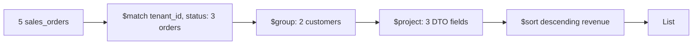
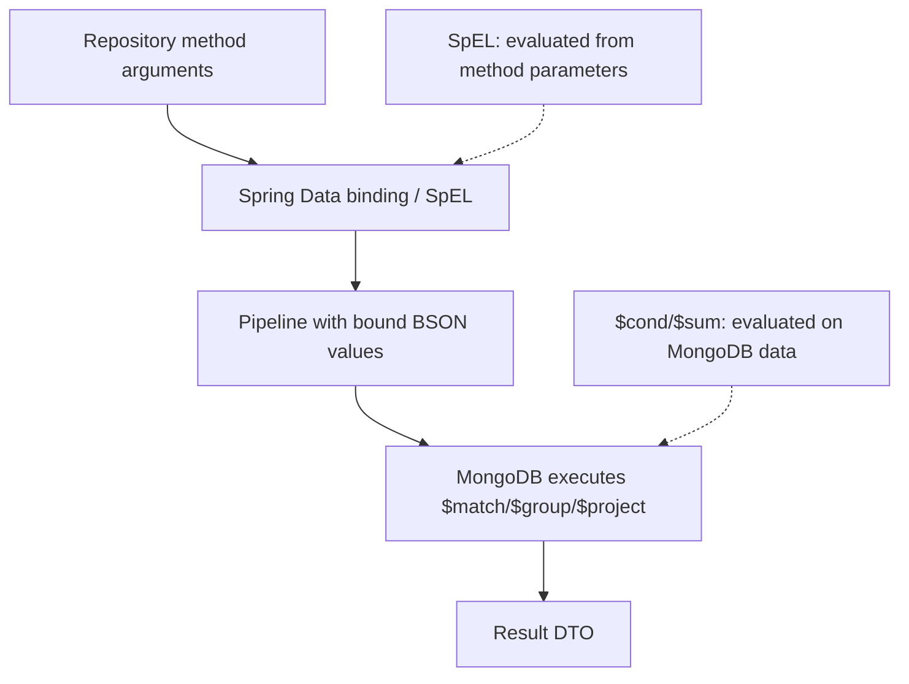
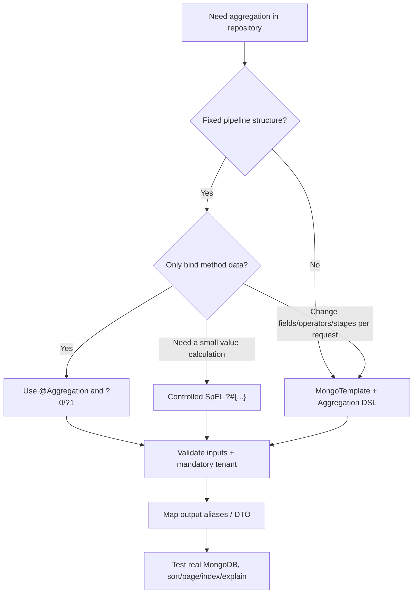

# Placeholders and SpEL in Spring Data MongoDB Repository Aggregation Pipelines

## 1. Why does repository aggregation need dynamic parameters?

In **Spring Data MongoDB**, a Java application does not only read and write documents via `MongoRepository` or `MongoTemplate`—it can also aggregate data using the MongoDB Aggregation Framework: filtering by conditions, grouping, summing, projecting fields, and sorting reports. When a pipeline is relatively stable, it can be declared directly on a **repository method** using the `@Aggregation` annotation.

For example, a revenue-by-customer report has the same structure on every request:

```text
sales_orders
    ↓ $match: tenant and status
    ↓ $group: by customer_id, compute count and sum
    ↓ $project: set aliases matching DTO names
    ↓ $sort: descending revenue
List<CustomerRevenue>
```

However, **tenant**, **status**, **time range**, or **status list** often vary with method parameters. Having to write a new pipeline per tenant or manually concatenate JSON strings would make code hard to test and prone to security vulnerabilities.

Spring Data supports two key mechanisms to express dynamic parts inside a repository pipeline:

- **Positional placeholders**, such as `?0`, `?1`: bind a value from a method parameter into the query/pipeline.
- **SpEL expressions in parameter bindings**, such as `?#{[0]}` or `?#{[1] ? 'PAID' : 'NEW'}`: evaluate a controlled expression and use its result when building the query.

These two mechanisms are not a license for clients to author MongoDB pipelines. They help **reuse a server-defined pipeline structure**, while controlling input values, BSON mapping, output DTOs, and performance limits.

### 1.1. Participating elements

| Concept | Role | Example |
|---|---|---|
| `@Aggregation` | Declares one or more pipeline stages on a repository method | `@Aggregation(pipeline = { ... })` |
| `?0`, `?1` | Reads method parameter value by 0-based index | `{ 'tenant_id': ?0 }` |
| `?#{...}` | Spring Expression Language expression evaluated at binding time | `?#{[1] ? 'PAID' : 'NEW'}` |
| `MongoRepository` | Creates proxy and executes the repository method | `SalesOrderRepository` |
| `@Document`, `@Field` | Describes collection and document mapping | `@Field("total_cents")` |
| Result DTO | Receives documents after `$group`/`$project`, not necessarily the source entity | `CustomerRevenue` |
| `Sort` / `Pageable` | Optional sorting/limiting of repository aggregation results | `Sort.by("revenueCents")` |

**Learning goal:** create an `@Aggregation` pipeline with properly typed placeholders, understand when SpEL adds value, recognize escaping/security issues, map results to DTOs, and verify with MongoDB integration tests.

## 2. Sample dataset: revenue by customer

### 2.1. BSON documents in the sales_orders collection

Suppose the test database has five orders:

```javascript
db.sales_orders.insertMany([
  {
    _id: "S-101", tenant_id: "T-A", customer_id: "C-01",
    status: "PAID", total_cents: NumberLong(15000),
    created_at: ISODate("2026-01-05T10:00:00Z"),
    tags: ["online", "priority"]
  },
  {
    _id: "S-102", tenant_id: "T-A", customer_id: "C-01",
    status: "PAID", total_cents: NumberLong(7000),
    created_at: ISODate("2026-01-08T10:00:00Z"),
    tags: ["online"]
  },
  {
    _id: "S-103", tenant_id: "T-A", customer_id: "C-02",
    status: "PAID", total_cents: NumberLong(9000),
    created_at: ISODate("2026-01-11T10:00:00Z"),
    tags: ["retail"]
  },
  {
    _id: "S-104", tenant_id: "T-A", customer_id: "C-02",
    status: "NEW", total_cents: NumberLong(5000),
    created_at: ISODate("2026-01-13T10:00:00Z"),
    tags: ["online"]
  },
  {
    _id: "S-201", tenant_id: "T-B", customer_id: "C-01",
    status: "PAID", total_cents: NumberLong(100000),
    created_at: ISODate("2026-01-09T10:00:00Z"),
    tags: ["online"]
  }
]);
```

The data intentionally includes order `S-201` belonging to tenant `T-B` and unpaid order `S-104`. The expected report for **tenant T-A and status PAID**:

| customerId | orderCount | revenueCents |
|---|---:|---:|
| C-01 | 2 | 22,000 |
| C-02 | 1 | 9,000 |

Total revenue is 31,000 cents. **Must not include** the 5,000-cent order with status NEW or the 100,000-cent order from the other tenant.

### 2.2. Java entity using mapping annotations

Place the class in an appropriate Java file. Example using Java 17 and Spring Data MongoDB:

```java
import java.time.Instant;
import java.util.List;

import org.springframework.data.annotation.Id;
import org.springframework.data.mongodb.core.mapping.Document;
import org.springframework.data.mongodb.core.mapping.Field;

@Document(collection = "sales_orders")
public class SalesOrder {
    @Id
    private String id;

    @Field("tenant_id")
    private String tenantId;

    @Field("customer_id")
    private String customerId;

    private String status;

    @Field("total_cents")
    private long totalCents;

    @Field("created_at")
    private Instant createdAt;

    private List<String> tags;

    protected SalesOrder() {}

    public SalesOrder(
            String id,
            String tenantId,
            String customerId,
            String status,
            long totalCents,
            Instant createdAt,
            List<String> tags) {
        this.id = id;
        this.tenantId = tenantId;
        this.customerId = customerId;
        this.status = status;
        this.totalCents = totalCents;
        this.createdAt = createdAt;
        this.tags = tags;
    }

    public String getId() { return id; }
    public String getTenantId() { return tenantId; }
    public String getCustomerId() { return customerId; }
    public String getStatus() { return status; }
    public long getTotalCents() { return totalCents; }
    public Instant getCreatedAt() { return createdAt; }
    public List<String> getTags() { return tags; }
}
```

Mapping to distinguish:

| Java Property | BSON Field in `sales_orders` |
|---|---|
| `id` | `_id` |
| `tenantId` | `tenant_id` |
| `customerId` | `customer_id` |
| `status` | `status` |
| `totalCents` | `total_cents` |
| `createdAt` | `created_at` |
| `tags` | `tags` |

In the `@Aggregation` JSON strings below, the examples use **physical BSON names** (`tenant_id`, `customer_id`, `total_cents`) to directly illustrate MongoDB structure and avoid relying on the assumption that every raw JSON snippet is renamed identically by the mapper. When using the Spring Data aggregation DSL/typed mapping, Java properties can be mapped according to the domain type; do not arbitrarily mix the two naming layers.

### 2.3. Result DTO after grouping

The pipeline no longer returns individual orders, so declare a dedicated DTO:

```java
public record CustomerRevenue(
    String customerId,
    long orderCount,
    long revenueCents
) {}
```

This is an **output projection**, not an entity for calling `save` onto the `sales_orders` collection. The three output field names must be produced explicitly via `$project` or another output structure compatible with the Java record.

## 3. Baseline MongoDB pipeline for comparison

Before inserting placeholders, write the pipeline with fixed values in `mongosh`:

```javascript
db.sales_orders.aggregate([
  { $match: { tenant_id: "T-A", status: "PAID" } },
  {
    $group: {
      _id: "$customer_id",
      orderCount: { $sum: 1 },
      revenueCents: { $sum: "$total_cents" }
    }
  },
  {
    $project: {
      _id: 0,
      customerId: "$_id",
      orderCount: 1,
      revenueCents: 1
    }
  },
  { $sort: { revenueCents: -1, customerId: 1 } }
]);
```

Steps:

1. `$match` selects documents of the right tenant and status.
2. `$group` groups by `customer_id`. After this step, `_id` is the **group key**, no longer the `_id` of the source order.
3. `$project` creates the `customerId` alias and removes `_id` so the DTO receives the exact fields.
4. `$sort` orders by descending revenue and ascending customerId for deterministic results.



With `@Aggregation`, the **four-stage structure above stays unchanged**; only the **filter values** in `$match` turn into placeholders.

## 4. Declaring @Aggregation on a repository

### 4.1. Basic repository method with two placeholders

```java
import java.util.List;

import org.springframework.data.mongodb.repository.Aggregation;
import org.springframework.data.mongodb.repository.MongoRepository;

public interface SalesOrderRepository
        extends MongoRepository<SalesOrder, String> {

    @Aggregation(pipeline = {
        "{ '$match': { 'tenant_id': ?0, 'status': ?1 } }",
        "{ '$group': { " +
            "'_id': '$customer_id', " +
            "'orderCount': { '$sum': 1 }, " +
            "'revenueCents': { '$sum': '$total_cents' } " +
        "} }",
        "{ '$project': { " +
            "'_id': 0, " +
            "'customerId': '$_id', " +
            "'orderCount': 1, " +
            "'revenueCents': 1 " +
        "} }",
        "{ '$sort': { 'revenueCents': -1, 'customerId': 1 } }"
    })
    List<CustomerRevenue> revenueByTenantAndStatus(
        String tenantId,
        String status
    );
}
```

The Java strings have double quotes surrounding each JSON stage; inside, the examples use single quotes as MongoDB/Spring Data commonly permit in annotation pipeline syntax. The `+` concatenation only splits a long Java string literal across lines, not user values into JSON. The actual pipeline consists of four stages.

Calling the repository:

```java
List<CustomerRevenue> rows =
    salesOrderRepository.revenueByTenantAndStatus(
        "T-A", "PAID");

// Expected C-01: 2 orders, 22,000 cents;
// C-02: 1 order, 9,000 cents.
```

`salesOrderRepository` here is a Spring-injected bean. There is no need to manually create a `MongoTemplate` to run a repository method declared with `@Aggregation`.

### 4.2. Reading parameter order accurately

```text
revenueByTenantAndStatus("T-A", "PAID")
                         │       │
                         │       └── ?1 = "PAID"
                         └────────── ?0 = "T-A"
```

Placeholders are **0-based**. For the method above:

| Placeholder | Parameter | Bound result |
|---|---|---|
| `?0` | `tenantId` | BSON String `"T-A"` |
| `?1` | `status` | BSON String `"PAID"` |

The placeholder index only specifies the **method argument position**, not the field position inside a BSON document. You can repeat `?0` across multiple stages if the same parameter needs to be used several times. When a method has special parameters such as `Sort`/`Pageable`, how bindable parameters are resolved should be checked alongside the signature and Spring Data version; do not rely on a guess about index offsets if code uses multiple special parameters.

### 4.3. @Aggregation(value = ...) and @Aggregation(pipeline = ...)

Depending on the Spring Data MongoDB version, `@Aggregation` has annotation elements `value`/`pipeline` used to declare stages. To help learners recognize the structure, the examples above use `pipeline = { ... }`. Some existing documentation or code may write:

```java
@Aggregation({
    "{ '$match': { 'status': ?0 } }",
    "{ '$group': { '_id': '$customer_id', 'count': { '$sum': 1 } } }"
})
List<org.bson.Document> countByCustomer(String status);
```

Both forms illustrate a pipeline consisting of multiple stage strings; verify against the annotation version in use. **Do not merge the entire pipeline into a single JSON object containing multiple `$match`, `$group` keys**, because a pipeline is an **ordered array of stages**.

### 4.4. Why is repository @Aggregation different from @Query?

`@Query` defines a document retrieval query, whereas `@Aggregation` defines a **multi-stage pipeline**. For example:

```java
// With @Query: find source orders.
@org.springframework.data.mongodb.repository.Query(
    "{ 'tenant_id': ?0, 'status': ?1 }"
)
List<SalesOrder> findRawOrders(String tenantId, String status);

// With @Aggregation: build a grouped report.
@Aggregation(pipeline = {
    "{ '$match': { 'tenant_id': ?0, 'status': ?1 } }",
    "{ '$group': { '_id': '$customer_id', 'count': { '$sum': 1 } } }"
})
List<org.bson.Document> countOrdersByCustomer(
    String tenantId, String status);
```

These are **two methods in the same repository interface** with different return types and processing semantics. `@Query` does not automatically perform `$group`. `@Aggregation` can return a DTO or `Document` produced by the pipeline, not necessarily a stored entity.

## 5. Placeholders ?0, ?1: value binding rather than manual JSON concatenation

### 5.1. Placeholders represent bound values

Given the declaration:

```java
@Aggregation(pipeline = {
    "{ '$match': { 'tenant_id': ?0, 'status': ?1 } }",
    "{ '$count': 'orderCount' }"
})
List<org.bson.Document> countMatchingOrders(
    String tenantId,
    String status
);
```

The call:

```java
countMatchingOrders("T-A", "PAID");
```

is interpreted as an equivalent pipeline in meaning:

```javascript
[
  { $match: { tenant_id: "T-A", status: "PAID" } },
  { $count: "orderCount" }
]
```

Spring Data handles **value binding and encoding** according to the query infrastructure and conversions applied to the method; it is not a Java string substitution like `String.replace("?0", input)`. This matters because a String containing quotes, backslashes, or content resembling MongoDB operators must still be treated as a **String value**, not a new stage.

### 5.2. Do not wrap placeholders in quotes to simulate a String

Distinguish between:

```java
// Recommended: value handled by the parameter binder.
"{ '$match': { 'status': ?0 } }"

// Do not use to "manually quote" a placeholder:
"{ '$match': { 'status': '?0' } }"
```

In the second form, the string may be interpreted as a **literal containing the characters `?0`** or interact unexpectedly with the parser depending on parser/version mechanics. For clarity and consistency, place `?0` in the **BSON value** position and let Spring Data decide the representation for String, Boolean, numbers, Date, enum, or List.

This does not mean every String/type combination is automatically valid: Spring must have a matching converter, MongoDB still checks BSON types, and the pipeline must be structurally valid.

### 5.3. Binding does not turn field names into data

In a JSON stage:

```java
"{ '$match': { 'tenant_id': ?0 } }"
```

`tenant_id` is a **field name** controlled by the developer; `?0` is a **value**. Do not accept a field name from a client and try to use placeholders to build arbitrary BSON structures:

```text
Client picks "field": "tenant_id"
Client picks "operator": "$ne"
Client picks "value": null
       ↓
Inject entire field/operator into pipeline
       ↓
Risk of altering query scope and access control
```

If an API genuinely needs selectable fields, design an **allowlist mapping public field → fixed BSON/Java property name in code**, combined with a set of allowed operators. Do not treat placeholders as an access-control mechanism.

### 5.4. A String parameter resembling JSON/operators does not turn into an operator

Suppose a client sends the value:

```text
PAID' }, { '$group': { '_id': null } }, { '$match': { 'status': 'PAID
```

A binder receiving a `String` and inserting it as a **value** must not allow that text to turn into new `$group` stages. Risk arises when the application **builds pipelines by concatenating raw input**, converts an untrusted object/map directly into a BSON query structure, or uses SpEL to construct keys/operators/stages from input without an allowlist.

Never write:

```java
// ANTI-PATTERN: concatenating arbitrary input into a JSON pipeline.
String stage = "{ '$match': { 'status': '" + rawStatus
    + "' } }";
```

Replace with `?0` and enum validation of `status` before calling the repository.

### 5.5. Binding the same parameter multiple times

If a value needs to be reused in multiple places in the pipeline:

```java
@Aggregation(pipeline = {
    "{ '$match': { 'tenant_id': ?0, 'status': ?1 } }",
    "{ '$group': { '_id': '$customer_id', 'total': { '$sum': '$total_cents' } } }",
    "{ '$project': { '_id': 0, 'customerId': '$_id', 'total': 1, 'tenant': ?0 } }"
})
List<org.bson.Document> revenueWithTenant(
    String tenantId,
    String status);
```

`?0` appears in two stages, both referencing **the same argument**. Repeating a placeholder does not make the parameter mutable state across executions.

Note that in the example `tenant: ?0` produces a **literal value** in the output projection, not a reference to the `"$tenant_id"` field. If you want to use a value from the source document, aggregation expression syntax must reference a field such as `"$tenant_id"` at the proper stage/path.

## 6. Binding by appropriate data type: String, number, time, list

### 6.1. Date range with Instant

In a time-window report, the `$match` stage receives two timestamps:

```java
import java.time.Instant;
import java.util.List;
import org.springframework.data.mongodb.repository.Aggregation;

public interface SalesOrderRepository
        extends MongoRepository<SalesOrder, String> {

    @Aggregation(pipeline = {
        "{ '$match': { " +
            "'tenant_id': ?0, " +
            "'status': ?1, " +
            "'created_at': { '$gte': ?2, '$lt': ?3 } " +
        "} }",
        "{ '$group': { " +
            "'_id': '$customer_id', " +
            "'orderCount': { '$sum': 1 }, " +
            "'revenueCents': { '$sum': '$total_cents' } " +
        "} }",
        "{ '$project': { '_id': 0, 'customerId': '$_id', " +
            "'orderCount': 1, 'revenueCents': 1 } }"
    })
    List<CustomerRevenue> revenueInWindow(
        String trustedTenantId,
        String status,
        Instant fromInclusive,
        Instant untilExclusive);
}
```

Example call:

```java
List<CustomerRevenue> january =
    salesOrderRepository.revenueInWindow(
        "T-A",
        "PAID",
        Instant.parse("2026-01-01T00:00:00Z"),
        Instant.parse("2026-02-01T00:00:00Z")
    );
```

Meaning of `[fromInclusive, untilExclusive)`: the start of the month is included, and the start of the next month is excluded. There is no need to construct a "23:59:59.999999" timestamp to represent month-end. When the UI uses dates in a local timezone, the controller must convert the business-timezone date range into exact `Instant` bounds.

**Preconditions to check before calling the repository:**

- Both timestamps are non-null if the query requires a full range.
- `fromInclusive.isBefore(untilExclusive)`.
- The time span does not exceed product limits.
- The BSON `created_at` field consistently has Date type; if legacy data stores Strings, binding an `Instant` will not automatically fix the schema mismatch.

### 6.2. Numeric placeholder: minimum total amount

```java
@Aggregation(pipeline = {
    "{ '$match': { 'tenant_id': ?0, 'status': 'PAID', " +
        "'total_cents': { '$gte': ?1 } } }",
    "{ '$group': { '_id': '$customer_id', " +
        "'revenueCents': { '$sum': '$total_cents' } } }",
    "{ '$project': { '_id': 0, 'customerId': '$_id', " +
        "'revenueCents': 1 } }"
})
List<org.bson.Document> revenueFromLargeOrders(
    String trustedTenantId, long minTotalCents);
```

The `long minTotalCents` parameter is a number, not a String needing quotes. If `minTotalCents = 0L`, it is still a valid value; do not drop the filter with a check like `if (minTotalCents > 0)` unless the API contract explicitly states so.

**Be careful:** this pipeline sums revenue **only from orders where `total_cents >= minTotalCents`**, not the revenue of customers whose total revenue exceeds the threshold. If you want to filter **post-group totals**, you must add `$match` **after `$group`** on `revenueCents`.

### 6.3. List parameter for the $in operator

```java
@Aggregation(pipeline = {
    "{ '$match': { 'tenant_id': ?0, " +
        "'status': { '$in': ?1 } } }",
    "{ '$group': { '_id': '$customer_id', " +
        "'orderCount': { '$sum': 1 } } }",
    "{ '$project': { '_id': 0, 'customerId': '$_id', " +
        "'orderCount': 1 } }"
})
List<org.bson.Document> countByCustomerForStatuses(
    String trustedTenantId, List<String> statuses);
```

At the call site:

```java
var rows = salesOrderRepository.countByCustomerForStatuses(
    "T-A",
    List.of("PAID", "NEW"));
```

`?1` must bind into an array of values used in `$in`. Validation should ensure:

- The list is non-null, bounded in size, and every value is within the allowed status set.
- An empty list is handled explicitly: `$in: []` matches nothing, unlike "do not filter by status."
- Do not take an arbitrary `Map<String, Object>` from the client in place of a list of values; doing so can cross the boundary from data into query structure.

### 6.4. Enum, ObjectId, and custom conversions

If a method accepts an enum:

```java
public enum OrderStatus {
    NEW, PAID, CANCELLED
}
```

repository parameter mapping can convert the enum to BSON according to the active converter. However, if MongoDB stores status as numbers or codes different from the enum name, **do not** assume `OrderStatus.PAID` automatically maps to the string `"PAID"` matching the schema; verify with tests and converter configuration.

Similarly, a `String` shaped like an ObjectId is not equivalent to a BSON ObjectId if the stored field is actually a String. Binding `_id` and `@Id`/`@MongoId` follows specific rules; test an actual ID value used in the system rather than only checking placeholder syntax.

## 7. Is a placeholder a MongoDB expression or just a value?

### 7.1. Distinguishing literal, field reference, and operator

In aggregation syntax, symbols carry different meanings:

```javascript
{
  $project: {
    tenantFromDocument: "$tenant_id",
    fixedText: { $literal: "PAID" },
    calculated: { $add: ["$total_cents", NumberLong(100)] }
  }
}
```

In `@Aggregation`, `?0` sits in a **value** position. If the parameter is the String `"$total_cents"`, you should not assume Spring Data always treats it as a field reference like `"$total_cents"` written in the raw DSL. Binding a String and constructing an aggregation expression are two distinct tasks.

To perform a dynamic calculation with a fixed structure, keep the operators **server-defined** and bind the numbers:

```java
@Aggregation(pipeline = {
    "{ '$match': { 'tenant_id': ?0 } }",
    "{ '$project': { " +
        "'customerId': '$customer_id', " +
        "'adjustedCents': { '$add': [ '$total_cents', ?1 ] } " +
    "} }"
})
List<org.bson.Document> previewAdjustedAmounts(
    String trustedTenantId,
    long fixedAdjustmentCents);
```

Here `$add` and `"$total_cents"` are **developer-controlled expression structure**; `?1` is a number supplied by the method. This is only a reporting/preview calculation and does not write back to `total_cents` in MongoDB. Units must be consistent, and overflow/negative amounts must be checked according to business rules.

### 7.2. Why not pass field names as arbitrary query parameters?

Anti-pattern idea:

```text
GET /report?groupBy=anyField&operator=$sum
     ↓
SpEL/placeholder injects groupBy/operator into pipeline
     ↓
Permits grouping by internal fields or using unintended operators
```

Even without "injection" in the sense of breaking JSON syntax, a user can alter **data scope, execution cost, or DTO contracts** if the server lets them control field paths/operators. The solution is to map a set of business choices such as `groupBy=customer`, `groupBy=status` to **reviewed static pipelines** or an allowlisted stage-selection DSL.

### 7.3. Do not confuse binding with Java-built queries

`@Aggregation` is meant for **pipelines stable enough to declare in an annotation**. If every request changes the number of stages, stage order, condition groups, or projected fields, stuffing that control logic into a very long SpEL expression makes code hard to test.

When pipeline structure is genuinely dynamic, build `Aggregation.newAggregation(...)` with `MongoTemplate` in a controlled query builder class. You can still bind inputs via `Criteria` and entity mapping without manually concatenating raw JSON.

## 8. SpEL in @Aggregation: the ?#{...} syntax

**SpEL** stands for *Spring Expression Language*. Spring Data supports using SpEL expressions in binding positions to compute a value depending on method parameters. Core syntax:

```text
?#{ <Spring Expression Language expression> }
│ │                                          │
│ └─ requests expression evaluation          └─ ends expression
└── Spring Data binding prefix
```

To retrieve the first and second arguments:

```text
?#{[0]}  → parameter value at index 0
?#{[1]}  → parameter value at index 1
```

This is **expression binding syntax**, distinct from passing a literal `"#{...}"` string to MongoDB. The SpEL expression is declared by **the repository author** in the annotation; input values are passed by the caller when invoking the method.

### 8.1. Simple example: SpEL merely retrieves a parameter

```java
@Aggregation(pipeline = {
    "{ '$match': { 'tenant_id': ?#{[0]}, 'status': ?#{[1]} } }",
    "{ '$count': 'orderCount' }"
})
List<org.bson.Document> countBySpelBoundValues(
    String tenantId, String status);
```

In intent, `?#{[0]}` grabs the same method parameter value as `?0`; `?#{[1]}` is analogous to `?1`. **When you only need to pass the value through as-is, prefer `?0`/`?1`**: shorter, easier to read, and creates less expression surface area.

Use SpEL when you genuinely need to **compute/normalize a value according to a defined policy**, such as picking a valid status from a Boolean or applying a fixed numeric threshold.

### 8.2. Conditional SpEL ternary example

Suppose a report supports **two service-controlled modes**: `paid = true` uses status PAID; `paid = false` uses status NEW. We can express this:

```java
@Aggregation(pipeline = {
    "{ '$match': { 'tenant_id': ?0, " +
        "'status': ?#{[1] ? 'PAID' : 'NEW'} } }",
    "{ '$group': { " +
        "'_id': '$customer_id', " +
        "'orderCount': { '$sum': 1 }, " +
        "'revenueCents': { '$sum': '$total_cents' } " +
    "} }",
    "{ '$project': { '_id': 0, 'customerId': '$_id', " +
        "'orderCount': 1, 'revenueCents': 1 } }"
})
List<CustomerRevenue> revenueByStatusFlag(
    String trustedTenantId,
    boolean paid);
```

The expression `?#{[1] ? 'PAID' : 'NEW'}` is SpEL's ternary operator:

| `paid` parameter | SpEL return value | MongoDB filter in business terms |
|---|---|---|
| `true` | `"PAID"` | `status = "PAID"` |
| `false` | `"NEW"` | `status = "NEW"` |

The example is intentionally simple to demonstrate syntax. **It does not mean every non-PAID order is NEW**: real data may have CANCELLED, REFUNDED, PENDING... Choose an API/filter that accurately represents business states.

### 8.3. Defaulting a value when a parameter is null

For example, wanting a null status parameter to default to PAID:

```java
@Aggregation(pipeline = {
    "{ '$match': { 'tenant_id': ?0, " +
        "'status': ?#{[1] == null ? 'PAID' : [1]} } }",
    "{ '$count': 'orderCount' }"
})
List<org.bson.Document> countWithDefaultStatus(
    String trustedTenantId,
    String requestedStatus);
```

If `requestedStatus` is non-null, the expression returns it as-is. If null, it returns `"PAID"`. However:

- Do not let users input arbitrary String values and assume any value is allowed. Validate the enum before calling.
- Using null to mean "default PAID" is a **business convention**, distinct from "do not filter by status."
- If you need to **omit the status condition completely when null**, having SpEL return null is **not** equivalent to removing the `status` field from `$match`. `status: null` has its own MongoDB semantics and can match null/missing fields.

In maintainable code, normalizing input in the **service before calling the repository** is usually clearer than a long SpEL expression:

```java
String status = requestedStatus == null
    ? "PAID" : validateStatus(requestedStatus);

var rows = salesOrderRepository.revenueByTenantAndStatus(
    authenticatedTenantId, status);
```

`validateStatus(...)` in the snippet is a business helper you must implement; it is not a built-in Spring Data method.

### 8.4. SpEL computing numeric values

An expression can compute from a parameter and a developer-chosen constant. For example, if the input parameter is in **whole currency units** while MongoDB stores the **smallest unit**, a fixed conversion might be applied:

```java
@Aggregation(pipeline = {
    "{ '$match': { " +
        "'tenant_id': ?0, " +
        "'total_cents': { '$gte': ?#{[1] * 100} } " +
    "} }",
    "{ '$count': 'orderCount' }"
})
List<org.bson.Document> countAboveUnitAmount(
    String trustedTenantId,
    long amountInWholeUnits);
```

The example only illustrates SpEL arithmetic. **Do not apply multiplying by 100 to every currency or pricing system.** Units, rounding, overflow, and validation should be standardized in the domain/service layer. If values can be large, `Math.multiplyExact` in the Java service catches overflow explicitly before passing the converted `long` into `?1`.

### 8.5. Do not confuse a String in an expression with a BSON field name

Suppose:

```java
"{ '$match': { 'status': ?#{[0] ? 'PAID' : 'NEW'} } }"
```

SpEL here returns a **String value**. It does not generate a new field name, does not add stages, and cannot reference BSON properties of documents in the pipeline such as `"$status"`.

If you need MongoDB to compute **over fields of each document**, write aggregation expressions like `$cond`, `$add`, `$subtract`, and `$ifNull` inside the stage. SpEL is evaluated **when preparing the query from method parameters**, whereas MongoDB aggregation expressions are evaluated **when the database processes each document or group**.



## 9. How to choose: ?0 or ?#{[0]}?

| Need | Preferred syntax | Why? |
|---|---|---|
| Bind tenant ID, status, minAmount directly | `?0`, `?1` | Short, clear, minimal hidden logic |
| Bind `List<String>` for `$in` | `?1` | Binder handles list values |
| Pick one of two hardcoded literals | `?#{[1] ? 'PAID' : 'NEW'}` | SpEL expresses a small, bounded condition |
| Default a simple value | Normalize in Java service, then use `?1` | Easy to validate and unit test |
| Unit conversion / overflow check | Java domain/service, then `?1` | Clear types and error handling |
| Pick `$group` field from user input | Do not concatenate arbitrary raw SpEL | Requires an allowlist or two static pipelines |
| Vary stage count/order across dozens of cases | `MongoTemplate` + Aggregation DSL | Query builder is easier to read/test than complex annotations |
| Business logic needing database fields of each document | Aggregation operators `$cond`/`$ifNull` | SpEL does not run per source document |

**Guideline:** if you can express it with a `?0` placeholder without losing meaning, use it. If you have to write a long multi-branch SpEL expression with collections, field paths, operators, permissions, and complex conditions, that is usually a sign to **move logic into a Java service/query builder**, not to write ever-larger SpEL.

## 10. Named SpEL references, @Param, and compatibility

Some Spring Data repository configurations allow referencing **named parameters** in the SpEL evaluation context. Conceptually, an expression might reference `#status` instead of `[1]` when the method parameter name is properly registered (often involving `@Param` or parameter-name metadata).

However, **never assume** Java parameter names are always present across every compiler setup, every Spring Data MongoDB version, or every annotation type. For this lesson, standalone runnable examples use **positional binding `?0`/`?1`** and **SpEL indexing `[0]`/`[1]`**.

When using named SpEL in a real project:

1. Check the official Spring Data MongoDB and Spring Data Commons documentation for your version.
2. Declare `@Param` if required by that API.
3. Ensure your build configuration preserves parameter names if relying on reflection metadata.
4. Integration-test the exact method with different values.
5. Never pass user-supplied SpEL expression text directly into an evaluator.

Avoid confusing `?#{[0]}` (SpEL accessing a parameter) with `@Value("#{...}")` used for other purposes like property/config injection or Spring Data projections; they are not the same execution API.

## 11. SpEL evaluation time and security boundaries

### 11.1. SpEL in annotations is not a sandbox for untrusted input

Input and code must remain strictly separated:

```text
Server developer defines:
  "$match tenant_id = ?0"
  "status = ?#{[1] ? 'PAID' : 'NEW'}"

Client sends:
  only allowed data values

Server validates:
  tenant from security context
  status/flag from valid type and policy
         ↓
Repository query is bound and executed
```

If an application lets a client send a raw SpEL string and feeds it to expression evaluation, users can control logic the server never approved. **Do not use SpEL as an arbitrary filter language for public APIs.**

### 11.2. Do not trust arbitrary Map structures as harmless values

A normal String passed through a placeholder behaves as data. However, if a method accepts a user-supplied `Map<String, Object>` or `Document` and puts it into an operator/query structure position, that object can contain keys like `$ne`, `$expr`, or nested expressions. The result is no longer simply an "escaped String value."

To reduce risk:

- Accept DTOs with concrete typed fields, e.g., `String status`, `Instant from`, `long minTotalCents`.
- Validate status against an enum/allowlist; validate timestamps, array lengths, monetary amounts, and page sizes.
- Keep all MongoDB field names, operators, and stage structures in **server-controlled code**.
- Expose only predefined choices, such as `groupBy=CUSTOMER` or `groupBy=STATUS`, and select tested pipelines.
- Do not take raw JSON pipelines from requests and feed them directly into `@Aggregation`/`BasicQuery`/`MongoTemplate`.

### 11.3. Tenant must stay outside optional OR clauses

Goal: read only tenant `T-A`, while status may be PAID **or** NEW. Correct query:

```javascript
{
  $and: [
    { tenant_id: "T-A" },
    { status: { $in: ["PAID", "NEW"] } }
  ]
}
```

Do not write:

```javascript
// Wrong if you want tenant isolation:
{
  $or: [
    { tenant_id: "T-A" },
    { status: "PAID" }
  ]
}
```

The `status = PAID` branch can return orders from `T-B`, violating authorization. In a repository pipeline, ensure `$match` includes the tenant from a trusted source and any optional OR branches remain constrained by the tenant.

### 11.4. SpEL does not replace performance controls

A syntactically valid SpEL pipeline can still consume excessive resources if clients can choose:

- Very large `$in` arrays.
- Unindexed substring `$regex`.
- Very wide date ranges.
- Extremely deep `$skip`.
- High-cardinality `$group` or `$sort` over computed output.

Input limits must be enforced at the service/controller layer before calling the repository. For complex reports, monitor latency, group counts, `keysExamined`/`docsExamined`, and memory/disk usage rather than only watching controller timing.

## 12. @Aggregation results: DTO, Document, scalar, and alias

### 12.1. Output does not have to be the source entity

`SalesOrderRepository` is declared with domain type `SalesOrder` because the repository operates on the `sales_orders` collection. However, aggregation can return:

- `List<CustomerRevenue>`: report rows.
- `List<org.bson.Document>`: output BSON documents, convenient for debugging and prototyping.
- A single-row summary DTO such as `TenantRevenueSummary`.
- A scalar value in certain return-type structures supported by repository mapping, though **the scalar contract must be verified explicitly against the output shape and version**.

The domain type `SalesOrder` **does not require** every result row to have `id`, `tenantId`, `status`, or all original fields. `$group` and `$project` stages have changed the output schema.

### 12.2. _id after group is not the order _id

Example stage:

```javascript
{
  $group: {
    _id: "$customer_id",
    orderCount: { $sum: 1 },
    revenueCents: { $sum: "$total_cents" }
  }
}
```

Raw document after this stage:

```javascript
{
  _id: "C-01",
  orderCount: 2,
  revenueCents: NumberLong(22000)
}
```

The value `_id = "C-01"` is **not** `"S-101"` or `"S-102"`. If the DTO is:

```java
public record CustomerRevenue(
    String customerId,
    long orderCount,
    long revenueCents
) {}
```

then you need to alias `_id` to `customerId` when expecting direct mapping by record property name:

```javascript
{
  $project: {
    _id: 0,
    customerId: "$_id",
    orderCount: 1,
    revenueCents: 1
  }
}
```

Do not assume the mapper infers `customerId` from `_id` without corresponding mapping metadata. Explicit aliases make DTOs easy to read and test.

### 12.3. Mapping to a record or class

With a Java record DTO, output alias names and constructor parameter order must be compatible with how Spring Data object mapping materializes records. In the example with output fields:

```javascript
{
  customerId: "C-01",
  orderCount: 2,
  revenueCents: NumberLong(22000)
}
```

This is a shape that maps cleanly onto the `CustomerRevenue` record. If the pipeline returns `customer_id` while the record only has `customerId` without a converter annotation, the result may be null or fail materialization depending on type/constructor.

If you use a class instead of a record, you can use constructors supported by Spring Data and appropriate getters. For most immutable reporting DTOs, records are convenient because fields are clearly defined.

### 12.4. Accumulator numeric types

| MongoDB expression | Example | Mapping notes |
|---|---|---|
| `{ '$sum': 1 }` | Document count | Use `long` if large counts are possible |
| `{ '$sum': '$total_cents' }` | Sum of amounts | Check BSON type, numeric range, overflow |
| `{ '$avg': '$total_cents' }` | Average value | May produce floating-point/decimal types; decide precision and rounding |
| `{ '$min': '$created_at' }` | Earliest timestamp | Choose `Instant`/`Date` per converter |
| `{ '$push': '$customer_id' }` | Build an array | Can grow group output large, hitting BSON limits |

MongoDB has numeric promotion/overflow rules for accumulators and conversions. When dealing with money, **do not** automatically switch integer cents to `double` just because aggregation allows floating-point numbers. If sums can exceed 64-bit range, consider appropriate storage/accumulation per schema and test boundary values.

### 12.5. Single summary row for the whole tenant

```java
public record TenantRevenueSummary(
    long orderCount,
    long revenueCents
) {}
```

```java
@Aggregation(pipeline = {
    "{ '$match': { 'tenant_id': ?0, 'status': ?1 } }",
    "{ '$group': { '_id': null, " +
        "'orderCount': { '$sum': 1 }, " +
        "'revenueCents': { '$sum': '$total_cents' } } }",
    "{ '$project': { '_id': 0, 'orderCount': 1, " +
        "'revenueCents': 1 } }"
})
TenantRevenueSummary summarizeTenant(
    String trustedTenantId, String status);
```

A `$group` pipeline with `_id: null` creates at most **one group** for a non-empty input set. When no documents match `$match`, the result may have zero rows; a method returning a single DTO can receive `null` depending on repository method semantics/version.

Therefore, the service must not assume:

```java
long total = salesOrderRepository
    .summarizeTenant("T-NONE", "PAID")
    .revenueCents(); // May fail if result is null.
```

Define a policy for missing data and test it:

```java
TenantRevenueSummary rawSummary =
    salesOrderRepository.summarizeTenant(
        authenticatedTenantId, "PAID");

TenantRevenueSummary summary = rawSummary == null
    ? new TenantRevenueSummary(0L, 0L)
    : rawSummary;
```

Define a different record or `Optional<TenantRevenueSummary>` return type if your project's dependency/method contract clearly supports it, and test the no-rows case.

### 12.6. A scalar result is not always an arbitrary field name

MongoDB pipeline:

```javascript
[
  { $match: { tenant_id: "T-A", status: "PAID" } },
  { $count: "orderCount" }
]
```

returns a document like `{orderCount: 3}` when data exists, not the raw number `3` directly from the server. Repository mapping can support scalar extraction rules when the return type is a simple type, though field-selection rules when multiple fields exist depend on structure and version.

For the foundational lesson, use an explicit DTO:

```java
public record OrderCountResult(long orderCount) {}
```

```java
@Aggregation(pipeline = {
    "{ '$match': { 'tenant_id': ?0, 'status': ?1 } }",
    "{ '$count': 'orderCount' }"
})
OrderCountResult countPaidOrdersByTenant(
    String tenantId, String status);
```

When no documents pass `$match`, the `$count` stage may **emit no row**. Test this scenario to avoid expecting an object with `orderCount = 0` to always be returned.

## 13. Sort and Pageable with repository aggregation

### 13.1. Sort references output after the pipeline

Spring Data MongoDB supports special parameters like `Sort` for repository aggregations depending on version. Sorting is applied to the **result of the declared pipeline**, without altering the semantics of preceding stages.

Example of a method **without hardcoded `$sort`**:

```java
import org.springframework.data.domain.Sort;

@Aggregation(pipeline = {
    "{ '$match': { 'tenant_id': ?0, 'status': ?1 } }",
    "{ '$group': { '_id': '$customer_id', " +
        "'orderCount': { '$sum': 1 }, " +
        "'revenueCents': { '$sum': '$total_cents' } } }",
    "{ '$project': { '_id': 0, 'customerId': '$_id', " +
        "'orderCount': 1, 'revenueCents': 1 } }"
})
List<CustomerRevenue> revenueSorted(
    String trustedTenantId,
    String status,
    Sort sort);
```

Caller:

```java
Sort sort = Sort.by(
    Sort.Order.desc("revenueCents"),
    Sort.Order.asc("customerId")
);

var rows = salesOrderRepository.revenueSorted(
    authenticatedTenantId, "PAID", sort);
```

Note:

- `revenueCents` and `customerId` are **output fields/DTO properties** after `$project`, not the source fields `total_cents` and `customer_id`.
- Adding a tie-breaker keeps ordering deterministic when revenues are equal.
- When a repository method already has `$sort` and the caller also passes `Sort`, verify **stage order and precedence** in your version; do not write two sort sources unintentionally.
- Property mapping during sorting can use metadata of the return type, especially for fields annotated with `@Id`. Test the actual command and output aliases to avoid placing `@Id` on an aggregate DTO in a way that unintentionally sorts by `_id`.

### 13.2. Pageable to limit result rows

Example method with `Pageable`:

```java
import org.springframework.data.domain.Pageable;

@Aggregation(pipeline = {
    "{ '$match': { 'tenant_id': ?0, 'status': ?1 } }",
    "{ '$group': { '_id': '$customer_id', " +
        "'orderCount': { '$sum': 1 }, " +
        "'revenueCents': { '$sum': '$total_cents' } } }",
    "{ '$project': { '_id': 0, 'customerId': '$_id', " +
        "'orderCount': 1, 'revenueCents': 1 } }"
})
List<CustomerRevenue> revenuePage(
    String trustedTenantId,
    String status,
    Pageable pageable);
```

Caller:

```java
import org.springframework.data.domain.PageRequest;

Pageable page = PageRequest.of(
    0,
    20,
    Sort.by(
        Sort.Order.desc("revenueCents"),
        Sort.Order.asc("customerId"))
);

List<CustomerRevenue> rows =
    salesOrderRepository.revenuePage(
        authenticatedTenantId, "PAID", page);
```

In Spring Data MongoDB repository aggregation, `Pageable` can be applied via sort/skip/limit stages **after the declared pipeline**. Thus a page of 20 in the example means **20 customer groups after revenue has been computed**, not grouping only the first 20 input orders.

Limit page size and offset in the service/controller. If the pipeline produces a very large number of groups, deep offset paging can be expensive; consider report snapshots, keyset pagination, or an appropriate materialized summary architecture.

### 13.3. Do not assume @Aggregation supports Page<T> like findAll(Pageable)

Repository aggregations can accept a `Pageable` parameter, but the **`Page<T>` return type is not always supported**. In Spring Data MongoDB, repository aggregation documentation notes that `Page` is not supported because obtaining a total count for aggregation results typically requires a separate count pipeline.

Unlike document find queries, the **total number of groups** after `$group` can differ greatly from the **number of source orders**. For example:

```text
T-A has 3 PAID orders
        ↓ group by customer
2 CustomerRevenue rows

Correct Page.totalElements for the group page = 2
not 3
```

Therefore:

- Use `List<CustomerRevenue>` or a return type supported by your framework/version when fetching a page.
- If the UI needs the total number of groups, write a dedicated **count-groups pipeline** or a properly designed `$facet`.
- Do not take `repository.count()` on source documents and assign it as `totalElements` of a grouped report.

### 13.4. Counting groups with another pipeline

In MongoDB:

```javascript
db.sales_orders.aggregate([
  { $match: { tenant_id: "T-A", status: "PAID" } },
  { $group: { _id: "$customer_id" } },
  { $count: "totalGroups" }
]);
// [{ totalGroups: 2 }]
```

Repository method:

```java
public record GroupCount(long totalGroups) {}
```

```java
@Aggregation(pipeline = {
    "{ '$match': { 'tenant_id': ?0, 'status': ?1 } }",
    "{ '$group': { '_id': '$customer_id' } }",
    "{ '$count': 'totalGroups' }"
})
GroupCount countCustomerGroups(
    String trustedTenantId,
    String status);
```

When there are no groups, `$count` may return no document; the service should treat null as 0 per contract. If the content query and count query run at different times, data can change between the two computations, so total and page do not necessarily reflect the same snapshot.

### 13.5. Sort and DTO $id fields

Suppose a DTO is designed as:

```java
public record GroupRow(
    String customerId,
    long revenueCents
) {}
```

Avoid annotating `customerId` with `@Id` if the pipeline already `$project`ed it to alias `customerId` and removed `_id`, unless you genuinely want Spring Data to treat that property as an ID. In repository aggregations, special `Sort` mapping and materialization can be affected by `@Id` metadata.

**Preference:** output DTOs without special ID mapping when they are simply report rows; alias output to the property name and test the post-pipeline sort.

## 14. @Meta and aggregation execution options

`@Aggregation` keeps the pipeline structure on the repository. Certain query options can be declared via metadata annotations or framework configuration, depending on version.

Example where Spring Data MongoDB repository supports `@Meta`:

```java
import org.springframework.data.mongodb.repository.Meta;

@Meta(allowDiskUse = true)
@Aggregation(pipeline = {
    "{ '$match': { 'tenant_id': ?0, 'status': ?1 } }",
    "{ '$group': { '_id': '$customer_id', " +
        "'revenueCents': { '$sum': '$total_cents' } } }"
})
List<org.bson.Document> revenueWithDiskUse(
    String trustedTenantId, String status);
```

`allowDiskUse` relates to MongoDB's ability to use disk for certain resource-heavy stages, depending on MongoDB version and cluster configuration. It **does not automatically make pipelines faster**, does not replace indexes, does not remove the 16 MiB BSON document limit, or exempt the query from other limits.

When you need timeouts, collation, comments, batch sizes, `allowDiskUse`, or complex dynamic options, check which options `@Meta`/`@Aggregation` support in your current dependency. If an option cannot be expressed clearly in a repository annotation, consider `MongoTemplate` with `AggregationOptions`.

## 15. When placeholders and SpEL are not enough: moving to MongoTemplate

### 15.1. Distinguishing optional values from omitting an entire stage

Suppose a report screen receives a request:

```text
tenantId (required, from security)
status (optional, null means do not filter status)
from/until (optional as a pair)
groupBy (CUSTOMER or STATUS)
sortBy (REVENUE or COUNT)
```

An annotation containing `?#{[1] == null ? null : [1]}` for the `status` field produces a condition equivalent to `status: null` when the input is null, **not** "completely remove the status condition." MongoDB equality with null can match both null and missing fields, which differs from not filtering. If requirements call for **varying stage structures**, use `MongoTemplate`.

### 15.2. Request DTO for dynamic reports

```java
import java.time.Instant;

public record RevenueFilter(
    String status,
    Instant fromInclusive,
    Instant untilExclusive
) {}
```

Do not put the tenant ID into this request DTO; the service receives `trustedTenantId` from the security context. Do not convert the DTO into a raw BSON query via reflection or a serializer without validation.

### 15.3. Building a pipeline from controlled stages

```java
import java.util.ArrayList;
import java.util.List;

import org.springframework.data.domain.Sort;
import org.springframework.data.mongodb.core.MongoTemplate;
import org.springframework.data.mongodb.core.aggregation.Aggregation;
import org.springframework.data.mongodb.core.aggregation.AggregationOperation;
import org.springframework.data.mongodb.core.query.Criteria;
import org.springframework.stereotype.Service;

@Service
public class RevenueReportService {
    private final MongoTemplate template;

    public RevenueReportService(MongoTemplate template) {
        this.template = template;
    }

    public List<CustomerRevenue> search(
            String trustedTenantId, RevenueFilter filter) {
        if (trustedTenantId == null || trustedTenantId.isBlank()
                || filter == null) {
            throw new IllegalArgumentException("Missing search context");
        }

        Criteria criteria = Criteria.where("tenantId")
            .is(trustedTenantId);

        if (filter.status() != null) {
            String status = filter.status().trim();
            if (!List.of("NEW", "PAID", "CANCELLED")
                    .contains(status)) {
                throw new IllegalArgumentException("Invalid status");
            }
            criteria.and("status").is(status);
        }

        if ((filter.fromInclusive() == null)
                != (filter.untilExclusive() == null)) {
            throw new IllegalArgumentException(
                "Both time bounds are required together");
        }

        if (filter.fromInclusive() != null) {
            if (!filter.fromInclusive()
                    .isBefore(filter.untilExclusive())) {
                throw new IllegalArgumentException("Invalid time range");
            }
            criteria.and("createdAt")
                .gte(filter.fromInclusive())
                .lt(filter.untilExclusive());
        }

        List<AggregationOperation> stages = new ArrayList<>();
        stages.add(Aggregation.match(criteria));
        stages.add(Aggregation.group("customerId")
            .count().as("orderCount")
            .sum("totalCents").as("revenueCents"));
        stages.add(Aggregation.project(
                "orderCount", "revenueCents")
            .and("_id").as("customerId")
            .andExclude("_id"));
        stages.add(Aggregation.sort(
            Sort.by(
                Sort.Order.desc("revenueCents"),
                Sort.Order.asc("customerId"))));

        Aggregation pipeline =
            Aggregation.newAggregation(stages);

        return template.aggregate(
            pipeline,
            SalesOrder.class,
            CustomerRevenue.class
        ).getMappedResults();
    }
}
```

In this example:

- The tenant condition **is always added**.
- When status is null, **there is no** status condition, unlike `status: null`.
- The time range is added when both bounds are valid.
- `SalesOrder.class` provides input mapping from `tenantId` to `tenant_id` and similarly for other fields.
- The `CustomerRevenue` DTO still needs the `$project` alias just like the repository pipeline.
- The code can unit-test validation/request normalization separately and integration-test MongoDB output.

### 15.4. Choosing groupBy without allowing arbitrary fields

Suppose the product only supports grouping by **customer** or **status**:

```java
public enum RevenueGroup {
    CUSTOMER,
    STATUS
}
```

```java
String groupField = switch (groupBy) {
    case CUSTOMER -> "customerId";
    case STATUS -> "status";
};

stages.add(
    Aggregation.group(groupField)
        .count().as("orderCount")
        .sum("totalCents").as("revenueCents")
);
```

This is a **snippet illustrating replacing the group stage** in the service above, not appending a second `$group` after the previous stage. `groupBy` is a controlled enum; the user cannot pass `"$customer.sensitiveField"` or an arbitrary path.

When switching `groupBy` from customer to status, the **output DTO also changes meaning**. Use a generic DTO with a `groupKey` property if both modes truly share one contract, or separate explicit DTOs. Do not keep calling the field `customerId` when the data is actually a status.

### 15.5. Custom repository to keep the repository abstraction

When you want the public API to remain a repository:

```java
public interface SalesOrderReportCustom {
    List<CustomerRevenue> searchRevenue(
        String trustedTenantId, RevenueFilter filter);
}
```

You can implement a fragment using `MongoTemplate` and attach it to the appropriate repository according to Spring Data conventions. This exposes the method on the repository without forcing a dynamic pipeline into a long SpEL annotation string. Follow the fragment implementation naming convention of your project's Spring Data version; avoid creating a class that collides with bean names or unintentionally uses legacy custom implementation patterns no longer recommended.

### 15.6. When to keep @Aggregation?

| Case | `@Aggregation` repository | `MongoTemplate` DSL |
|---|---|---|
| Static pipeline, a few scalar values change | Very suitable | Also works |
| Validated `?0`, `?1`, `List`, `Instant` | Suitable | Also works |
| Small SpEL ternary between fixed values | Can be suitable | May be overly verbose |
| Completely omit a condition group when null | Unnatural, easy to confuse null semantics | Explicit |
| Vary number and order of stages | Hard to review | Suitable |
| Many AND/OR branches, optional grouping | Easily becomes hard-to-maintain JSON | Suitable |
| Complex `AggregationOptions` | Depends on annotation/version | Flexible |
| Different collectionName per business case | Repository is usually tied to entity collection | Has overloads accepting collection name |
| Pipeline managed/tested as a code builder | Hard to split expressions | Easy to unit/integration test |

## 16. Collections, mapping, and common false assumptions

### 16.1. @Document determines the repository's collection

`SalesOrderRepository extends MongoRepository<SalesOrder, String>` operates on domain type `SalesOrder`, which has `@Document(collection = "sales_orders")`. An `@Aggregation` pipeline runs by default against the collection determined by the repository entity. A String method parameter such as `tenantId` **does not automatically switch collections**.

If you need to aggregate `sales_orders_archive`, you cannot pass a collection name into `?0` inside `$match` and expect Spring Data to pick that collection. You need a different repository/entity mapping or `MongoTemplate.aggregate(aggregation, collectionName, outputType)`.

### 16.2. @Field and raw JSON pipelines

`SalesOrder.customerId` is a Java property, while MongoDB stores `customer_id`. In the example JSON stages, we used:

```java
"{ '$group': { '_id': '$customer_id', " +
    "'revenueCents': { '$sum': '$total_cents' } } }"
```

This form is easy to cross-check with `mongosh`. When an annotation parser/aggregation context applies mapping to stages, verify the exact behavior for your version and stage type: **do not assume** literal field strings inside raw JSON are always converted the same way as `Criteria.where("customerId")` in the typed aggregation DSL.

Conversely, in the DSL:

```java
Aggregation.group("customerId")
    .sum("totalCents").as("revenueCents")
```

Spring Data can apply appropriate input type mapping when calling `MongoTemplate.aggregate(..., SalesOrder.class, ...)`. An integration test should verify both paths against real data.

### 16.3. Aliases after $project are the output names

Once you have created:

```javascript
{
  $project: {
    customerId: "$_id",
    revenueCents: 1,
    _id: 0
  }
}
```

the caller's `Sort` or a subsequent `$sort` must refer to **output field names** such as `customerId`, not `customer_id` from the source document (if the source field was dropped). This is a common bug when migrating a pipeline from returning `Document` to a DTO and then adding `Sort`.

### 16.4. Do not use aggregate DTOs to save into the source collection

`CustomerRevenue` has `customerId` but does not have a sales order ID. `revenueCents` is the sum across many documents, not the amount of one order. Calling `save(customerRevenue)` is not a way to update individual order revenues and could write into an unintended collection when the DTO lacks proper entity mapping.

If you need to persist materialized reports, design a separate report collection/table with clear identity, recomputation schedule, consistency, retention, and backfill strategy.

## 17. Performance: binding parameters correctly is not enough for a fast pipeline

### 17.1. Indexes for filtering at the start of the pipeline

An index that may fit when most reports filter by `tenant_id`, `status`, and sometimes a `created_at` range:

```javascript
db.sales_orders.createIndex(
  { tenant_id: 1, status: 1, created_at: 1, customer_id: 1 },
  { name: "ix_sales_tenant_status_time_customer" }
);
```

This is a **candidate index to measure**, not an absolute optimal index. If most queries do not filter by time and instead group by customer, measure a different index key order or consider indexes tailored to dominant queries; overly wide indexes also increase write overhead.

Placeholders `?0`/`?1` do not automatically create indexes. If an application frequently calls:

```java
salesOrderRepository.revenueByTenantAndStatus(
    authenticatedTenantId, "PAID");
```

MongoDB still needs an execution plan, access path, and resources suited to the data.

### 17.2. $match early, $group with the right scope

A sensible report order:

```text
$match(tenant, status, time range)
    ↓
$group(customer)
    ↓
$project(output aliases)
    ↓
$sort(revenue)
    ↓
$limit(page size)
```

Do not place `$limit: 20` **before `$group`** and call the result "top 20 customers by total revenue." Doing so only aggregates the first 20 input orders and returns a semantically wrong report.

Even when `$match` uses an index, `$sort` on `revenueCents` computed by `$sum` after `$group` typically cannot use an index on the **source `total_cents` field** the way a sort on a normal document field can.

### 17.3. Running explain on the equivalent pipeline

In `mongosh`:

```javascript
db.sales_orders.explain("executionStats").aggregate([
  { $match: { tenant_id: "T-A", status: "PAID" } },
  {
    $group: {
      _id: "$customer_id",
      orderCount: { $sum: 1 },
      revenueCents: { $sum: "$total_cents" }
    }
  },
  { $sort: { revenueCents: -1 } }
]);
```

When analyzing:

| Metric/indicator | Meaning |
|---|---|
| `IXSCAN` | Uses an index scan, though you still need to check how many keys were scanned |
| `COLLSCAN` | Collection scan; sometimes acceptable on very small datasets |
| `totalKeysExamined` | Number of index keys examined |
| `totalDocsExamined` | Number of documents examined |
| `nReturned` | Number of rows returned in the corresponding plan/result |
| Memory/disk of `$group` | Computing many groups can consume significant resources |
| `$sort` after group | Sorting on computed fields can be expensive |
| `executionTimeMillis` | Time measured on one run; benchmark across multiple runs |

Do not draw conclusions about index performance from five sample documents. To measure realistically, use data with production-like scale and distribution, testing different time ranges, tenant counts, status counts, and customer counts.

### 17.4. Parameter values affect selectivity

Two calls to the same `@Aggregation`:

```java
revenueByTenantAndStatus("T-A", "PAID");
revenueByTenantAndStatus("T-LARGE", "PAID");
```

can differ drastically in execution duration if the second tenant has millions of orders. "Same pipeline code" does not guarantee "same query cost." In multi-tenant systems, monitor hot-tenant skew, dataset sizes, indexes, and access controls, and apply appropriate time limits/cadences.

### 17.5. Count, projection, and report size

A pipeline returning only a few rows may still read and aggregate millions of documents beforehand. Conversely, a pipeline returning hundreds of thousands of groups materialized into `List<CustomerRevenue>` can put pressure on the JVM heap.

Limit output group counts when appropriate, consider streaming/templates when needed, or create materialized reports with a clear update contract. Do not just slice a `List` in Java after MongoDB has processed and transmitted the entire result set.

### 17.6. Do not put arbitrary regex into SpEL

If `status` is an identifier enum, equality comparison is the right intent. Do not use `?#{[0]}` to build a regex or freeform `CONTAINING` on status merely because a frontend wants "fuzzy matching": that can cause the query to scan far more data and change semantics.

For genuine text search, use `Pattern.quote` for literal strings and consider prefix searches, canonical fields, or Search indexes as appropriate. Do not allow unreviewed raw complex regexes from users into pipeline stages.

## 18. Integration testing repository aggregations

### 18.1. What needs verification

Do not stop at unit tests confirming the annotation string contains `?0`. Run against a real MongoDB to verify:

1. Does the repository proxy bind `?0`/`?1` properly?
2. Are String/Instant/List serialized into the **right BSON types**?
3. Do `@Field` and physical BSON names in the annotation match stored data?
4. Do `$group`/`$project` produce output matching the record names?
5. Does the SpEL ternary return the expected status for `true` and `false`?
6. Do invocations with different parameters return independent results without "retaining" the previous filter?
7. Are other tenants excluded from results?
8. Are Sort/Pageable applied after output projection as expected in your version?
9. Are special values bound as data rather than parsed into query structures?
10. When there are no input documents, is the result an empty list or null DTO per the method contract?

Mocking the repository only tests interaction; it **does not verify** how Spring Data generates the query or how MongoDB executes it.

### 18.2. Seeding data via MongoTemplate in @DataMongoTest

The example below targets an **isolated** integration-test MongoDB database, such as Testcontainers or a dedicated test URI. Only a test database may be cleaned up:

```java
import java.time.Instant;
import java.util.List;

import org.bson.Document;
import org.junit.jupiter.api.BeforeEach;
import org.junit.jupiter.api.Test;
import org.springframework.beans.factory.annotation.Autowired;
import org.springframework.boot.test.autoconfigure.data.mongo.DataMongoTest;
import org.springframework.data.domain.PageRequest;
import org.springframework.data.domain.Sort;
import org.springframework.data.mongodb.core.MongoTemplate;

import static org.assertj.core.api.Assertions.assertThat;

@DataMongoTest
class SalesOrderRepositoryAggregationTest {
    @Autowired
    SalesOrderRepository repository;

    @Autowired
    MongoTemplate template;

    @BeforeEach
    void seed() {
        // ONLY on an isolated test database; clear only the test collection.
        template.getCollection("sales_orders")
            .deleteMany(new Document());

        repository.saveAll(List.of(
            order("S-101", "T-A", "C-01", "PAID", 15000L,
                "2026-01-05T10:00:00Z"),
            order("S-102", "T-A", "C-01", "PAID", 7000L,
                "2026-01-08T10:00:00Z"),
            order("S-103", "T-A", "C-02", "PAID", 9000L,
                "2026-01-11T10:00:00Z"),
            order("S-104", "T-A", "C-02", "NEW", 5000L,
                "2026-01-13T10:00:00Z"),
            order("S-201", "T-B", "C-01", "PAID", 100000L,
                "2026-01-09T10:00:00Z")
        ));
    }

    private static SalesOrder order(
            String id, String tenant, String customer,
            String status, long amount, String at) {
        return new SalesOrder(
            id, tenant, customer, status, amount,
            Instant.parse(at), List.of("online"));
    }

    @Test
    void positionalBindingFiltersTenantAndStatus() {
        var rows = repository.revenueByTenantAndStatus(
            "T-A", "PAID");

        assertThat(rows)
            .extracting(CustomerRevenue::customerId)
            .containsExactly("C-01", "C-02");

        assertThat(rows)
            .extracting(CustomerRevenue::orderCount)
            .containsExactly(2L, 1L);

        assertThat(rows)
            .extracting(CustomerRevenue::revenueCents)
            .containsExactly(22000L, 9000L);
    }

    @Test
    void sameRepositoryMethodAcceptsDifferentValues() {
        var paidT_A = repository.revenueByTenantAndStatus(
            "T-A", "PAID");
        var newT_A = repository.revenueByTenantAndStatus(
            "T-A", "NEW");
        var paidT_B = repository.revenueByTenantAndStatus(
            "T-B", "PAID");

        assertThat(paidT_A).hasSize(2);
        assertThat(newT_A)
            .singleElement()
            .satisfies(row -> {
                assertThat(row.customerId()).isEqualTo("C-02");
                assertThat(row.revenueCents()).isEqualTo(5000L);
            });
        assertThat(paidT_B)
            .singleElement()
            .satisfies(row -> {
                assertThat(row.customerId()).isEqualTo("C-01");
                assertThat(row.revenueCents()).isEqualTo(100000L);
            });
    }

    @Test
    void spelTernaryUsesChosenStatus() {
        var paid = repository.revenueByStatusFlag("T-A", true);
        var fresh = repository.revenueByStatusFlag("T-A", false);

        assertThat(paid)
            .extracting(CustomerRevenue::revenueCents)
            .containsExactlyInAnyOrder(22000L, 9000L);
        assertThat(fresh)
            .extracting(CustomerRevenue::revenueCents)
            .containsExactly(5000L);
    }

    @Test
    void datePlaceholdersRespectHalfOpenRange() {
        var rows = repository.revenueInWindow(
            "T-A",
            "PAID",
            Instant.parse("2026-01-01T00:00:00Z"),
            Instant.parse("2026-01-10T00:00:00Z")
        );

        assertThat(rows)
            .extracting(CustomerRevenue::customerId)
            .containsExactly("C-01");
        assertThat(rows.get(0).revenueCents())
            .isEqualTo(22000L);
    }

    @Test
    void listParameterIsAnInFilter() {
        var rows = repository.countByCustomerForStatuses(
            "T-A", List.of("PAID", "NEW"));

        assertThat(rows).hasSize(2);
        // C-01 has two PAID; C-02 has one PAID and one NEW.
        assertThat(rows.stream()
            .map(row -> row.get("orderCount"))
            .map(Number.class::cast)
            .map(Number::longValue))
            .containsExactlyInAnyOrder(2L, 2L);
    }

    @Test
    void pageableLimitsRowsAfterGrouping() {
        var page = PageRequest.of(0, 1,
            Sort.by(
                Sort.Order.desc("revenueCents"),
                Sort.Order.asc("customerId")));

        var rows = repository.revenuePage(
            "T-A", "PAID", page);

        assertThat(rows).hasSize(1);
        assertThat(rows.get(0).customerId())
            .isEqualTo("C-01");
    }
}
```

The test uses repository methods introduced in sections 4, 6, 8, and 13. When implementing in practice, **combine these method signatures into a single `SalesOrderRepository`**; the interface declarations in earlier sections are partial examples, not a suggestion to create multiple files with the same name.

**Safety note:** `deleteMany(new Document())` in `@BeforeEach` is only suitable for a **strictly isolated test database**. Do not run it against shared development environments or production. If a test database must be reused, delete by a dedicated test-only ID prefix and ensure the namespace/credentials contain no real data.

### 18.3. Testing values that resemble MongoDB operators

A regression test helps distinguish **String value binding** from raw JSON concatenation:

```java
@Test
void suspiciousStringRemainsAStringValue() {
    String statusText = "{ '$ne': null }";

    var rows = repository.revenueByTenantAndStatus(
        "T-A", statusText);

    // No status in the fixture equals this literal text.
    assertThat(rows).isEmpty();
}
```

This test goes **inside the test class above**. It does not replace enum validation or service authorization, but it catches a dangerous regression if someone replaces placeholders with raw JSON string concatenation.

### 18.4. When you need to inspect BSON after binding

You can enable controlled command monitoring/logging in the MongoDB test environment to inspect the sent command, especially when SpEL does not yield the expected result. You can also run the equivalent MongoDB pipeline in `mongosh` to compare.

Do not try to guess the final JSON simply by inspecting `annotation.pipeline()[0]`: the annotation value holds `?0`/`?#{...}` **before binding**. The actual query still passes through converters, mapping context, and repository infrastructure.

When logging commands, strip or mask personal data, sensitive tenant identifiers, emails, tokens, credentials, and request payloads. Enabling verbose logging in production can waste resources and expose sensitive data.

### 18.5. Additional tests needed before production

| Case | Must prove |
|---|---|
| Different tenant with same customerId | No cross-tenant data mixing |
| `?0` and `?1` swapped | Test fails instead of silently returning wrong results |
| Null/blank/non-enum status | Rejected or defaulted per contract |
| Empty, null, or oversized `$in` list | Explicit policy and resource limits |
| Inverted time bounds | Rejected before calling repository |
| Timestamp equal to upper bound | Excluded when using `$lt untilExclusive` |
| Document missing `total_cents` or wrong type | Aggregation/DTO handles per schema rules |
| Zero rows returned | Does not cause NullPointerException |
| Two groups with equal revenue | Sort has a tie-breaker |
| Deep Pageable page | Bounded or handled by another strategy |
| Syntactically invalid JSON stage | Caught by integration test, not just Java compile |
| SpEL on a different runtime version | Evaluates properly or fails tests clearly |
| Output DTO field mismatch | Check alias names and numeric types |
| Pipeline with lookup/array stage | Check indexes, permissions, and row multiplication |

No dedicated QA/refactor review or production benchmark needs to be run during this **Markdown authoring** step; the test examples serve as guidance for learners to execute in a properly configured environment.

## 19. Troubleshooting table for repository @Aggregation, placeholders, and SpEL

| Symptom | Possible cause | Investigation steps |
|---|---|---|
| `?0` and `?1` return empty results | Swapped argument order, wrong BSON field, or wrong BSON type | Compare method signature, JSON stages, and raw documents |
| Query only works with hardcoded tenant/status | Improper binding or misplaced literal placeholder | Check `?0` syntax; do not manually quote as `'?0'` |
| SpEL not evaluated or throws parse error | Invalid `?#{...}` syntax, mismatched braces/quotes, invalid expression | Simplify expression, verify runtime version, integration test |
| `?#{[1]}` seems to pull the wrong data | Wrong method argument index or special parameter | Check positional binding and actual signature |
| String with special characters breaks JSON | Code concatenates raw input into annotation/dynamic string | Use placeholders; never build pipelines from user strings |
| `$in` returns no results | Empty/null list or wrong element type | Validate input and check BSON array |
| Null status narrows query unexpectedly | `status: null` differs from omitting filter | Move to `MongoTemplate` query builder when omitting conditions |
| `revenueCents` is 0 despite source amounts | Group uses wrong `total_cents` or non-numeric values | Inspect stage output and BSON schema |
| DTO `customerId` is null | Group key remains in `_id`, missing output alias | Add `$project customerId: "$_id"` |
| Sorting by `customer_id` fails to work | Field was aliased to `customerId` | Sort on final stage output |
| T-A report includes T-B orders | Missing tenant filter or misplaced in OR | Enforce tenant condition from security context |
| Runs against unintended collection | Repository bound to another domain entity | Check `@Document`; use template to override |
| Scalar result differs from expectations | `$count` returns a document; scalar/version mapping differs | Use explicit-field DTO and test empty results |
| `Page<CustomerRevenue>` fails | Repository aggregation does not support page-count like find queries | Use `List`/supported type and separate count-groups |
| Pageable page 2 shows unexpected data | Missing stable sort; group count changed between requests | Add tie-breaker; consider snapshots/materialization |
| `@Meta(allowDiskUse=true)` does not speed up | Index/filter bottleneck or high group cardinality | `explain` and benchmark rather than just throwing resources |
| Valid query params consume excessive RAM | Aggregation returns too many groups materialized into a List | Limit results, stream/template, or materialized report |
| Mock tests pass while real MongoDB fails | Annotation JSON is only parsed/run at execution time | Integration test against an isolated MongoDB |

### 19.1. Six-layer debugging method

1. **Method layer:** method name, parameter order, special parameters, return type.
2. **Binding layer:** `?0`/`?1` values, SpEL `?#{...}`, defaults/nulls, and conversions.
3. **Pipeline layer:** valid JSON per stage, BSON field names, positions of `$match`/`$group`/`$project`/`$sort`.
4. **Database layer:** collection from `@Document`, permissions, tenant, actual schema, indexes, and data distribution.
5. **Output mapping layer:** `_id` alias, DTO field names, constructor/record, and numeric types.
6. **Performance layer:** explain plan, resource use, pagination, group count, and PII-redacted logs/metrics.

Do not try to fix an annotation by blindly changing `?0` to `?#{[0]}` when the real bug is a **misspelled BSON field**. Conversely, do not rename `@Field` on the entity if the query logic is right and the DTO simply lacks an alias.

### 19.2. Distinguishing three kinds of "empty"

```text
No documents satisfy $match
  → $group/$count may return 0 rows

Group result has one row but a field is null/missing
  → DTO mapping depends on fields, constructor, and schema

Repository method has a single-result return type and zero rows
  → may return null/Optional.empty depending on method contract
```

These three cases need **three separate tests**. Do not apply a single default `0` to every field without determining why data is missing.

### 19.3. Reading and comparing the executed pipeline

When diagnosing:

```javascript
// Replace bound values with concrete values in mongosh.
db.sales_orders.aggregate([
  { $match: { tenant_id: "T-A", status: "PAID" } },
  {
    $group: {
      _id: "$customer_id",
      orderCount: { $sum: 1 },
      revenueCents: { $sum: "$total_cents" }
    }
  },
  {
    $project: {
      _id: 0,
      customerId: "$_id",
      orderCount: 1,
      revenueCents: 1
    }
  },
  { $sort: { revenueCents: -1, customerId: 1 } }
]);
```

Compare `mongosh` results with the repository:

- Both wrong in the same way: check query logic and input schema.
- `mongosh` right, repository empty: check binding, mapping, collection, converters, and typed context.
- Raw result right but DTO wrong: check projection aliases and Java materialization.
- Sporadically wrong under concurrent requests: check for shared mutable state in services/query builders; a repository proxy is no reason to keep a shared mutable map across requests.

## 20. Hands-on lab: repository report with placeholders and SpEL

### 20.1. Objective

Build repository methods for a customer order report. Data resides in `sales_orders` with five sample documents. The API must enforce tenant isolation; status, time range, and status list are controlled business inputs.

### 20.2. Part A — Static pipeline and ?0/?1

1. Create entity `SalesOrder` with `@Document(collection = "sales_orders")` and corresponding `@Field` annotations.
2. Create record `CustomerRevenue` with `customerId`, `orderCount`, and `revenueCents`.
3. Write the pipeline in `mongosh` following `$match → $group → $project → $sort`.
4. Define `SalesOrderRepository` with `@Aggregation(pipeline = { ... })`.
5. Replace literal tenant/status with `?0` and `?1`; keep field keys/operators in server-controlled code.
6. Call `revenueByTenantAndStatus("T-A", "PAID")`. Verify C-01 = 22,000, C-02 = 9,000.
7. Call the same method with `"NEW"` and tenant `"T-B"`; verify independent, unmixed results.
8. Try passing a String containing quotes and operator-like text; verify binding treats it as data.

### 20.3. Part B — Binding multiple data types

1. Add `revenueInWindow(tenant, status, Instant from, Instant until)` using `?2` and `?3`.
2. Write a test for half-open date range `[2026-01-01, 2026-01-10)`; result only contains C-01.
3. Add filter `total_cents >= ?1`, verifying that an amount condition **before grouping** selects only qualifying orders.
4. Add method `countByCustomerForStatuses(tenant, List<String> statuses)` using `$in: ?1`.
5. Test empty/null lists and invalid enum values; define validation in the service.
6. If the entity has custom converters or enum status, verify the actual BSON query rather than inferring from Java types.

### 20.4. Part C — SpEL

1. Replace `?0` with `?#{[0]}` for one value to understand the syntax.
2. Write method `revenueByStatusFlag(tenant, boolean paid)` with `?#{[1] ? 'PAID' : 'NEW'}`.
3. Test `paid = true` and `paid = false`, verifying each group's values.
4. Try a SpEL expression returning a default when a parameter is null; discuss why defaulting differs from **omitting the filter**.
5. Consider a fixed numeric conversion in SpEL, then move the logic to the Java service to handle overflow explicitly.
6. Explain why client SpEL text, arbitrary field names, or raw BSON objects from requests must never go straight into a pipeline.

### 20.5. Part D — Sort, Pageable, DTO, and counting groups

1. Remove `$sort` from the pipeline and add a `Sort` parameter; sort by output `revenueCents`, then `customerId`.
2. Use `PageRequest.of(0, 1, Sort...)` with the repository aggregation; confirm the first page returns group C-01.
3. Count **the number of groups** with `$match → $group → $count`; distinguish customer count from order count.
4. Test a tenant with no data; define rules for returning `0` or an empty result.
5. Inspect how missing the `customerId` alias affects DTO mapping.
6. Explain why `Page<CustomerRevenue>` should not be used blindly and why `count()` of source documents does not substitute for counting groups.

### 20.6. Part E — When is MongoTemplate required?

1. Add the requirement "null status means **do not filter** by status." Demonstrate that `status: null` is not equivalent to omitting the condition.
2. Write a service using `Criteria` to build optional `$match` and `Aggregation.newAggregation(...)`.
3. Add a `groupBy` choice for CUSTOMER/STATUS via an enum or allowlist; do not accept arbitrary raw field paths.
4. Compare length, reviewability, and integration testing between a long SpEL annotation and the template DSL.
5. Try index `{tenant_id:1,status:1,created_at:1,customer_id:1}` on sufficiently scaled test data; use `explain("executionStats")` to evaluate.
6. Write technical documentation for the endpoint: input validation, tenant rules, sort/page limits, empty-result handling, pipeline shape, and DTO output.

### 20.7. Completion criteria

Learners meet the objectives when they can:

- Explain why `@Aggregation` uses an **array of stages** and the role of each stage.
- Distinguish `?0`/`?1` from `?#{[0]}`/SpEL expressions.
- Bind `String`, `Instant`, `long`, and `List` accurately without arbitrary JSON concatenation.
- Demonstrate that the tenant filter is mandatory and cannot be bypassed by OR/SpEL.
- Use SpEL for small controlled value selection/transformation, **not to build a client query language**.
- Map the `_id` group key accurately to an output DTO alias.
- Use `Sort`/`Pageable` aligned with **aggregated result rows**, without confusing them with source documents.
- Know when `MongoTemplate` is the better tool.
- Have real integration tests running against MongoDB, verifying per-group values and cross-tenant isolation.

## 21. Summary table and conclusion

| Question | Accurate understanding |
|---|---|
| What does `@Aggregation` do? | Declares a pipeline on a repository method |
| What does each string in `pipeline = {...}` represent? | One MongoDB stage in order |
| What is `?0`? | The first bound method parameter position |
| What is `?1`? | The next method parameter |
| What is `?#{[0]}`? | SpEL evaluated to retrieve the first parameter's value |
| When is SpEL needed? | When a small, controlled value calculation/selection is needed |
| When simply passing values through? | Prefer `?0`/`?1` |
| Do you need to manually quote `?0` when binding a String? | No; place the placeholder in the value position |
| Does parameter binding let users pick arbitrary fields? | No; requires an allowlist and server-defined query structure |
| Does `status: null` mean omit the filter? | No; MongoDB has separate null/missing semantics |
| Which collection does a repository `@Aggregation` use? | The collection determined from entity/repository mapping |
| Does `@Field` matter? | Yes; verify domain mapping and BSON names in the annotation |
| What is `_id` after `$group`? | The group key, not necessarily the source document ID |
| Why is `$project` needed? | Keeps/renames fields to match the DTO contract |
| Where do Sort/Pageable apply? | On pipeline results per repository/version mechanics |
| Can you use `Page` like in a find query? | Do not assume support; usually requires counting groups separately |
| When to switch to `MongoTemplate`? | Stage structure or conditions genuinely vary per request |
| How to verify performance? | `explain("executionStats")`, indexes, cardinality, sort, and real workload |
| How to test? | Integration tests with MongoDB, multi-tenancy, SpEL, types, aliases, and empty results |

### Decision diagram



**Conclusion:** In Spring Data MongoDB, `?0`/`?1` placeholders allow an `@Aggregation` pipeline to **reuse a fixed structure with varying values**. SpEL `?#{...}` extends this to compute a value from method parameters, but it should not replace input DTO design, validation, authorization, or a query builder. When stage counts, field names, operators, or logic branches vary per request, `MongoTemplate` and the Aggregation DSL are usually clearer. Always verify **actual executed BSON, output DTOs, and MongoDB cost** using integration tests and `explain`.

**Reference documentation by project version:** [Spring Data MongoDB — Repository Aggregation Methods](https://docs.spring.io/spring-data/mongodb/reference/mongodb/repositories/query-methods.html), [Spring Data MongoDB — Aggregation Framework Support](https://docs.spring.io/spring-data/mongodb/reference/mongodb/aggregation-framework.html), [Spring Data MongoDB — @Aggregation API](https://docs.spring.io/spring-data/mongodb/docs/current/api/org/springframework/data/mongodb/repository/Aggregation.html), [Spring Data Commons — Query Method Expressions](https://docs.spring.io/spring-data/commons/reference/repositories/query-methods-details.html), [MongoDB — Aggregation Pipeline](https://www.mongodb.com/docs/manual/core/aggregation-pipeline/), [MongoDB — Explain](https://www.mongodb.com/docs/manual/reference/command/explain/). Verify binding syntax, SpEL context, special parameters, output mapping, and `@Meta` against the actual Spring Data MongoDB/Spring Boot/Java Driver versions in your project.
