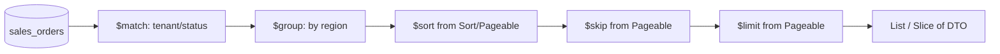

# Impact of Sort and Pageable on the Pipeline

A MongoDB report may consist of multiple stages such as `$match`, `$group`, `$project`, `$sort`, and `$limit`. When implementing the report with an `@Aggregation` repository method in **Spring Data MongoDB**, you can also pass `Sort` or `Pageable` at invocation time. A common misconception is that **Sort/Pageable do not slip into the beginning of the pipeline**: Spring Data applies them **after the stages defined by the annotation**. Therefore, they sort or paginate the **final result of the aggregation**, not necessarily the source documents.

For example, after `$group`, each result row represents **one sales region**, no longer an individual order. Passing `PageRequest.of(0, 2, Sort.by("revenueCents"))` to the repository method normally means **fetching two regions from the grouped result list**, not reading only two orders and then grouping them.

This lesson belongs to the **Aggregation repository** chapter of the `SPRING_DATA_MONGODB` module. The module teaches how to use Spring Data MongoDB to connect, map documents, and work with MongoDB using `MongoTemplate` or repositories, as well as queries, aggregation, indexes, transactions, reactive access, testing, and performance diagnostics.

> **Three key facts:** (1) `Sort`/`Pageable` are appended to the **end** of an `@Aggregation` pipeline; (2) field names used for dynamic sorting are mapped against the **return result type**, not necessarily the input entity; (3) **`Page<T>` is not directly supported** for `@Aggregation` repository methods, although you can pass `Pageable` and return `Slice<T>`.

## 1. Learning objectives

After this lesson, you will be able to:

1. Explain how Spring Data appends `Sort` and `Pageable` to a repository aggregation pipeline.
2. Distinguish sorting **documents before grouping** from sorting **results after grouping**.
3. Create an `@Aggregation` returning `List<DTO>` with a runtime `Sort` parameter.
4. Use `Pageable` to add `$sort`, `$skip`, and `$limit` to aggregation results.
5. Explain why `Page<DTO>` is not a supported return type for `@Aggregation` and when to use `Slice<DTO>`.
6. Understand how `Sort.by("region")` can be mapped to `{ $sort: { _id: 1 } }` if `region` is the `@Id` property of the **output DTO**.
7. Analyze stage order, fields lost after `$project`, aliases after `$group`, and limits of dynamic sorting.
8. Ensure stable pagination using a **unique tie-breaker** and understand the risk of data changing between pages.
9. Design approaches when **total count** is needed using `MongoTemplate` or `$facet` with counting **before** pagination stages.
10. Evaluate the cost of `$sort` on grouped results, large `$skip`, indexes, and `$sort + $limit` optimization.
11. Write integration tests verifying data, ordering, and the actual pipeline sent to MongoDB.
12. Use synchronous/reactive APIs properly, enforce tenant isolation, whitelist sorts, and cap page sizes.

## 2. Distinguishing three data layers in the pipeline

Consider a pipeline consisting of:

```javascript
[
  { $match: { status: "PAID" } },
  {
    $group: {
      _id: "$region",
      orderCount: { $sum: 1 },
      revenueCents: { $sum: "$total_cents" }
    }
  }
]
```

There are three layers to distinguish:

| Layer | Document shape | Meaningful fields |
| --- | --- | --- |
| **Source** before `$match` | `{_id, tenant_id, region, status, total_cents}` | Order fields |
| **After `$group`** | `{_id:"north", orderCount:2, revenueCents:2500}` | `_id` is the group; aggregated fields |
| **After Sort/Pageable** | Still group documents, now sorted/sliced | `_id`, `revenueCents`, `orderCount` |

Diagram:



This is the **logical order** intended to paginate grouped results. The exact BSON stage sequence generated by Spring Data and executed by the MongoDB optimizer may vary by version and pipeline shape; verify the actual command when those details matter.

**Do not confuse:** `Pageable` in a repository aggregation is not equivalent to applying a `PageRequest` to individual source documents before computing the entire report.

## 3. Sample dataset and entity

Collection `sales_orders` holds orders across multiple tenants, regions, and statuses. Dataset used throughout:

| Order ID | Tenant | Region | Status | total_cents |
| --- | --- | --- | --- | ---: |
| `SO-A1` | tenant-a | north | PAID | 1,000 |
| `SO-A2` | tenant-a | south | PAID | 4,000 |
| `SO-A3` | tenant-a | north | PAID | 1,500 |
| `SO-A4` | tenant-a | central | PAID | 2,000 |
| `SO-A5` | tenant-a | central | PAID | 500 |
| `SO-A6` | tenant-a | north | PENDING | 9,000 |
| `SO-B1` | tenant-b | north | PAID | 8,000 |

Create the Java entity:

```java
package dev.learning.sales;

import org.springframework.data.annotation.Id;
import org.springframework.data.mongodb.core.mapping.Document;
import org.springframework.data.mongodb.core.mapping.Field;

@Document("sales_orders")
public record SalesOrder(
    @Id String id,
    @Field("tenant_id") String tenantId,
    String region,
    String status,
    @Field("total_cents") long totalCents) {
}
```

Each sample document has an ID prefixed with `SO-` to avoid hex-string-to-ObjectId conversion rules. In a real application, choose an ID type consistent with BSON `_id`, test historical data, and use appropriate indexes.

The report query only considers:

```javascript
{ tenant_id: "tenant-a", status: "PAID" }
```

The result after grouping by region is:

| `_id` = region | orderCount | revenueCents |
| --- | ---: | ---: |
| north | 2 | 2,500 |
| south | 1 | 4,000 |
| central | 2 | 2,500 |

**There are 5 PAID orders but only 3 groups.** This is the core example for recognizing whether pagination occurs **before or after** `$group`.

### 3.1. DTO mapping grouped results

```java
package dev.learning.sales;

import org.springframework.data.annotation.Id;

public record RegionRevenue(
    @Id String region,
    long orderCount,
    long revenueCents) {
}
```

`@Id` on `RegionRevenue.region` indicates that the MongoDB group key `_id` maps to the `region` property in the **DTO**. This annotation also affects how Spring Data handles **dynamic `Sort` by return type**.

Do not think of `RegionRevenue` as an entity to save back into `sales_orders`. It is a **read model** produced by aggregation; it lacks the full fields of a `SalesOrder`.

## 4. Repository @Aggregation without passing Sort/Pageable

```java
package dev.learning.sales;

import java.util.List;
import org.springframework.data.mongodb.repository.MongoRepository;
import org.springframework.data.mongodb.repository.Aggregation;

public interface SalesOrderRepository
        extends MongoRepository<SalesOrder, String> {

    @Aggregation(pipeline = {
        "{ '$match': { 'tenantId': ?0, 'status': 'PAID' } }",
        "{ '$group': { '_id': '$region',"
          + " 'orderCount': { '$sum': 1 },"
          + " 'revenueCents': { '$sum': '$totalCents' } } }"
    })
    List<RegionRevenue> revenueByRegion(String tenantId);
}
```

In the annotation pipeline:

- `?0` is the placeholder for the first `tenantId` parameter.
- `$match` uses `tenantId` (Java property), which Spring Data MongoDB maps to BSON `tenant_id` from domain `SalesOrder`.
- `$group` uses `$totalCents` from the source entity, mapped to `$total_cents` via `@Field`.
- `_id` of the group result holds the region; `orderCount` and `revenueCents` are **output fields generated by the aggregation**.
- Results are mapped into `RegionRevenue`.

A semantically equivalent BSON pipeline:

```javascript
db.sales_orders.aggregate([
  { $match: { tenant_id: "tenant-a", status: "PAID" } },
  {
    $group: {
      _id: "$region",
      orderCount: { $sum: 1 },
      revenueCents: { $sum: "$total_cents" }
    }
  }
]);
```

**Without `$sort`**, MongoDB **does not guarantee** returning north/south/central in any specific order. Consistent-looking results on a small dataset do not constitute a sorting contract.

### 4.1. Annotation JSON and placeholders

`@Aggregation` accepts one or more strings describing the stages. Besides `?0`, Spring Data also supports SpEL expressions `?#{ ... }` per the documentation. Only pass dynamic data through framework-provided bindings; never concatenate raw JSON snippets from requests to create stages or field names.

When a query filters by tenant, the tenant value must come from an authenticated context with authorization checks, not blindly trusting an HTTP parameter sent by the client.

## 5. Passing Sort: $sort is appended after the annotation pipeline

Declare a method accepting `Sort`:

```java
@Aggregation(pipeline = {
    "{ '$match': { 'tenantId': ?0, 'status': 'PAID' } }",
    "{ '$group': { '_id': '$region',"
      + " 'orderCount': { '$sum': 1 },"
      + " 'revenueCents': { '$sum': '$totalCents' } } }"
})
List<RegionRevenue> revenueByRegion(
    String tenantId,
    org.springframework.data.domain.Sort sort);
```

Call:

```java
import org.springframework.data.domain.Sort;

Sort sort = Sort.by(
    Sort.Order.desc("revenueCents"),
    Sort.Order.asc("region")
);

List<RegionRevenue> rows =
    repository.revenueByRegion("tenant-a", sort);
```

**Logical** pipeline:

```javascript
[
  { $match: { tenant_id: "tenant-a", status: "PAID" } },
  {
    $group: {
      _id: "$region",
      orderCount: { $sum: 1 },
      revenueCents: { $sum: "$total_cents" }
    }
  },
  { $sort: { revenueCents: -1, _id: 1 } }
]
```

Expected results:

| Position | region | revenueCents |
| ---: | --- | ---: |
| 1 | south | 4,000 |
| 2 | central | 2,500 |
| 3 | north | 2,500 |

`region` is used as a **tie-breaker** because central and north have the same revenue, making the order more deterministic than sorting solely by `revenueCents`.

### 5.1. Why does Sort.by("region") become _id?

The Spring Data MongoDB documentation states explicitly: for repository `@Aggregation`, **`Sort` fields are mapped based on the return result type**. Because `RegionRevenue.region` has `@Id`, sorting by `"region"` is mapped to `"_id"` in BSON.

This differs from how `$match` in the pipeline is mapped according to the **source domain**. Distinguish carefully:

| Operation | Type/shape used for field mapping | Example |
| --- | --- | --- |
| `$match` in annotation | Source `SalesOrder` | `tenantId` → `tenant_id` |
| `$group` in annotation | Source and pipeline expressions | `$totalCents` → `$total_cents` |
| Method parameter `Sort` | **Return type `RegionRevenue`** | `region` with `@Id` → `_id` |
| `Sort` by aggregated field | Field present on output DTO | `revenueCents` → `revenueCents` |

If you return `Document` or an interface projection with different metadata, sort mapping may differ. **Always test the output and actual BSON command**, especially when DTOs use `@Id`, `@Field`, or renamed aliases.

### 5.2. Do not sort by a source field that no longer exists

After `$group`, each document only has `_id`, `orderCount`, and `revenueCents`. If you pass:

```java
Sort wrong = Sort.by("totalCents");
```

`totalCents` is a field of **`SalesOrder`**, not a field present on the grouped result. Depending on mapping, the command may sort on a non-existent field or throw an error. If every output document lacks the sort key, the order is undefined. Always sort by **fields of the DTO/group result**, such as `revenueCents` or `region`.

## 6. Sorting before and after $group have different meanings

The following two pipelines are **not equivalent**.

### 6.1. Sorting source documents before grouping

```javascript
[
  { $match: { tenant_id: "tenant-a", status: "PAID" } },
  { $sort: { total_cents: -1, _id: 1 } },
  {
    $group: {
      _id: "$region",
      orderCount: { $sum: 1 },
      revenueCents: { $sum: "$total_cents" },
      highestOrderId: { $first: "$_id" }
    }
  }
]
```

This `$sort` orders **orders before grouping**; `$first` picks the ID of the order with the highest `total_cents` in each region (assuming an appropriately designed sort with a unique tie-breaker). It does not sort the `RegionRevenue` result rows.

### 6.2. Sorting groups after grouping

```javascript
[
  { $match: { tenant_id: "tenant-a", status: "PAID" } },
  {
    $group: {
      _id: "$region",
      orderCount: { $sum: 1 },
      revenueCents: { $sum: "$total_cents" }
    }
  },
  { $sort: { revenueCents: -1, _id: 1 } }
]
```

This `$sort` orders **the aggregated regions**, without affecting which order `$first` picks in the previous example.

**Key takeaway:** The `Sort` method parameter of `@Aggregation` is added **after the declared stages**, so **it cannot replace a `$sort` before `$group`** when logic depends on `$first`, `$last`, or computation order. If you need a sort **inside** the pipeline at a specific position, declare `$sort` at that exact spot in the annotation or use `MongoTemplate` to build a dynamic pipeline.

## 7. Pageable: sort, skip, and limit applied at the end of the pipeline

Add a repository method:

```java
import org.springframework.data.domain.Pageable;
import org.springframework.data.domain.Slice;

@Aggregation(pipeline = {
    "{ '$match': { 'tenantId': ?0, 'status': 'PAID' } }",
    "{ '$group': { '_id': '$region',"
      + " 'orderCount': { '$sum': 1 },"
      + " 'revenueCents': { '$sum': '$totalCents' } } }"
})
Slice<RegionRevenue> revenueByRegion(
    String tenantId,
    Pageable pageable);
```

Call:

```java
import org.springframework.data.domain.PageRequest;
import org.springframework.data.domain.Sort;

Pageable firstPage = PageRequest.of(
    0, 2,
    Sort.by(
        Sort.Order.desc("revenueCents"),
        Sort.Order.asc("region"))
);

Slice<RegionRevenue> first =
    repository.revenueByRegion("tenant-a", firstPage);
```

Semantically, pagination operators are **appended after the grouped results**:

```javascript
[
  { $match: { tenant_id: "tenant-a", status: "PAID" } },
  {
    $group: {
      _id: "$region",
      orderCount: { $sum: 1 },
      revenueCents: { $sum: "$total_cents" }
    }
  },
  { $sort: { revenueCents: -1, _id: 1 } },
  { $skip: 0 },
  { $limit: 2 }
]
```

First page result: `south` and `central`. When calling `PageRequest.of(1,2,...)`, offset = 1×2 = 2; the second page contains `north`.

### 7.1. Paginates groups only, not orders before grouping

Wait—in tenant-a there are **5 PAID orders** but only **3 regions**. Page size 2 means fetching **2 group result rows** out of the three regions. It does not mean "compute revenue from only the first 2 orders."

If you want to **paginate orders first and then sum over that page**, that is a different report. You would place `$sort`/`$skip`/`$limit` **before `$group`** in the pipeline per requirements and understand that the totals only reflect that subset of orders.

### 7.2. Without Sort, pagination is unstable

```java
Pageable risky = PageRequest.of(1, 2);
```

Without a deterministic order, page 0 and page 1 can duplicate or omit groups when output order shifts. With offset pagination, always specify a sort with a **unique key**:

```java
Pageable stable = PageRequest.of(
    1, 2,
    Sort.by(
        Sort.Order.desc("revenueCents"),
        Sort.Order.asc("region"))
);
```

In group-by-region output, `region`/`_id` is unique within the region-grouped set. If grouping by `(tenant, region)`, the tie-breaker must be the **entire composite group key**, not just one part where multiple groups can still tie.

### 7.3. Do not assume identical BSON ordering to the illustration

The documentation states that Spring Data appends `$sort`, `$skip`, `$limit` from `Pageable` to the end of the pipeline. The sample syntax here illustrates the logical order required for correct results. The framework and MongoDB optimizer may organize or coalesce stages differently; verify the actual command on your project's version when exact ordering is relied upon.

## 8. Why is Page<T> not supported in @Aggregation?

A `Page<T>` typically contains:

- The content of the current page.
- `totalElements`: total matching records across the **entire result set before pagination**.
- `totalPages` calculated from total and page size.
- Metadata `hasNext`, `number`, `size`.

With aggregation, the total record count after `$group`/`$unwind`/`$facet` can differ vastly from the source document count. Spring Data MongoDB **does not support the `Page<T>` return type for `@Aggregation` repository methods**, per current reference documentation. Having a method accept `Pageable` **does not generate an automatic count pipeline** with accurate semantics for every report.

Wrong intent:

```java
// DO NOT USE: @Aggregation does not support Page<RegionRevenue>.
@Aggregation("{ '$group': { '_id': '$region',"
    + " 'revenueCents': { '$sum': '$totalCents' } } }")
Page<RegionRevenue> unsupported(Pageable pageable);
```

Proper approach when only paging forward is needed:

```java
@Aggregation("{ '$group': { '_id': '$region',"
    + " 'revenueCents': { '$sum': '$totalCents' } } }")
Slice<RegionRevenue> supported(Pageable pageable);
```

**`Slice<T>`** provides the page content and whether a next slice exists **without requiring `totalElements`** like `Page`. The Spring Data documentation allows aggregation methods taking `Pageable` to return `Slice`. Test `hasNext()` and fetch limits on your exact version; do not assume Spring Data always runs an extra count query.

### 8.1. List + Pageable is also valid

If an endpoint only needs an array of results without `Slice`:

```java
@Aggregation("{ '$group': { '_id': '$region',"
    + " 'revenueCents': { '$sum': '$totalCents' } } }")
List<RegionRevenue> groupedList(Pageable pageable);
```

`Pageable` still controls sort/offset/limit. `List` does not provide `getTotalElements()`, `hasNext()`, or page metadata.

## 9. Which count is accurate when you need total pages?

Returning to the dataset:

- **7 source orders** across two tenants and multiple statuses.
- **5 PAID orders for tenant-a**.
- **3 regions** after filtering and `$group`.
- **2 regions** on the first page at page size 2.

If the UI displays "showing 1–2 of 3 regions," **`totalElements` must be 3**, not 5 or 7.

### 9.1. Wrong: counting the source collection

```java
long wrongForGroups = repository.count();
```

`repository.count()` counts documents in the collection (subject to any custom conditions), **not output rows after `$group`**.

Also wrong:

```javascript
db.sales_orders.countDocuments({
  tenant_id: "tenant-a", status: "PAID"
});
```

That returns 5 orders, not 3 groups.

### 9.2. Counting output groups before skip/limit

```javascript
db.sales_orders.aggregate([
  { $match: { tenant_id: "tenant-a", status: "PAID" } },
  { $group: { _id: "$region" } },
  { $count: "totalGroups" }
]);
```

Result:

```javascript
[ { totalGroups: 3 } ]
```

This count pipeline **must** mirror the exact stages that determine the number of output rows, yet **must not** include `$skip`/`$limit` of the current page.

If the original pipeline has `$unwind` or `$lookup` altering cardinality, the count must express the same semantics after those stages. `countDocuments` cannot substitute for it.

### 9.3. Total = 0 when $count returns no document

`$count` over an empty input stream usually emits no document at all, rather than `{totalGroups:0}`. When parsing the result, default to 0 if the count branch is empty; do not call `results.get(0)` when no row exists.

## 10. $facet: one pipeline with both page data and total group count

`$facet` can process the same grouped result set through two branches:

- `items`: sort, skip, and limit.
- `total`: count all groups before pagination.

```javascript
db.sales_orders.aggregate([
  { $match: { tenant_id: "tenant-a", status: "PAID" } },
  {
    $group: {
      _id: "$region",
      orderCount: { $sum: 1 },
      revenueCents: { $sum: "$total_cents" }
    }
  },
  {
    $facet: {
      items: [
        { $sort: { revenueCents: -1, _id: 1 } },
        { $skip: 0 },
        { $limit: 2 }
      ],
      total: [
        { $count: "value" }
      ]
    }
  }
]);
```

Output:

```javascript
[
  {
    items: [
      { _id: "south", orderCount: 1, revenueCents: 4000 },
      { _id: "central", orderCount: 2, revenueCents: 2500 }
    ],
    total: [
      { value: 3 }
    ]
  }
]
```

**Important:** If you place `$facet` inside `@Aggregation` and also pass repository `Pageable`, Spring Data appends `$sort`/`$skip`/`$limit` **after the entire annotation pipeline**, meaning **after `$facet`**. Those operators then act on the **document containing `items` and `total`**, rather than paginating the `items[]` array inside. Therefore, a report using `$facet` for page+total should **manage pagination inside the `items` branch** via `MongoTemplate` or a properly built pipeline, instead of blindly mixing it with method-tail `Pageable`.

### 10.1. $facet is not always optimal

A `$facet` pipeline can avoid stitching results from two independent commands and ensures both branches process the same input stream for that invocation, yet `$facet` has its own memory and output document size limits. Placing `$facet` too early can hinder optimizations and index usage.

If reports are small, or the UI only needs "is there a next page?", `Slice` can be simpler. For large datasets, measure both the pipeline and branch output sizes before choosing.

## 11. When you truly need Page: build it manually with MongoTemplate

One implementation approach uses two aggregations:

1. **Data pipeline**: filter → group → sort → skip → limit.
2. **Count pipeline**: filter → group → count.

Then combine them into `PageImpl<RegionRevenue>` in the service layer.

Example using the Spring Data aggregation DSL:

```java
import java.util.List;
import org.springframework.data.domain.Page;
import org.springframework.data.domain.PageImpl;
import org.springframework.data.domain.Pageable;
import org.springframework.data.domain.Sort;
import org.springframework.data.mongodb.core.MongoTemplate;
import org.springframework.data.mongodb.core.aggregation.Aggregation;
import org.springframework.data.mongodb.core.aggregation.TypedAggregation;
import org.springframework.data.mongodb.core.query.Criteria;

public class RegionReportService {
    private final MongoTemplate template;

    public RegionReportService(MongoTemplate template) {
        this.template = template;
    }

    public Page<RegionRevenue> revenueByRegion(
            String authorizedTenant, Pageable page) {

        var filter = Aggregation.match(
            Criteria.where("tenantId").is(authorizedTenant)
                .and("status").is("PAID"));

        var grouped = Aggregation.group("region")
            .count().as("orderCount")
            .sum("totalCents").as("revenueCents");

        // Sort after group by output BSON fields, not source fields.
        Sort outputSort = Sort.by(
            Sort.Order.desc("revenueCents"),
            Sort.Order.asc("_id"));

        TypedAggregation<SalesOrder> dataPipeline =
            Aggregation.newAggregation(
                SalesOrder.class,
                filter, grouped,
                Aggregation.sort(outputSort),
                Aggregation.skip(page.getOffset()),
                Aggregation.limit(page.getPageSize())
            );

        List<RegionRevenue> content = template.aggregate(
            dataPipeline, RegionRevenue.class
        ).getMappedResults();

        TypedAggregation<SalesOrder> countPipeline =
            Aggregation.newAggregation(
                SalesOrder.class,
                Aggregation.match(
                    Criteria.where("tenantId").is(authorizedTenant)
                        .and("status").is("PAID")),
                Aggregation.group("region"),
                Aggregation.count().as("total")
            );

        var totals = template.aggregate(
            countPipeline, org.bson.Document.class
        ).getMappedResults();

        long total = totals.isEmpty()
            ? 0L
            : ((Number) totals.get(0).get("total")).longValue();

        return new PageImpl<>(content, page, total);
    }
}
```

This snippet uses a **fixed service-controlled sort** to focus on demonstrating pagination and accurate group counting; if accepting `page.getSort()` from a request, you must validate against a whitelist and translate DTO properties (`region`) into output BSON fields (`_id`) properly before building the sort.

**Consistency warning:** two aggregations are **two separate read commands**. If orders change between the data query and the count query, `content` and `total` can reflect different points in time. When business requirements demand a single shared snapshot, evaluate read concern/transactions or a `$facet` suited to your topology and performance targets.

## 12. $project, aliases, and fields that no longer exist

A pipeline with an added `$project`:

```javascript
[
  {
    $group: {
      _id: "$region",
      revenueCents: { $sum: "$total_cents" }
    }
  },
  {
    $project: {
      _id: 0,
      regionName: "$_id",
      total: "$revenueCents"
    }
  }
]
```

The output **no longer has** `_id` or `revenueCents`; they are replaced by `regionName` and `total`.

If you subsequently pass `Sort.by("revenueCents")` or `Sort.by("region")` with a return type incompatible with the aliases:

- The sort may target a **non-existent field** in the output.
- Output documents missing the sort key tie on sort value, producing unstable ordering.
- Results can have "the right page size" yet **wrong order**, which is very hard to spot.

Define an appropriate output DTO and sort by **fields existing after the final stage**:

```java
public record RegionRevenueFlat(
    String regionName,
    long total) {
}
```

```java
Sort correct = Sort.by(
    Sort.Order.desc("total"),
    Sort.Order.asc("regionName"));
```

If you want to return property `region` while the output BSON field is `regionName`, you need metadata/projection capable of mapping it properly and must verify repository sorting. Never try to use a source entity property where the output shape has changed.

### 12.1. Do not use Sort to create or rename aliases

`Sort.by("total")` only sorts; it **does not create** the `total` field. If the pipeline has not created that field yet, update `$group`/`$project` or choose an existing field.

## 13. Pipelines with built-in $sort/$limit: avoid mixing two pagination layers

Suppose a repository has a fixed pipeline:

```java
@Aggregation(pipeline = {
    "{ '$match': { 'tenantId': ?0, 'status': 'PAID' } }",
    "{ '$group': { '_id': '$region',"
      + " 'revenueCents': { '$sum': '$totalCents' } } }",
    "{ '$sort': { 'revenueCents': -1 } }",
    "{ '$limit': 10 }"
})
List<RegionRevenue> topTenRegions(
    String tenantId,
    org.springframework.data.domain.Pageable pageable);
```

The declared pipeline picks **at most the 10 highest-revenue regions**. When `PageRequest.of(1,5,Sort.by("region"))` is passed, Spring Data appends pagination/sort **after `$limit:10`**. The result **sorts and paginates within that pre-selected set of at most 10 regions**, rather than paginating across all regions in the database.

Interpretation:

```javascript
[
  { $match: { tenant_id: "tenant-a", status: "PAID" } },
  { $group: { _id: "$region",
              revenueCents: { $sum: "$total_cents" } } },
  { $sort: { revenueCents: -1 } },
  { $limit: 10 },
  // Dynamically appended after the pipeline:
  { $sort: { _id: 1 } },
  { $skip: 5 },
  { $limit: 5 }
]
```

**Two sort layers do not "replace" each other regarding the sliced dataset's semantics:** the first sort decides **which 10 regions enter the top set**, and the second sort decides **the order within that top set**. Assuming the `Pageable` sort always controls how the top 10 are selected can lead to business logic errors.

### 13.1. When should you remove a fixed $limit?

- If users should browse **all regions** across pages, remove the fixed `$limit` before `Pageable`.
- If you want **top N** where the top-N ordering itself is user-chosen, build `$sort` and `$limit` in the same top-N logic rather than only appending a trailing sort.
- If you want "page n of the top 100," that is a valid problem, though the API should clearly state it is paging only within the top 100 subset.
- If you want a total count, decide whether total means **all regions after grouping** or **the 100 regions in the top set** before writing the count pipeline.

### 13.2. Sorting on fields removed by $project

`$project` can rename or exclude fields. If you define:

```javascript
{ $project: { _id: 0, regionName: "$_id", total: "$revenueCents" } }
```

then sorting by `_id` or `revenueCents` **after** project no longer has the intended effect. Before adding `Sort` to a repository method, inspect the **final stage shape** and the return type.

## 14. Pagination stability: tie-breakers and changing data

MongoDB `$sort` is **not a stable sort**. When two documents share the same sort key, their relative order is not guaranteed. With offset pagination:

```javascript
{ $sort: { revenueCents: -1 } },
{ $skip: 2 },
{ $limit: 2 }
```

if multiple regions have the same revenue, two executions can place tied regions in different positions. When reading page 0 and page 1 separately, a region can appear twice or be skipped.

Adding a unique key:

```javascript
{ $sort: { revenueCents: -1, _id: 1 } }
```

makes the order deterministic **within the same data snapshot**. With `@Id String region` on the return DTO:

```java
Sort sort = Sort.by(
    Sort.Order.desc("revenueCents"),
    Sort.Order.asc("region")
);
```

is mapped by the return type to sort on `_id`. Do not arbitrarily replace `region` with `"id"`: that may not be the property declared on the DTO.

### 14.1. Tie-breakers do not solve changing data

Even when the sort includes `_id`, between the page 1 request and the page 2 request:

- New orders may increase a region's revenue.
- Orders may be cancelled or leave PAID status.
- A new group may appear; an old group may disappear.
- Revenue rankings shift, causing offset 2 to point to different groups.

When reports must stay consistent across multiple pages, consider a **snapshot/materialized report**, versioned report data, or an appropriate read concern/session. A deterministic sort **does not automatically guarantee a snapshot across multiple HTTP requests**.

### 14.2. Keyset/seek pagination is non-trivial when sorting by aggregates

For entity lists with stable keys, keyset pagination sometimes uses a "after last key" condition instead of large `$skip`. However, with an aggregation sorted by `revenueCents` computed via `$sum`, finding "after (revenue, region)" requires filtering on **grouped output**, such as:

```javascript
{
  $match: {
    $or: [
      { revenueCents: { $lt: lastRevenue } },
      {
        revenueCents: lastRevenue,
        _id: { $gt: lastRegion }
      }
    ]
  }
}
```

This is the reasoning for sorting `revenueCents DESC, _id ASC`, placed **after `$group`**. It is not an automatic feature of `@Aggregation(Pageable)`. Source data updates can still change aggregate sort keys, so keyset pagination also needs a consistency strategy for real-time reports.

## 15. Controlling Sort and Pageable from public APIs

For a REST endpoint:

```text
GET /reports/regions?sort=revenueCents,desc&page=0&size=20
```

Never assume the framework bounds every value for you:

- Clients can pass arbitrary fields, targeting non-existent or sensitive fields.
- Oversized page sizes inflate payloads, memory, and DB load.
- Huge page numbers create large offsets; `$skip` must scan/discard many output groups.
- Sorts with too many keys or inconsistent fields can trigger MongoDB errors.
- Tenant ID must come from an authenticated context, not an unverified query string.

### 15.1. Whitelisting sort fields

A factory allowing sorting only by revenue, order count, or region:

```java
package dev.learning.sales;

import org.springframework.data.domain.Sort;

public final class RegionSortFactory {
    private RegionSortFactory() {}

    public static Sort by(String requestedField,
                          boolean descending) {
        String property = switch (requestedField) {
            case "revenue" -> "revenueCents";
            case "orders"  -> "orderCount";
            case "region"  -> "region";
            default -> throw new IllegalArgumentException(
                "Unsupported sort field");
        };

        Sort.Direction direction = descending
            ? Sort.Direction.DESC
            : Sort.Direction.ASC;

        if (property.equals("region")) {
            return Sort.by(new Sort.Order(direction, "region"));
        }
        return Sort.by(
            new Sort.Order(direction, property),
            Sort.Order.asc("region")
        );
    }
}
```

`region` is the tie-breaker. If the primary sort is `region`, it is already unique in a group-by-region set. There is no need to append the same field a second time.

### 15.2. Validating pagination

```java
import org.springframework.data.domain.PageRequest;
import org.springframework.data.domain.Pageable;
import org.springframework.data.domain.Sort;

public static Pageable regionPage(
        int requestedPage, int requestedSize, Sort sort) {

    if (requestedPage < 0) {
        throw new IllegalArgumentException("page must be >= 0");
    }
    if (requestedSize < 1 || requestedSize > 100) {
        throw new IllegalArgumentException("size must be between 1 and 100");
    }
    if (requestedPage > 10_000) {
        throw new IllegalArgumentException(
            "Pagination limit exceeded; use a dedicated export/report");
    }
    return PageRequest.of(requestedPage, requestedSize, sort);
}
```

The thresholds `100` and `10_000` only illustrate **application policy**, not fixed Spring Data limits. Beyond validation, enforce execution time limits, query monitoring, and UX evaluation on large datasets.

### 15.3. Tenant must be a filter at the start of the pipeline

```java
String authorizedTenant = authenticationContext.currentTenantId();

Slice<RegionRevenue> result = repository.revenueByRegion(
    authorizedTenant, regionPage(page, size, validatedSort));
```

`authenticationContext.currentTenantId()` is an illustrative application-provided API. Do not treat `Sort` or `Pageable` as authorization mechanisms: they only change ordering/result counts and **do not stop other tenants' data from entering the pipeline** if the initial `$match` lacks the tenant filter.

## 16. Performance: post-group sorting is not like sorting by a source index

An early `$match` can leverage an index on `sales_orders`:

```javascript
db.sales_orders.createIndex(
  { tenant_id: 1, status: 1, region: 1 },
  { name: "tenant_status_region" }
);
```

However, `revenueCents` **does not exist on source documents**; it is computed by `$group: {$sum: "$total_cents"}`. Therefore:

```javascript
{ $sort: { revenueCents: -1 } }
```

**after grouping** is typically a sort on intermediate results and cannot directly use a source B-tree index on `revenueCents` to avoid the sort stage. Indexing `total_cents` on individual orders does not turn it into an index on total revenue per region.

### 16.1. A small page does not mean reading few orders

```javascript
{ $group: { _id: "$region",
            revenueCents: { $sum: "$total_cents" } } },
{ $sort: { revenueCents: -1 } },
{ $limit: 2 }
```

Even though only two groups are returned, the server must still process all matching orders to compute totals per region. `$limit:2` after grouping **cannot be arbitrarily pushed before grouping** while keeping revenue numbers accurate.

For very large datasets, consider pre-aggregated/materialized views, scheduled report updates, or a tailored read model. Define consistency and compensation rules if updated asynchronously.

### 16.2. $sort + $skip + $limit optimization

MongoDB can optimize the sequence:

```javascript
{ $sort: { revenueCents: -1, _id: 1 } },
{ $skip: 100 },
{ $limit: 20 }
```

into a bounded sort keeping the **top 120** results and skipping 100, provided no stage changing document cardinality sits in between. That is an **optimizer transformation** reducing sort memory where applicable; it **does not make `$skip:100` an O(1) operation**, nor does it free the preceding `$group` from processing its inputs.

If `$unwind`/`$group` sits between `$sort` and `$limit`, coalescence conditions may no longer hold. Run `explain` on your exact server version because optimizer behavior can change.

### 16.3. allowDiskUse and memory

`$sort` is a blocking stage; `$group` can also require significant memory. A repository method can use `@Meta`:

```java
import org.springframework.data.mongodb.repository.Meta;

@Meta(
    allowDiskUse = "true",
    maxExecutionTimeMs = 5_000L,
    comment = "region-revenue-report"
)
@Aggregation(pipeline = {
    "{ '$match': { 'tenantId': ?0, 'status': 'PAID' } }",
    "{ '$group': { '_id': '$region',"
      + " 'revenueCents': { '$sum': '$totalCents' } } }"
})
List<RegionRevenue> revenueReportWithLimits(
    String authorizedTenant, Sort sort);
```

`allowDiskUse` on `@Meta` is a **String** (e.g., `"true"`) in current Spring Data MongoDB lines; do not use `allowDiskUse=true` if your version's signature requires a String. This setting lets the server spill to temporary disk files when eligible stages need it, subject to server/config rules.

`allowDiskUse` **does not reduce row counts** to group/sort, does not replace indexes, and does not bypass all resource limits. With `$facet`, separate limits apply: a 100 MB intermediate facet limit that cannot spill to disk, and a 16 MiB maximum BSON output document size. Measure before using.

### 16.4. Monitoring latency, query plans, and payloads

Track at minimum:

- Request distribution by page size/page number and sort field.
- Report p50/p95/p99 latency.
- Input orders after `$match` and output groups after `$group`.
- `totalKeysExamined`, `totalDocsExamined`, `IXSCAN`/`COLLSCAN`.
- Blocking `SORT`/`GROUP`, disk spill, memory, and server load.
- Returned DTO byte size and Java materialization time.
- Rates of timeouts, request cancellations, repeated pagination, and inconsistent report reads.

A pipeline with a large `$skip` or post-aggregate sort can be expensive even when the DTO returns only a few rows.

## 17. Analyzing $sort, $group, and indexes with explain

Run the equivalent BSON in `mongosh` against a test database:

```javascript
db.sales_orders.explain("executionStats").aggregate([
  { $match: { tenant_id: "tenant-a", status: "PAID" } },
  {
    $group: {
      _id: "$region",
      orderCount: { $sum: 1 },
      revenueCents: { $sum: "$total_cents" }
    }
  },
  { $sort: { revenueCents: -1, _id: 1 } },
  { $skip: 0 },
  { $limit: 2 }
]);
```

Inspect explain output per server version:

- `queryPlanner` and index scan for the initial `$match`.
- Number of source documents read.
- Number of group outputs after `$group`.
- Whether sorting on `revenueCents` sorts outputs or uses another optimization.
- Whether the top-N limit is coalesced with the sort.
- Whether disk spill or heavy memory usage occurs.
- Which stage dominates cost.

**Note:** MongoDB may reorder or coalesce stages in the query plan. The logical pipeline `$sort → $skip → $limit` still accurately expresses the pagination requirement, even if explain does not show it verbatim.

### 17.1. Verifying the pipeline generated by the repository

Do not just print the annotation string and conclude the `Sort` parameter mapped properly. To see the real command:

1. Configure a **MongoDB Java Driver `CommandListener`** in the test environment.
2. Observe the `aggregate` command and its `pipeline` field.
3. Verify `$match` uses `tenant_id` and `$group` uses `$total_cents`.
4. Verify `$sort` uses `revenueCents` and `_id` when sorting by DTO `RegionRevenue`.
5. Verify `$skip`/`$limit` match the `PageRequest`.
6. If the pipeline projects or creates new aliases, verify the sort key **actually exists** in the output.

Never log full production BSON documents containing PII, customer IDs, or unauthorized financial data. Command/profiler tests should redact or use synthetic data.

## 18. Integration testing Sort and Pageable on grouped output

An integration test must prove **correct stage semantics**, not just the right item count.

### 18.1. Fixture and group-sorting tests

The examples below assume `SalesOrder`, `RegionRevenue`, and `SalesOrderRepository` are declared per sections 3–7, with a dedicated test MongoDB (test URI/Testcontainers per project).

```java
package dev.learning.sales;

import static org.assertj.core.api.Assertions.assertThat;

import java.util.List;
import java.util.UUID;

import org.junit.jupiter.api.Test;
import org.springframework.beans.factory.annotation.Autowired;
import org.springframework.boot.test.context.SpringBootTest;
import org.springframework.data.domain.PageRequest;
import org.springframework.data.domain.Pageable;
import org.springframework.data.domain.Slice;
import org.springframework.data.domain.Sort;

@SpringBootTest
class RepositoryAggregationPagingIntegrationTest {

    @Autowired SalesOrderRepository repository;

    private String seed() {
        String s = UUID.randomUUID().toString();
        String tenant = "tenant-a-" + s;
        String other = "tenant-b-" + s;

        repository.insert(List.of(
            new SalesOrder("SO-A1-" + s, tenant, "north", "PAID", 1000),
            new SalesOrder("SO-A2-" + s, tenant, "south", "PAID", 4000),
            new SalesOrder("SO-A3-" + s, tenant, "north", "PAID", 1500),
            new SalesOrder("SO-A4-" + s, tenant, "central", "PAID", 2000),
            new SalesOrder("SO-A5-" + s, tenant, "central", "PAID", 500),
            new SalesOrder("SO-A6-" + s, tenant, "north", "PENDING", 9000),
            new SalesOrder("SO-B1-" + s, other, "north", "PAID", 8000)
        ));
        return tenant;
    }

    private Sort revenueThenRegion() {
        return Sort.by(
            Sort.Order.desc("revenueCents"),
            Sort.Order.asc("region")
        );
    }

    @Test
    void sortIsAppliedAfterGroupingToDtoFields() {
        String tenant = seed();

        List<RegionRevenue> rows =
            repository.revenueByRegion(tenant, revenueThenRegion());

        assertThat(rows).extracting(RegionRevenue::region)
            .containsExactly("south", "central", "north");
        assertThat(rows).extracting(RegionRevenue::revenueCents)
            .containsExactly(4000L, 2500L, 2500L);
        assertThat(rows).extracting(RegionRevenue::orderCount)
            .containsExactly(1L, 2L, 2L);
    }

    @Test
    void pageableSlicesTheGroupsNotTheSourceOrders() {
        String tenant = seed();

        Pageable p0 = PageRequest.of(0, 2, revenueThenRegion());
        Pageable p1 = PageRequest.of(1, 2, revenueThenRegion());

        Slice<RegionRevenue> first =
            repository.revenueByRegion(tenant, p0);
        Slice<RegionRevenue> second =
            repository.revenueByRegion(tenant, p1);

        assertThat(first.getContent())
            .extracting(RegionRevenue::region)
            .containsExactly("south", "central");
        assertThat(second.getContent())
            .extracting(RegionRevenue::region)
            .containsExactly("north");
    }
}
```

The test above verifies three points:

- `$match` by tenant/status excludes tenant-b and PENDING orders.
- `$group` accurately computes 3 groups and their revenues.
- `Sort`/`Pageable` apply **after grouping**, slicing group results rather than input orders.

### 18.2. Do not start with a hasNext test before verifying your version

The Spring Data reference allows `Slice` with `Pageable` for `@Aggregation`, but internal `hasNext`/limiting mechanics must be verified on your specific version. Your first test should assert **the content of each page**, then add `hasNext()`/`isLast()` tests matching the expected contract. Do not assume a `Slice` always carries total group count.

### 18.3. Testing empty groups

Add a test for a tenant with no PAID orders:

```java
@Test
void noMatchingOrdersGivesEmptySlice() {
    String missingTenant = "missing-" + UUID.randomUUID();

    Slice<RegionRevenue> rows = repository.revenueByRegion(
        missingTenant,
        PageRequest.of(0, 10, revenueThenRegion())
    );

    assertThat(rows.getContent()).isEmpty();
}
```

Place this method in the **same test class** to reuse `repository` and `revenueThenRegion()`.

### 18.4. Testing sorting on an @Id field of the result DTO

A dedicated test:

```java
@Test
void regionSortUsesGroupId() {
    String tenant = seed();

    List<RegionRevenue> rows = repository.revenueByRegion(
        tenant, Sort.by(Sort.Order.asc("region"))
    );

    assertThat(rows).extracting(RegionRevenue::region)
        .containsExactly("central", "north", "south");
}
```

This content test shows the output order matches sorting by region. To **prove** Spring Data sent `{ $sort: { _id: 1 } }` (rather than sorting by another field), add a `CommandListener`/monitoring, because correct results alone do not always prove the mapping path.

## 19. Non-happy-path test cases to cover

| Scenario | Must prove |
| --- | --- |
| Two regions with equal revenue | Tie-breaker `region`/`_id` is deterministic |
| No `Sort` provided | Do not assume result ordering |
| Page index 0 and 1 | No duplicated or skipped groups when data is static |
| Page size 1, max page size | `$skip`/`$limit` respect bounds |
| Deep page beyond total groups | Empty content, no accidental fallback |
| No PAID orders | Zero groups, total groups equals 0 |
| Tenant-b has huge revenue | Never leaks into tenant-a's report |
| Source `@Field("total_cents")` | `$sum` uses the right BSON field |
| Result DTO `@Id region` | Dynamic sort on `region` uses group `_id` |
| DTO `$project` renames aliases | Sort uses the right output field |
| Pipeline already has `$limit` | `Pageable` only pages the limited subset |
| `Page<RegionRevenue>` return type | Not used with repository `@Aggregation` |
| Two-command paging and count | Snapshot inconsistency accepted or handled |
| `$group` after `$unwind` | Count accurately reflects output cardinality |
| Sort by non-whitelisted field | Request rejected |
| Sort field missing from output | Schema check/command capture prevents random order |

In practice, use fixed fixtures, synthetic data, and **never delete an entire production collection**. Performance tests require a dedicated workload rather than running with 7 sample orders.

## 20. Reactive @Aggregation with Pageable

Repository aggregations are also supported for reactive repositories. When limiting data via `Pageable`, reactive methods typically return `Flux<T>` rather than requiring `Page<T>`:

```java
package dev.learning.sales;

import org.springframework.data.domain.Pageable;
import org.springframework.data.mongodb.repository.Aggregation;
import org.springframework.data.mongodb.repository.ReactiveMongoRepository;
import reactor.core.publisher.Flux;

public interface ReactiveSalesOrderRepository
        extends ReactiveMongoRepository<SalesOrder, String> {

    @Aggregation(pipeline = {
        "{ '$match': { 'tenantId': ?0, 'status': 'PAID' } }",
        "{ '$group': { '_id': '$region',"
          + " 'orderCount': { '$sum': 1 },"
          + " 'revenueCents': { '$sum': '$totalCents' } } }"
    })
    Flux<RegionRevenue> revenueByRegion(
        String tenantId, Pageable page);
}
```

Usage:

```java
Flux<RegionRevenue> results =
    reactiveRepository.revenueByRegion(
        authorizedTenant,
        PageRequest.of(0, 20, revenueThenRegion())
    );
```

`$sort`/`$skip`/`$limit` in the pipeline have the exact same meaning in MongoDB. `Flux` does not automatically carry `totalElements`/`totalPages` like `Page`; if you need group counts, design a separate aggregation or an appropriate facet.

Never call `block()` casually on an event loop. Do not `collectList()` all groups on very large reports just to "turn reactive into a List"; enforce bounds and manage resources. If a publisher is subscribed to twice, the aggregation may run again and read newer data; paged results across subscriptions are not automatically synchronized.

## 21. Stream and return-type variants

Besides `List<T>` and `Slice<T>`, repository `@Aggregation` can use `Stream<T>` depending on Spring Data version support:

```java
@Aggregation(pipeline = {
    "{ '$match': { 'tenantId': ?0, 'status': 'PAID' } }",
    "{ '$group': { '_id': '$region',"
      + " 'revenueCents': { '$sum': '$totalCents' } } }"
})
java.util.stream.Stream<RegionRevenue> streamRevenue(
    String tenantId, Sort sort);
```

Use `try-with-resources` to close the cursor:

```java
try (var stream = repository.streamRevenue(
        authorizedTenant,
        Sort.by("region"))) {
    stream.forEach(this::processRegion);
}
```

`processRegion` is an application-provided method. `Stream` does not turn a post-group sort into a source sort or make the pipeline streaming end-to-end: `$group`/`$sort` stages can still block on the MongoDB Server.

### 21.1. Return-type selection table

| Need | API choice |
| --- | --- |
| Small list needing runtime sort | `List<DTO> method(Sort)` |
| Paginated list without needing total | `Slice<DTO> method(Pageable)` |
| Offset/limit list without needing metadata | `List<DTO> method(Pageable)` |
| Total group count and page count | `MongoTemplate` + count pipeline or `$facet` |
| Synchronous cursor processing | `Stream<DTO>`, closed via try-with-resources |
| Reactive read | `Flux<DTO> method(Pageable)` |
| `Page<DTO>` directly from `@Aggregation` | **Not supported** |

## 22. Common mistakes and how to fix them

| Mistake | Consequence | Fix |
| --- | --- | --- |
| Thinking `Pageable` runs before `$group` | Revenue/counts misinterpreted | Read the pipeline: pageable applies last |
| Runtime sort by source entity property | Sort key missing after group/project | Sort by output DTO/alias |
| Misunderstanding `@Id` in DTO | `Sort.by("region")` can map to `_id` | Check return-type metadata and BSON |
| Using `Page<DTO>` on `@Aggregation` | Return type not supported by framework | Use `Slice` or build `Page` manually |
| Using `repository.count()` as total groups | Counts orders instead of groups | Count on a post-group pipeline |
| `$facet` with external `Pageable` | Paginates the facet wrapper document, not `items[]` | Put pagination inside the facet branch |
| Sorting only by total revenue | Tied groups lack deterministic order | Add unique group key |
| Tie-breaker present yet data changes across pages | Duplicates/skips can still occur with offset | Snapshot/materialized report |
| Pipeline has `$limit` before `Pageable` | Only pages the limited subset | Decide between top-N and full dataset |
| Two consecutive `$sort` stages | Final sort can override display order | Distinguish top-N sort vs. final display sort |
| `$project` drops field then sorts by old field | Sort loses effect | Use output field/alias |
| Unbounded page size | High memory/payload | Validate page/size/fields |
| Letting clients pick any sort key name | Schema errors, uncontrolled resource usage | Whitelist properties |
| Letting clients pick tenant | Data leak | Tenant from principal |
| Assuming `total_cents` index helps `SUM(total)` sort | Computed aggregate is absent from source index | Run explain, consider pre-aggregation |
| Assuming few output rows means cheap query | Group still reads many source docs | Measure input cardinality and server time |
| Thinking `allowDiskUse` is enough | Doesn't shrink data; facet still has limits | Filter early, index, redesign pipeline |
| Changing DTO without testing Sort | Dynamic sort mapping can shift | Integration test + command capture |

## 23. Practice exercises

**Exercise 1 — Identifying order.** Given pipeline `$match → $group` and parameter `Sort.by("revenueCents")`, does the sort stage take effect before or after grouping? *Answer:* after grouping, sorting output groups.

**Exercise 2 — @Id in DTO.** Define `RegionRevenue(@Id String region, long revenueCents)` and call `Sort.by("region")`. Predict the BSON sort key. *Hint:* `_id`.

**Exercise 3 — Page size two.** Given south=4000, central=2500, north=2500, sort `revenueCents DESC, region ASC`. Write the two pages at page size 2. *Answer:* page 0 south, central; page 1 north.

**Exercise 4 — Wrong sort placement.** A pipeline wants to use `$first` to get the largest order in each region. Why cannot a method `Sort` parameter replace a `$sort` before `$group`?

**Exercise 5 — Sorting by alias.** Add `$project` renaming `revenueCents` to `total` and `_id` to `regionName`. Update the return DTO and `Sort` to use fields present at the end of the pipeline.

**Exercise 6 — Counting groups.** There are 5 PAID orders for tenant-a and 3 regions. Why does `countDocuments` return 5 while the report's `totalElements` needs 3? Write `$group → $count`.

**Exercise 7 — Facet.** Write a `$facet` pipeline with an `items` branch using sort/skip/limit and a `total` branch using `$count`. Explain why you should not pass `Pageable` outside the facet annotation.

**Exercise 8 — Top N + pagination.** A pipeline has `$sort revenue DESC → $limit 10`. Pass `Sort` region ASC and `Pageable`. State what total dataset is being paginated.

**Exercise 9 — Unstable sort.** Create 3 groups with identical revenue, sorting only by revenue. Demonstrate page 0/page 1 can be unstable, and add `_id` as a tie-breaker.

**Exercise 10 — Indexes.** Create index `tenant_id + status + region`. Run explain for the query grouping and sorting by `revenueCents`. Why does the index not automatically sort by `SUM(total_cents)`?

**Exercise 11 — Changing source data.** While a user flips pages, one region's revenue increases. Design one solution accepting real-time data and one solution requiring a snapshot.

**Exercise 12 — Security.** Allow clients to sort only by revenue/orders/region, cap size≤100, and always read tenant from the principal; write the `Sort` and `Pageable` factories.

**Exercise 13 — Reactive.** Write a repository `@Aggregation` returning `Flux<RegionRevenue>` with `Pageable`; explain why it cannot directly return `Mono<Page<RegionRevenue>>`.

## 24. Pre-release checklist

- [ ] Clearly identify whether the pipeline returns **source documents**, **group rows**, or **projected DTOs**.
- [ ] Remember that `Sort`/`Pageable` on repository `@Aggregation` apply **after** annotation stages.
- [ ] If sorting is needed before `$group`/`$first`, place the stage in the right position **inside the pipeline**.
- [ ] Only sort by output fields that still exist after the final stage.
- [ ] Verify return-type mapping, especially `@Id` → `_id` and `@Field`.
- [ ] Include a deterministic sort with a unique tie-breaker for offset pagination.
- [ ] Confirm `PageRequest` offset/limit match **post-group** data.
- [ ] Do not use `Page<T>` directly as a return type on repository `@Aggregation`.
- [ ] Use `Slice`/`List` for pagination that does not require a total count.
- [ ] When a total is needed, count **output rows before skip/limit**, not the source collection.
- [ ] If using `$facet`, paginate inside the `items` branch and count inside the `total` branch.
- [ ] Do not mix a fixed `$limit` and `Pageable` without understanding the top-N subset semantics.
- [ ] Whitelist `Sort` fields and validate page/size/offset.
- [ ] Tenant filter uses authenticated identity, never client-chosen input.
- [ ] Test ties, no-match cases, deep pages, and renamed field aliases.
- [ ] Measure `explain`, command monitoring, sort memory/spill, and input cardinality.
- [ ] Consider snapshots/materialized reports if consistent data across pages is required.
- [ ] Do not confuse finishing lesson drafting with Content QA or publishing.

## 25. Official references

1. [Spring Data MongoDB — MongoDB-specific Query Methods, Aggregation Methods](https://docs.spring.io/spring-data/mongodb/reference/mongodb/repositories/query-methods.html): `@Aggregation` examples with `Sort`/`Pageable`, field mapping by return type, `Slice`, and `Page` limitations.
2. [Spring Data MongoDB — @Aggregation Javadoc](https://docs.spring.io/spring-data/mongodb/docs/current/api/org/springframework/data/mongodb/repository/Aggregation.html): how sort/pageable are appended after the pipeline and placeholders.
3. [Spring Data MongoDB — @Meta Javadoc](https://docs.spring.io/spring-data/mongodb/docs/current/api/org/springframework/data/mongodb/repository/Meta.html): `allowDiskUse`, max execution time, and comment.
4. [Spring Data MongoDB — Aggregation Framework Support](https://docs.spring.io/spring-data/mongodb/reference/mongodb/aggregation-framework.html): typed aggregation, `$group`, `$project`, and builder API.
5. [Spring Data Commons — Pagination and Sorting](https://docs.spring.io/spring-data/mongodb/reference/data-commons/repositories/core-concepts.html): `Pageable`, `Page`, `Slice`, and `Sort`.
6. [MongoDB Manual — $sort Aggregation Stage](https://www.mongodb.com/docs/manual/reference/operator/aggregation/sort/): blocking sort, non-deterministic on duplicate sort keys, top-N optimization.
7. [MongoDB Manual — $skip](https://www.mongodb.com/docs/manual/reference/operator/aggregation/skip/): offset and unique sort requirement for stable pagination.
8. [MongoDB Manual — $limit](https://www.mongodb.com/docs/manual/reference/operator/aggregation/limit/): limiting pipeline document counts.
9. [MongoDB Manual — $group](https://www.mongodb.com/docs/manual/reference/operator/aggregation/group/): grouping, accumulation, and output fields.
10. [MongoDB Manual — $facet](https://www.mongodb.com/docs/manual/reference/operator/aggregation/facet/): multiple branches, 100 MB/16 MiB limits.
11. [MongoDB Manual — Aggregation Pipeline Optimization](https://www.mongodb.com/docs/manual/core/aggregation-pipeline-optimization/): `$sort + $skip + $limit` coalescence and stage reordering.
12. [MongoDB Manual — Aggregation Pipeline Limits](https://www.mongodb.com/docs/manual/core/aggregation-pipeline-limits/): memory, disk spill, and constraints.
13. [MongoDB Manual — Explain Results](https://www.mongodb.com/docs/manual/reference/explain-results/): inspecting query plans and execution statistics.

**Conclusion:** In repository `@Aggregation`, `Sort`/`Pageable` govern the **final result of the annotation pipeline**. Consequently, sorting after `$group` orders the **aggregated groups** and page size limits the **number of groups**, not the number of source documents used to compute totals. Dynamic sort fields are also mapped against the **return DTO**, so `@Id`/aliases directly determine the BSON key. To paginate safely, use a sort with a tie-breaker, whitelist sort/page inputs, pick `Slice` or `List` instead of direct `Page`, and when a total is required, count **output groups before skip/limit**. Verify with integration tests, captured commands, and `explain` to avoid semantically wrong reports or excessive resource use.
