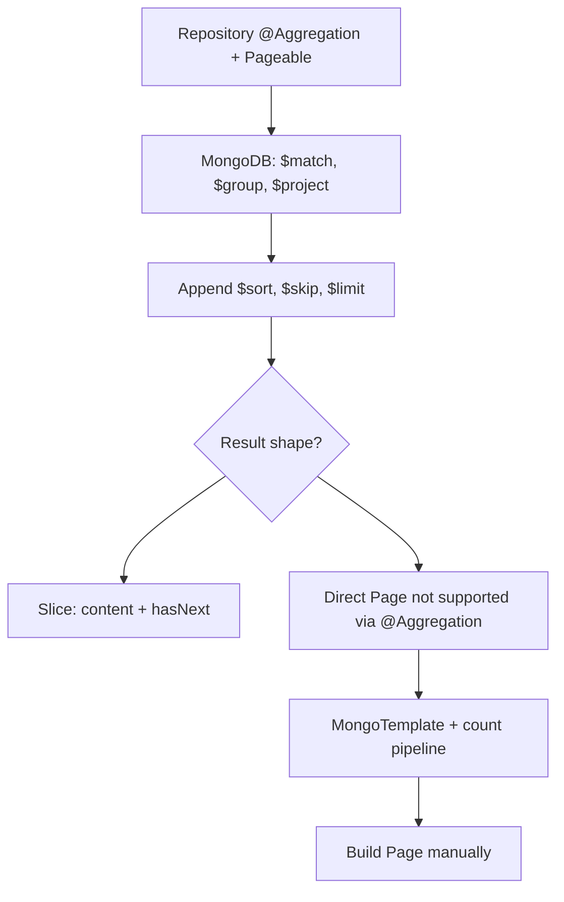
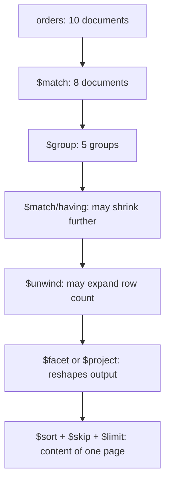
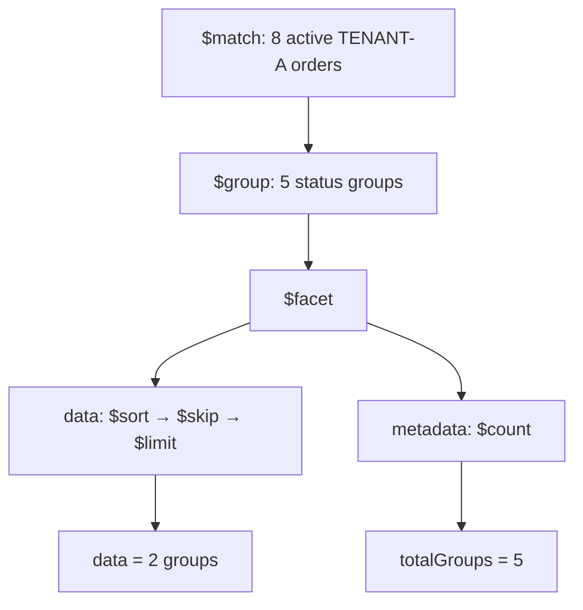

# Page Limitations and Choosing Slice for @Aggregation

> **Chapter:** Aggregation repository  
> **Module:** `SPRING_DATA_MONGODB` — connecting, mapping documents, and working with MongoDB via `MongoTemplate` or repositories; practicing queries, aggregation, indexes, transactions, reactive access, testing, and performance diagnostics. This lesson focuses on **`Page` limitations for repository `@Aggregation`**, how to paginate safely with **`Slice` and `Pageable`**, and options when an API requires **`totalElements`/`totalPages`** on aggregation results.

## 1. Scenario: a report has 5 groups while the collection has millions of orders

An order management system for each business wants to list revenue by status:

| Status | Order count | Total amount (cents) |
| --- | ---: | ---: |
| CANCELLED | 1 | 2,500 |
| PAID | 3 | 30,000 |
| PENDING | 2 | 10,000 |
| REFUNDED | 1 | 7,000 |
| REVIEW | 1 | 1,500 |

These are **5 group results**, even though the collection has **8 order documents** for the tenant in question. The UI allows loading **2 groups at a time**, with a **Load more** button, or may require displaying "Page 1/3."

To aggregate in MongoDB instead of loading all `Order`s into the JVM, we use a pipeline:

```javascript
db.orders.aggregate([
  { $match: { tenantId: "TENANT-A", deleted: false } },
  {
    $group: {
      _id: "$status",
      orderCount: { $sum: 1 },
      grossCents: { $sum: "$amountCents" }
    }
  },
  {
    $project: {
      _id: 0,
      status: "$_id",
      orderCount: 1,
      grossCents: 1
    }
  },
  { $sort: { status: 1 } },
  { $skip: 0 },
  { $limit: 2 }
]);
```

With the sample data below, the first page output is **CANCELLED**, **PAID**. `$skip` and `$limit` **after `$group`** select **groups**, rather than selecting the first two orders to compute the report.

### Core takeaway before writing Java

**Spring Data MongoDB does not support `Page<T>` as a direct return type of a repository method using `@Aggregation`**, per the official documentation. **`Pageable` is still supported**: Spring Data can append `$sort`, `$skip`, `$limit` to the end of the pipeline and return **`Slice<T>`**. `Slice` expresses the current content and **whether there is a next page**, but **does not provide the total number of groups**. If `Page` is strictly required, you must build an additional strategy to **count post-aggregation results** via `MongoTemplate`, `$facet`, or a separate count pipeline.



**Do not confuse:** this limitation applies to **repository `@Aggregation`**, not all of Spring Data. Ordinary repository finders such as `findByStatus(String, Pageable)` can return `Page<Order>` because their count query mechanism is different.

## 2. Sample database: 8 valid orders produce 5 groups

Run only on an **isolated test database**; `drop()` deletes data:

```javascript
db.orders.drop();

db.orders.insertMany([
  { _id: "A-001", tenantId: "TENANT-A", status: "PAID",
    deleted: false, amountCents: NumberLong(12000) },
  { _id: "A-002", tenantId: "TENANT-A", status: "PAID",
    deleted: false, amountCents: NumberLong(8000) },
  { _id: "A-003", tenantId: "TENANT-A", status: "PAID",
    deleted: false, amountCents: NumberLong(10000) },
  { _id: "A-004", tenantId: "TENANT-A", status: "PENDING",
    deleted: false, amountCents: NumberLong(4000) },
  { _id: "A-005", tenantId: "TENANT-A", status: "PENDING",
    deleted: false, amountCents: NumberLong(6000) },
  { _id: "A-006", tenantId: "TENANT-A", status: "CANCELLED",
    deleted: false, amountCents: NumberLong(2500) },
  { _id: "A-007", tenantId: "TENANT-A", status: "REFUNDED",
    deleted: false, amountCents: NumberLong(7000) },
  { _id: "A-008", tenantId: "TENANT-A", status: "REVIEW",
    deleted: false, amountCents: NumberLong(1500) },

  // These two records must never enter the TENANT-A report.
  { _id: "B-001", tenantId: "TENANT-B", status: "PAID",
    deleted: false, amountCents: NumberLong(999000) },
  { _id: "A-009", tenantId: "TENANT-A", status: "PAID",
    deleted: true, amountCents: NumberLong(888000) }
]);
```

With `$match: {tenantId:"TENANT-A", deleted:false}`, exactly **8 orders** enter `$group`. After `$group`, **5 groups** remain. Sorted results:

```javascript
{ status: "CANCELLED", orderCount: 1, grossCents: NumberLong(2500) }
{ status: "PAID", orderCount: 3, grossCents: NumberLong(30000) }
{ status: "PENDING", orderCount: 2, grossCents: NumberLong(10000) }
{ status: "REFUNDED", orderCount: 1, grossCents: NumberLong(7000) }
{ status: "REVIEW", orderCount: 1, grossCents: NumberLong(1500) }
```

Distinguish three numbers:

- **10 documents in the collection** (8 active tenant A, 1 tenant B, 1 soft-deleted tenant A).
- **8 documents passing `$match`**.
- **5 documents output by `$group`**.

When the UI asks for "total rows in the report by status," the answer is **5**, **not 8 or 10**.

## 3. Defining the entity and projection DTO

### 3.1. Domain stored in the orders collection

Example using Java 17+, Spring Data MongoDB, and a `long` monetary field in cents so totals are easy to verify:

```java
package demo.orders;

import org.springframework.data.annotation.Id;
import org.springframework.data.mongodb.core.mapping.Document;

@Document(collection = "orders")
public record Order(
    @Id String id,
    String tenantId,
    String status,
    boolean deleted,
    long amountCents
) {}
```

**BSON type note:** the mongosh data was seeded with `NumberLong`; Spring Data maps `long` accordingly. If business logic involves multiple currencies, decimal places, or averages, consider `Decimal128`/`BigDecimal` and rounding rules instead of assuming `long` fits every case.

### 3.2. DTO for post-$group results

`$group` no longer returns an `Order`. The output has fields `status`, `orderCount`, and `grossCents`:

```java
package demo.orders;

public record StatusTotals(
    String status,
    long orderCount,
    long grossCents
) {}
```

Put it in its own `StatusTotals.java`. A read-only DTO separates the report schema from the source entity and avoids accidentally calling `save` on an incomplete document.

When `@Aggregation` has `Pageable`/`Sort`, Spring Data applies sorting **on the pipeline output** and maps against the **return type**. Having `$project` rename `_id` to `status` lets you clearly sort by the DTO's `"status"` name.

## 4. Writing a repository @Aggregation returning Slice

### 4.1. Interface implementation

```java
package demo.orders;

import org.springframework.data.domain.Pageable;
import org.springframework.data.domain.Slice;
import org.springframework.data.mongodb.repository.Aggregation;
import org.springframework.data.mongodb.repository.MongoRepository;

public interface OrderReportRepository extends MongoRepository<Order, String> {

    @Aggregation(pipeline = {
        "{ '$match': { 'tenantId': ?0, 'deleted': false } }",
        "{ '$group': { '_id': '$status', " +
          "'orderCount': { '$sum': 1 }, " +
          "'grossCents': { '$sum': '$amountCents' } } }",
        "{ '$project': { '_id': 0, 'status': '$_id', " +
          "'orderCount': 1, 'grossCents': 1 } }"
    })
    Slice<StatusTotals> summarizeByStatus(
        String tenantId, Pageable pageable
    );
}
```

`org.springframework.data.mongodb.repository.Aggregation` is the **annotation** used on repository methods. Do not confuse it with **`org.springframework.data.mongodb.core.aggregation.Aggregation`**, the builder class used in `MongoTemplate`.

**`?0`** is bound by the framework to the `tenantId` parameter. Never concatenate the tenant ID directly into the JSON query string. Even more important than escaping is obtaining the tenant ID from an **authenticated principal/security context**, never trusting a client-spoofable value.

### 4.2. Calling from a service

```java
import org.springframework.data.domain.PageRequest;
import org.springframework.data.domain.Slice;
import org.springframework.data.domain.Sort;

PageRequest request = PageRequest.of(
    0,
    2,
    Sort.by(Sort.Direction.ASC, "status")
);

Slice<StatusTotals> slice = orderReportRepository
    .summarizeByStatus("TENANT-A", request);

List<StatusTotals> items = slice.getContent();
boolean hasMore = slice.hasNext();
```

`orderReportRepository` is a bean injected into the service. Assuming the test contains only the data from section 2 and no concurrent writers, the result is:

```text
slice.number          = 0
slice.size            = 2
slice.numberOfElements = 2
content statuses     = [CANCELLED, PAID]
slice.hasNext()      = true
```

Using `List` requires `import java.util.List;` in the service. Calling the second page:

```java
Slice<StatusTotals> second = orderReportRepository.summarizeByStatus(
    "TENANT-A",
    PageRequest.of(1, 2, Sort.by("status").ascending())
);
// PENDING, REFUNDED; hasNext() = true
```

Third page:

```java
Slice<StatusTotals> third = orderReportRepository.summarizeByStatus(
    "TENANT-A",
    PageRequest.of(2, 2, Sort.by("status").ascending())
);
// REVIEW; hasNext() = false
```

**`PageRequest` uses 0-based indexing**, not 1-based. `PageRequest.of(1,2)` retrieves the third and fourth groups in the chosen order.

### 4.3. Using nextPageable instead of incrementing page numbers manually

```java
Slice<StatusTotals> current =
    orderReportRepository.summarizeByStatus(
        "TENANT-A", PageRequest.of(0, 2, Sort.by("status"))
    );

while (true) {
    consume(current.getContent());
    if (!current.hasNext()) {
        break;
    }
    current = orderReportRepository.summarizeByStatus(
        "TENANT-A", current.nextPageable()
    );
}
```

`consume(...)` is an application-defined helper to process the DTO list, not a built-in Spring Data method. `nextPageable()` preserves the chosen sort and page size; ensure the tenant/filters remain unchanged between calls.

## 5. How is Pageable appended to the end of the pipeline?

Spring Data MongoDB documents that when an `@Aggregation` repository method accepts `Pageable`, **`$sort`, `$skip`, and `$limit`** operations are **applied after the stages declared in the annotation**. The `$sort` portion can map fields according to the **return DTO type**, not necessarily the source entity's field names.

Illustrative pipeline:

```javascript
[
  { $match: { tenantId: "TENANT-A", deleted: false } },
  {
    $group: {
      _id: "$status",
      orderCount: { $sum: 1 },
      grossCents: { $sum: "$amountCents" }
    }
  },
  {
    $project: {
      _id: 0, status: "$_id",
      orderCount: 1, grossCents: 1
    }
  },
  { $sort: { status: 1 } },
  { $skip: 0 },
  { $limit: 2 }
]
```

When returning `Slice`, the framework **may over-fetch by one element** to determine `hasNext`. Therefore, **do not treat `$limit:2` in the illustration as a strict guarantee of the exact number of BSON documents read by the server across every version**. Check command monitoring if you need to see the actual executed pipeline. Results returned to the caller remain bounded by the page size.

### 5.1. Sort in Pageable belongs to the output, not the input

```java
Sort.by("status").ascending()
```

Here `"status"` is the field `$project`ed from `$_id`. If the pipeline only groups without projecting:

```javascript
{ $group: { _id: "$status", orderCount: { $sum: 1 } } }
```

the output is `{_id:"PAID",orderCount:3}`, with no root `status` field. A misnamed sort may not work as expected. Spring Data can map a property of the result DTO to `_id` when the DTO defines `@Id` appropriately, but you must **verify mapping on your target version**. It is easier to control by `$project`ing to an explicit field name and testing the sort.

### 5.2. Do not put $limit early thinking Pageable will rescue it

Anti-example:

```java
@Aggregation(pipeline = {
    "{ '$match': { 'tenantId': ?0 } }",
    "{ '$limit': 10 }",
    "{ '$group': { '_id': '$status', 'orders': { '$sum': 1 } } }"
})
Slice<StatusTotals> incorrectTotals(String tenantId, Pageable page);
```

Because `$limit:10` appears **before grouping**, the numbers reflect only the **first 10 source documents kept by the pipeline**, not all orders of the tenant. `Pageable` at the end can only paginate the already-wrong groups.

Another anti-example:

```javascript
[
  { $group: { _id: "$status", orders: { $sum: 1 } } },
  { $limit: 3 },
  { $sort: { _id: 1 } }
]
```

Sorting after limiting cannot recover groups that were dropped **before sorting**. If the requirement is "the 3 groups with the most orders," group first, sort by `orders` descending, and then limit.

### 5.3. Sorting must be deterministic

Sorting by `status` on a `$group _id:"$status"` has distinct keys, so there are no ties between groups of the same status. However, if grouping by `tenantId + status`, sorting only by `orderCount` allows groups with equal counts to change positions between calls.

```javascript
{ $sort: { orderCount: -1, tenantId: 1, status: 1 } }
```

Tie-breaker fields must actually exist in the **output** of group/project, and (if using `Pageable`) be represented on the result DTO type. For reports where multiple groups can share amounts/counts, build a complete deterministic sort to avoid duplicates or omissions across pages.

## 6. What Slice returns, and what it does not know

`org.springframework.data.domain.Slice<T>` contains one slice's content and basic pagination metadata:

| API | Available in Slice? | Meaning |
| --- | :---: | --- |
| `getContent()` | Yes | DTOs of the current page. |
| `getNumber()` | Yes | 0-based page index. |
| `getSize()` | Yes | Page size. |
| `getNumberOfElements()` | Yes | Actual number of DTOs on this page. |
| `hasNext()` | Yes | Whether another page may exist. |
| `hasPrevious()` | Yes | Whether a previous page exists at current position. |
| `nextPageable()` | Yes | `Pageable` for the next slice. |
| `getTotalElements()` | **No** | Does not know total number of results. |
| `getTotalPages()` | **No** | Does not know total number of pages. |

For UIs with only a **Load more** button, `Slice` is usually enough. If you must display `Page 1/3`, page-number links, or allow jumping to the last page, you need a **total statistic** outside the content.

### 6.1. HasNext is not the same as total

Suppose page size = 2:

```text
Page 0: [CANCELLED, PAID]     hasNext=true
Page 1: [PENDING, REFUNDED]   hasNext=true
Page 2: [REVIEW]              hasNext=false
```

`hasNext=true` only tells you **at least one more result exists** after the current window. It does not reveal whether **1 or 10,000 groups** remain. Even after reading all three pages, the UI can only infer page count under the **data state across those reads**; that is not an initial total metadata value.

### 6.2. Slice vs. Stream

`Stream<StatusTotals>` allows sequential reading via a cursor (which must be closed), but does not provide `hasNext` at the level of **`Pageable`-segmented pages** the way `Slice` does. For large datasets, both approaches require managing memory/cursor lifecycles; do not use `List` to load all groups when cardinality is high.

## 7. Why does @Aggregation not return Page directly?

`Page<T>` requires **content + the total element count across the entire matching result set** to derive `totalPages`. For simple finders, Spring Data can generate a count query from the filter. With aggregation, however, **every stage can change the document count**:



A `countDocuments({tenantId:"TENANT-A"})` counts **source documents**, not the total **output groups** of the pipeline. In pipelines with `$unwind`, `$lookup`, multi-stage `$group`, post-group `$match`, or `$facet`, you cannot derive total simply by stripping `$skip/$limit` and calling `countDocuments` with the input filter.

Therefore, the Spring Data MongoDB documentation **does not support direct `Page` return types for repository `@Aggregation`**. A method like the following is an **anti-example**:

```java
// NOT supported per Spring Data MongoDB @Aggregation contract:
@Aggregation(pipeline = {
    "{ '$match': { 'tenantId': ?0 } }",
    "{ '$group': { '_id': '$status', 'orders': { '$sum': 1 } } }"
})
Page<StatusTotals> unsupported(String tenantId, Pageable pageable);
```

Do not try to turn `Slice<StatusTotals>` into `Page<StatusTotals>` merely by editing the return type and expecting Spring Data to compute the post-stage total automatically. Two better solutions are:

1. **Only need a "Load more" button:** keep `Slice` and avoid counting.
2. **Must know total:** create a pipeline counting grouped results and assemble `Page` in the service, or use `$facet` in the same pipeline depending on consistency and performance needs.

## 8. When a real Page is required: count groups and build PageImpl manually

### 8.1. Counting 5 groups, not 8 orders

To know the total row count of a `$group` report, count the **output of `$group`**, not the collection input:

```javascript
db.orders.aggregate([
  { $match: { tenantId: "TENANT-A", deleted: false } },
  { $group: { _id: "$status" } },
  { $count: "totalGroups" }
]);
// { totalGroups: 5 }
```

`$count` in the example is a **pipeline stage**, not the `orderCount` accumulator of `$group`. Computations like `$sum:1` and `$sum:"$amountCents"` do not need to be repeated in the count pipeline **if** they do not affect group filtering:

- For a report grouping solely by status, `$group: {_id:"$status"}` followed by `$count` is enough.
- If the report also filters **groups with total revenue of at least 10,000**, you must keep `$sum:"$amountCents"` and `$match:{grossCents:{$gte:10000}}` **before `$count`**. Dropping that stage yields the wrong total.

### 8.2. MongoTemplate count pipeline and PageImpl

Example service using the repository's `Slice` for content and `MongoTemplate` for total:

```java
package demo.orders;

import org.bson.Document;
import org.springframework.data.domain.Page;
import org.springframework.data.domain.PageImpl;
import org.springframework.data.domain.Pageable;
import org.springframework.data.domain.Slice;
import org.springframework.data.mongodb.core.MongoTemplate;
import org.springframework.data.mongodb.core.aggregation.Aggregation;
import org.springframework.data.mongodb.core.query.Criteria;
import org.springframework.stereotype.Service;

import static org.springframework.data.mongodb.core.aggregation.Aggregation.*;

@Service
public class OrderReportService {
    private final OrderReportRepository repository;
    private final MongoTemplate template;

    public OrderReportService(OrderReportRepository repository,
                              MongoTemplate template) {
        this.repository = repository;
        this.template = template;
    }

    public Page<StatusTotals> statusPage(String tenantId, Pageable pageable) {
        // tenantId must come from a trusted authenticated context.
        if (tenantId == null || tenantId.isBlank()) {
            throw new IllegalArgumentException("tenantId is required");
        }
        if (pageable.isUnpaged()) {
            throw new IllegalArgumentException("Pageable must be paged");
        }

        Slice<StatusTotals> slice =
            repository.summarizeByStatus(tenantId, pageable);

        Aggregation countGroups = newAggregation(
            match(Criteria.where("tenantId").is(tenantId)
                .and("deleted").is(false)),
            group("status"),
            count().as("totalGroups")
        );

        Document countResult = template.aggregate(
            countGroups, Order.class, Document.class
        ).getUniqueMappedResult();

        long totalGroups = countResult == null
            ? 0L
            : ((Number) countResult.get("totalGroups")).longValue();

        return new PageImpl<>(
            slice.getContent(), pageable, totalGroups
        );
    }
}
```

**Limitation of this example:** the service intentionally issues two database commands: **one for content** and **one for total**. Required predicates (`tenantId` and `deleted=false`) must be **identical** across both pipelines. When changing the report, centralize filter/aggregation definitions to prevent drift.

`countResult == null ? 0L : ...` properly handles the zero-group case: `$count` over an empty set can return **no document** rather than `{totalGroups:0}`.

If the source pipeline has additional `$unwind`, `$lookup`, or post-group `$match` stages, the count pipeline **must replicate every stage that alters the result set before pagination**. Counting only status keys in this basic example is a simplified case.

### 8.3. Consistency issue between content and total

Because the two commands run separately, a writer can insert, delete, or change an order's status **between** reading content and counting. Then:

```text
Before: 5 groups.
Content query reads 5 groups, returns first page.
Writer adds a new status, creating a 6th group.
Count query reads 6 groups.
API returns stale content with totalGroups = 6.
```

This is not necessarily a framework bug; it is a property of **reading at two different points in time**. For dashboards, this consistency level may be acceptable. For audit reports, you must design read concern, snapshots/transactions, or immutable reporting data according to requirements and supported MongoDB topology.

### 8.4. PageImpl does not compute the count for you

`new PageImpl<>(content, pageable, total)` merely **wraps** the content and total you supply. It runs no query and knows nothing about `$group`. If you pass the collection's `countDocuments` as `total`, `PageImpl` still returns wrong metadata without catching the business error.

Do not use `PageableExecutionUtils.getPage(…)` with a naive `countDocuments` supplier. The count supplier must reflect **the exact post-aggregation document set**, and any optimization that skips counting must be carefully verified for grouped reports.

## 9. Using $facet to fetch content and total in a single aggregation

`$facet` lets multiple sub-pipelines run on the same pipeline input stream. We can **group once** and split:

- `data` branch: sort, skip, limit the **groups**.
- `metadata` branch: count the number of **groups**.

```javascript
db.orders.aggregate([
  { $match: { tenantId: "TENANT-A", deleted: false } },
  {
    $group: {
      _id: "$status",
      orderCount: { $sum: 1 },
      grossCents: { $sum: "$amountCents" }
    }
  },
  {
    $project: {
      _id: 0,
      status: "$_id",
      orderCount: 1,
      grossCents: 1
    }
  },
  {
    $facet: {
      data: [
        { $sort: { status: 1 } },
        { $skip: 0 },
        { $limit: 2 }
      ],
      metadata: [
        { $count: "totalGroups" }
      ]
    }
  }
]);
```

The output looks like:

```javascript
{
  data: [
    { status: "CANCELLED", orderCount: 1, grossCents: NumberLong(2500) },
    { status: "PAID", orderCount: 3, grossCents: NumberLong(30000) }
  ],
  metadata: [
    { totalGroups: 5 }
  ]
}
```

To construct `Page`, read `data` as content and `metadata[0].totalGroups` as total. When there are zero groups, `metadata` can be an **empty array**, requiring a 0 fallback.

### 9.1. Why place facet after group?

Because the UI question is **"how many groups exist?"**, the count branch must count **post-group results**:



If you split `$facet` **before grouping**, each branch would have to perform its own stages. If the count branch simply runs `$count` right after `$match`, the result is **8 orders** instead of **5 groups**.

### 9.2. $facet is not a free solution

Trade-offs:

- Even when the page size is small, the `metadata` branch still has to count all groups.
- The `$facet` stage must hold its output in a **single BSON document** with the `data`/`metadata` branch arrays; it remains subject to the **16 MiB result document limit** as well as facet memory limits.
- `$facet` has its own memory limit; **`allowDiskUse` does not allow facet to arbitrarily spill to disk** to bypass that stage's constraint.
- A single aggregation command does not automatically create a snapshot consistent with other database commands; if special consistency is required, read concern still needs consideration.
- A `$facet` pipeline returns **one document wrapping two arrays**, unlike `StatusTotals` directly; you must define a container DTO or read `Document` and map carefully.

`$facet` fits when you need both content and total in **a single aggregation call**, output size is controlled, and count computation is light enough for your SLA. It does not replace `Slice` for every API.

### 9.3. Why not put facet in @Aggregation and pass Pageable?

Anti-example:

```javascript
[
  { $match: { tenantId: "TENANT-A", deleted: false } },
  { $group: { _id: "$status" } },
  { $facet: { data: [/* ... */], metadata: [/* ... */] } },
  { $skip: 2 },
  { $limit: 2 }
]
```

Repository `Pageable` gets appended **after `$facet`**, applying to the **wrapper document containing two arrays**, which usually has only **one** output document — not to the items inside `data`. To use facet properly, put `$sort/$skip/$limit` **inside the `data` branch**; this typically fits `MongoTemplate`/Aggregation API and a `Page`-building service better than a repository `@Aggregation` with auto-appended `Pageable`.

## 10. Paginating when there is a post-group $match ("having")

Suppose the screen lists only **status groups with total amount of at least 10,000 cents**. This condition applies **to aggregated results**, not individual orders:

```javascript
db.orders.aggregate([
  { $match: { tenantId: "TENANT-A", deleted: false } },
  {
    $group: {
      _id: "$status",
      orderCount: { $sum: 1 },
      grossCents: { $sum: "$amountCents" }
    }
  },
  { $match: { grossCents: { $gte: 10000 } } },
  { $project: { _id: 0, status: "$_id", orderCount: 1, grossCents: 1 } },
  { $sort: { status: 1 } },
  { $skip: 0 },
  { $limit: 2 }
]);
```

In the sample data, only **PAID (30,000)** and **PENDING (10,000)** qualify: the total groups to report is **2**, not 5.

**Correct** count pipeline:

```javascript
[
  { $match: { tenantId: "TENANT-A", deleted: false } },
  {
    $group: {
      _id: "$status",
      grossCents: { $sum: "$amountCents" }
    }
  },
  { $match: { grossCents: { $gte: 10000 } } },
  { $count: "totalGroups" }
]
```

A **wrong** count pipeline drops the post-group `$match grossCents` and counts 5 groups. In many systems, this causes the "last page is empty even though totalPages says more pages exist" bug.

### 10.1. $lookup, $unwind, and multi-stage $group

If a pipeline has `$lookup` or `$unwind` multiplying rows and then `$group`s again, each stage can alter **cardinality**. The count must sit after all stages that determine the **final result set**, and before pagination stages (`$sort` if it does not alter the set, `$skip`, `$limit`).

Never use initial order totals to compute page counts for reports grouped by SKU, customer, month, bucket, or leaderboard.

## 11. Stable sorting and handling deep pages

### 11.1. Sorting by metrics needs a tie-breaker

Example top groups by revenue report:

```javascript
{
  $sort: {
    grossCents: -1,
    status: 1
  }
}
```

When multiple groups share `grossCents`, `status` acts as a secondary key for deterministic ordering. If the actual group key is `(tenant, month)`, the tie-breaker must uniquely distinguish every group, usually using the fields of the group key.

Missing a sort or sorting only by a metric with duplicate values risks **duplicating/dropping groups between pages** even if data never changes, because the database does not guarantee any natural `$group` order.

### 11.2. Slice still uses offsets

`Slice` has no total, yet `Pageable` still appends offset-based `$skip` to the end of the pipeline. With `PageRequest.of(5000,20)`, the offset is **100,000 groups**, not "efficiently starting from the next group." On high-cardinality group reports:

- The server may have to build many groups before sorting.
- `$sort` may have to process a huge output set.
- The larger `$skip` is, the more work is wasted discarding results.
- Each subsequent request may have to rerun the preceding aggregation.

Choosing `Slice` **avoids automatic total counts**, but **does not eliminate offset cost**. If you need to traverse millions of groups, consider custom keyset/seek pagination over a deterministically sorted output, or a materialized summary table with proper indexes.

### 11.3. Do not assume @Aggregation supports Window like derived queries

`Window<T>` and `ScrollPosition` are useful scrolling APIs in Spring Data, but do not assume merely changing `Slice<StatusTotals>` to `Window<StatusTotals>` makes every `@Aggregation` repository method support scrolling/keyset pagination.

Check your **Spring Data Commons + Spring Data MongoDB versions** and store module capabilities. For aggregation reports requiring custom scrolling, template queries or materialized reporting collections usually give clearer control over keyset predicates and indexes.

## 12. Projections and mapping: Pageable sorts on the result type

The Spring Data MongoDB documentation notes that `Sort` on a repository aggregation can be **mapped using the result type**, because it is applied after the pipeline:

```java
@Aggregation(pipeline = {
    "{ '$group': { '_id': '$status', 'orders': { '$sum': 1 } } }",
    "{ '$project': { '_id': 0, 'status': '$_id', 'orders': 1 } }"
})
Slice<StatusCount> statuses(Pageable pageable);
```

DTO:

```java
public record StatusCount(String status, long orders) {}
```

Sort with:

```java
PageRequest.of(0, 20, Sort.by("status").ascending());
```

Because `$project` created the `status` field, sorting does not need to guess that the source `status` remained at the root after `$group`.

### 12.1. When output keeps _id

A projection having an `@Id` property mapped to `_id` can cause `Sort.by("status")` to map to `_id` in the documentation's examples. If you use a different DTO, mapping behavior changes too. Inspect the **actual executed BSON pipeline** in an integration test rather than copying a source-entity sort and assuming it still works after `$group`.

### 12.2. Do not use the source entity to read group output

`Order` has `tenantId`, `status`, `deleted`, and `amountCents`. Group output has `status`, `orderCount`, `grossCents`. Trying to map into `Order` leaves fields missing/null/0 and creates an incomplete entity. Use a dedicated DTO for reports, and never `save` a "partially read" entity back into the collection.

### 12.3. Projection vs. $facet

`$project` trims or renames fields on each **result document**. `$facet` wraps multiple **result arrays** inside a single output document. When using raw `AggregationResults` or a facet wrapper, define a DTO matching the actual shape rather than mixing `List<StatusTotals>` with `{data:[...], metadata:[...]}`.

## 13. Choosing List, Slice, Stream, or building Page manually?

| Requirement | Approach | Trade-offs |
| --- | --- | --- |
| Dashboard with at most 5–10 fixed groups | `@Aggregation` returning `List<DTO>` | Simple; avoid if groups can number in the millions. |
| **Load more** button | `@Aggregation` + `Pageable` returning `Slice<DTO>` | Provides `hasNext`, avoids auto-count, still incurs offset cost. |
| Table with total groups and total pages | `Slice` + count aggregation + `PageImpl` | Two queries; reads may reflect different timestamps. |
| Content and total in one pipeline | `MongoTemplate` + `$facet` | Fetched in one operation; watch memory/output limits and mapping. |
| Bulk export via cursor | `Stream<DTO>`/`Flux<DTO>` depending on version | Must manage cursors, memory, and execution duration. |
| Very deep traversal, many group keys | Materialized reporting collection / custom keyset | More complex, yet indexable and fast to query. |
| Dynamically built filters and stages | `MongoTemplate`/`ReactiveMongoTemplate` | Flexible; must manage projection/paging/count yourself. |

### 13.1. When is List enough?

If the aggregation only groups by 3 fixed statuses, returning `List<StatusTotals>` can be simpler than `Slice`:

```java
@Aggregation(pipeline = {
    "{ '$match': { 'tenantId': ?0, 'deleted': false } }",
    "{ '$group': { '_id': '$status', 'orders': { '$sum': 1 } } }",
    "{ '$project': { '_id': 0, 'status': '$_id', 'orders': 1 } }"
})
List<StatusCount> groupAllStatuses(String tenantId);
```

The example includes `$project` so the `StatusCount` DTO receives `status` and `orders` accurately. `List` has no pagination metadata and can load many results into memory if group counts are large. In a real Java interface, import `java.util.List` and declare the `StatusCount` DTO in scope.

### 13.2. Stream must close its cursor

```java
@Aggregation(pipeline = {
    "{ '$match': { 'tenantId': ?0, 'deleted': false } }",
    "{ '$group': { '_id': '$status', 'orders': { '$sum': 1 } } }",
    "{ '$project': { '_id': 0, 'status': '$_id', 'orders': 1 } }"
})
Stream<StatusCount> streamStatuses(String tenantId);
```

Usage:

```java
try (Stream<StatusCount> stream =
         reportRepository.streamStatuses("TENANT-A")) {
    stream.forEach(this::writeRow);
}
```

`reportRepository` and `writeRow` are application-defined components; this example requires importing `java.util.stream.Stream`. `Stream` uses an underlying cursor and must be closed with `try-with-resources`. If the grouping pipeline has high server memory pressure, streaming the output does not automatically make `$group` lighter.

### 13.3. Why not hardcode $limit in the annotation?

An `@Aggregation` method with a fixed `{ '$limit': 20 }` can work for "top 20" **when placed after a valid sort**. However, if it later accepts `Pageable`, appended `$skip/$limit` rules can make page 2 empty because not enough groups remain after the static limit. For pagination with dynamic page sizes, let **`Pageable` control the limit at the end of the pipeline** instead of adding an incompatible static cap.

## 14. Reactive repositories and aggregation pagination

### 14.1. Do not expect Mono<Page> from Pageable

Reactive Spring Data MongoDB uses `Flux`/`Mono`. The MongoDB documentation explicitly states that **`Mono<Page<T>>` is not supported as a reactive repository return type**. And repository `@Aggregation` already does not support direct `Page` in the imperative stack.

One option, subject to capability/version of your reactive repository, is receiving bounded results as `Flux`:

```java
import org.springframework.data.domain.Pageable;
import org.springframework.data.mongodb.repository.Aggregation;
import org.springframework.data.mongodb.repository.ReactiveMongoRepository;
import reactor.core.publisher.Flux;

public interface ReactiveOrderReportRepository
        extends ReactiveMongoRepository<Order, String> {

    @Aggregation(pipeline = {
        "{ '$match': { 'tenantId': ?0, 'deleted': false } }",
        "{ '$group': { '_id': '$status', " +
          "'orderCount': { '$sum': 1 }, " +
          "'grossCents': { '$sum': '$amountCents' } } }",
        "{ '$project': { '_id': 0, 'status': '$_id', " +
          "'orderCount': 1, 'grossCents': 1 } }"
    })
    Flux<StatusTotals> summarizeByStatus(
        String tenantId, Pageable pageable
    );
}
```

Verify `@Aggregation` + `Pageable` support on your **specific Spring Data MongoDB/reactive version**. `Flux` does not automatically provide `hasNext` like `Slice`; if you need to check for remaining data, over-fetch by one and craft a custom response, or switch to `ReactiveMongoTemplate` for explicit `$skip/$limit` control.

### 14.2. ReactiveMongoTemplate for explicit pipeline control

```java
import static org.springframework.data.mongodb.core.aggregation.Aggregation.*;

import org.bson.Document;
import org.springframework.data.domain.PageRequest;
import org.springframework.data.domain.Pageable;
import org.springframework.data.domain.Sort;
import org.springframework.data.mongodb.core.aggregation.Aggregation;
import org.springframework.data.mongodb.core.query.Criteria;
import reactor.core.publisher.Flux;

Pageable pageable = PageRequest.of(0, 2, Sort.by("status").ascending());

Aggregation dataAggregation = newAggregation(
    match(Criteria.where("tenantId").is("TENANT-A")
        .and("deleted").is(false)),
    group("status")
        .count().as("orderCount")
        .sum("amountCents").as("grossCents"),
    project("orderCount", "grossCents")
        .and("_id").as("status")
        .andExclude("_id"),
    sort(Sort.Direction.ASC, "status"),
    skip(pageable.getOffset()),
    limit(pageable.getPageSize())
);

Flux<StatusTotals> contents = reactiveMongoTemplate.aggregate(
    dataAggregation, Order.class, StatusTotals.class
);
```

**Note:** `skip(pageable.getOffset())` takes a `long` offset, and `limit(pageable.getPageSize())` takes the size. This snippet only returns **bounded content**, without `hasNext` or total. To compute `hasNext`, fetch one extra item or use a slicing pattern, then trim the extra item from the response.

### 14.3. Composing content and count into Mono<Page> manually

If the reactive API still needs both content and total:

```java
Aggregation countAggregation = newAggregation(
    match(Criteria.where("tenantId").is("TENANT-A")
        .and("deleted").is(false)),
    group("status"),
    count().as("totalGroups")
);

Mono<Long> totalGroups = reactiveMongoTemplate.aggregate(
    countAggregation, Order.class, Document.class
).next()
 .map(doc -> ((Number) doc.get("totalGroups")).longValue())
 .defaultIfEmpty(0L);

Mono<Page<StatusTotals>> page = Mono.zip(
    contents.collectList(),
    totalGroups
).map(tuple -> new PageImpl<>(
    tuple.getT1(), pageable, tuple.getT2()
));
```

This snippet complements the previous reactive code: import `reactor.core.publisher.Mono`, `org.springframework.data.domain.Page`, and `PageImpl`; `contents`/`pageable` belong to the same method/service. It **manually constructs `Mono<Page<StatusTotals>>`** from two publishers—it is **not** an automatically supported repository `Mono<Page>` return type.

`Mono.zip` does not create a shared transaction snapshot across the two reads. With a `Pageable` having a small page size, `contents.collectList()` collects a **bounded result set**; never use `collectList()` on an unbounded aggregation of millions of groups.

### 14.4. Backpressure does not eliminate $group memory pressure

Reactive backpressure coordinates consumption of **output**. The MongoDB server may still have to scan all input documents, sort, and maintain `$group` state before forming groups. If group cardinality is high, do not treat `Flux` or `Mono` as a substitute for `$match`, indexes, and sound accumulator design.

Never call `block()` on an event loop to turn a reactive pipeline into imperative code, and never retry an expensive aggregation endlessly on network errors.

## 15. Indexes and performance: do not assume Slice makes grouping free

### 15.1. Indexes help $match, not automatically computing totals

For a report always filtering by `tenantId`, `deleted`, and grouping by `status`:

```javascript
db.orders.createIndex({
  tenantId: 1,
  deleted: 1,
  status: 1
});
```

This is a **candidate index**. It can help locate tenant A's non-deleted documents before aggregation. However:

- `$group` still must identify groups and compute `$sum`.
- Trailing `$sort` after grouping sorts **on group results**, which is not always directly optimized by source indexes.
- `Pageable` only limits **final output**, not input documents.
- A count pipeline wanting total groups still has to execute the corresponding grouping logic.

Do not create indexes solely based on a snippet recommendation. Check workload, selectivity, existing index count, write overhead, and `explain`.

### 15.2. Explain the aggregation instead of guessing

```javascript
db.orders.explain("executionStats").aggregate([
  { $match: { tenantId: "TENANT-A", deleted: false } },
  {
    $group: {
      _id: "$status",
      orderCount: { $sum: 1 },
      grossCents: { $sum: "$amountCents" }
    }
  },
  { $sort: { _id: 1 } },
  { $skip: 100 },
  { $limit: 20 }
]);
```

Depending on server/version, check available metrics: `IXSCAN`/`COLLSCAN`, `totalKeysExamined`, `totalDocsExamined`, group count, sort stage, and disk spill. With only 5 groups as in the sample data, `$skip:100` returns empty; when grouping millions of keys, deep skips can become very costly.

### 15.3. Memory and allowDiskUse

`$group` and `$sort` can require lots of RAM when group counts are large. With repository `@Aggregation`, Spring Data provides `@Meta` to pass aggregation options such as `allowDiskUse` on supported versions:

```java
import org.springframework.data.mongodb.repository.Meta;

@Meta(allowDiskUse = "true")
@Aggregation(pipeline = {
    "{ '$match': { 'tenantId': ?0, 'deleted': false } }",
    "{ '$group': { '_id': '$status', 'orders': { '$sum': 1 } } }",
    "{ '$project': { '_id': 0, 'status': '$_id', 'orders': 1 } }"
})
List<StatusCount> reportWithDiskUseAllowed(String tenantId);
```

This method includes `$project` to map the `status` field properly. `@Meta(allowDiskUse = "true")` **does not fix broken pipeline logic**, does not eliminate sort cost, does not make `Page` a supported return type, and does not bypass the limit on an oversized BSON output document.

### 15.4. When traversing extremely many groups

For aggregations by `customerId` with millions of groups, re-running `$group` on every page can impose more load than rendering the UI itself. Consider:

- **Materializing the report** into a dedicated collection per period/tenant, with stable group keys and indexes for sorting/seeking.
- Using `$merge`/ETL jobs to refresh metrics under a defined consistency strategy.
- Running ordinary queries on the reporting collection using `Page`/`Slice`/keyset instead of recomputing groups on each page load.
- Evaluating freshness, sync lag, retry handling, and access control.

Only materialize when performance genuinely demands it; for 5 fixed statuses, a single `$group` returning `List` is far simpler.

## 16. Tenant authorization, transactions, and consistency

### 16.1. Tenant is not a decorative parameter

`@Aggregation("{ '$match': { 'tenantId': ?0 } }")` is only safe if `?0` comes from an **authenticated context**, not an arbitrary tenant passed by the user in a query param.

If user A sends `tenantId = TENANT-B` without service-level authorization checks, the aggregation will still read tenant B's revenue. Parameterized query binding does not equal authorization.

**Never omit the tenant filter from the count pipeline** while keeping it in the content pipeline. Doing so can leak global system activity counts even when content only shows the current tenant.

### 16.2. Multi-document transactions and snapshots

An aggregation does not implicitly start a transaction, nor does it freeze the result set across **multiple `Slice` requests**. If a new group appears while a user clicks "Load more," offset-based pagination can duplicate or skip groups.

For financial reports needing high consistency, consider read concern/transactions/snapshots per your MongoDB topology, accounting for transaction costs and limits. For near-real-time dashboards, changing data may be acceptable as long as the UI displays the snapshot/refresh time.

**A `$facet` inside a single command only solves reading both content and total branches from the same pipeline input stream; it does not guarantee a persistent snapshot across multiple HTTP requests.**

### 16.3. Do not pass dangerous inputs to $skip/$limit

At the API layer:

```java
int safeSize = Math.min(Math.max(requestedSize, 1), 100);
int safePage = Math.max(requestedPage, 0);

PageRequest page = PageRequest.of(
    safePage, safeSize, Sort.by("status").ascending()
);
```

This only illustrates **value clamping**; for deep pagination you must also cap offsets or guard against overflow and enforce SLAs. Never let clients sort freely on fields absent from the output DTO or pass unreviewed complex expressions.

## 17. Integration tests: verifying both content and hasNext accurately

### 17.1. Need at least 5 groups to test 3 Slices

A test seeding only PAID and PENDING cannot properly verify next-page detection at page size 2. Section 2's dataset creates **5 groups**, allowing you to verify:

| Slice | Pageable | Content statuses | `hasNext()` |
| --- | --- | --- | :---: |
| 0 | `PageRequest.of(0,2,sort)` | CANCELLED, PAID | true |
| 1 | `PageRequest.of(1,2,sort)` | PENDING, REFUNDED | true |
| 2 | `PageRequest.of(2,2,sort)` | REVIEW | false |
| 3 | `PageRequest.of(3,2,sort)` | Empty | false |

Content and count tests must also assert that tenant B and soft-deleted orders never appear in tenant A's report.

### 17.2. JUnit 5 test class

The example below fits Spring Boot 3.x, JUnit 5, and a dedicated test MongoDB. Other Spring Boot versions may change the `@DataMongoTest` package; verify against your dependencies. `@DataMongoTest` **does not spin up a MongoDB server automatically** without Testcontainers or a configured test database.

```java
package demo.orders;

import static org.assertj.core.api.Assertions.assertThat;

import java.util.List;
import java.util.UUID;
import org.junit.jupiter.api.BeforeEach;
import org.junit.jupiter.api.Test;
import org.springframework.beans.factory.annotation.Autowired;
import org.springframework.boot.test.autoconfigure.data.mongo.DataMongoTest;
import org.springframework.data.domain.Page;
import org.springframework.data.domain.PageRequest;
import org.springframework.data.domain.Slice;
import org.springframework.data.domain.Sort;
import org.springframework.data.mongodb.core.MongoTemplate;

@DataMongoTest
class OrderReportSliceTest {

    @Autowired OrderReportRepository repository;
    @Autowired MongoTemplate template;

    private final Sort sort = Sort.by("status").ascending();

    @BeforeEach
    void seed() {
        // ONLY run on an isolated test MongoDB instance.
        repository.deleteAll();
        repository.saveAll(List.of(
            new Order("A-001", "TENANT-A", "PAID", false, 12000L),
            new Order("A-002", "TENANT-A", "PAID", false, 8000L),
            new Order("A-003", "TENANT-A", "PAID", false, 10000L),
            new Order("A-004", "TENANT-A", "PENDING", false, 4000L),
            new Order("A-005", "TENANT-A", "PENDING", false, 6000L),
            new Order("A-006", "TENANT-A", "CANCELLED", false, 2500L),
            new Order("A-007", "TENANT-A", "REFUNDED", false, 7000L),
            new Order("A-008", "TENANT-A", "REVIEW", false, 1500L),
            new Order("B-001", "TENANT-B", "PAID", false, 999000L),
            new Order("A-009", "TENANT-A", "PAID", true, 888000L)
        ));
    }

    @Test
    void slicesAreBasedOnGroupedRows() {
        Slice<StatusTotals> first = repository.summarizeByStatus(
            "TENANT-A", PageRequest.of(0, 2, sort)
        );
        assertThat(first.getContent())
            .extracting(StatusTotals::status)
            .containsExactly("CANCELLED", "PAID");
        assertThat(first.hasNext()).isTrue();

        Slice<StatusTotals> second = repository.summarizeByStatus(
            "TENANT-A", first.nextPageable()
        );
        assertThat(second.getContent())
            .extracting(StatusTotals::status)
            .containsExactly("PENDING", "REFUNDED");
        assertThat(second.hasNext()).isTrue();

        Slice<StatusTotals> third = repository.summarizeByStatus(
            "TENANT-A", second.nextPageable()
        );
        assertThat(third.getContent())
            .extracting(StatusTotals::status)
            .containsExactly("REVIEW");
        assertThat(third.hasNext()).isFalse();
    }

    @Test
    void groupTotalsIgnoreOtherTenantAndDeletedOrders() {
        Slice<StatusTotals> first = repository.summarizeByStatus(
            "TENANT-A", PageRequest.of(0, 2, sort)
        );

        StatusTotals paid = first.getContent().stream()
            .filter(row -> row.status().equals("PAID"))
            .findFirst()
            .orElseThrow();

        assertThat(paid.orderCount()).isEqualTo(3L);
        assertThat(paid.grossCents()).isEqualTo(30000L);
    }

    @Test
    void customPageCountsGroupsNotSourceOrders() {
        OrderReportService service =
            new OrderReportService(repository, template);

        Page<StatusTotals> page = service.statusPage(
            "TENANT-A", PageRequest.of(0, 2, sort)
        );

        assertThat(page.getTotalElements()).isEqualTo(5L);
        assertThat(page.getTotalPages()).isEqualTo(3);
        assertThat(page.getContent())
            .extracting(StatusTotals::status)
            .containsExactly("CANCELLED", "PAID");
    }

    @Test
    void unknownTenantHasNoGroupAndNoTotal() {
        OrderReportService service =
            new OrderReportService(repository, template);

        Page<StatusTotals> page = service.statusPage(
            "TENANT-NOT-FOUND", PageRequest.of(0, 2, sort)
        );

        assertThat(page.getContent()).isEmpty();
        assertThat(page.getTotalElements()).isZero();
        assertThat(page.getTotalPages()).isZero();
    }
}
```

**Environment requirement:** must connect to an isolated test MongoDB server, seed the 10 orders, and have the domain/repository/service classes described. Because this lesson has not compiled or executed the code here, treat this as an integration test template to compile and run against your project's actual dependencies rather than a claim that it has already passed in your environment.

### 17.3. Catching the "countDocuments = 8" bug

In `customPageCountsGroupsNotSourceOrders`, asserting `totalElements=5` catches a service mistakenly doing:

```java
// ANTI-EXAMPLE: counts documents before grouping => 8 instead of 5.
long wrongTotal = template.count(
    org.springframework.data.mongodb.core.query.Query.query(
        org.springframework.data.mongodb.core.query.Criteria
            .where("tenantId").is("TENANT-A")
            .and("deleted").is(false)
    ),
    Order.class
);
```

If one `status` group contains 100,000 orders, the group row count still increases by **1**, not 100,000. Total tests must protect the report's exact contract.

### 17.4. Additional tests to write

| Scenario | What to verify |
| --- | --- |
| Group has only one status | First slice has 1 row, `hasNext=false`. |
| Group count equals page size | Does not falsely report `hasNext=true`. |
| Group count equals page size + 1 | First slice reports `hasNext=true`. |
| No data passes match | Empty content, `totalGroups=0`. |
| Two groups share `grossCents` | Sort tie-breaker prevents non-deterministic order. |
| Other tenant or soft-deleted | Excluded from both content **and count**. |
| Post-group `$match` filtering total amount | Count includes only groups passing the having predicate. |
| Page index exceeds total pages | Content is empty, total still reflects all groups. |
| Sort by field absent from DTO | Test catches mapping/ordering error. |
| Pipeline contains `$unwind` | Count reflects the final result unit. |
| Writer mutates data between content and count | Document and verify the accepted consistency policy. |
| Large dataset | Measure query plan, count cost, skip, and disk spill. |

### 17.5. Verifying the actual pipeline

In a controlled test environment, use MongoDB command monitoring or redacted logs to verify:

- `$match` tenant/deleted is present.
- `$sort` is appended **after `$project`** on the right field.
- `$skip` uses the value from `PageRequest`.
- `$limit` matches your version's `Slice` mechanics.
- The count pipeline has `$group` and `$count` in the right order.

Do not assert the exact stage count or server limit purely from Java source code; Spring Data/the driver may add details for slicing. Verify logical outcomes with integration tests.

## 18. Common errors

| Symptom | Cause | Fix |
| --- | --- | --- |
| `@Aggregation` returning `Page<DTO>` fails | Repository aggregation contract does not support `Page`. | Use `Slice` or build `Page` manually with a count aggregation. |
| Total pages is 4 despite only 2 groups | Counting source documents instead of output groups. | Count after `$group` and any post-group filters. |
| Second page is unexpectedly empty | Static pipeline has misplaced `$limit` or `$skip`. | Never limit before grouping; let `Pageable` apply to output. |
| Sort by status misbehaves | Output only has `_id` without projecting `status`. | `$project` an explicit alias and sort by output DTO. |
| Same group appears on two pages | Sort lacks tie-breaker or data mutated between calls. | Use deterministic sort and define consistency policy. |
| `Slice.hasNext()` is always false | Too few groups or broken slicing configuration/implementation. | Seed more than page size, inspect command on real MongoDB. |
| `Slice` is slow on deep pages | Large `$skip` and group/sort stages processing many results. | Custom keyset/materialized report/proper indexes. |
| `PageImpl` total is wrong | Supplier/count pipeline lacks matching filters/having clauses. | Use a count pipeline mirroring all group-shaping stages. |
| `Page` total and content disagree | Two queries ran at different times. | Define consistency SLA; consider facet/snapshot. |
| Facet returns one document instead of DTO rows | `$facet` wraps `data` and `metadata` arrays. | Map to a facet wrapper/`Document`, don't cast directly to DTO. |
| Facet + trailing `Pageable` returns empty content | `Pageable` skips the wrapper facet document, not `data[]`. | Put skip/limit inside the `data` branch via template. |
| Count pipeline fast in tests yet slow in prod | Many groups/inputs, missing index, or heavy accumulators. | Inspect explain, query profiler/metrics, consider pre-aggregation. |
| Other tenant's data appears | Client-supplied tenant ID or missing match in one pipeline. | Pull tenant from security context; test both content and count. |
| DTO fields are wrong/null | Post-group/project mapping doesn't match record fields. | Use explicit projection and inspect raw BSON. |
| Reactive `Mono<Page>` ignored/errors | Not a directly supported reactive repository return type. | Use `Flux`/`Mono` from template; zip content/count if needed. |

**Debugging workflow:** (1) identify whether desired output is **orders or groups**; (2) read the `@Aggregation` pipeline; (3) check `$match` and tenant authorization; (4) check `$group/$project`; (5) inspect appended sort/skip/limit; (6) compare `Slice.getContent` with actual data; (7) verify count counts groups; (8) inspect BSON, versions, and query plans.

## 19. Hands-on lab: revenue report API with Load more and total pages

**Context:** build a tenant-scoped order dashboard API with two modes: incrementally loading status groups and returning page metadata for an admin table.

1. Create `Order`, `StatusTotals`, and `OrderReportRepository` matching sections 3–4.
2. Seed the 10 documents from section 2: **8 active tenant A**, one tenant B, and one soft-deleted tenant A.
3. Write repository `@Aggregation` with `$match`, `$group`, `$project`, returning `Slice<StatusTotals>` with `Pageable`.
4. Fetch page size 2, sorted `status ASC`. Verify the three pages `[CANCELLED,PAID]`, `[PENDING,REFUNDED]`, `[REVIEW]` and their `hasNext` flags.
5. Try changing the return type to `Page<StatusTotals>` on a scratch branch, read the docs on why it is **not supported**, and revert to `Slice`.
6. Write a count pipeline with `$match` + `$group` by status + `$count`, confirming **`totalGroups=5`**.
7. Use `OrderReportService`/`PageImpl` to assemble `Page`; verify `totalPages=3` when size=2.
8. Create a `$facet` pipeline with `data` and `metadata` branches; verify metadata count=5 while data has only 2 groups.
9. Add post-group predicate `grossCents >= 10000`. Verify only PAID and PENDING remain; the count pipeline must also return **2**.
10. Try sorting by `grossCents DESC, status ASC` for a tie-breaker; update code/DTO accordingly.
11. Try a page index past the group count, verifying content is empty without resetting total group count to 0.
12. Simulate order status changes between two `Slice` calls and between content/count; describe the observed consistency limit.
13. Create a candidate index on `tenantId + deleted + status`; run `explain("executionStats")` on the aggregation and compare against an unindexed filter.
14. Write a reactive version returning bounded `Flux<StatusTotals>` and compose content/count into `Mono<Page<StatusTotals>>` in the service when needed.
15. Design tests so `deleteAll()` can never hit production; verify your Spring Boot and Spring Data MongoDB versions before applying.

### Self-check questions

- Why does repository `@Aggregation` not support `Page` directly even though it accepts `Pageable`?
- Which stages does `Pageable` add, and where in the pipeline are they applied?
- What does `Slice.hasNext()` tell you, and what does it not tell you?
- When a collection has 8 orders and grouping by status produces 5 groups, is the **report's** `totalElements` 8 or 5?
- Why is `countDocuments` wrong when `$group` alters the result count?
- What happens if `$limit` is placed before `$group`?
- Why must `$sort` after `$project` reference fields on the output DTO?
- To get the total count of groups with `grossCents >= 10000`, which stage must the count pipeline preserve?
- How does `$facet` retrieve both content and total, and what memory limits does it have?
- Why can `@Aggregation` with `Pageable` after `$facet` accidentally skip the wrapper document?
- Does `Slice` eliminate offset cost on very deep pages?
- What must be done to prevent duplicate groups across pages when metrics tie?
- Why might separate content and count queries not observe the same snapshot?
- Do reactive repositories directly support `Mono<Page<...>>`?
- If a report has millions of groups, when should you materialize a reporting collection rather than recomputing the aggregation?

## 20. Summary and references

- **Repository `@Aggregation` does not directly support `Page<T>`**; **`Slice<T>` with `Pageable`** is the pattern documented by Spring Data MongoDB.
- **`Pageable` appends `$sort/$skip/$limit` after the pipeline**, so pagination applies to the output of declared stages. Sorting is resolved against the **result type**, so check `$group/$project`.
- **`Slice` provides content and `hasNext`, not `totalElements`/`totalPages`**. It fits "Load more" UIs.
- **Total pages for an aggregation must be based on final output documents before skip/limit**, never raw source `countDocuments`.
- **When `Page` is required**, write a proper count aggregation and build `PageImpl` in the service; or use `$facet` to fetch content and total in one command while watching memory limits.
- **Count after all `$group`/`$unwind` and relevant post-group filters**. If there is a "having" condition, the count pipeline must apply it too.
- **Deterministic sorting and tie-breakers** are essential to avoid duplicating or dropping groups across pages. `Slice` remains offset-based when using `Pageable`.
- **Reactive `Flux` does not automatically supply totals**, and reactive repositories do not automatically support `Mono<Page>`; compose them in the service when `Page` is truly needed.
- **Indexes, cardinality, memory, and `explain`** still govern aggregation performance; small page sizes do not make `$group` cheap.
- **Tenant and access checks** must be enforced on both content and count. Independent reads do not automatically share a snapshot.

Official documentation to check for your project's versions:

- [Spring Data MongoDB — MongoDB-specific Query Methods, Aggregation Methods](https://docs.spring.io/spring-data/mongodb/reference/mongodb/repositories/query-methods.html)
- [Spring Data MongoDB — Repository @Aggregation annotation](https://docs.spring.io/spring-data/mongodb/reference/api/java/org/springframework/data/mongodb/repository/Aggregation.html)
- [Spring Data Commons — Paging, Sorting, and Slicing](https://docs.spring.io/spring-data/mongodb/reference/repositories/query-methods-details.html)
- [Spring Data Commons — Slice API](https://docs.spring.io/spring-data/commons/docs/current/api/org/springframework/data/domain/Slice.html)
- [Spring Data Commons — Page API](https://docs.spring.io/spring-data/commons/docs/current/api/org/springframework/data/domain/Page.html)
- [Spring Data MongoDB — Aggregation Framework Support](https://docs.spring.io/spring-data/mongodb/reference/mongodb/aggregation-framework.html)
- [MongoDB — $group stage](https://www.mongodb.com/docs/manual/reference/operator/aggregation/group/)
- [MongoDB — $facet stage](https://www.mongodb.com/docs/manual/reference/operator/aggregation/facet/)
- [MongoDB — $count stage](https://www.mongodb.com/docs/manual/reference/operator/aggregation/count/)
- [MongoDB — $skip stage](https://www.mongodb.com/docs/manual/reference/operator/aggregation/skip/)
- [MongoDB — $limit stage](https://www.mongodb.com/docs/manual/reference/operator/aggregation/limit/)
- [MongoDB — Aggregation Pipeline Limits](https://www.mongodb.com/docs/manual/core/aggregation-pipeline-limits/)
