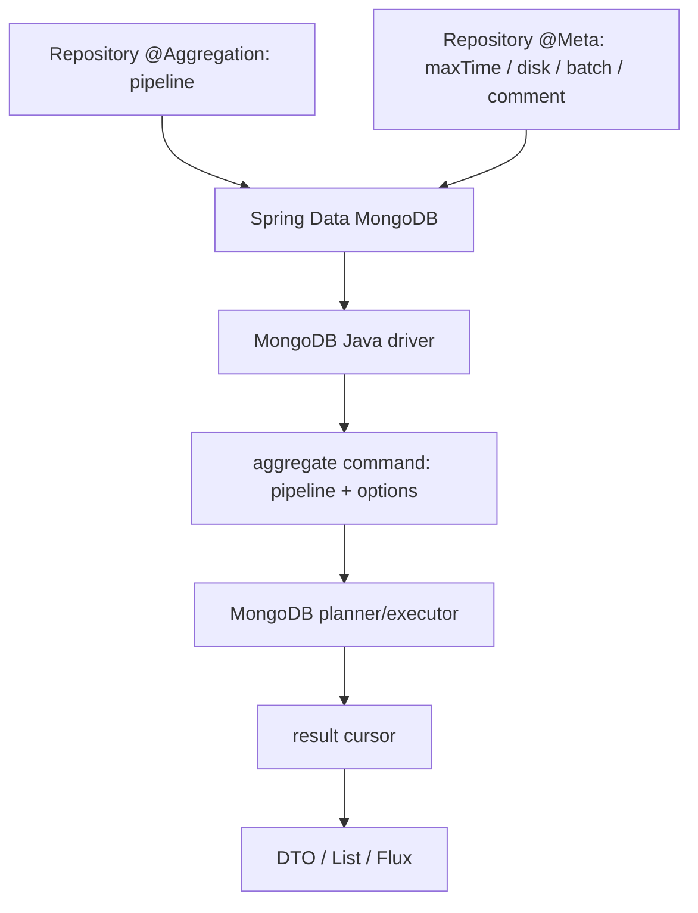
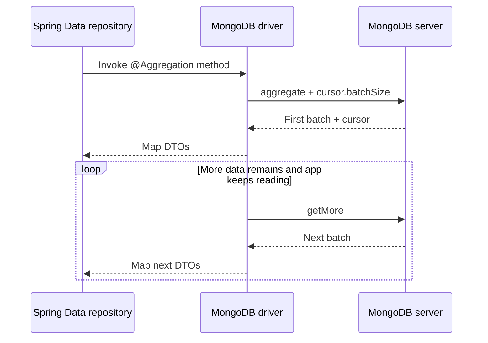

# @Meta, Execution Time, and Resource Options

## 1. The problem: a correct pipeline still needs operational controls

An aggregation pipeline may produce accurate results on test data yet run very slowly or consume excessive resources as the collection grows. Stages such as `$group`, `$sort`, `$bucket`, or `$setWindowFields` may need to maintain intermediate state. If a query is invoked from a time-bounded HTTP API, letting MongoDB process indefinitely is not safe.

In **Spring Data MongoDB**, repositories support `@Aggregation` to declare a pipeline directly on a method. The **`@Meta`** annotation on the same method lets you declare several execution options, such as:

- `maxExecutionTimeMs`: caps processing time on the MongoDB server side.
- `allowDiskUse`: controls whether eligible stages may spill temporary data to disk when needed.
- `cursorBatchSize`: tunes the batch size returned by the cursor.
- `comment`: attaches a query label for analysis and diagnostics.

Example of an API reporting the top 20 SKUs by revenue for the logged-in tenant:

```java
@Meta(
    maxExecutionTimeMs = 3000,
    allowDiskUse = "true",
    cursorBatchSize = 50,
    comment = "report:top-paid-skus:v1"
)
@Aggregation(pipeline = {
    "{ '$match': { 'tenantId': ?0, 'status': 'PAID' } }",
    "{ '$group': { '_id': '$sku', " +
        "'revenueCents': { '$sum': '$amountCents' } } }",
    "{ '$sort': { 'revenueCents': -1, '_id': 1 } }",
    "{ '$limit': 20 }"
})
List<Document> topPaidSkus(String authorizedTenantId);
```

The example above illustrates the shape of a repository method; later sections provide the **complete entity, DTO, repository, and tests**, avoiding reliance on `Document` in business logic. In current Spring Data MongoDB, the `allowDiskUse` attribute of the annotation is a **String**, so write `"true"` rather than boolean `true`.

**Key takeaway:** `@Meta` controls certain **execution** options for a query. It does not automatically make a pipeline use an index, does not eliminate required CPU/RAM, does not enforce data authorization, does not automatically paginate results, and does not guarantee a hard wall-clock deadline from HTTP request arrival to response completion.

This lesson belongs to the **Aggregation repository** chapter of the **SPRING_DATA_MONGODB** module, where we use Spring Data to connect, map documents, write aggregations via repositories or `MongoTemplate`, test, and diagnose performance. The focus is on using `@Meta` and resource limits properly, and understanding the differences among server, driver, and application options.

## 2. How do @Aggregation, @Meta, and AggregationOptions differ?

Three concepts serve distinct roles:

| Component | Where is it used? | Responsibility |
| --- | --- | --- |
| `@Aggregation` | Repository method | Declares pipeline stages, parameter bindings, and result type |
| `@Meta` | Repository method or composed annotation | Declares execution metadata/options such as time limit, batch size, comment, and disk use |
| `AggregationOptions` | `MongoTemplate` / `ReactiveMongoTemplate` | Configures execution options for pipelines built in code |
| `Aggregation` DSL | `MongoTemplate` / `ReactiveMongoTemplate` | Builds stages via a Java API |
| `MongoDB aggregate command` | MongoDB server | Executes the pipeline with options forwarded through the driver |



If not using repository annotations, you can build a pipeline with `Aggregation.newAggregation(...)` and pass `AggregationOptions`:

```java
AggregationOptions options = AggregationOptions.builder()
    .maxTime(Duration.ofSeconds(3))
    .allowDiskUse(true)
    .cursorBatchSize(50)
    .comment("report:top-paid-skus:v1")
    .build();

Aggregation pipeline = Aggregation.newAggregation(
    // Declared AggregationOperations.
).withOptions(options);
```

This is an **API options illustration**; section 10 gives the actual Java pipeline. Proper imports also matter:

```java
// Annotations used on repository methods:
import org.springframework.data.mongodb.repository.Aggregation;
import org.springframework.data.mongodb.repository.Meta;

// Class/DSL used with MongoTemplate:
import org.springframework.data.mongodb.core.aggregation.AggregationOptions;
// org.springframework.data.mongodb.core.aggregation.Aggregation
```

Two `Aggregation` types live in different packages. Similarly, `org.springframework.data.mongodb.repository.Meta` is an **annotation**, whereas `org.springframework.data.mongodb.core.query.Meta` is a **query-layer metadata class**; do not mix up imports when applying `@Meta`.

## 3. Sample entity and report result

### 3.1. Entity for the sales_events collection

Suppose each document records one sale line event. The example stores money in **integer cents** for straightforward summation without `Double` rounding issues.

```java
package example.sales;

import java.time.Instant;
import org.springframework.data.mongodb.core.mapping.Document;
import org.springframework.data.mongodb.core.mapping.FieldType;
import org.springframework.data.mongodb.core.mapping.MongoId;

@Document(collection = "sales_events")
public record SaleEvent(
    @MongoId(FieldType.STRING) String id,
    String tenantId,
    String sku,
    String status,
    int units,
    long amountCents,
    Instant createdAt
) {}
```

`@MongoId(FieldType.STRING)` specifies that IDs are stored as BSON Strings. Typed Spring Data queries/aggregations can map Java `id` to `_id`. When writing JSON pipelines inside `@Aggregation`, referenced fields must be consistent with the actual mapping.

### 3.2. Result DTO

```java
package example.sales;

public record SkuRevenueSummary(
    String sku,
    long orderCount,
    long unitsSold,
    long revenueCents
) {}
```

This is the pipeline's **read model**. It does not hold an individual event's `tenantId`, `status`, or `createdAt`. Never convert this DTO back into an entity and call `save` as though it were a complete source document.

### 3.3. Purposeful test data

```javascript
db.sales_events.insertMany([
  {
    _id: "event-101", tenantId: "shop-01",
    sku: "A", status: "PAID",
    units: NumberInt("2"), amountCents: NumberLong("2000"),
    createdAt: ISODate("2026-11-19T10:00:00Z")
  },
  {
    _id: "event-102", tenantId: "shop-01",
    sku: "B", status: "PAID",
    units: NumberInt("3"), amountCents: NumberLong("6000"),
    createdAt: ISODate("2026-11-19T11:00:00Z")
  },
  {
    _id: "event-103", tenantId: "shop-01",
    sku: "A", status: "PAID",
    units: NumberInt("1"), amountCents: NumberLong("1200"),
    createdAt: ISODate("2026-11-20T09:00:00Z")
  },
  {
    _id: "event-104", tenantId: "shop-01",
    sku: "B", status: "PENDING",
    units: NumberInt("10"), amountCents: NumberLong("20000"),
    createdAt: ISODate("2026-11-20T10:00:00Z")
  },
  {
    _id: "event-201", tenantId: "shop-02",
    sku: "A", status: "PAID",
    units: NumberInt("30"), amountCents: NumberLong("30000"),
    createdAt: ISODate("2026-11-20T11:00:00Z")
  }
]);
```

Expected result for `shop-01`, `PAID` events only:

| SKU | Event count | Total units | Revenue (cents) |
| --- | ---: | ---: | ---: |
| B | 1 | 3 | 6,000 |
| A | 2 | 3 | 3,200 |

`event-104` and `event-201` must be excluded. The tenant must be determined by the server from the security context or an authorized source; letting a client supply a tenant name does not replace authorization checks.

## 4. Complete repository @Aggregation

### 4.1. Pipeline before attaching Meta

```java
package example.sales;

import java.util.List;
import org.springframework.data.mongodb.repository.Aggregation;
import org.springframework.data.mongodb.repository.MongoRepository;

public interface SaleEventRepository
        extends MongoRepository<SaleEvent, String> {

    @Aggregation(pipeline = {
        "{ '$match': { 'tenantId': ?0, 'status': 'PAID' } }",
        "{ '$group': { " +
            "'_id': '$sku', " +
            "'orderCount': { '$sum': 1 }, " +
            "'unitsSold': { '$sum': '$units' }, " +
            "'revenueCents': { '$sum': '$amountCents' } " +
        "} }",
        "{ '$project': { " +
            "'_id': 0, 'sku': '$_id', " +
            "'orderCount': 1, 'unitsSold': 1, 'revenueCents': 1 " +
        "} }",
        "{ '$sort': { 'revenueCents': -1, 'sku': 1 } }",
        "{ '$limit': 20 }"
    })
    List<SkuRevenueSummary> topPaidSkus(String tenantId);
}
```

`?0` is the first method parameter. `$match` filters documents before `$group`; `$project` renames the group key `_id` to `sku` so field names match the DTO; `$sort` orders by revenue and uses `sku` as a tie-breaker; `$limit` bounds the **final number of SKU groups**.

**Domain note:** `orderCount` in the example is actually the **number of sales event documents**, which does not automatically equal unique orders if one order has multiple events. If distinct order count is needed, the schema must include an order ID and the pipeline must express the appropriate distinct count. Metric names should fit the domain; here each document is assumed to correspond to one event line counted in the metric.

### 4.2. Adding @Meta to the same method

```java
package example.sales;

import java.util.List;
import org.springframework.data.mongodb.repository.Aggregation;
import org.springframework.data.mongodb.repository.Meta;
import org.springframework.data.mongodb.repository.MongoRepository;

public interface SaleEventRepository
        extends MongoRepository<SaleEvent, String> {

    @Meta(
        maxExecutionTimeMs = 3000,
        cursorBatchSize = 50,
        allowDiskUse = "true",
        comment = "report:top-paid-skus:v1"
    )
    @Aggregation(pipeline = {
        "{ '$match': { 'tenantId': ?0, 'status': 'PAID' } }",
        "{ '$group': { " +
            "'_id': '$sku', " +
            "'orderCount': { '$sum': 1 }, " +
            "'unitsSold': { '$sum': '$units' }, " +
            "'revenueCents': { '$sum': '$amountCents' } " +
        "} }",
        "{ '$project': { " +
            "'_id': 0, 'sku': '$_id', " +
            "'orderCount': 1, 'unitsSold': 1, 'revenueCents': 1 " +
        "} }",
        "{ '$sort': { 'revenueCents': -1, 'sku': 1 } }",
        "{ '$limit': 20 }"
    })
    List<SkuRevenueSummary> topPaidSkus(String authorizedTenantId);
}
```

This is the **final version** of the interface used in subsequent sections; the two `SaleEventRepository` snippets in sections 4.1 and 4.2 are **two alternatives**, not meant to be declared simultaneously in the same project.

Options are defined **per method**. If a repository has multiple reports with different needs, do not mechanically apply the exact same maxTime/disk/batch configuration to all of them.

## 5. maxExecutionTimeMs: capping server-side processing time

### 5.1. Syntax and meaning

```java
@Meta(maxExecutionTimeMs = 3000)
@Aggregation(pipeline = {
    "{ '$match': { 'status': 'PAID' } }",
    "{ '$group': { '_id': '$sku', 'n': { '$sum': 1 } } }"
})
List<SkuCount> counts();
```

`3000` is in **milliseconds**, about three seconds. Spring Data translates this limit into the corresponding MongoDB time option, commonly seen on `aggregate` commands as `maxTimeMS`:

```javascript
db.sales_events.aggregate(
  [
    { $match: { status: "PAID" } },
    { $group: { _id: "$sku", n: { $sum: 1 } } }
  ],
  { maxTimeMS: 3000 }
);
```

If MongoDB exceeds the budget at an interruptible check point, the server can terminate the operation and return an error, usually associated with an **execution time limit**. The application must handle this error as a normal outcome for time-bounded reports, rather than returning empty results labeled "no data."

### 5.2. Not a wall-clock timer for the entire HTTP request

Different time budgets:

| Limit | Scope |
| --- | --- |
| `@Meta(maxExecutionTimeMs=...)` / MongoDB `maxTimeMS` | Server-side cap for the configured operation; interrupted at server check points |
| Connection timeout | Time to establish TCP connection to the server |
| Server selection timeout | Time for driver to locate an eligible server in the topology |
| Socket/read timeout | Network I/O wait limit per driver/config |
| HTTP request timeout | Acceptable wait time at gateway/API/client |
| End-to-end business deadline | From request arrival to response sent, including cache, DB, mapping, and JSON serialization |

**`maxTimeMS` is not a system-wide hard deadline.** The connection may spend time selecting a server before the command starts, and the application may spend time converting BSON to Java DTOs or serializing JSON after the query finishes. Server interruption occurs at interrupt check points, so observed elapsed time does not always equal the exact configured number.

If the application must meet a fixed latency budget, **coordinate** timeouts and deadlines across HTTP, service, driver, and server. Avoid inadvertently setting an HTTP timeout shorter than the server wait budget and leaving orphaned queries consuming resources after clients disconnect.

### 5.3. Choosing maxExecutionTimeMs from measurements

Do not pick `3000` just because the example uses three seconds. Practical process:

1. Measure p50/p95/p99 latency of the pipeline on a representative dataset.
2. Identify the API's SLO/SLA and the budget allocated specifically to MongoDB.
3. Monitor the rate of queries aborted due to the time limit.
4. Fix queries/indexes before endlessly raising the limit.
5. For intentionally heavy reports, consider running asynchronously via a dedicated workflow/job with checkpoints and resource controls.

High execution time does not automatically mean the query needs more RAM or disk use. Often the real cause is an unindexed `$match`, a misplaced `$sort`, or `$group` scanning far too many documents.

### 5.4. Default and unset values

In the current annotation API, `maxExecutionTimeMs` defaults to `-1`, meaning **no limit set via the annotation**, not "the server must run forever." Server, driver, and cluster still enforce their own limits.

Do not pass arbitrary negative values or 0 to express an SLO; specify a positive number and check how your framework/driver version handles the option.

## 6. allowDiskUse: allowing spill, not a free optimization

### 6.1. When does aggregation need temporary disk?

Stages like `$group` and `$sort` may need to accumulate many items. When data is large enough, MongoDB may need temporary disk files for stages that support spilling:

```javascript
db.sales_events.aggregate(
  [
    { $match: { tenantId: "shop-01", status: "PAID" } },
    {
      $group: {
        _id: "$sku",
        revenueCents: { $sum: "$amountCents" }
      }
    },
    { $sort: { revenueCents: -1 } }
  ],
  { allowDiskUse: true }
);
```

In the repository:

```java
@Meta(allowDiskUse = "true")
@Aggregation(pipeline = {
    "{ '$group': { '_id': '$sku', 'revenue': { '$sum': '$amountCents' } } }",
    "{ '$sort': { 'revenue': -1 } }"
})
List<SkuRevenueOnly> totalRevenueBySku();
```

**Allowing spill does not mean the pipeline always writes to disk.** When stages fit comfortably in memory or have an efficient plan, no spill occurs. When spill does happen, the query typically incurs heavy I/O, consumes temporary space, and increases latency.

### 6.2. Distinguishing allow, deny, and server default

In current Spring Data MongoDB, the String value of `@Meta.allowDiskUse` supports options such as:

| Annotation value | Intent |
| --- | --- |
| `allowDiskUse = "true"` or `"allow"` | Allow disk use for eligible stages |
| `allowDiskUse = "false"` or `"deny"` | Forbid disk use for the operation per server mechanics |
| Omitted / default empty string `""` | Do not override in annotation; let server/framework default policy apply |

Key point from **MongoDB 6.0 onward**: the server parameter `allowDiskUseByDefault` governs the default policy for stages that can spill under high memory usage. If the server defaults to allow, omitting `allowDiskUse` does **not** guarantee disk spill is forbidden. If the server defaults to deny, a command with `allowDiskUse: true` can allow spilling specifically for that command.

Do not infer behavior solely from the "annotation default" while ignoring the **MongoDB server version, `allowDiskUseByDefault` setting, and options actually sent to the server**.

### 6.3. An API change to watch when upgrading versions

In some older Spring Data MongoDB versions, `@Meta.allowDiskUse` was a **boolean**:

```text
Some legacy code uses syntax: allowDiskUse = true
```

In the current Spring Data MongoDB API, the attribute is a **String**:

```java
@Meta(allowDiskUse = "true")
```

Do not copy syntax from older blog posts without checking the Javadoc of your project's actual BOM/dependencies. Using `"true"` also makes it possible to distinguish **unset**, **allow**, and **deny**.

### 6.4. Why can enabling disk use slow the system down?

Common reasons:

- Stages must write and read temporary files under high memory pressure.
- Multiple concurrent aggregations compete for the same disk I/O resources.
- Full disks or throttled I/O lead to failures or latency spikes.
- `$group` creates too many groups, or `$sort` sorts a massive result set.
- The pipeline lacks a selective `$match` or tries to rebuild full-history reports on every request.

**`allowDiskUse` is a resource safety valve for eligible stages, not a substitute for query optimization.** Usually you should prioritize reducing input documents, adding proper indexes, chunking, or maintaining materialized summaries.

### 6.5. When should disk use be explicitly forbidden?

For synchronous APIs with strict resource/latency budgets, system owners may choose:

```java
@Meta(allowDiskUse = "false")
```

Then a query exceeding stage memory limits fails instead of spilling temporary data to disk. This is a **fail-fast resource trade-off** on the server that must be tested and monitored for errors. Never describe forbidding disk use as "guaranteeing queries are always fast."

## 7. cursorBatchSize: records per batch, not a result limit

### 7.1. From aggregation to cursor

MongoDB usually returns aggregation results via a **cursor**. The driver can receive an initial batch and then issue `getMore` for subsequent batches as the application consumes results.



`@Meta(cursorBatchSize = 50)` sets the desired batch size. It does **not** replace a `$limit: 20` stage, nor is it the maximum number of documents the repository method is allowed to return.

### 7.2. Comparing batch size and limit

| Option | Unit | What it governs |
| --- | --- | --- |
| `cursorBatchSize = 50` | Documents/batch | How the cursor fetches results in chunks |
| `{$limit: 20}` | Pipeline result documents | Caps the **total number of result rows** from the pipeline |
| `Pageable`/`Slice` | Page and order | Paging API, depending on repository/aggregation structure |
| HTTP response limit | Application bytes or rows | Caps data returned to the HTTP caller |

Batch sizes can also be constrained by message/BSON size limits and driver/server batching behavior. Therefore, **never assume every batch always contains exactly 50 rows**. The value in `@Meta` guides data delivery rather than dictating every low-level I/O detail.

### 7.3. List still holds all results in the application

If the method returns:

```java
List<SkuRevenueSummary> rows =
    repository.topPaidSkus("shop-01");
```

the method's entire result is still materialized into a `List`. Even though the cursor fetches batch by batch, the `List` occupies memory proportional to the **total result count**, not `cursorBatchSize`.

For a top-20 report, that is negligible. For exporting millions of rows, consider streaming, output limits, proper pagination, or a batch export job architecture. `cursorBatchSize` by itself does **not** prevent application-side OOM.

### 7.4. Choosing batch size based on data

Small batch:

- May reduce client-side buffering per chunk.
- Increases `getMore` round trips and network overhead when reading many rows.

Large batch:

- Can reduce fetch round trips.
- Each chunk can be large in bytes if documents/DTOs are bulky.

The choice depends on **document size, network latency, consumption rate, memory limits, and streaming mechanics**. The number 50 in the example is illustrative; benchmark values appropriate for your workload.

### 7.5. Batch size does not make grouping pipelines fully streaming

A pipeline with an unindexed `$group` or `$sort` may have to accumulate intermediate data **before emitting the first batch**. Even with batch size 1, MongoDB can still consume heavy RAM/CPU/disk to compute the very first result.

Do not use `cursorBatchSize = 1` as a substitute for optimizing `$group` or `$sort`.

## 8. comment: tagging queries for investigation

### 8.1. Using static, meaningful comments

```java
@Meta(comment = "report:top-paid-skus:v1")
```

MongoDB can record the `comment` in commands, profiler entries, and diagnostic logs, helping distinguish similarly structured queries originating from different APIs.

An easily searchable naming convention:

```text
<domain>:<query-purpose>:<version>

sales:top-paid-skus:v1
sales:daily-revenue:v2
inventory:low-stock-summary:v1
```

With an annotation, `comment` is **fixed on the method**. If you need a dynamic per-request correlation ID, use controlled application-layer logging/observability and driver instrumentation; never put access tokens, emails, customer names, or sensitive payloads into comments for tracing.

### 8.2. Using comments with profiler/slow query logs

Equivalent MongoDB command example:

```javascript
db.sales_events.aggregate(
  [
    { $match: { tenantId: "shop-01", status: "PAID" } },
    { $group: { _id: "$sku", revenue: { $sum: "$amountCents" } } }
  ],
  { comment: "sales:top-paid-skus:v1" }
);
```

When administrators inspect slow operations, logs, or the profiler (where enabled with proper permissions), comments help tie a command back to an application feature. However, **a comment does not guarantee every execution appears in the profiler**: observability still depends on sampling, profiler/logging configuration, and MongoDB environment capabilities.

Do not turn on full database profiling logging every query in production without assessing load, log storage cost, and sensitive data exposure.

## 9. Combining all four options together

Here is the final repository method from section 4:

```java
@Meta(
    maxExecutionTimeMs = 3000,
    allowDiskUse = "true",
    cursorBatchSize = 50,
    comment = "report:top-paid-skus:v1"
)
@Aggregation(pipeline = {
    "{ '$match': { 'tenantId': ?0, 'status': 'PAID' } }",
    "{ '$group': { '_id': '$sku', " +
        "'revenueCents': { '$sum': '$amountCents' } } }",
    "{ '$sort': { 'revenueCents': -1 } }",
    "{ '$limit': 20 }"
})
List<Document> topPaidSkus(String tenantId);
```

Conceptually, the options travel alongside a MongoDB aggregation command:

```javascript
db.sales_events.aggregate(
  [
    { $match: { tenantId: "shop-01", status: "PAID" } },
    {
      $group: {
        _id: "$sku",
        revenueCents: { $sum: "$amountCents" }
      }
    },
    { $sort: { revenueCents: -1 } },
    { $limit: 20 }
  ],
  {
    maxTimeMS: 3000,
    allowDiskUse: true,
    cursor: { batchSize: 50 },
    comment: "report:top-paid-skus:v1"
  }
);
```

This section is meant to map **metadata to wire options**. The method uses `List<Document>` only to keep the pipeline short in the illustration; the production DTO version was given in section 4.2.

Independence of these options:

- `maxTimeMS` caps processing time per server mechanics.
- `allowDiskUse` allows or denies spill when eligible stages need resources.
- `cursor.batchSize` affects how results are delivered.
- `comment` aids diagnostics.
- **None of these options automatically adds a tenant `$match`, accurate `$sort`, or safe `$limit`.**

A method can still be slow, hit memory errors, or return wrong data if its pipeline or business predicates are flawed.

## 10. Equivalent options when using MongoTemplate

### 10.1. AggregationOptions

When a pipeline needs dynamic assembly, `MongoTemplate` is usually more flexible than a long annotation:

```java
package example.sales;

import java.time.Duration;
import java.util.List;
import org.springframework.data.domain.Sort;
import org.springframework.data.mongodb.core.MongoTemplate;
import org.springframework.data.mongodb.core.aggregation.Aggregation;
import org.springframework.data.mongodb.core.aggregation.AggregationOptions;
import org.springframework.data.mongodb.core.query.Criteria;
import org.springframework.stereotype.Service;

@Service
public class SaleReportTemplateService {

    private final MongoTemplate template;

    public SaleReportTemplateService(MongoTemplate template) {
        this.template = template;
    }

    public List<SkuRevenueSummary> topPaidSkus(
            String authorizedTenantId) {

        if (authorizedTenantId == null ||
                authorizedTenantId.isBlank()) {
            throw new IllegalArgumentException(
                "Invalid tenantId"
            );
        }

        AggregationOptions options = AggregationOptions.builder()
            .maxTime(Duration.ofSeconds(3))
            .allowDiskUse(true)
            .cursorBatchSize(50)
            .comment("report:top-paid-skus:template:v1")
            .build();

        Aggregation pipeline = Aggregation.newAggregation(
            Aggregation.match(
                Criteria.where("tenantId").is(authorizedTenantId)
                    .and("status").is("PAID")
            ),
            Aggregation.group("sku")
                .count().as("orderCount")
                .sum("units").as("unitsSold")
                .sum("amountCents").as("revenueCents"),
            Aggregation.project(
                "orderCount", "unitsSold", "revenueCents"
            ).and("_id").as("sku").andExclude("_id"),
            Aggregation.sort(
                Sort.by(
                    Sort.Order.desc("revenueCents"),
                    Sort.Order.asc("sku")
                )
            ),
            Aggregation.limit(20)
        ).withOptions(options);

        return template.aggregate(
            pipeline, SaleEvent.class, SkuRevenueSummary.class
        ).getMappedResults();
    }
}
```

This code uses **`SaleEvent.class` as the input type** so Spring Data applies entity mapping where appropriate, and `SkuRevenueSummary.class` as the output type. Verify mapping in projects with `@Field`/custom converters because field names after `$group` and `$project` no longer match the source schema.

### 10.2. Differences between annotation and options builder

| Repository annotation | MongoTemplate |
| --- | --- |
| `@Meta(maxExecutionTimeMs = 3000)` | `.maxTime(Duration.ofSeconds(3))` |
| `@Meta(allowDiskUse = "true")` | `.allowDiskUse(true)` |
| `@Meta(cursorBatchSize = 50)` | `.cursorBatchSize(50)` |
| `@Meta(comment = "name")` | `.comment("name")` |

Notice the **parameter type difference**: `@Meta`'s `allowDiskUse` currently uses a `String`, whereas `AggregationOptions.Builder.allowDiskUse(...)` accepts a `boolean`. This is a valid API difference, not a contradiction.

### 10.3. Choosing the right API for your needs

Repository `@Aggregation` + `@Meta` fits when:

- The pipeline is **fixed** and straightforward;
- Input parameters are few and safely bindable;
- A clean repository contract is desired;
- Execution metadata is static per feature.

`MongoTemplate` + `AggregationOptions` fits when:

- There are many optional filters/stages;
- Time budgets/batch sizes must be configured dynamically by policy;
- You need `hint`, collation, read concern, or options beyond `@Meta`;
- You want to split stages into helper methods and write clear integration tests.

Do not pick an API just to save a few lines; correctness, mapping, testability, and operability matter more.

## 11. Streaming and reactive do not remove server aggregation cost

### 11.1. MongoTemplate.aggregateStream

When results are large and there is no need to build a `List`, Spring Data MongoDB provides a streaming aggregation API:

```java
import java.util.stream.Stream;
import org.springframework.data.mongodb.core.aggregation.Aggregation;

// 'pipeline' already has appropriate AggregationOptions.
try (Stream<SkuRevenueSummary> stream =
         template.aggregateStream(
             pipeline, SaleEvent.class, SkuRevenueSummary.class
         )) {
    stream.forEach(this::exportRow);
}
```

`exportRow` is an application method provided by the developer. This snippet belongs in a service that already has `template` and `pipeline`; the stream/cursor must be closed when finished. For long-running exports, handle request cancellation, network errors, timeouts, and resume strategies.

**Streaming does not stop `$group`/`$sort` from using MongoDB memory.** It only prevents the application from having to keep every received result in a `List`.

### 11.2. ReactiveMongoTemplate and Flux

```java
import org.springframework.data.mongodb.core.ReactiveMongoTemplate;
import reactor.core.publisher.Flux;

// reactiveTemplate is injected from the Spring context.
Flux<SkuRevenueSummary> rows =
    reactiveTemplate.aggregate(
        pipeline, SaleEvent.class, SkuRevenueSummary.class
    );
```

Reactive I/O structures non-blocking data flow and backpressure. However, the server still executes the stages, and `collectList()` still gathers all results on the Java side:

```java
Mono<List<SkuRevenueSummary>> all = rows.collectList();
```

For top 20, collecting into a list is fine; for millions of groups, enforce limits, stream, or build an export workflow. Never call `block()` inside a WebFlux thread just to turn a publisher into a synchronous result.

### 11.3. Reactive repositories and @Meta

Reactive repositories can declare `@Aggregation` and `@Meta` on methods, per Spring Data MongoDB support in your project version. However, **never assume** from returning `Flux` that `maxExecutionTimeMs`, `cursorBatchSize`, and `allowDiskUse` can be ignored: they remain server/cursor constraints.

When combining with Reactor timeouts:

```java
Flux<SkuRevenueSummary> bounded =
    rows.timeout(Duration.ofSeconds(5));
```

Reactor's timeout applies **to the publisher** per Reactor rules, not `maxTimeMS` enforced by MongoDB. Cancelling a subscription normally triggers the driver to close/cancel work as supported by the stack, but do not treat that as a guarantee that every server operation stops immediately. Design end-to-end deadlines across both layers when truly needed.

## 12. Can @Meta replace indexes or pipeline optimization?

**No.** Metadata does not change the underlying nature of the query.

### 12.1. Place $match early and leverage indexes

With:

```javascript
{ $match: { tenantId: "shop-01", status: "PAID" } }
```

candidate index:

```javascript
db.sales_events.createIndex(
  { tenantId: 1, status: 1, sku: 1 },
  { name: "by_tenant_status_sku" }
);
```

This can help restrict documents entering the pipeline when the workload fits. However, because `revenueCents` is computed **after grouping**, sorting by total revenue typically cannot directly reuse a source event index the way `find().sort(...)` on a stored field can.

### 12.2. Reduce cardinality before expensive stages

```javascript
[
  { $match: { tenantId: "shop-01", status: "PAID" } },
  { $group: { _id: "$sku", revenue: { $sum: "$amountCents" } } },
  { $sort: { revenue: -1 } },
  { $limit: 20 }
]
```

This is a valid order for a top-SKU report. Placing `$limit: 20` **before** `$group` would only sum 20 input documents, breaking the meaning of "top SKUs across all PAID sales."

`$sort` on a computed field usually has to inspect many groups. Allowing disk use may avoid some memory errors, yet does not change the number of additions, group counts, or source data volume processed.

### 12.3. Questions to answer before enabling allowDiskUse

1. Does this really need to compute over full history on every request?
2. Does the query filter by tenant/status/date range sensibly?
3. Are there proper indexes supporting initial `$match` and `$sort`?
4. Is there an `$unwind` stage multiplying intermediate documents?
5. Does the `$group` group count grow linearly with users/items?
6. Could daily/monthly pre-aggregations or snapshots be stored instead?
7. Does the server have enough disk I/O and temp space for concurrent requests?

Only then should you decide on disk policies and time budgets based on real load.

## 13. Monitoring: verifying options actually reach MongoDB

### 13.1. Do not read an annotation and assume runtime behavior

A syntactically valid `@Meta` annotation does not prove every option reached the server. Differences can arise from dependency versions, repository proxies, method kinds, result types, or driver configuration.

Verification steps:

1. Use an integration test calling the real repository.
2. Enable controlled **MongoDB command monitoring** in the test environment to observe the `aggregate` command.
3. Confirm the command carries `maxTimeMS`, `allowDiskUse`, `comment`, and `cursor.batchSize` where applicable.
4. Cross-check with the profiler/slow query log if needed.
5. Check DTO results, latency, and resource usage.

Remember that logged commands may contain pipelines and sensitive tenant/filter values. Restrict environments, redact values, and limit log retention.

### 13.2. CommandListener example in the MongoDB driver

The MongoDB Java driver lets you observe sent commands:

```java
package example.sales;

import com.mongodb.event.CommandListener;
import com.mongodb.event.CommandStartedEvent;
import org.bson.Document;

public final class AggregationCommandObserver
        implements CommandListener {

    @Override
    public void commandStarted(CommandStartedEvent event) {
        if (!"aggregate".equals(event.getCommandName())) {
            return;
        }

        Document command = event.getCommand();
        // Log only safe metadata, never full sensitive payloads.
        System.out.println("hasMaxTime=" +
            command.containsKey("maxTimeMS"));
        System.out.println("hasComment=" +
            command.containsKey("comment"));
        System.out.println("hasCursor=" +
            command.containsKey("cursor"));
    }
}
```

This is an **illustrative observer**; it only runs when registered on the `MongoClientSettings` used by the test/app client. Declaring the class alone produces no logs. In a Spring Boot project, command listener registration must match your auto-configuration version and should generally be enabled only in test environments.

When confirming specific values:

```javascript
// Illustration of a sent aggregate command:
{
  aggregate: "sales_events",
  pipeline: [/* stages */],
  cursor: { batchSize: 50 },
  maxTimeMS: 3000,
  allowDiskUse: true,
  comment: "report:top-paid-skus:v1"
}
```

This structure is **illustrative**. Real commands may also carry `$db`, session metadata, or other options; rely on actual output observed from a listener/profiler in a real environment.

### 13.3. Investigating the right symptom

| Observation | Investigation hint |
| --- | --- |
| Frequent max time errors | Indexes, cardinality, blocking stages, and time budget |
| Profiler/diagnostic log shows `usedDisk` | Pipeline spilled due to memory needs; measure I/O and data size |
| Many `getMore` round trips | Output size, batch size, and consumer speed |
| Large DTO results and high app heap | `List` materialization, missing `$limit`, or non-streaming export |
| Disk I/O spikes with report traffic | Multiple queries allowed to spill concurrently |
| Missing comment | Inspect real command, profiler/log config, or code path bypassing expected repository method |
| Slow before first batch arrives | Blocking `$group`/`$sort` or poor index, not just batch size |

Never diagnose "the server lacks RAM" from a timeout alone. Gather `explain("executionStats")`, CPU/memory/disk metrics, query planner details, and examined document counts.

## 14. Integration testing repositories and @Meta

A test suite should separate two goals:

- **Pipeline correctness:** given the same data, it returns the right SKUs, event counts, total units, and revenue.
- **Execution options:** the annotation declares the right values and options are actually forwarded to the server; the second part requires configured command monitoring/integration tests.

### 14.1. Testing repository output

Example using JUnit 5 and Spring Boot `@DataMongoTest`:

```java
package example.sales;

import static org.junit.jupiter.api.Assertions.*;

import java.time.Instant;
import java.util.List;
import java.util.UUID;
import org.junit.jupiter.api.Test;
import org.springframework.beans.factory.annotation.Autowired;
import org.springframework.boot.test.autoconfigure.data.mongo.DataMongoTest;
import org.springframework.data.mongodb.core.MongoTemplate;

@DataMongoTest
class RepositoryAggregationMetaTest {

    @Autowired
    SaleEventRepository repository;

    @Autowired
    MongoTemplate template;

    @Test
    void paidSalesAreGroupedForAuthorizedTenant() {
        String suffix = UUID.randomUUID().toString();
        String tenant = "shop-" + suffix;
        Instant now = Instant.parse("2026-11-20T10:00:00Z");

        template.insertAll(List.of(
            new SaleEvent(
                "a1-" + suffix, tenant, "A", "PAID", 2, 2000L, now
            ),
            new SaleEvent(
                "b1-" + suffix, tenant, "B", "PAID", 3, 6000L, now
            ),
            new SaleEvent(
                "a2-" + suffix, tenant, "A", "PAID", 1, 1200L, now
            ),
            new SaleEvent(
                "pending-" + suffix, tenant, "B", "PENDING",
                10, 20000L, now
            ),
            new SaleEvent(
                "outside-" + suffix, "other-" + suffix,
                "A", "PAID", 30, 30000L, now
            )
        ));

        List<SkuRevenueSummary> result =
            repository.topPaidSkus(tenant);

        assertEquals(
            List.of(
                new SkuRevenueSummary("B", 1, 3, 6000),
                new SkuRevenueSummary("A", 2, 3, 3200)
            ),
            result
        );
    }
}
```

This test verifies that the pipeline filters tenant/status, groups, projects, and sorts properly; it does not by itself prove `allowDiskUse` or `maxTimeMS` were sent over the driver. Test data is too small to trigger spill or time limits, which is **normal**.

`@DataMongoTest` only sets up the MongoDB slice context and does not guarantee a MongoDB server is available without Testcontainers or a dedicated instance and compatible Spring Boot version. This lesson is written as Markdown without running Gradle builds or integration tests here.

### 14.2. Testing @Meta declaration via reflection

In a test in the same module:

```java
import static org.junit.jupiter.api.Assertions.*;

import org.junit.jupiter.api.Test;
import org.springframework.data.mongodb.repository.Meta;

class RepositoryMetaContractTest {

    @Test
    void queryHasExpectedMetadata() throws Exception {
        Meta meta = SaleEventRepository.class
            .getMethod("topPaidSkus", String.class)
            .getAnnotation(Meta.class);

        assertNotNull(meta);
        assertEquals(3000L, meta.maxExecutionTimeMs());
        assertEquals(50, meta.cursorBatchSize());
        assertEquals("true", meta.allowDiskUse());
        assertEquals(
            "report:top-paid-skus:v1",
            meta.comment()
        );
    }
}
```

A reflection test only checks that **the annotation is present with declared values**. To verify forwarding to the server, write a test with a command listener or equivalent observability. Never claim "runtime options verified" solely because a reflection test passes.

### 14.3. Testing option forwarding via command monitoring

A dedicated integration test can register a `CommandListener` before `MongoClient` initializes, then:

1. Call `repository.topPaidSkus(tenant)`.
2. Filter the `aggregate` command matching the `comment`.
3. Assert `maxTimeMS == 3000`.
4. Assert `allowDiskUse == true`.
5. Assert `cursor.batchSize == 50` in the observed command.

This is a **testing procedure** rather than a complete copy-paste test because client/auto-configuration wiring depends on Spring Boot version. In a system with multiple `MongoClient`s, the listener must attach to the exact client used by the repository.

### 14.4. Do not test timeouts by sleeping a fixed duration

A test expecting `maxExecutionTimeMs=10` to always abort on a small pipeline is highly flaky. Machine latency, document count, query plan, server interrupt checks, and caching all vary.

To test **configuration**, verify the option is sent to the server. To test **timeout behavior**, use a controlled workload in an isolated environment, accept server-dependent timing variance, and assert the resulting error code/exception. Never write a test calling `Thread.sleep(3000)` assuming the query will time out at that exact threshold.

## 15. Custom composed @Meta annotations and team conventions

Spring Data MongoDB allows creating a meta-annotation wrapping `@Meta` to reuse policies:

```java
package example.sales;

import java.lang.annotation.ElementType;
import java.lang.annotation.Retention;
import java.lang.annotation.RetentionPolicy;
import java.lang.annotation.Target;
import org.springframework.data.mongodb.repository.Meta;

@Retention(RetentionPolicy.RUNTIME)
@Target(ElementType.METHOD)
@Meta(
    maxExecutionTimeMs = 3000,
    allowDiskUse = "true",
    cursorBatchSize = 50,
    comment = "report:bounded-aggregation:v1"
)
public @interface BoundedReportAggregation {
}
```

Then apply it to a repository method:

```java
@BoundedReportAggregation
@Aggregation(pipeline = {
    "{ '$match': { 'status': 'PAID' } }",
    "{ '$group': { '_id': '$sku', 'n': { '$sum': 1 } } }"
})
List<SkuCount> countPaidBySku();
```

Benefits:

- Enforces a consistent **time/resource** policy across a group of queries.
- Reduces duplication of metadata attributes.
- Expresses intent through the annotation's name rather than repeating multiple parameters.

Limitations:

- Not every report shares the same cost or SLO.
- A shared annotation with a fixed `comment` can make different reports **harder to distinguish** at runtime.
- When per-method comments are needed, declare `@Meta` directly with unique names or use appropriate external monitoring strategies.
- Do not rely on stacking/overriding multiple `@Meta` annotations without verifying precedence and annotation restrictions in your Spring Data version.

When establishing team conventions, specify clearly: max latency for online reports, when spilling is permitted, default batch size by output kind, who can approve higher limits, and which dashboards track timeout/spill rates.

## 16. Security and stability when running reports

### 16.1. Meta does not replace authorization

A repository method:

```java
@Meta(maxExecutionTimeMs = 1000)
@Aggregation("{ '$group': { '_id': '$tenantId', 'sum': { '$sum': '$amountCents' } } }")
List<TenantRevenue> revenueByAllTenants();
```

still exposes multi-tenant figures if invoked from an endpoint lacking proper permissions. Adding a time limit **does not make a query authorization-safe**.

In tenant-scoped APIs, the tenant `$match` must live in the pipeline, and the tenant ID must come from server-side authorization. Filtering after `$group` is usually too late to prevent computation over unauthorized data.

### 16.2. Bounding client-controlled query parameters

Never accept unbounded `maxExecutionTimeMs`, `allowDiskUse`, or `cursorBatchSize` values from clients to construct arbitrary queries. Such settings directly impact cluster resources.

For endpoints with dynamic reporting parameters, enforce **server-side caps**:

```java
int topN = Math.min(Math.max(requestedTopN, 1), 100);
```

However, `topN` only caps final output. If a pipeline has high cardinality before `$group`, a small `$limit` can still scan huge document counts. You also need controls on input ranges, indexes, list lengths, and concurrency.

### 16.3. Comments must never contain secrets

Avoid:

```text
comment = "user-email:someone@example.com;token:..."
```

Because commands, profilers, and logs may capture comments, use static technical labels rather than user information. When linking request traces, use observability mechanisms with proper redaction, retention, and access-control policies.

### 16.4. When the client times out while the query is still running

An HTTP request can disconnect before MongoDB finishes. For heavy reports:

- Set coordinated server and app time bounds.
- Handle cancellation via the driver/reactive subscriber as practically supported.
- Limit concurrent heavy reports.
- Use async jobs/report snapshots with idempotency and deferred retrieval if queries routinely run long.

Never blindly auto-retry heavy aggregations multiple times after a timeout; if each retry launches another full scan, the cluster can spiral into overload.

## 17. Common errors and fixes

| Symptom | Possible cause | Fix |
| --- | --- | --- |
| `@Meta(allowDiskUse = true)` fails to compile | Current API requires a String | Use `"true"`, check dependency/BOM |
| Query runs longer than `maxExecutionTimeMs` | Server cap is not an end-to-end deadline; interrupt points and network/mapping | Coordinate multi-layer timeouts, measure runtime |
| `List` still grows Java heap | Batch size does not cap total results | Add `$limit`/streaming/pagination |
| `cursorBatchSize=50` yet batches have fewer than 50 | Few results, byte limits, or server behavior | Do not assert every batch equals 50 |
| `allowDiskUse` enabled yet still fails | Stage cannot spill, hit another limit, or I/O/resource failure | Inspect error and server limits, optimize pipeline |
| `allowDiskUse` enabled yet query is slow | Disk spill increases I/O and contention | Filter early, index, measure `usedDisk`/memory |
| `usedDisk` seen without declaring `allowDiskUse` | MongoDB 6.0+ server default allows it | Check `allowDiskUseByDefault` |
| Denying disk use causes memory errors | Stage exceeds RAM limit | Improve query, or consider allowing spill |
| Comment present yet missing in profiler | Profiling/sampling/logging not configured | Check command monitoring and observability setup |
| Data returned for wrong tenant | Metadata adds no authorization | Use authenticated tenant `$match` |
| Small `$limit` yet query stays heavy | `$group`/`$sort` still processes many documents before limit | Reduce input/group cardinality, materialize |
| Wrong `@Meta` package imported | Confused `@Meta` with `query.Meta` class | Use `org.springframework.data.mongodb.repository.Meta` |
| `@Aggregation` reads null fields on DTO | `$group` creates `_id` without `$project` renaming | Check output BSON, mapping, and DTO |
| Reflection test passes yet command lacks options | Forwarding/runtime never checked | Attach `CommandListener` in integration test |
| Raising timeout never stops slowness | Missing indexes, growing data, unoptimized pipeline | Run `explain` and benchmark workload |

### Ordered diagnostic procedure

1. **Correctness:** confirm `$match`, `$group`, `$sort`, `$limit`, and DTO type.
2. **Options:** confirm `@Meta` is on the right method with the right import.
3. **Versions:** check Javadoc for `@Meta.allowDiskUse` and MongoDB server defaults.
4. **Command:** verify actual `aggregate` has `maxTimeMS`, `allowDiskUse`, `cursor.batchSize`, `comment`.
5. **Plan:** run `explain("executionStats")` and inspect examined counts and stage cardinality.
6. **Resources:** watch `usedDisk`, memory, I/O, and concurrency.
7. **Client:** inspect how the method returns `List`, `Stream`, or `Flux` and how cursors close.
8. **Timeouts:** compare server time limit against network/client/request deadlines.
9. **Security:** ensure tenant filters, comments/logs, and API limits are controlled.

## 18. Practice exercises

### Exercise 1 — Comparing with and without @Meta

Write two repository methods with the same top-SKU pipeline: one without `@Meta`, and one with `maxExecutionTimeMs=3000`, `cursorBatchSize=50`, `allowDiskUse="true"`, and a static `comment`. Use command monitoring in a test to compare the options actually sent.

### Exercise 2 — Timeout is not result row count

Generate test data large enough for `$group` to process many records. Experiment with `maxExecutionTimeMs` values in an isolated environment. Distinguish server time-limit errors from network timeouts; do not write tests relying on `Thread.sleep`.

### Exercise 3 — When to enable disk use?

Create a `$group` + `$sort` aggregation over many SKUs, comparing allow, deny, and server default modes. Observe `usedDisk`, duration, and I/O. Explain why results depend on data volume/topology/version and why enabling disk use is not automatically faster.

### Exercise 4 — Batch size and $limit

Run a pipeline returning 500 documents with `cursorBatchSize=10`, then add `$limit=20`. Observe rows received and `getMore` calls via a listener. Explain why batch size does not replace capping total output.

### Exercise 5 — MongoTemplate.withOptions

Rewrite `SaleEventRepository.topPaidSkus` using `Aggregation.newAggregation` and `AggregationOptions.builder()`. Compare DTO results, tenant filtering, and command options with the repository version.

### Exercise 6 — Reactive and query cancellation

Move the report to `ReactiveMongoTemplate` and `Flux<SkuRevenueSummary>`. Compare `collectList` with incremental consumption, add a Reactor timeout, and explain why it does not equal server `maxTimeMS`.

### Exercise 7 — Reusable annotation

Create `@BoundedReportAggregation` wrapping `@Meta`. Apply it to two methods with different workloads, measure latency, and decide whether they should share the same limits. Design a comment convention to distinguish each report.

### Self-check questions

- How do `@Aggregation` and `@Meta` divide responsibilities?
- In current Spring Data MongoDB, why does `@Meta(allowDiskUse = "true")` have quotes?
- Does `maxExecutionTimeMs` mean the HTTP request always finishes by that exact deadline?
- Does `allowDiskUse` force MongoDB to always write temp files?
- Why might MongoDB 6.0+ servers spill even when the annotation omits disk use?
- Does `cursorBatchSize=50` cap the repository to returning at most 50 documents?
- Why can a method returning `List` still cause high heap usage despite a small batch size?
- How can `$group`/`$sort` block delivery of the very first batch?
- How does `comment` help investigate slow queries and what log risks exist?
- Should runtime options be verified via reflection or command monitoring?
- How does `AggregationOptions` differ from `@Meta`?
- Why does `$limit=20` after `$group` not mean MongoDB only reads 20 source documents?
- When should you choose materialized summaries instead of raising timeouts and enabling disk use?

## Key takeaways

For **Spring Data MongoDB repository aggregations**, `@Aggregation` expresses the **pipeline**, while **`@Meta` tunes execution behavior**. `maxExecutionTimeMs` is a MongoDB server-side limit, **not a full HTTP request deadline**; `allowDiskUse` permits eligible stages to spill to disk, **not a query optimization**; `cursorBatchSize` tunes cursor delivery, **not a total result cap**; and `comment` aids diagnostics when properly logged/profiled. Outside repositories, the corresponding options live in `MongoTemplate`'s **`AggregationOptions`**. Check API versions, protect tenants, verify actual sent commands, optimize `$match`/indexes/stage order, and measure timeouts, memory, and disk I/O before deploying heavy reports to production.

## References

- [Spring Data MongoDB Reference — MongoDB-specific Query Methods, Repository Aggregations and @Meta](https://docs.spring.io/spring-data/mongodb/reference/mongodb/repositories/query-methods.html)
- [Spring Data MongoDB API — Repository Meta annotation](https://docs.spring.io/spring-data/mongodb/docs/current/api/org/springframework/data/mongodb/repository/Meta.html)
- [Spring Data MongoDB API — AggregationOptions.Builder](https://docs.spring.io/spring-data/mongodb/docs/current/api/org/springframework/data/mongodb/core/aggregation/AggregationOptions.Builder.html)
- [Spring Data MongoDB Reference — Aggregation Framework Support](https://docs.spring.io/spring-data/mongodb/reference/mongodb/aggregation-framework.html)
- [MongoDB Manual — aggregate command](https://www.mongodb.com/docs/manual/reference/command/aggregate/)
- [MongoDB Manual — Aggregation Pipeline Limits](https://www.mongodb.com/docs/manual/core/aggregation-pipeline-limits/)
- [MongoDB Manual — Aggregation Pipeline Optimization](https://www.mongodb.com/docs/manual/core/aggregation-pipeline-optimization/)
