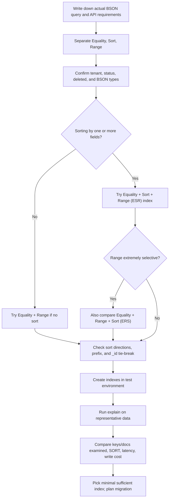

# Designing Indexes for Equality, Sort, and Range Conditions

In applications using **Spring Data MongoDB**, queries rarely filter by just a single field. An order management screen may need to **filter by tenant and status**, **sort by most recent timestamp**, and then take only orders whose **total amount is within a range**. A single-field index on `status` or `totalAmount` may not suffice to support both the filters and the result ordering simultaneously.

MongoDB supports **compound indexes** with multiple ordered keys. Choosing **which field comes first**, **which comes next**, and **the ascending/descending direction** can determine whether a query uses the index to read the right range and return already-sorted data, or must scan many keys, read many documents, and perform an additional sort.

MongoDB's recommended starting guideline is commonly called **ESR — Equality, Sort, Range**:

- **E — Equality:** exact-match fields, such as `tenantId = T1`, `status = PAID`, `deleted = false`.
- **S — Sort:** fields the query needs to sort by, such as `createdAt DESC, _id DESC`.
- **R — Range:** fields with range conditions, such as `totalAmount >= 100`.

ESR is a **heuristic for design and evaluation**, not a rigid rule that every index must obey regardless of workload. If a range predicate is extremely selective, an **Equality–Range–Sort (ERS)** index may be worth testing, even if it forces MongoDB to sort results after filtering. The final decision should rely on the **query shape, real data, and `explain("executionStats")`**.

This lesson belongs to the **Indexes** chapter of the **SPRING_DATA_MONGODB** module: using Spring Data MongoDB to connect, map documents, and query via repositories/`MongoTemplate`, practicing indexing, testing, and performance diagnostics. The focus is on **designing compound indexes for equality, sort, and range conditions**, from BSON queries to implementation and verification in Java.

After completing this lesson, you can:

1. Read a MongoDB query and classify predicates into equality, range, and sort.
2. Explain the impact of **field ordering** and **sort direction** in a compound index.
3. Propose an ESR index and compare it against ERS when range conditions are highly selective.
4. Identify cases where an index supports sorting versus cases where MongoDB requires a `SORT` stage.
5. Design indexes for multi-tenant queries, soft deletes, pagination, and time-range filtering.
6. Distinguish compound indexes, partial indexes, multikey indexes, and covered queries.
7. Create indexes via `mongosh`, Spring Data annotations, or `MongoTemplate.indexOps(...)`.
8. Verify query results with integration tests and evaluate execution plans using `explain`.

## 1. The Problem: Filter Orders, Sort by Time, Select by Price

Suppose the `orders_index_lab` collection contains documents like:

```javascript
{
  _id: ObjectId("665f1f2a4b6c7d8e9f001234"),
  tenantId: "T1",
  status: "PAID",
  deleted: false,
  createdAt: ISODate("2026-11-20T10:00:00Z"),
  totalAmount: NumberDecimal("150.00"),
  customerId: "C-101"
}
```

The application exposes an endpoint:

```text
GET /orders?status=PAID&minAmount=100&sort=createdAt:desc&limit=20
```

The tenant **must not be trusted from the client's query string**; for example, the service obtains `trustedTenantId` from the authenticated security context.

Equivalent query:

```javascript
db.orders_index_lab.find({
  tenantId: "T1",
  status: "PAID",
  deleted: false,
  totalAmount: { $gte: NumberDecimal("100.00") }
})
.sort({ createdAt: -1, _id: -1 })
.limit(20);
```

Classification:

| Component | Field | Category | Meaning |
| --- | --- | --- | --- |
| `tenantId: "T1"` | `tenantId` | Equality | Limits tenant scope |
| `status: "PAID"` | `status` | Equality | Selects only paid orders |
| `deleted: false` | `deleted` | Equality | Excludes soft-deleted orders |
| `sort({createdAt:-1,_id:-1})` | `createdAt`, `_id` | Sort | Newest first, tie-break by ID |
| `totalAmount: {$gte: 100}` | `totalAmount` | Range | Total amount meets threshold |

ESR candidate:

```javascript
db.orders_index_lab.createIndex(
  {
    tenantId: 1,
    status: 1,
    deleted: 1,
    createdAt: -1,
    _id: -1,
    totalAmount: 1
  },
  { name: "idx_orders_esr" }
);
```

Visualizing key order:

```text
tenantId  status  deleted  createdAt↓   _id↓   totalAmount↑
   E       E       E          S          S          R
```

The index can locate the group of documents matching tenant/status/deleted, traverse in the desired time/ID order, and check the amount threshold. **However**, because the range condition is at the end, the query may have to examine many entries below the threshold before gathering 20 results. That is the ESR trade-off to measure.

## 2. Compound Indexes Operate by Key Order

### 2.1. Not an Unordered Set of Fields

The following two indexes are **not equivalent**:

```javascript
{ tenantId: 1, status: 1, createdAt: -1 }

{ createdAt: -1, status: 1, tenantId: 1 }
```

In the first index, MongoDB can locate a contiguous key range sharing `tenantId` and `status`, then read `createdAt` in order within that range.

In the second index, keys are organized primarily by `createdAt` first. To retrieve only one tenant/status, the engine may have to inspect many keys belonging to other tenants and statuses. The index may still be useful for another workload, but it cannot be treated as equivalent to the first index merely because it contains the same three fields.

### 2.2. Prefix Rule (*leftmost prefix*)

Given the index:

```javascript
{ tenantId: 1, status: 1, createdAt: -1 }
```

Illustrative queries:

| Query | Ability to leverage key organization |
| --- | --- |
| `{tenantId:"T1"}` | Matches the `tenantId` prefix |
| `{tenantId:"T1",status:"PAID"}` | Matches the two-field prefix |
| `{tenantId:"T1",status:"PAID"}` + sort `createdAt DESC` | Has opportunity to use index ordering |
| `{status:"PAID"}` | Skips the leading field; lacks the same prefix narrowing advantage |
| `{createdAt:{$gte:date}}` | No equality prefix; must measure actual execution plan |
| `{tenantId:"T1",createdAt:{$gte:date}}` | Can use tenant prefix, but status in the middle affects bounding/sorting on the trailing field |

Saying "does not satisfy the prefix" **does not mean the query can never use the index under any engine or version**. The MongoDB planner has various options and optimizations. The prefix rule helps you **predict efficient usage**, which you then verify with explain.

### 2.3. Equality Comes First Because It Narrows the Key Range

With:

```javascript
{
  tenantId: "T1",
  status: "PAID",
  deleted: false
}
```

the index:

```javascript
{ tenantId: 1, status: 1, deleted: 1, createdAt: -1 }
```

keeps orders matching the equality group together, allowing subsequent traversal in timestamp order.

If a query has equality predicates on all three fields, the **relative** order among those equality fields can often be swapped while preserving the ESR goal for that specific query. However, do not order them arbitrarily:

- If many endpoints **filter only by tenant**, `tenantId` is a crucial leading prefix.
- If other endpoints filter by `tenantId + status` without filtering `deleted`, the order `tenantId, status, deleted` may serve that query group better than `tenantId, deleted, status`.
- Cardinality/selectivity, unique constraints, partial filters, and other query shapes must all be considered.
- Do not blindly assume "the highest-cardinality field must always come first" when full equalities already narrow the slice and the goal includes sort/prefix reuse.

### 2.4. How Does Range Differ from Equality?

A condition such as:

```javascript
{ totalAmount: { $gte: NumberDecimal("100.00") } }
```

typically bounds a **range of keys**, rather than fixing a single value. If you place the range before the sort fields:

```javascript
{ tenantId: 1, status: 1, deleted: 1, totalAmount: 1, createdAt: -1 }
```

the engine can find entries in the amount range efficiently, but entries are spread across **many different totalAmount values**. The `createdAt` order within each amount bucket does not form a global `createdAt` order across buckets. Therefore, sorting by createdAt usually requires an extra sort step, depending on the query and plan.

## 3. The ESR Rule: Equality → Sort → Range

### 3.1. Why Do Sort Fields Usually Precede Range?

With a fixed equality group (`tenantId/status/deleted`), we want the 20 newest orders with total amount ≥ 100.

ESR index:

```javascript
{
  tenantId: 1,
  status: 1,
  deleted: 1,
  createdAt: -1,
  _id: -1,
  totalAmount: 1
}
```

Within the slice sharing the three equalities, entries are already ordered by `createdAt DESC, _id DESC`. MongoDB can traverse in that order and discard documents that do not meet the amount threshold. When eligible for optimization, this avoids a separate **blocking sort** on results.

For queries with `limit(20)` where most orders meet the threshold, the engine can stop as soon as it finds 20 matching results without collecting and sorting the entire candidate set.

**Trade-off:** if very few orders meet the threshold, the ESR index may have to scan many entries to find 20 matches or exhaust the group. ESR optimizes ordering, not necessarily minimizing keys examined.

**An important detail in this example:** `_id` is a unique key and precedes `totalAmount` in the ESR index to serve as the sort tie-breaker. Consequently, `totalAmount` **after `_id`** usually **cannot create an efficient scan range**; its benefit, if any, is mainly having the value present in the index for filtering/covering in suitable plans. Do not assume this longer index is better than a shorter version containing only equality + `createdAt` + `_id`. Test **both the shorter index** and ERS, not just the two longer candidates, and compare `totalKeysExamined`, `totalDocsExamined`, sorting, and write cost. The ESR rule does not guarantee that a trailing range field reduces examined entries.

### 3.2. When to Try ERS?

Equality → Range → Sort index:

```javascript
{
  tenantId: 1,
  status: 1,
  deleted: 1,
  totalAmount: 1,
  createdAt: -1,
  _id: -1
}
```

With `totalAmount >= 100000` where only a tiny fraction of orders qualify, ERS can eliminate most data right during the range scan. The engine then sorts a much smaller set.

| Scenario | ESR worth trying | ERS worth trying |
| --- | --- | --- |
| Fetch 20 newest orders, most orders meet threshold | Yes; benefits from pre-sorted scan | May pay for an unnecessary sort |
| Extremely high threshold, very few orders match | May scan many entries before reaching limit | Can filter via a very narrow range |
| No `sort` | No need to put S before R | Equality + Range is usually the starting point |
| Range condition is on the sort field itself | Can reuse the same key | Not necessarily distinct ESR vs. ERS choices |
| Query changes sort field constantly | One fixed index struggles to optimize every sort | Evaluate main query shapes and reasonable index count |

**There is no fixed "highly selective range" threshold across all collections.** Base your decision on actual keys/documents examined, execution time, memory/sort stage, and write load.

### 3.3. Range Can Be on the Sort Field Itself

For example, finding the newest PAID orders within a time window:

```javascript
db.orders_index_lab.find({
  tenantId: "T1",
  status: "PAID",
  deleted: false,
  createdAt: {
    $gte: ISODate("2026-11-01T00:00:00Z"),
    $lt: ISODate("2026-12-01T00:00:00Z")
  }
})
.sort({ createdAt: -1, _id: -1 })
.limit(20);
```

Here `createdAt` is both the **range field** and the primary sort field. The index:

```javascript
{ tenantId: 1, status: 1, deleted: 1, createdAt: -1, _id: -1 }
```

can bound the time interval on the same key already ordered by `createdAt`, then use `_id` as the tie-breaker. Do not try to insert a duplicate `createdAt` into the compound index in two separate "R" and "S" positions.

## 4. Sort Order and Index Direction

### 4.1. Directions `1` and `-1`

In the index:

```javascript
{ createdAt: -1, _id: -1 }
```

- `1` indicates ascending key order.
- `-1` indicates descending key order.
- With a **single sort field**, MongoDB can scan the index either forward or backward when appropriate.
- With **multiple sort fields**, the relationship between directions across the fields matters.

Example:

```javascript
db.orders_index_lab.createIndex(
  { tenantId: 1, price: 1, createdAt: -1 },
  { name: "idx_tenant_price_asc_created_desc" }
);
```

Once `tenantId = "T1"` is fixed by equality, the index above can serve the sort orders:

```javascript
// Same direction as declared.
.sort({ price: 1, createdAt: -1 })

// Exact inverse of both fields.
.sort({ price: -1, createdAt: 1 })
```

However:

```javascript
// Neither the same direction pattern nor a simultaneous inversion.
.sort({ price: 1, createdAt: 1 })
```

cannot be completely satisfied by that same index ordering. MongoDB may need an additional sort step or select another index.

### 4.2. Equality Fields Do Not Need to Appear in Sort

Index:

```javascript
{ tenantId: 1, status: 1, createdAt: -1, _id: -1 }
```

Query:

```javascript
db.orders_index_lab.find({
  tenantId: "T1",
  status: "PAID"
})
.sort({ createdAt: -1, _id: -1 });
```

The first two fields are **pinned by equality**, so sorting on the subsequent fields can use the index order.

Conversely, if the query only fixes `tenantId = "T1"` and **does not fix `status`**, the index sorts first by status and only then by createdAt. It does not guarantee `createdAt DESC` order **across all statuses**. That is why "skipping a field between the prefix and sort" usually loses full index-supported sorting.

### 4.3. Field Order in `sort` Must Match

With:

```javascript
{ tenantId: 1, status: 1, createdAt: -1, _id: -1 }
```

`sort({createdAt:-1,_id:-1})` clearly benefits after pinning the two equality fields. `sort({_id:-1,createdAt:-1})` is not equivalent: the precedence of the two sort keys is reversed. If an API offers multiple sort modes, identify the common ones and index accordingly; do not expect one index to support arbitrary permutations.

### 4.4. Why Add `_id` as a Tie-Breaker?

Two orders share the same `createdAt`:

```text
Order D: 2026-11-20T11:00:00Z
Order I: 2026-11-20T11:00:00Z
```

If you only sort `createdAt DESC`, the relative order between D and I is **not guaranteed** across reads or planner changes. Adding `_id DESC`:

```javascript
.sort({ createdAt: -1, _id: -1 })
```

produces a deterministic order as long as `_id` is unique. This is especially important for **pagination** to avoid duplicate or skipped records between pages.

**Note:** MongoDB's `_id` is often an ObjectId, but it should not be interpreted as an "exact business timestamp". Sort by `createdAt` first and use `_id` only as a tie-breaker; ObjectId embeds a timestamp component, but it does not replace a business time field.

## 5. Pagination: `skip/limit` and Keyset Pagination

### 5.1. `skip` Can Become Expensive on Deep Pages

Query:

```javascript
db.orders_index_lab.find({
  tenantId: "T1",
  status: "PAID",
  deleted: false
})
.sort({ createdAt: -1, _id: -1 })
.skip(100000)
.limit(20);
```

may still have to traverse/skip a large number of entries before returning 20 results. A suitable index avoids sorting or broad filtering, but **does not eliminate the cost of skipping deep pages**. For cursor-based APIs, consider **keyset pagination**.

### 5.2. Two-Key Cursor on `createdAt` and `_id`

Suppose the previous page ended at:

```javascript
const lastCreatedAt = ISODate("2026-11-20T11:00:00Z");
const lastId = ObjectId("665f1f2a4b6c7d8e9f001234");
```

To fetch records **after** the cursor in descending order:

```javascript
db.orders_index_lab.find({
  tenantId: "T1",
  status: "PAID",
  deleted: false,
  $or: [
    { createdAt: { $lt: lastCreatedAt } },
    {
      createdAt: lastCreatedAt,
      _id: { $lt: lastId }
    }
  ]
})
.sort({ createdAt: -1, _id: -1 })
.limit(20);
```

This is a lexicographical comparison on the `(createdAt, _id)` pair:

```text
createdAt < lastCreatedAt
    OR
(createdAt = lastCreatedAt AND _id < lastId)
```

Tenant/status/deleted stay **outside `$or`**, so every branch enforces the same scope. Putting tenant only inside the first branch would allow the other branch to leak data from other tenants—a far worse bug than slow performance.

The index:

```javascript
{
  tenantId: 1,
  status: 1,
  deleted: 1,
  createdAt: -1,
  _id: -1
}
```

is a strong candidate to evaluate for this cursor query. However, actual efficiency of `$or`/range/cursor depends on the planner; verify with `explain` on representative data.

### 5.3. A Cursor Is Not an Immutable Snapshot

Keyset pagination solves deep-page performance and tie-breaker ordering, but **does not freeze data** between two HTTP requests. If a new document is inserted or a sort field changes between reads, results can still shift according to your data contract. Clearly define consistency expectations and immutability of cursor keys; do not assume a two-field cursor equals a transactional snapshot.

### 5.4. Adding a `totalAmount` Range to the Cursor

You can add:

```javascript
totalAmount: { $gte: NumberDecimal("100.00") }
```

to the same cursor filter. In that case, an ESR index `tenantId/status/deleted/createdAt/_id/totalAmount` preserves cursor-order traversal, though it may examine many records below the amount threshold. ERS can filter amounts early at the expense of weaker sort/cursor ordering. Measure both `keysExamined` and query latency for the pages actually used.

## 6. Common Query Shapes and Index Choices

Do not create indexes merely by listing fields appearing in an API. First classify **query shapes** (filter/sort/projection structures sharing similar semantics).

| Query shape | Filter/sort | Candidate index |
| --- | --- | --- |
| Order lookup by ID | `_id`, plus tenant permission check | Default `_id` index is usually the starting point |
| Latest list | `tenantId,status,deleted` + `createdAt↓,_id↓` | `{tenantId:1,status:1,deleted:1,createdAt:-1,_id:-1}` |
| Latest list with amount ≥ threshold | Equality on tenant/status/deleted, time sort, amount range | ESR or ERS to compare via explain |
| List within date range | Equality + createdAt range + sort createdAt↓,_id↓ | `{tenantId:1,status:1,deleted:1,createdAt:-1,_id:-1}` |
| Lookup by tenant and customerId | Equality on tenant/customerId | `{tenantId:1,customerId:1}` if workload justifies it |
| Filter amount range, **no sort** | Equality + amount range | `{tenantId:1,status:1,deleted:1,totalAmount:1}` |
| Sort by amount↓, createdAt↓ | Equality + sort amount/createdAt | Index with matching sort pattern after equality |

A longer index can support several query shapes via prefixes, but **more fields in an index is not always better**. Adding fields increases index size, raises write cost, and may cause other workloads to use a different index more effectively. Prefer a small set of indexes serving actual access paths, and observe queries before adding a second or third index.

## 7. Conditions That Alter How ESR Applies

### 7.1. `$in` Should Not Always Be Treated as Pure Equality

```javascript
{
  tenantId: "T1",
  status: { $in: ["PAID", "SHIPPED"] }
}
```

`$in` expresses multiple values. For queries with sorting and indexes, MongoDB may use strategies such as scanning multiple key bounds or sorting/merging depending on the execution plan. When the `$in` list grows large, optimization behavior can change and varies across MongoDB versions.

Therefore, **do not assume `$in` is always equivalent to a fixed `status = constant`** for index-backed sorting. Avoid hardcoding a magic `$in` element count threshold; consult the documentation for your server version and measure `explain` on real queries.

### 7.2. `$ne`, `$nin`, and Non-Prefix Regex

Predicates such as:

```javascript
{ status: { $ne: "CANCELLED" } }
{ status: { $nin: ["CANCELLED", "FAILED"] } }
{ customerName: { $regex: "hoa", $options: "i" } }
```

generally lack the simple selectivity or single-key-range properties of equality. A "contains anywhere" case-insensitive regex cannot leverage a B-tree index as effectively as an anchored prefix match. Evaluate these conditions individually rather than mechanically placing them in group E.

### 7.3. `$or` Creates Multiple Branches

```javascript
{
  tenantId: "T1",
  deleted: false,
  $or: [
    { status: "PAID" },
    { totalAmount: { $gte: NumberDecimal("10000") } }
  ]
}
```

The two branches have different structures. MongoDB may need different indexes to optimize each branch or choose another strategy. Do not design a single ESR index for an entire `$or` without inspecting the query plan.

**Security:** keep tenant and soft-delete conditions outside `$or` when they must apply to the entire query. An index cannot fix logic errors or authorization flaws in predicates.

### 7.4. `$expr` Comparing Two Fields

```javascript
{ $expr: { $gt: ["$totalAmount", "$paidAmount"] } }
```

evaluates two values that vary per document, which is not equivalent to comparing `amount > constant`. An index on `totalAmount` does not turn a two-field comparison into a simple contiguous range. You can use other equality fields to narrow candidates, or consider a consistently updated derived field if this query is very common.

## 8. Partial Indexes for Soft-Deleted Data

If most endpoints only read non-deleted documents, consider a **partial index** that indexes only documents matching a fixed condition, such as `deleted = false`.

### 8.1. Full Index vs. Partial Index

Full index:

```javascript
db.orders_index_lab.createIndex(
  {
    tenantId: 1,
    status: 1,
    deleted: 1,
    createdAt: -1,
    _id: -1
  },
  { name: "idx_orders_visible_full" }
);
```

Partial index candidate:

```javascript
db.orders_index_lab.createIndex(
  {
    tenantId: 1,
    status: 1,
    createdAt: -1,
    _id: -1
  },
  {
    name: "idx_orders_visible_partial",
    partialFilterExpression: { deleted: false }
  }
);
```

With a partial index, only documents satisfying `deleted: false` are indexed. If soft-deleted data is substantial, this index can be smaller and reduce storage/write overhead compared to the full index for the same read goal.

However, **the index holds only a subset**, so MongoDB must not use it to return incomplete results. A query must include predicates matching the partial filter (or clearly implying the result set falls within the partial filter) for the planner to safely use it.

Matching example:

```javascript
db.orders_index_lab.find({
  tenantId: "T1",
  status: "PAID",
  deleted: false
})
.sort({ createdAt: -1, _id: -1 });
```

A query **not** filtering `deleted`:

```javascript
db.orders_index_lab.find({
  tenantId: "T1",
  status: "PAID"
});
```

may need both `deleted=true` and `deleted=false` records, so **it cannot treat a partial index containing only `deleted=false` as a complete source**.

### 8.2. Partial Indexes Do Not Automatically Inject Business Filters

If a service **forgets** `deleted: false`, creating a partial index does not make MongoDB implicitly add that filter to the query. A partial index only changes which entries are stored in the index and whether the planner can pick it; it **does not replace application access-control or soft-delete filters**.

When choosing a partial index, also check jobs that read deleted data, audits, recovery flows, and admin tools. They may require another index or accept a different scan plan; never let a partial index eliminate the ability to query recoverable data.

### 8.3. Avoid Creating Overlapping Index Variants

If you already have `idx_orders_visible_full`, a nearly identical partial index might help one query group while adding overhead when writing non-deleted documents. Before creating both:

1. List query shapes needing the full index and query shapes reading only `deleted=false`.
2. Measure dataset sizes for each group.
3. Compare explain plans in a test environment with representative data.
4. Evaluate extra index update and storage costs.
5. Plan migration/removal of redundant indexes according to operational procedures.

Do not create both simply because both are illustrated in a guide.

## 9. Collation and Data Types Affect Index Effectiveness

### 9.1. Indexes with Special Collation

Suppose customer names are searched case-insensitively. MongoDB supports **collation**, but the index collation and query collation must be compatible to use string comparison/sorting rules on String fields.

Illustrative example:

```javascript
db.orders_index_lab.createIndex(
  { tenantId: 1, customerName: 1 },
  {
    name: "idx_tenant_customer_name_vi",
    collation: { locale: "vi", strength: 2 }
  }
);
```

A query needs a matching collation specification:

```javascript
db.orders_index_lab.find({
  tenantId: "T1",
  customerName: "hoa"
})
.collation({ locale: "vi", strength: 2 });
```

The index is not automatically used for string queries with a different collation. In mixed numeric and String indexes, non-String prefix parts may still be useful under specific conditions, but do not assume string sorting/equality remains optimized when collation mismatches.

**Note:** name search in production often has specific locale/normalization requirements; do not pick a collation solely because of an example. Verify actual semantics for Vietnamese diacritics, casing, comparison strength, and MongoDB version.

### 9.2. Decimal128, Double, and String

For currency, these BSON values are **fundamentally different**:

```javascript
{ totalAmount: NumberDecimal("100.00") }
{ totalAmount: 100.0 }
{ totalAmount: "100.00" }
```

Decimal128, Double, and String must not be mixed haphazardly in a collection queried by amount ranges. In particular, if amounts are stored as Strings, a `$gte: NumberDecimal("100")` filter cannot perform numeric comparison against those string values.

MongoDB defines BSON type comparison/ordering rules, and Spring Data has its own converters/mappings. For `BigDecimal`, specify the target BSON type explicitly (such as `FieldType.DECIMAL128`) and audit legacy data before evaluating range indexes.

**Do not try to fix a broken schema by adding an index.** If data has mixed/wrong types, even a fast index cannot make monetary comparisons correct.

### 9.3. Date/Time Strings Do Not Replace BSON Date

`createdAt` should be stored as a **BSON Date** (e.g., mapped from Java `Instant`) when representing a point in time. If some documents store String `"20/11/2026"` and others store BSON Date, date sorting and range queries can yield business-incorrect results.

Likewise, when accepting local dates, compute exact UTC boundaries in the application layer and bind as Date/Instant. Avoid passing timezone-less Strings into indexed queries expecting MongoDB to infer business timezones.

## 10. Multikey Indexes When Fields Are Arrays

If orders have a `tags` or `items` array, an index on the array field becomes a **multikey index** in the respective cases.

```javascript
{
  tenantId: "T1",
  tags: ["priority", "fragile"],
  createdAt: ISODate("2026-11-20T10:00:00Z")
}
```

Example:

```javascript
db.orders_index_lab.createIndex(
  { tenantId: 1, tags: 1, createdAt: -1 },
  { name: "idx_tenant_tags_created" }
);
```

An order with multiple tags can contribute multiple index entries. This index can help when filtering:

```javascript
db.orders_index_lab.find({
  tenantId: "T1",
  tags: "priority"
})
.sort({ createdAt: -1 });
```

However, **do not assume scalar ESR rules apply verbatim** when one of the keys is an array:

- A multikey index creates multiple entries for a single document.
- Whether an index supports sorting with an array depends on bounds and field path relationships; some cases still require a blocking sort.
- MongoDB enforces restrictions on **compound multikey indexes** when multiple indexed keys are arrays in the same document.
- The index can increase write cost when long arrays change.
- Covered queries with multikey indexes have limitations, especially when projecting the array field itself.

If an API filters by tenant/tag and sorts by time, measure that query shape specifically. Do not unconditionally classify `tags` as scalar equality when documents have many elements.

### 10.1. Arrays of Embedded Documents and `$elemMatch`

When `items` is an array of objects:

```javascript
items: [
  { sku: "BK-01", quantity: 3 },
  { sku: "PEN-01", quantity: 0 }
]
```

If a **single element** must simultaneously have `sku = BK-01` and `quantity > 0`, express it explicitly:

```javascript
db.orders_index_lab.find({
  tenantId: "T1",
  items: {
    $elemMatch: {
      sku: "BK-01",
      quantity: { $gt: 0 }
    }
  }
});
```

Using two separate dotted predicates without `$elemMatch` allows the conditions to be satisfied by **different elements** in the array. That is a query correctness bug, not an indexing bug; adding a compound multikey index does not supply `$elemMatch` logic.

## 11. Covered Queries and Projections

A query can be **covered** when MongoDB returns results solely from index entries without reading source documents, subject to query/index conditions and server version.

Consider the index:

```javascript
{ tenantId: 1, status: 1, createdAt: -1, _id: -1 }
```

A query returning only indexed fields:

```javascript
db.orders_index_lab.find(
  { tenantId: "T1", status: "PAID" },
  { _id: 1, tenantId: 1, status: 1, createdAt: 1 }
)
.sort({ createdAt: -1, _id: -1 });
```

can be satisfied largely or completely from the index under matching conditions. When reading explain, `totalDocsExamined = 0` is a key indicator of a covered query plan; merely seeing `IXSCAN` does not mean the query is covered.

If the projection adds `customerName`, which is **not in the index**, the engine must normally fetch the document to return that field. If `_id` is returned by default while not present in the candidate index, that can also prevent covered behavior; define projections explicitly.

**Do not** turn every index into "cover the entire DTO" by adding dozens of fields just to avoid FETCH. Overly wide compound indexes hurt size, memory, and write performance. Consider covered queries only for measured hot workloads.

## 12. Do Not Equate Index Intersection with a Compound Index

Suppose you already have:

```javascript
{ tenantId: 1 }
{ status: 1 }
{ createdAt: -1 }
```

MongoDB may consider execution plans using one or more indexes depending on the query. However, three single-field indexes **are not equivalent** to a compound index:

```javascript
{ tenantId: 1, status: 1, createdAt: -1 }
```

A compound index stores the multi-field key order **within a single structure**, which is especially valuable when a query needs both an equality prefix and subsequent sort order. Index intersection has its own costs and limitations and does not guarantee compound sort order. Use `explain` to see what the planner actually does.

## 13. Spring Data MongoDB: Entity Mapping and Index Creation

Spring Data MongoDB provides annotations to declare indexes on entities and `MongoTemplate.indexOps(...)` to manage indexes in Java. However, **declaring an annotation does not mean the index exists in MongoDB**: automatic index creation depends on application configuration and Spring Data version.

### 13.1. Example Entity

```java
import java.math.BigDecimal;
import java.time.Instant;
import org.bson.types.ObjectId;
import org.springframework.data.annotation.Id;
import org.springframework.data.mongodb.core.index.CompoundIndex;
import org.springframework.data.mongodb.core.mapping.Document;
import org.springframework.data.mongodb.core.mapping.Field;
import org.springframework.data.mongodb.core.mapping.FieldType;

@Document(collection = "orders_index_lab")
@CompoundIndex(
    name = "idx_orders_tenant_status_deleted_time_id",
    def = "{ 'tenantId': 1, 'status': 1, 'deleted': 1, " +
          " 'createdAt': -1, '_id': -1 }"
)
public class IndexedOrder {
    @Id
    private ObjectId id;

    private String labRun;
    private String tenantId;
    private String status;
    private boolean deleted;
    private String customerId;
    private Instant createdAt;

    @Field(targetType = FieldType.DECIMAL128)
    private BigDecimal totalAmount;

    protected IndexedOrder() {}

    public IndexedOrder(
            String labRun,
            String tenantId,
            String status,
            boolean deleted,
            String customerId,
            Instant createdAt,
            BigDecimal totalAmount) {
        this.labRun = labRun;
        this.tenantId = tenantId;
        this.status = status;
        this.deleted = deleted;
        this.customerId = customerId;
        this.createdAt = createdAt;
        this.totalAmount = totalAmount;
    }

    public ObjectId getId() { return id; }
    public String getLabRun() { return labRun; }
    public String getTenantId() { return tenantId; }
    public String getStatus() { return status; }
    public boolean isDeleted() { return deleted; }
    public String getCustomerId() { return customerId; }
    public Instant getCreatedAt() { return createdAt; }
    public BigDecimal getTotalAmount() { return totalAmount; }
}
```

`@CompoundIndex` describes a compound index with equality fields followed by sort fields. In the annotation, `_id` is the **actual BSON field name** for the ID, while `@Id ObjectId id` in Java maps to `_id`.

This is one index choice for the newest-orders listing shape; if the system primarily runs highly selective `totalAmount` range queries, consider a separate ERS index or adjust choices instead of creating endless indexes.

### 13.2. Why Use Decimal128 for `BigDecimal`?

```java
@Field(targetType = FieldType.DECIMAL128)
private BigDecimal totalAmount;
```

This metadata instructs Spring Data to store monetary values as BSON Decimal128, suitable for numeric amount range queries. If you only declare Java `BigDecimal`, **do not assume all BSON data is automatically Decimal128**: converters, field metadata, and historical data may differ.

Inspect using the raw driver in integration tests and `mongosh`:

```javascript
db.orders_index_lab.aggregate([
  {
    $group: {
      _id: { amountType: { $type: "$totalAmount" } },
      documents: { $sum: 1 }
    }
  }
]);
```

### 13.3. Annotation-Based Index Creation Modes

Spring Data has an **auto-index creation** mechanism that can be toggled via configuration. In many modern Spring Data MongoDB releases, you **should not expect** indexes to be created automatically just because `@CompoundIndex` is present unless this setting is enabled.

Example Spring Boot property in supported versions:

```yaml
spring:
  data:
    mongodb:
      auto-index-creation: true
```

This property is suitable for demos or apps with a startup index creation policy. For production, it is usually better to manage indexes through **controlled migrations/deployments**, because an index change can be resource-intensive and affect cluster performance; do not enable auto-index creation for all entities without a plan.

**Check your Spring Boot/Spring Data version** before copying properties and annotations. No build tools are run while authoring this Markdown; compilation/QA happens in a subsequent coordinated step.

### 13.4. Creating Indexes with `MongoTemplate.indexOps(...)`

Spring Data provides:

```java
import org.springframework.data.domain.Sort;
import org.springframework.data.mongodb.core.MongoTemplate;
import org.springframework.data.mongodb.core.index.Index;

public class OrderIndexSetup {
    private final MongoTemplate template;

    public OrderIndexSetup(MongoTemplate template) {
        this.template = template;
    }

    public String ensureListIndex() {
        Index idx = new Index()
            .on("tenantId", Sort.Direction.ASC)
            .on("status", Sort.Direction.ASC)
            .on("deleted", Sort.Direction.ASC)
            .on("createdAt", Sort.Direction.DESC)
            .on("_id", Sort.Direction.DESC)
            .named("idx_orders_tenant_status_deleted_time_id");

        return template.indexOps(IndexedOrder.class)
            .ensureIndex(idx);
    }
}
```

`ensureIndex(...)` is a database index-management operation, distinct from building a `Query` and running find. If an index with the same name already exists with an incompatible definition or options, the operation may error and should be handled as a **schema migration** rather than renaming blindly to create duplicates.

**Important:** in a real codebase, choose one consistent index-management approach. The example above demonstrates the API, not an instruction to invoke `ensureListIndex()` on every HTTP request.

### 13.5. ERS Index via `indexOps`

To **experiment** with placing the range before the sort:

```java
import org.springframework.data.domain.Sort;
import org.springframework.data.mongodb.core.index.Index;

Index ers = new Index()
    .on("tenantId", Sort.Direction.ASC)
    .on("status", Sort.Direction.ASC)
    .on("deleted", Sort.Direction.ASC)
    .on("totalAmount", Sort.Direction.ASC)
    .on("createdAt", Sort.Direction.DESC)
    .on("_id", Sort.Direction.DESC)
    .named("idx_orders_ers");

String name = template.indexOps(IndexedOrder.class)
    .ensureIndex(ers);
```

Execute this only within an **index-management method/configuration with a valid `template`**. When using both ESR and ERS indexes in a lab, remember both consume space and write maintenance. After measuring on a representative workload, production should retain only indexes with clear benefit rather than keeping all tutorial examples.

### 13.6. Verifying the Index Actually Exists

In `mongosh`:

```javascript
db.orders_index_lab.getIndexes();
```

Or via Spring Data:

```java
var indexInfo = template.indexOps(IndexedOrder.class)
    .getIndexInfo();

for (var info : indexInfo) {
    System.out.println(info.getName());
}
```

`getIndexInfo()` reports the index metadata currently stored by MongoDB. Do not treat an application log saying "loaded entity with `@CompoundIndex`" as proof the index was created on the server.

## 14. Building Queries with `MongoTemplate` and `Criteria`

### 14.1. Newest-Orders Query

```java
import java.util.List;
import org.springframework.data.domain.Sort;
import org.springframework.data.mongodb.core.MongoTemplate;
import org.springframework.data.mongodb.core.query.Criteria;
import org.springframework.data.mongodb.core.query.Query;

public List<IndexedOrder> recentPaidOrders(
        MongoTemplate template,
        String trustedTenantId,
        int limit) {

    if (trustedTenantId == null || trustedTenantId.isBlank()) {
        throw new IllegalArgumentException("Invalid tenant");
    }
    if (limit < 1 || limit > 100) {
        throw new IllegalArgumentException("Limit out of range");
    }

    Criteria scope = Criteria.where("tenantId")
        .is(trustedTenantId)
        .and("status").is("PAID")
        .and("deleted").is(false);

    Query query = Query.query(scope)
        .with(Sort.by(
            Sort.Order.desc("createdAt"),
            Sort.Order.desc("id")
        ))
        .limit(limit);

    return template.find(query, IndexedOrder.class);
}
```

`Sort.Order.desc("id")` uses the entity's **Java property**, which maps to BSON `_id` in queries based on `IndexedOrder.class`. In raw `mongosh`, use `_id` directly. Keep this difference in mind when comparing Java code against BSON query plans.

### 14.2. Adding a `totalAmount` Range When a Threshold Is Provided

```java
import java.math.BigDecimal;

public List<IndexedOrder> recentPaidOrdersAtLeast(
        MongoTemplate template,
        String trustedTenantId,
        BigDecimal minimumAmount,
        int limit) {

    if (trustedTenantId == null || trustedTenantId.isBlank()) {
        throw new IllegalArgumentException("Invalid tenant");
    }
    if (minimumAmount == null || minimumAmount.signum() < 0) {
        throw new IllegalArgumentException("Invalid minimum amount");
    }
    if (limit < 1 || limit > 100) {
        throw new IllegalArgumentException("Limit out of range");
    }

    Query query = Query.query(
        Criteria.where("tenantId").is(trustedTenantId)
            .and("status").is("PAID")
            .and("deleted").is(false)
    );

    query.addCriteria(
        Criteria.where("totalAmount").gte(minimumAmount)
    );
    query.with(Sort.by(
        Sort.Order.desc("createdAt"),
        Sort.Order.desc("id")
    ));
    query.limit(limit);

    return template.find(query, IndexedOrder.class);
}
```

Spring Data binds `BigDecimal` according to `IndexedOrder.totalAmount`'s mapping, which has the Decimal128 annotation. Do not manually convert `minimumAmount` to String `"100.00"` when numeric comparison is intended; verify raw BSON in tests.

### 14.3. Query with Start/End Time Window

```java
import java.time.Instant;

public List<IndexedOrder> ordersInPeriod(
        MongoTemplate template,
        String trustedTenantId,
        Instant fromInclusive,
        Instant toExclusive,
        int limit) {

    if (trustedTenantId == null || trustedTenantId.isBlank()
            || fromInclusive == null || toExclusive == null
            || !fromInclusive.isBefore(toExclusive)
            || limit < 1 || limit > 100) {
        throw new IllegalArgumentException("Invalid filter");
    }

    Query query = Query.query(
        Criteria.where("tenantId").is(trustedTenantId)
            .and("status").is("PAID")
            .and("deleted").is(false)
            .and("createdAt")
                .gte(fromInclusive)
                .lt(toExclusive)
    )
    .with(Sort.by(
        Sort.Order.desc("createdAt"),
        Sort.Order.desc("id")
    ))
    .limit(limit);

    return template.find(query, IndexedOrder.class);
}
```

A half-open interval `[fromInclusive, toExclusive)` lets you chain consecutive periods without overlapping endpoints; there is no need to subtract one millisecond from the end date. When clients send local dates, the service must convert them into proper `Instant` values before calling the repository/template.

### 14.4. Repository Derived Queries and Pagination

When queries have fixed predicates, you can use a repository:

```java
import org.bson.types.ObjectId;
import org.springframework.data.domain.Pageable;
import org.springframework.data.domain.Slice;
import org.springframework.data.mongodb.repository.MongoRepository;

public interface IndexedOrderRepository
        extends MongoRepository<IndexedOrder, ObjectId> {

    Slice<IndexedOrder> findByTenantIdAndStatusAndDeletedFalse(
        String tenantId,
        String status,
        Pageable pageable);
}
```

The service passes a `Pageable` with sort `createdAt DESC, id DESC` and a bounded page size. If using `Page<IndexedOrder>`, the API may need a count query to compute total pages—another cost to evaluate. `Slice` avoids the total-page-count contract but **can still use offset/skip** via `Pageable`; it does not automatically become keyset pagination.

For explicit cursor-based keyset pagination, use a query with cursor predicates or the keyset feature appropriate to your Spring Data version, and test ordering/bounds. Do not use overly long derived method names to hide a complex `$or` pagination filter.

## 15. `mongosh` Lab: Designing, Creating, and Comparing Indexes

This section uses the test database `spring_data_training` and collection `orders_index_lab`. Each session creates a `labRun` marker and two randomized tenants to isolate data. **Do not practice in production**, do not drop shared collections, and do not rename indexes managed by other systems.

### 15.1. Seeding a Dataset with Equality, Sort, and Range Conditions

Open `mongosh` on a learning MongoDB instance:

```javascript
use spring_data_training

const orders = db.getCollection("orders_index_lab");
const labRun = "indexes-002-" + new ObjectId().toHexString();
const tenant1 = labRun + "-T1";
const tenant2 = labRun + "-T2";

function order(
  label, tenantId, status, deleted,
  createdAt, totalAmount, customerId
) {
  return {
    labRun: labRun,
    tenantId: tenantId,
    label: label,
    status: status,
    deleted: deleted,
    createdAt: ISODate(createdAt),
    totalAmount: NumberDecimal(totalAmount),
    customerId: customerId
  };
}

orders.insertMany([
  order("A", tenant1, "PAID", false,
        "2026-11-20T08:00:00Z", "40.00", "C-01"),
  order("B", tenant1, "PAID", false,
        "2026-11-20T09:00:00Z", "120.00", "C-02"),
  order("C", tenant1, "PAID", false,
        "2026-11-20T10:00:00Z", "220.00", "C-03"),
  order("D", tenant1, "PAID", false,
        "2026-11-20T11:00:00Z", "150.00", "C-04"),
  order("E", tenant1, "PAID", false,
        "2026-11-20T12:00:00Z", "70.00", "C-05"),
  order("F", tenant1, "NEW", false,
        "2026-11-20T13:00:00Z", "300.00", "C-06"),
  order("G", tenant1, "PAID", true,
        "2026-11-20T14:00:00Z", "350.00", "C-07"),
  order("H", tenant2, "PAID", false,
        "2026-11-20T15:00:00Z", "500.00", "C-08"),
  order("I", tenant1, "PAID", false,
        "2026-11-20T11:00:00Z", "180.00", "C-09"),
  order("J", tenant1, "PAID", false,
        "2026-11-20T06:00:00Z", "300.00", "C-10"),
  order("K", tenant1, "PAID", false,
        "2026-11-20T16:00:00Z", "90.00", "C-11")
]);

printjson({
  labRun: labRun,
  tenant1: tenant1,
  tenant2: tenant2
});

print(orders.countDocuments({ labRun: labRun }));
// Expected: 11.
```

Keep the same `mongosh` session for the following commands, because `labRun`, `tenant1`, and `tenant2` are JavaScript variables scoped to this session.

### 15.2. Equality + Sort Query, Without Range

```javascript
const visiblePaid = {
  labRun: labRun,
  tenantId: tenant1,
  status: "PAID",
  deleted: false
};

const byTime = { createdAt: -1, _id: -1 };

const sorted = orders.find(
  visiblePaid,
  { _id: 1, label: 1, createdAt: 1, totalAmount: 1 }
).sort(byTime).toArray();

printjson(sorted.map(d => d.label));
```

Documents eligible to appear: **A, B, C, D, E, I, J, K**. F is not PAID, G is soft-deleted, and H belongs to tenant2.

By timestamp, K at 16:00 comes first, E at 12:00 next, D and I share 11:00, then C at 10:00, B at 09:00, A at 08:00, and J at 06:00. **Do not guess in advance whether D or I comes first**: since they share the same timestamp, their relative order is determined by their generated `_id` values.

Verify the logic programmatically:

```javascript
const expectedLabels = ["A", "B", "C", "D", "E", "I", "J", "K"];

const actualSorted = sorted.map(d => d.label).sort();

printjson({
  expectedLabels: expectedLabels,
  actualSorted: actualSorted,
  sameSet: JSON.stringify(expectedLabels) ===
           JSON.stringify(actualSorted)
});
// Expected sameSet: true.
```

### 15.3. Adding Amount Range and Limiting Results

```javascript
const minAmount = NumberDecimal("100.00");

const paidAtLeast100 = {
  ...visiblePaid,
  totalAmount: { $gte: minAmount }
};

const selected = orders.find(
  paidAtLeast100,
  { _id: 1, label: 1, createdAt: 1, totalAmount: 1 }
).sort(byTime).toArray();

printjson(selected.map(d => d.label));
// Expected exactly five labels: B, C, D, I, J.
// D and I share createdAt 11:00 and are ordered by _id.
```

Here A, E, and K are excluded because `totalAmount` is below 100. F/G/H are excluded by equality filters. Check count:

```javascript
print(selected.length); // 5
```

Test `limit(2)`:

```javascript
const firstTwo = orders.find(
  paidAtLeast100,
  { _id: 1, label: 1 }
).sort(byTime).limit(2).toArray();

printjson(firstTwo.map(d => d.label));
// Expected the two elements D and I, ordered by _id.
```

Even when using ERS, MongoDB must still guarantee the exact same result set and order regardless of differences in query plan implementation.

### 15.4. Creating Three Candidate Indexes in the Lab

To compare strategies, use **three lab-specific index names**:

```javascript
orders.createIndex(
  {
    tenantId: 1,
    status: 1,
    deleted: 1,
    createdAt: -1,
    _id: -1
  },
  { name: "lab_idx_002_equality_sort" }
);

orders.createIndex(
  {
    tenantId: 1,
    status: 1,
    deleted: 1,
    createdAt: -1,
    _id: -1,
    totalAmount: 1
  },
  { name: "lab_idx_002_esr" }
);

orders.createIndex(
  {
    tenantId: 1,
    status: 1,
    deleted: 1,
    totalAmount: 1,
    createdAt: -1,
    _id: -1
  },
  { name: "lab_idx_002_ers" }
);

printjson(orders.getIndexes()
  .filter(i => i.name.startsWith("lab_idx_002_")));
```

These are merely three **candidates for comparison**, not a recommendation to keep all three in production. Indexes are collection-scoped, **not scoped to `labRun`**; use a dedicated lab collection or ensure index-management permission if sharing an environment.

### 15.5. Using `explain("executionStats")` and Intentional `hint`

No need to guess which index the planner chooses. Inspect the plan:

```javascript
const baselinePlan = orders.find(paidAtLeast100)
  .sort(byTime)
  .limit(2)
  .explain("executionStats");

printjson(baselinePlan);
```

To compare each candidate **in the lab**:

```javascript
const planEqualitySort = orders.find(paidAtLeast100)
  .sort(byTime)
  .limit(2)
  .hint("lab_idx_002_equality_sort")
  .explain("executionStats");

const planESR = orders.find(paidAtLeast100)
  .sort(byTime)
  .limit(2)
  .hint("lab_idx_002_esr")
  .explain("executionStats");

const planERS = orders.find(paidAtLeast100)
  .sort(byTime)
  .limit(2)
  .hint("lab_idx_002_ers")
  .explain("executionStats");

printjson({
  equalitySort: planEqualitySort.executionStats,
  esr: planESR.executionStats,
  ers: planERS.executionStats
});
```

Compare metrics such as `totalKeysExamined`, `totalDocsExamined`, `nReturned`, execution time, and whether a **blocking SORT** occurs. The shape of `winningPlan` can vary by version and engine; look for equivalent stages rather than assuming a single JSON key named `SORT` always exists.

**Warning about `hint`:** it is used here to force testing each candidate, not as advice to hardcode `hint` in production queries. An inappropriate hint can slow queries down when data distribution changes. After testing, re-run the query **without hint** to observe MongoDB's default plan selection.

### 15.6. Time Query Acting as Both Range and Sort

```javascript
const windowQuery = {
  labRun: labRun,
  tenantId: tenant1,
  status: "PAID",
  deleted: false,
  createdAt: {
    $gte: ISODate("2026-11-20T09:00:00Z"),
    $lt: ISODate("2026-11-20T12:00:00Z")
  }
};

const inWindow = orders.find(
  windowQuery,
  { _id: 1, label: 1, createdAt: 1 }
).sort(byTime).toArray();

printjson(inWindow.map(d => d.label));
// Expected: B, C, D, and I (descending by time, D/I by _id).
```

Index `lab_idx_002_equality_sort` is a candidate for this query because the same `createdAt` field both bounds the range and determines the sort order.

### 15.7. Wrong Tenant or Wrong Status Must Not Leak Into Results

```javascript
print(orders.countDocuments({
  ...paidAtLeast100,
  tenantId: tenant2
}));
// Expected: 1 (document H of tenant2).

print(orders.countDocuments({
  ...paidAtLeast100,
  status: "NEW"
}));
// Expected: 1 (document F).
```

Having T2/NEW documents that satisfy the range condition proves why equality filters are **business and security constraints**, not mere optimization hints. When the main query uses `tenant1` and `status=PAID`, these two documents must be excluded despite high amounts and recent timestamps.

### 15.8. Checking BSON Types

```javascript
const typeDistribution = orders.aggregate([
  { $match: { labRun: labRun } },
  {
    $group: {
      _id: {
        amountType: { $type: "$totalAmount" },
        createdType: { $type: "$createdAt" }
      },
      documentCount: { $sum: 1 }
    }
  }
]).toArray();

printjson(typeDistribution);
// Expected one group: decimal / date, documentCount=11.
```

This is a data audit, not an index optimization metric. Indexes are only meaningful when BSON types support the intended business comparisons.

### 15.9. Safe Data Cleanup and Index Management

```javascript
const beforeCleanup = orders.countDocuments({ labRun: labRun });
print("Test documents to delete: " + beforeCleanup);

const removed = orders.deleteMany({ labRun: labRun });
printjson({ deletedCount: removed.deletedCount });

print(orders.countDocuments({ labRun: labRun })); // 0
```

Cleanup **deletes only documents matching the session marker**. Never run `deleteMany({})` or `drop()` if the collection could contain other people's data.

**Indexes are collection-level resources:** deleting fixtures does not drop the `lab_idx_002_*` indexes. If using a dedicated lab database/collection with admin privileges, consider dropping test indexes after benchmarking; on a shared collection, do not drop indexes without verifying ownership and impact on other users.

## 16. Reading `explain` Through Business Goals

`explain("executionStats")` is not just for spotting the word `IXSCAN`. A plan using an index can still scan many entries or require a huge sort.

### 16.1. Key Indicators

| Indicator / Observation | Meaning | Question to Answer |
| --- | --- | --- |
| `winningPlan` | Plan chosen by the planner | Which index, and are there FETCH/SORT/scan stages? |
| `executionStats.nReturned` | Documents actually returned | Matches `limit` and query contract? |
| `totalKeysExamined` | Index entries scanned | Does the index prune data early enough? |
| `totalDocsExamined` | Documents read/inspected | Scanning too broadly to return very few docs? |
| `executionTimeMillis` | Explain execution time | Stable on representative data and load? |
| `SORT`/`IXSCAN`/`COLLSCAN` stages | Execution path details | Any blocking sort or collection scan? |
| `indexBounds` (if present) | Key ranges scanned | Are equality/range bounds exploited properly? |
| Index metadata | Key pattern and options | Correct direction, collation, partial filter? |

Fields and their nesting can vary across MongoDB versions and execution engines; avoid writing brittle tests tied to one exact `winningPlan` JSON path across environments.

### 16.2. Why Small `nReturned` Does Not Guarantee a Fast Query

Suppose there are 10 million PAID orders in T1, and only 100 have amount ≥ 100000. A query fetches the 10 newest orders in that amount bracket.

- An **ESR** index returns sorted results directly, but may scan millions of PAID orders with lower amounts.
- An **ERS** index can scan only orders in the narrow amount range, then sort the 100-record set.
- With `limit(10)`, a blocking sort may use top-k logic in some plans, though it still must inspect all matching candidates.

Compare **total cost**, not merely the rule "avoid SORT at all costs".

### 16.3. Why High `totalDocsExamined` Is Not Always an Index Bug

If an endpoint genuinely needs to return 20,000 full documents, reading many documents is expected. The ratio of `docsExamined` to `nReturned` depends on projection, sort, filter, index coverage, and business requirements.

A query returning 20 documents with `docsExamined = 500000` warrants investigation; a query returning 500000 documents and examining 500000 documents simply reflects an API requesting huge payloads. In that case, review pagination, projection, and use cases—not just index order.

### 16.4. Comparing in a Representative Environment

A meaningful comparison should hold constant:

1. Exact same query and exact same dataset.
2. Same projection, sort, limit, and collation.
3. Comparable background mutation rate and concurrency where possible.
4. Recorded keys/docs examined, sort stages, execution times, and index sizes.
5. Repeated measurements, distinguishing cold vs. warm cache and normal variance.
6. Write workload impact, since indexes incur maintenance cost whenever indexed fields change.

`hint` helps compare candidates in test environments, but does not replace MongoDB's planner choice in production. Avoid changing indexes on gut feeling after seeing a few milliseconds difference on eleven documents.

### 16.5. Do Not Judge Performance by `explain` Alone

Beyond explain, real applications must monitor:

- Service/API latency, including network and Java deserialization.
- CPU, I/O, cache, and memory under concurrent requests.
- Index build/maintenance overhead and replication impact.
- Write cost when documents update indexed fields.
- Payload volume over the network, DTO size, and deep pagination frequency.

The ultimate goal is **application SLA and correctness**, not maximizing a single number inside explain output.

## 17. Spring Data MongoDB Integration Testing

To verify that Java code produces the expected BSON queries and results, test against a real MongoDB instance or Testcontainers MongoDB. Unit tests checking strings inside `@CompoundIndex` are insufficient for verifying Decimal128, `@Id` mapping, sorting, and cross-tenant isolation.

### 17.1. Test Case Matrix

| Case | Condition | Required Assertion |
| --- | --- | --- |
| Valid equality | T1, PAID, deleted=false | Only records matching all three |
| Wrong tenant | H in T2 with matching status and high amount | Excluded from T1 results |
| Wrong status | F is NEW | Excluded from PAID |
| Soft-deleted | G has deleted=true | Not returned |
| Amount range | Amount ≥ 100 | B, C, D, I, J returned |
| Exact threshold | Amount=100, min=100 | Included by `$gte` |
| Time sort | createdAt descending | Newer records appear first |
| Tie-break | D and I share timestamp | Ordered by `_id DESC` |
| Date window | `[from,to)` | Inclusive start, exclusive end |
| Pagination | Limit=2 | Exact top two records in order |
| Money BSON type | `BigDecimal` | Stored as raw BSON Decimal128 |
| Wrong BSON type | String instead of Decimal128 | Detected; not treated as valid numeric query |
| Index exists | Server metadata | `getIndexes()`/`indexOps.getIndexInfo()` matches keys |
| Query plan | Sufficiently large dataset | Compare ESR/ERS via explain; do not hard-assert plan on tiny fixtures |

### 17.2. `@DataMongoTest` and JUnit 5 Example

The test snippet below assumes a Spring Boot project connected to an **isolated test database**. Imports for `@DataMongoTest` and test environment setup may vary by Spring Boot version. Place the `IndexedOrder` entity from section 13 in the appropriate main/test source directory.

```java
import static org.junit.jupiter.api.Assertions.*;
import static com.mongodb.client.model.Filters.eq;

import java.math.BigDecimal;
import java.time.Instant;
import java.util.Comparator;
import java.util.List;
import java.util.Set;
import java.util.UUID;
import java.util.stream.Stream;
import org.bson.Document;
import org.bson.types.Decimal128;
import org.bson.types.ObjectId;
import org.junit.jupiter.api.Test;
import org.springframework.beans.factory.annotation.Autowired;
import org.springframework.boot.test.autoconfigure.data.mongo.DataMongoTest;
import org.springframework.data.domain.Sort;
import org.springframework.data.mongodb.core.MongoTemplate;
import org.springframework.data.mongodb.core.query.Criteria;
import org.springframework.data.mongodb.core.query.Query;

@DataMongoTest
class CompoundIndexQueryIntegrationTest {

    @Autowired
    MongoTemplate template;

    private IndexedOrder insert(
            String run, String tenant, String status,
            boolean deleted, String timestamp, String amount) {
        return template.insert(new IndexedOrder(
            run,
            tenant,
            status,
            deleted,
            "customer-" + run,
            Instant.parse(timestamp),
            new BigDecimal(amount)
        ));
    }

    private Query filter(
            String tenant, BigDecimal minimum, int limit) {
        Query query = Query.query(
            Criteria.where("tenantId").is(tenant)
                .and("status").is("PAID")
                .and("deleted").is(false)
        );
        if (minimum != null) {
            query.addCriteria(
                Criteria.where("totalAmount").gte(minimum)
            );
        }
        query.with(Sort.by(
            Sort.Order.desc("createdAt"),
            Sort.Order.desc("id")
        ));
        query.limit(limit);
        return query;
    }

    private void cleanup(String run) {
        template.remove(
            Query.query(Criteria.where("labRun").is(run)),
            IndexedOrder.class
        );
    }

    @Test
    void equalityRangeAndSortWorkTogether() {
        String run = UUID.randomUUID().toString();
        String tenant1 = run + "-T1";
        String tenant2 = run + "-T2";

        IndexedOrder a = insert(
            run, tenant1, "PAID", false,
            "2026-11-20T08:00:00Z", "40.00"
        );
        IndexedOrder b = insert(
            run, tenant1, "PAID", false,
            "2026-11-20T09:00:00Z", "120.00"
        );
        IndexedOrder c = insert(
            run, tenant1, "PAID", false,
            "2026-11-20T10:00:00Z", "220.00"
        );
        IndexedOrder d = insert(
            run, tenant1, "PAID", false,
            "2026-11-20T11:00:00Z", "150.00"
        );
        IndexedOrder i = insert(
            run, tenant1, "PAID", false,
            "2026-11-20T11:00:00Z", "180.00"
        );
        IndexedOrder j = insert(
            run, tenant1, "PAID", false,
            "2026-11-20T06:00:00Z", "300.00"
        );
        insert(
            run, tenant1, "NEW", false,
            "2026-11-20T13:00:00Z", "500.00"
        );
        insert(
            run, tenant1, "PAID", true,
            "2026-11-20T14:00:00Z", "500.00"
        );
        insert(
            run, tenant2, "PAID", false,
            "2026-11-20T15:00:00Z", "500.00"
        );

        try {
            List<IndexedOrder> result = template.find(
                filter(tenant1, new BigDecimal("100.00"), 100),
                IndexedOrder.class
            );

            Set<ObjectId> actualIds = result.stream()
                .map(IndexedOrder::getId)
                .collect(java.util.stream.Collectors.toSet());

            Set<ObjectId> expectedIds = Set.of(
                b.getId(), c.getId(), d.getId(),
                i.getId(), j.getId()
            );

            assertEquals(expectedIds, actualIds);
            assertFalse(actualIds.contains(a.getId()));

            Comparator<IndexedOrder> latestFirst =
                Comparator.comparing(IndexedOrder::getCreatedAt)
                    .thenComparing(IndexedOrder::getId)
                    .reversed();

            List<ObjectId> expectedOrder = Stream.of(
                    b, c, d, i, j
                )
                .sorted(latestFirst)
                .map(IndexedOrder::getId)
                .toList();

            assertEquals(
                expectedOrder,
                result.stream()
                    .map(IndexedOrder::getId)
                    .toList()
            );

            Document raw = template
                .getCollection("orders_index_lab")
                .find(eq("_id", b.getId()))
                .first();

            assertNotNull(raw);
            assertTrue(
                raw.get("totalAmount") instanceof Decimal128
            );
        } finally {
            cleanup(run);
        }
    }

    @Test
    void limitKeepsSortAndDoesNotLeakAnotherTenant() {
        String run = UUID.randomUUID().toString();
        String t1 = run + "-T1";
        String t2 = run + "-T2";

        IndexedOrder older = insert(
            run, t1, "PAID", false,
            "2026-11-20T08:00:00Z", "120.00"
        );
        IndexedOrder newer = insert(
            run, t1, "PAID", false,
            "2026-11-20T12:00:00Z", "120.00"
        );
        insert(
            run, t2, "PAID", false,
            "2026-11-20T15:00:00Z", "999.00"
        );

        try {
            List<IndexedOrder> one = template.find(
                filter(t1, new BigDecimal("100"), 1),
                IndexedOrder.class
            );
            assertEquals(1, one.size());
            assertEquals(newer.getId(), one.get(0).getId());
            assertNotEquals(older.getId(), one.get(0).getId());
        } finally {
            cleanup(run);
        }
    }
}
```

In this test:

- Test data for T1/T2 uses unique tenant values per run.
- `Set` verifies the **exact ID set**, while list assertion verifies **exact order**.
- Records D and I with identical `createdAt` are sorted by their actual ObjectId values rather than assuming D always precedes I.
- Reading the raw `Document` confirms `BigDecimal` is stored as Decimal128.
- Test documents are cleaned up by marker in `finally`.

**This is instructional code and was not executed during authoring.** The test does not assert that `winningPlan` must always use a specific index, because MongoDB may choose a collection scan on a tiny fixture. To test performance/index selection, use representative data and run explain separately.

### 17.3. Verifying Index Metadata in Integration Tests

In an environment with index-management permissions where indexes have been created by migration or `indexOps`:

```java
var names = template.indexOps(IndexedOrder.class)
    .getIndexInfo()
    .stream()
    .map(info -> info.getName())
    .toList();

assertTrue(
    names.contains("idx_orders_tenant_status_deleted_time_id")
);
```

Use this assertion only if the test **ensures index creation** in setup. Do not claim `@CompoundIndex` auto-creates indexes when auto-index creation is disabled. In migration-managed environments, run the test migration step before asserting.

## 18. Common Mistakes When Choosing Compound Indexes

| Symptom | Possible Cause | Fix |
| --- | --- | --- |
| Index has all fields, yet query still scans broadly | Field order mismatches equality prefix/sort/range | Classify query shape, reorder keys, measure explain |
| Plan shows `IXSCAN`, yet query is still slow | High `keysExamined` or heavy `FETCH`/sort | Read full executionStats, not just stage names |
| ESR scans too many entries | Range is highly selective and follows sort | Try ERS or a shorter index/alternative access path |
| ERS shows a `SORT` stage | Range precedes sort, losing global sort order | Weigh sort cost vs. fewer entries scanned; test ESR |
| Adding `totalAmount` after unique `_id` does not reduce scan | Range key sits behind unique tie-breaker | Test shorter index; drop long index if no gain |
| `createdAt` sort ignores index despite containing the field | A leading field before sort in compound index lacks equality | Adjust query or try an index matching the query shape |
| Two-field sort has wrong direction | Index has `{a:1,b:-1}` while query sorts `{a:1,b:1}` | Match the sign pattern or invert both directions together |
| Page 1 and 2 have duplicates or missing records | `createdAt` sort lacks a deterministic tie-breaker | Add `_id` tie-breaker, consider keyset pagination |
| Deep pages are slow | `skip` still scans/discards many entries | Use keyset/cursor pagination if UX allows |
| Query returns records from another tenant | Missing tenant filter or placed in wrong `$or` branch | Put trusted tenant scope outside `$or` |
| Planner ignores partial index | Query does not imply `deleted=false` from partialFilter | Inspect query filter and index metadata |
| Created partial index, API still returns deleted=true | Index does not replace soft-delete filter | Add `deleted=false` to business query |
| `@CompoundIndex` is in code, missing in DB | Auto-index creation disabled or migration not run | Verify with `getIndexes`/`getIndexInfo` and deploy index |
| Wrong index after renaming property | `@Field` or schema changed BSON field name | Verify physical keys in metadata, migrations, and tests |
| String query misses collation index | Query collation mismatches index collation | Align collation semantics |
| Monetary query returns wrong results | BSON amount mixes String/Double/Decimal128 | Standardize schema and audit raw BSON |
| Erratic date sorting | `createdAt` stored as String or timezone mishandled | Store BSON Date, normalize `Instant` |
| Array index increases write cost | Multikey creates many entries, large arrays | Control array growth and query shape |
| Two dotted predicates on array give false positives | Conditions match across two different elements | Use `$elemMatch` as required |
| Many nearly identical indexes created | Each experiment adds an index without cleanup | Inventory indexes, measure ROI, drop redundant ones |
| Test fails because MongoDB picks collection scan on 11 docs | Planner chooses cheap scan for tiny datasets | Test correctness separately; benchmark on representative data |
| Hardcoded hint slows production queries over time | Hint forces index despite shifting data distribution | Hint only with operational justification and ongoing monitoring |

### 18.1. Logic Bugs Must Be Fixed Before Performance Bugs

Example:

```javascript
{
  $or: [
    { tenantId: "T1", status: "PAID" },
    { totalAmount: { $gte: NumberDecimal("10000") } }
  ]
}
```

The second branch can return orders from other tenants. No compound index can infer user access control to filter out this invalid result. Before optimizing with ESR/ERS, fix the filter so **tenant** and mandatory predicates apply to every branch.

### 18.2. Do Not Use Indexes to Mask Poor Schema Quality

If `status` has inconsistent values, `deleted` is occasionally missing, `createdAt` is a String in some documents, and `totalAmount` mixes Decimal128/Double, key ordering cannot guarantee business-correct results.

Index design must go hand in hand with:

- BSON field format conventions.
- Java mapping with explicit metadata.
- Write-path validation.
- Historical data migrations when needed.
- Integration tests inspecting raw BSON.

## 19. A Repeatable Index Selection Process



### 19.1. Checklist Before Creating a Production Index

1. **Query shape**: have you recorded exact filter, sort, projection, limit, and collation?
2. **E**: which equality fields appear across endpoints? Is the prefix order appropriate?
3. **S**: which fields are sorted and in which direction? Is `_id` needed as tie-breaker?
4. **R**: which range fields exist and how selective are they? Is a range sitting behind a unique key?
5. **ESR/ERS**: have you measured sort benefit vs. range selectivity instead of guessing?
6. **Partial/soft-delete**: do queries include predicates implying the partial filter?
7. **Collation**: do String comparisons share identical semantics between index and query?
8. **BSON**: are monetary values and timestamps stored in consistent types?
9. **Multikey**: are any fields arrays, subject to compound multikey/sort restrictions?
10. **Pagination**: are there deep-page queries, cursors, and deterministic tie-breakers?
11. **Write cost**: how does adding the index affect inserts/updates/deletes and replication?
12. **Lifecycle management**: who creates, verifies, rolls back, or drops redundant indexes?
13. **Security**: are tenant and soft-delete filters enforced properly, including inside `$or`?
14. **Measurement**: do you have `explain` and telemetry on representative datasets and load?
15. **Testing**: do fixtures verify exact result correctness before evaluating plans?

## 20. Practice Exercises

**Exercise 1 — ESR classification.** Given a query filtering `tenantId = T1`, `status = PAID`, sorted `createdAt DESC`, `amount >= 100`, list E/S/R components. Propose an ESR index and explain the role of each key segment.

**Exercise 2 — Swapping order.** Compare `{tenantId:1,status:1,createdAt:-1}` vs. `{createdAt:-1,status:1,tenantId:1}` for a query with tenant+status equality and createdAt sort. Explain the difference in prefix organization.

**Exercise 3 — ESR or ERS?** A dataset has 10 million PAID orders for T1; only 100 orders have amount ≥ 100000. The query fetches the 10 newest matching orders. Propose ESR and ERS indexes, identify what to measure, and explain why you cannot decide by rule name alone.

**Exercise 4 — Unique key before range.** In `{tenantId:1,status:1,createdAt:-1,_id:-1,totalAmount:1}`, explain why trailing `totalAmount` usually cannot effectively bound scans by amount. Compare with a shorter index ending at `_id`.

**Exercise 5 — Bidirectional sort.** Given `{tenantId:1,price:1,createdAt:-1}` and tenant equality, examine `{price:1,createdAt:-1}`, `{price:-1,createdAt:1}`, and `{price:1,createdAt:1}`. Which patterns match the index order or its reverse?

**Exercise 6 — Range overlapping sort.** Find PAID orders in `[2026-11-01,2026-12-01)` sorted by `createdAt DESC,_id DESC`. Propose an index and explain why `createdAt` does not need to appear twice.

**Exercise 7 — Keyset pagination.** Write a next-page query after cursor `(lastCreatedAt,lastId)` in descending order. Ensure tenant/status/deleted apply to both OR branches. Test with two records sharing a timestamp.

**Exercise 8 — Partial index.** Create an index for non-deleted orders using `partialFilterExpression: {deleted:false}`. Write one query eligible to use the index and one query ineligible to treat the partial index as complete.

**Exercise 9 — Decimal128.** Insert three records with `totalAmount` stored as Decimal128, Double, and String respectively. Run a Decimal128 range query and aggregate BSON types. Propose a migration to normalize the field rather than adding an index.

**Exercise 10 — Collation.** Create a compound tenant+customerName index with a collation for Vietnamese strings. Test queries with and without matching collation; compare explain plans and case/diacritic results.

**Exercise 11 — Arrays and `$elemMatch`.** An order has two line items: line A matches SKU with quantity=0, line B has a different SKU with quantity=5. Write a query finding "a single line matching both SKU and quantity > 0". Explain why two separate dotted predicates are incorrect.

**Exercise 12 — Covered query.** Given `{tenantId:1,status:1,createdAt:-1,_id:-1}`, write a query/projection using only those fields. Run explain and inspect `totalDocsExamined`; then add `customerName` to the projection and observe the impact.

**Exercise 13 — Spring Data annotations.** Write an `IndexedOrder` entity with `@CompoundIndex` for tenant/status/deleted/createdAt/_id. Verify the BSON field name of `id` and auto-index creation settings. Confirm metadata from MongoDB, not just the annotation.

**Exercise 14 — `MongoTemplate`.** Build a `Query` with `Criteria`, `Sort`, and `limit` for non-deleted PAID orders with amount ≥ client-supplied threshold. Bound `limit`, retrieve tenant from an authenticated context, and verify raw BSON Decimal128.

**Exercise 15 — Testing three indexes.** Using the `mongosh` dataset from section 15, create the short equality+sort index, long ESR index, and ERS index. Run the same query and compare `explain("executionStats")` with and without `hint`. Explain why 11 documents are insufficient for real performance conclusions.

**Exercise 16 — Negative tests.** Create a T2 document with a very high amount, a T1 NEW document, and a deleted T1 document. Prove the T1/PAID/deleted=false query excludes all three even though they satisfy the sort and range.

**Exercise 17 — Query shape review.** Three endpoints: lookup by ID; newest list by tenant/status; unsorted amount-range report. Design the smallest useful index set, identifying which index already exists and which should wait until measured.

**Exercise 18 — Distinguishing correctness vs. performance.** One query shows `IXSCAN` but leaks another tenant's data. Another query is accurate but scans 500,000 keys to return 20 rows. Classify the logic/security bug vs. the performance bug and define the remediation order.

**Exercise 19 — Deep pagination.** Compare `skip(100000).limit(20)` against keyset pagination by createdAt/_id. Explain the impact of concurrent inserts, sort-field mutations, and entry-skipping costs.

**Exercise 20 — Index operations.** Propose a rollout workflow for adding a new index on a large collection: identify query shapes, benchmark on staging, review build cost and write load, apply via migration, monitor, inspect query plans, and roll back or drop redundant indexes with proper approval.

## 21. Summary

**ESR (Equality → Sort → Range)** is a strong starting point when designing compound indexes for queries that filter, sort, and apply range conditions. Placing equalities in the prefix narrows the key range; ordering sort fields with matching directions allows the index to return sorted results; placing a range afterward can assist filtering, **though it does not guarantee narrowing scanned entries**, especially when placed behind a unique key like `_id`.

**ERS (Equality → Range → Sort)** is worth testing when the range predicate is extremely selective and sorting the small remainder is cheap. Do not choose by intuition: compare **short indexes, ESR, and ERS** on the exact filter/sort/projection/limit and representative data, inspecting `totalKeysExamined`, `totalDocsExamined`, sort stages, and write costs.

In **Spring Data MongoDB**, indexes can be declared via `@CompoundIndex`, created via `MongoTemplate.indexOps(...).ensureIndex(...)`, or managed through migrations; either way, verify metadata showing **the index truly exists** and inspect the generated BSON queries. In multi-tenant applications, always enforce tenant/soft-delete filters, deterministic tie-breakers, bounded pagination, consistent BSON Decimal128/Date types, collation, and multikey awareness. **Indexes accelerate correct queries; they do not fix broken business logic.**
