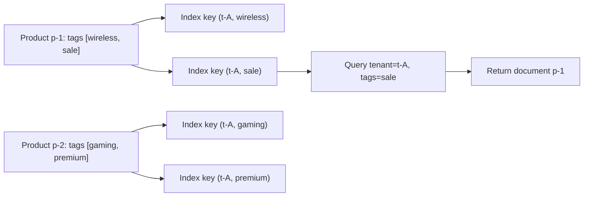

# Multikey Indexes for Arrays and Compound Restrictions

## 1. When Does a MongoDB Index Become Multikey?

In **Spring Data MongoDB**, an entity may contain `List<String>`, `List<Integer>`, or a list of subdocuments representing tags, scores, order line items, or multiple addresses. When querying "products tagged `sale`" or "orders containing a line item matching conditions", MongoDB can use a **multikey index** instead of scanning the entire collection.

A **multikey index** is an index storing keys generated from values inside an **array**. MongoDB automatically marks an index as multikey when an indexed field contains an array; **there is no separate index creation option named `MULTIKEY`**.

Example:

```javascript
db.products.createIndex({ tags: 1 });
```

If a document contains:

```json
{
  "_id": "p-1",
  "tags": ["wireless", "sale", "gaming"]
}
```

then one document can contribute **multiple index keys**, corresponding to distinct values in the array. All those keys still point to **the same document**. If an array contains duplicate identical values, MongoDB does not necessarily create multiple identical index entries for the same document; this does not deduplicate the underlying BSON array.

**Lesson belonging to the Indexes chapter of the `SPRING_DATA_MONGODB` module**: connecting and mapping documents with Spring Data MongoDB, practicing `MongoTemplate`/repositories, designing queries, indexes, aggregations, transactions, reactive access, testing, and performance diagnostics.

Questions to answer:

- How do multikey indexes work with scalar arrays and subdocument arrays?
- When can a **compound index** combine an array with regular fields?
- Why can a compound index across **two independent arrays** be rejected?
- How does `$elemMatch` relate to **correctness** and **index bounds**?
- How are unique, covered queries, sorting, hashed indexes, and shard keys constrained?
- How do we declare indexes in Spring Data MongoDB and verify with `explain("executionStats")`?

## 2. Visualizing Index Structure and Queries

Suppose we have three products:

```javascript
{
  _id: "p-1",
  tenant_id: "t-A",
  tags: ["wireless", "sale"]
}
{
  _id: "p-2",
  tenant_id: "t-A",
  tags: ["gaming", "premium"]
}
{
  _id: "p-3",
  tenant_id: "t-B",
  tags: ["sale", "accessory"]
}
```

Index:

```javascript
db.products.createIndex(
  { tenant_id: 1, tags: 1 },
  { name: "idx_products_tenant_tags" }
);
```

A conceptual view (**not a byte-level copy of the B-tree**):

| Logical key in compound index | Points to document |
| --- | --- |
| `("t-A", "sale")` | `p-1` |
| `("t-A", "wireless")` | `p-1` |
| `("t-A", "gaming")` | `p-2` |
| `("t-A", "premium")` | `p-2` |
| `("t-B", "accessory")` | `p-3` |
| `("t-B", "sale")` | `p-3` |

Query:

```javascript
db.products.find({
  tenant_id: "t-A",
  tags: "sale"
});
```

can use the index to look up the `("t-A","sale")` key rather than reading every document. Queries still return **documents**, not individual index entries; MongoDB deduplicates results as needed so a single document does not appear multiple times just because multiple array values matched.



**Trade-off:** arrays with many elements typically produce many index keys. Multikey indexes can speed up reads, but increase index storage size, write costs, and maintenance overhead when arrays change.

## 3. Running Dataset: Tags, Sales Channels, Line Items, and Scores

We use a `products` collection containing **two independent arrays** `tags` and `salesChannels`, plus a subdocument array `items` and a numeric array `scores`.

```javascript
db.products.insertMany([
  {
    _id: "p-1",
    tenant_id: "t-A",
    name: "Device Bundle A",
    active: true,
    tags: ["wireless", "sale"],
    salesChannels: ["web", "retail"],
    items: [
      { sku: "KB-1", quantity: 1 },
      { sku: "MS-1", quantity: 5 }
    ],
    scores: [5, 99]
  },
  {
    _id: "p-2",
    tenant_id: "t-A",
    name: "Device Bundle B",
    active: true,
    tags: ["gaming", "premium"],
    salesChannels: ["app"],
    items: [
      { sku: "KB-1", quantity: 4 },
      { sku: "HS-1", quantity: 2 }
    ],
    scores: [85]
  },
  {
    _id: "p-3",
    tenant_id: "t-B",
    name: "Device Bundle C",
    active: false,
    tags: ["sale", "accessory"],
    salesChannels: ["web"],
    items: [
      { sku: "MS-1", quantity: 3 }
    ],
    scores: [70, 90]
  }
]);
```

Each fixture has a clear purpose:

- `p-1` has tag `sale` and belongs to tenant `t-A`.
- `p-1` has an item `KB-1` with quantity 1 and **another item** `MS-1` with quantity 5.
- `p-2` has a **single item** `KB-1` with quantity 4.
- `p-1` has scores `[5, 99]`: one low value and one high value, **no score between 80 and 90**.
- `p-3` belongs to another tenant; every query serving tenant A clients must exclude it via a mandatory filter.

**Practice only on a test database.** Creating indexes on an existing collection affects write costs and can fail if data violates constraints; never test intentionally invalid indexes in production.

## 4. Java Model Using Spring Data MongoDB

```java
import java.util.List;

import org.springframework.data.mongodb.core.mapping.Document;
import org.springframework.data.mongodb.core.mapping.Field;
import org.springframework.data.mongodb.core.mapping.FieldType;
import org.springframework.data.mongodb.core.mapping.MongoId;

@Document(collection = "products")
public record ProductDocument(
    @MongoId(FieldType.STRING)
    String id,

    @Field("tenant_id")
    String tenantId,

    String name,
    boolean active,
    List<String> tags,
    List<String> salesChannels,
    List<LineItem> items,
    List<Integer> scores
) {
    public record LineItem(
        String sku,
        int quantity
    ) {}
}
```

Mapping to note:

| Java | BSON | Usage in examples |
| --- | --- | --- |
| `id` | string `_id` | Document primary key |
| `tenantId` | `tenant_id` | Tenant filter and compound index prefix |
| `tags` | `tags` | Scalar array creating a multikey index |
| `salesChannels` | `salesChannels` | Array independent from `tags` |
| `items.sku` | `items.sku` | Field inside subdocument array `items` |
| `items.quantity` | `items.quantity` | Field inside the **same** `items` array |
| `scores` | `scores` | Numeric array; `$elemMatch` range example |

`@MongoId(FieldType.STRING)` ensures IDs have consistent string types as intended by the lesson. In real systems, inspect BSON data: if some IDs are ObjectId and others are string, lookups and indexes may not return expected results.

If the model uses `@Field("sales_channels")` to remap the BSON name, match the actual stored name when creating indexes via the shell. With Spring Data `IndexOperations`, use entity property paths and verify the resulting mapped index.

## 5. Creating a Multikey Index on a Scalar Array

Basic index on tags:

```javascript
db.products.createIndex(
  { tags: 1 },
  { name: "idx_products_tags" }
);
```

MongoDB does not require specifying `multikey: true`. Because `tags` is an array in the data, the index becomes multikey.

Querying one tag:

```javascript
db.products.find({ tags: "sale" });
```

MongoDB can return `p-1` and `p-3`. If data should be scoped to `t-A`:

```javascript
db.products.find({
  tenant_id: "t-A",
  tags: "sale"
});
```

Only `p-1` matches. However, the single-field index `{tags:1}` might read candidates across tenants before filtering; an appropriate **compound index** on tenant and tags can be more efficient.

### 5.1. Scalar Array Containing Mixed BSON Types

```javascript
{ _id: "mixed", tags: ["sale", 42, null] }
```

BSON distinguishes strings, numbers, null, and other types. An application expecting `List<String>` should not haphazardly store numbers or objects inside `tags`. Indexes do not enforce data validation for the application.

Apply schema checks on the write path; if a collection already contains mixed types, audit using `$type`/aggregation and run a dedicated migration.

### 5.2. Arrays with Duplicate Elements

```javascript
{
  _id: "duplicate-tags",
  tags: ["sale", "sale", "wireless"]
}
```

A multikey index does not ensure the underlying array contains only one `"sale"`. It may deduplicate keys at the **document index-entry level**, without modifying the BSON field. To maintain tags as a set, use validation and appropriate `$addToSet` updates; note that `$addToSet` does not remove duplicates that already exist.

## 6. Querying Arrays: Equality, `$all`, and Exact Array Match

Common filter forms have **distinct** semantics:

| Filter | Meaning |
| --- | --- |
| `{tags:"sale"}` | Array has at least one element equal to `"sale"` |
| `{tags:{$in:["sale","gaming"]}}` | Array has at least one tag in the value set |
| `{tags:{$all:["sale","wireless"]}}` | Array contains **both values**, order not required |
| `{tags:["wireless","sale"]}` | **Entire array** must match exact order and contents per MongoDB semantics |
| `{tags:{$size:2}}` | Array has exactly 2 elements |

Examples:

```javascript
// p-1: contains both tags.
db.products.find({
  _id: "p-1",
  tags: { $all: ["sale", "wireless"] }
});

// Matches the entire array in p-1's exact order.
db.products.find({
  tags: ["wireless", "sale"]
});
```

**Important limitation:** a multikey index can find candidates for an exact-array match based on element values, but **cannot alone prove the entire array has the exact order and structure**; MongoDB must FETCH the document and verify the actual array.

`$size` is also not efficiently solved by a standard multikey index alone. If querying exact array lengths frequently, consider maintaining a consistently updated `tagCount` field, indexing it, and testing the write paths.

## 7. Compound Multikey Indexes: Scalar Fields Combined with One Array

In multi-tenant applications, a compound index is usually more useful than an array-only index:

```javascript
db.products.createIndex(
  { tenant_id: 1, tags: 1 },
  { name: "idx_products_tenant_tags" }
);
```

Query:

```javascript
db.products.find({
  tenant_id: "t-A",
  tags: "sale"
});
```

The index can leverage both `tenant_id` and `tags`. This is a multikey index because **one of the indexed fields contains an array**.

Another example:

```javascript
db.products.createIndex(
  { active: 1, tenant_id: 1, tags: 1 },
  { name: "idx_products_active_tenant_tags" }
);
```

Choose field order based on **actual queries**, selectivity, sorting, and compound index prefixes. Do not create every variant without a workload justifying the cost; every additional index incurs storage and update overhead.

### 7.1. Leftmost Prefix Still Matters with Arrays

With `{tenant_id:1,tags:1}`, a tenant-only query can leverage the `tenant_id` prefix. Conversely, a `tags`-only query usually cannot leverage the compound index as effectively as when the prefix matches, though the planner may choose various plans depending on data.

If nearly every endpoint requires a tenant filter, leading with tenant is worth evaluating and helps avoid scanning other tenants' candidates. However, **an index is not an authorization mechanism**: the tenant filter must still be supplied in the query from a trusted authenticated source.

### 7.2. Index Key Expansion and Cost

A document with 50 tags can contribute many keys to the same index. When a document has scalar fields alongside an array, the scalar values combine with each array element to form compound keys without turning the scalar fields into arrays.

Inspect actual index key counts using explain/metrics on representative data; do not blindly assume key count equals `document count × array length` in every case, because duplicate values, missing fields, and index rules also affect expansion.

## 8. The "Parallel Arrays" Limit: Never Compound Two Independent Arrays

This is a central constraint of the lesson.

Suppose a document has **two independent arrays**:

```javascript
{
  _id: "p-1",
  tags: ["wireless", "sale"],
  salesChannels: ["web", "retail"]
}
```

Do not create a compound index like this:

```javascript
// Invalid when documents contain both independent arrays:
db.products.createIndex(
  { tags: 1, salesChannels: 1 },
  { name: "idx_illegal_parallel_arrays" }
);
```

With data like `p-1`, MongoDB will reject creating this compound multikey index because the indexed fields contain **parallel arrays** within the same document.

Another dangerous scenario:

1. The collection currently has no document containing both arrays, so index creation succeeds.
2. Later, the application inserts or updates a document so **both `tags` and `salesChannels` are arrays**.
3. The new write operation can **fail** because it violates the existing compound multikey index constraint.

This is not merely an index migration error; it can surface as a **production write failure** after schema evolution.

### 8.1. Understanding the "At Most One Array" Rule

MongoDB's rule for a compound multikey index is that **any indexed document must not contain multiple independent indexed array fields** within the same index.

This **does not prohibit** a collection from having multiple arrays in the same document. For example, both of the following can coexist:

```javascript
db.products.createIndex(
  { tenant_id: 1, tags: 1 },
  { name: "idx_tenant_tags" }
);

db.products.createIndex(
  { tenant_id: 1, salesChannels: 1 },
  { name: "idx_tenant_channels" }
);
```

These are **two separate indexes**; each compound index references only one array. For queries combining both arrays, the planner may pick one access path then FETCH/filter, or consider other strategies, without turning two separate indexes into a single parallel-arrays compound index.

### 8.2. Are Multiple Nested Fields in an Array Also Prohibited?

No. If two indexed paths originate from the **same subdocument array**, such as `items.sku` and `items.quantity`, they share **a single common array path `items`**. This is an important special case covered in section 9.

Do not misinterpret the parallel arrays limit as forbidding a compound index with two dotted paths traversing the same array.

## 9. Compound Indexes Across Multiple Fields in the Same Subdocument Array

A document has:

```javascript
{
  _id: "p-1",
  items: [
    { sku: "KB-1", quantity: 1 },
    { sku: "MS-1", quantity: 5 }
  ]
}
```

You can create a compound index across two sub-properties of the **same `items` array**:

```javascript
db.products.createIndex(
  {
    tenant_id: 1,
    "items.sku": 1,
    "items.quantity": 1
  },
  {
    name: "idx_products_tenant_items"
  }
);
```

This is a valid compound multikey index in this model, unlike a compound index across independent arrays `tags` and `salesChannels`.

**Distinguish two separate questions:**

- **Is the index allowed to be created?** Yes, because the dotted paths share the `items` array.
- **Can the query compound bounds across both sub-fields for the same element?** That depends on how the query is written, specifically `$elemMatch`.

### 9.1. Queries with Two Dotted Predicates Do Not Guarantee the Same Item

```javascript
db.products.find({
  tenant_id: "t-A",
  "items.sku": "KB-1",
  "items.quantity": { $gte: 3 }
});
```

This query can match **p-1**:

- The first element has `sku="KB-1"` with `quantity=1`.
- The second element has `quantity=5` with `sku="MS-1"`.

The two conditions can be satisfied by **two different elements** in the same array. For `p-2`, both also hold because it has an item `KB-1` with quantity 4.

If the business requirement is "**a single line item** with SKU KB-1 and quantity ≥ 3", this query is incorrect.

### 9.2. Using `$elemMatch` to Enforce the Same Element

```javascript
db.products.find({
  tenant_id: "t-A",
  items: {
    $elemMatch: {
      sku: "KB-1",
      quantity: { $gte: 3 }
    }
  }
});
```

On the dataset:

- `p-1` **does not match**: no single item has `KB-1` and quantity ≥ 3.
- `p-2` **matches**: has item `KB-1` with quantity 4.
- `p-3` is excluded by tenant `t-B`.

`$elemMatch` establishes **same-element semantics**, not merely an optimization trick.

### 9.3. `$elemMatch` Enables Compound Bounds

With index `{"items.sku":1,"items.quantity":1}`, the two keys share the path `items`. MongoDB can **compound the index bounds** of `items.sku` and `items.quantity` when the query uses `$elemMatch` at that exact shared array path:

```javascript
{
  items: {
    $elemMatch: {
      sku: "KB-1",
      quantity: { $gte: 3 }
    }
  }
}
```

Without a matching `$elemMatch`, MongoDB may be unable to tightly compound bounds on both array keys; the query still runs, but may scan more index keys or FETCH more documents.

If dotted paths are nested deeper with **nested arrays**, `$elemMatch` placement must match the **common array path** used by the index. Placing `$elemMatch` on a different parent path does not automatically allow compounding all bounds.

## 10. `$elemMatch` on Scalar Arrays Enables Intersecting Two Bounds

`p-1`'s `scores` array is:

```json
[5, 99]
```

Suppose we want to find **a single score** between 80 and 90 inclusive.

Query without `$elemMatch`:

```javascript
db.products.find({
  scores: { $gte: 80, $lte: 90 }
});
```

For arrays, MongoDB can satisfy the two conditions across **two different elements**:

- `99 >= 80`.
- `5 <= 90`.

Therefore `p-1` can match that filter, even though **no element** lies between 80 and 90.

Correct query when requiring **a single score** to meet both conditions:

```javascript
db.products.find({
  scores: {
    $elemMatch: {
      $gte: 80,
      $lte: 90
    }
  }
});
```

In the sample data, `p-2` has score 85 and matches; `p-1` does not match. `p-3` has 90 but belongs to tenant B, so include the tenant filter in real APIs.

### 10.1. Impact on Index Bounds

If you created:

```javascript
db.products.createIndex(
  { scores: 1 },
  { name: "idx_products_scores" }
);
```

then `$elemMatch` both provides **same-element semantics** and lets MongoDB **intersect index bounds**:

```text
scores >= 80  → [80, +∞)
scores <= 90  → (-∞, 90]
Intersected bounds → [80, 90]
```

Without `$elemMatch`, MongoDB does not guarantee intersecting two multikey index bounds in this manner; the index scan may use one of the broader bounds instead.

**Note:** `$elemMatch` is not a mandatory optimization for every array query. Use it when business logic genuinely requires a single element to match, then inspect the planner to verify efficiency.

## 11. Spring Data MongoDB: Querying Scalar Arrays and `$elemMatch`

### 11.1. Simple Tag Query with `Criteria`

```java
import java.util.List;

import org.springframework.data.mongodb.core.MongoTemplate;
import org.springframework.data.mongodb.core.query.Criteria;
import org.springframework.data.mongodb.core.query.Query;

public List<ProductDocument> findByTag(
    MongoTemplate template,
    String trustedTenantId,
    String tag
) {
    if (trustedTenantId == null || trustedTenantId.isBlank()) {
        throw new IllegalArgumentException("Missing tenant");
    }

    Query query = Query.query(
        Criteria.where("tenantId").is(trustedTenantId)
            .and("tags").is(tag)
    );

    return template.find(query, ProductDocument.class);
}
```

`MongoTemplate` uses mapping metadata to translate `tenantId` to `tenant_id`; you do not need raw BSON field names in entity-typed `Query` objects. Check the actual query plan and result size; array queries do not automatically bound the number of returned documents.

### 11.2. Querying an Item with Same-Element Conditions

```java
import org.springframework.data.mongodb.core.query.Criteria;
import org.springframework.data.mongodb.core.query.Query;

Criteria sameItem = Criteria.where("items").elemMatch(
    Criteria.where("sku").is("KB-1")
        .and("quantity").gte(3)
);

Query query = Query.query(
    new Criteria().andOperator(
        Criteria.where("tenantId").is("t-A"),
        sameItem
    )
);

List<ProductDocument> result =
    template.find(query, ProductDocument.class);
```

The `elemMatch(...)` call ensures both `sku` and `quantity` predicates apply to **a single LineItem**. When results are materialized into `ProductDocument`, the `items` array can still contain **all items**; `$elemMatch` in the filter does not mean the response contains only the matched item.

If the API wants only the matching element, use a separate projection/aggregation as needed and review `$elemMatch` projection limits. Do not confuse **filter** with **projection**.

### 11.3. Repository Derived Query

A repository can declare:

```java
import java.util.List;

import org.springframework.data.mongodb.repository.MongoRepository;

public interface ProductRepository
        extends MongoRepository<ProductDocument, String> {

    List<ProductDocument> findByTenantIdAndTags(
        String tenantId,
        String tag
    );
}
```

This is a convenient query for a single tag predicate. However, for business rules requiring the **same subdocument** or dynamic queries, `MongoTemplate`/`@Query` generally expresses `$elemMatch` more clearly. Do not assume a derived method with two dotted paths automatically inserts `$elemMatch` with same-element semantics.

## 12. Creating Indexes with `IndexOperations`

Spring Data MongoDB provides `IndexOperations` to create and inspect indexes for an entity.

```java
import org.springframework.data.domain.Sort;
import org.springframework.data.mongodb.core.MongoTemplate;
import org.springframework.data.mongodb.core.index.Index;
import org.springframework.data.mongodb.core.index.IndexOperations;

public class ProductIndexProvisioner {

    private final MongoTemplate template;

    public ProductIndexProvisioner(MongoTemplate template) {
        this.template = template;
    }

    public void ensureIndexes() {
        IndexOperations indexes =
            template.indexOps(ProductDocument.class);

        // Compound index: scalar tenant + tags array.
        indexes.ensureIndex(
            new Index()
                .on("tenantId", Sort.Direction.ASC)
                .on("tags", Sort.Direction.ASC)
                .named("idx_products_tenant_tags")
        );

        // Two dotted paths belonging to the same 'items' array.
        indexes.ensureIndex(
            new Index()
                .on("tenantId", Sort.Direction.ASC)
                .on("items.sku", Sort.Direction.ASC)
                .on("items.quantity", Sort.Direction.ASC)
                .named("idx_products_tenant_items")
        );

        // Separate scalar-array 'scores' index.
        indexes.ensureIndex(
            new Index()
                .on("scores", Sort.Direction.ASC)
                .named("idx_products_scores")
        );
    }
}
```

When creating indexes via `indexOps(ProductDocument.class)`, Spring Data uses domain mapping metadata. Because the entity has `@Field("tenant_id")`, verify the resulting index actually contains BSON key `tenant_id`.

In real environments, **provision indexes as a controlled deployment step** while monitoring build time, resources, permissions, concurrency, and existing data. Do not call `ensureIndexes()` on every HTTP request.

### 12.1. Declaring with Annotations

Another option is `@Indexed`/`@CompoundIndex`:

```java
import org.springframework.data.mongodb.core.index.CompoundIndex;
import org.springframework.data.mongodb.core.mapping.Document;

@Document(collection = "products")
@CompoundIndex(
    name = "idx_products_tenant_tags",
    def = "{'tenantId': 1, 'tags': 1}"
)
public record IndexedProductExample(
    String tenantId,
    java.util.List<String> tags
) {}
```

This is a **standalone** annotation example, not the shared entity for the `products` collection from earlier sections. When using `@Field` to remap BSON names or conditional indexes, inspect the resolved index definition after Spring Data resolves mapping.

**Important:** since Spring Data MongoDB 3.0, **automatic index creation from annotations is disabled by default**. Writing `@Indexed`/`@CompoundIndex` **does not mean** every environment already has the index. You can enable it intentionally or create indexes via migrations/bootstrap; check your Spring Data version and deployment workflow.

### 12.2. Avoiding Duplicate Indexes

If both annotations and a provisioner manage the same index, establish clear ownership. Indexes with identical keys but different options (unique, partial filter, collation, sparse) are not necessarily equivalent. Do not create many nearly identical indexes just to cover minor query variations.

## 13. Unique Multikey Indexes Do Not Guarantee Uniqueness Within a Single Array

MongoDB supports **unique multikey indexes** with one crucial constraint: uniqueness applies across **different documents**, which does not prevent an array within a single document from repeating elements.

Example `users` collection:

```javascript
db.users.createIndex(
  { emailAliases: 1 },
  { unique: true, name: "uniq_email_aliases" }
);
```

One document:

```javascript
db.users.insertOne({
  _id: "u-1",
  emailAliases: [
    "a@example.test",
    "a@example.test"
  ]
});
```

Duplicate elements within the **same document** do not necessarily violate a unique multikey index, because the index may store a single key entry for that document. However, a **different** document:

```javascript
db.users.insertOne({
  _id: "u-2",
  emailAliases: ["a@example.test"]
});
```

will hit a **duplicate key** error if that unique index is active and `u-1` already exists.

### 13.1. Do Not Put `unique` on Regular Tags

If you put `unique:true` on `tags` in a product catalog, two products with the `"sale"` tag will conflict. This is usually a **design bug**, because tags must be reusable across many products.

Unique multikey is more appropriate when an array value semantically **must never belong to two different documents**, such as global identity aliases, alongside a policy handling duplicates within the same document.

### 13.2. Unique Does Not Automatically Normalize Data

`"A@Example.test"` and `"a@example.test"` can be two distinct values under simple collation. If business rules require case-insensitive comparison, design canonicalization or collation for the unique index, clean legacy data, and write integration tests. Do not treat a unique index as an automatic email or Unicode normalizer.

## 14. Covered Queries on Multikey Indexes Have Strict Conditions

A **covered query** is a query satisfied completely from the index without FETCHing source documents. A multikey index **can** cover certain queries, provided strict conditions are met:

1. The query **does not return the array field** in the projection.
2. The query **does not use `$elemMatch`**.
3. All required filter/projection fields are covered by the index under standard rules.
4. Avoid requesting `_id` if the index does not include `_id`; typically project `_id:0`.

Example:

```javascript
db.products.createIndex(
  {
    tenant_id: 1,
    tags: 1,
    name: 1
  },
  {
    name: "idx_products_tenant_tags_name"
  }
);
```

Query potentially eligible for covering:

```javascript
db.products.find(
  { tenant_id: "t-A", tags: "sale" },
  { _id: 0, name: 1 }
).explain("executionStats");
```

Because the projection requests only `name` and does not return the `tags` array, the index can cover the query if remaining conditions hold. To verify, inspect `totalDocsExamined` and the plan: a covered query plan normally reports `totalDocsExamined: 0` with no document FETCH.

Query **not covered** under multikey rules:

```javascript
db.products.find(
  { tenant_id: "t-A", tags: "sale" },
  { _id: 0, tags: 1, name: 1 }
);
```

Because the projection returns the **entire `tags` array**, index entries alone cannot reconstruct the original array with its exact order and duplicates. Likewise, a query using `$elemMatch` is not considered covered by a multikey index per MongoDB's documented constraints.

**Do not assume `IXSCAN` means covered.** A plan may scan the index to filter and still FETCH many documents.

## 15. Sorting with Multikey Indexes: Why Can RAM Still Be Used?

Having an index `{tags:1}` does not mean this query always avoids a sort:

```javascript
db.products.find({
  tags: "sale"
}).sort({ tags: 1 });
```

Sorting on array fields follows specific rules. A query using a multikey index can still exhibit an **in-memory sort stage** when:

- The index bounds of the sort fields are not the full `[MinKey, MaxKey]` range.
- There are bounds on a multikey-indexed field sharing a path prefix with the sort pattern.
- Other query plan factors prevent the index from providing the requested order.

According to MongoDB documentation, avoiding an in-memory sort with a multikey index requires satisfying **both specific conditions** on bounds and path prefixes; merely having the index is insufficient.

### 15.1. Sorting Documents Differs from Sorting Array Elements

```javascript
db.products.find({
  tenant_id: "t-A"
}).sort({ scores: 1 });
```

This command **sorts the result documents**, not the `scores` inside each document. Do not confuse it with the `$sortArray` expression or the `$sort` modifier of `$push` when updating arrays.

If you need the highest score per document and want to sort products by that metric, define the metric explicitly—such as a materialized `maxScore` field or an aggregation calculation. Indexing the entire `scores` array does not turn into an index on the business `maxScore`.

### 15.2. Inspect the Plan Instead of Guessing

```javascript
db.products.find({
  tags: "sale"
})
.sort({ tags: 1 })
.explain("executionStats");
```

Check whether a `SORT`/sort stage appears, how many keys/documents were examined, execution cost, and `indexBounds`. Index selection decisions should rely on actual workloads, not merely an index named `idx_products_tags`.

## 16. Other Combined Restrictions: Hashed, Shard Key, and `$expr`

### 16.1. Hashed Indexes Cannot Be Multikey

MongoDB **does not support hashed multikey indexes**. Avoid:

```javascript
// Invalid when the indexed field is an array.
db.products.createIndex({
  tags: "hashed"
});
```

If the field does not initially contain arrays, creating a hashed index might not catch future violations immediately; prevent schema changes from turning the indexed field into an array. Hashed indexes are suited for specific scalar fields, not as a substitute for multikey tags.

### 16.2. Multikey Indexes Cannot Be Used as Shard-Key Indexes

You cannot select a **multikey index** directly as the shard key index. However, if shard-key fields form a **scalar prefix** of a compound index, trailing fields (outside the shard key) can make **that compound index** multikey without making the shard key itself an array.

Conceptual example:

```javascript
// Assuming sharding on tenant_id per supported design.
// This compound index has an array suffix 'tags':
db.products.createIndex({
  tenant_id: 1,
  tags: 1
});
```

Do not assume a collection sharded by `tenant_id` can shard/sort every query on `tags` efficiently. You must also consider sharding rules, routing, uniqueness, and index requirements for your actual MongoDB version and cluster.

### 16.3. `$expr` Does Not Leverage Multikey Indexes the Same Way

Per MongoDB limitations, **`$expr` does not support multikey indexes** for those access paths. If you rewrite a simple array predicate into a dynamic `$expr` expression, do not assume the planner still uses the multikey index like a standard equality query.

That does not mean every query containing `$expr` can never use **any** index; examine each filter clause and the specific execution plan.

## 17. Partial, Sparse, and Collation Combined with Array Indexes

Multikey describes **how an array field is indexed**; it can appear alongside other index options where MongoDB supports the combination.

### 17.1. Partial Indexes to Reduce Indexed Documents

If you only need to query active products:

```javascript
db.products.createIndex(
  { tenant_id: 1, tags: 1 },
  {
    name: "idx_active_tenant_tags",
    partialFilterExpression: {
      active: true
    }
  }
);
```

This index contains only documents **matching the partial filter** per MongoDB semantics. Queries intending to use it must include conditions allowing the planner to prove no documents outside the partial index are omitted:

```javascript
db.products.find({
  tenant_id: "t-A",
  active: true,
  tags: "sale"
});
```

A query without `active:true` cannot rely on that partial index because the index omits inactive documents that the query is entitled to return. Do not force a hint on a partial index just to make it "faster"; verify result completeness and server constraints.

### 17.2. Sparse Does Not Mean Unique Array Elements

Sparse indexes mainly omit documents **missing the indexed field**, according to the rules of each index type. They do not turn an array into a set and do not resolve duplicate elements inside an array. For most business conditions, a **partial index** expresses scope more clearly than a sparse index, provided matching predicates are managed.

### 17.3. Collation for String Arrays

When tags are strings and locale-aware case-insensitive comparison is desired, an index can be created with an appropriate collation:

```javascript
db.products.createIndex(
  { tenant_id: 1, tags: 1 },
  {
    name: "idx_tenant_tags_vi_casefold",
    collation: {
      locale: "vi",
      strength: 2
    }
  }
);
```

Queries wanting full index support for string comparison/sorting must specify a **compatible collation**. A regex with `i` does not share the same semantics or index usage as equality with collation.

Before applying collation to unique string arrays, define business normalization rules and audit existing data. Do not assume lower strength is always better; Vietnamese characters may fold differently than expected.

## 18. Why Do Large Arrays Make Indexes Expensive?

A multikey index gains many keys when documents hold many distinct values. The following operations can increase write cost:

- `$push` adding one or more new elements.
- `$pull` removing values from the array.
- `$addToSet` adding a previously absent element.
- `$set` replacing the whole array or changing an indexed field.
- Modifying `items` subdocuments, causing `items.sku`/`items.quantity` keys to change.

As arrays grow larger:

- Indexes consume more storage space.
- Updating one document may require maintaining many index keys.
- A single document updated by many concurrent writers can become a hotspot.
- Documents are subject to the standard **16 MiB** BSON size limit.
- Index scans may need deduplication across entries; not every index entry corresponds to a unique document.

### 18.1. When Should You Split Into a Child Collection?

A small, bounded array such as a few product tags fits embedding well. However, consider a separate child collection when facing:

- Millions of orders/activities attached to one user.
- Large report line items needing independent search.
- Audit histories requiring independent time-based pagination.
- Array elements with independent access permissions or lifecycles.
- Cases repeatedly hitting parallel array limits or array update hotspots.

For example, replacing unbounded `items` with an `order_lines` collection:

```javascript
{
  _id: "line-1",
  orderId: "order-1",
  sku: "KB-1",
  quantity: 4
}
```

Then the scalar compound index:

```javascript
db.order_lines.createIndex({
  orderId: 1,
  sku: 1,
  quantity: 1
});
```

is not multikey if all those fields are scalar. In exchange, the business domain must manage relationships, cross-collection queries, or multi-document transactions when invariants span documents.

## 19. Reading `explain("executionStats")` to Verify Multikey Behavior

An example:

```javascript
db.products.find({
  tenant_id: "t-A",
  tags: "sale"
})
.explain("executionStats");
```

In explain output, look for properties depending on server version and engine:

| Property | Meaning |
| --- | --- |
| `winningPlan` | Plan selected by the planner for the query |
| `IXSCAN` | Uses an index scan |
| `COLLSCAN` | Scans the entire collection |
| `indexName` | Which index was used |
| `isMultiKey` | Whether the index in the plan is multikey |
| `multiKeyPaths` | Which paths contribute multikey behavior |
| `indexBounds` | Key ranges scanned, including whether compounded/intersected |
| `totalKeysExamined` | Number of index keys examined |
| `totalDocsExamined` | Number of source documents read |
| `SORT`/sort stage | Whether an out-of-index sort occurred |
| `FETCH` | Whether source documents were read after the index scan |

Not every MongoDB version places all fields in the exact same nesting. Execution engines and explain verbosity levels alter the JSON structure.

### 19.1. Comparing Three Queries on the Same Index

Test on representative data:

```javascript
// A: Tag filter.
db.products.find({
  tenant_id: "t-A",
  tags: "sale"
}).explain("executionStats");

// B: Two dotted predicates that can match two different elements.
db.products.find({
  tenant_id: "t-A",
  "items.sku": "KB-1",
  "items.quantity": { $gte: 3 }
}).explain("executionStats");

// C: One item must satisfy both; can compound bounds.
db.products.find({
  tenant_id: "t-A",
  items: {
    $elemMatch: {
      sku: "KB-1",
      quantity: { $gte: 3 }
    }
  }
}).explain("executionStats");
```

Compare **both business results and indexBounds**. Never say B is "faster" than C if B is returning the **wrong document set** for the actual question.

### 19.2. Tiny Datasets Are Not Benchmarks

With three products, MongoDB may choose `COLLSCAN` simply because scanning is trivial. That does not prove a multikey index is useless. Evaluate on realistic data and distributions, with appropriate warm/cold caches, p95/p99 latency, and write throughput metrics.

### 19.3. Hints Are for Diagnostics, Not Replacing the Planner

You can test:

```javascript
db.products.find({
  tenant_id: "t-A",
  tags: "sale"
})
.hint("idx_products_tenant_tags")
.explain("executionStats");
```

Then run **without hint** to compare. A hardcoded hint can cause errors if the index does not exist or hurt performance when data distribution shifts. Do not deploy hints simply because you saw `IXSCAN` in a single trial.

## 20. Spring Data MongoDB Integration Testing

Unit tests mocking repositories cannot prove MongoDB created a multikey index, nor do they test `$elemMatch` or parallel array limits. Write integration tests against real MongoDB, such as with Testcontainers in Spring Boot projects.

### 20.1. Testing Same-Element Array Conditions

```java
import static org.assertj.core.api.Assertions.assertThat;

import java.util.List;

import org.junit.jupiter.api.Test;
import org.springframework.beans.factory.annotation.Autowired;
import org.springframework.boot.test.autoconfigure.data.mongo.DataMongoTest;
import org.springframework.data.mongodb.core.MongoTemplate;
import org.springframework.data.mongodb.core.query.Criteria;
import org.springframework.data.mongodb.core.query.Query;

@DataMongoTest
class ProductMultikeyIntegrationTest {

    @Autowired MongoTemplate template;

    @Test
    void elemMatchRequiresSameLineItem() {
        template.insert(new ProductDocument(
            "mk-01",
            "mk-tenant",
            "Bundle A",
            true,
            List.of("sale", "wireless"),
            List.of("web", "retail"),
            List.of(
                new ProductDocument.LineItem("KB-1", 1),
                new ProductDocument.LineItem("MS-1", 5)
            ),
            List.of(5, 99)
        ));

        template.insert(new ProductDocument(
            "mk-02",
            "mk-tenant",
            "Bundle B",
            true,
            List.of("gaming", "premium"),
            List.of("app"),
            List.of(
                new ProductDocument.LineItem("KB-1", 4)
            ),
            List.of(85)
        ));

        Query dottedQuery = Query.query(
            Criteria.where("tenantId").is("mk-tenant")
                .and("items.sku").is("KB-1")
                .and("items.quantity").gte(3)
        );

        assertThat(
            template.find(dottedQuery, ProductDocument.class)
        )
            .extracting(ProductDocument::id)
            .containsExactlyInAnyOrder("mk-01", "mk-02");

        Query sameElementQuery = Query.query(
            new Criteria().andOperator(
                Criteria.where("tenantId").is("mk-tenant"),
                Criteria.where("items").elemMatch(
                    Criteria.where("sku").is("KB-1")
                        .and("quantity").gte(3)
                )
            )
        );

        assertThat(
            template.find(sameElementQuery, ProductDocument.class)
        )
            .extracting(ProductDocument::id)
            .containsExactly("mk-02");
    }
}
```

This test proves **query logic**; to test index behavior, also **create the index** and run `explain`. With fixed IDs, tests require an isolated database/collection or proper record cleanup. Do not run on shared data.

### 20.2. Testing Compound Indexes Matching the Schema

In tests or index provisioning:

```java
import org.springframework.data.domain.Sort;
import org.springframework.data.mongodb.core.index.Index;

template.indexOps(ProductDocument.class).ensureIndex(
    new Index()
        .on("tenantId", Sort.Direction.ASC)
        .on("items.sku", Sort.Direction.ASC)
        .on("items.quantity", Sort.Direction.ASC)
        .named("idx_products_tenant_items")
);
```

After creating, inspect:

```javascript
db.products.getIndexes();

db.products.find({
  tenant_id: "mk-tenant",
  items: {
    $elemMatch: {
      sku: "KB-1",
      quantity: { $gte: 3 }
    }
  }
}).explain("executionStats");
```

Use `getIndexes()` to verify the index **definition**, and `explain` to see **whether the query uses the index**. An index may exist while the planner picks another path.

### 20.3. Testing Parallel Arrays Failure on an Isolated Database

Scenario to test:

1. Create a document where both `tags` and `salesChannels` are arrays.
2. Attempt `createIndex({tags:1,salesChannels:1})` in the test collection.
3. Verify MongoDB rejects the index creation due to parallel arrays.
4. Create two separate indexes on each array with the tenant prefix, and verify both succeed.
5. In a **different** collection, create the compound index before violating data exists; then insert a document containing both arrays and verify the write is rejected.

**Do not hardcode MongoDB error message text** as a test contract; messages and error details can vary across versions. Check error codes/exception types and verify data/index state as appropriate.

### 20.4. Additional Test Cases

| Case | What to verify |
| --- | --- |
| Scalar array tags | Equality query returns documents containing the element |
| Duplicate array elements | BSON preserves duplicates; index does not "clean" data |
| `$all` | Requires all elements, order-independent |
| Exact array match | Distinguishes full-array match from single-element match |
| `$elemMatch` scalar range | `[5,99]` does not match range 80–90 |
| `$elemMatch` subdocument | Both predicates enforced on the same item |
| Compound tenant+tags | Proper tenant scoping; uses index when plan fits |
| Compound items.sku+quantity | Allowed along shared array path |
| Parallel arrays | Violating index/insert/update must be rejected |
| Unique multikey | Prevents cross-document duplicates, allows intra-document duplicates |
| Covered query | No array projection, no `$elemMatch`, expected docs examined |
| Array sort | Observe when an in-memory `SORT` occurs |
| Partial index | Query must satisfy partial filter |
| Hashed array | Disallowed as multikey |
| BSON field rename | `@Field` and index keys match physical data |
| Reactive query | Accurate results, non-blocking |
| Concurrent writes | Index maintenance and per-document atomicity |

## 21. Reactive Access and Array Updates

In WebFlux applications, `ReactiveMongoTemplate` supports queries with the same `Query`/`Criteria` API while returning `Flux<ProductDocument>`.

```java
import org.springframework.data.mongodb.core.ReactiveMongoTemplate;
import org.springframework.data.mongodb.core.query.Criteria;
import org.springframework.data.mongodb.core.query.Query;

import reactor.core.publisher.Flux;

public Flux<ProductDocument> findByTagReactive(
    ReactiveMongoTemplate template,
    String trustedTenantId,
    String tag
) {
    Query query = Query.query(
        Criteria.where("tenantId").is(trustedTenantId)
            .and("tags").is(tag)
    );
    query.limit(100);

    return template.find(query, ProductDocument.class);
}
```

Even in reactive stacks, MongoDB applies the exact same multikey, compound index, `$elemMatch`, and parallel array rules as imperative stacks. `Flux` does not make an unindexed query any cheaper. Avoid calling `block()` on the WebFlux event loop and avoid `collectList()` on unbounded results.

### 21.1. Array Writes and Index Maintenance

```java
import org.springframework.data.mongodb.core.query.Update;

Update update = new Update()
    .addToSet("tags", "new-feature");
```

When using `MongoTemplate.updateFirst(...)` or its reactive counterpart, MongoDB must update affected index keys whenever the array changes. `$addToSet` avoids adding duplicate values according to MongoDB equality semantics; it does not replace a collection-wide unique constraint.

An update on a **single document** is applied atomically by MongoDB, but modifying multiple documents or collections is not automatically transactional. When business invariants span multiple documents, consider `MongoTransactionManager`/`ReactiveMongoTransactionManager` per your stack and topology; indexes do not replace transactions.

## 22. Common Misconceptions

**Misconception 1 — "You must specify `multikey:true` when creating the index."** No. MongoDB determines this automatically from array values.

**Misconception 2 — "Each array element becomes a separate document."** No. A document can generate multiple index entries, but queries still return documents.

**Misconception 3 — "Indexing `tags` removes duplicate tags inside the array."** No. Index deduplication does not alter the stored BSON array.

**Misconception 4 — "A compound index can include both `tags` and `salesChannels` because both are arrays."** False. Two independent arrays in the same indexed document trigger the parallel arrays error.

**Misconception 5 — "If an entity has two arrays, you cannot create any multikey indexes."** No. You can create **multiple separate indexes**, each referencing one indexed array path.

**Misconception 6 — "`items.sku` and `items.quantity` are always illegal parallel arrays."** False; they share the `items` array path and can form a valid compound index.

**Misconception 7 — "Two dotted predicates automatically match the same subdocument."** False. Use `$elemMatch` whenever business logic requires a single element to satisfy both.

**Misconception 8 — "An array range query without `$elemMatch` always finds a single point inside the range."** False. Two bounds can be satisfied by two distinct elements.

**Misconception 9 — "Having a multikey index means queries with `$elemMatch` are always covered."** False. Covered queries have restrictions around `$elemMatch`.

**Misconception 10 — "Unique multikey forbids an array from holding duplicate values."** False. The unique constraint applies across documents based on index keys.

**Misconception 11 — "An array index always solves sorting without using RAM."** False. Sorting with multikey indexes has strict conditions on bounds and paths.

**Misconception 12 — "A hashed index can replace multikey when arrays have many values."** False. Hashed indexes cannot be multikey.

**Misconception 13 — "Any multikey index can serve as a shard-key index."** False. Shard keys have dedicated restrictions.

**Misconception 14 — "`@Indexed` always auto-creates indexes on startup."** Not by default in modern Spring Data MongoDB versions; an explicit index creation process is needed.

**Misconception 15 — "Seeing `IXSCAN` means the query is already optimized."** No. You must also inspect indexBounds, FETCH, docs/keys examined, SORT, result correctness, and p95/p99 latency.

## 23. Comprehensive Lab Exercise

1. Seed the three sample documents containing `tags`, `salesChannels`, `items`, and `scores`.
2. Create a single-field index `{tags:1}` and test equality, `$in`, and `$all`.
3. Create compound index `{tenant_id:1,tags:1}`; compare queries with and without the tenant filter.
4. Create valid index `{tenant_id:1,"items.sku":1,"items.quantity":1}`.
5. Run dotted query `items.sku="KB-1"` AND `items.quantity>=3`, observing `p-1` matching despite failing same-item semantics.
6. Replace with `items:{$elemMatch:{sku:"KB-1",quantity:{$gte:3}}}`, receiving only `p-2` in tenant A.
7. Create `{scores:1}`; compare range queries with and without `$elemMatch` against `[5,99]`.
8. In a test database, attempt creating `{tags:1,salesChannels:1}` and observe the parallel arrays error.
9. Create two separate indexes for `tags` and `salesChannels`; demonstrate this is permitted collection-wide.
10. Test a unique multikey index on a separate `users` collection; compare intra-document duplicates vs. cross-document duplicates.
11. Test a covered query projecting only scalar fields, then project the array or add `$elemMatch`.
12. Measure sorting on an indexed array with `explain`; note any sort stage.
13. Test a partial index with `active:true`, and examine a query missing the active filter.
14. Create indexes via `MongoTemplate.indexOps(...)`, inspecting `getIndexes()` and `multiKeyPaths` in explain.
15. Run Java integration tests using `Criteria.elemMatch(...)`.
16. Measure write latency as arrays grow; consider a child collection if arrays are unbounded.

## 24. Production Checklist

| Check | Question |
| --- | --- |
| Array path | Is the field actually a scalar array or a subdocument array? |
| Compound fields | Are there **two independent indexed arrays** in the same document? |
| Shared array path | Do dotted fields share a valid common array prefix? |
| Query semantics | Must one element satisfy all predicates? If so, use `$elemMatch` |
| Bounds | Did `indexBounds` combine the conditions properly? |
| Tenant/ACL | Are mandatory filters in the query rather than relying on the index? |
| Index prefix | Does compound key order suit filters and sorts? |
| Unique | Uniqueness applies across documents; have duplicates been audited? |
| Covered | Does the query avoid projecting arrays and avoid `$elemMatch`? |
| Sort | Is there an out-of-index `SORT` or memory pressure? |
| Hashed/sharding | Does it violate multikey restrictions for that index type? |
| Partial/collation | Do query filters and collation match the index? |
| Mapping | Do `@Field`, `@MongoId`, and BSON fields align? |
| Auto creation | Are indexes provisioned via migrations/IndexOperations rather than annotations alone? |
| Array growth | Are index key expansion and write costs acceptable? |
| Explain | Did you check `isMultiKey`, `multiKeyPaths`, `totalKeysExamined`, `totalDocsExamined`? |
| Monitoring | Are p95/p99 latency, index size, write rate, and insert/index-build errors tracked? |
| Integration test | Did you test same-element queries, parallel arrays, unique/covered/sort? |

## 25. Official Documentation

Multikey indexing is a MongoDB Server feature; Spring Data MongoDB provides entity mapping and index creation/query APIs. Verify your running **MongoDB Server, Java Driver, and Spring Data MongoDB versions**, especially regarding explain engines, index options, auto-index creation, sharding, and building indexes on populated collections.

- [MongoDB Manual — Multikey Indexes](https://www.mongodb.com/docs/manual/core/indexes/index-types/index-multikey/)
- [MongoDB Manual — Multikey Index Bounds](https://www.mongodb.com/docs/manual/core/indexes/index-types/index-multikey/multikey-index-bounds/)
- [MongoDB Manual — Compound Indexes](https://www.mongodb.com/docs/manual/core/indexes/index-types/index-compound/)
- [MongoDB Manual — Query an Array](https://www.mongodb.com/docs/manual/tutorial/query-arrays/)
- [MongoDB Manual — Query an Array of Embedded Documents](https://www.mongodb.com/docs/manual/tutorial/query-array-of-documents/)
- [MongoDB Manual — Explain Results](https://www.mongodb.com/docs/manual/reference/explain-results/)
- [Spring Data MongoDB — Index Creation](https://docs.spring.io/spring-data/mongodb/reference/mongodb/mapping/mapping-index-management.html)
- [Spring Data MongoDB — IndexOperations API](https://docs.spring.io/spring-data/mongodb/reference/api/java/org/springframework/data/mongodb/core/index/IndexOperations.html)
- [Spring Data MongoDB — Criteria API](https://docs.spring.io/spring-data/mongodb/reference/api/java/org/springframework/data/mongodb/core/query/Criteria.html)

**Conclusion:** MongoDB **automatically enables multikey behavior when indexing an array** and can use it to speed up array element lookups. Compound indexes work well when combining scalar fields like tenant with one array, but **you cannot index two independent arrays within the same document**; multiple subfields under the **same subdocument array** can be indexed together. `$elemMatch` both ensures predicates apply to the **same element** and enables MongoDB to intersect/compound multikey index bounds along a shared array path. Sound design must also account for cross-document uniqueness, covered queries, sorting, hashed/shard-key restrictions, index maintenance overhead, and array growth; always verify with `explain("executionStats")` and integration tests against real BSON.
