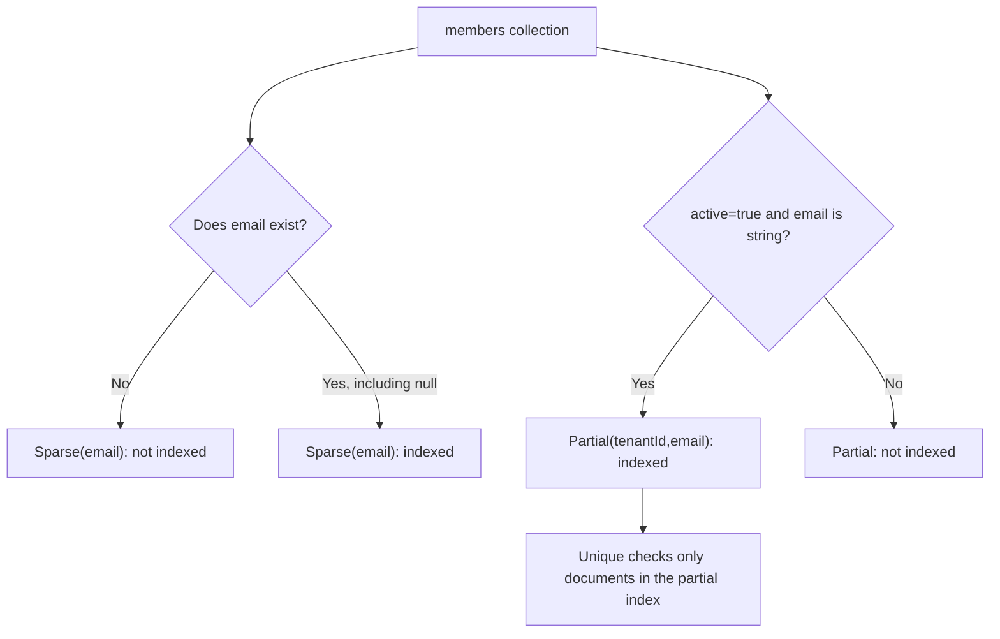

# Sparse Indexes and Partial Indexes

> **Chapter:** Indexes  
> **Module:** `SPRING_DATA_MONGODB` — connecting, mapping documents, working with MongoDB via `MongoTemplate` or repositories, and practicing query design, aggregation, indexing, transactions, reactive access, testing, and data performance diagnostics. This lesson focuses on **sparse indexes**, **partial indexes**, and choosing between them for optional fields, soft deletes, and conditional unique rules.

## 1. Practical Scenario: Not Every Document Has an Email

A SaaS system stores members of multiple organizations in the `members` collection. Users may register via phone number without providing an email, or may be deactivated (`active=false`). Three requirements commonly arise:

1. Quickly look up members **who have an email field** without indexing documents **missing** the field.
2. Enforce **unique emails among active members within the same tenant**, while still allowing identical emails across two tenants and allowing reuse of emails from deactivated accounts.
3. Avoid building large indexes over rarely queried documents, while preventing queries from returning **incomplete results**.

A standard index `{email:1}` stores an index entry even for documents lacking `email` (under a null key). A **sparse index** filters which documents enter the index based on **presence of the indexed field**. A **partial index** uses a **filter expression** to decide which documents enter the index, such as `active:true` and `email` having BSON string type.



**Most common misconception:** Sparse **does not mean** "skip all null values". A field `email: null` **does exist**, so it enters a sparse index on `email`; only documents where the field **is absent from BSON** are excluded from that sparse index. For "only valid string emails", a partial filter using `$type:"string"` is usually more appropriate. Even then, that checks only the **BSON data type**, not email syntax.

## 2. Dataset for Experimentation

Run the data-modifying commands below only on an **isolated test MongoDB**. `drop()` deletes the entire `members` collection:

```javascript
db.members.drop();

db.members.insertMany([
  // Missing email field.
  { _id: "U-001", tenantId: "TENANT-A", active: true,  displayName: "An" },
  // Has email field with explicit BSON null.
  { _id: "U-002", tenantId: "TENANT-A", active: true,
    email: null, displayName: "Binh" },
  // Active member with String email.
  { _id: "U-003", tenantId: "TENANT-A", active: true,
    email: "ana@example.test", displayName: "Chi" },
  // Inactive: intentionally shares email with U-003.
  { _id: "U-004", tenantId: "TENANT-A", active: false,
    email: "ana@example.test", displayName: "Dung" },
  { _id: "U-005", tenantId: "TENANT-A", active: true,
    email: "bob@example.test", displayName: "Ha" },
  // Another tenant's email matches U-003, valid per business rules.
  { _id: "U-006", tenantId: "TENANT-B", active: true,
    email: "ana@example.test", displayName: "Khanh" },
  // Empty string: still a String, not missing or null.
  { _id: "U-007", tenantId: "TENANT-A", active: true,
    email: "", displayName: "Linh" },
  { _id: "U-008", tenantId: "TENANT-A", active: false,
    displayName: "Mai" },
  // Wrong legacy data type: number.
  { _id: "U-009", tenantId: "TENANT-A", active: true,
    email: 42, displayName: "Nam" },
  // Second explicit null.
  { _id: "U-010", tenantId: "TENANT-A", active: false,
    email: null, displayName: "Oanh" }
]);
```

In this collection:

| Document | `email` | Field present? | `active` | Sparse `{email:1}` | Partial `active=true AND email String` |
| --- | --- | :---: | :---: | :---: | :---: |
| U-001 | missing | No | true | No | No |
| U-002 | null | Yes | true | **Yes** | No |
| U-003 | "ana@example.test" | Yes | true | Yes | Yes |
| U-004 | "ana@example.test" | Yes | false | Yes | No |
| U-005 | "bob@example.test" | Yes | true | Yes | Yes |
| U-006 | "ana@example.test" | Yes | true | Yes | Yes |
| U-007 | "" | Yes | true | Yes | **Yes** |
| U-008 | missing | No | false | No | No |
| U-009 | 42 | Yes | true | Yes | No |
| U-010 | null | Yes | false | Yes | No |

**Document counts:** the collection has 10 documents; single-field sparse `email` indexes the 8 documents having the email field; partial on `active=true` and string `email` indexes 4 documents. This is an explanatory model, **not** a guarantee that every real index has exactly one physical entry per document (multikey arrays follow different rules).

**Important:** no unique index is created in this seeding step, because U-003/U-004/U-006 intentionally share an email and U-002/U-010 both hold null. Unique examples are demonstrated **separately**, on an appropriately filtered index or separate test collection.

## 3. What Is a Sparse Index?

A sparse index includes only documents that have **at least one value for the indexed field** according to that index type's rules. For a standard **single-field ascending/descending index**:

```javascript
db.members.createIndex(
  { email: 1 },
  { name: "ix_members_email_sparse", sparse: true }
);
```

This index excludes documents **completely missing `email`**, while including:

- `email: null` — the field exists despite its null value.
- `email: ""` — empty string.
- `email: 42` — legacy numeric value.
- `email: "ana@example.test"` — normal string.

A sparse index **does not validate format**, clean up mistyped fields, or apply `active:true`.

### 3.1. Comparing Against a Regular Index

| Property | Regular `{email:1}` | Sparse `{email:1}` |
| --- | --- | --- |
| Document missing email | Has null key entry | **Not** indexed |
| Document with email=null | Has null key entry | **Has** null key entry |
| Document with email="" | Yes | Yes |
| Document with numeric email | Yes | Yes |
| Inclusion rule | All documents | `email` field exists |
| Full-collection sort | Eligible if suitable | Usually **not** used if it would omit missing-field docs |
| Unique on email | Missing/null both constrained | Missing skipped, explicit null **not** skipped |

MongoDB has certain index types that are **inherently sparse** (such as text or geospatial indexes with their own rules). This lesson primarily discusses **single-field B-tree** sparse indexes and separates compound sparse cases in section 7 to avoid overgeneralizing single-field rules to every index type.

### 3.2. Queries That Can Leverage a Sparse Index

```javascript
db.members.find({
  email: { $exists: true }
}).explain("executionStats");
```

This query **explicitly excludes documents missing `email`**, so the sparse index is a valid candidate for locating documents containing the field. Note that `$exists:true` still includes `email:null` and `email:42`.

A normal email equality lookup:

```javascript
db.members.find({
  email: "ana@example.test"
}).explain("executionStats");
```

does not need documents missing email; the sparse index **may be selected by the planner**. Actual selection depends on data volume, selectivity, competing indexes, and server version.

### 3.3. Why Full-Collection Sorts Do Not Use Sparse by Default

```javascript
db.members.find().sort({ email: 1 });
```

This query requests **all documents**, including U-001 and U-008 which lack email. If the planner read only the sparse index, those documents would vanish and results would be **incomplete**. MongoDB avoids choosing a sparse index for queries/sorts when doing so would return an incomplete result set.

**Do not force the wrong index with `hint()`:**

```javascript
// PITFALL ILLUSTRATION ONLY: omits documents without email.
db.members.find()
  .sort({ email: 1 })
  .hint("ix_members_email_sparse");
```

`hint()` can force MongoDB to scan the sparse index, returning only indexed documents. That **alters the observable query semantics**, not just speed. Similarly, `countDocuments({}, {hint:"ix_members_email_sparse"})` can undercount documents; never use a sparse hint to count an entire collection.

## 4. What Is a Partial Index?

A partial index includes a document only when it matches a **`partialFilterExpression`**. The expression can reference fields outside the index keys and check conditions beyond mere field existence.

Example indexing `email` only for active accounts:

```javascript
db.members.createIndex(
  { email: 1 },
  {
    name: "ix_active_email_partial",
    partialFilterExpression: { active: true }
  }
);
```

**Warning:** if the filter is only `active:true`, every active document is indexed—**including active documents missing email or having email=null**. In this partial index, U-001 and U-002 still get entries for `email` under a null key. A partial filter **does not automatically exclude null/missing index keys** unless the filter specifies it.

To index only String emails on active accounts:

```javascript
db.members.createIndex(
  { email: 1 },
  {
    name: "ix_active_string_email",
    partialFilterExpression: {
      active: true,
      email: { $type: "string" }
    }
  }
);
```

On the sample dataset, this index contains `U-003`, `U-005`, `U-006`, `U-007`. It excludes missing fields, null, numbers, and inactive accounts.

**Limitation of `$type:"string"`:** it checks only BSON type; `""` is also a string and enters the index. If the application forbids empty emails, enforce validation/normalization and optionally refine the filter expression, without relying on the index as a replacement for validation.

### 4.1. Common Operators in `partialFilterExpression`

Depending on the MongoDB version, partial filters support a documented subset of query operators:

| Condition | Example | Goal |
| --- | --- | --- |
| Equality | `{active:true}` | Active accounts only |
| Field existence | `{email:{$exists:true}}` | Mimic sparse for a field |
| BSON type | `{email:{$type:"string"}}` | String emails only |
| Range | `{score:{$gte:100}}` | Documents above threshold only |
| Logical AND | `{$and:[{active:true},{tier:"GOLD"}]}` | Both predicates simultaneously |
| Logical OR | `{$or:[{tier:"GOLD"},{tier:"PLATINUM"}]}` | Either of multiple cases |
| Membership | `{status:{$in:["NEW","OPEN"]}}` | Any of listed statuses |
| Geo | `$geoWithin` / `$geoIntersects` | Spatial bounds with compatible index |

Do not assume **every query operator** works inside `partialFilterExpression`. Operators such as `$ne`, `$nin`, `$regex`, and `$expr` are not generally supported in partial filters in current MongoDB documentation; to express "non-empty email", do not blindly write `$ne:""` expecting index creation to succeed. Pick operators supported by your server version and test `createIndex` directly.

### 4.2. What Can Partial Do That Sparse Cannot?

```javascript
db.members.createIndex(
  { tenantId: 1, email: 1 },
  {
    name: "ix_active_members_by_tenant_email",
    partialFilterExpression: { active: true }
  }
);
```

The index keys are `tenantId` and `email`, while the filter inspects `active`—a field **not required to be in the key pattern**. Sparse cannot directly express "index only active accounts" when `active` is unrelated to key field presence.

### 4.3. Do Not Combine Sparse and Partial in the Same Index

MongoDB **forbids** specifying both `sparse:true` and `partialFilterExpression` in a single index definition:

```javascript
// INVALID: both options cannot be declared together.
db.members.createIndex(
  { email: 1 },
  {
    sparse: true,
    partialFilterExpression: { active: true }
  }
);
```

The same applies in Spring Data MongoDB: do not combine `@Indexed(sparse=true, partialFilter=...)` or `@CompoundIndex(sparse=true, partialFilter=...)`. **Pick one mechanism** matching the business requirement.

## 5. Comparison Table for Choosing an Index

| Criterion | Sparse index | Partial index |
| --- | --- | --- |
| Inclusion rule | Indexed field present; compound has special rules | Any **valid filter** defined by `partialFilterExpression` |
| Excludes explicit null? | **No** if field exists | **Yes**, e.g. filtering `$type:"string"` |
| Selects active only? | Not directly by active value | Yes, `{active:true}` |
| Filters on fields outside index keys | Not via conditional filter | Yes |
| Subset uniqueness | Yes, subset is docs with key | Yes, subset defined by business filter |
| Query index usage | Only if no required docs are omitted | Only if query guarantees results lie inside filter subset |
| Storage / write maintenance | Reduced when many docs lack field | Reduced when filter selects a small subset |
| Combining sparse + partial in one index | No | No |
| When to use | Only need to skip docs **missing the indexed field** | Need rules **by status, type, tenant, range, etc.** |

**General recommendation:** partial indexes are more flexible for most subset-indexing problems. Sparse remains handy when the rule is simply "field exists" and you fully understand null semantics, query coverage, and server version behavior.

## 6. Can the Query Planner Use a Partial Index?

This difference is decisive for both performance and correctness. A partial index holds only a subset of documents. MongoDB **will not use that index for a query/sort if doing so could omit documents requested by the query**.

Suppose the index is:

```javascript
db.members.createIndex(
  { tenantId: 1, email: 1 },
  {
    name: "ix_tenant_active_email",
    partialFilterExpression: { active: true }
  }
);
```

### 6.1. Query Implying the Filter

```javascript
db.members.find({
  tenantId: "TENANT-A",
  active: true,
  email: "ana@example.test"
}).explain("executionStats");
```

The query includes `active:true`, so every matching document belongs to the `active:true` subset of the partial index. `{tenantId:1,email:1}` is a **valid candidate** for looking up those two keys. The planner **may** choose it, though it is not guaranteed to win in every situation.

### 6.2. Query Missing the Partial Filter Condition

```javascript
db.members.find({
  tenantId: "TENANT-A",
  email: "ana@example.test"
}).explain("executionStats");
```

This query asks for **both active and inactive members**; `U-004` also matches. Using only the active partial index would **miss U-004**, so the planner cannot rely on it alone to return complete results.

**Do not add `active:true` just to force index usage if the business logic needs inactive records too.** That changes the data policy and is no longer equivalent to the original query.

### 6.3. Range Subsets

A partial index filtering by score:

```javascript
db.members.createIndex(
  { score: 1 },
  {
    name: "ix_score_gte_100",
    partialFilterExpression: { score: { $gte: 100 } }
  }
);
```

The query `{score:{$gte:150}}` is a narrower subset of `{score:{$gte:100}}`, so it **can** use the index. The query `{score:{$gte:50}}` asks for scores below 100 as well, so it **cannot rely solely on that partial index**.

**Note:** MongoDB documents that subset implication varies across operators in `partialFilterExpression`. For complex filters, verify via `explain()` on your exact server version; do not infer solely from mathematical logic that the planner recognizes every equivalence.

### 6.4. Interpreting Explain Correctly

```javascript
db.members.find({
  tenantId: "TENANT-A",
  active: true,
  email: "bob@example.test"
}).explain("executionStats");
```

Inspect `winningPlan` and stages like `IXSCAN` / `COLLSCAN` / `FETCH`, `indexName`, `totalKeysExamined`, `totalDocsExamined`, and `nReturned`. On a 10-document dataset, the planner may prefer a collection scan because the collection is tiny; that is not proof that the partial index was created wrong.

If the index is not used, check: (1) does the index actually exist, (2) does the query imply the partial filter, (3) do BSON field names match, (4) does compound key order fit filter/sort, (5) does collation match, and (6) are dataset size/cardinality sufficient for the index to be chosen?

## 7. Unique Sparse: Allows Multiple Missing Fields, Still Constrains Null

### 7.1. Regular Single-Field Unique Index

```javascript
// Run only in a fresh test collection, not the seeded members collection.
db.profileSparseTest.drop();

db.profileSparseTest.createIndex(
  { email: 1 },
  { name: "ux_email_normal", unique: true }
);
```

With a **regular single-field unique index**, MongoDB generates a null key for both missing `email` and explicit `email:null`. Because only one null unique key is permitted, inserting **two documents without an email** triggers `E11000 duplicate key`. This is a frequent reason projects with optional fields cannot use a plain unique index.

### 7.2. Unique Sparse for Optional Email

Recreate the test collection to illustrate separately:

```javascript
db.profileSparseTest.drop();

db.profileSparseTest.createIndex(
  { email: 1 },
  {
    name: "ux_email_sparse",
    unique: true,
    sparse: true
  }
);

// Valid: both documents lack the email field.
db.profileSparseTest.insertMany([
  { _id: "P-1", displayName: "A" },
  { _id: "P-2", displayName: "B" }
]);

// Valid: first explicit null.
db.profileSparseTest.insertOne({
  _id: "P-3", email: null
});
```

However:

```javascript
// EXPECTED ERROR E11000: null key already exists from P-3.
db.profileSparseTest.insertOne({
  _id: "P-4", email: null
});
```

**Unique sparse allows multiple documents missing email, but does NOT allow multiple documents with `email:null` in that single-field index.** If a mapper or client writes absent fields as explicit null, uniqueness behavior may surprise you.

Do not use `{email:null}` to infer whether a document has an email field: in MongoDB queries, equality to null matches both **null** and **missing**. To inspect BSON explicitly, use `{email:{$exists:true}}` or `{email:{$type:"null"}}` as appropriate.

### 7.3. Collection-Wide Unique Sparse Does Not Solve Per-Tenant Uniqueness

The index:

```javascript
{ email: 1 } // unique:true, sparse:true
```

still enforces `email` uniqueness **across the entire collection**. It treats `"ana@example.test"` in TENANT-A and TENANT-B as duplicates even when business rules allow it. Furthermore, an inactive user's email still occupies a unique key, so that email **cannot be reused** for another member simply because the old user became inactive.

If the requirement is unique **per tenant, active only, and string emails only**, you need a **compound unique partial index**, not a single-field unique sparse index.

## 8. Unique Partial by Tenant, Status, and Data Type

On the `members` dataset from section 2, create:

```javascript
db.members.createIndex(
  { tenantId: 1, email: 1 },
  {
    name: "ux_tenant_active_string_email",
    unique: true,
    partialFilterExpression: {
      active: true,
      email: { $type: "string" }
    }
  }
);
```

This index enforces uniqueness on the **(tenantId, email) pair**, **only** for documents satisfying both conditions:

- `active:true`;
- `email` is a BSON string per `$type` semantics.

On the sample dataset, index creation succeeds: U-003 is active in TENANT-A with `ana@example.test`; U-004 has the same email but is inactive so **it is outside the index**; U-006 uses the same email in TENANT-B so the compound key differs; U-002/U-010 nulls are excluded; U-001/U-008 missing fields are excluded; U-009 numeric email is excluded.

### 8.1. Duplicate Active Email in Same Tenant Is Blocked

```javascript
// EXPECTED ERROR E11000 on ux_tenant_active_string_email.
db.members.insertOne({
  _id: "U-011",
  tenantId: "TENANT-A",
  active: true,
  email: "ana@example.test"
});
```

**Do not rely on calling `existsByEmail(…)` before insert to guarantee uniqueness.** Two concurrent requests can both see "email does not exist" and both write. MongoDB's unique index is the database-level enforcement point; the application should still catch duplicate errors and return an appropriate business message.

### 8.2. Inactive Accounts May Reuse the Email Value

```javascript
// Valid: inactive document does not enter the unique partial index.
db.members.insertOne({
  _id: "U-012",
  tenantId: "TENANT-A",
  active: false,
  email: "ana@example.test"
});
```

However, if you later update `U-012.active` from `false` to `true` while U-003 is active, MongoDB must **insert U-012's entry into the partial index** and will reject the update with a duplicate key error. Uniqueness rules apply on **both inserts and updates** whenever a document enters or leaves the subset due to data changes.

### 8.3. Transitioning from Active to Inactive

```javascript
db.members.updateOne(
  { _id: "U-003", tenantId: "TENANT-A", active: true },
  { $set: { active: false } }
);
```

After this update, U-003 leaves the unique partial index; a **new active** account in the same tenant with that email can now be inserted, provided no other active account conflicts.

**Business review required:** should inactive accounts really release their email? If login/security binds an email permanently to an identity, reusing emails can introduce security risks. An index enforces the technical rule, but the domain layer must approve that rule.

### 8.4. String Does Not Mean Valid Email

`$type:"string"` also admits `email:""` into the index. If two active accounts in the same tenant both have `email:""`, unique partial will block the second account. To prevent this:

- Normalize inputs: trim, lowercase/canonicalize per policy, and reject empty values.
- When no email is provided, **omit the field** or store a value excluded by the partial filter rather than storing an empty string.
- Enforce validation in the service and MongoDB schema validation if needed; an index does not validate email formatting.
- For case-insensitive emails, consider a **`normalizedEmail` field** with a unique index on it, or an appropriate collation; do not assume default binary uniqueness treats `"ANA@..."` and `"ana@..."` as duplicates.

### 8.5. Unique Partial Does Not Replace Authorization

A unique index containing `tenantId` prevents per-tenant duplicates, **not spoofed `tenantId` values in requests**. Email lookup queries must still take `tenantId` from the authenticated principal/security context and include `active:true` when business logic targets active users only.

## 9. Compound Sparse: Understand Rules Differing from Single-Field

A common mistake is assuming compound sparse `{tenantId:1,email:1}` indexes only documents having **both fields**. For a **compound B-tree containing only ascending/descending keys**, MongoDB indexes a document if it has a value in **at least one field in the key pattern**.

### 9.1. A Particularly Easy Mistake

```javascript
db.members.createIndex(
  { tenantId: 1, email: 1 },
  { name: "ix_compound_sparse", sparse: true }
);
```

In SaaS systems, almost every document has `tenantId`. Consequently, **even documents missing email** such as U-001/U-008 still enter the compound sparse index because they contain `tenantId`. This index **fails** the goal "index only members who have an email".

State the condition explicitly with partial:

```javascript
db.members.createIndex(
  { tenantId: 1, email: 1 },
  {
    name: "ix_compound_email_exists",
    partialFilterExpression: {
      email: { $exists: true }
    }
  }
);
```

This index selects only documents containing the `email` field, **without needing `tenantId` in the filter**; `tenantId` remains an index key for tenant-scoped queries.

### 9.2. Compound Sparse Concept Table

| Key pattern | When a document is indexed |
| --- | --- |
| `{email:1}`, sparse | Has email field, including null |
| `{tenantId:1,email:1}`, sparse; both regular B-tree | Has **at least one** of the two fields |
| Compound with a geospatial key | Specific rules driven by the geospatial field |
| Compound with a text key | Specific rules driven by the text field |

Because of this difference, **do not generalize intuition from the word "sparse" to all compound indexes**. For business-level filtering, partial indexes express intent far more clearly.

## 10. Spring Data MongoDB: Declaring @Indexed

Spring Data MongoDB provides `org.springframework.data.mongodb.core.index.Indexed`:

### 10.1. Sparse on an Optional Property

```java
package demo.members;

import org.springframework.data.annotation.Id;
import org.springframework.data.mongodb.core.index.Indexed;
import org.springframework.data.mongodb.core.mapping.Document;

@Document(collection = "member_profiles")
public class MemberProfile {
    @Id
    private String id;

    @Indexed(name = "ix_contact_email_sparse", sparse = true)
    private String contactEmail;

    // Constructor/getters/setters per application mapping style.
}
```

The index described by annotation metadata corresponds semantically to:

```javascript
db.member_profiles.createIndex(
  { contactEmail: 1 },
  { name: "ix_contact_email_sparse", sparse = true }
);
```

Declaring `@Indexed` alone **does not mean** the index exists when the app runs: **since Spring Data MongoDB 3.0, automatic index creation is disabled by default**. Explicitly enable it where appropriate or create indexes during controlled migration/bootstrap lifecycles.

### 10.2. Unique Partial with @Indexed

When there is a single index key field:

```java
package demo.members;

import org.springframework.data.annotation.Id;
import org.springframework.data.mongodb.core.index.Indexed;
import org.springframework.data.mongodb.core.mapping.Document;

@Document(collection = "members")
public class MemberByEmail {
    @Id
    private String id;

    private boolean active;

    @Indexed(
        name = "ux_active_string_email",
        unique = true,
        partialFilter = "{ 'active': true, 'email': { '$type': 'string' } }"
    )
    private String email;
}
```

This annotation defines a unique index on **`email`** for active documents with String emails. **It is collection-wide unique for email, not per-tenant unique.** If per-tenant uniqueness is required, use a compound key.

`@Indexed.partialFilter` exists in Spring Data MongoDB 3.1+ in current APIs; do not copy into older versions without checking. `sparse=true` and `partialFilter` **must not be used together**.

### 10.3. Composite Unique Partial with @CompoundIndex

```java
package demo.members;

import org.springframework.data.annotation.Id;
import org.springframework.data.mongodb.core.index.CompoundIndex;
import org.springframework.data.mongodb.core.mapping.Document;

@Document(collection = "members")
@CompoundIndex(
    name = "ux_tenant_active_string_email",
    def = "{ 'tenantId': 1, 'email': 1 }",
    unique = true,
    partialFilter = "{ 'active': true, 'email': { '$type': 'string' } }"
)
public class Member {
    @Id
    private String id;
    private String tenantId;
    private String email;
    private boolean active;

    protected Member() {}

    public Member(String id, String tenantId, String email, boolean active) {
        this.id = id;
        this.tenantId = tenantId;
        this.email = email;
        this.active = active;
    }

    public String getId() { return id; }
    public String getTenantId() { return tenantId; }
    public String getEmail() { return email; }
    public boolean isActive() { return active; }
}
```

Two points to remember:

1. `@CompoundIndex` is placed on the **`@Document` type**, not on the `email` field.
2. `def` defines the two index keys, while `partialFilter` defines the document subset. `unique=true` enforces uniqueness on the **key pair** within that subset.

**A project should choose one consistent index creation strategy** (resolved annotations at startup or migration/programmatic provisioning). Do not declare both single-field unique and compound unique annotations on the same collection when business rules require per-tenant uniqueness; they have different semantics and will conflict.

### 10.4. BSON Field Aliases in Index Filters

If an entity defines:

```java
@Field("email_address")
private String email;
```

then the stored field is `email_address`. In raw BSON/JSON index definitions and `partialFilterExpression`, ensure field names in the filter use the **actual MongoDB field name**, rather than assuming every raw `Document` is remapped by Spring Data:

```java
@CompoundIndex(
    name = "ux_tenant_email_active",
    def = "{ 'tenantId': 1, 'email_address': 1 }",
    unique = true,
    partialFilter = "{ 'active': true, 'email_address': { '$type': 'string' } }"
)
```

Mapping metadata in some APIs may translate aliases in key definitions, yet you **must inspect actual `getIndexes()` output** before concluding the filter used the right BSON path. Especially with `PartialIndexFilter.of(Document)`, do not rely on the converter to translate Java names into renamed BSON fields.

## 11. Creating Indexes with MongoTemplate and IndexOperations

When managing indexes per environment/migration, use `MongoTemplate.indexOps(...)` and `Index` / `PartialIndexFilter`.

### 11.1. Creating a Sparse Index

```java
import org.springframework.data.domain.Sort;
import org.springframework.data.mongodb.core.index.Index;

String indexName = mongoTemplate.indexOps("member_profiles")
    .ensureIndex(
        new Index()
            .on("contactEmail", Sort.Direction.ASC)
            .named("ix_contact_email_sparse")
            .sparse()
    );
```

This requires an injected `mongoTemplate` bean. `ensureIndex` asks MongoDB to ensure the matching index exists; if the collection already has an index with the same name but different options, an **index options conflict** will occur instead of silently altering the existing index. Do not treat it as a complete migration replacement.

### 11.2. Creating a Compound Unique Partial Index

```java
import org.bson.Document;
import org.springframework.data.domain.Sort;
import org.springframework.data.mongodb.core.index.Index;
import org.springframework.data.mongodb.core.index.PartialIndexFilter;

Index uniqueActiveEmail = new Index()
    .on("tenantId", Sort.Direction.ASC)
    .on("email", Sort.Direction.ASC)
    .named("ux_tenant_active_string_email")
    .unique()
    .partial(PartialIndexFilter.of(Document.parse(
        "{ 'active': true, 'email': { '$type': 'string' } }"
    )));

mongoTemplate.indexOps("members").ensureIndex(uniqueActiveEmail);
```

`PartialIndexFilter.of(Document)` passes a **raw filter**. You can also use `PartialIndexFilter.of(CriteriaDefinition)` in supported versions, paying attention to field-name mapping. Never chain `.sparse()` and `.partial(...)` on the same `Index`.

### 11.3. Should Spring Data Auto-Index Creation Be Enabled?

Per Spring Data MongoDB documentation, **automatic index creation is disabled by default since 3.0** to avoid unintended effects on collection lifecycle and startup performance. In projects wanting to enable it via Java configuration:

```java
import org.springframework.context.annotation.Configuration;
import org.springframework.data.mongodb.config.AbstractMongoClientConfiguration;

@Configuration
public class MongoIndexConfig extends AbstractMongoClientConfiguration {

    @Override
    protected String getDatabaseName() {
        return "members_demo";
    }

    @Override
    public boolean autoIndexCreation() {
        return true;
    }

    // Configure MongoClient/connection according to the actual project.
}
```

**This is an illustrative configuration option**, not a file to drop blindly into any Spring Boot app already auto-configuring `MongoClient`/`MongoTemplate`. In most long-lived production services, manage index creation/changes via migrations or controlled initialization with a rollout policy, because building a unique index on existing data can fail on duplicates.

When using `@Indexed`/`@CompoundIndex`, you can also use `MongoPersistentEntityIndexResolver` to resolve definitions and call `IndexOperations.ensureIndex` explicitly during a controlled initialization step. Never invoke index creation per HTTP request.

### 11.4. Verifying Created Indexes

```javascript
db.members.getIndexes();
```

Inspect these fields:

- `key`: key pattern such as `{tenantId:1,email:1}`;
- `name`: index name;
- `unique`: whether enabled;
- `sparse`: whether enabled;
- `partialFilterExpression`: exact filter stored by MongoDB.

**Reading back the index catalog matters more than reading Java annotations**: annotations may look right while auto-index creation is off, migrations haven't run, or an older index exists with different options.

## 12. Using Repositories and MongoTemplate: Queries Must Preserve Partial Scope

An index does not automatically inject `active=true` into queries. The application must explicitly supply the proper business predicates.

### 12.1. Repository Method with Explicit Active Condition

```java
package demo.members;

import java.util.Optional;
import org.springframework.data.mongodb.repository.MongoRepository;

public interface MemberRepository extends MongoRepository<Member, String> {

    Optional<Member> findByTenantIdAndEmailAndActiveTrue(
        String tenantId,
        String email
    );
}
```

This method typically generates a predicate equivalent to:

```javascript
{
  tenantId: "TENANT-A",
  email: "ana@example.test",
  active: true
}
```

It matches the scope of the partial unique index `{tenantId:1,email:1}` with filter `{active:true,email:{$type:"string"}}` when `email` is a non-null String. **Do not rely solely on method naming to assert the planner picks the index**: query filters must allow the planner to deduce subset membership, and key order, collation, and data distribution must also align.

### 12.2. Querying with MongoTemplate

```java
import java.util.List;
import org.springframework.data.mongodb.core.query.Criteria;
import org.springframework.data.mongodb.core.query.Query;

Query query = Query.query(
    Criteria.where("tenantId").is("TENANT-A")
        .and("email").is("ana@example.test")
        .and("active").is(true)
);

List<Member> matches = mongoTemplate.find(query, Member.class);
```

In a real service, `tenantId` comes from the authenticated security context, and `email` must be normalized/validated. `MongoTemplate` maps Java property names to BSON via the entity converter, whereas raw index filters like `PartialIndexFilter.of(Document)` require physical field names. Do not mix the two contexts.

### 12.3. Queries for `active=false` Need Another Index If Frequent

```java
Query inactiveQuery = Query.query(
    Criteria.where("tenantId").is("TENANT-A")
        .and("active").is(false)
);
```

A partial index containing only active records **cannot** serve this query. If an admin screen frequently lists inactive members, add a full index or another partial index suited to that workload. **Never artificially add `active=true`** just to hit an index, as that corrupts business results.

### 12.4. Do Not Use `exists()` to Replace a Unique Constraint

```java
// Pre-check does not eliminate race conditions:
boolean alreadyExists = memberRepository
    .findByTenantIdAndEmailAndActiveTrue(
        "TENANT-A", "ana@example.test"
    )
    .isPresent();

// Another request can insert the same email right after the check.
// The database unique partial index remains the race-safe enforcement point.
```

Services should catch duplicate exceptions on write. In Spring Data MongoDB, MongoDB errors are typically translated to `org.springframework.dao.DuplicateKeyException`; in raw MongoDB Java Driver calls, it may be `com.mongodb.MongoWriteException` with a duplicate-key error code. Do not blindly map every `DuplicateKeyException` to "email already exists" if the collection has multiple unique indexes; classify error details safely and accurately.

## 13. Missing Data, Explicit Null, Arrays, and BSON Types

### 13.1. Missing and Null Differ at the Index Level

```javascript
db.members.find({ email: { $exists: false } }); // U-001 and U-008

db.members.find({ email: { $exists: true } });  // 8 documents

db.members.find({ email: { $type: "null" } });  // U-002 and U-010

db.members.find({ email: null }); // Can match both missing and explicit null
```

When auditing legacy data:

- Absent `email` means the field is missing.
- `email:null` means the field exists with BSON Null.
- `email:""` means the field exists with an empty string.
- `email:42` is an invalid numeric type when email must be a String.

**With a sparse index**, absent is excluded while explicit null is indexed. **With partial `$type:"string"`**, null, absent, and numbers are excluded, while empty strings are indexed. Do not conflate these three cases into "no email".

### 13.2. @Field and Null Mapping

In Spring Data MongoDB, whether a Java `email == null` property is written as an absent field or BSON Null depends on write path and mapping/null-handling configuration. Do not guess. Inspect with:

```javascript
db.members.find(
  { _id: { $in: ["U-001", "U-002"] } },
  { email: 1 }
);
```

and raw BSON/Java Driver assertions to verify the physical schema. When business rules depend on missing vs. null, establish a consistent mapping convention, migrate legacy data, and write integration tests covering both cases.

### 13.3. Warning on Arrays with $type

An `email` field might accidentally be stored as an array:

```javascript
{
  _id: "LEGACY-ARRAY",
  tenantId: "TENANT-A",
  active: true,
  email: ["ana@example.test", "other@example.test"]
}
```

In MongoDB queries, `$type:"string"` on an array field matches when **any array element** is a String; therefore, never treat `partialFilterExpression:{email:{$type:"string"}}` as a validator guaranteeing the field **is not an array**. Multikey indexes have their own uniqueness rules, including indexing multiple values from one document.

If the domain requires email to be a **scalar String**, apply MongoDB JSON Schema validation and audit legacy data, or normalize before enabling unique partial. Do not allow malformed array data in just because the partial filter includes `$type`.

## 14. Document Lifecycle and Indexes: Insert, Update, and Soft Delete

### 14.1. Changing `active` Changes Index Membership

```javascript
db.members.updateOne(
  { _id: "U-004", tenantId: "TENANT-A" },
  { $set: { active: true } }
);
```

If U-003 is still active with the same email in tenant A, MongoDB must add U-004 to the unique partial index and will **reject the update** with `E11000`. An update cannot silently create two active accounts sharing the unique key.

Conversely, updating `active:true → false` takes the document out of the filter, so its index entry is removed.

**Atomicity:** an update on a single document is atomic at the document level in MongoDB. However, a workflow "deactivate old user + activate new user" across **two documents** is two operations and not automatically transactional; if both must commit together, use a topology-supported transaction or an appropriate handover design.

### 14.2. Soft Delete Using `deleted=false`

Other applications use a `deleted` flag:

```javascript
db.accounts.createIndex(
  { tenantId: 1, normalizedEmail: 1 },
  {
    name: "ux_live_email_per_tenant",
    unique: true,
    partialFilterExpression: {
      deleted: false,
      normalizedEmail: { $type: "string" }
    }
  }
);
```

Rule: only accounts **explicitly storing `deleted:false`** with a String normalized email participate in uniqueness. Legacy documents missing the `deleted` field will **not** match `deleted:false` (aside from specific query semantics elsewhere) and could escape the unique constraint even though the business considers them "not deleted".

Before enabling the index, migrate the status field across all participating documents. If missing meant "not deleted" in legacy code, align or backfill the field so no uniqueness gap occurs.

### 14.3. Partial Indexes Do Not Add `deleted=false` to Every Query

```javascript
db.accounts.find({
  tenantId: "TENANT-A",
  normalizedEmail: "ana@example.test"
});
```

If this query is meant to return deleted accounts too, it **cannot rely solely** on a partial index containing only `deleted:false`. To find active accounts, include `deleted:false` in the query. An index only optimizes and constrains a subset; it never alters default query results.

## 15. Partial TTL Indexes and Specific Limitations

A partial index can combine TTL behavior within MongoDB's supported constraints. Example for a login sessions collection with an expiration date:

```javascript
db.sessions.createIndex(
  { expiresAt: 1 },
  {
    name: "ttl_expired_sessions",
    expireAfterSeconds: 0,
    partialFilterExpression: { state: "EXPIRED" }
  }
);
```

Only documents matching `state:"EXPIRED"` enter this TTL index. Once `expiresAt` passes, MongoDB's TTL monitor removes them on its schedule; **deletion at the exact expiration instant is not guaranteed**. TTL never replaces checking session expiration in auth logic.

For **time-series collections**, partial TTL has version-specific limits and permits filtering only on metadata fields per MongoDB's supported rules. TTL indexes are generally single-field; do not assume arbitrary compound indexes accept `expireAfterSeconds`.

### 15.1. Key Restrictions

Per current MongoDB documentation, keep in mind:

- Do not combine `sparse:true` with `partialFilterExpression`.
- Do not create a **partial index on the `_id` index**.
- **Shard key indexes** cannot be partial; unique constraints on sharded collections also require considering **shard key prefixes** and topology.
- With **Client-Side Field Level Encryption** or **Queryable Encryption**, partial filters cannot reference encrypted fields per MongoDB restrictions.
- Starting in MongoDB 7.3, the server prevents creating **equivalent partial indexes** with identical keys and equivalent filter/collation definitions. Do not treat creating multiple renamed copies as a valid migration strategy.
- Filter operators, index options, collation, and special index types depend on server version; verify rather than blindly copying snippets.

### 15.2. Collation and Case-Insensitive Emails

A unique index with the default/simple collation treats `"ANA@example.test"` and `"ana@example.test"` as **two different values**. If business rules treat them as one email, two strategies exist:

1. Store `normalizedEmail` canonicalized on the write path and put the unique index on that field.
2. Create the index with an appropriate collation and ensure queries use a matching collation (per server rules).

Collation affects both unique comparison **and** query index selection. Do not assume adding `ignoreCase` to a repository method name or using `regex /i` automatically utilizes every existing index. Verify `getIndexes()` and `explain()` in a real environment.

## 16. Performance Optimization: Smaller Does Not Always Mean Faster

### 16.1. Index Entries and Write Amplification

Partial/sparse indexes can reduce storage and index maintenance when a large fraction of documents is excluded. However, whenever updating `active`/`deleted`/`email` causes a document to enter or leave the filter, MongoDB must update the index accordingly.

| Workload | Consideration |
| --- | --- |
| 95% of documents lack email | Sparse email or partial email-exists saves substantial space. |
| Only 5% of users are active | Partial active index can stay very small if most are inactive. |
| Almost all active users have email | Partial may not be much smaller than a regular index. |
| Queries frequently view both active and inactive | Need an index supporting the full query, not just partial active. |
| Active flag flips constantly | Index membership churn can raise write costs. |
| Queries by tenant + email | Compound key ordered for workload; partial filter must match. |

Do not assume a partial index is always faster. If a query cannot prove subset membership, the planner cannot use it; if key order mismatches, sorting or scanning can still be expensive.

### 16.2. Using Explain and Metrics

```javascript
db.members.find({
  tenantId: "TENANT-A",
  active: true,
  email: "ana@example.test"
}).explain("executionStats");
```

Depending on server version, check:

- Does `winningPlan` show `IXSCAN` or `COLLSCAN`?
- Is `indexName` the expected index?
- Are `totalKeysExamined`, `totalDocsExamined`, and `nReturned` reasonable?
- Is there an extra `FETCH` because the index does not cover all projected fields?
- When sorting, is there a significant in-memory sort stage?

Index sizes can be inspected via `db.members.stats()`, `db.members.aggregate([{$indexStats:{}}])`, or appropriate monitoring tools per version. `getIndexes()` shows only **index definitions**, not actual runtime performance metrics.

### 16.3. Restraint with Hints

```javascript
// Safer to let the planner choose an index from a business-accurate query.
db.members.find({
  active: true,
  tenantId: "TENANT-A",
  email: "bob@example.test"
});
```

`hint()` forces the server to consider a specific index, useful for **diagnostics and comparison** in tests. However, with sparse/partial indexes, an improper hint can produce **incomplete results**. Never hardcode a hint to force a partial index when a query may need documents outside the filter.

### 16.4. Aggregations with `$match` Using Partial Indexes

```javascript
db.members.aggregate([
  { $match: { tenantId: "TENANT-A", active: true } },
  { $group: { _id: "$email", count: { $sum: 1 } } }
]);
```

If a partial index filters `active:true` with a compatible key pattern, the leading `$match` stage **can** use the index. However, `$group` still computes aggregation state; reducing input scan via an index does not make the whole pipeline free.

## 17. Integration Tests with Real MongoDB: Duplicates, Missing, and Active

### 17.1. Testing Principles

Do not merely unit-test that an `Index` builder holds `partialFilterExpression`; that does not prove the server built the index or enforces uniqueness. Meaningful tests should:

1. Create indexes via Spring Data APIs on a **test** MongoDB instance.
2. Seed documents with **missing fields**, **explicit null**, **String emails**, and **active true/false**.
3. Attempt duplicate inserts inside the subset and **expect MongoDB to reject them**.
4. Insert identical emails **outside the subset** and in other tenants, expecting success.
5. Attempt updates that move a document **into the subset** colliding on uniqueness, expecting failure.
6. Read back `listIndexes()` and verify actual index options.

### 17.2. JUnit 5 with @DataMongoTest

The example below matches Spring Boot 3.x, JUnit 5, AssertJ, and corresponding Spring Data MongoDB APIs; newer Boot releases may change annotation packages. MongoDB **must be provided separately for tests** (e.g., Testcontainers); `@DataMongoTest` does not start a MongoDB server itself.

```java
package demo.members;

import static org.assertj.core.api.Assertions.assertThat;
import static org.assertj.core.api.Assertions.assertThatThrownBy;

import java.util.ArrayList;
import java.util.List;
import com.mongodb.MongoWriteException;
import com.mongodb.client.MongoCollection;
import org.bson.Document;
import org.junit.jupiter.api.BeforeEach;
import org.junit.jupiter.api.Test;
import org.springframework.beans.factory.annotation.Autowired;
import org.springframework.boot.test.autoconfigure.data.mongo.DataMongoTest;
import org.springframework.data.domain.Sort;
import org.springframework.data.mongodb.core.MongoTemplate;
import org.springframework.data.mongodb.core.index.Index;
import org.springframework.data.mongodb.core.index.PartialIndexFilter;

@DataMongoTest
class MemberIndexIntegrationTest {

    @Autowired
    MongoTemplate mongoTemplate;

    @BeforeEach
    void cleanTestCollection() {
        // Run ONLY when connected to an isolated TEST MongoDB.
        mongoTemplate.dropCollection("members");
    }

    private MongoCollection<Document> members() {
        return mongoTemplate.getCollection("members");
    }

    private Document member(String id, String tenant,
                            boolean active, String email) {
        return new Document("_id", id)
            .append("tenantId", tenant)
            .append("active", active)
            .append("email", email);
    }

    @Test
    void uniquePartialOnlyConstrainsActiveStringEmailPerTenant() {
        mongoTemplate.indexOps("members").ensureIndex(
            new Index()
                .on("tenantId", Sort.Direction.ASC)
                .on("email", Sort.Direction.ASC)
                .named("ux_active_tenant_email")
                .unique()
                .partial(PartialIndexFilter.of(Document.parse(
                    "{ 'active': true, " +
                    "'email': { '$type': 'string' } }"
                )))
        );

        members().insertMany(List.of(
            member("A-ACTIVE", "A", true, "ana@example.test"),
            member("A-INACTIVE", "A", false, "ana@example.test"),
            member("B-ACTIVE", "B", true, "ana@example.test"),
            member("A-NULL-1", "A", true, null),
            member("A-NULL-2", "A", true, null),
            new Document("_id", "A-MISSING")
                .append("tenantId", "A")
                .append("active", true)
        ));

        // Same email + same tenant + active => unique violation.
        assertThatThrownBy(() -> members().insertOne(
            member("A-DUPLICATE", "A", true, "ana@example.test")
        )).isInstanceOf(MongoWriteException.class);

        // Moving an inactive document into the partial set must also fail.
        assertThatThrownBy(() -> members().updateOne(
            new Document("_id", "A-INACTIVE"),
            new Document("$set", new Document("active", true))
        )).isInstanceOf(MongoWriteException.class);

        Document savedInactive = members()
            .find(new Document("_id", "A-INACTIVE"))
            .first();
        assertThat(savedInactive).isNotNull();
        assertThat(savedInactive.getBoolean("active")).isFalse();

        List<Document> allIndexes =
            members().listIndexes().into(new ArrayList<>());
        Document target = allIndexes.stream()
            .filter(idx -> "ux_active_tenant_email"
                .equals(idx.getString("name")))
            .findFirst().orElseThrow();

        assertThat(target.getBoolean("unique")).isTrue();
        assertThat(target.get("partialFilterExpression")).isNotNull();
    }

    @Test
    void uniqueSparseExcludesMissingButNotExplicitNull() {
        mongoTemplate.indexOps("members").ensureIndex(
            new Index()
                .on("email", Sort.Direction.ASC)
                .named("ux_sparse_email")
                .sparse()
                .unique()
        );

        members().insertMany(List.of(
            new Document("_id", "MISSING-1"),
            new Document("_id", "MISSING-2"),
            new Document("_id", "NULL-1").append("email", null)
        ));

        // Document missing email field can still be inserted.
        members().insertOne(new Document("_id", "MISSING-3"));

        // Explicit null has the field => participates in sparse unique index.
        assertThatThrownBy(() -> members().insertOne(
            new Document("_id", "NULL-2").append("email", null)
        )).isInstanceOf(MongoWriteException.class);
    }
}
```

**Why use raw `Document` in the test?** To guarantee distinguishing **absent fields** from **present fields = BSON null**. An entity mapper may omit null fields or convert types depending on settings; raw seeding directly exercises server index semantics.

This test **was not executed during authoring**: compile and run it against your project's Spring Boot, driver, and MongoDB server versions. Never run `dropCollection` on production or shared databases; use an isolated test database/collection namespace and clean up after tests.

### 17.3. Separating Annotation Unit Tests and Server Integration Tests

Unit tests are suited for checking index-naming helpers, business states, and service validation. **Integration tests** are required to verify:

- Whether MongoDB accepts `partialFilterExpression`.
- Whether the unique index builds cleanly on existing data.
- Whether duplicate keys are blocked on insert and update.
- Whether BSON types and null/missing behave as designed.
- Whether the index catalog has exact `key`, `name`, `unique`, and `partialFilterExpression`.
- Whether the planner selects the index for a given query (requires explain on representative datasets).

For performance testing, 6–10 documents are far too small to extrapolate production efficiency.

## 18. Reactive Access and Asynchronous Index Creation

`ReactiveMongoTemplate` offers reactive index operations in supported versions:

```java
import org.bson.Document;
import org.springframework.data.domain.Sort;
import org.springframework.data.mongodb.core.index.Index;
import org.springframework.data.mongodb.core.index.PartialIndexFilter;
import reactor.core.publisher.Mono;

Index index = new Index()
    .on("tenantId", Sort.Direction.ASC)
    .on("email", Sort.Direction.ASC)
    .named("ux_active_tenant_email")
    .unique()
    .partial(PartialIndexFilter.of(Document.parse(
        "{ 'active': true, 'email': { '$type': 'string' } }"
    )));

Mono<String> created = reactiveMongoTemplate
    .indexOps("members")
    .ensureIndex(index);
```

`created` is a publisher for ensuring the index exists; **it does not execute unless subscribed within the application lifecycle**. Never call `created.subscribe()` fire-and-forget on every HTTP request assuming the index is ready before writes relying on uniqueness. For critical data constraints, create/migrate indexes **before the application serves write traffic**, verifying the index catalog and migration outcome.

Example reactive query with tenant and active conditions:

```java
import reactor.core.publisher.Flux;
import org.springframework.data.mongodb.core.query.Criteria;
import org.springframework.data.mongodb.core.query.Query;

Query filter = Query.query(
    Criteria.where("tenantId").is("TENANT-A")
        .and("active").is(true)
);

Flux<Member> activeMembers =
    reactiveMongoTemplate.find(filter, Member.class);
```

Reactive access **does not change** sparse/partial semantics, does not make a query missing `active:true` automatically use an active partial index, and does not replace transactions or idempotency.

## 19. Workflow for Rolling Out Indexes to Production

### 19.1. Before Creating a Unique Index

Never build a unique index on legacy data without checking for duplicates. For per-tenant active email uniqueness, audit duplicate pairs:

```javascript
db.members.aggregate([
  {
    $match: {
      active: true,
      email: { $type: "string" }
    }
  },
  {
    $group: {
      _id: {
        tenant: "$tenantId",
        email: "$email"
      },
      count: { $sum: 1 },
      ids: { $push: "$_id" }
    }
  },
  { $match: { count: { $gt: 1 } } },
  { $sort: { count: -1 } }
]);
```

In large production collections, do not `$push` millions of IDs into one group: sample/count or batch instead, due to the 16 MiB BSON limit and memory usage. Check **required/non-null `tenantId`**, email normalization rules, and `active` across all participating documents.

### 19.2. Safe Migration Plan

1. **Inventory workloads**: which queries need active-only, which need all accounts, and do queries filter tenant/index keys?
2. **Audit schema**: count documents missing email, `email=null`, `email=""`, wrong BSON types/arrays, or missing active/deleted flags.
3. **Lock down business rules**: global vs. per-tenant unique, whether inactive accounts release emails, and case-sensitivity rules.
4. **Clean data**: normalize emails, resolve duplicates, and backfill legacy statuses per policy.
5. **Create new clearly named indexes**, choosing sparse or partial; verify disk space, build duration, and replica lag/load impact.
6. **Read back `getIndexes()`** and run integration tests plus `explain` on real queries, verifying duplicate-rejection behavior.
7. **Switch application code** to exact query filters and monitor metrics and errors.
8. **Drop old indexes** only after confirming no query or workload still relies on them and a rollback plan is ready.

Do not expect `ensureIndex` to modify an existing index if `partialFilterExpression`/`unique`/`sparse` changed. You may encounter `IndexOptionsConflict`, `IndexKeySpecsConflict`, or duplicate-data failures; handle those with explicit migrations aware of server version constraints.

### 19.3. A New Index Is Not the Only Constraint

A unique partial index enforces key rules only for documents **matching the filter**. If legacy documents escape the filter due to missing `active` or wrong `email` type, those documents **are not constrained for uniqueness** as expected. Combine:

- MongoDB schema validation to enforce required fields and types.
- Service-layer validation, normalization, and authorization.
- Properly scoped unique indexes.
- Integration tests, legacy data audits, and violation monitoring.

Never let application logic define "active" one way while the partial index defines "active" another way.

## 20. Common Mistakes and Troubleshooting Checklist

| Symptom | Cause | Remediation |
| --- | --- | --- |
| Unique sparse still reports duplicate for multiple `email=null` | Sparse keeps documents that have a null field. | Use a matching partial filter or migrate missing/null conventions. |
| Regular unique errors on two documents without email | Regular index maps missing fields to a null key. | Use unique sparse or unique partial when email is optional. |
| Compound sparse still indexes docs missing email | Another field like `tenantId` is present, satisfying compound sparse. | Use partial `email:{$exists:true}` or `$type:"string"`. |
| Partial index created, yet query ignores it | Query lacks/does not imply filter or planner chose another plan. | Inspect query filter, `explain`, keys, collation, and workload. |
| Full-collection sort ignores sparse index | Sparse may omit documents lacking the field. | Use a full index when all results are needed; avoid bad hints. |
| `hint()` makes count smaller than actual docs | Forced sparse/partial index holding only a subset. | Remove hint when counting the whole collection. |
| `active:true` index still contains null emails | Partial filter does not require email to exist or be non-null. | Add the appropriate email predicate to the filter. |
| `$type:"string"` still accepts empty string | Empty string is a BSON String. | Enforce validation/normalization, not just a type filter. |
| `$type:"string"` admits array-typed email field | `$type` query matches array elements. | Add MongoDB JSON Schema validation for scalar String. |
| Building unique partial fails with E11000 | Existing data in the subset already has duplicate keys. | Audit and clean data before migration. |
| Switching inactive to active fails with duplicate | Document enters subset and collides on unique key. | Handle conflict in business flow; do not drop unique index. |
| `@Indexed` does not create index in DB | Auto-index creation is off by default or resolver didn't run. | Inspect `getIndexes()`, run migrations/initialization. |
| Index via `@Field` misses queries | Java field name and BSON field name mismatch. | Read back raw `Document` and index catalog. |
| Duplicate email across two tenants still blocked | Unique index created on email alone instead of tenant+email. | Create compound unique index with tenant prefix per business rule. |
| Different-cased emails allowed despite seeming duplicate | Binary collation does not normalize case. | Normalize email or configure appropriate collation. |
| Index build slows down production | Large dataset, many index entries, replica load. | Run controlled migration, measure and prepare rollback. |
| Index does not enforce cluster-wide uniqueness as expected | Unique/shard-key constraints on sharded collections. | Review topology and shard-key prefix requirements. |

**8-step debugging workflow:** (1) inspect raw BSON; (2) identify missing/null/empty/type states; (3) check `getIndexes()`; (4) verify key pattern and unique flag; (5) compare query predicates against partial filter; (6) inspect `explain`; (7) test real inserts/updates on test MongoDB; (8) review tenant scoping, normalization, and schema validation.

## 21. Practice Lab: Optional Email That Is Unique When Active

**Prompt:** A multi-tenant member system has `tenantId`, `email`, and `active`. Email is optional, but when an active member has a String email, it must be unique within that tenant.

1. Seed the `members` collection with the 10 sample documents from section 2. Check counts for missing, explicit null, empty string, and wrong type.
2. Create sparse index `{email:1}` and compare `email:{$exists:true}` against `email:null`.
3. Inspect `find().sort({email:1}).explain()`, then test `hint()` on **test** and explain why U-001/U-008 can disappear.
4. In a separate collection, create unique sparse email, insert multiple missing-email docs, and try inserting two `email=null` docs. Explain the outcome.
5. Create partial index `{email:1}` with filter `active:true`. Explain why U-001/U-002 can still appear in the index.
6. Replace the filter with `{active:true,email:{$type:"string"}}` and inspect which documents get indexed.
7. Create **unique compound partial** on `{tenantId:1,email:1}`. Confirm U-003/U-004 (active/inactive) and U-003/U-006 (different tenants) coexist.
8. Try inserting U-011 active, TENANT-A, `ana@example.test`; verify duplicate rejection. Try updating U-004 from inactive to active and verify rejection.
9. Insert `email:""` and `email:42`; explain type filtering and design schema validation.
10. Build a `Member` entity with `@CompoundIndex(unique=true, partialFilter=...)` and inspect `getIndexes()` to confirm actual index creation.
11. Repeat using `MongoTemplate.indexOps(...).ensureIndex` with `PartialIndexFilter.of(Document.parse(...))`.
12. Write repository method `findByTenantIdAndEmailAndActiveTrue`; compare queries with and without `active:true` via `explain("executionStats")`.
13. Create compound sparse `{tenantId:1,email:1}` on test and explain why **missing emails still get index entries** when `tenantId` is present.
14. Simulate legacy data missing `active` and design a migration workflow before enabling the unique partial index.
15. Write JUnit integration tests for null/missing, unique violations, membership updates, cross-tenant isolation, and index catalog verification.
16. Propose a production rollout identifying index-build risks, legacy duplicates, and a rollback plan.

### Self-Check Questions

- Why does sparse `{email:1}` still index `email:null`?
- How does missing `email` differ from `email:""`?
- Why does single-field unique sparse allow multiple missing emails yet forbid multiple explicit nulls?
- Which partial index selects only active users with String emails? Are empty strings included?
- If the index key is `email` and the partial filter is `active:true`, is an active user missing email indexed?
- When a query lacks `active:true`, can an active partial index guarantee complete results?
- Why is compound sparse `{tenantId:1,email:1}` not equivalent to `email exists`?
- How does unique compound partial allow identical emails in two different tenants?
- Why can transitioning inactive → active cause an update to fail?
- Does `$type:"string"` enforce scalar String and valid email format?
- Why can't `sparse=true` and `partialFilterExpression` be declared together?
- Once `@Indexed` is declared, should you assume the index exists on MongoDB?
- In what cases can `hint()` yield wrong counts or incomplete sorts?
- What must a sharded application consider regarding unique indexes and shard keys?
- Why does a smaller index not guarantee faster queries?

## 22. Key Takeaways and References

- **Single-field sparse indexes** omit documents **missing the indexed field**, but **do not omit documents with `field = null`**.
- **Partial indexes** select documents via `partialFilterExpression`, supporting status, type, existence, or range conditions rather than just field presence.
- **Never combine `sparse:true` and `partialFilterExpression` in one index**.
- **Unique sparse** constrains only indexed documents; explicit null remains constrained in single-field unique sparse indexes.
- **Unique partial** enforces uniqueness **only across the filter-selected subset**. In multi-tenant models, compound keys must include the scope-defining fields.
- **Compound sparse B-trees** index documents when **at least one** index key is present; not always only when all fields exist.
- **Queries must imply the partial index's filter** for the planner to use it without dropping results; even then, the planner may pick another index. Measure with `explain`.
- **Missing fields, explicit null, empty strings, invalid BSON types, and arrays** must be distinguished, especially when indexes protect data integrity.
- In Spring Data MongoDB, use `@Indexed(sparse=true)`, `@Indexed(partialFilter=...)`, `@CompoundIndex(partialFilter=...)`, or `IndexOperations.ensureIndex`; **auto-index creation is disabled by default since 3.0**.
- **Never treat indexes as replacements for validation, authorization, or migrations**. Before changing unique rules, audit data, test on isolated MongoDB, verify the catalog, and plan deployment.

Official documentation to cross-reference against your exact MongoDB and Spring Data versions:

- [MongoDB — Sparse Indexes](https://www.mongodb.com/docs/manual/core/index-sparse/)
- [MongoDB — Partial Indexes](https://www.mongodb.com/docs/manual/core/index-partial/)
- [MongoDB — Unique Indexes](https://www.mongodb.com/docs/manual/core/index-unique/)
- [MongoDB — Compound Indexes and Sparse Compound Indexes](https://www.mongodb.com/docs/manual/core/indexes/index-types/index-compound/)
- [MongoDB — Index Properties](https://www.mongodb.com/docs/manual/core/indexes/index-properties/)
- [MongoDB — Explain Results](https://www.mongodb.com/docs/manual/reference/explain-results/)
- [MongoDB — TTL Indexes](https://www.mongodb.com/docs/manual/core/index-ttl/)
- [Spring Data MongoDB — Index Creation](https://docs.spring.io/spring-data/mongodb/reference/mongodb/mapping/mapping-index-management.html)
- [Spring Data MongoDB — @Indexed API](https://docs.spring.io/spring-data/mongodb/docs/current/api/org/springframework/data/mongodb/core/index/Indexed.html)
- [Spring Data MongoDB — @CompoundIndex API](https://docs.spring.io/spring-data/mongodb/docs/current/api/org/springframework/data/mongodb/core/index/CompoundIndex.html)
- [Spring Data MongoDB — Index API](https://docs.spring.io/spring-data/mongodb/docs/current/api/org/springframework/data/mongodb/core/index/Index.html)
- [Spring Data MongoDB — PartialIndexFilter API](https://docs.spring.io/spring-data/mongodb/docs/current/api/org/springframework/data/mongodb/core/index/PartialIndexFilter.html)
