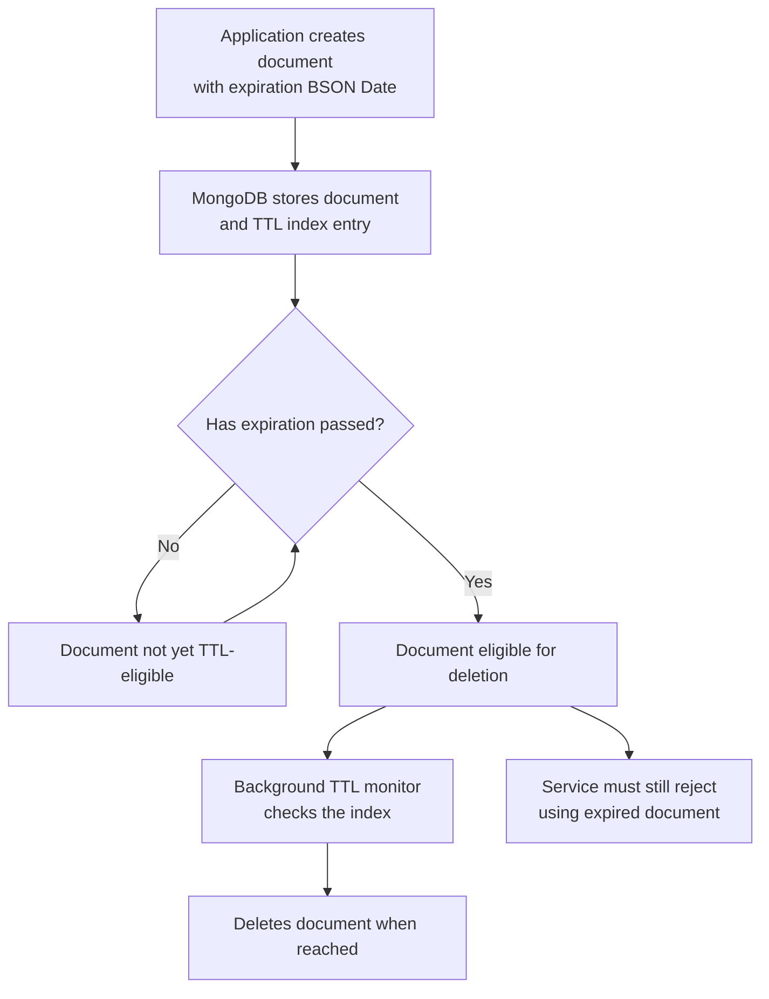

# TTL Indexes and Time-Based Data Expiration Semantics

## 1. What Problem Do TTL Indexes Solve?

In **Spring Data MongoDB**, some kinds of data only need to exist for a finite lifetime: temporary login sessions, used verification codes, short-lived technical logs, cached computation results, or events past their retention window. Using a scheduled Java job to scan and call `deleteMany(...)` forces the application to manage scheduling, retries, multi-instance coordination, and missed runs.

A **TTL (Time To Live) index** is a special MongoDB index that lets the server **automatically delete entire documents** once they qualify as expired. You still have to design the data lifecycle, but the application no longer needs to invoke `delete` for every expiring record.

Example:

```javascript
db.temporary_sessions.createIndex(
  { expires_at: 1 },
  { name: "sessions_expire_at_ttl", expireAfterSeconds: 0 }
)
```

If a document has `expires_at = ISODate("2026-11-20T08:00:00Z")`, from that moment onward MongoDB considers the document **eligible for deletion**; a background TTL thread removes it on a subsequent pass. **There is no guarantee the document disappears at exactly 08:00:00**. Shortly after that instant, the document can still remain in the collection for some period.

> **Crucial rule:** TTL is a *background data-cleanup* mechanism, **not a real-time security expiration enforcement mechanism**. Session validation APIs must check `expiresAt > now` and revocation status themselves, even when a TTL index exists.

### Concepts to Distinguish

| Concept | Meaning | Who is responsible? |
| --- | --- | --- |
| **Business expiration** | Session, ticket, code, or record is no longer usable | Domain/service checks timestamp, permissions, and status |
| **TTL eligibility** | BSON Date field plus `expireAfterSeconds` is no longer greater than the server's current time | Determined by MongoDB |
| **Physical document deletion** | Document is no longer found in the collection after the TTL monitor deletes it | MongoDB background TTL process |
| **Retention/reconciliation** | Data that must be kept for compliance, investigation, or audit | Separate business policy; do not rely solely on TTL |
| **Physical disk reclamation** | Data files consume less disk space | Storage engine management; deleting documents does not guarantee immediate file shrinking |

A TTL index can also act like a normal index to support queries on the time field, but this lesson's primary focus is the **deletion lifecycle**. You must understand **BSON types**, **expiration calculation**, **deletion lag**, **index structural limits**, and **Spring Data MongoDB configuration**.



## 2. Two Expiration Models: Relative Age and Absolute Timestamp

MongoDB uses the `expireAfterSeconds` option (in seconds) on a **single-field** index. The time a document becomes eligible for deletion is:

\[
\text{eligibleAt} = \text{indexedDate} + \text{expireAfterSeconds}
\]

### 2.1. Retaining for 7 Days from Creation

For technical logs kept for 7 days, `created_at` is stored as a BSON Date:

```javascript
db.debug_events.createIndex(
  { created_at: 1 },
  {
    name: "debug_events_7d_ttl",
    expireAfterSeconds: 7 * 24 * 60 * 60
  }
)
```

Sample document:

```javascript
db.debug_events.insertOne({
  _id: "EVT-1001",
  tenant_id: "SHOP-A",
  created_at: new Date(),
  level: "DEBUG",
  message: "Processed test event"
})
```

The document becomes TTL-eligible once `created_at + 604800 seconds` has elapsed. Changing the index's `expireAfterSeconds` **alters the retention policy applied to every document covered by that index**. Existing older records may immediately become eligible for deletion when retention is shortened.

### 2.2. Each Document Has Its Own Expiration Time

Temporary login sessions may be granted 10 minutes, 30 minutes, or 2 hours depending on policy. Instead of creating multiple TTL indexes, the application computes `expires_at` per document and sets **`expireAfterSeconds: 0`**:

```javascript
db.temporary_sessions.createIndex(
  { expires_at: 1 },
  { name: "sessions_expire_at_ttl", expireAfterSeconds: 0 }
)

db.temporary_sessions.insertMany([
  {
    _id: "SESSION-001",
    tenant_id: "SHOP-A",
    token_hash: "SHA256_EXAMPLE_001",
    created_at: ISODate("2026-11-20T07:00:00Z"),
    expires_at: ISODate("2026-11-20T07:30:00Z")
  },
  {
    _id: "SESSION-002",
    tenant_id: "SHOP-A",
    token_hash: "SHA256_EXAMPLE_002",
    created_at: ISODate("2026-11-20T07:00:00Z"),
    expires_at: ISODate("2026-11-20T09:00:00Z")
  }
])
```

Evaluated at `2026-11-20T08:00:00Z`:

| Document | `expires_at` | Business state | TTL state |
| --- | --- | --- | --- |
| `SESSION-001` | 07:30 UTC | Expired, **must not be accepted** | Eligible for deletion, may still await monitor |
| `SESSION-002` | 09:00 UTC | Not expired, unless revoked | Not yet eligible for deletion |

The `token_hash` values above are **placeholders only**, not valid cryptographic hashes. In real applications, never store or log plaintext secret tokens; use a secure token generator, store hashes, and validate with a properly designed authentication mechanism.

### 2.3. Which Model to Choose?

| Requirement | Model | TTL option |
| --- | --- | --- |
| All debug events share a 7-day retention | `created_at` | `expireAfterSeconds: 604800` |
| Each session has a different expiration time | `expires_at` | `expireAfterSeconds: 0` |
| Temporary job extends lifetime when leased | `lease_expires_at` or conditionally updated `expires_at` | Usually `expireAfterSeconds: 0`, though **TTL must not replace lease logic** |
| Audit data with minimum legal/policy retention | Do not auto-delete via TTL by default | Explicit retention/archiving policy |
| Document must be unusable at the exact expiration second | Time-based business filter | TTL helps clean up garbage, **not sufficient to block usage** |

## 3. BSON Requirement: Must Be Date or Array of Dates

A TTL index can compute expiration only from a field containing a **BSON Date** or an **array containing BSON Date elements**. In Java, `Instant` or `java.util.Date` is typically mapped by Spring Data MongoDB to BSON Date; in `mongosh`, use `ISODate(...)` or `new Date(...)`.

### Unsuitable Values

```javascript
// Valid: BSON Date.
{ _id: "A", expires_at: ISODate("2026-11-20T08:00:00Z") }

// NOT evaluated properly by TTL: String containing date.
{ _id: "B", expires_at: "2026-11-20T08:00:00Z" }

// NOT evaluated properly by TTL: Unix milliseconds number.
{ _id: "C", expires_at: 1795161600000 }

// Missing field -> no TTL timestamp to expire.
{ _id: "D" }

// Null -> no BSON Date to calculate TTL.
{ _id: "E", expires_at: null }
```

Creating a TTL index successfully **does not convert Strings/Longs into Dates** and **does not populate missing fields**. A system storing epoch milliseconds as `long` can accumulate documents forever even though the index was created cleanly.

### Array of Dates and the Earliest-Date Rule

If the TTL field is an array with multiple BSON Dates, MongoDB uses the **earliest date** among the Date elements to determine expiration:

```javascript
{
  _id: "A",
  expiry_candidates: [
    ISODate("2026-11-20T07:00:00Z"),
    ISODate("2026-11-21T07:00:00Z")
  ]
}
```

With `{ expiry_candidates: 1 }` and `expireAfterSeconds: 0`, the document becomes eligible for deletion on **Nov 20 at 07:00 UTC**, **without waiting for Nov 21**. This easily causes premature deletion when the domain expects "keep until the latest date". For expiration deadlines, prefer a **single scalar Date field** with clear semantics.

### Schema Validation

When TTL performs mandatory cleanup, consider adding a validator to ensure the field has BSON Date type:

```javascript
// Create only on a fresh demo database; do not impose on legacy data without checking.
db.createCollection("verified_sessions", {
  validator: {
    $jsonSchema: {
      bsonType: "object",
      required: ["expires_at"],
      properties: {
        expires_at: {
          bsonType: "date",
          description: "Session must have an expiration timestamp of BSON Date type"
        }
      }
    }
  }
})
```

This validator only illustrates enforcing that `expires_at` exists and has the right BSON type; it **does not** verify that `expires_at` is in the future or enforce access control.

## 4. TTL Does Not Delete Immediately: Monitor Mechanics and Consequences

TTL deletion is executed by a **background thread on `mongod`**. Under normal operation, the monitor checks periodically (typically roughly **every 60 seconds per pass**) and deletes eligible documents. When the system is busy or many documents expire together, deletion lag can **exceed one minute**. Therefore:

- Never write tests calling `Thread.sleep(1000)` and expecting the document to be gone.
- Never treat `findById(...) != null` as proof that a session is still valid.
- Never treat TTL as a scheduler with a one-second deletion SLA.
- Never view TTL as an *instant delete* across every replica set node.

In a replica set, the **primary** performs TTL deletions; secondaries **apply those deletes via replication** rather than running independent TTL threads deciding what to remove. Consequently, replication lag or read preferences can affect when a document disappears from secondary reads.

### Illustrative Timeline

```text
07:30:00  SESSION-001's expires_at is reached
07:30:01  API checks expires_at > now -> rejects
07:30:05  Document may still exist in MongoDB
07:31:00  TTL monitor may begin deleting the document
07:31:20  Under heavy load, deletion may still be in progress
```

This is an illustrative scenario, **not a guaranteed monitor schedule**. TTL does not invoke "on-expiration Java callbacks" or reliably emit business events at expiration time; notifications, permission revocation, and auditing require dedicated mechanisms.

### TTL Deletes Whole Documents, Not Individual Fields

A TTL index on `expires_at` **deletes the entire document** upon expiration, even if the document holds other fields:

```javascript
{
  _id: "SESSION-001",
  expires_at: ISODate("2026-11-20T07:30:00Z"),
  audit_note: "Requires reconciliation"
}
```

If `audit_note` must be retained, TTL on that document is inappropriate. Separate audit records into a collection with its own retention policy or archive before deletion. TTL **has no concept** of which fields are disposable and which must be kept.

## 5. Declaring TTL Indexes on Spring Data MongoDB Entities

In Java, a convenient approach is annotating the date field with Spring Data's `@Indexed`:

```java
package com.example.sessions;

import java.time.Instant;
import org.springframework.data.mongodb.core.index.Indexed;
import org.springframework.data.mongodb.core.mapping.Document;
import org.springframework.data.mongodb.core.mapping.Field;
import org.springframework.data.mongodb.core.mapping.FieldType;
import org.springframework.data.mongodb.core.mapping.MongoId;

@Document(collection = "temporary_sessions")
public class SessionTicket {

    @MongoId(FieldType.STRING)
    private String id;

    @Field("tenant_id")
    private String tenantId;

    @Field("account_id")
    private String accountId;

    @Indexed(name = "token_hash_unique", unique = true)
    @Field("token_hash")
    private String tokenHash;

    @Field("created_at")
    private Instant createdAt;

    @Indexed(name = "sessions_expire_at_ttl", expireAfter = "0s")
    @Field("expires_at")
    private Instant expiresAt;

    private boolean revoked;

    protected SessionTicket() {}

    public SessionTicket(
            String id,
            String tenantId,
            String accountId,
            String tokenHash,
            Instant createdAt,
            Instant expiresAt) {
        this.id = id;
        this.tenantId = tenantId;
        this.accountId = accountId;
        this.tokenHash = tokenHash;
        this.createdAt = createdAt;
        this.expiresAt = expiresAt;
        this.revoked = false;
    }

    public String getId() { return id; }
    public String getTenantId() { return tenantId; }
    public String getAccountId() { return accountId; }
    public String getTokenHash() { return tokenHash; }
    public Instant getCreatedAt() { return createdAt; }
    public Instant getExpiresAt() { return expiresAt; }
    public boolean isRevoked() { return revoked; }
}
```

Annotation breakdown:

| Annotation | Meaning |
| --- | --- |
| `@Document(collection = "temporary_sessions")` | Entity stored in `temporary_sessions` collection |
| `@MongoId(FieldType.STRING)` | `id` maps to `_id` as BSON String; does not auto-convert UUID-like strings to ObjectId |
| `@Field("expires_at")` | Java property `expiresAt` maps to BSON field `expires_at` |
| `@Indexed(expireAfter = "0s")` | Requests TTL index expiring at the `expires_at` value itself |
| `@Indexed(unique = true)` on `tokenHash` | Unique index serving a lookup key; **not a TTL index** |

`@Indexed(expireAfter = "0s")` and the index name express the **desired definition**. **Adding the annotation does not guarantee the index exists in MongoDB**. Ensure the index creation mechanism actually runs and verify collection metadata.

### Do Annotation Attributes Vary by Version?

In modern Spring Data MongoDB branches, `@Indexed(expireAfter = "10s")`, `"1d"`, or `"P2D"` is the duration-based way to declare TTL. The older `expireAfterSeconds` attribute still appears in legacy projects, but has been deprecated in newer branches; verify your Spring Data version's API before choosing.

Example retaining logs for one day:

```java
@Indexed(name = "debug_event_1d_ttl", expireAfter = "1d")
@Field("created_at")
private Instant createdAt;
```

This differs from `expireAfter = "0s"` on `expiresAt`: the former uses a **fixed retention duration from a timestamp field**, while the latter uses an **absolute expiration deadline precomputed in each document**.

### Are Indexes Created Automatically?

Since Spring Data MongoDB 3.x, annotation-based automatic index creation is **disabled by default**. Projects can enable it via configuration, though in production creating/modifying TTL indexes should be treated as a **controlled schema change**, because adding a TTL index to existing data can trigger mass deletions.

A common Spring Boot property is:

```properties
spring.data.mongodb.auto-index-creation=true
```

Enable it only after verifying your Boot version and deployment policy. Never let all service instances simultaneously alter production indexes on boot by default. When controlled rollouts are required, prefer migrations or supervised initialization, then confirm via `getIndexes()`.

### DTOs and Sensitive Data

`SessionTicket` is a persistence entity, not an HTTP response. Do not expose `tokenHash`, internal IDs, or sensitive fields just because they reside on the entity. When using TTL for sessions/tokens, ensure **expired access is blocked immediately in the service** and configure lifetimes suitable for each token type.

## 6. Creating TTL Indexes via `MongoTemplate.indexOps`

In some projects, operations teams do not want annotations mutating the database on every startup. Spring Data MongoDB provides `IndexOperations` to create and inspect indexes intentionally.

### 6.1. Defining the Index in Java

```java
package com.example.sessions;

import java.time.Duration;
import org.springframework.data.domain.Sort;
import org.springframework.data.mongodb.core.MongoTemplate;
import org.springframework.data.mongodb.core.index.Index;
import org.springframework.stereotype.Component;

@Component
public class SessionIndexSetup {

    private final MongoTemplate mongoTemplate;

    public SessionIndexSetup(MongoTemplate mongoTemplate) {
        this.mongoTemplate = mongoTemplate;
    }

    public String ensureExpirationIndex() {
        Index ttl = new Index()
            .on("expiresAt", Sort.Direction.ASC)
            .expire(Duration.ZERO)
            .named("sessions_expire_at_ttl");

        // On Spring Data MongoDB 4.x ensureIndex is commonly used.
        // See the version note below.
        return mongoTemplate.indexOps(SessionTicket.class)
            .ensureIndex(ttl);
    }
}
```

With `indexOps(SessionTicket.class)`, Spring Data has entity context to map Java property `expiresAt` to BSON `expires_at`. To verify the application created the right key, **inspect MongoDB metadata** afterward—especially if custom converters exist or an index with the same key and different options already exists.

**API version note:** `ensureIndex(IndexDefinition)` exists across many Spring Data MongoDB releases; newer releases introduced `createIndex(IndexDefinition)` and may deprecate `ensureIndex`. When implementing, use the method supported by your project's version. The example uses `ensureIndex` for broad applicability across Spring Boot 3.x projects.

### 6.2. Why Not Create Indexes on Every Request?

Creating and modifying indexes is a schema-management task; it should never be called inside login or token-read methods. Place it in a **migration step**, a controlled initialization job, or a startup hook whose production impact has been evaluated. If multiple instances run concurrently, coordinate rollouts to avoid conflicts and false alarms during index builds.

Never call `dropIndex(...)` and recreate on every deploy. The gap between the two commands can interrupt TTL enforcement, add index-build load, and delete data incorrectly if the new config differs from the old.

### 6.3. Verifying the Actual Index

In `mongosh`:

```javascript
db.temporary_sessions.getIndexes()
```

Look for an index entry equivalent to:

```javascript
{
  v: 2,
  key: { expires_at: 1 },
  name: "sessions_expire_at_ttl",
  expireAfterSeconds: 0
}
```

The `v` field and property ordering can vary by server version; what matters are **key, name, and expireAfterSeconds**. Having a regular index on `expires_at` is not enough for MongoDB to auto-delete documents: the TTL option must be present.

From Java:

```java
import org.springframework.data.mongodb.core.index.IndexInfo;

for (IndexInfo info :
        mongoTemplate.indexOps(SessionTicket.class).getIndexInfo()) {
    System.out.println(
        info.getName() + " / " + info.getExpireAfter());
}
```

In versions offering `IndexInfo.getExpireAfter()`, it returns `Optional<Duration>`. If unavailable in your branch, inspect `db.collection.getIndexes()` directly or check the corresponding metadata API.

### 6.4. Two Distinct Index Needs

A TTL index on `expires_at` does not automatically speed up lookups by `token_hash`:

```javascript
// Serves background cleanup:
{ expires_at: 1 }              // TTL, expireAfterSeconds: 0

// Serves fast authentication lookups:
{ token_hash: 1 }              // separate index, possibly unique
```

A TTL index **must be a single-field index**. Never attempt the following expecting it to both expire records and filter by token:

```javascript
// DO NOT use as a TTL index.
db.temporary_sessions.createIndex(
  { token_hash: 1, expires_at: 1 },
  { expireAfterSeconds: 0 }
)
```

Compound indexes do not support TTL; MongoDB will not turn it into a two-field expiration mechanism. Use **two dedicated indexes** when access patterns genuinely require both.

## 7. Authentication Services Must Check Expiration Rather Than Waiting for TTL

Suppose tokens are **hashed** in the auth layer. An API retrieves a currently valid session for a tenant under these conditions:

\[
\text{authorizedTenant} \land
\text{tokenHashMatch} \land
(\text{expiresAt} > \text{now}) \land
\neg \text{revoked}
\]

Service example:

```java
package com.example.sessions;

import java.time.Clock;
import java.util.Optional;
import org.springframework.data.mongodb.core.MongoTemplate;
import org.springframework.data.mongodb.core.query.Criteria;
import org.springframework.data.mongodb.core.query.Query;
import org.springframework.stereotype.Service;

@Service
public class SessionLookupService {

    private final MongoTemplate template;
    private final Clock clock;

    public SessionLookupService(
            MongoTemplate template, Clock clock) {
        this.template = template;
        this.clock = clock;
    }

    public Optional<SessionTicket> findUsable(
            String authorizedTenantId,
            String suppliedTokenHash) {

        if (authorizedTenantId == null
                || authorizedTenantId.isBlank()
                || suppliedTokenHash == null
                || suppliedTokenHash.isBlank()) {
            return Optional.empty();
        }

        Query condition = Query.query(
            Criteria.where("tenantId").is(authorizedTenantId)
                .and("tokenHash").is(suppliedTokenHash)
                .and("expiresAt").gt(clock.instant())
                .and("revoked").is(false)
        );

        return Optional.ofNullable(
            template.findOne(condition, SessionTicket.class)
        );
    }
}
```

`Criteria.where("expiresAt").gt(clock.instant())` guarantees that even if a document **still sits in the collection past expiration**, it is never returned as valid. Injecting an application `Clock` (such as `Clock.systemUTC()`) lets tests verify boundary behavior deterministically without waiting for the TTL monitor.

Absolute expiration deadlines are typically enforced so that **at the exact `expiresAt` instant, the session is invalid**, because the filter uses `gt(now)` rather than `gte(now)`. In multi-node systems, synchronize clocks and account for clock skew/timeouts; the TTL monitor cannot fix clock drift on application servers.

### Creating a New Session

```java
import java.time.Clock;
import java.time.Duration;
import java.time.Instant;
import java.util.UUID;

Clock clock = Clock.systemUTC();
Instant now = clock.instant();
Instant expiresAt = now.plus(Duration.ofMinutes(30));

SessionTicket ticket = new SessionTicket(
    UUID.randomUUID().toString(),
    "SHOP-A",
    "ACCOUNT-42",
    "HASH_GENERATED_BY_AUTH_SUBSYSTEM",
    now,
    expiresAt
);

mongoTemplate.insert(ticket);
```

This snippet illustrates **timestamps and entity mapping**, not production-grade token security code. `HASH_GENERATED_BY_AUTH_SUBSYSTEM` is a placeholder; real applications must generate cryptographically secure random tokens, hash/store them safely, and avoid leaking raw tokens in logs, queries, or telemetry.

### Two Different Questions

`findUsable(...)` returns `Optional.empty()` when a token is invalid or expired. `db.temporary_sessions.findOne(...)` might still find the document at that same moment because TTL hasn't deleted it yet. **The two observations do not contradict**: the service enforces security policy, while MongoDB reclaims storage asynchronously.

## 8. Extending, Revoking, and Canceling Sessions: TTL Does Not Replace State Logic

In some applications, expiration time **can change**, such as extending an active session while a user continues interacting. A TTL index on `expires_at` uses the **current Date value** stored in the document, rather than permanently locking in the initial insert timestamp.

### 8.1. Conditional Renewal

**Do not** read the session, check expiration in Java, and then update `expiresAt` by ID alone. Another request could revoke the session or change its timestamp between the two steps.

Instead, put business invariants inside **the update operation's filter**:

```java
package com.example.sessions;

import java.time.Clock;
import java.time.Duration;
import java.time.Instant;
import com.mongodb.client.result.UpdateResult;
import org.springframework.data.mongodb.core.MongoTemplate;
import org.springframework.data.mongodb.core.query.Criteria;
import org.springframework.data.mongodb.core.query.Query;
import org.springframework.data.mongodb.core.query.Update;
import org.springframework.stereotype.Service;

@Service
public class SessionRenewalService {

    private final MongoTemplate template;
    private final Clock clock;

    public SessionRenewalService(
            MongoTemplate template, Clock clock) {
        this.template = template;
        this.clock = clock;
    }

    public boolean renew(
            String authorizedTenantId,
            String sessionId,
            Duration extension) {

        if (authorizedTenantId == null
                || authorizedTenantId.isBlank()
                || sessionId == null || sessionId.isBlank()
                || extension == null
                || extension.isNegative()
                || extension.isZero()
                || extension.compareTo(Duration.ofHours(2)) > 0) {
            throw new IllegalArgumentException(
                "Invalid session renewal request");
        }

        Instant now = clock.instant();
        Instant nextExpiry = now.plus(extension);

        Query condition = Query.query(
            Criteria.where("id").is(sessionId)
                .and("tenantId").is(authorizedTenantId)
                .and("expiresAt").gt(now)
                .and("revoked").is(false)
        );

        Update change = new Update()
            .set("expiresAt", nextExpiry);

        UpdateResult result =
            template.updateFirst(
                condition, change, SessionTicket.class);

        return result.getMatchedCount() == 1;
    }
}
```

This pattern demonstrates a **conditional update**. However, it is simplified: in real systems, if two concurrent requests renew with different target timestamps, the later write might accidentally **shorten** an expiration set by the earlier request. If policy requires `expiresAt` to **only increase**, add a corresponding guard or use an update pipeline computing `max(currentExpiry, proposedExpiry)` with appropriate guarantees.

Additionally, enforce an **absolute session lifetime** (`absoluteExpiresAt`) so sliding renewals cannot extend a session indefinitely. A TTL index on `expiresAt` will not enforce that ceiling; the service must check it per policy.

**Concurrency warning:** a renewal might succeed right before the TTL monitor deletes an expired document due to stale state, but never design correctness around "updating fast enough to beat TTL". Allow renewal only on unexpired sessions and treat `matchedCount = 0` as an invalid/expired session.

### 8.2. Revocation Does Not Wait for TTL

When a user logs out or an admin revokes access, as soon as revocation is confirmed, the session **must no longer be accepted**. You can:

- Set `revoked = true` and require every auth query to check that flag.
- Delete the document directly if there is no reason to keep it.
- Maintain a revocation list or token version in the auth layer, depending on your security model.

Example:

```java
Query target = Query.query(
    Criteria.where("id").is(sessionId)
        .and("tenantId").is(authorizedTenantId)
);

Update revoke = new Update()
    .set("revoked", true);

mongoTemplate.updateFirst(target, revoke, SessionTicket.class);
```

This is a **business write**, not a TTL effect. If you want revoked sessions cleaned up sooner, you can also set `expiresAt` to a past/current time, yet you must still **reject** usage immediately—never wait for the monitor.

### 8.3. Updating the Date Changes Deletion Timing

| Change to `expires_at` | Expected TTL outcome |
| --- | --- |
| Push timestamp into the future | Document is not eligible for deletion until the new time |
| Move timestamp into the past | Document can be deleted on the next TTL pass |
| `$unset` the date field | No Date remains for TTL to delete |
| Overwrite with a String | TTL no longer calculates expiration properly |
| Keep Date while changing tenant/session type | TTL continues applying unless the index uses a partial filter |

Therefore, do not `$unset("expiresAt")` as a trick to "freeze and keep forever" unless your **retention policy** explicitly intends that and audits it. A migration accidentally dropping the date field can cause storage leaks, retain data past policy limits, and violate data governance requirements.

## 9. Partial TTL: Deleting Only a Matching Subset of Documents

Not every document in a collection shares the same retention window. For example, an `event_logs` collection might keep `DEBUG` events for 24 hours, while `AUDIT` events follow a separate policy and must not be deleted by the 24-hour TTL.

MongoDB supports **partial TTL indexes** on **regular collections**:

```javascript
db.event_logs.createIndex(
  { created_at: 1 },
  {
    name: "debug_only_24h_ttl",
    expireAfterSeconds: 24 * 60 * 60,
    partialFilterExpression: {
      retention_class: "DEBUG"
    }
  }
)
```

Insert sample data:

```javascript
db.event_logs.insertMany([
  {
    _id: "EVT-DEBUG-1",
    retention_class: "DEBUG",
    created_at: new Date(),
    summary: "Test diagnostic event"
  },
  {
    _id: "EVT-AUDIT-1",
    retention_class: "AUDIT",
    created_at: new Date(),
    summary: "Action requiring retention"
  }
])
```

Under this index, only documents with `retention_class: "DEBUG"` become eligible for deletion after 24 hours. `AUDIT` records are not deleted by **this specific TTL index**. If the collection has another TTL index covering `AUDIT`, that other index could still delete them.

### Partial Does Not Turn TTL Into a Compound Index

The key specification remains **`created_at: 1`** alone. `retention_class = DEBUG` is a `partialFilterExpression` determining **which documents enter the index**, not a second key field. Thus, the single-field TTL rule is preserved.

### Do Not Use Partial TTL as an Uncontrolled Legal Hold Switch

If a record becomes subject to a dispute and must be retained, switching `retention_class` from `DEBUG` to `LEGAL_HOLD` only works **if the update commits before TTL deletion removes the document**. Never rely on a race between "upgrading hold status" and "background deletion".

For data with legal retention obligations, separate collections/policies, enforce access controls, and use reliable archival pipelines; **never rely solely on partial TTL**. Deleting a document from the primary collection also does not remove copies in backups, exports, logs, and downstream systems.

### Two Retention Policies in the Same Collection?

Partial TTL can support multiple retention classes in one collection when index structure and server versions allow. However, adding indexes increases overlap risk, and future migrations can cause unintended deletions. In large systems, **separating collections by retention policy** usually makes auditing, permissions, operations, and reasoning much clearer.

## 10. TTL Index Limitations and Invalid Configurations

### 10.1. TTL Supports Single-Field Indexes Only

```javascript
// Valid: single Date field.
db.temporary_sessions.createIndex(
  { expires_at: 1 },
  { expireAfterSeconds: 0 }
)

// Invalid expectation: TTL on compound key.
db.temporary_sessions.createIndex(
  { tenant_id: 1, expires_at: 1 },
  { expireAfterSeconds: 0 }
)
```

**Compound indexes do not support TTL**. If an index has multiple fields, MongoDB will not honor `expireAfterSeconds` as expected. This differs from partial TTL, which has one key field plus a `partialFilterExpression`.

### 10.2. No TTL on `_id` or Capped Collections

A TTL index cannot be created on `_id`. Store expiration timestamps in another field such as `created_at` or `expires_at`. Likewise, do not use TTL indexes on **capped collections**, which have their own document-removal semantics.

### 10.3. `expireAfterSeconds` Bounds

`expireAfterSeconds` must be a non-negative integer number of seconds; MongoDB defines the valid range from `0` to `2147483647`. Value `0` has a specific meaning: **expire at the Date field's value itself**, not "disable TTL".

Never pass negative numbers, `NaN`, or a String `"3600"` in `db.collection.createIndex(...)`; `expireAfterSeconds` in MongoDB is numeric. In Java annotations, `expireAfter = "1h"` is a configuration string parsed by Spring Data into a duration before creating the index—**the two APIs take different input types**.

### 10.4. Do Not Change TTL Simply by Re-Calling `createIndex`

If `{expires_at:1}` already exists **without the TTL option**, attempting to create another index with the same key differing only by `expireAfterSeconds` will generally trigger an options conflict rather than creating two independent indexes.

If a 7-day TTL index exists and you want to change it to 1 day, re-calling `createIndex(...)` with the same key and a different duration **is not** the standard way to update TTL. Use `collMod` where supported by your server version and include the change in a controlled migration.

### 10.5. TTL on Time-Series Collections Is Related but Distinct

For MongoDB **time-series collections**, retention can be configured at the collection level, for example:

```javascript
db.createCollection("sensor_samples", {
  timeseries: {
    timeField: "recorded_at",
    metaField: "sensor_id",
    granularity: "hours"
  },
  expireAfterSeconds: 86400
})
```

MongoDB stores measurements inside buckets; expiration generally operates per **bucket** and may delete a bucket only once all measurements inside it qualify. Do not assume individual time-series measurements vanish exactly 24 hours after their timestamp.

Since MongoDB **7.0**, a form of **partial TTL on time-series collections** uses `timeField` as the key with a filter on `metaField`; those rules are specific and you should not copy regular-collection partial TTL patterns onto time-series collections without checking version limitations.

If the goal is simply "retain sensor data for 24 hours", evaluate time-series collection retention before building custom TTL indexes on an ill-fitting schema.

## 11. Migrating TTL on a Populated Collection

Enabling TTL on a **brand-new empty collection** is straightforward. Enabling or shortening TTL on a **collection with millions of documents** can trigger massive deletion spikes in a short period.

### 11.1. Converting a Regular Index to TTL

Suppose `debug_events` already has a regular index on `created_at`:

```javascript
db.debug_events.getIndexes()

// Example existing specification:
// { key: { created_at: 1 }, name: "created_at_1" }
```

Since MongoDB **5.1**, `collMod` can add a TTL option to an **existing single-field index** instead of dropping and rebuilding it:

```javascript
db.runCommand({
  collMod: "debug_events",
  index: {
    keyPattern: { created_at: 1 },
    expireAfterSeconds: 7 * 24 * 60 * 60
  }
})
```

Proceed only after verifying server version, admin privileges, and index type. On older versions, plan an appropriate migration; **never** drop an index actively used by queries and rebuild it during peak traffic.

### 11.2. Modifying an Existing Retention Window with `collMod`

Suppose a TTL index currently retains 7 days, and the new policy keeps only 24 hours:

```javascript
db.runCommand({
  collMod: "debug_events",
  index: {
    name: "debug_events_7d_ttl",
    expireAfterSeconds: 24 * 60 * 60
  }
})
```

`debug_events_7d_ttl` here is the existing index name, not a rename operation. Check `db.debug_events.getIndexes()` beforehand; if the actual name differs, substitute the existing name.

Changing the TTL value with `collMod` **does not necessarily rebuild the index**, yet **documents aged 1 to 7 days** immediately become expired, causing the TTL monitor to perform bulk deletions. This is a **data change**, not merely a performance tweak.

### 11.3. Estimating Deletion Scope Before Modifying

A representative preflight check:

```javascript
const retentionSeconds = 24 * 60 * 60;
const cutoff = new Date(Date.now() - retentionSeconds * 1000);

db.debug_events.countDocuments({
  created_at: { $lte: cutoff }
})
```

If there are millions of documents, the count itself can be expensive; inspect indexes, operational metrics, and use appropriate estimation/investigation methods before running in production. Also check for **mistyped/missing fields**, as those documents will not be deleted by TTL despite being business-expired.

Safe plan:

1. Confirm the new retention policy, legal requirements, and categories of data that **must not be deleted**.
2. Audit field BSON types, existing indexes, server version, and eligible document volume.
3. Back up/archive per policy; verify restore capability **before** creating a TTL index that may delete data.
4. If huge volumes must be deleted, consider **deleting in controlled small batches** before shortening TTL, instead of dumping the entire load into one change.
5. Deploy the migration during an approved window, monitoring latency and primary write load.
6. Verify `expireAfterSeconds`/key/partial filter post-migration, monitoring deletion counts and error metrics.
7. Maintain a forward policy rollback plan; remember **TTL deletions already executed cannot be undone simply by raising TTL again**.

### 11.4. Does Increasing TTL Bring Back Deleted Documents?

No. Raising `expireAfterSeconds` only changes when **remaining documents** become eligible for deletion. Already-deleted documents can only be restored from valid backups/sources if policy permits, never by editing the index.

### 11.5. Deployments Must Never Silently Alter Retention

If a code change alters `@Indexed(expireAfter = "7d")` to `"1d"`, never assume the framework will safely upgrade the production index as intended. That depends on index-management settings, can trigger options conflicts, and risks deleting data. Put TTL changes through **reviewed migrations**, checking before/after states and recording the business rationale.

## 12. Observing the TTL Monitor and Diagnosing Backlogs

### 12.1. Inspecting Index Definitions

```javascript
db.temporary_sessions.getIndexes()
```

Ask three questions:

- Does the index target the exact **BSON field** `expires_at`?
- Is `expireAfterSeconds: 0` (or the desired retention seconds) set?
- Is there a partial filter, and do documents needing deletion actually match it?

An index with the same name on a different field, or on the right field without the TTL option, will not clean up data as designed.

### 12.2. Finding Overdue Documents Still Present

```javascript
const now = new Date();

db.temporary_sessions.find(
  { expires_at: { $lte: now } },
  { _id: 1, expires_at: 1, tenant_id: 1 }
).sort({ expires_at: 1 }).limit(20)
```

This observes the **TTL backlog** at query time; finding expired documents does not prove the TTL monitor is broken. Check monitor pass timing, system load, and queue volume. Avoid printing token hashes or sensitive fields to consoles/logs during production investigations.

### 12.3. `serverStatus` Metrics

On versions exposing these metrics and with suitable privileges:

```javascript
const ttl = db.serverStatus().metrics.ttl;
printjson(ttl);

// May include:
// ttl.deletedDocuments
// ttl.passes
// ttl.subPasses
```

`deletedDocuments` counts documents deleted by the TTL monitor; `passes` and `subPasses` relate to inspection/deletion cycles. **Interpret these counters per your server version; they generally accumulate since process startup**. To measure deletion throughput, compute deltas between scrapes rather than treating a large cumulative number as an error.

`serverStatus` and `currentOp` usually require elevated admin/monitoring privileges; do not grant broad privileges to runtime application accounts just to plot a chart.

### 12.4. Metrics to Monitor

| Metric | Operational Meaning |
| --- | --- |
| `ttl_expired_documents_estimate` | Eligible documents still present at sample time |
| `ttl_oldest_expired_age_seconds` | Lag of the oldest expired document remaining in the collection |
| `metrics.ttl.deletedDocuments` delta | Rate at which the TTL monitor deletes documents |
| `metrics.ttl.passes` and `subPasses` | Monitor execution progress |
| `write_latency_p95/p99` | Are TTL deletes competing for resources with business writes? |
| `storage_used_bytes` and fragmentation | Are deletions translating into actual storage relief? |
| `replication_lag` | Lag as secondaries apply deletes from primary |
| `session_rejected_expired_count` | Is the API actively rejecting expired sessions independently of TTL? |

A TTL index can still be used by the query planner like a regular index, yet **`explain("executionStats")` on `find` does not measure TTL deletion lag**. Use explain to evaluate query plans, and backlog/metrics to evaluate cleanup policy.

### 12.5. Document Deletion Differs from Reclaiming File Space

After TTL deletes many documents, MongoDB may reuse freed blocks inside the storage engine without **immediately shrinking file sizes on the filesystem**. Do not treat unchanged file size as proof TTL isn't running. Before deciding to compact, archive, or remodel data, consult storage/version guides and weigh real system impact.

## 13. Properly Testing TTL Indexes and Expiration Logic

TTL has two distinct behavioral layers to test separately:

1. **Application enforcement:** at a given instant, are expired documents rejected **immediately**?
2. **MongoDB cleanup:** does the index have the right `key` and `expireAfterSeconds`, and when the monitor runs, are eligible documents deleted?

Mixing both and using `Thread.sleep(1000)` produces flaky tests. Because the TTL monitor runs asynchronously, **there is no one-second deletion SLA**. Test index metadata and business enforcement in a fast suite, and test physical deletion in a **dedicated integration environment** with a generous polling timeout.

### 13.1. `@DataMongoTest` Pattern Verifying Configuration and Access Enforcement

This example uses Java 17+, Spring Boot 3.x, `@DataMongoTest`, `MongoTemplate`, `SessionTicket`, and `SessionLookupService` from earlier sections. Test MongoDB must connect to a **completely isolated database** running a server version supporting TTL.

Trick to avoid waiting on TTL in fast tests: set the **simulated business clock** safely ahead of MongoDB's current wall clock. Documents can then be **expired for the service** while **not yet due for the MongoDB TTL server**, letting you test access boundaries deterministically.

```java
package com.example.sessions;

import java.time.Clock;
import java.time.Duration;
import java.time.Instant;
import java.time.ZoneOffset;
import java.util.ArrayList;
import java.util.Date;
import java.util.List;
import org.bson.Document;
import org.junit.jupiter.api.BeforeEach;
import org.junit.jupiter.api.Test;
import org.springframework.beans.factory.annotation.Autowired;
import org.springframework.boot.test.autoconfigure.data.mongo.DataMongoTest;
import org.springframework.data.domain.Sort;
import org.springframework.data.mongodb.core.MongoTemplate;
import org.springframework.data.mongodb.core.index.Index;

import static org.assertj.core.api.Assertions.assertThat;

@DataMongoTest
class SessionTtlIntegrationTest {

    @Autowired
    MongoTemplate template;

    SessionLookupService lookup;

    private static Document session(
            String id,
            String tenant,
            String tokenHash,
            Instant expires,
            boolean revoked) {
        return new Document("_id", id)
            .append("tenant_id", tenant)
            .append("account_id", "ACCOUNT-42")
            .append("token_hash", tokenHash)
            .append("created_at", Date.from(
                expires.minus(Duration.ofHours(1))))
            .append("expires_at", Date.from(expires))
            .append("revoked", revoked);
    }

    @BeforeEach
    void setUpIsolatedDatabase() {
        // Dedicated test database ONLY: deletes all rows in the collection.
        template.getCollection("temporary_sessions")
            .deleteMany(new Document());

        template.indexOps(SessionTicket.class).ensureIndex(
            new Index()
                .on("expiresAt", Sort.Direction.ASC)
                .expire(Duration.ZERO)
                .named("sessions_expire_at_ttl"));

        Instant appNow =
            Instant.now().plus(Duration.ofDays(30));
        Clock applicationClock =
            Clock.fixed(appNow, ZoneOffset.UTC);

        template.getCollection("temporary_sessions")
            .insertMany(List.of(
                session("EXPIRED-APP", "SHOP-A", "HASH-A",
                    appNow.minus(Duration.ofMinutes(1)), false),
                session("VALID", "SHOP-A", "HASH-B",
                    appNow.plus(Duration.ofMinutes(30)), false),
                session("REVOKED", "SHOP-A", "HASH-C",
                    appNow.plus(Duration.ofMinutes(30)), true),
                session("OTHER-TENANT", "SHOP-B", "HASH-D",
                    appNow.plus(Duration.ofMinutes(30)), false)
            ));

        lookup = new SessionLookupService(
            template, applicationClock);
    }

    @Test
    void ttlIndexIsSingleDateFieldWithZeroSeconds() {
        List<Document> specs = template
            .getCollection("temporary_sessions")
            .listIndexes()
            .into(new ArrayList<>());

        Document ttl = specs.stream()
            .filter(index -> "sessions_expire_at_ttl"
                .equals(index.getString("name")))
            .findFirst()
            .orElseThrow();

        Document key = ttl.get("key", Document.class);
        assertThat(key).containsEntry("expires_at", 1);
        assertThat(key).hasSize(1);

        Number seconds =
            (Number) ttl.get("expireAfterSeconds");
        assertThat(seconds.longValue()).isZero();
    }

    @Test
    void expiredSessionIsRejectedBeforeTtlRemovesIt() {
        // Document still exists because BSON Date is in the future
        // relative to server clock, yet expired per service Clock.
        long stored = template
            .getCollection("temporary_sessions")
            .countDocuments(new Document(
                "_id", "EXPIRED-APP"));

        assertThat(stored).isEqualTo(1L);
        assertThat(lookup.findUsable("SHOP-A", "HASH-A"))
            .isEmpty();
    }

    @Test
    void usableSessionRequiresCorrectTenantAndNotRevoked() {
        assertThat(lookup.findUsable("SHOP-A", "HASH-B"))
            .isPresent();

        assertThat(lookup.findUsable("SHOP-A", "HASH-C"))
            .isEmpty();

        assertThat(lookup.findUsable("SHOP-A", "HASH-D"))
            .isEmpty();
    }
}
```

**Severe warning:** `deleteMany(new Document())` deletes every session in the collection of whichever database the test connects to. Never use this setup pattern on production or shared databases. `@DataMongoTest` **does not automatically create or guarantee an isolated MongoDB under all configurations**; use Testcontainers or dedicated test infrastructure where needed.

Using `appNow = Instant.now().plus(30 days)` is designed so the TTL monitor **does not** prematurely delete fixtures under normal server clocks. It intentionally separates the **simulated business clock** from MongoDB's real clock to verify access control deterministically without testing background deletion.

### 13.2. Testing Physical Deletion: Polling Instead of Fixed Sleep

A separate test against real MongoDB should:

1. Create a valid TTL index on a test collection.
2. Insert a document whose `expires_at` has already passed **per the server clock**.
3. Verify the index metadata.
4. Poll the database periodically with a generous timeout instead of sleeping 1–2 seconds.
5. Conclude "TTL deletion works in this test environment" only once the document actually disappears.

Conceptual example using Awaitility (requires adding the Awaitility test dependency):

```java
import static org.awaitility.Awaitility.await;

// In a dedicated test only, after creating the TTL index:
template.getCollection("temporary_sessions").insertOne(
    new Document("_id", "PAST-EXPIRY")
        .append("expires_at", Date.from(
            Instant.now().minus(Duration.ofMinutes(10)))));

await()
    .pollInterval(Duration.ofSeconds(2))
    .atMost(Duration.ofMinutes(3))
    .until(() -> template.getCollection("temporary_sessions")
        .countDocuments(new Document("_id", "PAST-EXPIRY")) == 0);
```

Even 3 minutes is **not a guaranteed deletion bound** under arbitrary load or configuration. Keep this test in a separate infrastructure integration suite with environment guards, timeout diagnostics, and never make it the sole correctness gate for authentication features.

### 13.3. Additional Test Cases to Include

| Test case | What to confirm |
| --- | --- |
| `expiresAt == now` | Service rejects due to `gt(now)` |
| `expiresAt > now` | Service accepts when tenant/token match and not revoked |
| Revoked document | Service rejects even with future `expiresAt` |
| Wrong tenant | Never returns another tenant's document |
| Missing, null, or String `expires_at` | Caught by validator/app logic; do not expect TTL to clean |
| App-expired document not yet removed by monitor | Service still rejects |
| TTL index missing `expireAfterSeconds` | Metadata test must fail |
| TTL index on wrong BSON field name | Metadata test must detect |
| Partial TTL scoped to one retention class | Documents outside filter are not deleted by that index |
| Renewal racing with revocation | Conditional update does not resurrect revoked session |
| Retention change via migration | Verify eligible document count and updated index options |

### 13.4. Do Not Use TTL Deletion Tests as a "System Clock"

One test suite might observe documents vanishing after 2 seconds on machine A and 80 seconds on machine B. That difference does not mean one machine is broken. Session correctness must rely on **timestamp + policy** at API request time; TTL handles only background cleanup within server resources and schedule.

## 14. Reactive Access: TTL Still Runs on MongoDB

Applications using `spring-boot-starter-data-mongodb-reactive` can read sessions via `ReactiveMongoTemplate`. TTL indexes still operate on the **MongoDB server**, regardless of whether the application uses imperative or reactive APIs.

```java
package com.example.sessions;

import java.time.Clock;
import org.springframework.data.mongodb.core.ReactiveMongoTemplate;
import org.springframework.data.mongodb.core.query.Criteria;
import org.springframework.data.mongodb.core.query.Query;
import org.springframework.stereotype.Service;
import reactor.core.publisher.Mono;

@Service
public class ReactiveSessionLookupService {

    private final ReactiveMongoTemplate template;
    private final Clock clock;

    public ReactiveSessionLookupService(
            ReactiveMongoTemplate template, Clock clock) {
        this.template = template;
        this.clock = clock;
    }

    public Mono<SessionTicket> findUsable(
            String authorizedTenantId, String suppliedTokenHash) {

        if (authorizedTenantId == null
                || authorizedTenantId.isBlank()
                || suppliedTokenHash == null
                || suppliedTokenHash.isBlank()) {
            return Mono.empty();
        }

        Query query = Query.query(
            Criteria.where("tenantId").is(authorizedTenantId)
                .and("tokenHash").is(suppliedTokenHash)
                .and("expiresAt").gt(clock.instant())
                .and("revoked").is(false)
        );

        return template.findOne(query, SessionTicket.class);
    }
}
```

When no valid session exists, `findOne` returns `Mono.empty()`; it does not wait for the TTL monitor. Never call `block()` on a reactive request handler just to fetch synchronous results.

Reactive `IndexOperations` also provides APIs to create/inspect indexes (in many Spring Data branches):

```java
import java.time.Duration;
import org.springframework.data.domain.Sort;
import org.springframework.data.mongodb.core.index.Index;
import reactor.core.publisher.Mono;

Index index = new Index()
    .on("expiresAt", Sort.Direction.ASC)
    .expire(Duration.ZERO)
    .named("sessions_expire_at_ttl");

Mono<String> indexCreated =
    reactiveMongoTemplate.indexOps(SessionTicket.class)
        .ensureIndex(index);
```

This is a **schema preparation** snippet, not code to run per request. The `Mono` must be subscribed within a controlled startup lifecycle for the command to execute; newer Spring Data versions may offer `createIndex(...)` instead of `ensureIndex(...)`. If infrastructure migrations manage indexes, reactive services need not create them at all.

**Reactive does not alter two core truths:**

1. Access policies must still check `expiresAt > now`, `revoked`, and tenant.
2. MongoDB still deletes asynchronously; returning `Mono<SessionTicket>`/`Flux<SessionTicket>` does not create a per-second deletion SLA.

## 15. TTL in Real Systems: Retention, Audit, and Privacy

These distinctions are easily overlooked when applying TTL to business data:

### TTL Is Collection Retention, Not an End-to-End Deletion Pipeline

A TTL index deletes documents in the indexed collection. It **does not handle**:

- Copies already replicated to analytics warehouses, search indexes, or caches.
- Application logs containing similar data.
- Backups, snapshots, exports, or archival systems.
- Business events that should fire before or after deletion.
- Legal minimum retention, right-to-erasure requests, or legal holds.

Never treat TTL as proof that all copies of data have been purged. Sensitive data requires synchronized retention/deletion policies across systems, verification, and proper access controls.

### Do Not Use TTL as a Replacement for Session Invalidation

Login tokens, account recovery codes, and sessions must verify validity on the request path itself. Waiting on TTL deletion to determine "whether a token is still valid" leaves a window where expired tokens remain accepted—worsened when reading from secondaries experiencing replication lag.

### Do Not Apply TTL Directly to Complex Stateful Business Data

An order in transit, a payment awaiting reconciliation, or a retrying job must not vanish merely because a Date field aged out. For those documents, use a **state machine**, conditional transitions, audit logging, and archival policies. If TTL is desired, apply it to a **separate temporary/auxiliary collection** or only once records enter a deletable state.

### Define Timezones and Clock Sources

MongoDB BSON Date represents an absolute instant in time. In Java, `Instant` is the clearest choice for storing expiration deadlines. Avoid storing timezone-less `LocalDateTime` converted to Strings, which causes discrepancies across services, servers, and users. When inputs say "expires end-of-day in timezone X", convert that end-of-day instant in that **explicit business timezone** to `Instant` before persisting.

### Retention Windows Vary by Policy

Examples:

- Debug logs: 7 days.
- Sessions: 30 minutes from issuance or last renewal per policy.
- OTP codes: 5 minutes, while **rejecting** immediately once expired or consumed.
- Transaction audits: may require long retention without short TTLs.

These durations are **design examples only**, not legal advice or default policies. Real retention periods must come from risk, product, security, and regulatory requirements.

## 16. Common Issues and Diagnostic Table

| Symptom | Possible Cause | Resolution |
| --- | --- | --- |
| `@Indexed` added, yet documents are not deleted | Auto-index disabled or migration hasn't run | Check `getIndexes()` and actual index provisioning |
| Index exists on `expires_at` without deleting docs | Regular index missing `expireAfterSeconds` | Create or convert to TTL via controlled process |
| TTL ignores documents with String timestamps | Field is not BSON Date | Migrate/validate to BSON Date |
| Missing or null fields stay forever | No valid timestamp for expiration | Enforce schema and require field where needed |
| Documents deleted earlier than expected | TTL field is an array of Dates; uses earliest value | Use a single scalar Date field for deadlines |
| Expired documents still show up in finds | Background TTL monitor has lag | API must filter `expiresAt > now`; monitor backlog |
| Data deleted at unexpected times | Wrong timezone saved or seconds vs. milliseconds mix-up | Use `Instant`/BSON Date and test boundary cases |
| TTL deletes documents holding needed audit notes | TTL cannot protect individual fields | Split audit/retention data before enabling TTL |
| Upserts create docs missing expiration field | Write path fails to populate `expires_at` | Schema validation and testing across all write paths |
| Compound index `{tenant_id, expires_at}` doesn't delete | TTL supports single-field indexes only | Create separate TTL index on `expires_at` |
| TTL configured on `_id` | Unsupported | Use a dedicated Date field |
| TTL annotation changed, retention stays the same | Server index was not updated | Migrate with `collMod`; inspect index options |
| Shortening TTL slows down MongoDB | Large wave of older documents suddenly eligible | Estimate backlog, batch-delete safely, monitor load |
| TTL skips `retention_class = AUDIT` documents | Partial TTL targets matching subset only | Verify `partialFilterExpression` and policy |
| Disk space does not shrink immediately | Storage engine reuses freed space internally | Monitor storage/fragmentation rather than assuming TTL failed |
| Secondaries still show old documents | Replication lag or read preference | Understand primary TTL deletes and replication |
| Test passes on one machine, fails on another | Asserts deletion within 1s or lacks TTL monitor | Test access rules via `Clock`; poll TTL in separate test |
| Revoked session still accepted | Query omits `revoked=false` | Enforce status predicate in auth queries |
| Session renewal accidentally shortens expiration | Two concurrent updates using caller's timestamp | Use CAS/versioning or `max` update guard |
| Migration index script fails with options conflict | Same-key index already exists with different options | Inventory indexes; use `collMod` where supported |

### Short Investigation Workflow

1. Confirm you are inspecting the right environment's database and collection.
2. Check `getIndexes()`: key, name, `expireAfterSeconds`, and partial filter.
3. Inspect document BSON: Date vs. String/Long, and whether the field exists.
4. Compute eligibility using `date + seconds`, distinguishing user clocks from MongoDB clocks.
5. If overdue, inspect monitor status, backlog, write load, and replication.
6. If auth still accepts expired records, fix the business filter immediately; **never wait to tune the TTL monitor**.
7. Before retention changes, review affected records and archival/rollback plans.

## 17. Practice Exercises and Answers

### Exercise 1. Seven-Day Expiration

**Question:** Collection `debug_events` stores `created_at` as BSON Date and must retain documents for 7 days. Write the TTL index creation command.

**Answer:**

```javascript
db.debug_events.createIndex(
  { created_at: 1 },
  { expireAfterSeconds: 604800 }
)
```

Documents become eligible after `created_at + 604800 seconds`. MongoDB removes them on a background TTL pass, not at that exact second.

### Exercise 2. Each Token Has a Different Lifetime

**Question:** Session A expires at 09:00, session B expires at 10:30. Do you need two TTL indexes?

**Answer:** No. Each document stores its own BSON Date `expires_at`; create one TTL index `{ expires_at: 1 }` with `expireAfterSeconds: 0`. Deadlines come from each document's own field.

### Exercise 3. Can String Timestamps Use TTL?

```javascript
{ _id: "ONE", expires_at: "2026-11-20T08:00:00Z" }
```

**Question:** Since the field holds an ISO 8601 string, will MongoDB delete it on schedule?

**Answer:** No. That is a BSON String, not a BSON Date. Store an `ISODate(...)`/`Date` value and migrate existing data types before relying on TTL.

### Exercise 4. Compound TTL

```javascript
db.temporary_sessions.createIndex(
  { tenant_id: 1, expires_at: 1 },
  { expireAfterSeconds: 0 }
)
```

**Question:** Is this a valid TTL index to expire sessions per tenant?

**Answer:** No. A TTL index must be a **single-field index** on the Date field. Put TTL on `{ expires_at: 1 }`; if tenant queries need optimization, add a separate index per workload instead of attaching TTL to a compound key.

### Exercise 5. Overdue Document Still Present

**Question:** A token expired at 12:00:00, yet at 12:00:10 `findById` still returns the document. Is TTL broken? Should the service accept the token?

**Answer:** Not necessarily broken; the background monitor runs asynchronously and can lag. **The service must reject the token** because `expiresAt <= now`, regardless of whether the document still exists.

### Exercise 6. Array of Dates

A document contains:

```javascript
expiry_candidates: [
  ISODate("2026-11-20T07:00:00Z"),
  ISODate("2026-11-23T07:00:00Z")
]
```

**Question:** With `expireAfterSeconds: 0`, from which date does it qualify for deletion?

**Answer:** From **Nov 20**, because TTL uses the **earliest Date** in the array rather than waiting for Nov 23.

### Exercise 7. TTL Index Annotations

**Question:** Does adding `@Indexed(expireAfter = "0s")` to `Instant expiresAt` and deploying guarantee production has the TTL index?

**Answer:** No. Automatic index creation depends on Spring Data configuration and deployment flow. Run version-appropriate migrations/index setup, then verify `getIndexes()`, BSON key `expires_at`, and `expireAfterSeconds: 0`.

### Exercise 8. Partial TTL

A collection holds `DEBUG` and `AUDIT` events. Only `DEBUG` should expire after 24 hours. **Question:** How should you design it?

**Answer:** Use partial TTL on `created_at` with `partialFilterExpression: { retention_class: "DEBUG" }` and `expireAfterSeconds: 86400`. Ensure no other TTL index covers `AUDIT` and manage audit retention separately.

### Exercise 9. Shortening Retention

**Question:** What is the risk of using `collMod` to shrink TTL from 30 days down to 2 days?

**Answer:** Many documents aged 2 to 30 days may immediately become **eligible for deletion**, putting heavy delete load on the primary. Audit counts, archive/back up, batch-delete beforehand if appropriate, and monitor system health.

### Exercise 10. Deterministically Testing Expiration Enforcement

**Question:** Why shouldn't a test assert `MongoTemplate.findById(...)` returns null exactly 1 second after `expiresAt`?

**Answer:** The TTL monitor has no per-second deletion SLA. Use a fixed `Clock` and `expiresAt > now` queries to test access control; test background deletion separately using polling with a generous timeout.

### Exercise 11. Permission Revocation

**Question:** A user clicks "Log out of all devices". Should you merely update the TTL timestamp and wait for documents to disappear?

**Answer:** No. Update revocation state or delete sessions/invalidate tokens immediately per your auth architecture; TTL only handles subsequent cleanup.

### Exercise 12. Data Subject to Audit Requirements

**Question:** A single document stores both a temporary token and an audit log that must be kept for one year. Should you put a 30-minute TTL on that document?

**Answer:** No. TTL deletes the **entire document**; split temporary tokens into a TTL collection and audit logs into a collection/policy with proper retention and access controls.

## 18. TTL Index Implementation Checklist

1. **Confirm data nature.** Is the data truly permitted to be physically deleted on expiration? Are there audit/legal hold/backup implications?
2. **Choose the time model.** Relative duration from `createdAt` or absolute deadline `expiresAt`?
3. **Store BSON Date.** Use `Instant`/`Date` with explicit mapping, never Strings or numeric epochs as dates.
4. **Create a single-field TTL index.** Never include tenant or ID in the TTL key itself; verify valid `expireAfterSeconds`.
5. **Verify the actual index.** Annotations are not enough; check `getIndexes()` and BSON field names.
6. **Enforce expiration on access paths.** Sessions/OTPs/tokens must be rejected immediately upon expiration, independently of the monitor.
7. **Define renewal and revocation.** Prevent races, reject renewing expired or revoked sessions, and cap absolute lifetime where needed.
8. **Guard against missing or mistyped fields.** Schema validation and tests across every insert/upsert path.
9. **Beware Date arrays.** TTL uses the earliest Date; prefer a single deadline field.
10. **Evaluate partial TTL.** Apply only to suitable subsets, never as an uncontrolled legal hold toggle.
11. **Plan migrations.** Forecast expired document volume before enabling or shrinking TTL, back up/archive, and rehearse in staging.
12. **Monitor deletion lag.** Track expired backlog, `deletedDocuments`, `passes`/`subPasses`, write latency, and replication lag.
13. **Do not equate document deletion with instant disk shrinkage.** Track storage engine/fragmentation metrics properly.
14. **Separate test layers.** Use `Clock` for app logic; test physical TTL deletion on real MongoDB with polling, never 1-second sleeps.
15. **Avoid TTL on multi-state transactional records.** Stateful records need domain workflows and explicit retention policies.
16. **Verify server and Spring Data versions.** Especially `collMod` conversion from non-TTL, `@Indexed`/`IndexOperations` APIs, and time-series behavior.

## 19. References

Official sources to consult when implementing or upgrading MongoDB and Spring Data versions:

1. **MongoDB Manual — TTL Indexes:** https://www.mongodb.com/docs/manual/core/index-ttl/
2. **MongoDB Manual — Expire Data from Collections by Setting TTL:** https://www.mongodb.com/docs/manual/tutorial/expire-data/
3. **MongoDB Manual — Time Series Indexes:** https://www.mongodb.com/docs/manual/core/timeseries/timeseries-index/
4. **Spring Data MongoDB — Index Creation:** https://docs.spring.io/spring-data/mongodb/reference/mongodb/mapping/mapping-index-management.html
5. **Spring Data MongoDB — Index and Collection Management:** https://docs.spring.io/spring-data/mongodb/reference/mongodb/template-collection-management.html
6. **Spring Data MongoDB — `@Indexed` API:** https://docs.spring.io/spring-data/data-mongodb/docs/current/api/org/springframework/data/mongodb/core/index/Indexed.html

When "current" documentation describes newer APIs than your project uses, switch to the reference matching your exact release instead of blindly copying deprecated or renamed methods.

## 20. Conclusion

A **TTL index** is MongoDB's mechanism for removing **entire documents** over time based on a **BSON Date** field and `expireAfterSeconds`. The two common patterns are **expiring after a fixed number of seconds from a base timestamp** and **expiring at each document's own deadline** with `expireAfterSeconds: 0`. In Spring Data MongoDB, you can declare it with `@Indexed(expireAfter = "...")` or explicitly provision/verify it via `MongoTemplate.indexOps(...)`.

What matters most is not `createIndex` syntax, but **time-based deletion semantics**: MongoDB runs TTL deletions **asynchronously**, can lag, and handles storage cleanup rather than enforcing real-time security, authorization, auditing, or cross-system retention. Therefore, **business logic must reject expired documents immediately**, while indexes are managed via safe migrations, strict Date schemas, integration tests, and proper monitoring metrics. Reserve TTL for genuinely ephemeral data; never use it as a substitute for complex business or regulatory deletion/retention workflows.
