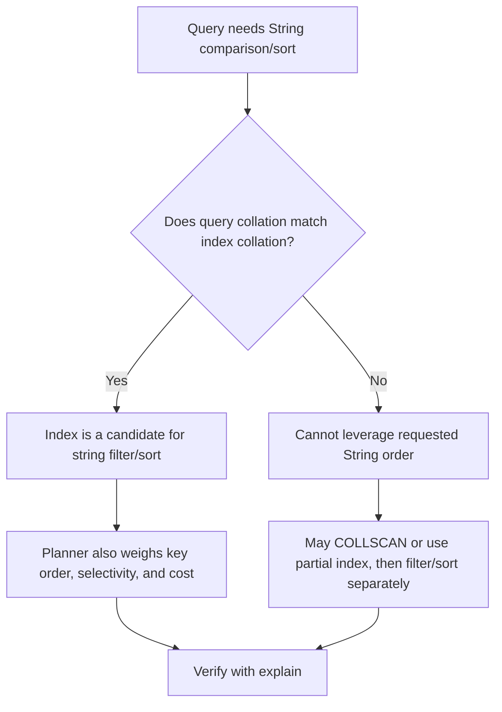
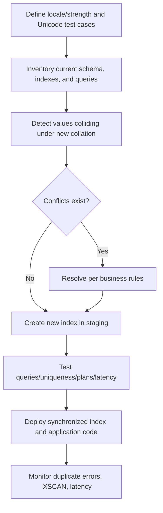

# Index Collation and Matching Query Conditions

## 1. The Problem: An Index Exists, Yet Queries Remain Slow or Return Different Results

In **Spring Data MongoDB**, indexes help MongoDB reduce the number of documents scanned during filtering or sorting. However, for **String values**, simply having an index on the right field name is not enough. MongoDB also needs to know the **string comparison rules** of both the query and the index.

Suppose a customer management system stores:

```javascript
{
  _id: "customer-101",
  tenantId: "tenant-01",
  displayName: "An",
  active: true
}
```

A user searches for `"an"` and expects to find both `"An"` and `"AN"`. A standard index using **simple/binary** comparison will not satisfy that requirement automatically. If you add a `collation` to the query to ignore case while the index lacks a matching collation, MongoDB may **not use the index's string comparison order as desired**. On large collections, that difference directly impacts latency.

Furthermore, the exact same predicate:

```javascript
{ tenantId: "tenant-01", displayName: "an" }
```

can return different results across:

- A query using **simple collation**: compares strings byte-by-byte.
- A query using **`locale: "en", strength: 2`**: case-insensitive yet accent/diacritic-sensitive.
- A query using **`locale: "en", strength: 1`**: may ignore both case and diacritics.

**Lesson objectives** within the **Indexes** chapter of the `SPRING_DATA_MONGODB` module: understand MongoDB collation, design indexes and queries with matching comparison rules, use `MongoTemplate`/repositories, verify via `explain` and tests, and spot pitfalls with unique indexes, regex, compound indexes, and Vietnamese data.

## 2. What Is Collation?

**Collation** describes how MongoDB compares and sorts Strings using language rules (*locale*) and secondary options. It is used in supported operations such as:

- Equality and inequality comparisons on Strings.
- `sort` on names, codes, or other string fields.
- Certain grouping and comparison steps in aggregations.
- Uniqueness checks in **unique indexes** over string keys.
- Key ordering stored inside a collated index.

MongoDB implements collation using ICU; exact results can depend on **locale**, options, and the ICU/server version. Always test against real data, especially personal names and accented Vietnamese strings.

### 2.1. Common Collation Properties

| Property | Meaning | Example |
| --- | --- | --- |
| `locale` | Language rule or `"simple"` | `"en"`, `"vi"`, `"simple"` |
| `strength` | Character difference level compared | `1`, `2`, `3` |
| `caseLevel` | Evaluates case differences in a dedicated pass | `true` or `false` |
| `caseFirst` | Ordering of uppercase vs. lowercase when case matters | `"upper"`, `"lower"`, `"off"` |
| `numericOrdering` | Compares digit sequences inside Strings numerically | `true` or `false` |
| `alternate` | Handling of characters like whitespace/punctuation | `"non-ignorable"`, `"shifted"` |
| `maxVariable` | Character group affected when `alternate=shifted` | `"space"`, `"punct"` |
| `backwards` | Diacritic comparison direction in certain languages | `true` or `false` |
| `normalization` | Optional Unicode normalization check | `true` or `false` |

You do not need to configure every parameter. Pick **the minimal options needed to express the requirement**, apply them identically on the index and query, and verify effectiveness.

### 2.2. Three Commonly Used Strength Levels

For most name-comparison needs:

| Strength | General Meaning | Illustration |
| --- | --- | --- |
| `1` — primary | Typically ignores case and diacritic differences | `"cafe"` and `"café"` may be treated as equal |
| `2` — secondary | Distinguishes diacritics, typically ignores case | `"Cafe"` ≈ `"cafe"`; `"cafe"` differs from `"café"` |
| `3` — tertiary | Also distinguishes case | `"Cafe"` differs from `"cafe"` |

These are **typical behaviors**, not a fixed Unicode mapping table for every language. Options like `caseLevel` can alter behavior even when `strength` stays the same. When Vietnamese rules are required, evaluate `locale: "vi"` and test pairs with/without diacritics, casing, and combining marks.

### 2.3. "simple" Is Not a Language Name

`locale: "simple"` selects binary byte/BSON comparison, distinct from language collations. Example:

```javascript
{ locale: "simple" }
```

Under standard simple collation, `"An"` does not equal `"an"`. That is why a standard index does not automatically make name queries case-insensitive.

**Distinction:** a BSON String field differs from an actual Number type. Configuring collation does not turn String `"10"` into BSON Int32/Int64 and never alters stored document values.

## 3. Sample Data and Target Results

Create a test collection without a custom default collation:

```javascript
db.customer_directory.insertMany([
  {
    _id: "c-101",
    tenantId: "tenant-01",
    displayName: "An",
    active: true
  },
  {
    _id: "c-102",
    tenantId: "tenant-01",
    displayName: "an",
    active: true
  },
  {
    _id: "c-103",
    tenantId: "tenant-01",
    displayName: "Ân",
    active: true
  },
  {
    _id: "c-104",
    tenantId: "tenant-02",
    displayName: "AN",
    active: true
  },
  {
    _id: "c-105",
    tenantId: "tenant-01",
    displayName: "Bình",
    active: false
  }
]);
```

Requirements:

1. Search only within `tenant-01`.
2. Entering `"AN"` matches both **c-101** and **c-102** case-insensitively.
3. Do not automatically conflate **Ân** with **An** since this scenario preserves diacritics.
4. Do not return `c-104` belonging to another tenant.
5. Support efficient filtering and sorting via an appropriate index on large collections.

Example collation rule:

```javascript
{ locale: "en", strength: 2 }
```

`"en"` is chosen here to demonstrate case-insensitivity clearly. If the product requires sorting Vietnamese names according to Vietnamese linguistic rules, evaluate `"vi"` with appropriate strength and options rather than assuming English collation sorts Vietnamese names accurately.

**Test data note:** if the collection already has a **case-insensitive unique index** on name, `"An"` and `"an"` in the same tenant could not coexist. In this section we create a **non-unique index**; unique index examples use a separate collection.

## 4. Creating an Index with Explicit Collation

### 4.1. `mongosh`: Index by Tenant and Name

```javascript
db.customer_directory.createIndex(
  { tenantId: 1, displayName: 1 },
  {
    name: "ix_tenant_name_en_s2",
    collation: {
      locale: "en",
      strength: 2
    }
  }
);
```

The index is ordered by two keys:

- `tenantId` comes first to scope to a single tenant.
- `displayName` comes second to support collated string comparisons and sorting when conditions align.

**Important:** an index's collation applies to **every String key in that index**, including `tenantId`. Not just `displayName` is affected. If `tenantId` is business-case-sensitive, store canonical tenant IDs, use a different schema/index, or explicitly evaluate the impact.

### 4.2. Query Matching the Index Collation

```javascript
db.customer_directory.find(
  {
    tenantId: "tenant-01",
    displayName: "AN"
  }
).collation({
  locale: "en",
  strength: 2
});
```

Given the fixture rules, this returns `c-101` and `c-102`. Index `ix_tenant_name_en_s2` is a **valid candidate** for MongoDB to serve String comparisons under this collation.

Do not write:

```javascript
// Collection defaults to simple: this query performs binary comparison.
db.customer_directory.find({
  tenantId: "tenant-01",
  displayName: "AN"
});
```

and expect case-insensitive results just because a case-insensitive index exists. **Creating an index never changes the semantics of a query** whose collection/operation uses a different collation.

### 4.3. Comparing Three Queries

| Query | Query collation | Expected results for `displayName="AN"` |
| --- | --- | --- |
| Unspecified on simple-default collection | `simple` | Neither `"An"` nor `"an"` |
| Explicit `locale: "en", strength: 2` | Case-insensitive, diacritic-sensitive | `c-101`, `c-102` |
| Explicit `locale: "en", strength: 1` | Often ignores both case and diacritics | May additionally match `"Ân"` |

With `strength: 1`, because semantics differ from strength 2, MongoDB cannot blindly use `ix_tenant_name_en_s2` for the **string lookup portion** under those different rules. Even with matching locale, **two collations are not automatically compatible**.

## 5. Core Rule: Query and Index Must Share Compatible Collation

MongoDB can use an index's **String key order** to satisfy String comparison or sorting only if the query's comparison rules match the index's collation.



**Note two layers of conditions:**

1. **Collation compatibility** is required for the index to support **string comparison/sorting**.
2. **Planner selection** also depends on key order, selectivity, predicate type, sorting, competing indexes, and real statistics.

Hence, "collation matches" **does not guarantee the planner picks `IXSCAN`**, and "collation differs" **does not always mean only `COLLSCAN` is possible**.

### 5.1. Where Does a Query Without Collation Get Its Rules?

In MongoDB, an operation without an explicit collation **inherits the collection's default collation**. If the collection was created without a custom collation, the default is simple.

Scenario:

```text
Collection default: simple
Index: en strength 2
Query without collation: simple
=> Query does NOT adopt en strength 2 merely because the index exists.
```

Conversely:

```text
Collection default: en strength 2
Index without explicit collation: inherits collection default
Query without collation: inherits collection default
=> Both align without repeating collation on every query.
```

Do not guess a collection's default from index names. Inspect collection options, index definitions, and actual commands sent.

### 5.2. String Comparison and Sort Queries

Collation affects both equality and sorting:

```javascript
db.customer_directory.find({
  tenantId: "tenant-01"
}).collation({
  locale: "en",
  strength: 2
}).sort({
  displayName: 1,
  _id: 1
});
```

Sorting `displayName` under a linguistic collation differs from binary sorting. For names considered equal at strength 2, the secondary `_id` key ensures deterministic ordering. **Do not expect collation to produce a unique order among Strings considered equal**.

Sort efficiency also depends on index key order. `{tenantId:1, displayName:1}` can serve tenant filtering and `displayName` sorting; if `_id` tie-breaking is mandatory in the sort, inspect the plan and consider adding `_id` to the index if workload warrants it.

## 6. Collection Default Collation and Index Overrides

### 6.1. Creating a Collection with a Default Collation

```javascript
db.createCollection("customers_default_en", {
  collation: {
    locale: "en",
    strength: 2
  }
});
```

When a collection has this default collation:

```javascript
db.customers_default_en.createIndex({
  tenantId: 1,
  displayName: 1
});
```

A standard index omitting an explicit collation inherits the collection's default collation per MongoDB rules. Queries omitting collation also inherit that default.

Pros: less repetition when the entire collection shares one string comparison rule.

Cons: affects **other queries** never intended for case-insensitive matching, as well as other indexes and unique constraints on String fields.

### 6.2. Overriding to `simple` for a Specific Operation

```javascript
db.customers_default_en.find({
  displayName: "An"
}).collation({
  locale: "simple"
});
```

This query requests binary comparison instead of the collection default. Accordingly, an index inheriting `en strength 2` does not share the same String ordering as the `simple` query.

### 6.3. Changing Default Collation Is Not an Arbitrary Option Update

Default collation is set at collection creation time and should not be treated as a trivial option tweakable via an index command on a populated collection. Changing collection-wide defaults requires planning a new collection/migration, adjusting indexes, and testing compatibility.

On the other hand, **creating an index with a dedicated collation on a `simple`-default collection** is completely valid when only one or a few queries need special comparison rules.

### 6.4. Inspecting Real Collection and Index Metadata

```javascript
db.getCollectionInfos({
  name: "customer_directory"
});

db.customer_directory.getIndexes();
```

Inspect `options.collation` on the collection (if present) and `collation` on each index. Note that an index inheriting or created with collation may display extra default fields beyond the options you passed; verify the attributes that actually matter, such as `locale`, `strength`, and `numericOrdering`.

## 7. Compound Indexes: Exceptions When Collation Mismatches

Saying simply "if collation differs, MongoDB cannot use the index" **is not strictly accurate**.

MongoDB can still use the **prefix of a compound index** for predicates on non-String fields, even when the trailing String comparison uses a different collation.

### 7.1. Example with a Numeric Leading Key

```javascript
db.events_by_region.createIndex(
  { regionId: 1, customerName: 1 },
  {
    name: "ix_region_name_en_s2",
    collation: { locale: "en", strength: 2 }
  }
);
```

Query using `simple` collation:

```javascript
db.events_by_region.find({
  regionId: NumberInt("7"),
  customerName: "An"
}).collation({
  locale: "simple"
});
```

The query collation does not match the index for **`customerName`**. Nevertheless, MongoDB can still use the **numeric** `regionId` prefix to narrow the range, then evaluate `customerName` under `simple` rules in another step. Do not assume subsequent String filtering or sorting is optimized by the index.

If the entire key prefix consists of Strings, a collation mismatch can affect usability starting from the very first field. In `{tenantId:1, displayName:1}` from section 4, **`tenantId` is also a String**, so that numeric-prefix exception does not apply.

### 7.2. Fixing Collation Does Not Fix Key Order

An index:

```javascript
{ tenantId: 1, displayName: 1, createdAt: -1 }
```

does not inherently optimize:

```javascript
db.customer_directory.find({
  tenantId: "tenant-01"
}).sort({
  createdAt: -1
});
```

because `displayName` sits between `tenantId` and `createdAt` in the index. Even with matching collation, **equality–sort–range (ESR)** rules and compound index prefix mechanics still apply.

When optimizing, inspect **both key pattern and collation**, never just one.

## 8. Two Indexes with the Same Key Pattern and Different Collations

A collection may need exact binary lookups for technical operations while offering case-insensitive lookups in the UI.

MongoDB permits creating indexes with identical key patterns and **different collations**, using distinct names to tell them apart:

```javascript
db.customer_directory.createIndex(
  { tenantId: 1, displayName: 1 },
  {
    name: "ix_tenant_name_simple",
    collation: { locale: "simple" }
  }
);

db.customer_directory.createIndex(
  { tenantId: 1, displayName: 1 },
  {
    name: "ix_tenant_name_en_s2",
    collation: { locale: "en", strength: 2 }
  }
);
```

This example assumes those indexes do not already exist or names are managed without collision; if `ix_tenant_name_en_s2` was already created in section 4, **do not recreate it**.

| Query | Candidate index |
| --- | --- |
| String equality/sort with `locale: "simple"` | `ix_tenant_name_simple` |
| String equality/sort with `locale: "en", strength: 2` | `ix_tenant_name_en_s2` |

Benefit: both query modes have a matching index.

Cost: each index consumes storage, adds write maintenance, reads data during index build, and competes for resources. Never create both "just in case" if one query shape does not exist in your workload.

## 9. Unique Indexes with Collation: The Definition of "Duplicate" Changes

### 9.1. Case-Insensitive Usernames

Suppose usernames must be unique per tenant regardless of case:

```javascript
db.user_accounts.createIndex(
  { tenantId: 1, username: 1 },
  {
    name: "uk_tenant_username_en_s2",
    unique: true,
    collation: { locale: "en", strength: 2 }
  }
);
```

Then:

```javascript
db.user_accounts.insertOne({
  _id: "u-101",
  tenantId: "tenant-01",
  username: "Admin"
});

db.user_accounts.insertOne({
  _id: "u-102",
  tenantId: "tenant-01",
  username: "admin"
});
// Expect E11000 duplicate key because both produce the same key under collation.
```

The unique constraint here does not compare raw bytes of `username`. It uses **the index's collation rules**, so `"Admin"` and `"admin"` in the same tenant collide as the same key.

### 9.2. Strength Governs Diacritics Too

- With `strength: 2`, `"cafe"` and `"café"` are usually treated as **distinct**.
- With `strength: 1`, they may be treated as **duplicates** depending on locale.
- With `caseLevel: true`, case differences can be re-evaluated even at lower strengths.

You cannot specify a unique collation merely by saying "ignore case". Document explicit business test cases for what constitutes identical names, especially when usernames allow Unicode, Vietnamese diacritics, punctuation, and digits.

### 9.3. Compound Index Affects `tenantId` Too

A unique index `{tenantId:1, username:1}` with collation `en strength 2` also evaluates `tenantId` under those String rules. For instance, `"Tenant-A"` and `"tenant-a"` would be treated as the same tenant key in the index.

If tenant IDs require **strict binary** comparison, use canonical stable IDs (such as consistently formatted UUIDs), an appropriate BSON type, or a design isolating discriminators so tenant identity semantics cannot accidentally shift.

### 9.4. Migrations Must Check Duplicates Before Building Unique Indexes

If a collection already holds `"Admin"` and `"admin"` in the same tenant, creating a case-insensitive unique index will **fail**. Procedure:

1. Back up and prepare a staging environment.
2. Define duplicate equivalence rules, including diacritics, casing, and locale.
3. Scan for duplicate groups under the target collation.
4. Resolve business conflicts in a controlled manner.
5. Create the unique index with an explicit name and collation.
6. Align both read and write paths to the same comparison contract.
7. Run integration tests for concurrent writes and duplicate-key handling.

**Never delete an account automatically just because two usernames become equal under a new collation.** Merging accounts affects permissions and related data; it requires a business workflow.

## 10. `numericOrdering`: Numbers Inside Strings When Sorting

When applications store codes like:

```javascript
[
  { _id: "p1", code: "item2" },
  { _id: "p2", code: "item10" },
  { _id: "p3", code: "item3" }
]
```

standard string sorting places `item10` before `item2`. The option:

```javascript
{
  locale: "en",
  strength: 2,
  numericOrdering: true
}
```

compares **digit sequences inside Strings numerically** where supported, placing `item2` before `item3` and `item10`.

### 10.1. Index and Query Must Both Set `numericOrdering`

```javascript
db.products.createIndex(
  { code: 1 },
  {
    name: "ix_code_numeric_en_s2",
    collation: {
      locale: "en",
      strength: 2,
      numericOrdering: true
    }
  }
);

db.products.find().sort({
  code: 1
}).collation({
  locale: "en",
  strength: 2,
  numericOrdering: true
});
```

If the query omits `numericOrdering: true`, even with matching locale and strength, **String sort rules no longer match completely**. Do not compare only `locale` when checking index compatibility.

### 10.2. Limitations of `numericOrdering`

`numericOrdering` is not a general-purpose number parser:

- It does not turn a String field into a BSON Number.
- Strings representing negative signs, decimals, thousands separators, or scientific notation may not sort according to arithmetic intuition.
- Very long digit sequences have processing limits under ICU/MongoDB.

For true quantities, amounts, or dates, **store proper BSON types**. Use `numericOrdering` only for **string codes with embedded numbers**, never to mask a schema storing all numbers as Strings.

## 11. `$regex` Is Not Equivalent to Collated Equality

A common pitfall is creating a case-insensitive index and then querying with regex:

```javascript
db.customer_directory.find({
  displayName: { $regex: "^an", $options: "i" }
}).collation({
  locale: "en",
  strength: 2
});
```

MongoDB `$regex` does not evaluate matches via collation like equality or sort. **Case-insensitive indexes generally do not speed up `$regex` with option `i` the way readers expect**, because `$regex` is not collation-aware.

Distinguish your goals:

| Need | Approach to evaluate |
| --- | --- |
| Exact string match ignoring case | Equality + collation, matching index |
| Linguistic sorting of names | Sort + collation, matching index |
| Case-sensitive prefix search | Simple/prefix regex with suitable index, measure explain |
| Contains / fuzzy / full-text search | Dedicated search engine or indexed normalized field |
| Diacritics, Unicode, search suggestions | Custom analyzers, normalization, and dedicated search UX |

For stable-latency case-insensitive prefix searches, you can maintain a **normalized search field** (`nameSearchKey`) with a regular index and run anchored prefix searches against that key—ensuring consistent generation across new/legacy data and Unicode tests while keeping the original display name intact.

Never claim MongoDB collation turns `$regex` into a full linguistic search engine.

## 12. Spring Data MongoDB: Creating Collated Indexes with `IndexOperations`

### 12.1. Sample Entity

```java
package example.directory;

import org.springframework.data.mongodb.core.mapping.Document;
import org.springframework.data.mongodb.core.mapping.FieldType;
import org.springframework.data.mongodb.core.mapping.MongoId;

@Document(collection = "customer_directory")
public record CustomerEntry(
    @MongoId(FieldType.STRING) String id,
    String tenantId,
    String displayName,
    boolean active
) {}
```

The record uses `String` for customer name and `tenantId`; `@MongoId(FieldType.STRING)` ensures IDs are stored as BSON Strings.

### 12.2. Declaring the Same `Collation` on the Index

```java
package example.directory;

import org.springframework.data.domain.Sort;
import org.springframework.data.mongodb.core.MongoTemplate;
import org.springframework.data.mongodb.core.index.Index;
import org.springframework.data.mongodb.core.query.Collation;
import org.springframework.data.mongodb.core.query.Collation.ComparisonLevel;
import org.springframework.stereotype.Component;

@Component
public class CustomerIndexManager {

    private final MongoTemplate template;

    public CustomerIndexManager(MongoTemplate template) {
        this.template = template;
    }

    public String ensureNameIndex() {
        Collation caseInsensitive =
            Collation.of("en")
                .strength(ComparisonLevel.secondary());

        Index index = new Index()
            .on("tenantId", Sort.Direction.ASC)
            .on("displayName", Sort.Direction.ASC)
            .named("ix_tenant_name_en_s2")
            .collation(caseInsensitive);

        return template.indexOps(CustomerEntry.class)
            .ensureIndex(index);
    }
}
```

`IndexOperations.ensureIndex` creates the index if no compatible index exists and returns the index name per current APIs. In production, DDL operations **must never run arbitrarily on every HTTP request**. Manage indexes through controlled migrations/deployments after evaluating existing data and permissions.

If an older index **with the same name and different configuration** already exists, do not expect `ensureIndex` to change its collation automatically. Check for errors/conflicts and plan index replacement when needed.

### 12.3. When Using Spring Data Auto-Index Creation

Spring Data MongoDB can resolve annotation-based indexes when enabled and configured properly, but **do not blindly rely** on application startup to build every index. Auto-index policies vary by version/config, and building large indexes on boot can overload the cluster.

For custom collations, explicit programmatic/migration creation as shown above is straightforward to verify. In strict production environments, put index definitions in migrations, monitor build progress, and keep index names consistent.

## 13. Queries in `MongoTemplate` Must Supply the Matching Collation

### 13.1. Case-Insensitive Name Search Service

```java
package example.directory;

import java.util.List;
import org.springframework.data.domain.Sort;
import org.springframework.data.mongodb.core.MongoTemplate;
import org.springframework.data.mongodb.core.query.Collation;
import org.springframework.data.mongodb.core.query.Collation.ComparisonLevel;
import org.springframework.data.mongodb.core.query.Criteria;
import org.springframework.data.mongodb.core.query.Query;
import org.springframework.stereotype.Service;

@Service
public class CustomerSearchService {

    private final MongoTemplate template;

    public CustomerSearchService(MongoTemplate template) {
        this.template = template;
    }

    public List<CustomerEntry> findByName(
            String authorizedTenantId,
            String requestedName) {

        if (authorizedTenantId == null
                || authorizedTenantId.isBlank()) {
            throw new IllegalArgumentException(
                "Invalid tenantId"
            );
        }
        if (requestedName == null
                || requestedName.isBlank()
                || requestedName.length() > 100) {
            throw new IllegalArgumentException(
                "Invalid search name"
            );
        }

        Collation caseInsensitive =
            Collation.of("en")
                .strength(ComparisonLevel.secondary());

        Query query = Query.query(
            Criteria.where("tenantId").is(authorizedTenantId)
                .and("displayName").is(requestedName)
        );
        query.collation(caseInsensitive);
        query.with(Sort.by(
            Sort.Order.asc("displayName"),
            Sort.Order.asc("id")
        ));
        query.limit(100);

        return template.find(query, CustomerEntry.class);
    }
}
```

In this example:

- `Criteria` defines tenant and name filters.
- `query.collation` sets the **exact same locale/strength** as the index.
- `Sort` orders by name and ID; `id` maps to `_id` in typed `Query` calls.
- `limit(100)` bounds the number of documents returned to the API.
- Tenant ID must come from server-side authentication/authorization; string validation alone is not authorization.

**Design limitation:** `limit(100)` only bounds output; it does not guarantee MongoDB scans only 100 keys/documents. With unselective filters or mismatched indexes, much data may still be scanned. Verify with `explain`.

### 13.2. Reusing Configuration to Prevent Index/Query Drift

Repeating `Collation.of("en").strength(ComparisonLevel.secondary())` in two places risks drifting out of sync. A cleaner pattern:

```java
package example.directory;

import org.springframework.data.mongodb.core.query.Collation;
import org.springframework.data.mongodb.core.query.Collation.ComparisonLevel;

public final class DirectoryCollations {

    private DirectoryCollations() {}

    public static Collation displayName() {
        return Collation.of("en")
            .strength(ComparisonLevel.secondary());
    }
}
```

Both the index manager and search service then call `DirectoryCollations.displayName()`. Whenever locale/strength changes, **migrate indexes in sync** rather than updating query code alone; the existing index stores keys sorted under the old collation.

### 13.3. Comparing Typed Queries vs. Raw Queries

Typed `Query` uses `CustomerEntry` mapping metadata to resolve field names when applicable. In raw MongoDB driver/`Document` calls, always use physical BSON field names.

For example, query:

```javascript
db.customer_directory.find({
  _id: "c-101"
});
```

instead of assuming raw BSON has an `id` field. If an entity uses `@Field("display_name")`, Spring Data APIs map the property name via metadata, whereas a manually constructed raw `Document` must use physical `display_name`.

## 14. Repository `@Query` and Collation

When a query is reused frequently with a fixed contract, Spring Data MongoDB repositories can declare collation on the query annotation:

```java
package example.directory;

import java.util.List;
import org.springframework.data.mongodb.repository.MongoRepository;
import org.springframework.data.mongodb.repository.Query;

public interface CustomerEntryRepository
        extends MongoRepository<CustomerEntry, String> {

    @Query(
        value = "{ 'tenantId': ?0, 'displayName': ?1 }",
        collation = "{ 'locale': 'en', 'strength': 2 }"
    )
    List<CustomerEntry> findNameIgnoringCase(
        String tenantId,
        String displayName
    );
}
```

In Spring Data MongoDB versions supporting `@Query.collation`, this attaches collation to the repository query. You still need a **matching collated index** to optimize the String filter; the annotation does not create the index.

If your version supports passing `Collation` as a special method parameter or different configuration style, check your actual dependency Javadoc before applying. For dynamic requirements, `MongoTemplate` is usually clearer.

### 14.1. Do Not Use `equalsIgnoreCase` in Java Instead of Querying

Avoid loading all customers and filtering in memory:

```java
// Unsuitable for large collections:
allCustomers.stream()
    .filter(c -> c.displayName().equalsIgnoreCase(queryName))
    .toList();
```

This wastes network and heap, and uses **Java rules** that can differ from MongoDB's ICU collation, especially for Unicode. When business rules rely on DB collation, align comparison rules consistently wherever uniqueness or matching decisions occur.

### 14.2. Access Control Remains the Service's Responsibility

`@Query(collation=...)` does not verify that the caller is authorized for the passed `tenantId`. Services must inject `tenantId` from authenticated/authorized context; collation defines **comparison semantics**, not a security boundary.

## 15. Aggregations and Collation Must Also Align with Indexes

Collation is not limited to `find`. Aggregations can specify collation too:

```javascript
db.customer_directory.aggregate(
  [
    { $match: { tenantId: "tenant-01" } },
    { $sort: { displayName: 1, _id: 1 } },
    {
      $project: {
        _id: 0,
        id: "$_id",
        displayName: 1
      }
    }
  ],
  { collation: { locale: "en", strength: 2 } }
);
```

When `$match`/`$sort` appear early enough in the pipeline, MongoDB can use an index with matching collation, depending on the plan. A `$group` stage on Strings also uses the aggregation's collation rules where applicable; names considered equivalent by collation can land in the same group.

### 15.1. Spring Data `AggregationOptions`

```java
import org.springframework.data.domain.Sort;
import org.springframework.data.mongodb.core.aggregation.Aggregation;
import org.springframework.data.mongodb.core.aggregation.AggregationOptions;
import org.springframework.data.mongodb.core.query.Collation;
import org.springframework.data.mongodb.core.query.Collation.ComparisonLevel;
import org.springframework.data.mongodb.core.query.Criteria;

Collation nameCollation = Collation.of("en")
    .strength(ComparisonLevel.secondary());

AggregationOptions options = AggregationOptions.builder()
    .collation(nameCollation)
    .build();

Aggregation pipeline = Aggregation.newAggregation(
    Aggregation.match(
        Criteria.where("tenantId").is(authorizedTenantId)
    ),
    Aggregation.sort(Sort.by(
        Sort.Order.asc("displayName"),
        Sort.Order.asc("id")
    )),
    Aggregation.project("displayName")
        .and("id").as("id")
).withOptions(options);

var result = template.aggregate(
    pipeline, CustomerEntry.class, CustomerNameRow.class
);
```

With DTO:

```java
package example.directory;

public record CustomerNameRow(
    String id,
    String displayName
) {}
```

This pipeline snippet is intended for a service having `template` and `authorizedTenantId`. With typed aggregations, verify how Spring Data maps `id`/`_id` across `project`; if output DTOs miss IDs, adjust projection to physical BSON fields. `withOptions(options)` attaches collation to the aggregation command; it does not add indexes.

### 15.2. Correctness of `$group` by Name

Example:

```javascript
db.customer_directory.aggregate(
  [
    { $match: { tenantId: "tenant-01" } },
    {
      $group: {
        _id: "$displayName",
        count: { $sum: 1 }
      }
    }
  ],
  { collation: { locale: "en", strength: 2 } }
);
```

`"An"` and `"an"` can merge into one group under strength 2 collation. However, **the representative string value** inside group `_id` should not be treated as a stable business canonical key. For stable reporting keys, use an explicit ID or normalized search key.

## 16. `explain`: Verifying Actual Index Usage

### 16.1. Two Queries to Compare

Matching collation query:

```javascript
db.customer_directory.find({
  tenantId: "tenant-01",
  displayName: "AN"
}).collation({
  locale: "en",
  strength: 2
}).explain("executionStats");
```

Mismatched query:

```javascript
db.customer_directory.find({
  tenantId: "tenant-01",
  displayName: "AN"
}).collation({
  locale: "simple"
}).explain("executionStats");
```

With index `ix_tenant_name_en_s2`, the first query has a compatible collation for the string filter; the second requests different semantics. **The planner can choose different plans**, depending on competing indexes, collection size, and data distribution.

### 16.2. Reading `executionStats` Properly

| Field / Indicator | Question to Answer |
| --- | --- |
| `winningPlan` | Which plan did the query actually pick? |
| `IXSCAN` | Is an index scan used, and which index? |
| `COLLSCAN` | Is the collection scanned? |
| `FETCH` | Must documents be read to check predicates or project fields? |
| `SORT` | Is there a separate sort step instead of using index order? |
| `totalKeysExamined` | How many index keys were examined? |
| `totalDocsExamined` | How many documents were read/inspected? |
| `nReturned` | How many documents were returned? |
| `executionTimeMillis` | Server execution timing statistic; limited as a standalone benchmark |

Seeing `IXSCAN` **does not guarantee the String portion of the index was used optimally**; it might only use a numeric prefix or scan many keys before filtering. Conversely, on a tiny collection, MongoDB may choose a cheaper `COLLSCAN` even with a well-designed index.

Do not draw conclusions from one run on five test documents. Benchmark on representative data volume and distribution, recording query shape, existing indexes, and MongoDB version.

### 16.3. Index Hints and Limitations

`hint` can force the planner to consider a specific index, yet it **never changes the query's string comparison rules**. Forcing an index with a different collation can cause broad scans or separate sorting; never treat `hint` as a fix for collation mismatches.

If a query is slow, first investigate **why query and index collations differ**, and only consider hints in thoroughly measured cases.

## 17. Integration Testing: Correct Results and Correct Index Metadata

A thorough test should verify:

1. **Semantics:** strength-2 queries match case variants and exclude other tenants.
2. **Index:** created index carries the intended `locale`, `strength`, and key pattern.
3. **Execution:** on sufficiently large data, `explain` shows a workload-appropriate plan. Keep that in a separate performance test rather than forcing unit tests to assert `IXSCAN`.

### 17.1. MongoDB Slice Test

```java
package example.directory;

import static org.junit.jupiter.api.Assertions.*;

import java.util.ArrayList;
import java.util.List;
import java.util.Set;
import java.util.UUID;
import java.util.stream.Collectors;
import org.bson.Document;
import org.junit.jupiter.api.Test;
import org.springframework.beans.factory.annotation.Autowired;
import org.springframework.boot.test.autoconfigure.data.mongo.DataMongoTest;
import org.springframework.context.annotation.Import;
import org.springframework.data.domain.Sort;
import org.springframework.data.mongodb.core.MongoTemplate;
import org.springframework.data.mongodb.core.index.Index;
import org.springframework.data.mongodb.core.query.Collation;
import org.springframework.data.mongodb.core.query.Collation.ComparisonLevel;
import org.springframework.data.mongodb.core.query.Criteria;
import org.springframework.data.mongodb.core.query.Query;

@DataMongoTest
@Import(CustomerSearchService.class)
class CustomerCollationIndexTest {

    @Autowired
    MongoTemplate template;

    @Autowired
    CustomerSearchService service;

    private void ensureIndex() {
        template.indexOps(CustomerEntry.class).ensureIndex(
            new Index()
                .on("tenantId", Sort.Direction.ASC)
                .on("displayName", Sort.Direction.ASC)
                .named("ix_tenant_name_en_s2")
                .collation(
                    Collation.of("en")
                        .strength(ComparisonLevel.secondary())
                )
        );
    }

    @Test
    void equalityUsesCaseInsensitiveComparisonWithinTenant() {
        ensureIndex();
        String suffix = UUID.randomUUID().toString();
        String tenant = "t-" + suffix;

        template.insertAll(List.of(
            new CustomerEntry("a-" + suffix, tenant, "An", true),
            new CustomerEntry("b-" + suffix, tenant, "an", true),
            new CustomerEntry("c-" + suffix, tenant, "Ân", true),
            new CustomerEntry(
                "d-" + suffix, "other-" + suffix, "AN", true
            )
        ));

        List<CustomerEntry> found =
            service.findByName(tenant, "AN");

        Set<String> ids = found.stream()
            .map(CustomerEntry::id)
            .collect(Collectors.toSet());

        assertEquals(
            Set.of("a-" + suffix, "b-" + suffix),
            ids
        );
    }

    @Test
    void simpleComparisonDoesNotIgnoreCase() {
        ensureIndex();
        String suffix = UUID.randomUUID().toString();
        String tenant = "t-" + suffix;

        template.insert(new CustomerEntry(
            "only-" + suffix, tenant, "An", true
        ));

        Query query = Query.query(
            Criteria.where("tenantId").is(tenant)
                .and("displayName").is("an")
        );
        query.collation(
            Collation.of("simple")
        );

        assertTrue(
            template.find(query, CustomerEntry.class)
                .isEmpty()
        );
    }

    @Test
    void indexMetadataContainsExpectedCollation() {
        ensureIndex();

        List<Document> indexes =
            template.getCollection("customer_directory")
                .listIndexes()
                .into(new ArrayList<>());

        Document target = indexes.stream()
            .filter(index ->
                "ix_tenant_name_en_s2".equals(
                    index.getString("name")
                ))
            .findFirst()
            .orElseThrow();

        Document collation = target.get(
            "collation", Document.class
        );
        assertNotNull(collation);
        assertEquals("en", collation.getString("locale"));
        assertEquals(2, collation.getInteger("strength"));
    }
}
```

These tests share a test collection while isolating IDs and tenants via UUIDs. If the same test suite defines an index with the same name but different options, `ensureIndex` will conflict; use an isolated test database or consistent index fixture management.

**Do not assume `@DataMongoTest` starts MongoDB automatically.** Projects must configure a compatible test MongoDB instance or Testcontainers for their Spring Boot version, and the test server must support collation. This is documentation code, not built or executed during authoring.

### 17.2. Testing Unique Indexes on a Separate Dataset

Another test can use `user_accounts_test` with:

```javascript
db.user_accounts_test.createIndex(
  { tenantId: 1, username: 1 },
  {
    name: "uk_tenant_username_en_s2",
    unique: true,
    collation: { locale: "en", strength: 2 }
  }
);
```

After inserting `username:"Admin"`, try inserting `username:"admin"` in the same tenant and assert duplicate-key failure. Then insert the same username in a different tenant and verify compound uniqueness permits it. When writing concurrent insert tests, verify enforcement at MongoDB rather than relying on `existsBy...` pre-checks—pre-checks cannot prevent races.

### 17.3. Testing Vietnamese and Unicode Data

Build a fixture containing:

```text
An / an / AN
Ân / ân
Hoa / Hòa / Hoà
Đức / đức / Duc
Names with leading/trailing whitespace
Precomposed Unicode names and names with combining marks
```

Run with `locale: "vi"`, different strengths, and needed options. Record equality matches and actual sort order. Never extrapolate full Vietnamese behavior from two ASCII names or simply switch locale to `"vi"` without testing.

## 18. Changing Collation in a Live System

Changing string comparison rules on a field is a **data contract change**, not merely a query optimization.

### 18.1. Changes That Can Break Correctness

If usernames were previously case-sensitive:

```text
User A: "Alice"
User B: "alice"
```

after switching to a case-insensitive unique index, both usernames become the same key. Building the new index will fail, and username lookup APIs can return multiple records if uniqueness was not enforced beforehand.

For customer display names, collapsing case variants makes sense for search, but **not necessarily for account identity**. Separate clearly:

- Display field: `displayName`, typically non-unique.
- Login identifier: `username`/`loginId`, requiring strict uniqueness rules.
- Record ID: `_id`, used for references and updates.

### 18.2. Controlled Migration Workflow



Recommended steps:

1. Finalize comparison rules with product and security: casing, diacritics, numeric digits, and locale.
2. Audit collection defaults, all indexes sharing the key pattern, repository/`MongoTemplate` queries, and raw driver calls.
3. Scan for duplicates under the new collation before creating **unique indexes**.
4. Create new indexes with **distinct names**, avoiding overwriting/dropping old indexes prematurely.
5. Run explain and performance tests on real queries and sorts.
6. Update all read/write paths and input validation in lockstep.
7. Watch for E11000 errors, search anomalies, query plan shifts, and write pressure.
8. Only once nothing depends on the old index, schedule its removal with a proper rollback plan.

**Never change a collection's default collation in production as an impromptu operation.** That acts as a broad data and application migration affecting far more than one API.

## 19. Common Mistakes and Troubleshooting

| Symptom | Possible Cause | Resolution |
| --- | --- | --- |
| Case-insensitive index exists, yet `find` misses `"an"` for `"An"` | Query uses simple/default collation differing from index | Add matching `query.collation` or fix collection default |
| Collated query ignores the index | Collation/index mismatch, bad key order, or scan is cheaper | Inspect `getIndexes`, `explain`, and workload |
| `strength: 1` returns extra accented names | Strength 1 ignores diacritic distinctions | Use strength 2 to preserve diacritics |
| `strength: 2` still differentiates case | `caseLevel` or other option enabled; locale/version differs | Inspect full collation document and test explicitly |
| Name sorting feels unstable | Multiple names compare equal under collation | Add a deterministic tie-breaker such as ID |
| Unique index creation fails | Data has colliding keys under new collation | Detect and resolve conflicts before migrating |
| Same username in different tenants collides | `tenantId` is also a String subject to collation, or non-canonical IDs | Canonicalize tenant IDs and review compound keys |
| `numericOrdering` fails on decimals/negatives | Option only parses specific unsigned digit runs in Strings | Store numeric fields as true BSON numbers |
| Regex `i` stays slow despite case-insensitive index | `$regex` is not collation-aware like equality | Pick a suitable search or index strategy |
| Two indexes with same key pattern report name collision | MongoDB auto-generates identical default names | Give each collated index an explicit distinct name |
| Aggregation `$group` merges names unexpectedly | Aggregation collation defines String equality | Group by stable ID or explicit normalized key |
| Index has right locale, yet sort remains slow | Strength/options mismatch or sort mismatches key order | Compare all collation options and execution plan |
| `@Indexed` does not create index on startup | Auto-index creation/migration not configured as expected | Check startup/`indexOps`, use controlled migrations |
| Vietnamese names sort wrong for business rules | Using another locale or untested diacritics/Unicode | Test `locale:"vi"` against product expectations |
| Cross-tenant document access | Confusing collation with authorization | Authenticate tenant server-side and enforce mandatory filter |

### Quick Investigation Checklist

1. Inspect **actual BSON String values**: trailing spaces, diacritics, Unicode normalization, or mixed types.
2. Check collection default collation rather than assuming simple.
3. Run `getIndexes()`: inspect key pattern, name, unique flag, and full collation spec.
4. Inspect **actual query/aggregation commands**: is collation present, and do locale/strength/numericOrdering match?
5. If sorting, verify sort keys and index key order.
6. If querying with regex, do not apply equality collation assumptions.
7. Run `explain("executionStats")` and examine keys/documents examined and sort stages.
8. For unique indexes, test duplicate data and concurrent writes.
9. Verify tenant/security isolation; collation is never authorization.
10. Only after confirming correctness, consider adding/removing indexes or changing schemas.

## 20. Practice Exercises

### Exercise 1 — Simple and Strength 2

Create a collection with `"An"`, `"an"`, and `"Ân"` in the same tenant. Run queries for `"AN"` without collation and with `{locale:"en",strength:2}`. Compare results, then use `explain` to inspect index consideration.

### Exercise 2 — Index Collation Mismatch

Create an `en strength 2` index, then run queries with `en strength 1` and `simple`. Compare search results and execution plans. Explain why matching field names/index key patterns alone are not enough.

### Exercise 3 — Collection Default and Override

Create a collection with default `en strength 2`. Create an index without specifying collation. Run queries omitting collation and overriding with `simple`. Predict results and index usability, then verify via `getCollectionInfos` and `getIndexes`.

### Exercise 4 — Compound Prefix

Create `{regionId:1,customerName:1}` with `en strength 2`, where `regionId` is Int32. Query `regionId=7` and search names with `simple` collation. Explain how the optimizer can still use the numeric prefix while the String segment remains incompatible.

### Exercise 5 — Unique Usernames

Create unique `{tenantId:1,username:1}` with `en strength 2`. Insert `"Admin"` and `"admin"` in the same tenant, then in another tenant. Observe duplicate-key failures and analyze the impact on `tenantId` itself.

### Exercise 6 — Numeric Ordering

Store `"item2"`, `"item10"`, and `"item3"` in a collection. Compare sorting under `simple` vs. `numericOrdering:true`. Create a matching index and run `explain`. Test decimal strings to observe limits.

### Exercise 7 — Spring Data Integration Test

Implement `CustomerEntry`, `IndexOperations` manager, `Query.collation` service, and JUnit tests as in section 17. Inspect index metadata, and verify case variants in the same tenant, accented names, and separate tenants.

### Exercise 8 — Comparing Equality vs. Regex

With an `en strength 2` index, compare `displayName == "an"` against `{$regex:"^an",$options:"i"}`. Observe execution plans and latency on a large test dataset. Propose a prefix-search solution if low-latency autocomplete is required.

### Exercise 9 — Vietnamese Names

Test `locale:"vi"` with strength 1/2/3 across `Hoa`, `Hòa`, `Hoà`, `Ân`, `An`, `Đức`, `Duc`, and uppercase variants. Record actual equality matches and sort order, and propose a policy matching application needs.

### Self-Check Questions

- Besides sorting, what else uses an index's collation?
- Does creating a `strength:2` index automatically make all queries on the collection case-insensitive?
- If a query omits collation, where does it inherit its collation from?
- How do `strength:1` and `strength:2` differ on diacritics?
- If query and index share `locale:"en"` yet differ on `numericOrdering`, are they fully compatible?
- Why can MongoDB still use a numeric prefix of a compound index when String collations differ?
- Can two indexes with the same key pattern and different collations coexist? What naming rule applies?
- Why can creating a case-insensitive unique index fail immediately on populated data?
- Does a compound index's collation affect `tenantId` if `tenantId` is a String?
- Does `$regex` with `i` leverage collated indexes like equality?
- Do `cursorBatchSize` or `limit` alter collation logic?
- Why is a tie-breaker key needed when sorting names considered equal?
- What should you read in `explain("executionStats")` to prove index efficiency?
- When should `locale:"vi"` be chosen over `"en"`?

## Key Takeaways

**Collation is part of both the String comparison contract and a MongoDB index's definition.** To use an index effectively for String equality or sorting, **the query must specify a collation compatible with the index**, alongside matching key patterns and query plans. When a query omits collation, it inherits the collection default; creating a separate collated index **does not alter query semantics by itself**. Strength, locale, caseLevel, and numericOrdering can change result sets, sort order, and uniqueness enforcement. Compound indexes may still serve **non-String** prefixes despite collation mismatches, without optimizing the String segment. In **Spring Data MongoDB**, use `IndexOperations`/`Index.collation(...)` when creating indexes and `Query.collation(...)`, `@Query(collation=...)`, or `AggregationOptions.collation(...)` when querying; always verify raw BSON, index metadata, `explain`, and integration tests against real Unicode and tenant data.

## References

- [MongoDB Manual — Collation](https://www.mongodb.com/docs/manual/reference/collation/)
- [MongoDB Manual — Indexes and Collation](https://www.mongodb.com/docs/manual/core/index-case-insensitive/)
- [MongoDB Manual — Collation and Index Use](https://www.mongodb.com/docs/manual/reference/collation/#collation-and-index-use)
- [MongoDB Manual — Unique Indexes](https://www.mongodb.com/docs/manual/core/index-unique/)
- [MongoDB Manual — Query Plans and Explain](https://www.mongodb.com/docs/manual/reference/explain-results/)
- [Spring Data MongoDB Reference — Index Creation](https://docs.spring.io/spring-data/mongodb/reference/mongodb/mapping/mapping-index-management.html)
- [Spring Data MongoDB Reference — Collations](https://docs.spring.io/spring-data/mongodb/reference/mongodb/collation.html)
- [Spring Data MongoDB API — Collation](https://docs.spring.io/spring-data/mongodb/docs/current/api/org/springframework/data/mongodb/core/query/Collation.html)
- [Spring Data MongoDB API — Index](https://docs.spring.io/spring-data/mongodb/docs/current/api/org/springframework/data/mongodb/core/index/Index.html)
