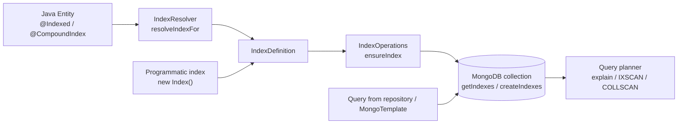
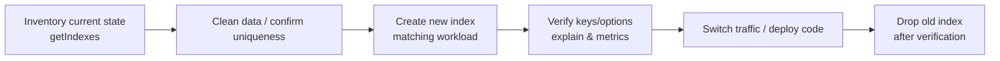

# `IndexOperations`, `IndexResolver`, and Programmatic Index Management

In a **Spring Data MongoDB** application, placing `@Indexed` or `@CompoundIndex` on an entity only expresses **index design intent**. MongoDB Server can only use an index once the index **physically exists** in the collection with the right fields, order, type, and options. Consequently, building a reliable system requires understanding three distinct layers: **entity metadata**, **Spring Data index resolution/creation APIs**, and **index change management in deployment environments**.

The two central APIs are:

- **`IndexOperations`**: operates on the indexes of a **single collection**, including ensuring/creating indexes via `ensureIndex(...)`, inspecting metadata via `getIndexInfo()`, and removing indexes via `dropIndex(...)` when planned.
- **`IndexResolver`** (commonly `MongoPersistentEntityIndexResolver`): reads index metadata from entities annotated with `@Indexed`, `@CompoundIndex`, `@TextIndexed`, or other framework-supported annotations, producing a list of `IndexDefinition` objects for `IndexOperations` to apply.

This lesson belongs to the **Indexes** chapter of the `SPRING_DATA_MONGODB` module. The module covers connecting and mapping with MongoDB, querying via `MongoTemplate` or repositories, aggregation, indexing, transactions, reactive access, testing, and data performance diagnostics. Here, the focus is on **controlled programmatic index management**, rather than adding annotations and hoping indexes appear by magic.

After this lesson, you can:

1. Distinguish **declaring**, **creating on the server**, **verifying existence**, **modifying**, and **dropping** indexes.
2. Use `MongoTemplate.indexOps(...)` to create single-field, compound, unique, and TTL indexes.
3. Use `IndexResolver` to turn entity annotations into concrete `IndexDefinition` instances.
4. Understand why **auto-index creation should not be treated as a full schema migration tool**, especially in production.
5. Write idempotent bootstrap/migration steps, detect index drift, and handle duplicate-key or option-conflict errors.
6. Measure query plans using `explain("executionStats")` and test real indexes against a test MongoDB instance.

## 1. Responsibility Map: Annotations, Spring Data, and MongoDB Server



Each step carries a distinct meaning:

| Step | Mechanism | What is guaranteed |
| --- | --- | --- |
| Declare | `@Indexed`, `@CompoundIndex` in Java classes | Design metadata; **does not prove index exists on server** |
| Resolve | `IndexResolver.resolveIndexFor(Entity.class)` | Produces `IndexDefinition` from entity mapping/annotations |
| Create/ensure | `IndexOperations.ensureIndex(definition)` | Requests MongoDB to create the index if needed, or succeeds if compatible |
| Inspect | `IndexOperations.getIndexInfo()`, `db.collection.getIndexes()` | Reveals which indexes currently exist on the collection |
| Use | MongoDB query planner | Index **may** be chosen if suitable for query, sort, and statistics |
| Modify | Controlled migration | Never assume an existing index updates keys/options when annotations change |

An endpoint `findByTenantIdAndSku(...)` returning accurate results **does not prove** MongoDB used an index. On small collections, `COLLSCAN` still returns fast; only `explain` or profiling on representative data confirms the execution strategy.

### 1.1. An Index Is a Physical Resource, Not a "Mirror" of a Java Field

An index has a **key pattern** (such as `{tenantId:1, sku:1}`), a name, and options such as `unique`, `sparse`, `partialFilterExpression`, TTL, collation, and type-specific attributes. One Java field can participate in multiple indexes; conversely, a compound index contains multiple fields where ordering is critical.

Index benefits must be weighed against costs: RAM/storage, index updates on insert/update/delete, build time, and write-workload impact. **Never blindly index every field**.

## 2. Example Domain Model: Multi-Tenant Product Lookup

Suppose `catalogProducts` serves these queries:

- Read one product by `tenantId + sku`.
- List active products by `tenantId + status`, sorted `createdAt DESC`.
- Clean up temporary expired records using `expiresAt`.
- Filter dynamic attributes across flexible fields as needed.

Sample document:

```javascript
{
  _id: "P-101",
  tenantId: "T-A",
  sku: "BK-001",
  name: "Sakura Notebook",
  status: "ACTIVE",
  createdAt: ISODate("2026-11-01T10:00:00Z"),
  expiresAt: null
}
```

For multi-tenant data, SKUs must be unique only **within a tenant**. A unique index on `sku` alone would prevent tenant `T-B` from using SKU `BK-001` already used by `T-A`. A compound unique index `{tenantId:1, sku:1}` models that requirement accurately.

### 2.1. Entity Declaring Index Metadata

```java
import java.time.Instant;
import org.springframework.data.annotation.Id;
import org.springframework.data.mongodb.core.index.CompoundIndex;
import org.springframework.data.mongodb.core.index.CompoundIndexes;
import org.springframework.data.mongodb.core.mapping.Document;

@Document(collection = "catalogProducts")
@CompoundIndexes({
@CompoundIndex(
        name = "ux_catalog_tenant_sku",
        def = "{ 'tenantId': 1, 'sku': 1 }",
        unique = true
),
@CompoundIndex(
        name = "ix_catalog_tenant_status_created",
        def = "{ 'tenantId': 1, 'status': 1, 'createdAt': -1 }"
)
})
public class CatalogProduct {
    @Id
    private String id;

    private String tenantId;
    private String sku;
    private String name;
    private String status;
    private Instant createdAt;
    private Instant expiresAt;

    protected CatalogProduct() {}

    public CatalogProduct(
            String id, String tenantId, String sku,
            String name, String status, Instant createdAt
    ) {
        this.id = id;
        this.tenantId = tenantId;
        this.sku = sku;
        this.name = name;
        this.status = status;
        this.createdAt = createdAt;
    }

    public String getId() { return id; }
    public String getTenantId() { return tenantId; }
    public String getSku() { return sku; }
    public String getName() { return name; }
    public String getStatus() { return status; }
    public Instant getCreatedAt() { return createdAt; }
    public Instant getExpiresAt() { return expiresAt; }
    public void setExpiresAt(Instant expiresAt) {
        this.expiresAt = expiresAt;
    }
}
```

Here, the two `@CompoundIndex` declarations define:

| Name | Key pattern | Purpose |
| --- | --- | --- |
| `ux_catalog_tenant_sku` | `{tenantId:1,sku:1}` | Prevent duplicate SKUs within the same tenant |
| `ix_catalog_tenant_status_created` | `{tenantId:1,status:1,createdAt:-1}` | Filter tenant/status and support newest-first sorting in compatible patterns |

This is **metadata**, not proof the indexes exist on MongoDB Server. Changing an annotation changes its name/spec in code; **never assume the framework deletes the old index**.

### 2.2. Do Not Mix Up `@Id` and Business Keys

`@Id` maps to `_id`, and MongoDB creates a unique index on `_id` for standard collections. `{tenantId,sku}` protects a **separate** constraint: the product code within a tenant.

In this example, `@Id String` is used for simplicity. For 24-character hex strings, Spring Data can map `String` to BSON `ObjectId` depending on setup; applications enforcing specific string ID formats can use `@MongoId` to control representation. Creating indexes never resolves String vs. ObjectId type mismatches in queries.

## 3. `IndexOperations`: API for Managing Collection Indexes

Spring Data MongoDB exposes `IndexOperations` via `MongoTemplate.indexOps(...)`:

```java
import org.springframework.data.mongodb.core.MongoTemplate;
import org.springframework.data.mongodb.core.index.IndexOperations;

// template has been injected into a service or configuration.
IndexOperations byEntity =
        template.indexOps(CatalogProduct.class);

IndexOperations byCollection =
        template.indexOps("catalogProducts");
```

**Important distinction:** `indexOps(CatalogProduct.class)` carries entity mapping metadata; `indexOps("catalogProducts")` targets a collection name directly without entity metadata. When entities use `@Field` aliases or custom collection names, prefer the **typed** overload or verify physical key patterns before creating indexes.

Common operations:

| Method | Role | Notes |
| --- | --- | --- |
| `ensureIndex(IndexDefinition)` | Ensures an index definition exists, returning its name | Not an automatic migration altering existing index definitions |
| `getIndexInfo()` | Lists existing indexes | Used for post-deployment checks and testing |
| `dropIndex(String)` | Drops an index by name | Execute only inside controlled migrations |
| `dropAllIndexes()` | Drops all removable non-`_id` indexes | Extremely dangerous in production |

### 3.1. Creating a Single-Field Index with `Index`

```java
import org.springframework.data.domain.Sort;
import org.springframework.data.mongodb.core.index.Index;

String indexName = template.indexOps(CatalogProduct.class)
        .ensureIndex(new Index()
                .on("status", Sort.Direction.ASC)
                .named("ix_catalog_status"));

System.out.println(indexName);
```

This is a technical example, not a recommendation to add a status-only index to every collection. If nearly all queries include tenant, `{tenantId,status,createdAt}` is usually far more valuable than low-selectivity `{status}`.

`ensureIndex` sends a **request to MongoDB Server**; it requires connectivity, index-creation permissions, and server support. Authentication, duplicate-key, or option-conflict errors throw exceptions rather than failing silently.

### 3.2. Creating a Compound Unique Index Programmatically

```java
import org.springframework.data.domain.Sort;
import org.springframework.data.mongodb.core.index.Index;
import org.springframework.data.mongodb.core.index.IndexOperations;

IndexOperations indexOps =
        template.indexOps(CatalogProduct.class);

String name = indexOps.ensureIndex(
        new Index()
                .on("tenantId", Sort.Direction.ASC)
                .on("sku", Sort.Direction.ASC)
                .unique()
                .named("ux_catalog_tenant_sku"));
```

This code expresses the same keys and options as `@CompoundIndex` on the entity. **Do not both resolve annotations and duplicate programmatic creation everywhere**; pick one primary source of truth or keep them strictly synchronized. Differing names or options can spawn redundant indexes, conflicts, or unintended migrations.

### 3.3. Creating an Index for Filter and Sort

```java
indexOps.ensureIndex(
        new Index()
                .on("tenantId", Sort.Direction.ASC)
                .on("status", Sort.Direction.ASC)
                .on("createdAt", Sort.Direction.DESC)
                .named("ix_catalog_tenant_status_created"));
```

Field order matches the sample query:

```javascript
db.catalogProducts.find({
  tenantId: "T-A",
  status: "ACTIVE"
}).sort({ createdAt: -1 }).limit(20);
```

MongoDB can use the compound prefix and satisfy sorting in many cases, though index presence does not guarantee the planner **always** picks it. Collation, range predicates, selectivity, projections, and competing indexes all affect execution plans. Verify with `explain`.

## 4. Reading Existing Indexes with `getIndexInfo()`

After running `ensureIndex`, verify that **the server holds the expected indexes** instead of trusting that no exception was thrown.

```java
import java.util.List;
import org.springframework.data.mongodb.core.index.IndexInfo;
import org.springframework.data.mongodb.core.index.IndexOperations;

IndexOperations indexOps =
        template.indexOps(CatalogProduct.class);

List<IndexInfo> indexes = indexOps.getIndexInfo();
for (IndexInfo info : indexes) {
    System.out.printf(
            "name=%s, unique=%s, keys=%s%n",
            info.getName(),
            info.isUnique(),
            info.getIndexFields()
    );
}
```

The list typically includes `_id_` plus any indexes created by the app or external tools. `IndexInfo` coverage depends on Spring Data MongoDB version; to verify advanced options like `partialFilterExpression`, collation, TTL, hidden flags, or wildcard projections, inspect **raw BSON** via `getIndexes()` in MongoDB.

Example in `mongosh`:

```javascript
db.catalogProducts.getIndexes();
```

Abbreviated illustrative result:

```javascript
[
  { v: 2, key: { _id: 1 }, name: "_id_" },
  {
    v: 2,
    key: { tenantId: 1, sku: 1 },
    name: "ux_catalog_tenant_sku",
    unique: true
  },
  {
    v: 2,
    key: { tenantId: 1, status: 1, createdAt: -1 },
    name: "ix_catalog_tenant_status_created"
  }
]
```

`v` is the server's index format version, not an entity version. Option fields can vary by index type and MongoDB version. **Never check only the index name** and declare success; an index with the same name but wrong keys or options indicates misconfiguration or drift.

### 4.1. Building a Startup or Health-Check Verification Step

In strict environments, read back index metadata after migrations to confirm baseline invariants:

```java
boolean hasUniqueSkuKey = template
        .indexOps(CatalogProduct.class)
        .getIndexInfo()
        .stream()
        .anyMatch(info ->
                "ux_catalog_tenant_sku".equals(info.getName())
                && info.isUnique());

if (!hasUniqueSkuKey) {
    throw new IllegalStateException(
            "Missing tenant + SKU unique index");
}
```

This is only a **preliminary check**. It does not verify exact key order. For production audits, verify **name + keys + order + unique + TTL + partial filter + collation** wherever those options are critical. If drift is detected, never auto-drop indexes inside an uncontrolled `if` branch.

### 4.2. `dropIndex` and `dropAllIndexes`: Use Only Per Plan

```java
// Example strictly for approved migrations or isolated test databases.
IndexOperations ops = template.indexOps(CatalogProduct.class);

ops.dropIndex("ix_catalog_status");

// NEVER execute in a live production application:
// ops.dropAllIndexes();
```

Dropping an index can shift queries from `IXSCAN` to `COLLSCAN`, spiking latency and server load. Dropping a **unique index** also removes duplicate protection. Never drop an index just because the annotation was removed from one codebase: another service or batch job might rely on it.

In production, dropping an index requires confirming zero active consumers, measuring plans after hiding or testing in staging, having a rollback plan, and isolating DDL permissions.

## 5. `IndexResolver`: Turning Annotations into `IndexDefinition`

`IndexOperations` executes commands against a collection, while `IndexResolver` **reads mapping metadata** to determine which indexes are declared.

A standard implementation is `MongoPersistentEntityIndexResolver`:

```java
import org.springframework.data.mongodb.core.index.IndexResolver;
import org.springframework.data.mongodb.core.index.MongoPersistentEntityIndexResolver;
import org.springframework.data.mongodb.core.index.IndexOperations;
import org.springframework.data.mongodb.core.MongoTemplate;

IndexResolver resolver = new MongoPersistentEntityIndexResolver(
        template.getConverter().getMappingContext()
);

IndexOperations operations =
        template.indexOps(CatalogProduct.class);

resolver.resolveIndexFor(CatalogProduct.class)
        .forEach(operations::ensureIndex);
```

`resolveIndexFor(CatalogProduct.class)` inspects entity metadata and returns `IndexDefinition` objects matching framework-supported annotations. Only then does `ensureIndex` instruct MongoDB to build the indexes.

**Key takeaway:** calling `resolveIndexFor(...)` alone **creates nothing**. The resolver does not replace `MongoTemplate`/driver or run migrations by itself.

### 5.1. What Benefits Does `IndexResolver` Offer?

| Without resolver | With resolver |
| --- | --- |
| Must manually write `new Index().on(...)` for every annotation | Reuses `@Indexed`/`@CompoundIndex` metadata |
| Easy to forget updating bootstrap code when fields rename | Resolver follows mapping metadata |
| Harder to standardize across many entities | Supports a centralized entity registry |
| Annotation metadata and programmatic code can diverge | Eliminates duplicate specs, though **still does not solve migration drift** |

Nor can the resolver deduce needed indexes from query code. It cannot inspect a slow `MongoTemplate.aggregate(...)` and suggest a missing index. Indexes maintained exclusively in Java, migration scripts, or DBA tooling must still be managed intentionally.

### 5.2. Annotations Must Be on Mapped/Scanned Entities

Spring Data MongoDB reads metadata only for mapped entity classes. If a class is not recognized by the mapping context, its annotations may be skipped. Use `@Document(collection = "...")`, configure entity scanning, and explicitly list entities participating in index initialization.

For `Map` or dynamic unstructured properties, the resolver cannot anticipate arbitrary runtime keys; map entries are **not automatically indexed**. When dynamic keys need indexing, evaluate `@WildcardIndexed` or an explicit wildcard index, weighing its storage and performance trade-offs.

### 5.3. Distinguishing `@Indexed` and `@CompoundIndex`

Example:

```java
import org.springframework.data.mongodb.core.index.CompoundIndex;
import org.springframework.data.mongodb.core.index.Indexed;
import org.springframework.data.mongodb.core.mapping.Document;

@Document(collection = "inventoryItems")
@CompoundIndex(
        name = "ux_tenant_sku",
        def = "{'tenantId': 1, 'sku': 1}",
        unique = true
)
class InventoryItem {
    String tenantId;
    String sku;

    @Indexed(name = "ix_inventory_status")
    String status;
}
```

`@Indexed` on `status` produces a **single-field** index; `@CompoundIndex` on the class produces a **multi-field index ordered as listed in `def`**. They **do not merge into a single index**. If workloads primarily query `tenantId + status`, a status-only index may be far less useful than a tailored compound index.

### 5.4. Other Index Annotations

Spring Data MongoDB supports additional index annotations depending on version:

| Annotation | Scenario | What to verify |
| --- | --- | --- |
| `@Indexed` | Single field, unique, sparse, TTL per configuration | Field type and actual server options |
| `@CompoundIndex` / `@CompoundIndexes` | Multi-field queries, unique business keys | Field order, index name, options |
| `@TextIndexed` / `@TextScore` | Text search via text index | Language, stemming, one-text-index-per-collection limit |
| `@GeoSpatialIndexed` | Location data, spatial queries | 2d vs. 2dsphere and valid GeoJSON |
| `@WildcardIndexed` | Dynamic fields, flexible schemas | Index size and wildcard scope |
| `@HashIndexed` | Hashed index on appropriate keys | Never confuse hashed with sorted/range indexes |

**Do not assume every annotation behaves identically across versions**. Index definitions form a contract with MongoDB Server—verify compatibility whenever upgrading Spring Data or drivers.

## 6. Why Do Annotations Not Auto-Create Indexes in Every Application?

Since **Spring Data MongoDB 3.0**, **automatic index creation is disabled by default**. Annotating an entity does not ensure MongoDB builds the index on startup. This design choice recognizes that indexes have significant physical impact on data and deployments.

Spring Boot projects can opt into auto-creation via configuration in supported Boot versions:

```properties
spring.data.mongodb.auto-index-creation=true
```

Or, when configuring Spring Data MongoDB via `AbstractMongoClientConfiguration`, override:

```java
@Override
protected boolean autoIndexCreation() {
    return true;
}
```

**Do not mix multiple competing configurations** where one overrides another. Verify your actual Spring Boot/Spring Data versions and MongoDB configuration beans.

### 6.1. When Is Auto-Index Useful?

In prototypes, local development, or test suites, annotation-driven auto-creation saves boilerplate and catches unique constraints quickly. In production, however:

- Building indexes on large collections takes significant time and resources.
- Multiple application replicas booting together all issue concurrent index creations.
- Existing indexes with changed keys/options **are not safely altered** when annotations change.
- Runtime app users require broad `createIndex` privileges, violating least privilege.
- If an index build fails, apps can crash on boot right during scale-out.

Therefore, **controlled index migrations** fit production environments with large datasets, strict SLAs, or shared collections much better.

### 6.2. Auto-Index Does Not Replace Schema/Index Migrations

Suppose V1 had:

```javascript
{ tenantId: 1, sku: 1 }
```

In V2, the team adds `unique: true` or changes the key pattern to:

```javascript
{ tenantId: 1, status: 1, sku: 1 }
```

Editing the annotation does not mean the existing server index was replaced. MongoDB rejects creating a same-named index with changed keys/options; new unique indexes also fail if existing data contains duplicates.

Migrations must inspect current indexes, audit duplicates, review query dependencies, create the new index, switch code over, and drop the old index only when safe.

### 6.3. Indexes Do Not Auto-Rebuild If a Collection Is Dropped and Recreated

If a collection is dropped and recreated while the app stays running, non-`_id` indexes disappear. Spring Data does not continuously watch collections to rebuild annotated indexes on the fly. Index creation must be part of a **deployment procedure** or explicit bootstrap/health-check workflow.

In integration tests that drop collections, ensure indexes are recreated **before testing unique constraints**, or delete test documents instead of dropping the collection.

## 7. Explicit Index Bootstrapping in Spring Boot

When you want **programmatic index management** without enabling global auto-index across every entity, define a dedicated `ApplicationRunner` or migration runner. The minimal example below ensures indexes **only for an explicit list of entities**, rather than blindly scanning the classpath.

### 7.1. Bootstrapping via `IndexResolver`

```java
import org.springframework.boot.ApplicationRunner;
import org.springframework.context.annotation.Bean;
import org.springframework.context.annotation.Configuration;
import org.springframework.data.mongodb.core.MongoTemplate;
import org.springframework.data.mongodb.core.index.IndexOperations;
import org.springframework.data.mongodb.core.index.IndexResolver;
import org.springframework.data.mongodb.core.index.MongoPersistentEntityIndexResolver;

@Configuration
public class CatalogIndexBootstrap {

    @Bean
    ApplicationRunner createCatalogIndexes(
            MongoTemplate template
    ) {
        return args -> {
            IndexResolver resolver =
                    new MongoPersistentEntityIndexResolver(
                            template.getConverter().getMappingContext());

            IndexOperations operations =
                    template.indexOps(CatalogProduct.class);

            resolver.resolveIndexFor(CatalogProduct.class)
                    .forEach(operations::ensureIndex);
        };
    }
}
```

**Execution order:** Spring Boot constructs `MongoTemplate`, the runner receives it, the resolver reads annotations, and `IndexOperations` sends requests to MongoDB Server. The runner executes during standard Spring Boot startup, yet **must not be mistaken for a coordinated multi-replica production migration step**.

For multiple entities:

```java
import java.util.List;

List<Class<?>> entityTypes = List.of(
        CatalogProduct.class,
        InventoryItem.class
);

IndexResolver resolver = new MongoPersistentEntityIndexResolver(
        template.getConverter().getMappingContext());

for (Class<?> type : entityTypes) {
    IndexOperations ops = template.indexOps(type);
    resolver.resolveIndexFor(type).forEach(ops::ensureIndex);
}
```

This snippet assumes placement inside a runner/config where `template` and `InventoryItem` exist. Never blindly scan every class in a package and trigger DDL automatically on every new entity. When only a dedicated process should manage indexes, place this resolver inside a migration tool rather than API instance startup.

### 7.2. Bootstrapping Programmatically with `Index`

When index creation is conditional or annotations are not desired:

```java
import org.springframework.boot.ApplicationRunner;
import org.springframework.context.annotation.Bean;
import org.springframework.context.annotation.Configuration;
import org.springframework.data.domain.Sort;
import org.springframework.data.mongodb.core.MongoTemplate;
import org.springframework.data.mongodb.core.index.Index;
import org.springframework.data.mongodb.core.index.IndexOperations;

@Configuration
public class ExplicitCatalogIndexBootstrap {

    @Bean
    ApplicationRunner createExplicitIndexes(
            MongoTemplate template
    ) {
        return args -> {
            IndexOperations ops =
                    template.indexOps(CatalogProduct.class);

            ops.ensureIndex(new Index()
                    .on("tenantId", Sort.Direction.ASC)
                    .on("sku", Sort.Direction.ASC)
                    .unique()
                    .named("ux_catalog_tenant_sku"));

            ops.ensureIndex(new Index()
                    .on("tenantId", Sort.Direction.ASC)
                    .on("status", Sort.Direction.ASC)
                    .on("createdAt", Sort.Direction.DESC)
                    .named("ix_catalog_tenant_status_created"));
        };
    }
}
```

**Pick one unified strategy**: if the app already resolves annotations, do not run a second programmatic runner creating the exact same indexes. The two examples illustrate **alternative approaches**—do not enable both unless verified identical.

### 7.3. Why Never Auto-Call `dropIndex` on Every Startup?

Anti-pattern:

```java
// DO NOT apply:
ops.dropIndex("ix_catalog_tenant_status_created");
ops.ensureIndex(newDefinition);
```

Between drop and create, queries slow down dramatically; if creation fails, the index is gone. Multiple replicas running this simultaneously trigger DDL races and outages. Moreover, altering indexes can affect duplicates and older application replicas still running queries.

**Safe bootstrapping** only ensures agreed-upon indexes exist in the current schema. **Modifying or removing** indexes belongs in a separate coordinated migration with monitoring and rollback.

## 8. `ensureIndex` Does Not Mean "Modify Existing Index"

The method name can mislead developers into thinking that if an index with the same name exists, the framework updates its keys or options to match. Never rely on that assumption.

MongoDB Server evaluates the creation request; depending on existing indexes, it may respond with:

- **Compatible index already exists:** creation completes as a no-op without rebuilding.
- **Same name, different key pattern/options:** error such as **IndexOptionsConflict** or equivalent.
- **Same key pattern, different unique/partial/collation options:** conflict or separate named index depending on the difference, server version, and naming.
- **Creating a unique index on duplicate data:** build fails because uniqueness cannot be satisfied.
- **Missing DDL privileges:** authentication/authorization failure unrelated to Java syntax.

### 8.1. A Common Drift Scenario

In V1:

```javascript
db.catalogProducts.createIndex(
  { tenantId: 1, sku: 1 },
  { name: "ux_catalog_tenant_sku" }
);
// V1: NON-UNIQUE.
```

In V2, the team updates the annotation or `new Index()` to add `unique = true`:

```java
new Index()
    .on("tenantId", Sort.Direction.ASC)
    .on("sku", Sort.Direction.ASC)
    .unique()
    .named("ux_catalog_tenant_sku");
```

Do not assume booting V2 converts V1's non-unique index into V2's unique index. Instead:

1. Detect the old index via `getIndexes()`.
2. Find duplicate `tenantId + sku` groups.
3. Clean/merge data per **approved** business rules.
4. Plan index replacement considering downtime, server load, and running app versions.
5. Create the new unique index per MongoDB Server capabilities and migration strategy.
6. Verify metadata afterward and re-run integration and EXPLAIN tests.

### 8.2. Checking for Duplicates Before Enabling Unique

In MongoDB:

```javascript
db.catalogProducts.aggregate([
  {
    $group: {
      _id: { tenantId: "$tenantId", sku: "$sku" },
      count: { $sum: 1 },
      ids: { $push: "$_id" }
    }
  },
  { $match: { count: { $gt: 1 } } }
]);
```

This is an example audit query. On very large collections, pushing all `ids` into an array can exhaust memory; collect IDs only in bounded batches, or group/count first and drill down per group. When duplicates are found, never delete records blindly without identifying canonical records, as that destroys business data.

### 8.3. Expand–Verify–Contract Workflow

A migration flow can be structured as:



When old and new key patterns cannot coexist under server rules or an existing unique constraint needs upgrading, adapt the workflow accordingly rather than applying expand–contract blindly.

With multiple app instances, **a single locked/coordinated migration job** is far safer than letting every instance issue drops and creates. The migration account holds DDL permissions while runtime app accounts hold minimal CRUD permissions.

## 9. Unique, Sparse, and Partial Indexes: Do Not Confuse Conditional Uniqueness

### 9.1. Per-Tenant Compound Unique Index

```javascript
db.catalogProducts.createIndex(
  { tenantId: 1, sku: 1 },
  {
    unique: true,
    name: "ux_catalog_tenant_sku"
  }
);
```

With documents:

```javascript
{ _id: "P-101", tenantId: "T-A", sku: "BK-001" }
{ _id: "P-102", tenantId: "T-B", sku: "BK-001" }
```

the two rows **do not collide on the unique compound key** because tenants differ. A third row `{tenantId:"T-A", sku:"BK-001"}` will violate the constraint.

**Missing fields:** unique indexes over optional fields follow MongoDB rules for null and missing values. Never treat a compound unique index as a schema validator forcing every document to contain an SKU. If business rules forbid missing `tenantId` or `sku`, **validate in Java and server schema validation**.

### 9.2. Sparse Indexes

A sparse index skips documents missing the indexed field. However, **sparse does not mean "index only active documents"**, and null/missing behavior must be verified per index type.

Example:

```javascript
db.catalogProducts.createIndex(
  { externalCode: 1 },
  {
    sparse: true,
    unique: true,
    name: "ux_external_code_sparse"
  }
);
```

Suitable when `externalCode` is **genuinely optional**, not when every tenant can reuse the same `externalCode` while needing per-tenant uniqueness. That requires scoping keys and predicates accurately.

### 9.3. Partial Indexes

Suppose only `status:"ACTIVE"` products need unique SKUs per tenant. A **partial unique index** expresses this as:

```javascript
db.catalogProducts.createIndex(
  { tenantId: 1, sku: 1 },
  {
    name: "ux_active_catalog_tenant_sku",
    unique: true,
    partialFilterExpression: { status: "ACTIVE" }
  }
);
```

This index covers only documents matching `status:"ACTIVE"`. When status transitions from DRAFT to ACTIVE, the server enforces uniqueness on the write operation.

Programmatic creation in Spring Data MongoDB (supported versions):

```java
import org.springframework.data.domain.Sort;
import org.springframework.data.mongodb.core.index.Index;
import org.springframework.data.mongodb.core.index.PartialIndexFilter;
import org.springframework.data.mongodb.core.query.Criteria;

Index activeUnique = new Index()
        .on("tenantId", Sort.Direction.ASC)
        .on("sku", Sort.Direction.ASC)
        .unique()
        .partial(PartialIndexFilter.of(
                Criteria.where("status").is("ACTIVE")))
        .named("ux_active_catalog_tenant_sku");

template.indexOps(CatalogProduct.class)
        .ensureIndex(activeUnique);
```

**Keep uniqueness models consistent:** if an unconditional `ux_catalog_tenant_sku` already exists, adding a partial index will not relax the global constraint; the old index will keep rejecting duplicates in DRAFT. Never add both expecting the partial index to override the existing full index.

**Query planner:** a partial index will not be chosen for queries lacking predicates matching the index filter, because it lacks documents needed for complete results. Unique enforcement and query serving are related yet distinct concerns.

### 9.4. Collation Can Change Uniqueness Semantics

A unique String index configured with case-sensitive or case-insensitive collation determines whether `"bk-001"` and `"BK-001"` collide. If business rules require case-insensitive SKUs, align **data normalization, index collation, and query collation**, then test against MongoDB Server.

Never assume `@Indexed(unique = true)` automatically enforces your desired Unicode or case-folding rules; it enforces uniqueness according to the index's actual collation.

## 10. TTL Indexes: Managing Data Lifecycles via Indexes

Temporary documents often have expiration deadlines, such as verification codes, cached payloads, or sessions. MongoDB offers **TTL indexes** to delete documents based on a BSON Date field and expiration offset.

### 10.1. TTL with an Absolute Expiration Timestamp

Example `temporaryTokens` collection:

```javascript
{
  _id: "token-101",
  ownerId: "USER-1",
  expiresAt: ISODate("2026-11-20T10:00:00Z")
}
```

Because `expiresAt` already stores the exact deadline, create the TTL index with `expireAfterSeconds:0`:

```javascript
db.temporaryTokens.createIndex(
  { expiresAt: 1 },
  {
    name: "ttl_temporary_tokens_expires_at",
    expireAfterSeconds: 0
  }
);
```

Programmatic equivalent using `IndexOperations`:

```java
import java.time.Duration;
import org.springframework.data.domain.Sort;
import org.springframework.data.mongodb.core.index.Index;

template.indexOps("temporaryTokens").ensureIndex(
        new Index()
                .on("expiresAt", Sort.Direction.ASC)
                .expire(Duration.ZERO)
                .named("ttl_temporary_tokens_expires_at"));
```

In Spring Data versions without `expire(Duration)`, check your version's API; numeric/TimeUnit overloads may apply. **Never replace `Duration.ZERO` with a positive duration casually**, as that shifts semantics: expiration becomes `documentDate + TTL duration`.

### 10.2. TTL Does Not Delete at the Exact Expiration Millisecond

MongoDB's TTL monitor runs in the background, so expired documents can **remain in the collection for some period** past `expiresAt`. Never rely on TTL as the sole security check deciding whether a token is still valid.

When validating tokens, always check explicitly:

```java
if (!Instant.now().isBefore(token.getExpiresAt())) {
    throw new IllegalStateException("Token has expired");
}
```

TTL serves **physical data cleanup**. For security-sensitive flows, system clocks, race conditions, time sync, and token revocation policies must still be enforced in the application layer.

### 10.3. TTL Is Not a Multi-Field Compound Index

Standard TTL indexes rely on a **single Date field** and carry type/option constraints; never assume a compound index `{tenantId:1, expiresAt:1}` both serves tenant queries and performs TTL cleanup. When expiry cleanup is needed, create a valid server TTL index and add separate query indexes if required.

TTL indexes also ignore documents where `expiresAt` is a String or non-Date BSON value. Verify `$type` in `mongosh` or check your `Instant` converter configuration.

### 10.4. What Happens When Changing TTL?

Changing retention from 30 days to 7 days is a **product and operational change**, not merely editing an annotation. Depending on MongoDB version, altering TTL options uses dedicated mechanisms like `collMod`. Verify with your server version and migration script, accounting for sudden waves of documents expiring immediately when shortening retention.

Never `dropIndex` and recreate a TTL index in production without assessing load, accidental deletion risks, and recovery plans.

## 11. Wildcard, Text, Hashed, and Geospatial Indexes: Know Resolver Limits

`IndexResolver` handles many annotations, yet you must understand each **index type** and **how queries use it**.

### 11.1. Wildcard Indexes for Dynamic Data

Suppose a product stores:

```javascript
{
  _id: "P-DYNAMIC-1",
  tenantId: "T-A",
  attributes: {
    color: "blue",
    size: "M",
    material: "cotton"
  }
}
```

When `attributes` is a `Map<String,Object>` with dynamic keys, the resolver cannot anticipate every runtime path like `attributes.color` or `attributes.material`. MongoDB supports wildcard indexes:

```javascript
db.catalogProducts.createIndex(
  { "attributes.$**": 1 },
  { name: "ix_catalog_attributes_wildcard" }
);
```

Spring Data provides `@WildcardIndexed` for compatible properties:

```java
import java.util.Map;
import org.springframework.data.mongodb.core.index.WildcardIndexed;
import org.springframework.data.mongodb.core.mapping.Document;

@Document("dynamicCatalog")
class DynamicCatalogItem {
    private String tenantId;

    @WildcardIndexed
    private Map<String, Object> attributes;
}
```

This snippet illustrates metadata only. **Wildcard indexes do not replace dedicated compound indexes** for frequent queries; they can grow large and lack optimal support for all filter/sort patterns. Measure `explain` on real workloads. Furthermore, `Map` index metadata needs testing on your exact Spring Data version since dynamic keys and resolution follow specific rules.

### 11.2. Text Indexes

Text indexes serve keyword searches per MongoDB text search semantics. Example:

```java
import org.springframework.data.mongodb.core.index.TextIndexed;
import org.springframework.data.mongodb.core.mapping.Document;

@Document("articles")
class Article {
    @TextIndexed(weight = 2)
    String title;

    @TextIndexed
    String body;
}
```

With `IndexResolver`, `@TextIndexed` metadata resolves to a text index as supported by the framework. Keep in mind MongoDB rules on text index count per collection, language, stemming, and relevance scoring. **Do not place multiple annotations assuming the server builds multiple independent text indexes** when the server limits collections to one.

Traditional text search, QBE regexes, and MongoDB Search all differ in semantics, ranking, and indexing; pick the right tool before provisioning indexes.

### 11.3. Hashed and Geospatial Indexes

Hashed indexes fit specific equality/sharding patterns with distinct constraints; they lack B-tree range scan and sorting capabilities. Geo indexes like `2dsphere` require valid coordinates/GeoJSON and matching spatial operators.

`IndexOperations` and `IndexResolver` work with corresponding Spring Data index definitions, but never add hashed or geo indexes merely because an annotation exists. Verify the exact index type against your MongoDB Server version and actual queries.

## 12. `getIndexes()`, `explain()`, and Proving Index Usage

An index appearing in `getIndexes()` is not guaranteed to be picked by the query planner. Example query:

```javascript
db.catalogProducts.find({
  tenantId: "T-A",
  status: "ACTIVE"
})
.sort({ createdAt: -1 })
.limit(20)
.explain("executionStats");
```

Inspect:

- `winningPlan` or equivalent plan structure for your server version.
- `IXSCAN`, `COLLSCAN`, `FETCH`, `SORT`, or newer execution engine stages.
- `totalKeysExamined` and `totalDocsExamined` relative to `nReturned`.
- Whether the server picked `ix_catalog_tenant_status_created` as hypothesized.
- Whether a blocking sort or overly broad key/document scan occurs.

Never run a single `explain` on four documents and declare the new index optimal. On tiny datasets, `COLLSCAN` is often the planner's rational choice; test on representative data with realistic tenant skew, document sizes, and production-like scale.

### 12.1. Distinguishing Indexes for Equality, Range, and Sort

Example query:

```javascript
db.catalogProducts.find({
  tenantId: "T-A",
  status: "ACTIVE",
  createdAt: {
    $gte: ISODate("2026-11-01T00:00:00Z")
  }
}).sort({ createdAt: -1 });
```

Compound index `{tenantId:1, status:1, createdAt:-1}` can serve the leading equalities plus range/sort on `createdAt` under matching conditions. However, if a query drops `status` or sorts by another field, the index may lose efficiency. That is why index design starts from **query workloads**, not entity field lists.

### 12.2. Verifying `@Field` Mapping

If an entity declares:

```java
import org.springframework.data.mongodb.core.mapping.Field;

@Field("created_at")
private Instant createdAt;
```

verify that the created index targets physical BSON field `created_at`. With `IndexResolver`, mapping metadata normally applies to annotations; with programmatic definitions, verify typed behavior on your framework version. When creating indexes in `mongosh`, always use **physical BSON names**, not Java property names.

### 12.3. Do Not Use `hint` to Mask Unmeasured Index Designs

MongoDB allows hinting an index on queries in certain scenarios, and Spring Data exposes `hint` on query APIs. However, pinning an index can make queries slower as data evolves or servers upgrade.

Use `hint` only when supported by clear benchmark/planner evidence and monitoring; **never slap a `hint` on a `COLLSCAN` without understanding the predicates and available indexes**.

## 13. Safe Production Index Migration Workflow

For multi-replica applications and multiple collections, a controlled workflow separates responsibilities:

| Phase | Owner | Completion Evidence |
| --- | --- | --- |
| Design | App team + DB owner | Query workload, index spec, key/order/options choices |
| Data prep | Migration/data job | Zero duplicates violating unique; valid schema |
| Provision | Migration runner with DDL rights | Planned create/collMod/drop commands executed and logged |
| Verify | DB owner / CI integration | `getIndexes()` matches spec; unique/TTL tests pass |
| Perf eval | QA / performance | `explain`/metrics on representative data |
| Traffic shift | Deploy / traffic orchestration | New app version uses index within SLA |
| Cleanup | Post-verification migration | Obsolete indexes removed safely |

### 13.1. Why Version Index Migrations?

Application code runs repeatedly during restarts and scaling. Versioned migrations (e.g., `V12_add_unique_tenant_sku`) track **whether a change has already been applied** and prevent concurrent jobs from running conflicting DDL.

**Versioning here refers to migration tracking**, not `@Version` on MongoDB entities. Migrations can be managed by dedicated tools or internal runners; what matters are locking, idempotency, logging, rollback plans, and pre-DDL data audits.

### 13.2. What Privileges Does the Runtime App Need?

If the app only queries and persists data, runtime accounts rarely need index creation/deletion rights. Under strict least-privilege production setups:

- The migration account holds DDL privileges within an approved scope.
- The runtime account holds required CRUD privileges.
- Application startup **verifies** critical indexes (if read-metadata permissions allow) without auto-creating or dropping.
- If a mandatory unique index is missing, the app fails fast or blocks readiness per policy rather than accepting unsafe writes.

Never log MongoDB connection URIs containing passwords in migration logs or docs. Use proper secrets management and credential rotation.

### 13.3. Zero-Downtime Rollouts Are More Than "Create First, Drop Later"

When migrating from non-unique to unique, clean existing duplicates and ensure neither old nor new writers introduce new duplicates mid-migration. Changing collation or partial filters alters query and constraint semantics too.

Coordinate **API versions**, **schema/validation**, **migrations**, and **traffic**. Never claim every index change is trivially reversible; some changes mutate data or trigger TTL deletions.

## 14. Integration Testing: Never Mock `IndexOperations` Alone

Unit tests mocking `ensureIndex(...)` confirm method invocation, yet **fail to prove** MongoDB built the right index, enforces uniqueness, stored TTL options, or that `IndexResolver` mapped annotations correctly.

Write integration tests against a **real yet isolated MongoDB Server**, such as Testcontainers with `@DataMongoTest` in Spring Boot 3.x. These tests use `CatalogProduct` from section 2.

### 14.1. Testing Resolver Execution of Index Annotations

```java
import static org.assertj.core.api.Assertions.assertThat;

import java.util.List;
import org.junit.jupiter.api.BeforeEach;
import org.junit.jupiter.api.Test;
import org.springframework.beans.factory.annotation.Autowired;
import org.springframework.boot.test.autoconfigure.data.mongo.DataMongoTest;
import org.springframework.data.mongodb.core.MongoTemplate;
import org.springframework.data.mongodb.core.index.IndexInfo;
import org.springframework.data.mongodb.core.index.IndexOperations;
import org.springframework.data.mongodb.core.index.IndexResolver;
import org.springframework.data.mongodb.core.index.MongoPersistentEntityIndexResolver;
import org.springframework.data.mongodb.core.query.Query;

@DataMongoTest
class CatalogIndexIntegrationTest {

    @Autowired
    MongoTemplate template;

    @BeforeEach
    void setUp() {
        // Isolated test MongoDB ONLY; remove documents, DO NOT drop collection.
        template.remove(new Query(), CatalogProduct.class);

        IndexResolver resolver = new MongoPersistentEntityIndexResolver(
                template.getConverter().getMappingContext());

        IndexOperations operations =
                template.indexOps(CatalogProduct.class);

        resolver.resolveIndexFor(CatalogProduct.class)
                .forEach(operations::ensureIndex);
    }

    @Test
    void annotationsResolveToActualServerIndexes() {
        List<IndexInfo> indexes = template
                .indexOps(CatalogProduct.class)
                .getIndexInfo();

        assertThat(indexes)
                .anySatisfy(i -> {
                    assertThat(i.getName())
                            .isEqualTo("ux_catalog_tenant_sku");
                    assertThat(i.isUnique()).isTrue();
                })
                .anySatisfy(i ->
                        assertThat(i.getName()).isEqualTo(
                                "ix_catalog_tenant_status_created"));
    }
}
```

`getIndexInfo()` confirms indexes appear; tests should additionally verify **key order** and critical options via raw index specs where precision matters. If annotations mismatch your Spring Data version or custom converters remap fields, this test surfaces the discrepancy immediately.

**Important:** `@DataMongoTest` configures only the test slice; it does not guarantee a MongoDB Server on every machine. Configure an isolated test MongoDB URI (e.g., Testcontainers), credentials, and database. Never point this at a real collection because `template.remove(new Query(), ...)` deletes every document in the target collection.

### 14.2. Testing Unique Constraints on MongoDB Server

In the same test class, add the following methods (imports belong at the top of the real Java file):

```java
import static org.assertj.core.api.Assertions.assertThat;
import static org.assertj.core.api.Assertions.assertThatThrownBy;

import java.time.Instant;
import org.junit.jupiter.api.Test;
import org.springframework.dao.DuplicateKeyException;

@Test
void duplicateSkuInSameTenantIsRejected() {
    Instant now = Instant.parse("2026-11-01T10:00:00Z");

    template.insert(new CatalogProduct(
            "IDX-1", "T-A", "BK-001",
            "Notebook A", "ACTIVE", now));

    assertThatThrownBy(() -> template.insert(new CatalogProduct(
            "IDX-2", "T-A", "BK-001",
            "Notebook duplicate", "ACTIVE", now)))
            .isInstanceOf(DuplicateKeyException.class);
}

@Test
void sameSkuAcrossTwoTenantsIsAllowed() {
    Instant now = Instant.parse("2026-11-01T10:00:00Z");

    template.insert(new CatalogProduct(
            "IDX-3", "T-A", "BK-001",
            "Notebook A", "ACTIVE", now));
    template.insert(new CatalogProduct(
            "IDX-4", "T-B", "BK-001",
            "Notebook B", "ACTIVE", now));

    assertThat(template.findAll(CatalogProduct.class))
            .hasSize(2);
}
```

These tests prove uniqueness is **enforced by MongoDB Server**, not by Java `if (!exists(...))`. Even if two requests race past `exists`, the unique index rejects the second insert. Translate duplicate-key exceptions into clean business errors instead of exposing stack traces to clients.

`sameSkuAcrossTwoTenantsIsAllowed` assumes each test's data was cleared in `@BeforeEach`. When running tests **in parallel against a shared database**, tests can collide on IDs/SKUs; use per-suite databases or control parallelism.

### 14.3. Testing Idempotent `ensureIndex` Calls

`ensureIndex` ensures a compatible index exists, so repeated calls with an identical definition do not create duplicates:

```java
import static org.assertj.core.api.Assertions.assertThat;

import org.junit.jupiter.api.Test;
import org.springframework.data.domain.Sort;
import org.springframework.data.mongodb.core.index.Index;
import org.springframework.data.mongodb.core.index.IndexOperations;

@Test
void ensuringTheSameDefinitionAgainIsSafe() {
    IndexOperations operations =
            template.indexOps(CatalogProduct.class);

    Index definition = new Index()
            .on("tenantId", Sort.Direction.ASC)
            .on("sku", Sort.Direction.ASC)
            .unique()
            .named("ux_catalog_tenant_sku");

    String first = operations.ensureIndex(definition);
    String second = operations.ensureIndex(definition);

    assertThat(first).isEqualTo("ux_catalog_tenant_sku");
    assertThat(second).isEqualTo(first);
}
```

This **does not** prove key/option edits auto-migrate. Add conflict tests on an isolated test database if your application supports changing index names or options. Avoid calling `dropAllIndexes` just to reset tests on shared collections.

### 14.4. Reading Raw Index Specifications via the Driver

When inspecting options not fully exposed by `IndexInfo`:

```java
import java.util.ArrayList;
import java.util.List;
import org.bson.Document;

List<Document> rawIndexes = template
        .getCollection("catalogProducts")
        .listIndexes()
        .into(new ArrayList<>());

rawIndexes.forEach(doc -> {
    String name = doc.getString("name");
    Document keyPattern = doc.get("key", Document.class);
    Object unique = doc.get("unique");
    System.out.printf(
            "%s => key=%s, unique=%s%n",
            name, keyPattern, unique);
});
```

This reads metadata directly from the **MongoDB Java Driver** without mutating indexes. In production, handle/log safely and verify `partialFilterExpression`, `expireAfterSeconds`, `collation`, and index types wherever part of your schema contract.

### 14.5. Testing TTL Without Waiting for the TTL Monitor

Never write unit/integration tests relying on `Thread.sleep(60_000)` to assert a document disappeared: the TTL monitor runs on a background schedule unsuitable for deterministic assertions. Better practice:

1. Create the TTL index on an isolated test collection.
2. Read `getIndexes()`/`listIndexes()` to confirm `expireAfterSeconds` and key `expiresAt`.
3. Test expiration enforcement in services using an injectable/mockable clock.
4. If end-to-end TTL deletion must be verified, run a separate integration test with a wide polling timeout without treating exact deletion time as a security SLA.

Expired-token correctness must come from `Instant.now() >= expiresAt`, never solely from TTL having deleted the document.

## 15. Testing Query Planners and Measuring Index Performance

You cannot verify effective index usage merely by inspecting `getIndexInfo()`. Observe **actual queries**:

```javascript
// Business-key lookup.
db.catalogProducts.find({
  tenantId: "T-A",
  sku: "BK-001"
}).explain("executionStats");

// Product feed by status and timestamp.
db.catalogProducts.find({
  tenantId: "T-A",
  status: "ACTIVE"
}).sort({ createdAt: -1 })
  .limit(20)
  .explain("executionStats");
```

### 15.1. Capturing Baselines Before and After Migration

Metrics checklist:

| Metric | Meaning | Watch out when |
| --- | --- | --- |
| `nReturned` | Documents returned | Output differs post-migration |
| `totalDocsExamined` | Documents examined | Far exceeds `nReturned` |
| `totalKeysExamined` | Index keys examined | Scanning too broadly across tenant/status |
| `IXSCAN`/`COLLSCAN` | Data access strategy | Critical queries scan huge collections |
| Sort stage/cost | Out-of-index sort needed | Sort consumes RAM/disk or raises latency |
| Latency p50/p95/p99 | Real user experience | Tail latency degrades after adding indexes |
| Insert/update throughput | Write cost of indexes | New index slows writes noticeably |
| Disk/RAM | Index storage cost | Too many indexes crowd cache |

**Adding indexes can speed up reads while slowing writes.** For write-heavy services, measure inserts/updates/deletes alongside reads.

### 15.2. Compound Index Prefixes

`{tenantId:1, status:1, createdAt:-1}` is designed for queries filtering `tenant + status`. A `tenantId`-only query can use the leading prefix; a `createdAt`-only query usually **cannot leverage the full index in the same way**.

If another endpoint sorts by `priceVnd` while the index ends in `createdAt`, MongoDB may need an extra sort. Never treat a compound index as an "index for every field inside it" regardless of order.

### 15.3. When Real Queries Use Regex or Text Search

Equality on `sku` can leverage a unique index; however, `name CONTAINING ignoreCase` compiles to an unanchored regex that cannot use a B-tree index efficiently. Do not add `{name:1}` expecting every regex to become fast.

For text search, fuzzy matching, or relevance scoring, choose a dedicated search strategy (normalized search field, MongoDB Search, etc., per deployment). Indexing must start from **predicates and query shapes**, not a generic wish to "make search faster".

## 16. Troubleshooting Errors in Programmatic Index Management

| Symptom | Common Cause | Check / Fix |
| --- | --- | --- |
| `@Indexed` present, missing in `getIndexes()` | Auto-index off, entity unmapped, resolver didn't run | Check config and run `IndexResolver` + `ensureIndex` per plan |
| `resolveIndexFor(...)` returns fewer indexes than expected | Misplaced annotation, dynamic Map, unmapped entity | Check class/field metadata; use `@WildcardIndexed` where appropriate |
| `ensureIndex(...)` throws name/option conflict | Existing index differs in keys/unique/partial/collation | Inspect `getIndexes()`, plan migration; never auto-drop at boot |
| Unique index creation fails | Existing duplicates or null/missing violations | Audit duplicates, normalize schema, recreate safely |
| Two identical SKUs in same tenant still succeed | Unique index missing, wrong field, or excluded by partial filter | Inspect server metadata and test duplicate keys |
| Same SKU across tenants rejected | Unique index on `sku` alone instead of `tenantId+sku` | Fix business key/index via migration |
| TTL annotation set, data never deleted | TTL index missing, wrong BSON Date type, monitor lag, wrong expiry | Inspect `expireAfterSeconds`, `$type`, and current timestamps |
| Expired data remains readable briefly | TTL deletion is asynchronous | Service must check expiration before returning data |
| Compound index exists, yet find shows COLLSCAN | Tiny dataset, non-prefix query, collation mismatch, competing index | Run `explain` on representative data; analyze filter/sort |
| `@Field` query is slow or misses index | Index built on Java property name instead of BSON field | Check raw key pattern, mapping, and typed `indexOps` |
| Duplicate indexes created | Mixing annotation resolver and manual definitions inconsistently | Pick one spec source of truth and inventory indexes |
| Slow API startup during deploys | All replicas simultaneously building large indexes | Move DDL to a coordinated migration job |
| New deploy fails with index conflict | Index schema drift across environments | Run preflight metadata/migration checks before traffic |
| Unique constraint lost after tests/resets | Collection dropped and recreated | Recreate indexes in setup; avoid reckless drops |
| Index storage spikes or writes slow down | Many unused indexes or huge wildcards | Audit index usage/metrics and remove redundant indexes safely |
| Partial index ignored by query planner | Query does not imply partial predicate or options mismatch | Inspect query shape, filter predicates, and explain |
| Case-insensitive uniqueness behaves unexpectedly | Inconsistent collation or SKU normalization | Define explicit rule and test case variants on server |

### 16.1. Procedure When `ensureIndex` Reports a Conflict

1. **Do not drop the old index immediately.** Determine whether the error stems from duplicate name, duplicate keys, differing options, or duplicate documents.
2. Run `db.catalogProducts.getIndexes()` or read driver metadata to inspect the physical index.
3. Compare **key pattern**, ASC/DESC direction, unique, TTL, partial filter, collation, and name between server and target spec.
4. Check which queries use the old index and whether older running service versions still depend on it.
5. If upgrading to unique, scan for duplicates and live writers that could create new duplicates.
6. Write a migration with clear ordering and rollback steps; never edit boot code to drop/recreate on every start.
7. Test in staging with representative data, then measure `explain` and write latency.
8. After production migration, re-verify `getIndexes()` and test constraints rather than trusting "job success" logs alone.

### 16.2. Procedure When Queries Do Not Use an Index

1. Capture the **actual** MongoDB query (field names, filters, sorts, collation, limit, projection), not just the Java repository method.
2. Run `explain("executionStats")` to inspect the winning plan and keys/docs examined.
3. Verify whether existing indexes have prefixes matching equality/range/sort.
4. Check whether regex, text search, arrays, collation, or partial filters affect index eligibility.
5. Check cardinality and data size: `COLLSCAN` is often rational on tiny datasets.
6. Test candidate indexes in a test environment with representative workloads and write throughput.
7. After adding an index, re-run correctness and latency tests; **never sacrifice tenant/access filters just to see `IXSCAN`**.

### 16.3. Distinguishing "Index Missing" vs. "Index Present but Unused"

The two situations lead to completely different actions:

```text
getIndexes() LACKS the expected index
  → inspect bootstrap / resolver / migration / permissions

getIndexes() HAS the expected index
  → inspect query shape / prefix / collation / planner / data stats
```

Without separating these two cases, teams either loop endlessly calling `ensureIndex` (which cannot fix a mismatched query shape) or keep adding redundant indexes (which cannot fix broken metadata bootstrapping).

## 17. Exercise: Designing an Index Workflow for an Order System

An application stores the `orders` collection:

```javascript
{
  _id: "O-101",
  tenantId: "SHOP-A",
  orderNo: "2026-001",
  status: "PAID",
  createdAt: ISODate("2026-11-01T10:00:00Z"),
  expiresAt: null
}
```

Requirements:

1. `orderNo` is unique **within a tenant** only.
2. Operations screens read orders by `tenantId + status`, sorted `createdAt DESC`, paginated.
3. Temporary draft orders set `expiresAt` and must be cleaned up after expiration.
4. Indexes are declared with annotations on entities, while production **disables auto-index creation**.
5. The app runs multiple replicas; never allow all replicas to drop/create indexes during deploys.
6. Integration tests must prove uniqueness and index metadata work.

### 17.1. Designing the Index Spec

One solution:

| Name | Key pattern | Options | Purpose |
| --- | --- | --- | --- |
| `ux_orders_tenant_no` | `{tenantId:1,orderNo:1}` | `unique:true` | Prevent duplicate `orderNo` per tenant |
| `ix_orders_tenant_status_created` | `{tenantId:1,status:1,createdAt:-1}` | Standard non-unique | Tenant/status feed sorted by time |
| `ttl_orders_expires` | `{expiresAt:1}` | `expireAfterSeconds:0` | Clean up documents with valid expiry |

**Critical review note:** TTL deletes the **entire document** once `expiresAt` passes. If PAID orders must never be deleted, ensure business rules never set `expiresAt` on retained orders—or split **temporary checkout drafts** into a separate collection. Never enable TTL on collections holding legal or accounting records without retention approval.

### 17.2. Writing Annotations for Unique and Query Indexes

```java
import java.time.Instant;
import org.springframework.data.annotation.Id;
import org.springframework.data.mongodb.core.index.CompoundIndex;
import org.springframework.data.mongodb.core.index.CompoundIndexes;
import org.springframework.data.mongodb.core.mapping.Document;

@Document("orders")
@CompoundIndexes({
    @CompoundIndex(
            name = "ux_orders_tenant_no",
            def = "{'tenantId': 1, 'orderNo': 1}",
            unique = true),
    @CompoundIndex(
            name = "ix_orders_tenant_status_created",
            def = "{'tenantId': 1, 'status': 1, 'createdAt': -1}")
})
class OrderDocument {
    @Id String id;
    String tenantId;
    String orderNo;
    String status;
    Instant createdAt;
    Instant expiresAt;
}
```

For TTL, decide between a version-compatible annotation or an explicit programmatic/migration index. When retention periods change periodically, managing TTL via dedicated migrations makes reviews and audits cleaner.

### 17.3. Writing the Entity Resolver and Separate TTL Setup

Illustrative runner/migration:

```java
import java.time.Duration;
import org.springframework.data.domain.Sort;
import org.springframework.data.mongodb.core.index.Index;
import org.springframework.data.mongodb.core.index.IndexResolver;
import org.springframework.data.mongodb.core.index.MongoPersistentEntityIndexResolver;

IndexResolver resolver = new MongoPersistentEntityIndexResolver(
        template.getConverter().getMappingContext());

var operations = template.indexOps(OrderDocument.class);
resolver.resolveIndexFor(OrderDocument.class)
        .forEach(operations::ensureIndex);

operations.ensureIndex(new Index()
        .on("expiresAt", Sort.Direction.ASC)
        .expire(Duration.ZERO)
        .named("ttl_orders_expires"));
```

This code executes inside a migration/runner with a configured `template`. It intentionally separates **annotation-derived metadata** from **programmatic TTL specs**. Still, if production already has another TTL index or differing schema, preflight checks and migrations as in sections 8 and 13 remain necessary.

### 17.4. Testing Edge Cases

On an isolated test MongoDB, verify:

- Two orders sharing `orderNo` in tenant `SHOP-A` throw **DuplicateKeyException**.
- Two orders sharing `orderNo` in different tenants succeed when contract allows.
- `getIndexes()` shows the exact three expected indexes alongside `_id_`, with right keys and options.
- `tenantId + status` filter with `createdAt DESC` sort via `explain`.
- For TTL, verify metadata and **application-level expiration checks**; never sleep a few seconds expecting guaranteed server deletion.
- If the collection is completely reset, recreate indexes in test setup before running uniqueness tests.
- When annotation options change, conflict tests surface the mismatch explicitly rather than ignoring it.

### 17.5. Discussion Questions

**Question 1:** Should you create a separate `{tenantId:1}` index when `{tenantId:1,status:1,createdAt:-1}` already exists?

There is no universal answer. The compound index includes the `tenantId` prefix, yet is larger than a single-field index; if tenant-only lookups dominate, measure the trade-off. Never create both merely assuming "more indexes are faster".

**Question 2:** After deploying `@CompoundIndex(unique=true)`, a request still inserts duplicates successfully. Where is the bug?

Check whether **the server index actually exists with `unique: true`**. Annotations do not enforce anything at runtime when auto-index is off. If the index is partial, also check whether the documents match the partial filter.

**Question 3:** If `IndexOptionsConflict` occurs in production, should you run `dropAllIndexes` and restart?

**No.** Compare old vs. new specs and execute a controlled migration; `dropAllIndexes` destroys performance and unique enforcement.

**Question 4:** After creating an index, is seeing `COLLSCAN` always a bug?

Not necessarily. The planner may find the collection too small or the index incompatible with the query. Inspect `explain`, data volume, and performance targets.

## 18. Pre-Production Checklist for Programmatic Index Management

1. **Did you start from query workloads?** Never index every field out of habit.
2. **Are business keys and tenant scopes clear?** Enforce uniqueness per `tenantId + sku/orderNo` when required.
3. **Are index specs explicit on name, keys, order, and options?** Review unique/TTL/partial/collation.
4. **Using annotations or programmatic definitions?** Avoid uncoordinated duplicate definitions.
5. **Does `IndexResolver` recognize the entities and mappings?** Check resolver output and nested/dynamic fields.
6. **Is `IndexOperations.ensureIndex` called on the right collection?** Never confuse metadata with physical server indexes.
7. **Is auto-index creation configured intentionally?** Never let production auto-create indexes unchecked.
8. **Did you verify current indexes with `getIndexInfo()/getIndexes()`?** Cross-check every option.
9. **Is there drift between server and code?** Use migrations instead of startup drop/create hacks.
10. **Can unique indexes build on existing data?** Audit duplicates and guard concurrent writers.
11. **Could TTL delete data that must be retained?** Verify Date fields and retention policies.
12. **Do partial indexes cover the exact required subset?** Never confuse index filters with query filters.
13. **Are wildcard/text/geo/hashed indexes truly needed?** Pick by query shape and measure storage/write costs.
14. **Do migrations have coordination, rollback, and least-privilege DDL?** Never let all replicas run dangerous DDL.
15. **Did you test against real MongoDB?** Unique constraints, `@Field` mapping, idempotent ensure, TTL metadata, and duplicate-key handling.
16. **Did you inspect `explain("executionStats")`?** Query correctness, keys/docs examined, and sorting.
17. **Did you measure write throughput after adding indexes?** Indexes carry write and resource overhead.
18. **Is index drift monitoring/health checking in place?** Never wait for corrupted data to discover a missing unique index.

**Rule to remember:** **`IndexResolver` reads index *definitions* from entity metadata; `IndexOperations` acts on *physical indexes* in MongoDB.** `ensureIndex` is not an automatic migration upgrading old indexes, `@Indexed` does not prove an index exists, and appearing in `getIndexes()` does not guarantee the planner picks it. Responsible index management combines **explicit specs, controlled creation, raw metadata checks, `explain` measurement, integration testing, and safe migrations**.

### Official References

- [Spring Data MongoDB — Index Creation](https://docs.spring.io/spring-data/mongodb/reference/mongodb/mapping/mapping-index-management.html): auto-index configuration, `IndexResolver`, `MongoPersistentEntityIndexResolver`, and index annotations.
- [Spring Data MongoDB — `IndexOperations` API](https://docs.spring.io/spring-data/mongodb/docs/current/api/org/springframework/data/mongodb/core/index/IndexOperations.html): `ensureIndex`, `getIndexInfo`, `dropIndex`, and index management methods.
- [Spring Data MongoDB — `IndexResolver` API](https://docs.spring.io/spring-data/mongodb/docs/current/api/org/springframework/data/mongodb/core/index/IndexResolver.html): resolving index definitions from entity metadata.
- [Spring Data MongoDB — `Index` API](https://docs.spring.io/spring-data/mongodb/docs/current/api/org/springframework/data/mongodb/core/index/Index.html): builder for index keys, unique, TTL, and partial options.
- [MongoDB — Indexes](https://www.mongodb.com/docs/manual/indexes/): index fundamentals, compound/wildcard/text, and performance trade-offs.
- [MongoDB — Create Indexes](https://www.mongodb.com/docs/manual/reference/method/db.collection.createIndex/): index keys/options and creation errors.
- [MongoDB — Unique Indexes](https://www.mongodb.com/docs/manual/core/index-unique/): unique constraints and null/missing behavior.
- [MongoDB — Partial Indexes](https://www.mongodb.com/docs/manual/core/index-partial/): `partialFilterExpression` and eligible queries.
- [MongoDB — TTL Indexes](https://www.mongodb.com/docs/manual/core/index-ttl/): expiration calculation, monitor, and TTL restrictions.
- [MongoDB — Explain Results](https://www.mongodb.com/docs/manual/reference/explain-results/): reading query plans and execution statistics.
