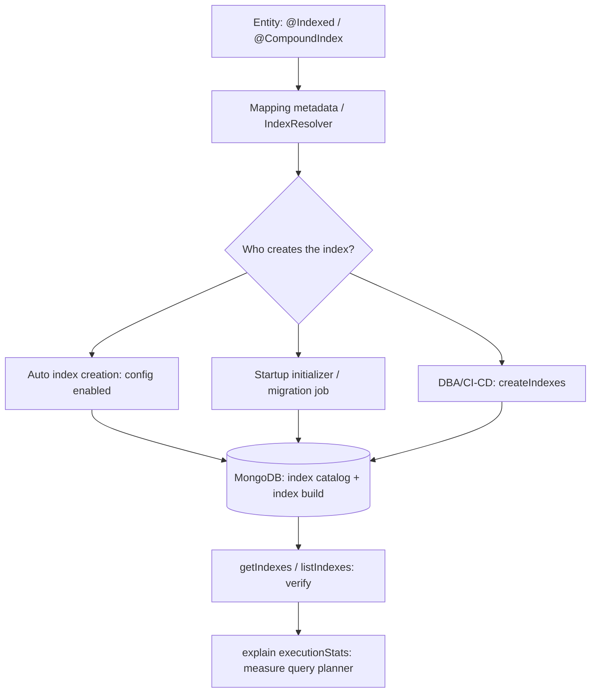
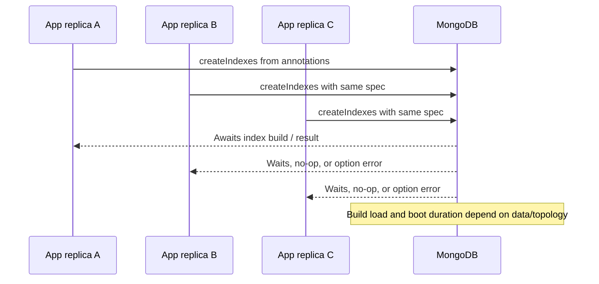
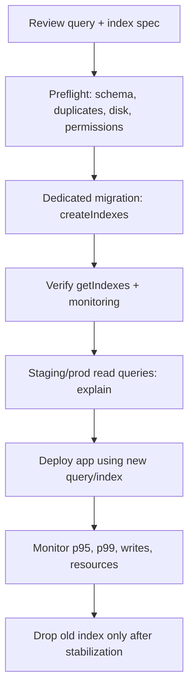

# Automatic Index Creation: Explicit Configuration and Deployment Control

In **Spring Data MongoDB**, annotations like `@Indexed` or `@CompoundIndex` let you declare **index design intent** right next to an entity. However, **declaring an annotation does not mean the index exists on MongoDB Server**. For an index to actually be created, the application must enable auto-index creation or run an explicit index creation step via `MongoTemplate`, `IndexOperations`, `mongosh`, or a migration tool.

This is an architectural decision, not merely a config flag. Building an index on a collection containing millions of documents consumes CPU, RAM, disk, and I/O, reducing write throughput; for a **unique index**, index builds can fail due to existing duplicate data. Letting every application instance alter indexes at startup can turn a rollout into an unplanned index-build storm.

This lesson belongs to the **Indexes** chapter of the **SPRING_DATA_MONGODB** module: using Spring Data MongoDB to connect, map documents, interact via `MongoTemplate`/repositories, and practice query design, aggregation, indexing, transactions, reactive access, testing, and performance diagnostics. The focus here is **explicitly configuring automatic index creation**, **choosing when during deployment to build indexes**, and **verifying physical indexes instead of trusting annotations alone**.

## 1. Distinguishing Declaring, Creating, and Using an Index

These three concerns are independent:

1. **Declaring**: Java entities or migration specs describe the desired index: fields, sort directions, unique, TTL, partial filter, collation, and name.
2. **Creating**: an authorized actor issues MongoDB's `createIndexes` command; the server builds the index and manages commit quorum across the topology.
3. **Using**: MongoDB's query planner considers the index during query execution; having an index does not mean the planner always picks it.



An annotation cannot resolve duplicate data, grant database-user privileges, or decide the right rollout window. Conversely, an index created by a DBA works **even if the entity has no `@Indexed` annotations at all**.

| What you see in code | What you can conclude | What you cannot conclude yet |
| --- | --- | --- |
| `@Indexed` on a property | Code declares index intent | Server already has the index |
| `auto-index-creation=true` | Framework is permitted to create metadata indexes | Every required index built successfully |
| `IndexOperations.createIndex(...)` succeeds | That create/ensure command was processed | Queries will actually use that index |
| `db.collection.getIndexes()` shows expected spec | Index exists in the inspected collection's catalog | Which query plan is optimal |
| `explain("executionStats")` on a real query | How that query executes on that data and configuration | Every workload gets the same performance |

## 2. Default Since Spring Data MongoDB 3.0: Auto-Index Is Off

Per Spring Data MongoDB documentation, since **3.0** automatic index creation for `@Document` entities is **disabled by default**. To use it, you must **enable it explicitly**.

Reason: Spring Data cannot fully control **collection lifecycles and performance impacts**. Auto-index runs when the framework registers initial entities at startup and upon first access to an entity type at runtime, rather than acting as a continuous migration engine reconciling all indexes on every release.

Consequences:

- Annotations present with **auto-index off** and **no migration** → expected indexes may **not exist**.
- Auto-index enabled in dev/test → framework attempts to create indexes when entity mappings are initialized.
- A collection is **dropped and recreated while the app is running** → auto-index is not guaranteed to re-run and recreate missing indexes.
- Adding/editing annotations during a rollout → if auto-index is on, every booting instance can send index creation commands.
- Upgrading from older Spring Data versions to 3.x+ → revisit your index policy rather than relying on the old default.

**Short takeaway:** annotations express **desired definitions**; production index creation requires a **clear owner and explicit deployment step**.

## 3. Sample Entity: Declaring Compound Indexes by Access Pattern

Suppose the `orders` collection stores multi-tenant data. Two common queries are:

1. Look up one order by `tenantId + orderKey`, where **each tenant must not have duplicate `orderKey` values**.
2. List orders by `tenantId + status`, sorted by `createdAt` descending.

Entity:

```java
import java.time.Instant;
import org.bson.types.ObjectId;
import org.springframework.data.annotation.Id;
import org.springframework.data.mongodb.core.index.CompoundIndex;
import org.springframework.data.mongodb.core.mapping.Document;
import org.springframework.data.mongodb.core.mapping.Field;

@Document(collection = "orders")
@CompoundIndex(
    name = "ux_orders_tenant_order_key",
    def = "{'tenant_id': 1, 'order_key': 1}",
    unique = true
)
@CompoundIndex(
    name = "ix_orders_tenant_status_created",
    def = "{'tenant_id': 1, 'status': 1, 'created_at': -1}"
)
public class OrderRecord {
    @Id
    private ObjectId id;

    @Field("tenant_id")
    private String tenantId;

    @Field("order_key")
    private String orderKey;

    private String status;

    @Field("created_at")
    private Instant createdAt;

    public OrderRecord() {}

    public OrderRecord(
            ObjectId id, String tenantId, String orderKey,
            String status, Instant createdAt) {
        this.id = id;
        this.tenantId = tenantId;
        this.orderKey = orderKey;
        this.status = status;
        this.createdAt = createdAt;
    }

    public ObjectId getId() { return id; }
    public String getTenantId() { return tenantId; }
    public String getOrderKey() { return orderKey; }
    public String getStatus() { return status; }
    public Instant getCreatedAt() { return createdAt; }
}
```

Both annotations use **BSON field names** inside `def`. Because the entity maps `@Field("tenant_id")`, `@Field("order_key")`, and `@Field("created_at")`, always inspect the **actual index keys generated by the resolver** and `getIndexes()`, especially when combining Java names with custom field-naming strategies.

Expected corresponding indexes:

```javascript
db.orders.createIndex(
  { tenant_id: 1, order_key: 1 },
  {
    name: "ux_orders_tenant_order_key",
    unique: true
  }
);

db.orders.createIndex(
  { tenant_id: 1, status: 1, created_at: -1 },
  { name: "ix_orders_tenant_status_created" }
);
```

`unique` on the first compound index enforces **no duplicate tenant–orderKey pairs**, without preventing different tenants from both using `orderKey="ORD-001"`.

**Do not add indexes simply because a field appears on the entity.** Every index should serve a concrete query, invariant, or TTL/geospatial requirement.

## 4. Single-Field `@Indexed` and Related Annotations

When a single field needs an index, declare:

```java
import org.springframework.data.mongodb.core.index.Indexed;
import org.springframework.data.mongodb.core.mapping.Document;

@Document("session_tokens")
class SessionToken {
    @Indexed(name = "ux_session_token_hash", unique = true)
    String tokenHash;

    @Indexed(name = "ix_session_expires_at", expireAfter = "0s")
    java.time.Instant expiresAt;
}
```

This illustrates a **separate collection**: `tokenHash` is checked for collection-wide uniqueness; `expiresAt` uses TTL with an absolute expiration timestamp. Never store raw secret tokens in indexes; apply cryptographic hashing and sound security policies.

Common index annotations and metadata:

| Annotation/option | Purpose | Risk when auto-created in production |
| --- | --- | --- |
| `@Indexed` | Single-field index; `unique`, `partialFilter`, TTL, collation per API | Option/index mismatch with legacy index, unique conflicts |
| `@CompoundIndex` | Multi-field index in a specific key order | Wrong field order, index fails to match query |
| `@TextIndexed` | MongoDB text search index | Text index/collation or language mismatches |
| `@GeoSpatialIndexed` | Geospatial index | Invalid coordinates or GeoJSON |
| `@WildcardIndexed` | Wildcard index for dynamic fields | Larger storage and write overhead |
| `@Indexed(expireAfter="0s")` | TTL based on Date field value | Deletes data later; not a harmless cache hint |

Be careful with annotations on **embedded objects**. Index names may be prefixed by the parent document property path; `IndexResolver` needs proper mapping context to generate specs. Dynamic map-like properties are generally skipped by the resolver unless a wildcard index is explicitly declared.

**Annotation attributes can evolve across versions.** In recent Spring Data MongoDB releases, `@Indexed(expireAfter="...")` is preferred; `expireAfterSeconds` was deprecated in 4.4. Likewise, the old `background` flag no longer controls index builds on modern MongoDB.

## 5. Enabling Auto-Index in Spring Boot

In Spring Boot with Spring Data MongoDB auto-configuration and supported properties:

```yaml
spring:
  data:
    mongodb:
      auto-index-creation: true
```

This is an **opt-in setting**. Enabling it in profiles for local development or integration tests can be convenient when test databases are fresh and small.

Example profile split:

```yaml
# application-dev.yml
spring:
  data:
    mongodb:
      auto-index-creation: true
```

```yaml
# application-prod.yml
spring:
  data:
    mongodb:
      auto-index-creation: false
```

However, **never copy this profile pattern blindly**: both staging and production must follow your organization's deployment policy. `false` does not create indexes elsewhere; without migrations, production will miss required indexes.

Notes:

- `spring.data.mongodb.auto-index-creation` is documented across Spring Boot 3.x and 4.x. Some MongoDB connection properties changed across Boot generations; always check the **exact Boot version** you run.
- When apps define custom `AbstractMongoClientConfiguration`, `MongoMappingContext`, or custom `MongoTemplate`/`MongoDatabaseFactory` beans, verify whether the YAML property actually governs the **active mapping context**.
- A YAML file setting `true` still leaves auto-index disabled if that profile isn't active or is overridden by environment variables.
- If multiple `MongoTemplate`/database factories exist, clarify the index policy for each context.

**Inspect the effective runtime configuration**, rather than assuming from a YAML file in the repository.

## 6. Enabling Auto-Index via Java Configuration

When extending `AbstractMongoClientConfiguration`, you can override:

```java
import org.springframework.context.annotation.Configuration;
import org.springframework.data.mongodb.config.AbstractMongoClientConfiguration;

@Configuration
public class MongoConfig extends AbstractMongoClientConfiguration {

    @Override
    protected String getDatabaseName() {
        return "orders_dev";
    }

    @Override
    public boolean autoIndexCreation() {
        return true;
    }

    // Other required MongoClient configuration methods
    // depend on your current Spring Data/configuration version.
}
```

This **illustrates the override**; never introduce a manual Mongo configuration class while expecting Spring Boot's auto-configuration to behave identically as before. When replacing the base config, verify active beans, entity scanning, converters, and `MongoDatabaseFactory`.

Enabling `autoIndexCreation()` only turns on auto-index—it does not guarantee indexes exist before any other component queries the database. If the system requires "indexes ready before serving traffic", use an explicit pre-deployment migration and readiness gates.

## 7. Why Should Auto-Index Not Be Enabled Recklessly in Production?

In production, apps typically run multiple replicas against populated collections under heavy write traffic.

When a release adds a new index and rolls out simultaneously:



If an index with the exact same spec already exists, the server treats it as a no-op. **Yet that is no reason to let every replica own index migrations.** When the index is new, building consumes heavy resources, waits on commit quorum, or fails on duplicate data. New replicas may stall during startup or crash on boot depending on initialization and exception handling.

Operational risks to manage:

- CPU, I/O, disk, and memory consumption during index builds across millions of documents.
- Write throughput degradation while building under heavy write load.
- Unique constraints take effect only once the index build commits; duplicates can still arrive mid-build.
- Timeouts, node failures, commit quorum blocks, disk exhaustion, or index option conflicts.
- Granting broad `createIndex` permissions to runtime application database users.
- Lack of review for the proper sequence: **create new index first → deploy code using it → drop old index later**.

**Production recommendation:** run an isolated **index migration / DBA job** with dedicated scheduling, permissions, logging, and verification; run application instances with least privilege and intentional auto-index configuration.

## 8. Choosing Between Auto-Index, Initializer, and External Migrations

| Approach | When appropriate | Limitations |
| --- | --- | --- |
| Annotation-driven auto-index | Dev/test, small apps accepting startup side effects | Coupled to entity lifecycle; hard to coordinate large builds |
| `ContextRefreshedEvent` + `IndexResolver` | Startup initializer controlling which entities/indexes to build | Fires after context refresh, not guaranteed before all DB access |
| Explicit `IndexOperations.createIndex(...)` | Java initializer or migration job with clear ordering/observability | Requires code for progress, error handling, and permissions |
| `mongosh`/driver `createIndex(s)` in deployment pipeline | Production schema migrations, large/unique indexes, separate permissions/runbooks | Must prevent drift against entity annotations |
| DBA-managed changes | Organizations with strict DB governance | Requires versioned specs, handoffs, and rollout checks |

No single pattern fits every team. What matters is that **each environment follows one consistent policy**, and owners know **when, by whom, and on which database** new indexes are built.

## 9. `IndexResolver`: Converting Annotations Into Index Definitions

Spring Data provides `IndexResolver` to inspect metadata such as `@Indexed`, `@CompoundIndex`, `@TextIndexed`, `@GeoSpatialIndexed`, and `@WildcardIndexed`.

Example using `MongoPersistentEntityIndexResolver`:

```java
import org.springframework.data.mongodb.core.MongoTemplate;
import org.springframework.data.mongodb.core.index.IndexResolver;
import org.springframework.data.mongodb.core.index.MongoPersistentEntityIndexResolver;

IndexResolver resolver = new MongoPersistentEntityIndexResolver(
    mongoTemplate.getConverter().getMappingContext()
);

var definitions = resolver.resolveIndexFor(OrderRecord.class);
```

`definitions` holds the `IndexDefinition` instances derived from annotations on `OrderRecord` and related embedded types. This is **metadata resolution only**; it has not called MongoDB to build anything yet.

To create them, invoke `IndexOperations` from **the same `MongoTemplate` and entity type**:

```java
import org.springframework.data.mongodb.core.index.IndexDefinition;
import org.springframework.data.mongodb.core.index.IndexOperations;

IndexOperations indexOps = mongoTemplate.indexOps(OrderRecord.class);

for (IndexDefinition definition : definitions) {
    indexOps.createIndex(definition); // Spring Data MongoDB 4.5+
}
```

**Version distinction:**

- On Spring Data MongoDB **4.5+**, `IndexOperations.createIndex(IndexDefinition)` is the recommended API.
- On Spring Data MongoDB **older than 4.5** (such as 3.x/4.4 projects), use `indexOps.ensureIndex(definition)`.
- `ensureIndex` was **deprecated for removal in 4.5**, so avoid presenting it as the sole option for new code.

`createIndex` ensures a matching index exists if missing; it **does not automatically fix drift** when an existing same-named index has different options. Handle conflicts with explicit migrations.

## 10. Initializing Indexes After `ContextRefreshedEvent`

Spring Data suggests `ContextRefreshedEvent` as an appropriate hook for `IndexResolver` because mapping and application contexts are fully initialized:

```java
import org.springframework.context.event.ContextRefreshedEvent;
import org.springframework.context.event.EventListener;
import org.springframework.data.mongodb.core.MongoTemplate;
import org.springframework.data.mongodb.core.index.IndexDefinition;
import org.springframework.data.mongodb.core.index.IndexOperations;
import org.springframework.data.mongodb.core.index.IndexResolver;
import org.springframework.data.mongodb.core.index.MongoPersistentEntityIndexResolver;
import org.springframework.stereotype.Component;

@Component
public class OrderIndexInitializer {
    private final MongoTemplate template;

    public OrderIndexInitializer(MongoTemplate template) {
        this.template = template;
    }

    @EventListener(ContextRefreshedEvent.class)
    public void createIndexes() {
        IndexResolver resolver =
            new MongoPersistentEntityIndexResolver(
                template.getConverter().getMappingContext()
            );

        IndexOperations ops = template.indexOps(OrderRecord.class);

        for (IndexDefinition definition :
                resolver.resolveIndexFor(OrderRecord.class)) {
            ops.createIndex(definition);
        }
    }
}
```

This example targets Spring Data MongoDB **4.5+**. On older versions, substitute `ensureIndex`. It illustrates an **explicit initializer for a specific entity**, not a complete migration framework.

**Two operational warnings:**

1. `ContextRefreshedEvent` ensures the Spring context is refreshed, **not that no other bean or thread has touched MongoDB yet**. If indexes are prerequisites for traffic, use pre-deployment migrations or readiness gates.
2. If every replica registers this listener, every replica submits index creation commands. In production, gate it behind a profile/flag or run it inside **a single dedicated deployment job**.

If scanning all mapped entities, iterate `mappingContext.getPersistentEntities()` and **filter for classes annotated with `@Document`**. Still, avoid blindly creating every index without reviewing storage, permission, and build impact.

## 11. Programmatic Indexes Independent of Annotations

When you prefer not to let annotations drive production schema changes, create indexes directly in Java.

```java
import org.springframework.data.domain.Sort;
import org.springframework.data.mongodb.core.MongoTemplate;
import org.springframework.data.mongodb.core.index.Index;

public class OrdersIndexMigration {
    private final MongoTemplate template;

    public OrdersIndexMigration(MongoTemplate template) {
        this.template = template;
    }

    public String createTenantOrderKey() {
        Index key = new Index()
            .on("tenantId", Sort.Direction.ASC)
            .on("orderKey", Sort.Direction.ASC)
            .unique()
            .named("ux_orders_tenant_order_key");

        return template.indexOps(OrderRecord.class).createIndex(key);
    }
}
```

Because `indexOps(OrderRecord.class)` uses the entity's converter/mapping context, property names `tenantId` and `orderKey` map to BSON keys `tenant_id` and `order_key`. Verify via `getIndexes()` since custom converters or naming strategies can change output.

**Never call this method on every request.** This is schema/index management, suited for controlled migrations or initialization steps.

In large systems, a versioned migration can track **expected specs**, **migration code**, **deployment timestamp**, and **results/rollback plans**, offering clearer auditability than annotations alone.

## 12. Creating Indexes via `mongosh` in a Deployment Job

Execute these commands against the **verified target database**:

```javascript
// 1. Before creating, inspect current indexes.
db.orders.getIndexes();

// 2. Create compound unique index for the business key.
db.orders.createIndex(
  { tenant_id: 1, order_key: 1 },
  {
    name: "ux_orders_tenant_order_key",
    unique: true
  }
);

// 3. Create index serving list/sort.
db.orders.createIndex(
  { tenant_id: 1, status: 1, created_at: -1 },
  { name: "ix_orders_tenant_status_created" }
);

// 4. Verify again.
db.orders.getIndexes();
```

Operations matching an existing spec usually avoid rebuilding. However, if the **same name exists with different keys/options**, the server throws a conflict error instead of "silently updating" the index. Changing unique/partial/collation or key patterns requires a dedicated migration.

You can also invoke the `createIndexes` command to submit multiple specs and tune `writeConcern` or `commitQuorum` for your topology:

```javascript
db.runCommand({
  createIndexes: "orders",
  indexes: [
    {
      key: { tenant_id: 1, status: 1, created_at: -1 },
      name: "ix_orders_tenant_status_created"
    }
  ],
  comment: "schema-change-2026-orders-index"
});
```

`comment` aids tracing commands where supported. Quorum and write concern settings must follow operational policy; **never lower quorum arbitrarily just to finish builds faster** without understanding replica set safety implications.

## 13. Duplicate Data: Mandatory Preflight Before Creating Unique Indexes

If `orders` already contains duplicate `(tenant_id,order_key)` pairs, creating the unique index will **fail**.

Preflight duplicate check query:

```javascript
db.orders.aggregate([
  {
    $group: {
      _id: {
        tenant: "$tenant_id",
        orderKey: "$order_key"
      },
      duplicates: { $sum: 1 },
      oneId: { $first: "$_id" }
    }
  },
  { $match: { duplicates: { $gt: 1 } } },
  { $sort: { duplicates: -1 } },
  { $limit: 20 }
]);
```

Also inspect missing/null business keys:

```javascript
db.orders.find({
  $or: [
    { tenant_id: null },
    { order_key: null }
  ]
}).limit(20);
```

In MongoDB, `field: null` also matches **missing fields**. Compound unique indexes follow null/missing key rules, so **multiple documents in the same tenant lacking `order_key` will collide**.

Remediation steps:

1. Count duplicates and inventory null/missing cases.
2. Decide which keys are valid and define a repair policy; never blindly "keep the first record" without understanding order references and payments.
3. Prevent active writers from introducing new duplicates (validation and write logic), especially while the index is building.
4. Clean data with an auditable script.
5. Create the unique index and confirm the build committed.
6. Re-run duplicate checks and verify duplicate inserts fail in testing.

**A unique index is not an automatic deduplication tool.** Never rely on legacy `dropDups` flags; modern MongoDB does not auto-delete colliding documents during unique index creation.

## 14. Index Builds Carry Operational Cost

Modern MongoDB uses an optimized index-build process: taking short exclusive collection locks at the start and end while permitting concurrent reads and writes for most of the build. However, "does not lock the entire database for the whole build" **does not mean zero impact on the application**.

Factors to monitor:

- Document count and BSON volume scanned to build the index.
- RAM, temporary disk spill files, CPU, and node I/O.
- Concurrent write rate; inserts/updates must also update in-progress index builds.
- Replica set / sharded cluster: builds across data-bearing members and commit quorum before completion.
- Free disk capacity and disk pressure alerts, especially near thresholds.
- Wait times if a voting member is unavailable.
- Concurrent index builds; running several builds simultaneously can severely degrade throughput.

```javascript
// Observe current operations, read-only:
db.currentOp();

// Check server version parameters:
db.version();
db.adminCommand({ buildInfo: 1 }).version;
```

In MongoDB 4.2+ with optimized builds, the legacy `background` option on `createIndexes` no longer changes build mechanics and is ignored by the server. Never teach `background:true` as a magic shield against production impact.

**Plan capacity and maintenance windows** for large indexes. Split index migrations by collection and priority instead of forcing one deployment to build all new indexes at once.

## 15. A Safe Rollout Plan: Expand, Verify, Switch, Contract

For multi-instance systems, follow:



### Before Deployment

- Review key queries, filters/sorts, cardinality, and query planner behavior.
- Snapshot `getIndexes()`/`listIndexes`, document count, and existing index sizes.
- Preflight unique duplicates, null/missing states, collation, and sharding constraints.
- Confirm backups, rollback plans, and migration-user privileges.
- Schedule the window, bound concurrency, and watch server load.

### During Deployment

- Run **one** index creation job—do not let all app replicas run migrations concurrently.
- Wait for the build to commit completely, not just for command submission.
- Compare the resulting index catalog against target specs.
- Once indexes are ready, deploy new application code or open traffic via readiness gates.
- If the build fails, hold the old app version or roll back per runbook.

### After Deployment

- Measure query latency and `explain("executionStats")`.
- Monitor insert/update latency and index storage growth.
- Watch for unexpected duplicate-key errors after a unique index activates.
- Drop obsolete indexes only in a separate follow-up change once no older code or batch query depends on them.

**Expand first, contract later** prevents running code without needed indexes or dropping indexes still in active use.

## 16. Detecting Drift: Index Exists with Wrong Spec

`db.orders.getIndexes()` inspects name, keys, unique, partial filter, collation, TTL, and other index options.

```javascript
db.orders.getIndexes().forEach(ix => {
  printjson({
    name: ix.name,
    key: ix.key,
    unique: ix.unique,
    expireAfterSeconds: ix.expireAfterSeconds,
    partialFilterExpression: ix.partialFilterExpression,
    collation: ix.collation,
    hidden: ix.hidden
  });
});
```

Index drift can manifest as:

- Same name, missing fields in the compound key.
- Right keys, `unique` not enabled.
- Different TTL duration.
- Wrong `partialFilterExpression`.
- Different collation altering string comparisons and planner eligibility.
- Index dropped by another operation.
- Index created in a **different database** or collection under a similar name.

`createIndex`/`ensureIndex` **cannot auto-heal drift**. When options or keys differ, the server reports `IndexOptionsConflict`/`IndexKeySpecsConflict` and requires an explicit replacement plan.

**Never auto-run `dropIndex` just to clear conflicts.** Dropping can trigger query regressions, disable uniqueness enforcement, or leave gaps while rebuilding. Require explicit review and a rollback plan.

## 17. Specialized Indexes: TTL, Partial, Sparse, and Collation

### TTL

With `@Indexed(expireAfter="0s")` on `expiresAt`, a TTL index uses a Date field to mark when documents become eligible for deletion. MongoDB's background TTL monitor **does not promise deletion at the exact expiration millisecond**.

```javascript
db.session_tokens.createIndex(
  { expires_at: 1 },
  { name: "ix_sessions_expires_at", expireAfterSeconds: 0 }
);
```

In Java, if `expiresAt` lacks `@Field("expires_at")` and uses property name `expiresAt`, the physical BSON key differs. Keep mappings consistent! For the section 4 sample, `expiresAt` had no `@Field`; therefore the `expires_at` shell snippet applies only if you **add `@Field("expires_at")`** or configure a matching field-naming strategy. Never mix two schemas silently.

**TTL directly mutates data**, not just query speed. Mistakenly placing `expireAfterSeconds=0` on orders subject to retention requirements can cause scheduled data loss.

### Partial and Sparse

Partial indexes index only documents matching `partialFilterExpression`, saving cost when targeting an intentional subset. Unique partial indexes enforce uniqueness only across **documents matching the filter**.

```javascript
db.orders.createIndex(
  { tenant_id: 1, order_key: 1 },
  {
    name: "ux_active_orders_tenant_key",
    unique: true,
    partialFilterExpression: { status: "ACTIVE" }
  }
);
```

This is an **alternative** to an unfiltered unique index: never keep both on the same collection without clarifying domain rules, as an unfiltered unique index will still reject duplicates outside `ACTIVE`.

`@Indexed` and `@CompoundIndex` support `partialFilter`, but cannot combine `sparse=true` and `partialFilter` on the same annotation: the API forbids it. If a query omits predicates implying the partial filter, the planner may ignore the index.

### Collation

Collated indexes compare uppercase, lowercase, and diacritics by linguistic rules. A collated unique index can treat `"Abc"` and `"abc"` as duplicates in one setup and distinct in another.

When queries need that index, query collation must match. Never add a collated index assuming all derived repository methods inherit its collation automatically.

## 18. Sharding, Unique Constraints, and Tenant Scope

On sharded collections, unique index rules depend on the **shard key**, index type, and server version. Never assume an arbitrary compound unique index is valid cluster-wide.

For example, when sharding by `tenant_id`, `{tenant_id:1,order_key:1}` fits far better than `{order_key:1}` alone, though you must still verify sharding rules (shard-key prefixing, hashed shard keys, server version).

Verify:

- Does the index spec match the shard key and sharding type (range/hashed)?
- Do all shards hold identical indexes after the build?
- Could duplicates span multiple shards?
- Are commit quorum/locks and build progress monitored on the target deployment?
- Should uniqueness be **per-tenant** or **global**?

Never deploy `@Indexed(unique=true)` on `orderKey` assuming it enforces proper per-tenant constraints on a sharded cluster. Key, index, and shard designs must be reviewed together.

## 19. Collections Dropped and Recreated at Runtime

A notable limitation of auto-index: Spring Data creates indexes for entities registered at startup or first access, **without continuously watching collection lifecycles**.

Suppose:

```javascript
db.orders.drop();
db.createCollection("orders");
db.orders.getIndexes(); // May show only _id_.
```

The running app still holds its previously initialized mapping context. **Never assume annotated indexes immediately recreate themselves.** Subsequent repository reads/writes run on an unindexed collection.

Mitigations:

1. Restrict production `drop` privileges; separate drop rights from the runtime app user.
2. In tests that drop collections, re-run **schema/index initialization** or create a fresh test database per run.
3. If an application workflow genuinely recreates a collection, run explicit index initialization afterward before opening traffic to it.
4. Schedule periodic or pipeline index-drift checks rather than checking only at startup.

In production, an unintended collection drop is a **recovery incident**, not a reason to turn on auto-index expecting automatic self-healing.

## 20. `IndexOperations.getIndexInfo` and Verifying from Spring

Beyond `mongosh`, Java code can inspect the index catalog:

```java
import java.util.List;
import org.springframework.data.mongodb.core.MongoTemplate;
import org.springframework.data.mongodb.core.index.IndexInfo;

List<IndexInfo> infos =
    mongoTemplate.indexOps(OrderRecord.class).getIndexInfo();

for (IndexInfo info : infos) {
    System.out.println(info.getName());
}
```

To inspect options independently, read native `listIndexes`:

```java
import java.util.ArrayList;
import org.bson.Document;

List<Document> raw = mongoTemplate.getCollection("orders")
    .listIndexes(Document.class)
    .into(new ArrayList<>());

for (Document index : raw) {
    System.out.println(index.toJson());
}
```

`listIndexes` is a **read-only inspection**; never turn this into an automated production auto-repair loop. When comparing actual vs. desired indexes, check **keys + options**, not just a matching name.

**Never log connection credentials or sensitive raw records.** Index metadata typically holds no record data, though collection and index names can still be operational metadata worth protecting.

## 21. `explain`: Having an Index Still Requires Proving Queries Use It

Example query listing orders by tenant/status sorted newest-first:

```javascript
db.orders.find({
  tenant_id: "T1",
  status: "PAID"
})
.sort({ created_at: -1 })
.limit(30)
.explain("executionStats");
```

With index:

```javascript
{ tenant_id: 1, status: 1, created_at: -1 }
```

The query planner **can** use the index for equality filtering and sort order, yet you must measure:

- `IXSCAN` or `COLLSCAN`?
- Is there a memory-heavy `SORT` stage?
- `totalKeysExamined` and `totalDocsExamined` vs. `nReturned`?
- Which index appears in `winningPlan`?
- Real p95/p99 latency on large datasets under realistic concurrency?
- Write latency, disk, and cache impact after adding the index?

A successful index build does not guarantee **every query** or dataset improves. MongoDB's query planner weighs selectivity, cost, and server version; indexes also tax the write path.

Running `explain` in production should follow operational rules to avoid triggering heavy queries. For index migrations, test first on representative staging data and observe production post-rollout.

## 22. Do Not Treat Hidden Indexes as a Universal Undo Button

MongoDB supports **hidden indexes** in compatible versions to evaluate planner behavior when an index is hidden from consideration:

```javascript
// Illustrative command: run only with an approved plan.
db.orders.hideIndex("ix_orders_tenant_status_created");

// Restore planner visibility:
db.orders.unhideIndex("ix_orders_tenant_status_created");
```

A hidden index **is still maintained on writes and still consumes storage**. If unique, it **still enforces uniqueness**, so `hideIndex` cannot "temporarily disable" a unique constraint.

Hidden indexes are useful before dropping a read-serving index, yet **do not replace a rollback plan** for unique, TTL, partial/collated, or shard-dependent changes.

## 23. Account Privileges and Isolating Migrations

Production runtime application accounts rarely need permissions to create or drop indexes. Separate roles:

| Role | Primary Privileges | Example Operations |
| --- | --- | --- |
| Runtime application | Read/write on needed collections | Repository CRUD, MongoTemplate queries/updates |
| Index migration job | `createIndex`/`listIndexes` on specific collections | Controlled changeset execution |
| DBA/operator | Build monitoring, emergency intervention, schema ops | `currentOp`, index build diagnostics |
| CI/staging test | Create indexes on isolated test databases | Automated integration tests |

Exact required privileges depend on topology, existing collections, and operations. Operations like `$out` or drops/renames need broader rights; never grant everything to runtime apps just for convenience.

**In production, disable auto-index when runtime accounts lack create-index rights and migrations own schema changes.** Enabling auto-index without privileges causes startup or first-access exceptions; never silently swallow those errors and pretend indexes are ready.

## 24. Integration Testing: From Annotations to Physical Indexes

A worthwhile test inspects the **MongoDB index catalog**, not merely entity annotations. Example using Spring Boot's test slice against real MongoDB (e.g., Testcontainers):

```java
import static org.assertj.core.api.Assertions.assertThat;

import java.time.Instant;
import java.util.ArrayList;
import org.bson.Document;
import org.bson.types.ObjectId;
import org.junit.jupiter.api.Test;
import org.springframework.beans.factory.annotation.Autowired;
import org.springframework.boot.test.autoconfigure.data.mongo.DataMongoTest;
import org.springframework.data.mongodb.core.MongoTemplate;
import org.springframework.data.mongodb.core.index.IndexDefinition;
import org.springframework.data.mongodb.core.index.IndexOperations;
import org.springframework.data.mongodb.core.index.IndexResolver;
import org.springframework.data.mongodb.core.index.MongoPersistentEntityIndexResolver;

@DataMongoTest(properties =
    "spring.data.mongodb.auto-index-creation=false")
class OrderIndexMetadataIntegrationTest {
    @Autowired MongoTemplate template;

    @Test
    void explicitlyCreatesAnnotatedIndexesAndChecksRawSpec() {
        // Isolated test MongoDB ONLY; never run against prod.
        template.insert(new OrderRecord(
            new ObjectId(), "test-T1", "ORD-001",
            "NEW", Instant.now()
        ));

        IndexResolver resolver = new MongoPersistentEntityIndexResolver(
            template.getConverter().getMappingContext()
        );

        IndexOperations ops = template.indexOps(OrderRecord.class);
        for (IndexDefinition definition :
                resolver.resolveIndexFor(OrderRecord.class)) {
            ops.createIndex(definition); // Spring Data >= 4.5.
        }

        var indexes = template.getCollection("orders")
            .listIndexes(Document.class)
            .into(new ArrayList<>());

        assertThat(indexes).anySatisfy(index -> {
            assertThat(index.getString("name"))
                .isEqualTo("ux_orders_tenant_order_key");
            assertThat(index.getBoolean("unique")).isTrue();
            Document keys = index.get("key", Document.class);
            assertThat(keys).containsEntry("tenant_id", 1)
                            .containsEntry("order_key", 1);
        });

        assertThat(indexes).anySatisfy(index -> {
            assertThat(index.getString("name"))
                .isEqualTo("ix_orders_tenant_status_created");
            Document keys = index.get("key", Document.class);
            assertThat(keys).containsEntry("tenant_id", 1)
                            .containsEntry("status", 1)
                            .containsEntry("created_at", -1);
        });
    }
}
```

What this test proves:

- Annotations are resolved properly.
- `IndexOperations` actually submits index creation commands.
- BSON index keys and `unique` match the reviewed spec.
- Setting `auto-index-creation=false` does not block **explicit index creation**.

**Note:** in test setups with custom mapping/configuration beans, ensure `@DataMongoTest` properties reach the active context. The test assumes a compatible test MongoDB instance/database; never run on shared databases. For Spring Data earlier than 4.5, change `createIndex` to `ensureIndex` per your API.

## 25. Testing Unique Indexes with Duplicate Data and Build Failures

Another test should prove MongoDB Server rejects pre-existing duplicates when building a unique index:

```java
import static org.assertj.core.api.Assertions.assertThatThrownBy;

import org.bson.Document;
import org.bson.types.ObjectId;
import com.mongodb.MongoCommandException;
import com.mongodb.client.MongoCollection;

void verifyDuplicateDataBlocksIndexBuild(MongoTemplate template) {
    String collection = "orders_unique_test_" + new ObjectId().toHexString();
    MongoCollection<Document> raw = template.getCollection(collection);

    raw.insertOne(new Document("_id", new ObjectId())
        .append("tenant_id", "T1")
        .append("order_key", "ORD-DUP"));

    raw.insertOne(new Document("_id", new ObjectId())
        .append("tenant_id", "T1")
        .append("order_key", "ORD-DUP"));

    assertThatThrownBy(() -> raw.createIndex(
        new Document("tenant_id", 1).append("order_key", 1),
        new com.mongodb.client.model.IndexOptions()
            .name("ux_test_tenant_order_key")
            .unique(true)
    )).isInstanceOf(MongoCommandException.class);
}
```

This is an **integration test helper**, not a standalone `@Test` method. In JUnit 5, inject a test `MongoTemplate` and invoke it from a test targeting an isolated database. Drivers may raise different MongoDB exception subtypes depending on version/path; production tests should check **Mongo error code 11000 / duplicate key** or `MongoCommandException` rather than matching English message strings.

One test verifies "duplicate data blocks unique index build" on a test database. Clean up duplicates or create a clean test collection afterward, then confirm the unique index builds and blocks new duplicate inserts.

**Never intentionally insert duplicate test data into a production collection.**

## 26. Additional Configuration and Lifecycle Test Cases

Beyond creating annotated indexes, write tests for:

1. **Default off:** on a fresh database, boot context without enabling auto-index; verify annotations alone do not create indexes (ignoring the built-in `_id_` index).
2. **Opt-in:** on a fresh database with `auto-index-creation=true`, boot context and verify annotated indexes appear in `listIndexes`.
3. **IndexResolver:** resolver produces expected compound keys, names, unique, and TTL/partial options.
4. **Duplicate preflight:** two documents sharing tenant/orderKey cause unique index creation to fail.
5. **Index migration idempotency:** re-applying identical specs creates no duplicate indexes and loses no data.
6. **Index drift:** same name with differing specs/options triggers conflict error; **never auto-drop indexes** at startup.
7. **Collection recreated:** drop/recreate on a test database, observe indexes disappear, and run the initializer to restore them.
8. **TTL:** verify catalog `expireAfterSeconds`, without testing deletion "exactly after 1 second" due to async TTL monitor timing.
9. **Multi-tenant unique:** identical `orderKey` across T1/T2 succeeds; duplicate within T1 is rejected.
10. **Index usage:** run `explain` with real filters/sorts to inspect plans instead of guessing from index names.
11. **Release rollback:** older app version keeps running cleanly alongside the new index; drop old indexes only after code upgrades complete.
12. **Permissions:** runtime app user lacking `createIndex` works smoothly when migrations prepare indexes and auto-index is off.

Lifecycle and drop/recreate tests require **isolated test databases**. Sharing one database/collection across parallel tests creates order-dependent flakiness that is hard to diagnose.

## 27. Common Mistakes and Fixes

| Mistake | Consequence | Fix |
| --- | --- | --- |
| Seeing `@Indexed` and assuming index exists | Slow queries or missing uniqueness | Inspect `getIndexes`/`listIndexes` on the right DB |
| Forgetting default off since Spring Data 3.0 | Indexes missing after upgrade | Enable explicitly or run migrations |
| Enabling prod auto-index across all replicas | Unplanned index builds on boot | Dedicated migration job; apps do not manage schema |
| Treating `ensureIndex` as the current standard API | Deprecated for removal in 4.5 | Prefer `createIndex` on newer versions |
| Building unique index when duplicates exist | Index build fails | Preflight duplicates and clean data first |
| Thinking unique index auto-deduplicates | Severe data corruption risk | Never use `dropDups`; repair with audit trail |
| Changing keys/options on same-named index and re-running | Conflict error or drift | Versioned migrations and explicit replacement |
| Using Java field names in raw `mongosh` despite `@Field` | Index created on wrong field | Match `@Field`, raw BSON, and catalog |
| Setting `background:true` to avoid production impact | Ignored by modern servers | Monitor and schedule index builds properly |
| Assuming `ContextRefreshedEvent` precedes all DB access | Races with other beans/traffic | Migrate before traffic and guard readiness |
| Dropping/recreating collection at runtime | Annotated indexes do not auto-recover | Reinitialize explicitly or follow recovery runbook |
| Treating TTL as a harmless cache hint | MongoDB deletes documents | Review TTL/retention policies and test |
| Partial index missing matching predicates in queries | Planner skips the index | Align query filters and verify via explain |
| Using hidden index to pause unique constraint | Uniqueness stays enforced | Never use hidden to bypass unique checks |
| Runtime user lacks `createIndex` while auto-index is on | Boot or first-access failures | Separate migration rights from runtime CRUD |
| Adding indexes by gut feeling | Wasted storage and slow writes | Design from query shapes, explain, and prod metrics |

## 28. Self-Check Questions

**1.** Starting in which version did Spring Data MongoDB disable auto-index by default?  
**Answer:** starting in **3.0**.

**2.** `@CompoundIndex` is present, yet `getIndexes` lacks that index. Is this a contradiction?  
**Answer:** no. Annotations are metadata; auto-index may be off or creation hasn't run/failed.

**3.** How do you enable auto-index in Spring Boot?  
**Answer:** in Boot versions supporting the property, set `spring.data.mongodb.auto-index-creation=true`.

**4.** Which API replaces `IndexOperations.ensureIndex` starting in Spring Data 4.5?  
**Answer:** `IndexOperations.createIndex(IndexDefinition)`.

**5.** Does `ContextRefreshedEvent` guarantee indexes exist before any other bean touches MongoDB?  
**Answer:** no; the event fires after context refresh, by which time other components may have already accessed the database.

**6.** Why clean up duplicates before building a unique index?  
**Answer:** MongoDB validates existing and concurrent records; duplicates cause the build to fail.

**7.** Does compound unique `{tenant_id:1,order_key:1}` prevent T1 and T2 from sharing the same `orderKey`?  
**Answer:** no. It prevents duplicates only on the complete combined pair.

**8.** If an index is dropped while the app runs, does it recreate itself immediately?  
**Answer:** not guaranteed. You need an explicit migration, initializer, or recovery step.

**9.** If `createIndex` succeeds, does `find` definitely use the index?  
**Answer:** no; the query planner decides—verify with `explain("executionStats")`.

**10.** Does a hidden unique index still block duplicates?  
**Answer:** yes. Hidden indexes remain maintained on writes and still enforce uniqueness.

**11.** What else can a TTL index do besides optimizing queries?  
**Answer:** MongoDB deletes expired documents via its asynchronous TTL background process.

**12.** When deploying a new index across a multi-replica production service, what strategy is easiest to control?  
**Answer:** run a separate migration/index build before launching the app version that relies on it, verify catalog and plans, and drop obsolete indexes in a later release.

## 29. Practice Lab and Official References

**Practice Lab:** on an isolated development/test MongoDB, create `OrderRecord` with both `@CompoundIndex` annotations as shown. Start with `auto-index-creation=false`; insert a document without running any initializer and observe `getIndexes`. Next, run `IndexResolver` with `IndexOperations` to create indexes and verify BSON keys/`unique` in `listIndexes`. Retry with `auto-index-creation=true` on a fresh database. Insert two orders with identical tenant/orderKey to confirm unique-index rejection, and confirm T1/T2 with the same orderKey succeeds. Finally, measure the tenant/status/createdAt list query using `explain("executionStats")`, inspect write throughput impact, and practice dropping/recreating the collection **in the test database**.

**Official References:**

- [Spring Data MongoDB — Index Creation](https://docs.spring.io/spring-data/mongodb/reference/mongodb/mapping/mapping-index-management.html).
- [Spring Data MongoDB — IndexOperations API](https://docs.spring.io/spring-data/mongodb/reference/api/java/org/springframework/data/mongodb/core/index/IndexOperations.html).
- [Spring Data MongoDB — Indexed annotation](https://docs.spring.io/spring-data/mongodb/reference/api/java/org/springframework/data/mongodb/core/index/Indexed.html).
- [Spring Data MongoDB — CompoundIndex annotation](https://docs.spring.io/spring-data/mongodb/reference/api/java/org/springframework/data/mongodb/core/index/CompoundIndex.html).
- [Spring Boot — Application properties](https://docs.spring.io/spring-boot/appendix/application-properties/).
- [MongoDB — Index Builds on Populated Collections](https://www.mongodb.com/docs/manual/core/index-creation/).
- [MongoDB — Create an Index](https://www.mongodb.com/docs/manual/core/indexes/create-index/).
- [MongoDB — createIndexes command](https://www.mongodb.com/docs/manual/reference/command/createindexes/).

**Conclusion:** in Spring Data MongoDB, **index annotations do not mean indexes are automatically created**. Auto-index has been **disabled by default since 3.0**; you can opt in explicitly or use `IndexResolver` and `IndexOperations` for controlled creation. For production, a **separately planned migration** offers far better control than startup auto-index: preflight duplicates/schemas, build indexes once, verify raw catalogs, measure `explain`, then roll out application code and remove obsolete indexes once stable. For unique, TTL, partial/collated, or sharded indexes, treat index changes as **schema and data-behavior changes**, not merely query speedups.
