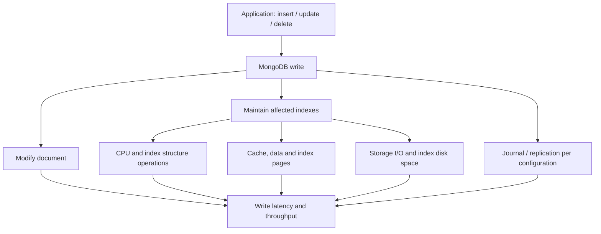
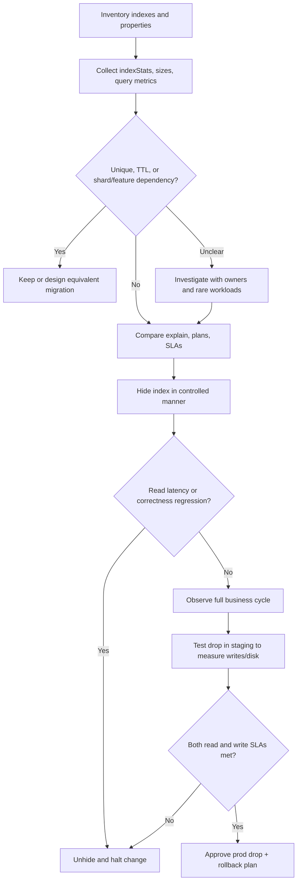

# Evaluating Write Cost, Storage Size, and Unused Indexes

## 1. The Problem: Indexes Speed Up Reads, But Are Never Free

An order service originally had only 4 indexes. After several query-tuning iterations, the team added indexes for status, update timestamp, SKU, event ID, and several field combinations. Reads on several screens sped up, yet order write throughput dropped, storage size grew, cache efficiency worsened, and index maintenance took longer. A few indexes appeared unused by any query.

Asking "which indexes are unused?" is necessary, but insufficient. You must answer simultaneously:

1. **Read benefit:** Which query shapes, sorts, uniqueness rules, TTL policies, or invariants does the index support?
2. **Write cost:** How many extra index structures must inserts, updates, and deletes maintain?
3. **Resource cost:** How much disk storage, cache memory, and I/O is the index consuming?
4. **Usage signal:** Is an index rarely chosen during an observation window genuinely redundant?
5. **Removal risk:** If you hide or drop the index, will rare workloads, scheduled jobs, or data invariants break?
6. **Proof:** How do you compare before and after on identical workloads with a rollback path?

This lesson belongs to the **Indexes** chapter in the **SPRING_DATA_MONGODB** module. The module scope covers using Spring Data MongoDB to connect and map documents, interact via `MongoTemplate` or repositories, and design queries, aggregations, indexes, transactions, reactive access, tests, and data performance diagnostics. Here the focus is **evaluating index cost versus value**, rather than index creation syntax alone.

After this lesson, you can:

- Explain **write amplification** and pressure on cache and index maintenance.
- Interpret `db.collection.stats()`, `getIndexes()`, `$indexStats`, and `explain("executionStats")` accurately.
- Distinguish **not used by the query planner** from **having no business function**.
- Build an index evaluation table based on queries, size, write cost, and risk.
- Use **hidden indexes** to test removal from the query planner, while understanding they **still consume write maintenance and storage**.
- Design a safe index-reduction workflow with measurement, approval, observation windows, and rollback.
- Test Spring Data MongoDB index management, including `@Indexed`, `@CompoundIndex`, `IndexOperations`, and post-deploy index re-creation risks.

> Details on admin features, permissions, query planner behavior, resource accounting, and feature availability depend on MongoDB server, topology, FCV, and Spring Data/driver versions. Index-modification examples are **impactful administrative operations**: never execute them in production without an approved plan.

## 2. Running Example: An `orders` Collection with Many Indexes

### 2.1. BSON Structure

```javascript
{
  _id: "ord-101",
  tenantId: "tenant-a",
  externalKey: "partner-evt-001",
  status: "READY_TO_SHIP",
  customerId: "customer-17",
  items: [
    { sku_code: "BOOK-A", quantity: 2 },
    { sku_code: "BOOK-B", quantity: 1 }
  ],
  amount_vnd: NumberLong("350000"),
  createdAt: ISODate("2026-11-10T08:00:00Z"),
  updatedAt: ISODate("2026-11-20T03:00:00Z"),
  expiresAt: ISODate("2027-02-20T03:00:00Z")
}
```

This is an **example document**, not an instruction to seed production data. Common operations in the system include:

| Workload | Filter / Behavior | Assumed Frequency |
| --- | --- | --- |
| View order by ID | `{_id, tenantId}` | Very high |
| Shipping queue | `{tenantId, status}` sorted `createdAt DESC, _id DESC` | High |
| Partner event ingestion | Upsert by `{tenantId, externalKey}` | High |
| Look up customer orders | `{tenantId, customerId}` | Medium |
| Find orders containing SKU | `{"items.sku_code": ...}` with tenant | Low |
| Monthly report | Range filter on `createdAt` and status | Scheduled |
| Quarter-end reconciliation | Query on specialized fields | Very rare yet critical |
| Status/`updatedAt` updates | Document updates | High |
| Expired data cleanup | TTL on `expiresAt` if policy allows | Automatic |

Frequencies in this table are illustrative only. Before dropping any real index, gather actual metrics across **peak traffic**, month-end, quarter-end, and infrequent jobs.

### 2.2. Hypothetical Index Set

```javascript
// Commands below illustrate the design;
// execute only in controlled practice environments.
db.orders.createIndex(
  { tenantId: 1, externalKey: 1 },
  { unique: true, name: "uk_orders_tenant_external" }
);

db.orders.createIndex(
  { tenantId: 1, status: 1, createdAt: -1, _id: -1 },
  { name: "ix_orders_tenant_status_recent" }
);

db.orders.createIndex(
  { tenantId: 1, customerId: 1 },
  { name: "ix_orders_tenant_customer" }
);

db.orders.createIndex(
  { tenantId: 1, status: 1 },
  { name: "ix_orders_tenant_status" }
);

db.orders.createIndex(
  { "items.sku_code": 1, tenantId: 1 },
  { name: "ix_orders_item_sku_tenant" }
);

db.orders.createIndex(
  { updatedAt: 1 },
  { name: "ix_orders_updated_at" }
);
```

The collection also has the default `_id_` index in standard collections. A TTL index on `expiresAt` might exist if documents are genuinely meant to expire automatically. **Never add TTL to orders subject to legal retention requirements**: confirm data retention policies first.

`ix_orders_tenant_status` appears to overlap the prefix of `ix_orders_tenant_status_recent`, and `ix_orders_updated_at` may see little use. However, **you cannot drop an index merely by inspecting names or shared prefixes**.

## 3. What Do MongoDB Indexes Consume?

With the standard WiredTiger storage engine, indexes maintain ordered lookup structures alongside collection data.



Costs span multiple dimensions:

| Resource | Why Indexes Affect It |
| --- | --- |
| CPU | Key lookup, tree maintenance, collation comparisons, and computing new keys |
| RAM/cache | Index pages compete for cache space with data and other indexes |
| Disk | Indexes occupy separate storage (often compressed); wide/multikey indexes grow larger |
| Disk I/O | Page reads/writes, checkpoints/flushes, and evictions; impact depends on working set |
| Write latency | Writes pay index maintenance alongside document mutation |
| Write throughput | When CPU/I/O/cache bottlenecks, extra indexes lower writes per second |
| Replication | Secondaries also apply mutations and maintain corresponding indexes |
| Operations | Index builds, backups, restores, migrations, and deployments take longer |

There is no fixed formula like "every index slows writes by X%". Impact depends on key size, workload, mutated fields, cache hit ratio, key distribution, unique/multikey/partial options, and hardware.

## 4. Write Amplification: Insert, Update, Delete

### 4.1. Insert

When inserting a new document, MongoDB inserts keys into every matching index. If there are 8 indexes besides `_id_` and the document qualifies for all 8, inserts maintain multiple index structures. Yet total keys and cost **do not equal a simple index count**:

- A multikey index on an array may insert multiple keys.
- A partial index inserts keys only when the document matches the filter.
- A sparse index follows field-presence rules.
- Complex key types or collations vary in comparison cost.
- Compression, key locality, cache state, and key distribution govern real I/O.

### 4.2. Update

An update changing `status` from NEW to PAID must maintain indexes whose keys or membership are affected—for instance, indexes containing `status`. Updating only `updatedAt` incurs maintenance on `ix_orders_updated_at`.

```javascript
db.orders.updateOne(
  {
    _id: "ord-101",
    tenantId: "tenant-a",
    status: "READY_TO_SHIP"
  },
  {
    $set: {
      status: "SHIPPED",
      updatedAt: new Date()
    }
  }
);
```

An index omitting the modified field does not mean zero overhead (document resizing, cache/transaction overhead still apply), yet **unchanged index keys generally avoid direct key updates** compared to indexes containing the mutated field.

### 4.3. Delete

Deleting a document removes its entries from every index containing it. Bulk deletions generate heavy load on both data and indexes. A TTL index **actively drives deletions** of expired documents per policy, so it must never be labeled "unused" just because application read queries ignore it.

### 4.4. Upserts and Bulk Writes

Upserts have an **insert branch** and an **update branch**. Index cost differs dramatically between the two; measure separately. With `bulkWrite(...)`, batching reduces network round-trip overhead, but **does not skip index maintenance**. Whenever batched writes modify indexed fields, index maintenance still runs.

## 5. When Do Indexes Grow Disproportionately Large?

### 5.1. Wide Indexes and Compound Keys

A compound index:

```javascript
{ tenantId: 1, status: 1, createdAt: -1, _id: -1 }
```

can be larger than a narrower index `{tenantId: 1, status: 1}`. Still, actual size is not simply the sum of field byte lengths times document count: WiredTiger applies prefix compression, page layouts, and metadata. **Measure it** rather than estimating purely from schema.

### 5.2. Multikey Indexes on Arrays

```javascript
db.orders.createIndex(
  { "items.sku_code": 1, tenantId: 1 },
  { name: "ix_orders_item_sku_tenant" }
);
```

Because `items.sku_code` resides inside an array, this is a **multikey index** in this data model. A document with many SKUs generates multiple index keys; MongoDB applies per-document key deduplication and multikey rules, so **never assume index key count equals array length**.

For orders with hundreds of line items, creating and updating multikey indexes can be expensive. If writes frequently modify `items`, benchmark documents with long arrays separately.

### 5.3. Wildcard, Text, Geo, and Specialized Types

Wildcard, text, geospatial, hashed, and compound/multikey indexes have distinct structures and goals. Never judge them merely by "fewer keys is better" or a fixed size ratio. Specialized indexes answer queries that plain B-tree indexes cannot serve equivalently.

### 5.4. Data Skew and Long Keys

Long strings, large arrays, skewed distributions, and data growth affect both index size and cache locality. Testing on a few hundred test documents cannot predict behavior on multi-million-document collections.

## 6. Measuring Size: `db.collection.stats()` and Units

### 6.1. Gathering a Read-Only Snapshot

```javascript
const stats = db.orders.stats();

printjson({
  count: stats.count,
  size: stats.size,
  storageSize: stats.storageSize,
  totalIndexSize: stats.totalIndexSize,
  indexSizes: stats.indexSizes,
  nindexes: stats.nindexes
});
```

Important fields:

| Field | Practical Meaning |
| --- | --- |
| `count` | Reported document count in collection stats |
| `size` | Logical data size reported, not identical to bytes on disk |
| `storageSize` | Storage allocated by the storage engine for collection data |
| `totalIndexSize` | Reported total size across all indexes on the collection |
| `indexSizes` | Map of index name → reported index size |
| `nindexes` | Number of indexes on the collection |

Unscaled size values are typically reported in **bytes**. When passing `scale` to stats commands, verify returned units and `scaleFactor` before doing arithmetic. Reported fields vary across server/storage-engine versions, and metrics fluctuate under live workloads.

### 6.2. Converting Index Sizes to MiB for Reporting

```javascript
const s = db.orders.stats();
const toMiB = bytes => bytes / (1024 * 1024);

const rows = Object.entries(s.indexSizes || {})
  .map(([name, bytes]) => ({
    name,
    mib: Number(toMiB(bytes).toFixed(2))
  }))
  .sort((a, b) => b.mib - a.mib);

printjson(rows);
```

`Object.entries` here is `mongosh` JavaScript, not a MongoDB aggregation operator. Running stats tools in locked-down environments requires appropriate monitoring privileges.

### 6.3. Useful Ratios and Their Limits

```javascript
const s = db.orders.stats();

const indexToDataStorage =
  s.storageSize > 0
    ? s.totalIndexSize / s.storageSize
    : null;

printjson({ indexToDataStorage });
```

If the ratio equals `0.75`, you can say reported total index size equals **75% of collection data `storageSize`** at snapshot time. **Do not** say "indexes consume 75% of total MongoDB disk"—journals, oplogs, replicas, backups, and other files also occupy disk.

Tracking ratios over time helps, **provided you track absolute numbers too**: a shrinking ratio might simply mean data grew rapidly, not that indexes shrank.

### 6.4. `totalIndexSize` Is Not Active RAM Usage

An index may sit partially in cache and partially on disk. `totalIndexSize` does not mean "RAM currently occupied by indexes". Measuring RAM/cache pressure requires WiredTiger cache metrics, page faults/evictions, cache bytes, disk I/O, and application telemetry depending on deployment.

### 6.5. Tracking Growth

Collect the same metrics daily/weekly and before/after deployments to spot:

- Which index grows fastest.
- Growth rates relative to document count and array lengths.
- Sudden jumps caused by newly added indexes.
- Large indexes providing minimal query benefit.
- Temporary spikes during index builds or data migrations.

Index byte size alone never proves an index is redundant; it is **one cost dimension**.

## 7. Measuring Usage: `$indexStats`

### 7.1. Correct Syntax

```javascript
db.orders.aggregate([
  { $indexStats: {} }
]);
```

`$indexStats` returns access statistics per index. Typical output contains:

```javascript
{
  name: "ix_orders_tenant_status_recent",
  key: { tenantId: 1, status: 1, createdAt: -1, _id: -1 },
  host: "mongo-node.example:27017",
  accesses: {
    ops: NumberLong("12345"),
    since: ISODate("2026-11-01T00:00:00Z")
  },
  spec: {
    name: "ix_orders_tenant_status_recent",
    key: { tenantId: 1, status: 1, createdAt: -1, _id: -1 }
  }
}
```

This is **illustrative output, not live telemetry**. `accesses.ops` counts user-triggered operations that used the index per MongoDB's accounting rules—not documents returned, index keys scanned, write-maintenance operations, or QPS.

### 7.2. Key Fields

| Field | Interpretation |
| --- | --- |
| `name` | Index name |
| `key` | Index key pattern |
| `host` | `mongod` node reporting the statistics |
| `accesses.ops` | Operations using the index since `since` on this node |
| `accesses.since` | Timestamp when counting started |
| `spec` | Full index specification including options |
| `shard` | Shard name when present in sharded cluster output |

### 7.3. `$indexStats` Must Be the First Stage

```javascript
// VALID: $indexStats is first stage, followed by project/sort.
db.orders.aggregate([
  { $indexStats: {} },
  {
    $project: {
      _id: 0,
      host: 1,
      name: 1,
      ops: "$accesses.ops",
      since: "$accesses.since"
    }
  },
  { $sort: { ops: 1, name: 1 } }
]);
```

Never put `$match` before `$indexStats` trying to filter collection documents. `$indexStats` emits **index metadata**, not order documents. This stage **cannot run inside transactions**, and monitoring accounts require appropriate permissions.

### 7.4. Why `ops = 0` Is Never Enough

An index showing `accesses.ops = 0` could simply mean:

1. The workload runs only at month-end or quarter-end and hasn't fired yet.
2. Counters recently reset after a restart, drop/recreate, or index metadata change.
3. You inspected a primary or secondary that does not serve that query group.
4. Queries run on a different shard or node.
5. The index enforces a unique constraint or TTL rather than serving reads.
6. A rare query uses `hint` or runs via a scheduled pipeline.
7. The query optimizer preferred another index during that window, while this index remains optimal for specific data skews/parameters.
8. The index is **hidden** and ineligible for planner selection.

That is why "unused" must always account for **observation window**, **node**, **full workload**, and **data-integrity roles**.

### 7.5. Counter Resets and Measurement Scope

Per MongoDB's `$indexStats` behavior, keep these limits in mind:

- Counters reset when `mongod` restarts, an index is dropped and recreated, or certain `collMod` operations modify the index.
- Metrics are **per node/host**, not automatically aggregated across all replica set members or shards.
- Excludes certain internal operations such as TTL deletions, replication operations, and internal sharding activity.
- Never equate `ops` with total collection reads or writes.

If a TTL index shows `ops=0`, that **does not mean TTL isn't running**. To capture the full cluster picture, gather stats from every relevant node/shard based on read preferences and traffic routing.

### 7.6. Computing `ops` Deltas Between Observations

To measure usage rates, compare two snapshots matching `host + index name`:

```text
Snapshot A: ops=200, since=2026-11-01T00:00Z, 10:00Z
Snapshot B: ops=260, since=2026-11-01T00:00Z, 11:00Z

Delta ops = 260 - 200 = 60 operations/hour (in this example)
```

Subtract only when `since` matches and no reset occurred. If B has a newer `since`, reset your baseline. Across multiple hosts, never sum counters with differing `since` timestamps and treat them as cluster-wide QPS.

## 8. Combining `indexStats` and `indexSizes` Into a Candidate List

A read-only inventory script:

```javascript
const sizes = db.orders.stats().indexSizes;
const usage = db.orders.aggregate([
  { $indexStats: {} }
]).toArray();

const inventory = usage.map(x => ({
  host: x.host,
  name: x.name,
  accesses: x.accesses?.ops,
  since: x.accesses?.since,
  sizeMiB: sizes?.[x.name] == null
    ? null
    : Number((sizes[x.name] / (1024 * 1024)).toFixed(2)),
  unique: x.spec?.unique === true,
  expireAfterSeconds: x.spec?.expireAfterSeconds,
  partialFilterExpression: x.spec?.partialFilterExpression,
  hidden: x.spec?.hidden === true
}));

printjson(inventory);
```

This script suits **standalone instances or controlled single-node inspections**. In sharded/replica deployments, `indexSizes` and `$indexStats` may differ in node/aggregation scope; build a monitoring pipeline aligned on scope. Never divide a cluster-wide size figure by one node's counter to claim cluster-wide efficiency.

### 8.1. Hypothetical Evaluation Table

| Index | Simulated Size | Simulated Reads/Period | Role | Initial Classification |
| --- | ---: | ---: | --- | --- |
| `_id_` | 80 MiB | Very high | Identity | Keep |
| `uk_orders_tenant_external` | 115 MiB | Low | Prevent duplicate business key | Keep |
| `ix_orders_tenant_status_recent` | 165 MiB | Very high | Queue/sort | Keep and measure |
| `ix_orders_tenant_customer` | 95 MiB | Medium | Customer lookup | Measure further |
| `ix_orders_tenant_status` | 75 MiB | Low | Potential prefix overlap | Candidate to inspect |
| `ix_orders_item_sku_tenant` | 310 MiB | Low | SKU lookup | Candidate for deep review |
| `ix_orders_updated_at` | 90 MiB | 0 in window | Possibly legacy | Candidate for deep review |

**All MiB figures and frequencies above are simulated**, never for real operational decisions. "Candidate to inspect" **never means "safe to drop"**.

## 9. Query Planner: High `ops` Does Not Prove High Efficiency

An index can receive heavy traffic yet deliver poor efficiency—for example, a low-selectivity index forcing many documents to be read afterward.

### 9.1. Explain for a Query Shape

```javascript
db.orders.find({
  tenantId: "tenant-a",
  status: "READY_TO_SHIP"
})
  .sort({ createdAt: -1, _id: -1 })
  .limit(20)
  .explain("executionStats");
```

Inspect fields depending on server version:

| Field | Meaning |
| --- | --- |
| `winningPlan` / query plan | Index or collection scan and execution stages |
| `IXSCAN` | Index scan in the plan |
| `COLLSCAN` | Collection scan |
| `totalKeysExamined` | Number of index keys scanned |
| `totalDocsExamined` | Number of documents inspected |
| `nReturned` | Number of documents returned |
| SORT/blocking stage | Did the server sort outside the index? |
| `executionTimeMillis` | Explain execution time, not production p95/p99 |

`ix_orders_tenant_status_recent` serves both filter and sort, minimizing work. An index on `status` alone might inspect vast numbers of records before filtering tenant—so high `ops` does not prove efficiency.

### 9.2. `explain` Does Not Replace Production Metrics

One `explain("executionStats")` run with one parameter set does not represent the entire load distribution. It may also differ from production behavior and excludes Java network/mapping overhead.

Combine with:

- Slow query profiler/logs or sampled monitoring tools.
- p50/p95/p99 latency per **query shape**.
- Query frequency, examined keys/docs, and returned doc counts.
- Workloads across large vs. small tenants and common vs. rare statuses.
- Primary/secondary read routing and periodic batch jobs.

Never enable verbose full-traffic profiling in production without assessing performance impact, access permissions, and sensitive PII inside logs.

### 9.3. Hints in Controlled Experiments

```javascript
db.orders.find({
  tenantId: "tenant-a",
  status: "READY_TO_SHIP"
})
  .sort({ createdAt: -1, _id: -1 })
  .hint("ix_orders_tenant_status_recent")
  .limit(20)
  .explain("executionStats");
```

`hint(...)` tests a specific index plan, yet forces the planner's hand and can degrade performance if deployed broadly. Use it for **experiments**, never hardcoding hints in production code based on a single test.

Once an index is hidden, the query planner cannot use it, and hinting a hidden index is restricted/invalid; unhide in test or use a staging clone instead.

## 10. Redundant Indexes and Compound Prefixes

### 10.1. Two Indexes Sharing a Prefix

Suppose you have:

```javascript
// A
{ tenantId: 1, status: 1 }

// B
{ tenantId: 1, status: 1, createdAt: -1, _id: -1 }
```

Index B has prefix `tenantId, status` and **can** serve many equality queries that used A. However:

- B is larger, potentially increasing cache/I/O footprint compared to A.
- A might carry different options such as collation, partial, or unique.
- Certain query shapes may execute faster on A due to key density or data layout.
- Hints, query settings, or operational tools might reference A by name.
- Filter/sort/projection differences can shift planner selection.

Therefore, treat **A as a redundancy candidate**, not automatically useless. Compare execution plans and latency for dependent queries, then test hiding A if warranted.

### 10.2. Indexes Are Not Redundant Just Because They Share a Field

```javascript
{ tenantId: 1, status: 1 }
{ status: 1, createdAt: -1 }
```

These two indexes share `status` yet **have different key order and prefixes**. A status-only filter favors the second; a tenant+status filter favors the first. Never drop an index just because a field name appears in another index.

### 10.3. Unique and Partial Have Different Meanings

```javascript
// Enforces uniqueness across the entire collection for the key pair.
db.orders.createIndex(
  { tenantId: 1, externalKey: 1 },
  { unique: true, name: "uk_orders_tenant_external" }
);

// Illustrates indexing only specific tracked statuses.
db.orders.createIndex(
  { tenantId: 1, createdAt: -1 },
  {
    name: "ix_orders_active_recent",
    partialFilterExpression: {
      status: { $in: ["NEW", "READY_TO_SHIP"] }
    }
  }
);
```

A partial index saves space and maintenance over a full index when only a filtered subset matters. Yet queries wishing to use it must include compatible predicates so MongoDB does not omit records.

**Important:** supported `partialFilterExpression` syntax and operators depend on server version; verify the definition is accepted on your topology. Never assume a partial index automatically substitutes for a collection-wide unique index protecting global invariants.

## 11. Indexes That Serve Zero Reads Can Still Be Essential

### 11.1. Unique Indexes

```javascript
db.orders.createIndex(
  { tenantId: 1, externalKey: 1 },
  { unique: true, name: "uk_orders_tenant_external" }
);
```

Suppose all app queries look up orders by `_id`; `$indexStats` on the unique index reports `ops = 0`. That index still stops two concurrent upserts from inserting duplicate business keys. Dropping it strips a **uniqueness invariant** the service relies upon.

Never replace a unique index with "Java checks `exists` before insert", because concurrent requests easily race past the check.

### 11.2. TTL Indexes

```javascript
// Example strictly for collections whose data has an expiration policy.
db.event_archive.createIndex(
  { expiresAt: 1 },
  { expireAfterSeconds: 0, name: "ttl_event_archive" }
);
```

TTL indexes allow MongoDB to purge expired documents per policy. Internal TTL deletions **may not increment `accesses.ops`** like user queries. Dropping a TTL index leaves expired data **accumulating indefinitely**.

Never add TTL to `orders` merely because `expiresAt` exists if retention contracts forbid deletion. Evaluate purpose, cleanup SLA, and retention rules before modifying indexes.

### 11.3. Mandatory or Topology-Required Indexes

The built-in `_id_` index, unique constraints, shard-key/topology-required indexes, and feature-specific indexes must never be judged solely on read counts. Exact rules for indexes/shard keys vary across MongoDB versions; cross-check before changes.

### 11.4. Rare Queries with Strict SLAs

An index used solely by a year-end reconciliation batch can report `ops=0` for the first three months of monitoring. Dropping it could turn a 5-minute year-end batch into a multi-hour outage. Maintain an inventory of periodic jobs and owners rather than looking only at last week's metrics.

## 12. Hidden Indexes: Testing Planner Removal Before Dropping

### 12.1. Exact Semantics

**Hidden indexes** are excluded from query planner selection. They let you simulate "what happens if the planner lacks this index" without destroying the underlying index structure.

```javascript
// Admin commands: run only after approval.
db.orders.hideIndex("ix_orders_updated_at");

// Inspect definitions; hidden: true appears while hidden.
db.orders.getIndexes();

// Restore planner visibility.
db.orders.unhideIndex("ix_orders_updated_at");
```

Hidden index availability and FCV requirements depend on your MongoDB server version. Never run `hideIndex`/`unhideIndex` in production outside a monitored change window.

### 12.2. What Hidden Indexes Do **Not** Do

| Behavior | Visible index | Hidden index |
| --- | --- | --- |
| Eligible for query planner selection | Yes | **No** |
| Consumes disk storage | Yes | **Yes** |
| Maintained on writes | Yes | **Yes** |
| Unique constraint enforced | Yes if unique | **Yes if unique** |
| TTL behavior active | Yes if TTL | **Yes if TTL** |
| Can unhide quickly without rebuilding? | N/A | **Yes**, index structure remains intact |

Therefore, **hidden indexes test read impact**, not **write-amplification reduction or storage reclamation**.

### 12.3. Why Can Hiding Reset `$indexStats`?

Toggling hidden status via `collMod` can reset index access statistics. Never compare `ops` before and after hiding as a continuous counter if `accesses.since` changed. Save snapshots and establish a fresh baseline.

### 12.4. Before/After Hide Test Flow

```text
Baseline:
  Index visible
  → Query plans, p95 latency, CPU, docs examined

Experiment:
  Hide candidate index
  → Re-run dependent query shapes
  → Check new query plans + SLAs

If regression:
  Unhide immediately per runbook

If no regression:
  Observe across a full business cycle
  → Only then consider approved drop
```

For unique indexes or rare queries, run explicit synthetic/representative tests rather than watching dashboards for 30 minutes and declaring it safe.

## 13. Dropping an Index Is a Real Change, Not Harmless Cleanup

### 13.1. Consequences of Dropping

Dropping an index can:

- Free that index's storage space (exact storage metric updates/space reuse depend on the storage engine).
- Reduce write maintenance on subsequent mutations.
- Shift available query plans.
- Break unique/TTL constraints or feature capabilities.
- Degrade rare queries to worse indexes or `COLLSCAN`.
- Require a full index rebuild to roll back after removal.

Hence, **dropping is not instantly reversible like unhiding**.

### 13.2. Administrative Syntax—Never Run Casually

```javascript
// Impactful command example: requires approval and a runbook.
db.orders.dropIndex("ix_orders_updated_at");
```

Execute only after:

1. Confirming exact index name, collection, and database.
2. Auditing uniqueness, TTL, sharding, and feature dependencies.
3. Testing hidden mode across a sufficiently long workload cycle.
4. Saving the full index definition/spec to recreate if needed.
5. Establishing monitoring and rollback/recreate criteria.
6. Obtaining agreement from business owners.

### 13.3. Rollback After Dropping Is Not One-Click

If a query regresses after dropping, you must rebuild the index:

```javascript
// Illustrates a regular index; always use the exact saved spec.
db.orders.createIndex(
  { updatedAt: 1 },
  { name: "ix_orders_updated_at" }
);
```

Index builds on large collections consume CPU and I/O, cause contention, and require monitoring. If the dropped index was unique, duplicates may have entered in the meantime, causing the rebuild to fail. **That is why you never use `drop` as your first experiment**.

## 14. Write Performance Testing to Measure Real Gains

### 14.1. Separating Insert, Update, and Delete Workloads

Never lump everything into "1000 writes/second" when 95% are metadata updates and 5% are inserts.

A measurement matrix:

| Workload | Purpose | Indexes Most Likely Affected |
| --- | --- | --- |
| Insert new document | Key insertion cost | Almost all applicable indexes |
| Update `updatedAt` | Timestamp index maintenance | Indexes containing `updatedAt` |
| Update `status` | Compound index maintenance | `ix_orders_tenant_status_*` |
| Add/remove `items` | Multikey maintenance | `ix_orders_item_sku_tenant` |
| Bulk delete documents | Key removal cost | All indexes containing deleted docs |
| Upsert miss | New document + index keys | Similar to insert + lookup |
| Upsert hit | Field updates | Only indexes whose keys changed |

### 14.2. Baseline and Comparable Experiments

```text
Representative Staging Environment:

A. Current index set
   → warm-up
   → measure insert/update/delete p50/p95/p99, ops/s, CPU, I/O

B. Equivalent staging snapshot with candidate index DROPPED
   → identical warm-up as A
   → run same workload, data distribution, and clients
   → compare metrics

C. Restore baseline index if needed
   → re-measure to filter out environmental noise
```

**Note:** hiding in B does not substitute for dropping when measuring **write-cost savings**, because hidden indexes are still maintained. Test dropping only in staging or in production after formal risk sign-off.

### 14.3. Useful Metrics to Capture

| Metric | Explanation |
| --- | --- |
| `writes/s` or document updates/s | Actual write throughput |
| Write p50/p95/p99 latency | Percentile latency split by insert/update/delete |
| CPU utilization | Is index maintenance bottlenecking CPU? |
| Disk read/write IOPS and latency | Extra I/O from cache misses and page flushes |
| WiredTiger cache usage/evictions | Are indexes pushing the working set out of cache? |
| Replication lag | Can secondaries keep up with write load? |
| Index build/disk growth | Operational overhead outside individual requests |
| Read query p95/p99 post-change | Ensure reads do not regress unacceptably |
| Error rate / duplicate-key errors | Ensure business invariants remain intact |

### 14.4. Comparing with Consistent Units

**Simulated** example results:

| Metric | Before | After dropping one index in staging | Interpretation |
| --- | ---: | ---: | --- |
| Update `updatedAt` p95 | 26 ms | 19 ms | Experiment shows improvement for this workload |
| Insert p95 | 35 ms | 32 ms | Smaller improvement |
| Update throughput/s | 1,200 | 1,450 | Measure variance across repeated runs |
| Read query p95 | 42 ms | 115 ms | Regression **cannot be ignored** |
| Index storage | 920 MiB | 830 MiB | Savings per simulated figures |

Faster writes alone do not justify dropping an index: the read regression here could violate SLAs. Evaluate holistically across repeated trials; never treat simulated numbers as expected benchmarks for your project.

## 15. Evaluating Index ROI: Cost and Benefit Together

An index is justified when its value outweighs its maintenance cost **within SLA and business constraints**. Never reduce everything to a single arbitrary "index score" without contextual telemetry.

### 15.1. Questions for Each Candidate Index

```text
Index = ix_orders_tenant_status

Which queries need it?
  - Tenant/status queue queries?
  - Counts by status?
  - Scheduled reports?

Can another index replace it?
  - ix_orders_tenant_status_recent?
  - Is the alternative plan nearly as fast?

Costs:
  - Index MiB?
  - Which writes mutate its keys?
  - Cache pressure?

Constraints:
  - Unique/TTL/partial/collation?
  - Hints or query settings?

Decision:
  - Keep, tune, test-hide, or propose drop?
```

### 15.2. Impact Across Different Tenants

An index might dramatically speed up a huge tenant while making little difference for a small tenant. Testing only `tenant-a` with 20 orders can mislead you about a tenant with millions of orders. Test with realistic data skew.

### 15.3. Is the Query Slow Due to Missing Indexes or Pipeline Stages?

If an aggregation runs `$unwind`, `$group`, or `$sort` on computed fields, adding indexes on base fields may barely reduce downstream cost. Inspect pipeline execution plans; sometimes rewriting the query shape, projection, or read model beats adding indexes.

## 16. Spring Data MongoDB: Disciplined Index Management

Spring Data MongoDB supports index metadata on domain classes and programmatic index APIs.

### 16.1. Entity with `@CompoundIndex`

```java
package com.example.orders.persistence;

import java.time.Instant;
import org.springframework.data.mongodb.core.index.CompoundIndex;
import org.springframework.data.mongodb.core.mapping.Document;
import org.springframework.data.mongodb.core.mapping.FieldType;
import org.springframework.data.mongodb.core.mapping.MongoId;

@Document(collection = "orders")
@CompoundIndex(
    name = "ix_orders_tenant_status_recent",
    def = "{ 'tenantId': 1, 'status': 1, 'createdAt': -1, '_id': -1 }"
)
public record OrderDocument(
    @MongoId(FieldType.STRING) String id,
    String tenantId,
    String status,
    Instant createdAt,
    Instant updatedAt
) {}
```

`@CompoundIndex` declares the intended index on the entity. **It does not prove the index exists on MongoDB**: that depends on auto-index settings, collection lifecycle, and deployment workflows.

### 16.2. Auto-Index Creation Is Not Always On by Default

In modern Spring Data MongoDB releases, automatic index creation **is disabled by default** (explicit opt-in via config, changed since Spring Data MongoDB 3.0). When enabled, it creates declared indexes at framework initialization hooks.

For production, prefer a **controlled index-management/migration workflow** instead of letting every app replica create indexes on startup. Building indexes on large collections affects server load and requires elevated privileges.

An annotation left behind in code can cause the framework to **recreate an index** you just dropped in the database if index-management policies are out of sync. Keep your **source of truth** and release plans aligned.

### 16.3. `@Indexed`, `@CompoundIndex`, and Related Tools

| API / Annotation | Purpose |
| --- | --- |
| `@Indexed` | Single-field index on property, with type-specific options |
| `@CompoundIndex` | Defines compound indexes |
| `@TextIndexed` | Declares text index fields |
| `@WildcardIndexed` | Wildcard index for suitable models |
| `IndexOperations` | Manages, inspects, and ensures indexes via API |
| `IndexResolver` | Extracts index definitions from mapping metadata |

Do not treat annotations as the sole authority if migrations, Atlas UI, or external tooling manage indexes too; keep all sources synchronized so dropped indexes don't reappear or drift on options.

## 17. `IndexOperations`: Inspect, `ensureIndex`, and Differences from Stats

### 17.1. Listing Indexes via Spring Data

```java
import java.util.List;
import org.springframework.data.mongodb.core.MongoOperations;
import org.springframework.data.mongodb.core.index.IndexInfo;

public final class OrderIndexInspector {
    private final MongoOperations mongo;

    public OrderIndexInspector(MongoOperations mongo) {
        this.mongo = mongo;
    }

    public List<IndexInfo> configuredIndexes() {
        return mongo.indexOps(OrderDocument.class).getIndexInfo();
    }
}
```

`getIndexInfo()` shows indexes **actually configured on the collection** via Spring Data's API. However, it **is not** an API for `accesses.ops` or query p95 metrics. Usage analysis requires `$indexStats` and telemetry.

### 17.2. Defining an Index in Java

```java
import org.springframework.data.domain.Sort;
import org.springframework.data.mongodb.core.index.Index;

String name = mongo.indexOps(OrderDocument.class).ensureIndex(
    new Index()
        .on("tenantId", Sort.Direction.ASC)
        .on("status", Sort.Direction.ASC)
        .on("createdAt", Sort.Direction.DESC)
        .on("id", Sort.Direction.DESC)
        .named("ix_orders_tenant_status_recent")
);
```

Here `mongo` is an injected `MongoOperations` inside a dedicated index-management component. With entity mapping, Java `id` maps to BSON `_id`; verify the resulting physical key via `getIndexInfo()` or `db.orders.getIndexes()` on your runtime version.

**Never call `ensureIndex(...)` recklessly inside request handlers.** It is a schema/index operation belonging in migrations or controlled startup paths, avoiding multi-instance races and unexpected production load.

### 17.3. Checking Indexes with `mongosh`

```javascript
db.orders.getIndexes();
```

Cross-check `name`, `key`, and options like `unique`, `partialFilterExpression`, `collation`, `expireAfterSeconds`, and `hidden`. Two indexes with identical keys and different options serve different purposes.

### 17.4. Never Auto-Drop Indexes from Code When `ops=0`

In live production apps, repositories or custom adapters **must never call `dropIndex`** automatically upon seeing zero usage counters. Measurements and approvals belong in an operational process with accountable owners, access boundaries, and rollback plans.

## 18. Fetching `$indexStats` via the Driver in Admin Tooling

To feed index usage stats into an authorized monitoring job, you can invoke the MongoDB Java Driver:

```java
import java.util.ArrayList;
import java.util.List;
import org.bson.Document;
import com.mongodb.client.MongoCollection;

// mongoTemplate is the bean for the monitored database;
// run only inside authorized administrative tooling.
MongoCollection<Document> orders =
    mongoTemplate.getCollection("orders");

List<Document> usage = orders.aggregate(
    List.of(new Document("$indexStats", new Document()))
).into(new ArrayList<>());

for (Document row : usage) {
    Document accesses = row.get("accesses", Document.class);
    System.out.println(
        row.getString("name") + ": " +
        (accesses == null ? "n/a" : accesses.get("ops"))
    );
}
```

Never run this driver command on user-facing API requests. `$indexStats` has specific privilege/server rules, must be the **first stage**, and cannot run inside transactions. Monitoring jobs need dedicated roles and must record timestamp and host for accurate interpretation.

In the `SPRING_DATA_MONGODB` module, `MongoTemplate` is the right way to obtain a collection handle when driver-level APIs are genuinely needed—never spin up a new `MongoClient` per measurement. In reactive stacks, use compatible reactive driver/`ReactiveMongoOperations` publishers rather than blocking the event loop with synchronous driver calls.

## 19. Partial, Sparse, and Maintenance Cost Trade-Offs

### 19.1. Partial Indexes

If only 5% of orders are actively awaiting processing, a partial index indexes far fewer documents:

```javascript
db.orders.createIndex(
  { tenantId: 1, createdAt: -1 },
  {
    name: "ix_active_orders_by_tenant",
    partialFilterExpression: { status: "READY_TO_SHIP" }
  }
);
```

Trade-offs:

- Fewer index entries for documents outside the predicate.
- Queries must include compatible predicates for the planner to use the index safely.
- Updates transitioning status into or out of the partial filter still add/remove index keys.
- If status distribution shifts over time, index size and write cost shift accordingly.

### 19.2. Sparse Indexes

Sparse indexes store entries only for documents containing the indexed field per type-specific semantics. They are not equivalent to partial indexes in all scenarios—especially with `null`, compound keys, and query coverage. Never switch a regular index to sparse solely to shrink size without verifying queries won't miss documents.

### 19.3. TTL Indexes

TTL is a **retention** mechanism, not merely a query speedup. Although TTL adds storage and delete overhead, it bounds long-term collection growth. Weigh TTL delete load, run schedules, and legal rules rather than judging solely by `ops`.

### 19.4. When Optimization Backfires

Creating separate partial indexes per status can increase total overhead; every status transition removes a document from one index and inserts it into another. Never assume "partial" is always cheaper than one shared compound index—measure the actual workload.

## 20. Production Workflow: Evaluate Before Dropping an Index

Safe decisions follow a structured workflow with evidence and clear ownership.



### 20.1. Step 1: Identify Owners and Build an Inventory

For each index, record:

| Inventory Field | Example |
| --- | --- |
| Database/collection | `commerce.orders` |
| Name/key/options | `ix_orders_updated_at` / `{updatedAt:1}` |
| Size | Measurement with timestamp and node |
| Access operations | `ops`, `since`, `host` |
| Query owners | Order management API, reconciliation batch, dashboard |
| Business invariants | unique, TTL, retention, tenant |
| Status | Keep / Investigate / Hidden test / Propose drop |
| Rollback plan | Unhide or recreate from saved spec |

### 20.2. Step 2: Use a Sufficient Observation Window

One week suffices only if workloads strictly repeat weekly. For monthly, quarterly, or holiday jobs, extend observation or test proactively. After restarts, check `accesses.since`. In replica sets, inspect whichever nodes actually serve read traffic.

### 20.3. Step 3: Test Read Degradation via Hidden Index

Monitor queries that might rely on the index: p95/p99 latency, query plans, docs examined, CPU, I/O, error rates, and rare workloads. Keep an instant unhide rollback ready.

### 20.4. Step 4: Measure Write Savings in Staging After Dropping

Hiding an index never reduces write maintenance. To measure **actual write-overhead reduction**, benchmark an equivalent staging environment with the index physically dropped under identical workloads.

### 20.5. Step 5: Roll Out and Verify

Before deploying, reconcile all sources of truth: annotations, Spring auto-index, migration scripts, Terraform/Atlas configs, and permissions. Monitor across multiple cycles afterward, ready to roll back if query load or consistency behaves unexpectedly.

## 21. Replica Sets, Sharding, and Read Preferences

### 21.1. Nodes Serve Different Workloads

The primary handles writes and possibly reads; secondaries may serve dedicated read workloads depending on read preference. `$indexStats` is per-node, so `ops=0` on the primary does not mean secondaries aren't using the index. Map read preferences and actual traffic per node.

### 21.2. Indexes on Sharded Collections

Sharded clusters can exhibit uneven data and query distribution. Collect stats per shard/node rather than letting one counter represent the cluster. Certain unique indexes depend on shard-key constraints or collection settings; **never alter them without checking** server version, shard key, routing, and migration tooling.

### 21.3. Secondary Lag

Writes replicate to secondary members, which must also maintain all indexes. Redundant indexes add work when secondaries apply oplog entries. Still, replication lag is also driven by network, disk, CPU, transactions, oplog sizing, and other operations—diagnose holistically instead of blaming indexes alone.

### 21.4. Indexes Serving Less-Monitored Nodes

A rare reporting batch hitting a secondary may rely on an index completely invisible on primary-only dashboards. That is why node-wide and full-cycle inventorying is mandatory.

## 22. Functional Testing and Benchmarking with Spring Data

### 22.1. Verifying Required Indexes Physically Exist

JUnit 5 skeleton:

```java
import static org.junit.jupiter.api.Assertions.*;
import java.util.List;
import org.junit.jupiter.api.Test;
import org.springframework.data.mongodb.core.MongoOperations;
import org.springframework.data.mongodb.core.index.IndexInfo;

class IndexContractIntegrationTest {
    MongoOperations mongo; // Injected from MongoDB test context.

    @Test
    void uniqueIndexMustExist() {
        List<IndexInfo> info =
            mongo.indexOps(OrderDocument.class).getIndexInfo();

        assertTrue(info.stream().anyMatch(
            index -> index.getName()
                .equals("uk_orders_tenant_external")
                && index.isUnique()
        ));
    }
}
```

This **test skeleton** requires a wired test context, index/migration fixtures, and injection. It does not pass simply because `@CompoundIndex` appears in code; it verifies metadata **actually exists** in test MongoDB.

### 22.2. Testing Uniqueness Under Concurrency

Seed a test collection with unique `{tenantId:1,externalKey:1}`, then run two concurrent workers inserting/upserting the same key. Assert zero duplicate logical records exist and verify the application handles duplicate-key/retry logic cleanly. Never trust a single sequential run to prove race safety.

### 22.3. Benchmarks Are Not Unit Tests

Benchmarking CPU, index cache, write throughput, and p99 latency requires:

1. Topology and MongoDB version close to production.
2. Dataset matching production scale and key/array distributions.
3. Multi-client concurrency, warm-up, and multiple repeated runs to control noise.
4. Comparing index sets in isolated environments or resetting to clean baselines.
5. Never running destructive/concurrent benchmarks against production.

Integration tests prove **functional correctness**; benchmarks measure **performance under the tested workload**, not universal guarantees.

### 22.4. Read Stats via Spring Data or `mongosh`?

For operational diagnostics like `$indexStats`, `collStats`, `explain`, MongoDB Atlas dashboards, and server metrics, dedicated monitoring tooling is usually far better than embedding operational analytics inside business repositories.

Application code should own tests for index invariants and query correctness. Drop decisions should unite DBA/SRE and business owners.

## 23. Common Diagnostic Scenarios

| Symptom | Likely Cause | Appropriate Action |
| --- | --- | --- |
| Writes slow down after deploying a new index | Higher key maintenance and cache/I/O load | Compare workload/index stats/disk metrics before and after |
| Total index size approaches data size | Too many, overly wide, or multikey indexes | Inventory `indexSizes` and query shapes |
| `$indexStats.ops=0` | Query hasn't run, counter reset, or ran on another node | Check `since`/`host` and full job schedules |
| Index `ops=0`, yet blocks duplicates | Unique index works on the write path | Do not drop without replacing the invariant |
| Index `ops=0`, yet old records vanish | TTL deletions do not count as user queries | Do not drop TTL if cleanup policy needs it |
| Hiding did not speed up writes | Hidden indexes are still maintained on writes | Measure write savings by dropping in staging |
| Hiding caused read p99 to spike | Planner lost an optimal index path | Unhide immediately and inspect query shapes |
| Two indexes share a prefix | Potential partial overlap | Compare plans, sizes, and latency; never drop hastily |
| Added index, yet `explain` still shows COLLSCAN | Filter, sort, collation, or selectivity mismatch | Inspect `winningPlan` and query shape |
| Previously "unused" index fires at month-end | Observation window missed periodic job | Document scheduled jobs and SLAs |
| Dropped index reappears after deploy | Auto-index or migration recreated it | Synchronize sources of truth |
| Unique index build fails | Duplicate keys already exist | Audit and resolve duplicates per business rules first |
| Index size differs from RAM usage | Storage size vs. cache usage are distinct metrics | Check WiredTiger cache metrics |
| Secondary lag shifts after drop | Replica and workload dynamics | Measure lag, I/O, CPU, version, and snapshots |
| Large tenant is slow, small tenant is fast | Data skew / index selectivity | Benchmark across skewed tenants/parameters |
| Sort reports high memory usage | Index does not satisfy sort or pipeline reshaped docs | Tune query, index, or pipeline |
| Dropping index causes COLLSCAN | Dependent query went unrecorded | Recreate or roll back per runbook |
| Storage size didn't shrink as expected | Compression, block reuse, or stats scope | Inspect storage engine metrics properly |
| Permission denied on `$indexStats` | Monitoring role lacks permissions | Use an authorized account instead of elevating runtime app |

### 23.1. Short Diagnostic Flow

```text
1. Identify which writes slowed down and the deployment timestamp.
                     ↓
2. Check getIndexes(), stats().indexSizes, totalIndexSize.
                     ↓
3. Inspect $indexStats with host/since across all relevant nodes.
                     ↓
4. Map every index → query shapes + unique/TTL constraints.
                     ↓
5. Explain dependent queries and verify SLAs.
                     ↓
6. Test hiding in an approved environment.
                     ↓
7. Measure drop in staging for write and storage savings.
                     ↓
8. Propose keeping or dropping with evidence and rollback.
```

## 24. Practice Exercises with Solutions

### Exercise 1 — Must an Unqueried Index Still Be Kept?

**Prompt:** Index `{tenantId:1,externalKey:1}` has `unique:true` and `accesses.ops=0` for an entire week. Should it be dropped?

**Solution:** You cannot conclude that. A unique index prevents concurrent inserts/upserts from creating duplicate business keys. Read counts do not reflect write-side constraints. Before proposing any change, confirm business invariants and equivalent enforcement; normally, required unique indexes must stay.

### Exercise 2 — Distinguishing `indexSizes` and Memory

**Prompt:** `stats().totalIndexSize` is 800 MiB. Does that mean indexes occupy 800 MiB of RAM?

**Solution:** No. That reports index storage size, not the volume of index pages currently resident in WiredTiger cache. Evaluating cache pressure requires cache usage/evictions and I/O metrics.

### Exercise 3 — Computing Index-to-Data Storage Ratio

**Prompt:** `totalIndexSize=600 MiB`, `storageSize=900 MiB`. What is the ratio and how should it be interpreted?

**Solution:** `600/900≈0.667`, meaning reported index size equals roughly **66.7%** of collection data storage size within the same snapshot/scope. Never describe it as 66.7% of "total MongoDB disk", since other files exist.

### Exercise 4 — Why Did Hiding Not Improve Writes?

**Prompt:** A team hid `ix_orders_updated_at`, yet p95 timestamp update latency barely changed. Is something wrong?

**Solution:** Not necessarily. Hiding excludes an index only from the query planner—it **still receives key maintenance on writes** and consumes disk/cache. To measure write-cost reductions, compare index sets by **dropping in staging**, not hiding.

### Exercise 5 — Two Indexes Sharing a Prefix

**Prompt:** You have A = `{tenantId:1,status:1}` and B = `{tenantId:1,status:1,createdAt:-1,_id:-1}`. Is A definitely redundant?

**Solution:** Not necessarily. B can serve many queries that used A, yet A is smaller or may carry distinct options/plans. Check keys/options, usage across all nodes/cycles, explain/latency, and test hiding A with rollback ready.

### Exercise 6 — Reading `$indexStats` After a Restart

**Prompt:** On Monday an index showed `ops=10,000`; on Tuesday it showed `ops=2`, while `since` changed from Sunday to Tuesday morning. Did query traffic drop 99.98%?

**Solution:** No. The counter reset or started a new window. Never compare cumulative counters with different `since` timestamps; establish a new baseline and measure deltas within matching windows on the same host.

### Exercise 7 — TTL Showing `ops=0`

**Prompt:** A TTL index on `event_archive` shows `accesses.ops=0`. Can you drop it to save disk?

**Solution:** Not if retention policy still requires expiring old data. TTL deletions are internal operations omitted from user-query `ops` counts. Dropping it disables TTL expiration, letting data pile up.

### Exercise 8 — Why Are Multikey Indexes Expensive?

**Prompt:** Documents have an `items` array with hundreds of SKUs and an index on `items.sku_code`. What happens as elements grow?

**Solution:** The multikey index must maintain keys corresponding to array values. Maintenance cost and size grow with array length and distribution, though not strictly one key per element due to deduplication/compound rules. Measure representative inserts/updates with long arrays and track index size.

### Exercise 9 — Measuring Write p95 After Removing an Index

**Prompt:** You need to verify whether removing the `updatedAt` index speeds up timestamp updates. The team only tested hiding the index. Is that enough?

**Solution:** No. Hiding does not eliminate write maintenance. Benchmark in staging with identical datasets, client concurrency, and workloads comparing index set A against set B with the index truly dropped; compare p95/p99, throughput, CPU, I/O, and ensure read SLAs remain met.

### Exercise 10 — Managing Indexes via Spring Data

**Prompt:** The team dropped an index in the database while leaving `@CompoundIndex` and `auto-index` enabled in the app. What can happen on startup or deploy?

**Solution:** The framework or migration can recreate the index per config. Synchronize annotations, migration sources of truth, and release plans; verify real server indexes with `getIndexInfo()`/`getIndexes()`. Never confuse annotation metadata with usage metrics.

### Exercise 11 — Heavily Used Index, Still Slow Queries

**Prompt:** `$indexStats` shows very high `ops` for the status index, yet queue queries suffer high p99 latency. What should you inspect?

**Solution:** Check `explain("executionStats")` and profiler/metrics per query shape: selectivity, keys/docs examined, blocking sorts, tenant scoping, pagination, cache state, and sort/collation alignment. High index usage counts do not prove efficient plans.

### Exercise 12 — Safe Index Removal Workflow

**Prompt:** An index shows `ops ≈ 0` and takes 400 MiB. Outline the steps before dropping it in production.

**Solution:** Inventory keys/options/owners; check unique, TTL, and topology dependencies; collect usage across all nodes and cycles including rare batches; review query plans and metrics; test hiding with rollback; benchmark write/disk savings via drop in staging; review SLAs/permissions; schedule approved prod window; archive spec for recreation; monitor post-drop. `ops≈0` and `400 MiB` are only starting signals for investigation.

## 25. Checklist Before Deciding to Keep or Drop an Index

| Review Question | Required Evidence |
| --- | --- |
| What is the index name, key pattern, and options? | `getIndexes()` / `IndexInfo` |
| Does it enforce a unique constraint? | `spec.unique` and business invariant |
| Does it enforce TTL or retention? | `expireAfterSeconds` and owner |
| Is it tied to shard keys or topology? | Metadata and server version check |
| On which nodes and over what window was usage measured? | `host`, `since`, `ops` |
| Did counters reset between snapshots? | Compare `since` |
| Was read traffic checked on secondaries/shards? | Metrics across all relevant nodes |
| Were rare/period-end batches accounted for? | Workload inventory and job schedules |
| How much disk space does the index consume? | `indexSizes` / `totalIndexSize` |
| Does it measurably add cache pressure? | Cache/evictions/I/O metrics |
| Are indexed fields updated heavily? | Categorized write workload |
| Is it multikey, partial, sparse, or compound? | Index spec and BSON samples |
| Can another index substitute for it? | Query shapes, explain, SLAs |
| Does a prefix-overlapping index have different options? | Full spec comparison, not keys alone |
| Was hiding tested first? | Before/after read metrics, unhide rollback |
| Do you know hiding still costs writes/disk? | Separate staging drop benchmark |
| Do you have p50/p95/p99 and throughput baselines? | Repeated A/B measurements |
| Are error rates and duplicate-key alerts monitored? | Functional and invariant tests |
| Is there a plan to rebuild if dropped? | Saved spec, downtime/I/O plan |
| Are Spring Data index creators aligned? | Annotations / auto-index / migrations |
| Are permissions and change windows secured? | Approvals and maintenance window |
| Are post-deploy dashboards ready? | Query latency, write rate, size, lag |
| Verified on your actual MongoDB version? | Tests and official docs check |

## 26. References and Key Takeaways

Official references to check syntax and constraints for your exact deployment version:

- MongoDB: [`$indexStats` aggregation stage](https://www.mongodb.com/docs/manual/reference/operator/aggregation/indexstats/).
- MongoDB: [Hidden indexes](https://www.mongodb.com/docs/manual/core/index-hidden/).
- MongoDB: [Collection statistics](https://www.mongodb.com/docs/manual/reference/method/db.collection.stats/).
- MongoDB: [Index properties](https://www.mongodb.com/docs/manual/core/indexes/index-properties/).
- Spring Data MongoDB: [Index creation and management](https://docs.spring.io/spring-data/mongodb/reference/mongodb/mapping/mapping-index-management.html).

### Key Takeaways

1. **Indexes accelerate specific queries while adding write, storage, and cache costs.** Never add an index merely because a field appears in filters.
2. **`$indexStats.accesses.ops` signals per-node index usage for operations**, not write-maintenance counts or sufficient proof an index is unnecessary.
3. **`db.collection.stats().indexSizes`/`totalIndexSize` measure storage size**, not active RAM consumption; pair them with cache and I/O metrics.
4. **Unique, TTL, and topology-required indexes remain vital even with zero read usage.** Never drop based on `ops=0`.
5. **Hidden indexes exclude an index from the query planner while still incurring write maintenance and storage.** Use hiding to gauge read risk, not to measure full write savings.
6. **Prefix-overlapping indexes are only reduction candidates**—compare options, query plans, latency, and rare workloads before dropping.
7. **Spring Data annotations/`indexOps` and DB admin tools must share one source of truth**, or dropped indexes may silently reappear.
8. Safe decisions require **full-cycle metrics, controlled experiments, rollback plans, clear ownership, and formal approval**. Before applying to production, verify against your exact server version and real workload.
