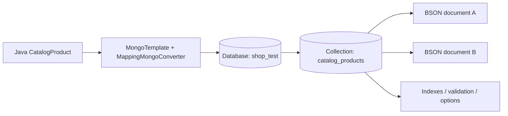
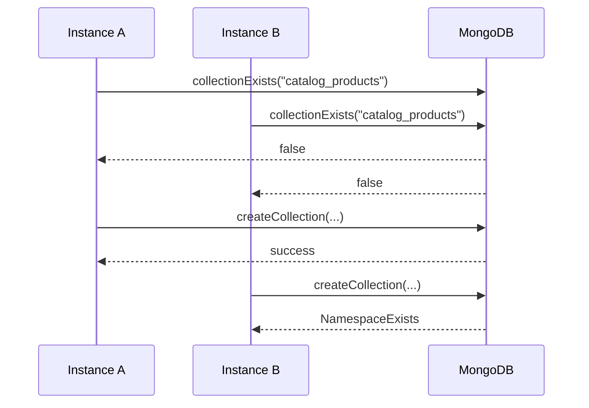
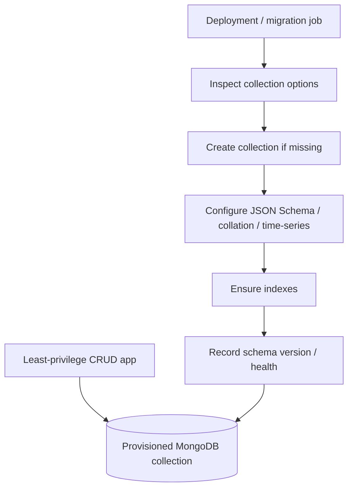

# Creating, Checking, and Dropping Collections with Template

In MongoDB, a **collection** is where BSON documents for a domain are stored, such as `catalog_products`, `orders`, or `sensor_readings`. Spring Data MongoDB allows accessing collections via repositories, but when you need to manage the **collection lifecycle** — creating upfront with schema options, checking existence, retrieving metadata, or dropping test collections — you need the methods of **`MongoTemplate`** (or `ReactiveMongoTemplate`).

This lesson belongs to the **Collections and Schema** chapter of the `SPRING_DATA_MONGODB` module. The module focuses on connecting to MongoDB, mapping documents, and manipulating data via `MongoTemplate`/repositories, combined with queries, aggregation, indexes, transactions, reactive access, testing, and performance diagnostics. Here, the focus is not on CRUD for a single document, but on managing **collections and collection configurations**. Creating or dropping a collection has broad impact on data, indexes, validators, and other applications sharing the database.

> **Operational Principle:** `collectionExists(...)` is a **check**; `createCollection(...)` is a **collection creation** command; `getCollection(...)` returns a **driver handle** rather than proving the namespace exists; `dropCollection(...)` is a **destructive** operation that removes the entire collection along with its indexes. Do not use `dropCollection` to delete a few records or clean up tenant data.

## 1. Learning Objectives

After this lesson, you will be able to:

1. Distinguish **database**, **collection**, **document**, Java mapping schema, and server-side schema validator.
2. Explain when MongoDB creates a collection **implicitly** and when `createCollection` must be called.
3. Use `MongoTemplate.collectionExists(Class)` and `collectionExists(String)` to check a namespace in the right database.
4. Use `getCollectionNames()` to list collections and understand the limitations of listing.
5. Distinguish `getCollection(String)` from `createCollection(String)` regarding actual existence.
6. Create a collection by `@Document` or explicit name and understand the effect of name mapping.
7. Create a collection with `CollectionOptions`: capped, collation, JSON Schema validation, and time-series.
8. Know that collection creation **does not imply** creating all secondary indexes from an entity.
9. Distinguish `dropCollection` from `remove`/`deleteAll` and know what is lost on drop.
10. Recognize the race condition of the **check-then-create** pattern, permission errors, and namespace-already-exists cases.
11. Write a safe provisioning flow with appropriate permissions, metadata checks, and proper rollback.
12. Use the corresponding `ReactiveMongoTemplate` API with `Mono`/`Flux`.
13. Write collection lifecycle integration tests using **randomized names and a dedicated test database**, without harming real data.
14. Evaluate options for managing schema/indexes via migrations and verify them through the MongoDB server.

## 2. Collection, Document, and Schema: Three Layers to Distinguish

A MongoDB database contains multiple collections; a collection contains BSON documents. Java entities are mapped to collections via Spring Data MongoDB.



| Concept | Example | Role |
| --- | --- | --- |
| Database | `shop_test` | Namespace scope, permissions, connection configuration |
| Collection | `catalog_products` | Group of documents sharing a business purpose |
| Document | `{_id:"P-1",sku_code:"BK-1"}` | A single BSON record |
| Java entity | `CatalogProduct` | Java model mapped by Spring Data |
| `@Document` | `@Document("catalog_products")` | Metadata selecting the collection for an entity |
| JSON Schema validator | `$jsonSchema` | Data constraints **at the MongoDB server** |
| Index | `{sku_code:1}` | Optimizes queries and/or enforces uniqueness |

**MongoDB is a database with a flexible schema, not "schemaless."** Documents in the same collection can have different structures, but businesses still need data contracts, validation, migrations, and appropriate indexes.

**`@Document` does not equate to a `db.createCollection` command.** It declares domain mapping. Only when the application actually creates the collection via management APIs or writes data under MongoDB's mechanism does the collection appear; do not assume that scanning classes/entities at Spring Boot startup creates all collections and indexes.

## 3. Running Example Entity: Product and @Document

Use a record for a simple domain model:

```java
package dev.learning.catalog;

import org.springframework.data.annotation.Id;
import org.springframework.data.mongodb.core.mapping.Document;
import org.springframework.data.mongodb.core.mapping.Field;

@Document("catalog_products")
public record CatalogProduct(
    @Id String id,
    @Field("sku_code") String sku,
    String name,
    String category,
    @Field("price_cents") long priceCents) {
}
```

Corresponding BSON data:

```javascript
{
  _id: "P-100",
  sku_code: "BK-JAVA",
  name: "Java Guide",
  category: "BOOK",
  price_cents: NumberLong("350000")
}
```

With this domain class:

- `mongoTemplate.insert(product)` chooses the collection name based on `@Document`.
- `mongoTemplate.collectionExists(CatalogProduct.class)` checks the collection derived from the class, in the currently connected database.
- `mongoTemplate.createCollection(CatalogProduct.class)` creates the collection according to entity metadata.
- `mongoTemplate.dropCollection(CatalogProduct.class)` **drops the entire corresponding collection**, not just documents of that class.
- `mongoTemplate.createCollection("other_name")` operates on the explicit name, without defaulting or converting to `catalog_products`.

If multiple entity classes point to the same collection, **dropping by one class still deletes all documents in that collection**, including documents created by other entities.

### 3.1. Do Not Treat Java Property Names as BSON Names

`sku` is stored as `sku_code` due to `@Field`, and `id` is typically mapped to `_id`. When creating indexes with typed `IndexOperations`, Spring Data can apply mapping; when running driver commands or raw `mongosh`, you must use the **actual BSON names**.

The **collection name** can also come from `@Document`/naming strategy. For APIs taking `String collectionName`, that string is the passed collection name — do not automatically assume `CatalogProduct` is the collection name without verifying.

## 4. Key Collection Management Methods

`MongoOperations`/`MongoTemplate` provides the primary methods:

| API | Return type (synchronous) | Behavior |
| --- | --- | --- |
| `collectionExists(String)` | `boolean` | Checks namespace by name |
| `collectionExists(Class<T>)` | `boolean` | Checks name derived from entity |
| `getCollectionNames()` | `Set<String>` | Lists collection names in the DB |
| `getCollection(String)` | `MongoCollection<Document>` | Obtains a **driver handle**; namespace may not exist yet |
| `createCollection(String)` | `MongoCollection<Document>` | Creates an uncapped collection by name |
| `createCollection(Class<T>)` | `MongoCollection<Document>` | Creates a collection based on entity metadata |
| `createCollection(String, CollectionOptions)` | `MongoCollection<Document>` | Creates a collection with options |
| `createCollection(Class<T>, CollectionOptions)` | `MongoCollection<Document>` | Creates by entity with options |
| `dropCollection(String)` | `void` | Drops the entire collection by name |
| `dropCollection(Class<T>)` | `void` | Drops the entire collection derived from entity |
| `indexOps(Class/String)` | `IndexOperations` | Manages secondary indexes separately |

Collection management methods **do not return a deleted document count** like a `DeleteResult`. `dropCollection` must not be used as a conditional `deleteMany` command.

Some Spring Data 5.x versions also support `createCollection(Class, Function<CollectionOptions, CollectionOptions>)` to customize options derived from annotations; when building a project, verify the API against the exact Spring Data BOM version in use.

## 5. Creating a Collection by Entity Class

Simple example:

```java
import com.mongodb.client.MongoCollection;
import org.bson.Document;
import org.springframework.data.mongodb.core.MongoTemplate;

MongoCollection<Document> created =
    mongoTemplate.createCollection(CatalogProduct.class);
```

For the entity in section 3, this command creates the corresponding collection `catalog_products`.

Afterward:

```java
boolean exists =
    mongoTemplate.collectionExists(CatalogProduct.class);

// When createCollection succeeds, in the accessed database:
assert exists;
```

**Do not repeat `createCollection` on an existing namespace** assuming it means "ensure exists." MongoDB may return a **NamespaceExists** error. If the system wants create-if-missing, it must check and handle concurrency races as shown later.

### 5.1. What Options Does the Class-Based Creator Infer?

Current `MongoOperations` documentation notes that `createCollection(Class)` can derive options from `@Document` and `@TimeSeries` metadata, such as **collation**, time-series time field/meta/granularity/expireAfter. However, advanced options such as **JSON schema validator** and **encryption** are not automatically inferred solely from the entity class; they must be declared via `CollectionOptions`/customizers or managed separately.

Do not confuse "entity mapping for CRUD" with "schema validator enabled on MongoDB."

### 5.2. Is a Collection Pre-Created Just Because of @Document?

You should not assume so. A regular collection in MongoDB can be created **implicitly on the first write** (for example, when inserting into a non-existent namespace). This is convenient for demos, but insufficient when an application requires configuration:

- Server-enforced validation.
- Default collection collation.
- Capped collection.
- Time-series collection.
- Certain security/encryption features.
- Controllable index creation workflows or provisioning permissions.

When special options are needed, **create explicitly before writing** and verify that the namespace has the right options.

## 6. Creating a Collection by String Name

```java
String name = "catalog_product_imports";

MongoCollection<Document> collection =
    mongoTemplate.createCollection(name);
```

Here the actual name is **exactly** `catalog_product_imports`. No `@Document` from `CatalogProduct` is used to rename it automatically.

Name selection behavior:

| Method call | Target name |
| --- | --- |
| `createCollection(CatalogProduct.class)` | `catalog_products` per `@Document` |
| `createCollection("catalog_products")` | String `catalog_products` |
| `createCollection("catalog_product_imports")` | String `catalog_product_imports` |
| `dropCollection(CatalogProduct.class)` | `catalog_products` |
| `dropCollection("catalog_product_imports")` | `catalog_product_imports` |

**When dynamic names are influenced by user input**, do not concatenate `tenantId` or arbitrary input directly into a collection name. Use naming conventions, whitelists/validation, quota/permission policies, and namespace limits. Typically, multi-tenancy uses a single collection with a `tenant_id` field and appropriate indexes rather than creating a collection per request.

## 7. Checking Collection Existence

Two common forms:

```java
boolean byName =
    mongoTemplate.collectionExists("catalog_products");

boolean byType =
    mongoTemplate.collectionExists(CatalogProduct.class);
```

If both overloads target `catalog_products` on the **same database**, they produce logically equivalent results.

**Distinction:** checking collection existence **does not** prove:

- The collection contains data.
- The collection has the expected validator.
- The collection has unique/TTL indexes.
- The collection is regular vs. time-series.
- The caller has permissions to write to or drop that collection.
- The namespace will still exist on the next command.

If the goal is to check **whether documents matching a query exist**, use `mongoTemplate.exists(Query, Class)` or a repository query, not `collectionExists`.

### 7.1. Checking Does Not Create a Collection

```java
String name = "lifecycle_demo_missing";

boolean exists = mongoTemplate.collectionExists(name);
// If the namespace has not been created yet, exists == false.
```

This is a metadata read; it does not create a collection. When verifying in tests, generate a **randomized** namespace to avoid collisions and run in a test database.

### 7.2. Existence Is Not an Immutable State

Between `collectionExists(name)` and `createCollection(name)` or `dropCollection(name)`, another instance may manage the namespace. This is a **check-then-act race**; you cannot turn two commands into an atomic collection creation merely by adding `synchronized` in a single service JVM.

## 8. Listing Collections with getCollectionNames

```java
import java.util.Set;

Set<String> names = mongoTemplate.getCollectionNames();

if (names.contains("catalog_products")) {
    // This namespace is currently in the name set returned by the driver.
}
```

`getCollectionNames()` is convenient when displaying database status or doing a quick list check. However:

- It reflects only the **database** to which `MongoTemplate` is connected, not all databases in the cluster.
- The list may include special collections or system-used namespaces depending on permissions and server version.
- The list can change immediately after being retrieved.
- Database user privileges may restrict listing capabilities.
- It should not be called repeatedly on every hot request just to see if an entity exists.

If you only need to know whether **one** collection exists, use `collectionExists`; if you need type/options metadata, inspect `listCollections`.

### 8.1. Do Not Use Listing to Drive Destructive Write Paths

A dangerous example:

```java
// DO NOT do this for critical business orchestration:
if (mongoTemplate.getCollectionNames().contains(name)) {
    mongoTemplate.dropCollection(name);
}
```

The list is only a point-in-time snapshot; moreover, permission to drop a namespace should not be coupled to list-reading logic. Dropping must be based on **explicit administrative intent and target verification**, not "if seen, drop it."

## 9. getCollection(String) Is a Driver Handle, Not Create

```java
import com.mongodb.client.MongoCollection;
import org.bson.Document;

String name = "catalog_product_imports";
MongoCollection<Document> handle =
    mongoTemplate.getCollection(name);
```

`getCollection` returns a **`MongoCollection<Document>`** from the MongoDB Java Driver. It is not the same as `createCollection`:

- You can obtain a handle when the namespace **does not yet exist** on the server.
- Having a Java handle **does not** mean the server has created the collection.
- The collection may be created upon the first write operation supported by MongoDB on a missing namespace.
- Reading via a handle on a non-existent collection typically returns empty results, but that fact must not replace namespace/validator checks.
- `getCollection` operates at the driver layer; field names in `Document`/`Filters` are **BSON names**, and do not automatically apply full Java mapping like `MongoTemplate.find(Query, CatalogProduct.class)`.

Illustrative example:

```java
String name = "import_staging";

MongoCollection<Document> handle =
    mongoTemplate.getCollection(name);

boolean exists = mongoTemplate.collectionExists(name);

// If no other create/write command has succeeded yet, exists can still be false.
```

If you need to ensure a collection exists **before** creating indexes/validators, call `createCollection` and handle the namespace-already-exists case. If you only need to access an existing collection, use the handle; if you need typed CRUD, prefer `MongoTemplate` with an entity class.

## 10. Create If Not Exists: Understanding the Race Condition

A common example:

```java
String name = "catalog_products";

if (!mongoTemplate.collectionExists(name)) {
    mongoTemplate.createCollection(name);
}
```

**Good for illustrating logic**, but **unsafe as a concurrent provisioning mechanism**:



Both processes can read `false`. Only one succeeds in creating the namespace, while the other receives a namespace-already-exists error.

### 10.1. How to Handle This in Production Systems

Appropriate approaches:

1. **One-time provisioning/migration** before multiple instances serve traffic. Grant namespace create/drop permissions to an operational account rather than every service instance.
2. If multiple instances run an initializer, use the synchronization/migration coordinator chosen by the project and treat creation as **potentially contended**.
3. When receiving the specific namespace-exists error, **re-read metadata/options** to confirm the collection was created by another process with compatible settings. Do not catch all exceptions and blindly treat them as success.
4. If the collection exists but is a **view/capped/time-series** or has the wrong validator, do not ignore it and continue writing as if the schema were valid.

### 10.2. Do Not Use Check-Then-Create as a Distributed Lock

`synchronized` only prevents races within a single JVM, not across multiple pods/instances. A `collectionExists` query also places no lock on the namespace for subsequent operations. For systems requiring determinism, separate schema lifecycle from runtime requests.

## 11. CollectionOptions: Why Create with Configuration?

`CollectionOptions` lets you describe creation settings, for example:

| Option | Purpose | Things to Note |
| --- | --- | --- |
| `capped()` | Limits capacity of a capped collection | Must set `size(long)` |
| `size(long)` | Byte capacity for a capped collection | Not a single BSON document size limit |
| `maxDocuments(long)` | Target maximum document count | Applies appropriately with capped; does not replace quota logic |
| `collation(Collation)` | Sets default string comparison rules | Related indexes and queries must align on collation |
| `schema(MongoJsonSchema)` | Enables JSON Schema validator | Field names must match actual BSON |
| `strictValidation()` | Applies strict validation on writes | Depends on MongoDB server/version |
| `warnOnValidationError()` | Logs warnings instead of rejecting invalid writes | Not equivalent to schema enforcement |
| `timeSeries(String timeField)` | Creates a time-series collection | Requires server support and valid time field |

Initialization example:

```java
import org.springframework.data.mongodb.core.CollectionOptions;

CollectionOptions options = CollectionOptions.empty();
```

`CollectionOptions` uses fluent methods that return new/customized options; always assign or chain the returned value. **Options apply only at creation time**, and are not a reliable way to alter every setting of an existing collection.

### 11.1. Creating a Capped Collection

```java
CollectionOptions cappedOptions = CollectionOptions.empty()
    .capped()
    .size(8L * 1024 * 1024)
    .maxDocuments(50_000L);

mongoTemplate.createCollection(
    "catalog_event_buffer_test",
    cappedOptions
);
```

Meaning: the capped collection has a configured capacity of roughly 8 MiB and a target document cap. Capped collections have specialized lifecycle/write semantics and are not suitable for every business entity. `size` is a critical requirement when configuring capped; `maxDocuments` does not replace it.

**Do not use a capped collection as an unconditional replacement for a TTL index**: capped limits by storage space, whereas TTL deletes documents based on time conditions; the two data/retention models are very different.

### 11.2. Need to Reconfigure an Existing Collection?

Do not try:

```java
if (mongoTemplate.collectionExists("catalog_products")) {
    mongoTemplate.createCollection(
        "catalog_products", CollectionOptions.empty().capped().size(12345));
}
```

Re-running creation on an existing namespace **is not a migration**. To change modifiable validators/indexes/options, inspect MongoDB's `collMod`/index operations APIs, permissions, version limits, and safe migration procedures. Many properties such as converting a regular collection into time-series or capped cannot be achieved simply via `createCollection`.

## 12. Schema Validation: Java Mapping Differs from Server Validator

With `CatalogProduct`, `@Field("sku_code")` indicates that Java property `sku` is stored in BSON field `sku_code`. However, **`@Document`/`@Field` does not automatically enable a JSON Schema validator on the server**.

To have the server reject documents missing SKU or having the wrong SKU type, create the collection with `MongoJsonSchema`:

```java
import org.springframework.data.mongodb.core.CollectionOptions;
import org.springframework.data.mongodb.core.schema.MongoJsonSchema;
import org.springframework.data.mongodb.core.schema.JsonSchemaProperty;

MongoJsonSchema schema = MongoJsonSchema.builder()
    .required("sku_code")
    .properties(
        JsonSchemaProperty.string("sku_code")
    )
    .build();

CollectionOptions options = CollectionOptions.empty()
    .schema(schema)
    .strictValidation()
    .failOnValidationError();

mongoTemplate.createCollection(
    "catalog_products_validated",
    options
);
```

This command creates **a new collection by explicit name** with the `sku_code` validator; it does not automatically attach the validator to an already existing `catalog_products`.

Conceptual BSON equivalent:

```javascript
db.createCollection("catalog_products_validated", {
  validator: {
    $jsonSchema: {
      type: "object",
      required: ["sku_code"],
      properties: {
        sku_code: { type: "string" }
      }
    }
  },
  validationLevel: "strict",
  validationAction: "error"
});
```

**BSON/JSON Schema Note:** Spring Data `MongoJsonSchema` examples use JSON-schema `type:"string"` via the DSL; MongoDB also has `bsonType` to constrain BSON-specific types. For `long`/`Decimal128` numbers, choose the schema and converter matching the actual data type, rather than mechanically copying Java types into the schema.

### 12.1. Validator Checks Data on the Server

Assuming `catalog_products_validated` has been created:

```javascript
// Valid: SKU is a string.
db.catalog_products_validated.insertOne({
  _id: "P-101",
  sku_code: "BK-001",
  name: "Book"
});

// Invalid: missing sku_code.
db.catalog_products_validated.insertOne({
  _id: "P-102",
  name: "Without SKU"
});

// Invalid: sku_code is a number.
db.catalog_products_validated.insertOne({
  _id: "P-103",
  sku_code: 123
});
```

The last two commands are expected to be rejected with a validation error if the server uses `validationAction:"error"` and write privileges do not bypass validation. In the application, catch write errors appropriately and return a safe business message; do not expose full schema details or sensitive BSON via the API.

### 12.2. strict and warn Are Different

- `strictValidation()`: level at which validation applies to writes; not an action that converts/migrates legacy data.
- `failOnValidationError()`: instructs the server to reject writes failing the validator (corresponding to the error action).
- `warnOnValidationError()`: allows invalid writes while logging a warning; **do not rely on it as a guarantee of valid data**.
- When updating a validator on an existing collection, old documents may not be automatically fixed or scanned/removed; the application needs a migration plan and existing-data audit.

Newer MongoDB versions add more validation options, so when writing docs/applications you must check against the running server. `strict`/`moderate` and `error`/`warn` actions are the common baseline; do not assume every new mode exists on all versions.

### 12.3. Must Use BSON Names in Schema

Conceptually wrong when data uses `sku_code` while the schema checks `sku`:

```javascript
{
  $jsonSchema: {
    required: ["sku"],
    properties: { sku: { bsonType: "string" } }
  }
}
```

This validator does not match the BSON name produced by `@Field("sku_code")`. Verify raw BSON before deploying validators. Collection options live on the server; they do not receive Java property metadata from `MongoTemplate.find(...)` to auto-fix field names.

## 13. Collation and Special Creation Options

**Collation** defines string comparison/sorting rules by locale, accented characters, case, and strength level. A collection can have a **default collation**; queries/indexes can specify their own collation.

```java
import org.springframework.data.mongodb.core.CollectionOptions;
import org.springframework.data.mongodb.core.query.Collation;

CollectionOptions options = CollectionOptions.empty()
    .collation(Collation.of("en"));

mongoTemplate.createCollection(
    "catalog_product_labels_test", options
);
```

When using MongoDB with Vietnamese, determining locale and strength needs testing on accented data, Unicode sorting, and business rules. **Do not assume setting an arbitrary collation makes substring search, full-text search, or regex automatically indexed optimally.**

Things to verify:

- The collection's default collation can affect queries/sorts that do not specify a collation.
- An index created with a different collation may not be usable for all queries having different comparison rules.
- String-based unique indexes can have different uniqueness semantics depending on collation; test carefully before enabling.
- `@Document` can describe collation metadata on an entity depending on Spring Data version, but the **actual collection** must still be created with the right options.
- An existing collection with a different collation **is not silently changed** merely by calling `createCollection` again.

## 14. Time-Series Collections: Must Be Created with the Right Type Before Writing

MongoDB supports **time-series collections** to store sequences of measurements and time-ordered events. This collection type has distinct storage mechanics and limitations compared to regular collections.

Create using `CollectionOptions`:

```java
import org.springframework.data.mongodb.core.CollectionOptions;

mongoTemplate.createCollection(
    "sensor_readings_test",
    CollectionOptions.timeSeries("recorded_at")
);
```

`"recorded_at"` must be the **BSON field name** used as the time field in documents. With the **String collectionName** call, do not rely on Java property mapping to turn `recordedAt` into `recorded_at`.

A sample document:

```javascript
db.sensor_readings_test.insertOne({
  _id: "READ-1",
  sensor_id: "SENSOR-A",
  recorded_at: ISODate("2026-11-20T08:00:00Z"),
  temperature: 27.5
});
```

You must confirm **the MongoDB server supports time-series** and check the constraints of the running version. In particular:

- A time-series collection must be **created as time-series**, not created as a regular collection hoping inserts will convert its type.
- Update/delete/index operations have specific restrictions depending on MongoDB version.
- Time-series has its own TTL/expireAfter mechanism on measurements per retention policy; do not equate it with a TTL index on a regular collection.
- Regular schema validation features cannot be applied to time-series in the same way as a regular collection in relevant MongoDB versions.
- When using `@TimeSeries` on an entity, Spring Data can derive time/meta/granularity/retention to create the collection by class; check the annotation/API in your version.

For instance, `mongoTemplate.createCollection(SensorReading.class)` can pick up `@TimeSeries` metadata if properly defined. However, `@Document` alone is not `@TimeSeries`.

## 15. Inspecting Real Metadata: Collection Type, Options, and Validator

`collectionExists` only tells you a namespace exists; **it does not verify configuration**. To check details like capped, validator, collation, or time-series, use MongoDB's `listCollections` command.

In `mongosh` on the **target database**:

```javascript
db.getCollectionInfos({ name: "catalog_products" });
```

The result may contain:

```javascript
[
  {
    name: "catalog_products",
    type: "collection",
    options: {
      // collation, validator, capped, timeseries... if configured
    },
    info: { /* metadata from server */ }
  }
]
```

The object above is an **illustrative shape**, not a complete or fixed output for all MongoDB versions.

### 15.1. Reading Metadata via MongoTemplate.executeCommand

`MongoTemplate` provides `executeCommand(Document)`:

```java
import java.util.List;
import org.bson.Document;

String expectedName = "catalog_products";

Document command = new Document("listCollections", 1)
    .append("filter", new Document("name", expectedName));

Document response = mongoTemplate.executeCommand(command);

Document cursor = response.get("cursor", Document.class);
List<Document> infos =
    cursor.getList("firstBatch", Document.class);

if (infos.isEmpty()) {
    throw new IllegalStateException(
        "Collection does not exist yet: " + expectedName);
}

Document metadata = infos.get(0);
String type = metadata.getString("type");
Document options = metadata.get("options", Document.class);
```

With an exact collection name filter, at most one valid namespace of that name exists in the database. When dealing with general driver APIs without a filter or with large results, `listCollections` may use a multi-batch cursor; the example above targets one specific name.

Distinction:

- `collectionExists(name)`: quick check for namespace existence.
- `getCollectionNames()`: retrieves the set of names.
- `executeCommand(listCollections)`: inspects detailed **type/options**.
- `getCollection(name)`: gets a handle for driver operations, does not inspect options.

### 15.2. Do Not Expose Metadata to Unauthorized Users

`listCollections` requires appropriate metadata privileges. A public API must not return all collection names, schemas, encryption options, or internal dataset names. Place metadata inspection in an **authorized health/admin/migration service**, not an arbitrary endpoint.

## 16. Indexes Are a Separate Part of the Collection Lifecycle

**Creating a collection does not equate to creating the secondary indexes an application needs.**

Example where SKU must be unique:

```java
import org.springframework.data.domain.Sort;
import org.springframework.data.mongodb.core.index.Index;

String indexName = mongoTemplate.indexOps(CatalogProduct.class)
    .ensureIndex(
        new Index()
            .on("sku", Sort.Direction.ASC)
            .unique()
    );
```

With `indexOps(CatalogProduct.class)`, Spring Data knows the `@Field("sku_code")` entity metadata, so the index path on property `sku` can be mapped to BSON field `sku_code`.

Using the collection name directly:

```java
String name = "catalog_product_imports";

String indexName = mongoTemplate.indexOps(name)
    .ensureIndex(
        new Index()
            .on("sku_code", Sort.Direction.ASC)
    );
```

In the `indexOps(String)` overload, there is no entity class from which to infer `@Field`; use the **actual BSON name**.

### 16.1. Viewing Existing Indexes

```java
import java.util.List;
import org.springframework.data.mongodb.core.index.IndexInfo;

List<IndexInfo> indexes =
    mongoTemplate.indexOps(CatalogProduct.class)
        .getIndexInfo();

for (IndexInfo index : indexes) {
    System.out.println(index.getName());
}
```

Every regular MongoDB collection has a default `_id` index; other indexes must be declared and maintained by policy. From versions 3.x onward, Spring Data by default **does not automatically create secondary indexes from all annotations** unless appropriately configured; do not rely on `@Indexed` alone to conclude an index actually exists on the server.

### 16.2. Avoid "Drop and Recreate on Every Startup"

An anti-pattern:

```java
// NEVER DO THIS DURING NORMAL STARTUP:
mongoTemplate.dropCollection(CatalogProduct.class);
mongoTemplate.createCollection(CatalogProduct.class);
mongoTemplate.indexOps(CatalogProduct.class)
    .ensureIndex(new Index().on("sku", Sort.Direction.ASC));
```

This code destroys **all existing data** and indexes before recreating them. Index creation should be a controlled change; dropping a collection is only suitable for isolated test environments or an explicitly approved operational procedure.

## 17. Dropping Collections: dropCollection Is Not deleteMany

`dropCollection` removes a **namespace** in MongoDB, including its data and associated indexes. It does not accept `Criteria`, `Query`, or tenant scope.

```java
// DROPS THE ENTIRE collection corresponding to @Document:
mongoTemplate.dropCollection(CatalogProduct.class);

// DROPS THE ENTIRE collection by name:
mongoTemplate.dropCollection("catalog_product_imports");
```

**These are API examples, not instructions to run directly against a database containing real data.**

Comparison:

| Operation | Target | After Operation |
| --- | --- | --- |
| `remove(Query, Class)` | Deletes documents matching filter | Collection/indexes/validator remain |
| `remove(new Query(), Class)` | Deletes all documents in entity collection | Namespace, indexes, options remain |
| `repository.deleteAll()` | Deletes repository entity data | Not a drop collection command |
| `dropCollection(Class)` | Drops entire collection derived from entity | Data + indexes + namespace options lost |
| `dropCollection(String)` | Drops entire collection by name | Same, for the chosen namespace |

If you need to delete **only one tenant's data**:

```java
import org.springframework.data.mongodb.core.query.Criteria;
import org.springframework.data.mongodb.core.query.Query;

// Only use after an authorized decision to delete tenant data:
Query onlyTenant = Query.query(
    Criteria.where("tenantId").is(authorizedTenantId));

var result = mongoTemplate.remove(
    onlyTenant, CatalogProduct.class);
```

This example assumes the entity contains `tenantId` and MongoDB stores multiple tenants in a shared collection. **The `CatalogProduct` entity in section 3 does not have a tenantId property**; in a real application you must define the tenant field before running such a query. Do not copy tenant-deletion code if the schema lacks a tenant field or if deletion authority is unverified.

### 17.1. Dropping Also Deletes Indexes

Suppose a collection has a unique index on `sku_code`. After `dropCollection`:

- Product documents are gone.
- The unique index is gone.
- Schema validator/collation/capped/time-series options bound to the namespace are also gone with the dropped collection.
- If recreated with `createCollection(name)` without options, the new collection **does not automatically regain all old settings**.
- The application could write schema-invalid data or duplicate SKUs if you forget to restore validators/indexes.

To restore configuration, you must re-execute **schema migrations, collection options, and index definitions** managed in trusted code/manifests.

### 17.2. Dropping and Linked Data

Other collections may store references to IDs in the dropped collection. MongoDB does not automatically enforce foreign keys like an RDBMS for application-designed references; dropping a source collection can leave dangling references in other collections.

With sharding, transactions, change streams, or replication/backup systems, dropping has even broader operational impact. Never treat it as a harmless "quick clear of an empty table."

## 18. Designing a Safe Drop Procedure

**In production, any API that triggers a drop must sit behind operational controls**, never called directly from a user endpoint.

A minimum checklist before approval:

1. Confirm the **exact cluster, database, and collection name**.
2. Confirm the **owner** of the collection and that no other service shares it.
3. Justify why the collection can be deleted: purpose, data, retention, legal obligations.
4. Confirm backups/snapshots are restorable, recovery time, and user impact.
5. Stop or coordinate related writers, consumers, change streams, and dashboards.
6. Record options, index definitions, and document count **for audit**, without confusing that count with a rollback guarantee.
7. Execute the command using a privileged account and an approved change process.
8. Verify post-conditions and monitor application errors afterward.
9. Have a recovery runbook for **data + schema + indexes**, not just recreating an empty namespace.

If you need to delete self-created test data, use a **randomized, isolated namespace** in a test database. Do not use `dropCollection(CatalogProduct.class)` in tests when the class maps to a collection that might be shared across tests.

### 18.1. Do Not Treat Drop as a Simple Rollback

A `dropCollection` command is not an "undo" of `createCollection` on a collection that has received writes. Do not assume transactions will protect or undo this kind of DDL operation across all configurations; operate within the limits of your MongoDB server/topology.

Recreating the collection **does not restore old data**. You need backups/point-in-time recovery or a dedicated operationally supported strategy.

## 19. Errors, Permissions, and Diagnostics

Typical errors:

| Symptom | Cause to Check | Remediation |
| --- | --- | --- |
| `collectionExists=false` despite data elsewhere | Connected to wrong database/cluster/tenant | Check URI, database name, credentials |
| `createCollection` reports namespace exists | Collection/view already exists; multi-instance race | Check type/options, do not catch all errors blindly |
| `createCollection` unauthorized | Account lacks collection creation privilege | Separate provisioning permissions |
| `getCollection` returns handle but `collectionExists=false` | Handle does not create namespace immediately | Use `collectionExists`/metadata |
| First insert creates regular collection | Options not provisioned before writes | Run migration creating collection with options |
| Schema validator rejects write | Wrong BSON field/type, invalid input data | Compare schema and raw BSON |
| `@Field` right in Java but validator still fails | Validator uses different raw BSON name | Fix validator/migration to match BSON |
| Unique index missing | Index migration not run, auto-index off | `indexOps().getIndexInfo()` and controlled `ensureIndex` |
| `dropCollection` causes widespread application errors | Dropped a namespace actively in use | Restore, investigate caller, tighten permissions |
| Collection has expected name but wrong type | View, capped, or time-series differs from expectation | Read `listCollections` options/type |
| Cannot create unique index | Duplicate data already exists | Clean up data / run controlled migration |
| Changing collection options has no effect | Used `createCollection` on existing namespace | Use `collMod` or appropriate migration |
| Tests destroy data | Used fixed name or shared DB | Dedicated test DB + UUID name + drop only self-created resources |

### 19.1. Spring Data Exception Translation

`MongoTemplate` translates MongoDB Driver errors into Spring's data access exception hierarchy, such as duplicate key, permission, configuration, and command errors. Avoid:

```java
try {
    mongoTemplate.createCollection("catalog_products");
} catch (Exception ignored) {
    // WRONG: cannot tell whether it already existed or failed due to auth/connection loss.
}
```

The right approach is to classify which errors may be ignored (if truly just namespace-already-exists), then verify metadata/options and propagate all other errors. In a migration system, it is generally better to **fail startup/deployment** rather than serve traffic with an uncertain schema.

## 20. ReactiveMongoTemplate: Same Lifecycle, Different Return Types

Corresponding reactive methods:

| Synchronous | Reactive |
| --- | --- |
| `collectionExists(name) → boolean` | `collectionExists(name) → Mono<Boolean>` |
| `getCollectionNames() → Set<String>` | `getCollectionNames() → Flux<String>` |
| `getCollection(name) → MongoCollection<Document>` | `getCollection(name) → Mono<MongoCollection<Document>>` |
| `createCollection(name) → MongoCollection<Document>` | `createCollection(name) → Mono<MongoCollection<Document>>` |
| `dropCollection(name) → void` | `dropCollection(name) → Mono<Void>` |

Example of **check and create**:

```java
import reactor.core.publisher.Mono;

String testName = "reactive_lifecycle_test";

Mono<Void> createIfMissing =
    reactiveMongoTemplate.collectionExists(testName)
        .flatMap(exists -> exists
            ? Mono.empty()
            : reactiveMongoTemplate.createCollection(testName).then());
```

This snippet is only a publisher; **no operation is guaranteed to have run** until subscribed. It still has a **check-then-create race** when multiple subscribers/instances initialize concurrently.

Checking after creation:

```java
Mono<Boolean> existsAfter =
    createIfMissing.then(
        reactiveMongoTemplate.collectionExists(testName));
```

In reactive applications, never call `block()` arbitrarily on an event loop. Compose the publisher into the appropriate startup/migration or service flow.

Dropping with the reactive API, **only on an application-owned test namespace**:

```java
Mono<Void> dropOwnedTestCollection =
    reactiveMongoTemplate.dropCollection(testName);
```

Assigning a publisher to a variable **does not make it safe**: once subscribed, the entire collection will be dropped. For production, approval mechanisms and separate permissions remain mandatory.

## 21. Integration Testing: Creating, Checking, and Dropping Only Test Collections

**Testing rule:** use a MongoDB database dedicated to testing (appropriate test URI/Testcontainers), generate collection names with UUIDs, and drop only **namespaces successfully created by the current test**, never dropping fixed module collection names.

### 21.1. Pure MongoTemplate Lifecycle Test

```java
package dev.learning.catalog;

import static org.assertj.core.api.Assertions.assertThat;

import java.util.UUID;
import org.bson.Document;
import org.junit.jupiter.api.Test;
import org.springframework.beans.factory.annotation.Autowired;
import org.springframework.boot.test.context.SpringBootTest;
import org.springframework.data.mongodb.core.MongoTemplate;
import com.mongodb.client.MongoCollection;

@SpringBootTest
class CollectionLifecycleIntegrationTest {

    @Autowired MongoTemplate template;

    private static String testName() {
        return "lesson_lifecycle_"
            + UUID.randomUUID().toString().replace("-", "");
    }

    @Test
    void createsChecksAndDropsOnlyOwnedCollection() {
        String name = testName();
        boolean created = false;

        try {
            assertThat(template.collectionExists(name)).isFalse();

            MongoCollection<Document> handle =
                template.getCollection(name);

            assertThat(handle.getNamespace().getCollectionName())
                .isEqualTo(name);

            // Getting a handle alone does not create the collection on the server.
            assertThat(template.collectionExists(name)).isFalse();

            template.createCollection(name);
            created = true;

            assertThat(template.collectionExists(name)).isTrue();
            assertThat(template.getCollectionNames()).contains(name);

            template.dropCollection(name);
            created = false;

            assertThat(template.collectionExists(name)).isFalse();
        } finally {
            // Do not drop other namespaces: clean up only if this test created it.
            if (created && template.collectionExists(name)) {
                template.dropCollection(name);
            }
        }
    }
}
```

This test demonstrates:

- `getCollection` is a handle, not create.
- `createCollection` makes the namespace actually exist.
- `getCollectionNames` includes the new name in the test database.
- `dropCollection` deletes the namespace.
- Cleanup uses a `created` guard so it does not touch unowned test resources.

**Safety note:** the `created` variable is only a local guard in the test. It **does not resolve all races** if someone intentionally reuses a rare UUID name or connects to a non-test database; isolate the database and permissions first.

### 21.2. Testing JSON Schema Validator

In the **same class** `CollectionLifecycleIntegrationTest`, add a method:

```java
@Test
void validatorRejectsIncorrectBsonType() {
    String name = testName();
    boolean created = false;

    try {
        var schema = org.springframework.data.mongodb.core.schema
            .MongoJsonSchema.builder()
            .required("sku_code")
            .properties(
                org.springframework.data.mongodb.core.schema
                    .JsonSchemaProperty.string("sku_code"))
            .build();

        var options = org.springframework.data.mongodb.core
            .CollectionOptions.empty()
            .schema(schema)
            .strictValidation()
            .failOnValidationError();

        template.createCollection(name, options);
        created = true;

        var collection = template.getCollection(name);

        collection.insertOne(
            new Document("_id", "VALID-" + UUID.randomUUID())
                .append("sku_code", "BOOK-1"));

        org.assertj.core.api.Assertions.assertThatThrownBy(
            () -> collection.insertOne(
                new Document("_id", "INVALID-" + UUID.randomUUID())
                    .append("sku_code", 42)
            )
        ).isInstanceOf(com.mongodb.MongoWriteException.class);

    } finally {
        if (created && template.collectionExists(name)) {
            template.dropCollection(name);
        }
    }
}
```

This snippet uses a **driver handle**, so write validation failures typically throw `MongoWriteException`. When writing through `MongoTemplate`, errors may be translated to Spring Data exceptions; in real tests you can assert specific error codes/messages and verify behavior matching your server version.

It intentionally passes `sku_code:42` (number) instead of string to prove the validator actually works. The test does not use production and only drops the unique name it created.

### 21.3. Testing Index Loss After Drop

You can add a separate test:

```java
import org.springframework.data.domain.Sort;
import org.springframework.data.mongodb.core.index.Index;

String name = testName();
boolean created = false;

try {
    template.createCollection(name);
    created = true;

    String indexName = template.indexOps(name)
        .ensureIndex(
            new Index().on("sku_code", Sort.Direction.ASC).unique()
        );

    assertThat(template.indexOps(name).getIndexInfo())
        .anySatisfy(info ->
            assertThat(info.getName()).isEqualTo(indexName));

    template.dropCollection(name);
    created = false;

    assertThat(template.collectionExists(name)).isFalse();

    // Both indexes and namespace were dropped;
    // when creating a new namespace, index migrations must run again.
} finally {
    if (created && template.collectionExists(name)) {
        template.dropCollection(name);
    }
}
```

This is an **illustrative snippet placed inside a test method that already has imports and the `template` field**. Do not run it during bean startup.

### 21.4. Testing Class Mapping Without Dropping a Real Collection

If you only want to verify `@Document`:

```java
@Test
void entityUsesDeclaredCollectionName() {
    assertThat(template.getCollectionName(CatalogProduct.class))
        .isEqualTo("catalog_products");
}
```

This method only inspects metadata and **does not create or drop** any real collection. Place it in a test class with `template` and `assertThat`.

## 22. Testing Schema Info and Permissions

Additional tests worth having:

| Scenario | Expectation |
| --- | --- |
| Create collection by class with `@Document` | DB namespace name is `catalog_products` in test DB |
| Create collection by string | Name is used verbatim, not confused with entity name |
| Check missing collection | `collectionExists=false`, `getCollectionNames` omits it |
| Call only `getCollection` | Namespace still not created |
| Create then create again | Namespace exists error, not an "idempotent create" |
| Valid insert with validator | Write succeeds |
| Insert wrong type/missing required field | Rejected when `validationAction=error` |
| Create capped/options | `listCollections` reflects expected options |
| Create time-series | Type/options metadata correct; supported by server version |
| Index present after `ensureIndex` | `getIndexInfo()` contains index name |
| Drop then check | Namespace disappears, associated indexes deleted |
| Missing create/drop privilege | Clear permission error, not swallowed |
| Two initializers create concurrently | Only one succeeds, the other handles namespace exists |
| Wrong test DB URI | Config guard fails, prevents drop |
| Per-tenant collections | Arbitrary tenants not allowed to name namespaces |
| Schema migration | Redeploying index/validator creation preserves existing data |

An integration test does not need to run **drop** on a production collection to prove the API works. Prefer test-only randomized namespaces and control the database URI in test configuration.

## 23. Operations: Provisioning, Backups, Migrations, and Observability

### 23.1. Separating Schema Management from CRUD

A common architecture:



Goals:

- **Migration/provisioner** holds privileges to manage collections, schemas, and indexes.
- **Runtime application** primarily holds needed document read/write privileges, without drop privileges by default.
- Collection configuration changes are reviewed, tested, and released alongside code/versions.
- When a collection is missing or has the wrong schema in production, **fail fast** rather than dropping/recreating to "fix" it.

### 23.2. Health Checks Should Go Beyond collectionExists

`collectionExists("catalog_products")=true` only indicates the namespace exists. A thorough health check can verify:

1. Connection to the right database with minimum privileges.
2. Collection type/options: regular vs. capped/time-series, validator, collation.
3. Required indexes (unique, TTL, compound).
4. Schema version or migration status.
5. Appropriate read/write privileges without granting drop privileges unnecessarily.
6. Practical query/update capability at a level safe for the environment.

**Avoid health checks that self-repair/drop collections.** Health checks should be read-only or restricted to allowed checks; never trigger migrations on every request.

### 23.3. Backup and Restore

True backup/restore must preserve:

- Documents.
- Collection options and validation rules.
- Index definitions.
- Constraints related to time-series/capped/encrypted collections.
- Dependent references and processes.

Do not claim "backups exist" without testing actual recovery and RPO/RTO. Dropping affects active writers, change stream sources, background jobs, and dashboards; a runbook is required.

### 23.4. Cost Diagnostics

Creating/dropping collections is **DDL**, not a per-request business query. Monitor:

- Number of collections and indexes per database.
- Whether collection options/types drift from expected migrations.
- Schema validation failures and duplicate key errors.
- Index build/migration durations and disk resources.
- Unusual drop operations, actors, privileges, and audit trails.
- Application error rates following deployments/schema changes.

Do not create a new collection per HTTP request, per query, or per small user without evaluating namespace overhead and administrative cost.

## 24. API Comparison with mongosh Operations

| Spring Data | Equivalent MongoDB/mongosh | Caveat |
| --- | --- | --- |
| `collectionExists("x")` | Check `db.getCollectionInfos({name:"x"})` | Does not guarantee options match |
| `getCollectionNames()` | `db.getCollectionNames()` | Lists metadata per privileges |
| `getCollection("x")` | `db.getCollection("x")` / driver handle | Does not prove namespace exists |
| `createCollection("x")` | `db.createCollection("x")` | May fail if already exists |
| `createCollection("x", options)` | `db.createCollection("x", options)` | Options must match server/version |
| `indexOps(...).ensureIndex(...)` | `db.x.createIndex(...)` | Index is a separate step |
| `dropCollection("x")` | `db.x.drop()` | **Deletes data and indexes** |
| `remove(query, Entity.class)` | `db.x.deleteMany(filter)` | Does not drop collection |

This table describes **conceptual equivalents**; Spring Data also performs exception translation, class/field name mapping, and other reactive/template behaviors depending on configuration.

## 25. Questions to Ask Before Managing Collections

1. Is this a **test, staging, or production** database?
2. Does the collection actually exist, and is that name a collection or a view?
3. Is the name derived from `@Document` or passed literally?
4. Are **validator, collation, capped, or time-series** needed at creation time?
5. If it already exists with different options, what is the migration plan?
6. Have secondary indexes been created and verified?
7. Are other instances running initializers/DDL concurrently?
8. Does the runtime account truly need `createCollection`/`dropCollection` privileges?
9. Is the data actively consumed by workers, jobs, streams, or dashboards?
10. Is there a tested backup/restore if a drop is planned?
11. If tests create collections, are names **unique** and does cleanup remove only self-created test resources?
12. Is tenant isolation based on fields/queries or modeled via uncontrolled collection names?
13. Are there raw BSON/JSON schema/`@Field` aliases to reconcile?
14. Are creation/drop errors logged/audited and translated into actionable operational responses?

## 26. Practice Exercises

**Exercise 1 — Name via @Document.** With `@Document("catalog_products")`, write `getCollectionName(CatalogProduct.class)`, `collectionExists(CatalogProduct.class)`, and predict the checked namespace.

**Exercise 2 — Handle vs. create.** Call `getCollection("demo_x")` then `collectionExists("demo_x")` before any writes. Explain why a handle does not guarantee the collection exists.

**Exercise 3 — Create/readback.** Using a UUID name in a test database, call `createCollection(name)` then verify with `collectionExists(name)` and `getCollectionNames()`.

**Exercise 4 — Check-then-create race.** Describe two instances reading false and then creating concurrently. Why doesn't `synchronized` in a single JVM solve it? Design an initializer/migration that checks options.

**Exercise 5 — Capped.** Use `CollectionOptions.empty().capped().size(8*1024*1024L)`, inspect metadata; compare capped retention with TTL.

**Exercise 6 — Schema.** Create a validator requiring `sku_code` to be a string, and insert valid/wrong-type documents. Explain the role of `@Field` with BSON schemas.

**Exercise 7 — Collation.** Create a collection with a default collation, test sorting strings with mixed case and accents in a test database; compare with another collation.

**Exercise 8 — Time-series.** Create `sensor_readings_test` with `timeField="recorded_at"`. Inspect metadata and list several limitations compared to regular collections.

**Exercise 9 — Indexes.** After creating a collection, add a unique index on `sku_code`; verify with `indexOps(name).getIndexInfo()`. If dropped/recreated, what happens to the index?

**Exercise 10 — Deleting data vs. dropping.** Given a collection with 100 documents across two tenants, write a query deleting 10 documents of tenant-a **without dropping the collection**. Compare with `dropCollection`.

**Exercise 11 — Reactive.** Write a `Mono<Void>` that creates a collection only if missing and a `Mono<Boolean>` to verify afterward. Explain subscriptions, race conditions, and why not to call `block()` on an event loop.

**Exercise 12 — Production readiness.** Design a runbook to add a validator/index to an existing collection without deleting documents. What verification steps, backups, and rollback plans are needed?

**Exercise 13 — Safe integration test.** Write a test using a UUID name, tracking a `created` flag, and dropping only the test-created collection in `finally`. Verify it cannot run against a production URI.

## 27. Completion Checklist and Official Documentation

Before deploying:

- [ ] Verify the right database, cluster, namespace, privileges, and owner.
- [ ] Distinguish entity mapping, collection namespace, and server JSON Schema.
- [ ] Know `@Document` does not automatically mean the collection is provisioned.
- [ ] Use `collectionExists` to check; `getCollectionNames` to list; `listCollections` to read options.
- [ ] Do not treat `getCollection` as creating or proving existence.
- [ ] Use `createCollection(Class)` or `createCollection(String)` with the intended name.
- [ ] Define validator, collation, capped/time-series options **before the first write** if needed.
- [ ] If the collection already exists, **do not recreate** it to "adjust options."
- [ ] Handle check-then-create races; do not swallow permission/connection errors.
- [ ] Inspect raw BSON when writing JSON Schema validators with `@Field`/converters.
- [ ] Create and verify secondary indexes via `indexOps`/migrations.
- [ ] Do not give runtime users unnecessary drop privileges.
- [ ] Do not use `dropCollection` instead of a filtered delete.
- [ ] Have backups/runbooks and approvals if a drop is truly necessary.
- [ ] Tests use a separate database, UUID namespaces, and clean up only owned test resources.
- [ ] Distinguish reactive publishers from subscribed execution.
- [ ] Verify options/type/index metadata after provisioning.
- [ ] Monitor schema validation failures, migration errors, and DDL operations.
- [ ] Do not treat the `WRITTEN` status of the document as having passed Content QA or being published.

### Official Documentation Sources

1. [Spring Data MongoDB — Index and Collection Management](https://docs.spring.io/spring-data/mongodb/reference/mongodb/template-collection-management.html): `getCollectionNames`, `collectionExists`, `createCollection`, `dropCollection`, indexes, time-series.
2. [Spring Data MongoDB — MongoOperations Javadoc](https://docs.spring.io/spring-data/mongodb/docs/current/api/org/springframework/data/mongodb/core/MongoOperations.html): collection management overloads.
3. [Spring Data MongoDB — MongoTemplate Javadoc](https://docs.spring.io/spring-data/mongodb/docs/current/api/org/springframework/data/mongodb/core/MongoTemplate.html): `getCollectionName`, `getCollection`, `executeCommand`.
4. [Spring Data MongoDB — CollectionOptions Javadoc](https://docs.spring.io/spring-data/mongodb/docs/current/api/org/springframework/data/mongodb/core/CollectionOptions.html): capped, size, schema, collation, time-series.
5. [Spring Data MongoDB — MongoJsonSchema Javadoc](https://docs.spring.io/spring-data/mongodb/docs/current/api/org/springframework/data/mongodb/core/schema/MongoJsonSchema.html): builder/schema properties.
6. [Spring Data MongoDB — ReactiveMongoOperations Javadoc](https://docs.spring.io/spring-data/mongodb/docs/current/api/org/springframework/data/mongodb/core/ReactiveMongoOperations.html): reactive collection lifecycle.
7. [MongoDB Manual — Create Collections](https://www.mongodb.com/docs/manual/core/databases-and-collections/): implicit vs. explicit creation.
8. [MongoDB Manual — create Command](https://www.mongodb.com/docs/manual/reference/command/create/): namespaces and create options.
9. [MongoDB Manual — listCollections Command](https://www.mongodb.com/docs/manual/reference/command/listCollections/): collection type/options metadata and privileges.
10. [MongoDB Manual — db.collection.drop()](https://www.mongodb.com/docs/manual/reference/method/db.collection.drop/): dropping collections, indexes, and consequences.
11. [MongoDB Manual — Schema Validation](https://www.mongodb.com/docs/manual/core/schema-validation/): JSON Schema/validation actions/levels.
12. [MongoDB Manual — Modify Schema Validation](https://www.mongodb.com/docs/manual/core/schema-validation/update-schema-validation/): `collMod` on existing collections.
13. [MongoDB Manual — Time Series Collections](https://www.mongodb.com/docs/manual/core/timeseries/timeseries-procedures/): creating time-series and configuration.
14. [MongoDB Manual — Time Series Limitations](https://www.mongodb.com/docs/manual/core/timeseries/timeseries-limitations/): limitations compared to regular collections.
15. [MongoDB Manual — Indexes](https://www.mongodb.com/docs/manual/indexes/): indexes, unique, and administration.
16. [MongoDB Manual — Database Security](https://www.mongodb.com/docs/manual/core/authorization/): namespace access privileges and operations.

**Conclusion:** `MongoTemplate` enables clear management of collection lifecycles: **`collectionExists` to check**, **`getCollectionNames` to list**, **`createCollection` to create with required options**, and **`dropCollection` to drop the entire namespace**. `getCollection` only returns a handle and does not replace existence checks. When designing with Spring Data MongoDB, distinguish `@Document`/field mapping from server-side JSON Schema validators and indexes; handle check-then-create races; and reserve create/drop privileges for provisioning, migrations, or isolated tests. Dropping not only deletes documents but also destroys indexes and options, so never use it as a routine data cleanup mechanism.
