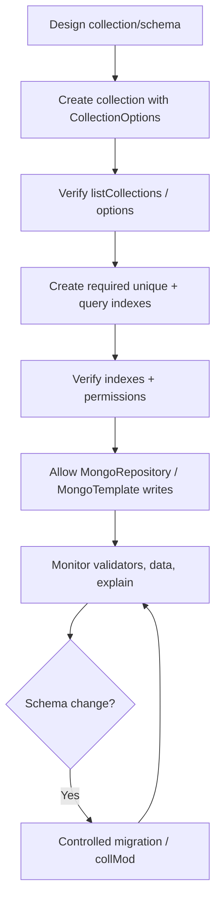

# CollectionOptions and Options Required Before Writing Data

## 1. Context: Why Decide Before the First Insert?

In **Spring Data MongoDB**, `MongoTemplate` and `MongoRepository` can often write to a collection that does not yet exist: MongoDB implicitly creates a regular collection on the first write. This mechanism is convenient for small examples, but in production it can easily cause a system to miss the chance to configure the **right collection type and policies** from the start.

Mini Commerce has datasets with distinct requirements:

- `products`: product catalog, requiring a stable BSON currency format, validation, and a unique SKU key.
- `customers`: contact data, requiring schema control, access control, and personal data protection policies.
- `orders`: long-term transaction records, which **must not be automatically evicted merely due to running out of space**.
- `product_metrics`: time-based measurements, well suited to a time-series collection and retention policy.
- `diagnostic_events`: temporary bounded-storage data, where a capped collection or a regular collection with TTL can be considered.

If a worker runs `repository.save(product)` before the collection initializer executes, `products` may already have been created as a regular collection **without the expected validator/collation**. At that point, calling `createCollection(..., CollectionOptions)` again does not mean MongoDB will add the desired settings to the existing collection.

This is why the topic **CollectionOptions and Options Required Before Writing Data** belongs to the **Collections and Schema** chapter of `SPRING_DATA_MONGODB`. We learn how to design, create, verify, and operate collections before business data enters, and then connect that to mapping, repositories, queries/indexes, aggregation, transactions, reactive access, and testing.

### Objectives

After this lesson, you will be able to:

1. Distinguish **explicit** collection creation via `MongoTemplate.createCollection(...)` from letting MongoDB create implicitly on write.
2. Use `CollectionOptions.empty()` and configuration methods returning **new options** for validators, collation, capped, and time series.
3. Write `MongoJsonSchema` using the exact **BSON field names**, Decimal128 currency type, and minimum constraints.
4. Distinguish `validationLevel` (strict/moderate/off) and `validationAction` (error/warn), and recognize when validators apply.
5. Know when to use a **capped collection**, versus a **TTL index** or a **time-series collection**.
6. Choose a default collation and understand its impact on queries, sorts, and unique indexes.
7. Create unique, TTL, and compound indexes via **IndexOperations** rather than assuming they are all `CollectionOptions`.
8. Design an idempotent bootstrap flow, inspect existing options, perform controlled migrations, and avoid races with application startup.
9. Test collection metadata with `listCollections`, test validation with real BSON, and use `explain` to evaluate indexes.
10. Recognize cases dependent on MongoDB version, sharding, transactions, encryption, or the reactive driver.

**Prerequisites:** Java 17+, Spring Boot with `spring-boot-starter-data-mongodb`, a running MongoDB instance, familiarity with `@Document`, `@Id`, `@Field`, `MongoTemplate`, `MongoRepository`, and BSON. Examples focus on synchronous APIs; reactive notes use `ReactiveMongoTemplate`.

## 2. What Does CollectionOptions Solve?

`CollectionOptions` lives in package:

```java
import org.springframework.data.mongodb.core.CollectionOptions;
```

It is a **description of options at collection creation time**. Spring Data's options object **is not a live collection** and is not an automatic schema migration controller.

| Option / Mechanism | Purpose | Mini Commerce Example | Decide Before Writing? |
| --- | --- | --- | --- |
| Regular collection | Stores documents without capped space limits | `products`, `customers`, `orders` | Should declare explicitly if extra options needed |
| `schema(...)` / `validator(...)` | Database-level validation | SKU, price, stock, status | **Should**, before invalid data enters |
| `strictValidation()` / `moderateValidation()` | Selects document validation scope | Guarding against wrong price types | **Should**, depending on migration strategy |
| `failOnValidationError()` / `warnOnValidationError()` | Reject or log warning | Trialing a validator | **Should**, with a rollout plan |
| `collation(...)` | Default string comparison rules | Searching/sorting product names | **Yes**: default collection collation cannot change after creation |
| `capped().size(...).maxDocuments(...)` | Bounded-capacity buffer | Diagnostic events | **Yes**: choose collection type and size |
| `timeSeries(...)` / `@TimeSeries` | Collection optimized for time-based measurements | `product_metrics` | **Yes**: must create time-series before insert |
| Change stream pre/post images | Stores before/after document versions for change streams | Tracking certain required changes | Choose at creation or configure separately via `collMod` |
| Queryable encryption | Field encryption policy backed by key system | Sensitive fields with special requirements | Must design alongside security and compatible server/driver |
| Unique/TTL/compound indexes | Uniqueness constraints, retention, query optimization | Unique SKU, cart session TTL | **Create via IndexOperations**, not solely CollectionOptions |
| Shard key / clustered collection / view | Advanced database design | Sharded datasets or reports | Depends on admin/server commands; do not assume every option has a DSL |

### 2.1. Distinguishing DDL and DML



- **DDL**: creating collections, changing validators, creating indexes, choosing collation/time series/capped.
- **DML**: insert, save, update, delete.

A single successful insert does not prove the collection is configured properly. Treat schema creation as an **independent, verifiable task** in the deployment process.

## 3. Explicit Collection Creation with MongoTemplate

### 3.1. APIs to Distinguish

Common overloads:

```java
// Fixed collection name, default options:
mongoTemplate.createCollection("products");

// Based on entity's @Document:
mongoTemplate.createCollection(Product.class);

// With explicit options:
mongoTemplate.createCollection(
    Product.class,
    CollectionOptions.empty());

// Using collection name and options:
mongoTemplate.createCollection(
    "products",
    CollectionOptions.empty());
```

These are **alternative call forms**, not four commands to run sequentially. Each `createCollection` command operates on a collection that does not yet exist. The collection name from `Product.class` comes from mapping metadata such as `@Document(collection = "products")`.

In modern Spring Data MongoDB, `createCollection(Class)` can also **derive** collation from `@Document` and time-series settings from `@TimeSeries`. However, **validators/schemas and special encryption or change stream options do not appear automatically from the domain class**; appropriate `CollectionOptions` must be provided.

### 3.2. Methods Return New CollectionOptions

```java
CollectionOptions base = CollectionOptions.empty();

CollectionOptions capped = base
    .capped()
    .size(1_048_576L)
    .maxDocuments(1_000L);
```

`CollectionOptions` modifiers are designed to **return a new instance with the new configuration**. Avoid assuming:

```java
CollectionOptions options = CollectionOptions.empty();
options.capped(); // Return value is discarded.

// options does not necessarily carry capped=true!
mongoTemplate.createCollection("diagnostic_events", options);
```

The right approach is to **assign the returned reference** or chain calls before passing to `createCollection`. The same applies to `schema`, `collation`, `size`, and `strictValidation`.

### 3.3. Why Checking collectionExists Is Still Insufficient

```java
if (!mongoTemplate.collectionExists("products")) {
    mongoTemplate.createCollection(
        "products", CollectionOptions.empty());
}
```

This snippet helps simple bootstrapping, but in multi-instance environments there is a **race**: two instances both see the collection missing and both call `createCollection`. Additionally, `collectionExists("products") == true` only indicates **the name exists**, not that the collection has the right validator/indexes/collation.

For production, use a single-owner migration/schema initializer with clear DDL permissions and post-creation metadata checks. Never swallow every "NamespaceExists" exception and let the application write without **reconciling options**.

## 4. Mini Commerce Product: Java and BSON Mapping

We begin with a regular collection `products`, neither time-series nor capped.

```java
package com.example.minicommerce.domain;

import java.math.BigDecimal;
import org.springframework.data.annotation.Id;
import org.springframework.data.mongodb.core.mapping.Document;
import org.springframework.data.mongodb.core.mapping.Field;
import org.springframework.data.mongodb.core.mapping.FieldType;

@Document(collection = "products")
public class Product {

    @Id
    private String id;
    private String sku;
    private String name;
    private boolean active;
    private int stock;

    @Field(name = "unit_price", targetType = FieldType.DECIMAL128)
    private BigDecimal price;

    public Product() {}

    public Product(String id, String sku, String name,
                   boolean active, int stock, BigDecimal price) {
        this.id = id;
        this.sku = sku;
        this.name = name;
        this.active = active;
        this.stock = stock;
        this.price = price;
    }

    public String getId() { return id; }
    public void setId(String id) { this.id = id; }
    public String getSku() { return sku; }
    public void setSku(String sku) { this.sku = sku; }
    public String getName() { return name; }
    public void setName(String name) { this.name = name; }
    public boolean isActive() { return active; }
    public void setActive(boolean active) { this.active = active; }
    public int getStock() { return stock; }
    public void setStock(int stock) { this.stock = stock; }
    public BigDecimal getPrice() { return price; }
    public void setPrice(BigDecimal price) { this.price = price; }
}
```

In BSON:

| Java Property | BSON Field | Expected BSON Type |
| --- | --- | --- |
| `id` | `_id` | String or ObjectId depending on ID format/mapping |
| `sku` | `sku` | String |
| `name` | `name` | String |
| `active` | `active` | Bool |
| `stock` | `stock` | Int32 |
| `price` | `unit_price` | Decimal128 |

When using `@Id String`, the framework may convert ObjectId-compatible hex strings into ObjectId; examples/tests use alphabetic prefixes that do not look like hex ObjectIds to avoid ambiguity. For critical keys, inspect raw BSON after mapping.

**Do not write a validator against Java property `price` expecting MongoDB to understand `@Field("unit_price")`.** The validator runs on the server against actual BSON, so rules must target `unit_price`.

## 5. JSON Schema Validation Before the First Data

MongoDB supports validation through a collection's `validator` option, typically using `$jsonSchema`. Spring Data provides `MongoJsonSchema` and `CollectionOptions.schema(schema)`.

### 5.1. Intended Schema for products

```javascript
{
  $jsonSchema: {
    bsonType: "object",
    required: ["sku", "name", "unit_price", "stock", "active"],
    properties: {
      sku: {
        bsonType: "string",
        minLength: 1
      },
      name: {
        bsonType: "string",
        minLength: 1
      },
      unit_price: {
        bsonType: "decimal",
        description: "Price must be stored as BSON Decimal128"
      },
      stock: {
        bsonType: "int",
        minimum: 0
      },
      active: {
        bsonType: "bool"
      }
    }
  }
}
```

This schema:

- Requires the primary fields **to be present**.
- Rejects `unit_price` as String or Double; it must be BSON Decimal128.
- Requires `stock` to be a non-negative BSON Int32.
- Permits additional fields because `additionalProperties: false` is not set.

Note that `required` only checks **field presence**; type and content constraints live under `properties`. If non-negative price is required, you can add `minimum: 0` to `unit_price`. In real systems, SKU length checks, currency, category, logical constraints, and write permissions are also needed at the business layer.

### 5.2. Creating a Schema via MongoJsonSchema.of(Document)

```java
import org.bson.Document;
import org.springframework.data.mongodb.core.CollectionOptions;
import org.springframework.data.mongodb.core.MongoTemplate;
import org.springframework.data.mongodb.core.schema.MongoJsonSchema;

public void createProductsWithValidator(MongoTemplate template) {

    MongoJsonSchema schema = MongoJsonSchema.of(
        Document.parse("""
            {
              "bsonType": "object",
              "required": [
                "sku", "name", "unit_price", "stock", "active"
              ],
              "properties": {
                "sku": {
                  "bsonType": "string",
                  "minLength": 1
                },
                "name": {
                  "bsonType": "string",
                  "minLength": 1
                },
                "unit_price": { "bsonType": "decimal" },
                "stock": {
                  "bsonType": "int",
                  "minimum": 0
                },
                "active": { "bsonType": "bool" }
              }
            }
            """));

    CollectionOptions options = CollectionOptions.empty()
        .schema(schema)
        .strictValidation()
        .failOnValidationError();

    // Run only when products does not yet exist and is
    // orchestrated by a migration/bootstrap job.
    template.createCollection(Product.class, options);
}
```

This is an **illustrative method for use in migrations**: do not call it on every HTTP request and do not drop an existing `products` collection to "clear the path." JSON schema expects **BSON field names**, specifically `unit_price`, not Java's `price`.

In Spring Data, `MongoJsonSchema.builder()` can also construct schemas via a Java DSL; to derive from entity metadata, `MongoJsonSchemaCreator` exists. However, generated schemas **do not know every business rule** such as "SKU is unique," "valid price for currency," or "an order must have at least one OrderLine." Always review the final schema before use.

### 5.3. Equivalent MongoDB Command

```javascript
db.createCollection("products", {
  validator: {
    $jsonSchema: {
      bsonType: "object",
      required: ["sku", "name", "unit_price", "stock", "active"],
      properties: {
        sku: { bsonType: "string", minLength: 1 },
        name: { bsonType: "string", minLength: 1 },
        unit_price: { bsonType: "decimal" },
        stock: { bsonType: "int", minimum: 0 },
        active: { bsonType: "bool" }
      }
    }
  },
  validationLevel: "strict",
  validationAction: "error"
});
```

Only run `createCollection` if the collection does not yet exist. Do not concurrently run the `mongosh` command and `MongoTemplate.createCollection` for the same name on the same database.

## 6. ValidationLevel and ValidationAction Are Not the Same

These are two **independent** decisions:

| Setting | Value | Meaning |
| --- | --- | --- |
| `validationLevel` | `strict` | Validates documents on inserts and updates against the validator |
| `validationLevel` | `moderate` | Validates inserts and updates to currently valid documents; does not use the validator to block updates to already invalid legacy documents |
| `validationLevel` | `off` | Disables validator checking |
| `validationAction` | `error` | Rejects writes violating validation |
| `validationAction` | `warn` | Permits writes but logs a warning about the violation |

Spring Data:

```java
CollectionOptions enforce =
    CollectionOptions.empty()
        .schema(schema)
        .strictValidation()
        .failOnValidationError();

CollectionOptions observe =
    CollectionOptions.empty()
        .schema(schema)
        .strictValidation()
        .warnOnValidationError();

CollectionOptions transitional =
    CollectionOptions.empty()
        .schema(schema)
        .moderateValidation()
        .failOnValidationError();
```

`schema` above is the previously constructed `MongoJsonSchema`. These are **three alternative configurations**, not a sequence of calls to alter an existing collection.

### 6.1. Validation Only Applies on Write

If a collection already holds schema-invalid documents before a new validator is applied, MongoDB does not automatically scan and delete/fix all old documents upon `collMod`. Old documents must be **evaluated/migrated separately**, and validation is checked when applicable insert/update operations occur.

`strict` can cause updates on legacy documents to fail because the document remains invalid. `moderate` is useful for rollouts with invalid legacy data, but **does not mean data rules are fully enforced**.

### 6.2. Using warn to Observe Before Enforcing

A migration roadmap for an existing collection:

1. Inventory existing BSON types and values.
2. Build the new schema in test/staging and verify all writers.
3. Enable `validationAction: "warn"` if you want to observe violations during transition.
4. Migrate/backfill legacy data.
5. Switch to `validationAction: "error"` with the appropriate level.
6. Monitor write errors and have a **configuration** rollback plan if needed.

Never rely on `warn` as a correctness guarantee: it **does not reject** schema-invalid documents.

### 6.3. Bypassing Validation Is Not Normal Operation

MongoDB supports write paths using `bypassDocumentValidation` for specially authorized purposes. Therefore, a validator is a **data-protection layer**, not an authorization mechanism and not a replacement for service validation. Restrict privileges so importers/migrations do not accidentally skip rules.

## 7. CollectionOptions Does Not Create a Unique Index for SKU

`$jsonSchema` checks field shape/types; it **does not guarantee SKU uniqueness across the collection**. A separate unique index is required:

```java
import org.springframework.data.domain.Sort.Direction;
import org.springframework.data.mongodb.core.index.Index;

template.indexOps(Product.class)
    .ensureIndex(
        new Index().on("sku", Direction.ASC).unique());
```

Or in `mongosh`:

```javascript
db.products.createIndex({ sku: 1 }, { unique: true });
```

If the business key is `(tenantId, sku)`, the unique index should reflect the **exact tenant scope**:

```javascript
db.products.createIndex(
  { tenant_id: 1, sku: 1 },
  { unique: true }
);
```

Do not make `sku` globally unique if each store is allowed to have the same SKU.

### 7.1. Order of Creating Validator and Indexes

For a new collection:

```text
createCollection(schema + collation)
    -> ensureIndex(unique business key)
    -> inspect listCollections/listIndexes
    -> allow importers and repositories to write data
```

For a collection with existing data, adding a unique index can **fail due to duplicates**; duplicates must be resolved first. Do not rely on `existsBySku(...)` before `insert` to replace a unique constraint, because two requests can pass the check simultaneously.

### 7.2. @Indexed Does Not Mean the Index Already Exists

An entity may carry `@Indexed(unique = true)`, yet the index only truly exists when index-creation infrastructure is enabled/orchestrated. Modern Spring Data MongoDB **does not automatically create indexes for every entity in all cases by default**; `autoIndexCreation` requires explicit configuration and careful consideration in production.

For deployments with strict requirements, an owned migration/index job plus a `listIndexes` verification step is easier to control.

## 8. Capped Collections: Bounded Storage Space

A capped collection has a **byte size** limit, and optionally a `maxDocuments` limit. When full, MongoDB automatically reclaims older data to make room for new data, like a circular buffer.

Suitable for certain temporary logs/diagnostics; **unsuitable** for `orders` or payment histories that must be retained completely.

### 8.1. Creating Capped via CollectionOptions

```java
CollectionOptions options = CollectionOptions.empty()
    .capped()
    .size(4L * 1024 * 1024)
    .maxDocuments(10_000L);

template.createCollection("diagnostic_events", options);
```

Equivalent:

```javascript
db.createCollection("diagnostic_events", {
  capped: true,
  size: 4 * 1024 * 1024,
  max: 10000
});
```

**`size` is required** when enabling capped; `maxDocuments` is only a secondary cap. If the byte limit is reached first, older documents can be evicted before reaching `max`. Do not treat `maxDocuments=10000` as a promise that the collection will always hold 10,000 documents.

### 8.2. Business and Technical Limitations

- Old data is evicted to make room: **no precise time-based retention**.
- Capped collections do not support sharding and cannot be written to inside transactions.
- Unsuitable for updates that grow document size, or heavy concurrent write workloads.
- Can use **tailable cursors** for append-only log streams; this is a different model from change streams.
- If you need deletion by `expiresAt`, reliable retention over a time window, and flexible querying/scaling, a **TTL index on a regular collection** is usually more appropriate.

Never use capped collections for financial/audit events requiring guaranteed retention where overwriting is a risk.

## 9. TTL for Regular Collections: Create a Separate Index

Suppose `cart_reservations` has `expiresAt` as a BSON Date. To expire a reservation at the timestamp recorded on the document:

```javascript
db.cart_reservations.createIndex(
  { expiresAt: 1 },
  { expireAfterSeconds: 0 }
);
```

In Spring Data:

```java
import java.time.Duration;
import org.springframework.data.domain.Sort.Direction;
import org.springframework.data.mongodb.core.index.Index;

template.indexOps("cart_reservations")
    .ensureIndex(
        new Index()
            .on("expiresAt", Direction.ASC)
            .expire(Duration.ZERO));
```

### 9.1. Why Not Use CollectionOptions.expireAfter for Every Collection?

`expireAfterSeconds` on **collection creation** applies only to server-supported types such as **time-series** and **clustered collections** under specific conditions, not "automatic TTL for every regular collection."

For regular collection `cart_reservations`, retention on a BSON Date field is a **TTL index**. If you want documents to expire 24 hours after `createdAt`, index that field with `expireAfterSeconds: 86400`. If you want expiration at `expiresAt`, use `expireAfterSeconds: 0`.

### 9.2. TTL Is Not an Exact Transactional Clock

MongoDB removes expired documents via a background thread; a document can still remain in the collection past its expiration timestamp. Therefore:

- Queries/reservation services must still check `expiresAt > now` when deciding if an item is still reserved.
- TTL does not automatically cancel a confirmed Order or restore stock per business workflows.
- Do not rely on TTL as a guarantee that "the document vanishes at exact second T."

## 10. Collation: Decide Before Creating the Collection

**Collation** specifies string comparison/sorting rules by locale and options for case/accent/numeric ordering.

Example:

```java
import org.springframework.data.mongodb.core.query.Collation;

CollectionOptions options = CollectionOptions.empty()
    .collation(Collation.of("vi"));

template.createCollection("catalog_names", options);
```

Equivalent:

```javascript
db.createCollection("catalog_names", {
  collation: { locale: "vi" }
});
```

### 10.1. Points to Remember

- A collection's default collation applies to operations that do not specify another collation.
- New indexes usually **inherit the collection's default collation** unless specified otherwise on the index.
- Queries aiming to leverage an index for collated string comparisons/sorts must align with the index's collation.
- **You cannot change an existing collection's default collation** by calling `createCollection` again or normal `collMod`. Changing the default may require creating a new collection and migrating.
- Case/accent sensitivity depends on `strength` and other settings. `locale:"vi"` **does not mean** any two Vietnamese strings are treated as equal.

### 10.2. Collation and Unique Indexes

Suppose an application wants `sku` to be an exact character-sensitive identifier, while `name` uses Vietnamese collation for sorting. A collection default collation can cause **an index on sku to inherit unwanted comparison rules**.

Solutions:

- Define a canonical business key such as `skuNormalized` (validated by the service).
- Create the unique index with an appropriate collation for SKU, possibly `simple` (binary).
- Use Vietnamese collation when querying/indexing `name`.
- Verify SKU collision behavior including upper/lower case via integration tests.

Do not use collation as an automatic accent-stripping normalizer for every business case. Notably, MongoDB `$regex` is not optimized solely by a case-insensitive collation index; if prefix/contains search is needed, design indexes or search separately.

## 11. Time-Series Collections: Design Before the First Measurement

Mini Commerce has `product_metrics` with periodic measurements:

```javascript
{
  recorded_at: ISODate("2026-11-20T02:00:00Z"),
  source: {
    tenantId: "shop-a",
    sku: "KBD-001"
  },
  viewed_count: 45,
  inventory_snapshot: 10
}
```

This is measurement data with a `timeField` and stable metadata; it is a good candidate for a time-series collection. Regular `Product` and `Order` collections are **not** time-series merely because they have `createdAt`.

### 11.1. MongoDB createCollection

```javascript
db.createCollection("product_metrics", {
  timeseries: {
    timeField: "recorded_at",
    metaField: "source",
    granularity: "minutes"
  },
  expireAfterSeconds: 30 * 24 * 60 * 60
});
```

- `timeField` is required and must be a valid **BSON Date**.
- `metaField` can hold an object describing the series (tenant, SKU), and should stay stable over time.
- `granularity` should match the data collection cadence; `seconds`, `minutes`, `hours` depending on server version.
- `expireAfterSeconds` declares measurement retention; cleanup has some lag.

MongoDB has supported time-series since **5.0**, and advanced options like bucket span/rounding have additional version requirements. Do not hardcode numeric bucket settings without verifying compatibility and data cadence.

### 11.2. Spring Data CollectionOptions.timeSeries

```java
import java.time.Duration;
import org.springframework.data.mongodb.core.CollectionOptions;

CollectionOptions options = CollectionOptions.timeSeries(
    "recorded_at",
    ts -> ts
        .metaField("source")
        .expireAfter(Duration.ofDays(30)));

template.createCollection("product_metrics", options);
```

The `timeSeries(timeField, optionsFunction)` overload and `TimeSeriesOptions.expireAfter(Duration)` exist in newer Spring Data MongoDB lines (for example **4.4+**). In older versions, you can use `CollectionOptions.timeSeries("recorded_at")` or the corresponding time-series configuration and use the driver if TTL at creation is required.

To set `granularity` explicitly, use `CollectionOptions.TimeSeriesOptions.granularity(GranularityDefinition)` with the type in `org.springframework.data.mongodb.core.timeseries` matching your project version. Do not mix conflicting `granularity` and span/rounding settings.

### 11.3. The @TimeSeries Annotation

```java
import java.time.Instant;
import org.springframework.data.annotation.Id;
import org.springframework.data.mongodb.core.mapping.TimeSeries;

@TimeSeries(
    collection = "product_metrics",
    timeField = "recordedAt",
    metaField = "source")
public class ProductMetric {
    @Id
    String id;
    Instant recordedAt;
    String source;
    int viewedCount;
}
```

This is an **alternative entity example**, not necessarily matching 100% of the BSON schema for `product_metrics` earlier (where `source` was an object and `recorded_at` was snake_case). When mapping to an entity, declare appropriate `@Field`/metadata or align the sample data accordingly; **never** guess field names.

`@TimeSeries` allows `createCollection(ProductMetric.class)` to derive time-field/meta-field settings. Its `expireAfter` attribute in newer Spring Data versions supports durations like `"30d"`; verify with your version. If the collection was already created implicitly earlier as a regular collection, adding `@TimeSeries` to the class **does not convert the existing collection** into time-series.

### 11.4. Important Time-Series Limitations

- Time-series does not support all behaviors of regular collections; per current MongoDB documentation, **schema validation rules are not supported for time-series**.
- Do not assume a default `_id` index exists as on regular collections; time-series index policies differ and depend on version.
- Unique indexes are not supported on time-series in the same way as regular collections.
- Updates, transactional writes, change streams, or MongoDB Search have specific limitations; **do not choose time-series for transactional Product/Order** collections if those features are required.
- Late-arriving metrics, wrong `timeField` type, overly high-cardinality metadata, or overly short TTL all affect data quality.

**Do not combine** `CollectionOptions.timeSeries(...)` with `schema(...)` in an example assuming the server will accept it; always check collection-type restrictions.

## 12. Change Stream Pre/Post Images Before Writing

If the business needs to observe document versions **before and after** changes, MongoDB supports `changeStreamPreAndPostImages` on a collection (requires server **6.0+**).

Spring Data MongoDB provides a shortcut:

```java
CollectionOptions options =
    CollectionOptions.emitChangedRevisions();

template.createCollection("audited_catalog_changes", options);
```

This API enables the collection setting for **change stream pre/post images**; it **does not replace** business audit trails, outbox patterns, or retention policies. A replica set/sharded topology and appropriate privileges are required for change streams. Pre/post images incur extra storage overhead and retention rules; enable only when truly needed.

If the collection already exists, MongoDB permits certain pre/post image settings via `collMod`. Do not run `createCollection` again assuming the setting was applied.

## 13. Advanced Options: Encryption, Clustered Collections, Sharding

`CollectionOptions` in recent Spring Data releases also supports options for **encrypted fields** and change streams. The MongoDB server `create` command can additionally accept `clusteredIndex`, `storageEngine`, and specialized options.

These decisions depend on:

- MongoDB version, feature compatibility version, and driver.
- Encryption key management and key vault access permissions.
- Which field structures are allowed to be encrypted/queried.
- Replica set / sharded cluster topology and shard key strategy.
- Backup/restore, migration, and performance observability procedures.

Do not copy an `encryptedFields` or clustered index example onto every collection. Design them purposefully and verify against product/version docs. **`@Encrypted` or a Java annotation alone does not guarantee encryption is active** without proper client-side encryption/key management configuration.

### 13.1. Views Are Not Regular Writable Collections

MongoDB also allows creating **views** backed by pipelines. A view is a read abstraction, not a place where you can freely call `repository.save(...)` like a regular collection. Do not confuse `CollectionOptions` for creating collections with view options; views and materialized reports have separate rules.

## 14. Safe Collection Initialization Across Environments

This is an operational concern more critical than Java syntax.

### 14.1. Anti-Pattern: Implicit Creation Followed by Late Configuration

```text
Application instance A starts
  -> endpoint receives first Product
  -> MongoDB implicitly creates products (default)

Instance B runs later:
  -> createCollection("products", CollectionOptions with validator)
  -> does not update the desired validator on the existing collection
```

Result: data may already have been written without the desired validation. When initialization conflicts occur, never suppress exceptions and continue writing.

### 14.2. Recommended Bootstrap Workflow

1. Run migration/bootstrap **before** opening endpoints or starting consumers/import jobs.
2. Verify the collection does not exist yet; if missing, create it with approved options.
3. If it already exists, read metadata to verify **collection type, validator, collation, time-series/capped**.
4. Confirm required indexes are present without index build errors or unique violations.
5. Record schema version and migration outcome in an owned migration management mechanism.
6. If settings mismatch, **fail fast or route through an approved migration procedure**; never drop/recreate arbitrarily.
7. Only once schema/indexes are in an acceptable state should write APIs/consumers be permitted to operate.

### 14.3. Inspecting Metadata from mongosh

```javascript
db.getCollectionInfos({ name: "products" });

db.getCollection("products").getIndexes();
```

For a collection created with `CollectionOptions`, check:

- Does `options.validator.$jsonSchema` match the BSON fields?
- Are `options.validationLevel` and `options.validationAction` as designed?
- Does `options.collation` have the right locale/strength?
- Are `options.capped`/`options.size`/`options.max` appropriate?
- Are `options.timeseries`/`options.expireAfterSeconds` right for time-series?
- Have unique, TTL, and query indexes been created separately?

Do not treat `collectionExists(...)` alone as sufficient verification.

### 14.4. Creating Collection Then Running Index Migration

```java
import org.springframework.data.domain.Sort.Direction;
import org.springframework.data.mongodb.core.CollectionOptions;
import org.springframework.data.mongodb.core.MongoTemplate;
import org.springframework.data.mongodb.core.index.Index;
import org.springframework.data.mongodb.core.schema.MongoJsonSchema;

public void bootstrapCatalog(
        MongoTemplate template, MongoJsonSchema schema) {

    if (!template.collectionExists(Product.class)) {
        template.createCollection(
            Product.class,
            CollectionOptions.empty()
                .schema(schema)
                .strictValidation()
                .failOnValidationError());
    }

    // Must verify actual options of an existing collection in
    // a separate step; this block cannot perform drift detection.

    template.indexOps(Product.class).ensureIndex(
        new Index().on("sku", Direction.ASC).unique());
}
```

This is a **skeleton** for a single-initializer environment. In production, add cross-instance coordination, drift checks, and migration error handling. The fact that an index operation appears idempotent **does not mean** it can replace an index of the same name but different definition without planning.

## 15. Modifying Schema on an Existing Collection

MongoDB provides the `collMod` command for certain changes, such as validator/validationLevel/validationAction and certain TTL/time-series/change-stream settings depending on version.

An **operational example—do not run directly on production without review**:

```javascript
db.runCommand({
  collMod: "products",
  validationLevel: "moderate",
  validationAction: "warn"
});
```

This command assumes the collection already has a suitable validator. It **does not install** a JSON Schema if none exists and does not validate legacy data.

To update the validator:

```javascript
db.runCommand({
  collMod: "products",
  validator: {
    $jsonSchema: {
      bsonType: "object",
      required: ["sku", "name"],
      properties: {
        sku: { bsonType: "string" },
        name: { bsonType: "string" }
      }
    }
  },
  validationLevel: "strict",
  validationAction: "error"
});
```

This is a **simplified illustrative schema**; do not use it to accidentally weaken the comprehensive `products` validator in section 5. When replacing a validator, MongoDB applies the **new definition** given in the command, so migrations must send the **entire** intended rule set, not just a fragment assuming the server merges it. Before turning on strict/error, inventory and backfill old documents.

### 15.1. Settings That Cannot Be Changed In-Place

- A collection's default collation **cannot be changed after creation** with regular `collMod`.
- Converting a regular collection to time-series/capped has special rules and is not simply calling `CollectionOptions.timeSeries(...)` again.
- Changing clustered indexes/shard keys or encryption options can require specialized admin/migration procedures.
- Changing a price type validator from String/Double to Decimal128 requires **migrating actual data**.

If you must create a new collection and copy data: plan dual-read/dual-write (if needed), batch migration, checksum/count verification, index synchronization, and cutover with rollback. Do not drop the old collection before proving the new data is complete.

## 16. Access Control and Data Safety

Normally, application runtimes should not hold the highest privileges to create/drop any collection. Separate roles:

| Role | Privileges to Consider |
| --- | --- |
| Migration/bootstrap | Privilege to create/modify collections and indexes within approved scope |
| Business API | Read/write privileges on the right collections, restricted DDL |
| Import/catalog job | Write and upsert by business key, subject to validator |
| Report/analytics | Read/projection privileges, cannot create writable collections |
| Security/admin | Encryption key management, auditing, access control |

`CollectionOptions` does not enforce all access policies. Validators do not replace authorization, and collation does not make data "safer" merely by being case-insensitive.

In multi-tenant systems, enforce `tenantId` filters (when stored), per-tenant unique indexes, and service-level permission checks. If a shared collection stores multiple tenants, create the collection once for the entire database; **never** let clients pass arbitrary collection names into `createCollection(String)`.

## 17. Transactions, Lifecycle, and Collection Creation

- `MongoTemplate.createCollection(...)` is an **administrative/DDL operation**, not an entity `save`.
- Do not expect `BeforeSaveCallback`, `@LastModifiedDate`, or optimistic locking to run on collection creation.
- MongoDB transactions have specific rules around DDL and topology; run schema migrations outside business transactions before taking traffic.
- Schema validation applies when the raw driver, `MongoTemplate`, repositories, or bulk writes send data to the server, aside from bypass privileges or different validation levels.
- Capped and time-series collections have transactional write limitations; do not include these two collection types in a multi-document `placeOrder` flow needing atomicity unless support is verified.

For creating an Order and decrementing stock across multiple Products, transactions remain a **business decision**; properly defining collections is only the foundation and does not make multiple writes all-or-nothing.

## 18. ReactiveMongoTemplate: Collection Creation Is a Publisher

When using `spring-boot-starter-data-mongodb-reactive`, collection creation returns a publisher:

```java
import org.springframework.data.mongodb.core.CollectionOptions;
import reactor.core.publisher.Mono;
import com.mongodb.reactivestreams.client.MongoCollection;
import org.bson.Document;

CollectionOptions options = CollectionOptions.empty()
    .schema(schema)
    .strictValidation()
    .failOnValidationError();

Mono<MongoCollection<Document>> created =
    reactiveMongoTemplate.createCollection(
        "products_reactive_test", options);
```

`reactiveMongoTemplate` is injected and `schema` is a `MongoJsonSchema` as in section 5. Actual creation happens when the publisher is subscribed. Do not call `block()` on a WebFlux event-loop thread; place schema bootstrap in an orchestrated startup/migration flow and await completion **before accepting write traffic**.

Reactive MongoDB faces the same issues as imperative:

- If the collection already exists, `createCollection` does not merge options.
- Validator/collation/time-series are handled by the MongoDB server.
- Indexes must still be checked after creation, with reactive `indexOps(...).ensureIndex(...)`.
- Reactive bootstrap running concurrently across multiple instances still races unless coordinated.

## 19. Integration Testing: Real Validator and Collection Metadata

A unit test checking a `CollectionOptions` factory method only proves **Java structure**, not that MongoDB accepted the BSON schema or rejects bad data. Use a real MongoDB instance or Testcontainers.

The following test uses a **randomized collection name in a test database** to avoid touching an existing `products` collection. It verifies strict/error, BSON Decimal128, schema metadata, and cleanup.

### 19.1. Complete Test

```java
package com.example.minicommerce;

import static org.junit.jupiter.api.Assertions.*;

import java.math.BigDecimal;
import java.util.UUID;

import com.mongodb.MongoWriteException;
import com.mongodb.client.MongoCollection;
import com.mongodb.client.model.Filters;

import org.bson.Document;
import org.bson.types.Decimal128;
import org.junit.jupiter.api.Test;
import org.springframework.beans.factory.annotation.Autowired;
import org.springframework.boot.test.context.SpringBootTest;
import org.springframework.data.mongodb.core.CollectionOptions;
import org.springframework.data.mongodb.core.MongoTemplate;
import org.springframework.data.mongodb.core.schema.MongoJsonSchema;

@SpringBootTest
class CollectionOptionsIntegrationTest {

    @Autowired
    MongoTemplate template;

    @Test
    void strictSchemaAcceptsDecimal128AndRejectsInvalidWrites() {
        String collection = "lesson29_schema_" +
            UUID.randomUUID().toString().replace("-", "");

        MongoJsonSchema schema = MongoJsonSchema.of(
            Document.parse("""
                {
                  "bsonType": "object",
                  "required": [
                    "sku", "name", "active",
                    "stock", "unit_price"
                  ],
                  "properties": {
                    "sku": { "bsonType": "string" },
                    "name": { "bsonType": "string" },
                    "active": { "bsonType": "bool" },
                    "stock": {
                      "bsonType": "int", "minimum": 0
                    },
                    "unit_price": { "bsonType": "decimal" }
                  }
                }
                """));

        CollectionOptions options = CollectionOptions.empty()
            .schema(schema)
            .strictValidation()
            .failOnValidationError();

        try {
            template.createCollection(collection, options);
            assertTrue(template.collectionExists(collection));

            MongoCollection<Document> raw =
                template.getCollection(collection);

            raw.insertOne(new Document("_id", "ok-1")
                .append("sku", "KBD-TEST")
                .append("name", "Keyboard")
                .append("active", true)
                .append("stock", 5)
                .append("unit_price",
                    new Decimal128(
                        new BigDecimal("129900.00"))));

            Document saved = raw.find(
                Filters.eq("_id", "ok-1")).first();
            assertNotNull(saved);
            assertTrue(saved.get("unit_price")
                instanceof Decimal128);

            MongoWriteException invalid =
                assertThrows(MongoWriteException.class,
                    () -> raw.insertOne(
                        new Document("_id", "bad-1")
                            .append("sku", "BAD-TEST")
                            .append("name", "Wrong price type")
                            .append("active", true)
                            .append("stock", 5)
                            .append("unit_price", "129900.00")));

            // DocumentValidationFailure typically uses code 121.
            assertEquals(121, invalid.getCode());

            Document info = template.execute(
                db -> db.listCollections()
                    .filter(Filters.eq("name", collection))
                    .first());
            assertNotNull(info);

            Document metadata = info.get(
                "options", Document.class);
            assertNotNull(metadata);
            assertEquals("strict",
                metadata.getString("validationLevel"));
            assertEquals("error",
                metadata.getString("validationAction"));

            Document validator = metadata.get(
                "validator", Document.class);
            assertNotNull(validator);
            assertTrue(validator.containsKey("$jsonSchema"));
        } finally {
            // Clean up only the TEST collection created in this method.
            if (template.collectionExists(collection)) {
                template.dropCollection(collection);
            }
        }
    }
}
```

Test requirements:

- MongoDB supports JSON Schema validation, and the test user has create/drop collection privileges.
- Do not point `@SpringBootTest` at a production database.
- Acknowledged writes must be enabled to receive the appropriate exception.
- Uses `raw MongoCollection<Document>` to test the server validator **independently of the entity mapper**.
- Error code 121 is MongoDB's standard validation error code; when going through `MongoTemplate.insert(...)`, the exception may be translated by Spring into a `DataAccessException` subtype. That is why the test intentionally uses the raw driver.

### 19.2. Testing Schemas for Data Migrations

If adding a validator to a collection with existing data, two test groups are needed:

1. **New data:** all write paths (repository, template, raw driver, bulk) are rejected when violating the schema with `validationAction=error`.
2. **Legacy data:** which legacy documents are invalid? What happens when updating them under `strict`/`moderate`?

Do not merely check that `createCollection` ran without error; assert **BSON field names, BSON types, and update behavior**.

### 19.3. Checking Capped and Time-Series Metadata

In a separate test:

```java
String cappedName = "lesson29_capped_test";
if (!template.collectionExists(cappedName)) {
    template.createCollection(cappedName,
        CollectionOptions.empty()
            .capped().size(4096L).maxDocuments(5));
}

Document info = template.execute(
    db -> db.listCollections()
        .filter(Filters.eq("name", cappedName))
        .first());

assertNotNull(info);
Document options = info.get("options", Document.class);
assertEquals(true, options.getBoolean("capped"));
```

This is a **test body**; it needs a separate/isolated collection name, imports, and cleanup in `finally`. Never assert that after 5 inserts a capped collection definitely contains 5 documents: the `size` limit may evict documents earlier. For time-series, inspect `options.timeseries.timeField` and `expireAfterSeconds` rather than assuming time-series has an `_id` index like a regular collection.

## 20. Querying and Performance Diagnostics After Creating a Collection

A collection created with the right schema **is not guaranteed to have fast queries**.

### 20.1. Product Filter Query

```java
import java.math.BigDecimal;
import org.springframework.data.mongodb.core.query.Query;
import org.springframework.data.mongodb.core.query.Criteria;

Query expensive = Query.query(
    Criteria.where("active").is(true)
        .and("price")
        .gte(new BigDecimal("100000.00")));

var products = template.find(expensive, Product.class);
```

Because of `Product.class` mapping, property `price` is translated to BSON `unit_price`, whereas raw `mongosh` must use the actual field:

```javascript
db.products.find({
  active: true,
  unit_price: {
    $gte: NumberDecimal("100000.00")
  }
});
```

If filtering frequently by `active` and a `unit_price` range, evaluate an appropriate index:

```javascript
db.products.createIndex({
  active: 1,
  unit_price: 1
});
```

This is an **index candidate**, not mandatory for every workload. More indexes consume more RAM/storage and increase write cost.

### 20.2. Explain

```javascript
db.products.find({
  active: true,
  unit_price: {
    $gte: NumberDecimal("100000.00")
  }
}).explain("executionStats");
```

Observe:

- `winningPlan`: index scan vs. collection scan.
- `totalKeysExamined` and `totalDocsExamined`.
- `nReturned` relative to documents examined.
- Sort cost and latency on a representative dataset.

Indexes do not make validators inherently faster; schema validation still checks written data against rules. Capped/time-series/collation also impact query/index strategies differently, so benchmark on the actual collection type.

## 21. Decision Matrix for Mini Commerce

| Dataset | Collection Type / Key Options | Additional Indexes / Constraints | What to Avoid |
| --- | --- | --- | --- |
| `products` | Regular, strict/error schema, Decimal128 | Unique `sku` or `tenant+sku`, price/status index | Capped losing products |
| `customers` | Regular, schema & security | Appropriate unique key, email index if needed | Treating schema validation as authorization |
| `orders` | Regular, retention per policy | Customer/status/placedAt index, unique order ID | TTL/capped deleting valid transactions |
| `cart_reservations` | Regular | TTL index on BSON Date + validity filter | Using TTL as an exact business clock |
| `product_metrics` | Time-series, timeField/metaField/retention | Valid indexes within time-series limits | Regular unique/schema validator on time-series |
| `diagnostic_events` | Capped or regular + TTL depending on purpose | Simple index for log lookup | Treating capped as lossless audit storage |
| `catalog_changes` | Regular, optionally pre/post images | Index by operation ID; outbox if needed | Confusing pre/post images with permanent audit trails |

## 22. Common Pitfalls

| Symptom | Cause | Resolution |
| --- | --- | --- |
| Validator missing despite creation code | Collection was implicitly created earlier | Check metadata; run `collMod` migration or controlled recreation |
| `createCollection` throws namespace exists | Multiple concurrent instances or re-run job | Coordinate bootstrap, verify options instead of swallowing errors |
| `CollectionOptions.capped()` has no effect | Return object ignored | Chain or assign new instance |
| Collection created but duplicate SKUs occur | Schema does not create unique index | `IndexOperations.ensureIndex(unique)` |
| `BigDecimal` price rejected by validator | Actual BSON is String/Double, schema expects Decimal128 | `@Field(targetType=DECIMAL128)`, migrate data |
| Schema uses `price` and misses `unit_price` | Used Java property instead of BSON key | Check `@Field` and raw BSON |
| `validationAction=warn` still permits bad writes | Warn only logs | Switch to error after cleaning data |
| `moderate` does not block invalid legacy updates | Validator does not enforce on already invalid legacy docs | Migrate, enable strict/error when ready |
| Adding strict validator breaks many saves | Invalid legacy docs or full replacement missing required field | Inventory/backfill data first |
| `@Indexed` present but real index missing | Index creation disabled / migration not run | Check `listIndexes` |
| Capped holds fewer documents than `maxDocuments` | Hit `size` limit first | Size is the primary limit |
| Capped loses old Orders | Wrong collection type | Regular collection + retention policy |
| TTL deletes late | TTL monitor runs in background | Queries must check expiration timestamp |
| Used `expireAfterSeconds` on regular collection creation | This option does not enable TTL on all regular collections | Create a separate TTL index |
| Collation behaves unexpectedly | Wrong locale/strength/index collation | Test comparison/sort/unique and query/index alignment |
| Want to change default collation in place | Default collation cannot change after creation | Migrate to a new collection |
| Time-series ended up regular | Inserted before `@TimeSeries`/options applied | Explicitly create time-series before writing |
| Time-series validator does not work | Collection type does not support schema validation rules | Validate at writers, redesign if needed |
| Time-series missing `_id` index | Index policy differs from regular | Check version docs and create allowed indexes |
| Change stream lacks pre-image | Option disabled / incompatible server | Check server, collection metadata, retention |
| CI tests fail on create/drop | User lacks privileges or shared DB used | Use dedicated DB, grant proper test privileges |
| API writes before migration finishes | Bootstrap lacked readiness gate | Run schema migration before traffic/consumers |
| Running `collMod` weakens validation | Incomplete new validator replaced old one | Review full schema, test, have rollback plan |

## 23. Practice Exercises

**Exercise 1 — Regular collection with validator.** Create `products` on a test database using `CollectionOptions.empty().schema(...).strictValidation().failOnValidationError()`. Test inserting a valid Decimal128 price, then a String price; verify server rejection.

**Exercise 2 — Checking the difference between Java and BSON.** Put `@Field("unit_price")` on `price`. Write a schema mistakenly using `price`, verify why it fails to protect data; fix to `unit_price` and test with the raw driver.

**Exercise 3 — Validator rollout.** On a test collection with legacy data, use `validationAction: "warn"`, observe violations; clean the data then switch to `strict/error` via `collMod`. Explain risk levels at each stage.

**Exercise 4 — Unique index.** Create unique `{tenant_id:1,sku:1}` on test data. Send two inserts with the same tenant/SKU to observe duplicate key; test the same SKU in another tenant if allowed by schema.

**Exercise 5 — Capped.** Create `diagnostic_events` with `size` and `maxDocuments`. Insert many events and observe older documents being evicted; explain why this collection type does not fit `orders`.

**Exercise 6 — TTL.** Create a regular `cart_reservations` collection with `expiresAt` and a TTL index `expireAfterSeconds: 0`. Verify the application must still filter `expiresAt > now` before treating a reservation as valid.

**Exercise 7 — Collation.** Create a test collection with `Collation.of("vi")` and one with simple collation. Insert Vietnamese names with different accents/cases, compare sort order and indexes without extrapolating from one tiny example.

**Exercise 8 — Time-series.** Create `product_metrics` with `CollectionOptions.timeSeries(...)`, insert BSON Date and metadata, inspect `getCollectionInfos`. Compare with a regular collection and list time-series limitations.

**Exercise 9 — Idempotent bootstrap.** Write a migration that creates a collection only if missing, then **reconciles validator/collation/indexes**. Simulate two instances starting together and design race avoidance.

**Exercise 10 — Testing and performance.** Run an integration test using a randomized collection, checking metadata + validation errors. Add an index for price/status queries and run `explain("executionStats")` on a sufficiently large dataset.

**Extension — Reactive and change streams.** Use `ReactiveMongoTemplate.createCollection(...)` and ensure the publisher is subscribed before traffic. If your deployment supports it, explore pre/post images configuration and compare with a separate-retention outbox solution.

### Self-Check Questions

1. Why shouldn't MongoDB be left to create collections implicitly in production?
2. What is `CollectionOptions.empty()`, and why must you retain the returned object from `capped()`/`schema()`?
3. Why is calling `createCollection` again not a validator migration?
4. How are `validationLevel` and `validationAction` independent?
5. When should you choose `strict`, `moderate`, or `warn`?
6. Why does `$jsonSchema.required` not replace a unique index?
7. Which BSON field name must be used for `Product.price` mapped with `@Field("unit_price")`?
8. Why is `size` more critical than `maxDocuments` for capped collections?
9. How does a TTL index on a regular collection differ from time-series `expireAfterSeconds` retention?
10. How does default collation affect indexes and can it be changed after creation?
11. Does `@TimeSeries` automatically convert an existing regular collection to time-series?
12. Why shouldn't regular schema validators be applied to time-series?
13. How do you verify options were actually applied by the server?
14. How do you prevent DDL bootstrap races across multiple instances?
15. Do collection types/options replace transactions or authorization?

**Expected outcomes:** learners know how to **design collections before the first write**, declare `CollectionOptions` with accurate semantics, intentionally apply schema validation and collation, distinguish capped/time-series/regular with TTL/indexes, and implement metadata-verified bootstrapping. This foundation makes Spring Data MongoDB writes/reads/aggregations/reactive flows more stable and reduces hard-to-fix data errors once production holds large volumes of data.

## References

- [Spring Data MongoDB — Index and Collection Management](https://docs.spring.io/spring-data/mongodb/reference/mongodb/template-collection-management.html): `MongoTemplate.createCollection`, `IndexOperations`, and `@TimeSeries`.
- [Spring Data MongoDB — CollectionOptions API](https://docs.spring.io/spring-data/mongodb/docs/current/api/org/springframework/data/mongodb/core/CollectionOptions.html): capped, size, validation, collation, time-series, change stream, and encryption options.
- [Spring Data MongoDB — MongoOperations API](https://docs.spring.io/spring-data/mongodb/docs/current/api/org/springframework/data/mongodb/core/MongoOperations.html): `createCollection`, `collectionExists`, `getCollection`, and `indexOps`.
- [Spring Data MongoDB — JSON Schema](https://docs.spring.io/spring-data/mongodb/reference/mongodb/mapping/mapping-schema.html): `MongoJsonSchema`, schema generation, aliases, and validation.
- [Spring Data MongoDB — TimeSeries Annotation](https://docs.spring.io/spring-data/mongodb/docs/current/api/org/springframework/data/mongodb/core/mapping/TimeSeries.html): `timeField`, `metaField`, granularity, and retention.
- [MongoDB Manual — create Collection Command](https://www.mongodb.com/docs/manual/reference/command/create/): options list, collation, validator, time-series, capped, and versions.
- [MongoDB Manual — collMod Command](https://www.mongodb.com/docs/manual/reference/command/collmod/): modifying validators, validation action/level, and certain collection settings.
- [MongoDB Manual — Schema Validation](https://www.mongodb.com/docs/manual/core/schema-validation/): BSON validation principles and validator deployment.
- [MongoDB Manual — Capped Collections](https://www.mongodb.com/docs/manual/core/capped-collections/): capacity limits, overwriting old documents, and restrictions.
- [MongoDB Manual — Time Series Collections](https://www.mongodb.com/docs/manual/core/timeseries/timeseries-procedures/): creating time-series, retention, and time/meta fields.
- [MongoDB Manual — Time Series Limitations](https://www.mongodb.com/docs/manual/core/timeseries/timeseries-limitations/): transaction, schema validation, and index limitations.
- [MongoDB Manual — TTL Indexes](https://www.mongodb.com/docs/manual/core/index-ttl/): expiration on BSON Date fields, background cleanup, and operational notes.
- [MongoDB Manual — Explain Results](https://www.mongodb.com/docs/manual/reference/explain-results/): inspecting query planner, indexes, and performance statistics.
