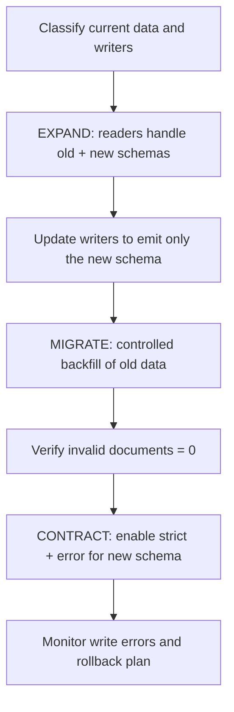
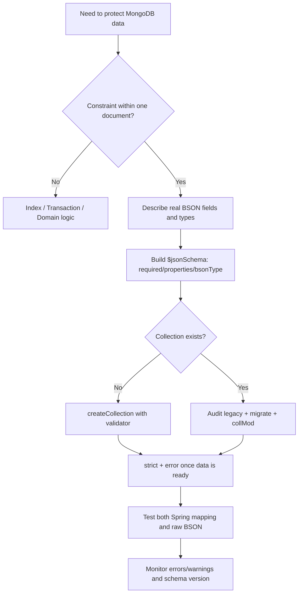

# JSON Schema, Validators, and BSON Type Constraints in Spring Data MongoDB

## 1. Why Does MongoDB Need Schema Validation?

MongoDB stores data as **BSON documents**. Two documents in the same collection can have different fields, missing fields, or different BSON types. This flexibility is useful during rapid development, but without a data contract, applications can run into hard-to-detect bugs:

- `total_cents` of order A is BSON Int64, while order B is the string `"25000"`.
- `created_at` in one document is stored as BSON Date, and in another as an ISO 8601 string.
- `status` is mistyped as `"PIAD"` yet still written successfully.
- `items` is sometimes an array, and sometimes a single object.
- Code from a legacy service writes documents missing `tenant_id`, creating a data leak risk if queries do not guard properly.

In the **SPRING_DATA_MONGODB** module, Java applications typically use `@Document`, `@Field`, `MongoTemplate`, repositories, and converters to map entities to BSON. **Java mapping alone does not guarantee that every write path into MongoDB follows the same structure**: another application, a `mongosh` script, an import job, a raw driver, or an older service version can still write unexpected data.

MongoDB supports **collection validators**, where `$jsonSchema` is a common tool for describing required fields and BSON types right at the database layer. When a write operation undergoes validation, the server can reject documents that do not satisfy the schema.

```text
Spring Data app / raw driver / import script
                  |
                  v
         MongoDB collection
                  |
                  v
        Collection validator
          ($jsonSchema)
                  |
          +-------+-------+
          |               |
        Valid          Invalid
          |               |
          v               v
      Written       "error" -> rejected
                    "warn"  -> warning logged, still written
```

**Lesson objective:** understand the difference between JSON Schema and BSON types, create a collection validator, control `required`/`null`/`array`/`object`, apply schemas using `createCollection` or `collMod`, integrate with Spring Data MongoDB, and test real-world updates.

### 1.1. Four Layers of Constraints to Distinguish

| Mechanism | Where Does It Live? | What Does It Protect? | Limitations |
|---|---|---|---|
| Java types, constructors, domain logic | Application | Creating properly typed objects, business rules | Does not control raw driver or other applications |
| Bean Validation (`@NotNull`, `@Min`, …) | Spring/Java application | Validating objects when invoked via proper validation paths | Not a MongoDB collection validator |
| MongoDB `$jsonSchema` validator | Database collection | Document shape, field presence and type on write | Does not replace uniqueness, foreign keys, or all business logic |
| Unique/partial/TTL/other indexes | Database | Uniqueness constraints or query/lifecycle support | Each index type has its own semantics; does not replace `$jsonSchema` |

A serious system can **combine all four layers**, rather than picking one and assuming the rest are redundant.

## 2. Sample Data and the Contract to Protect

### 2.1. The orders Collection

Suppose we build an order management application. Each document needs:

- `tenant_id`: non-empty String, required.
- `status`: one of `NEW`, `PAID`, `CANCELLED`, required.
- `total_cents`: BSON Int64 (`long`), non-negative.
- `created_at`: BSON Date, required.
- `items`: non-empty array of objects `{sku, quantity, unit_price_cents}`.
- `note`: optional; if present, accepts String or BSON null.

A valid document:

```javascript
{
  _id: "ORD-101",
  tenant_id: "T-A",
  status: "PAID",
  total_cents: NumberLong(25000),
  created_at: ISODate("2026-01-15T08:30:00Z"),
  items: [
    {
      sku: "SKU-BOOK",
      quantity: NumberInt(2),
      unit_price_cents: NumberLong(12500)
    }
  ],
  note: "Payment succeeded"
}
```

**Important:** `NumberLong(25000)` in `mongosh` represents BSON **Int64**; `NumberInt(2)` represents BSON **Int32**; `ISODate(...)` represents BSON **Date**. Numbers and dates look similar when printed as JSON, but the **stored BSON type is what the validator checks**.

### 2.2. Documents That Look Right But Are Invalid

```javascript
// Wrong: total_cents is String instead of BSON Int64.
{
  _id: "ORD-102",
  tenant_id: "T-A",
  status: "PAID",
  total_cents: "25000",
  created_at: ISODate("2026-01-15T08:30:00Z"),
  items: [{ sku: "SKU-BOOK", quantity: NumberInt(2),
            unit_price_cents: NumberLong(12500) }]
}

// Wrong: status is not in the allowed set of values.
{
  _id: "ORD-103",
  tenant_id: "T-A",
  status: "PIAD",
  total_cents: NumberLong(25000),
  created_at: ISODate("2026-01-15T08:30:00Z"),
  items: [{ sku: "SKU-BOOK", quantity: NumberInt(2),
            unit_price_cents: NumberLong(12500) }]
}

// Wrong: missing tenant_id and items is an object, not an array.
{
  _id: "ORD-104",
  status: "NEW",
  total_cents: NumberLong(0),
  created_at: ISODate("2026-01-15T08:30:00Z"),
  items: { sku: "SKU-BOOK", quantity: NumberInt(1),
           unit_price_cents: NumberLong(0) }
}
```

Without a validator, these documents can be saved and later cause failures in repositories, aggregations, indexes, or reading code.

### 2.3. Distinguish Stored Field Names from Java Properties

In Java, an entity might use `tenantId`, `totalCents`, `createdAt`. In BSON, they are named `tenant_id`, `total_cents`, `created_at` due to `@Field`.

**The collection schema must describe the actual BSON fields**, not the Java property names. Writing `"required": ["totalCents"]` when actual documents store `total_cents` can cause every entity-valid document to be considered missing a field by the validator.

## 3. How MongoDB's JSON Schema Differs from Pure JSON Schema

MongoDB supports a set of keywords inspired by **JSON Schema** and adds the **`bsonType`** keyword to express BSON data types.

A simple structure:

```javascript
{
  $jsonSchema: {
    bsonType: "object",
    required: ["tenant_id", "status"],
    properties: {
      tenant_id: {
        bsonType: "string",
        minLength: 1
      },
      status: {
        enum: ["NEW", "PAID", "CANCELLED"]
      }
    }
  }
}
```

**Two easily confused layers:**

1. `$jsonSchema` is the **MongoDB operator** used in validators or queries.
2. The inner object is the **schema document**, containing keywords such as `bsonType`, `required`, `properties`, `enum`, `minimum`, `items`,…

A random JSON Schema file from a website is **not guaranteed** to work verbatim as a MongoDB validator: MongoDB supports a specific set of keywords with its own constraints and BSON type handling. Check your **MongoDB Server version** and its documentation, especially for keywords involving references, formats, validator extensions, or complex expressions.

### 3.1. Keywords to Remember

| Keyword | Meaning | Example |
|---|---|---|
| `bsonType` | Allowed BSON type(s) | `"long"`, `"date"`, `"array"` |
| `required` | Fields that must be present in the object | `["tenant_id", "status"]` |
| `properties` | Schema for each field | `tenant_id: {bsonType:"string"}` |
| `enum` | Set of allowed values | `["NEW","PAID"]` |
| `minimum`, `maximum` | Numeric value bounds | `minimum: 0` |
| `minLength`, `maxLength` | String length limits | `minLength: 1` |
| `pattern` | Regex validating String values | `"^[A-Z0-9-]+$"` |
| `items` | Schema for array elements | `{bsonType:"object"}` |
| `minItems`, `maxItems` | Array element count limits | `minItems: 1` |
| `additionalProperties` | Whether fields outside `properties` are allowed | `false` |
| `description` | Description to help readers and tooling understand the schema | `"Tenant ID..."` |

Schema limits should reflect **business rules and real data**. For instance, `maxItems: 100` is not a built-in MongoDB limit, but a collection policy you choose to enforce.

### 3.2. type and bsonType: Not the Same Scope

Standard JSON Schema might describe `type: "number"`, `type: "integer"`, `type: "string"`. MongoDB additionally distinguishes:

- BSON Int32: `"int"`.
- BSON Int64: `"long"`.
- BSON Double: `"double"`.
- BSON Decimal128: `"decimal"`.
- BSON Date: `"date"`.
- BSON ObjectId: `"objectId"`.
- BSON Null: `"null"`.
- BSON Array: `"array"`.
- BSON Object: `"object"`.
- BSON Boolean: `"bool"`.

For validators that care about **exact storage representation**, `bsonType` is clearer than a generic JSON type description. Some numeric types may be accepted via a union schema if compatibility with legacy data is required; do not treat Int32 and Int64 as identical merely because Java can widen both to `long` on read.

### 3.3. JSON Schema Does Not Create Cross-Collection Constraints

`$jsonSchema` validates **a single document**. It does not automatically guarantee:

- Every customer's email is unique.
- `customer_id` in an order points to an existing customer.
- Total amount equals the sum of item prices **under a complex application-defined rule**.
- Documents across two collections are updated in the same transaction.
- Each tenant has at most one invoice with a given business key.

These requirements require combining indexes, transactions, domain logic, testing, and data pipelines.

## 4. Writing a Complete Schema for the orders Collection

### 4.1. Schema Using bsonType and required

```javascript
const orderSchema = {
  bsonType: "object",
  required: [
    "tenant_id",
    "status",
    "total_cents",
    "created_at",
    "items"
  ],
  properties: {
    _id: {
      description: "Order identifier; this example uses BSON String",
      bsonType: "string"
    },
    tenant_id: {
      bsonType: "string",
      minLength: 1,
      maxLength: 80
    },
    status: {
      bsonType: "string",
      enum: ["NEW", "PAID", "CANCELLED"]
    },
    total_cents: {
      bsonType: "long",
      minimum: 0
    },
    created_at: {
      bsonType: "date"
    },
    items: {
      bsonType: "array",
      minItems: 1,
      items: {
        bsonType: "object",
        required: [
          "sku",
          "quantity",
          "unit_price_cents"
        ],
        properties: {
          sku: {
            bsonType: "string",
            minLength: 1
          },
          quantity: {
            bsonType: "int",
            minimum: 1
          },
          unit_price_cents: {
            bsonType: "long",
            minimum: 0
          }
        }
      }
    },
    note: {
      bsonType: ["string", "null"]
    }
  }
};
```

This schema:

1. Requires core fields to be present.
2. Enforces exact BSON types for amount, timestamp, array, and quantity.
3. Rejects any status outside the enum.
4. Keeps the `items` array non-empty and requires each element to have three fields.
5. Allows `note` to be omitted, a String, or BSON null.

**Do not use `additionalProperties: false` at the root level in initial examples.** With Spring Data, documents may contain `_class` or new metadata/fields. Closing the schema too early will reject those fields. Section 9 analyzes how to use `additionalProperties` properly.

### 4.2. Root Schema Can Still Allow Other Fields

When `additionalProperties: false` is omitted, a field such as `debug_note` will not be prohibited by the schema above, provided other rules are satisfied. This is **intentional** during an open/evolving schema phase. If the product requires a closed field list, add `additionalProperties: false` and explicitly list `_id`, `_class` (if present), and all allowed fields.

### 4.3. Java Data Model Must Align with the Schema

A schema expecting `total_cents: long` must match how the Java converter writes `long`. A schema expecting `quantity: int` needs Java `int`/`Integer` converted to BSON Int32 under standard mapping. A schema expecting `created_at: date` needs the converter to store BSON Date, not a String.

Do not inspect a Jackson JSON REST response and conclude MongoDB stores the same types: REST JSON and database BSON are **two different representations**.

## 5. Creating a Collection with a Validator in mongosh

Define `orderSchema` from section 4 in the same `mongosh` session, then create the collection:

```javascript
db.createCollection("orders", {
  validator: {
    $jsonSchema: orderSchema
  },
  validationLevel: "strict",
  validationAction: "error"
});
```

Explanation:

- `validator`: document validation expression.
- `$jsonSchema: orderSchema`: uses the declared JSON Schema.
- `validationLevel: "strict"`: applies validation to inserts/updates within validation scope for documents subject to validation.
- `validationAction: "error"`: when a document violates the schema, MongoDB rejects the corresponding write operation.

A new collection is an ideal time to define validation up front. If the collection **already exists**, `db.createCollection(...)` is not the way to update the validator; use `collMod` as shown in section 10.

### 5.1. Inserting a Valid Document

```javascript
db.orders.insertOne({
  _id: "ORD-101",
  tenant_id: "T-A",
  status: "PAID",
  total_cents: NumberLong(25000),
  created_at: ISODate("2026-01-15T08:30:00Z"),
  items: [
    {
      sku: "SKU-BOOK",
      quantity: NumberInt(2),
      unit_price_cents: NumberLong(12500)
    }
  ]
});
```

With the sample schema, the document meets the BSON types and required constraints, so the command can succeed provided database, privileges, and other constraints are also satisfied.

### 5.2. Trying a Wrong-Type Document

```javascript
db.orders.insertOne({
  _id: "ORD-102",
  tenant_id: "T-A",
  status: "PAID",
  total_cents: "25000", // Wrong: BSON String.
  created_at: ISODate("2026-01-15T08:30:00Z"),
  items: [
    {
      sku: "SKU-BOOK",
      quantity: NumberInt(2),
      unit_price_cents: NumberLong(12500)
    }
  ]
});
```

With `validationAction: "error"` and a write that does not bypass validation, MongoDB rejects it because `total_cents` is not BSON `long`. In many MongoDB versions, validation errors have code **121 (DocumentValidationFailure)**; the exception and message details across drivers/Spring can vary by server, write mode, and framework.

Avoid asserting the entire error message as a fixed String, since `errInfo` structure, localized text, and driver error wrappers can differ across versions.

### 5.3. Confirming the Validator in Collection Metadata

```javascript
db.getCollectionInfos({ name: "orders" });
```

Collection info typically includes `options.validator`, `validationLevel`, and `validationAction`. This is a reliable way to verify the validator is actually installed, rather than just reading a schema file in application code.

### 5.4. Setting a Validator Does Not Mean Only Inserts Are Checked

MongoDB validators participate in **document write operations**, including both inserts and updates per the active validation mode. Thus, an update changing only `status` can still be rejected if the post-update document violates the schema, such as a legacy document still missing `tenant_id`.

With an update operator:

```javascript
db.orders.updateOne(
  { _id: "ORD-101" },
  { $set: { status: "CANCELLED" } }
);
```

The post-update document must still satisfy the schema. Setting `status: null` when the schema requires String/enum will fail validation.

## 6. BSON Type Constraints: Int32, Int64, Decimal128, Date, and ObjectId

### 6.1. Same Numeric Value, Multiple Storage Types

The value `25000` can be stored using different BSON types:

```javascript
db.numeric_samples.insertMany([
  { _id: "int32",   amount: NumberInt(25000) },
  { _id: "int64",   amount: NumberLong(25000) },
  { _id: "double",  amount: 25000.0 },
  { _id: "decimal", amount: NumberDecimal("25000.00") },
  { _id: "string",  amount: "25000" }
]);
```

Inspect the actual stored type using the `$type` aggregation expression:

```javascript
db.numeric_samples.aggregate([
  {
    $project: {
      _id: 1,
      valueType: { $type: "$amount" }
    }
  }
]);
```

`valueType` reflects the **stored BSON type**, not the Java type a repository might convert it into on read. If a schema requires `bsonType: "long"`, it will not automatically accept `"int"` or `"double"` merely because both represent 25000.

### 6.2. Common Type Mapping Table in Spring Data MongoDB

| BSON type in schema | `mongosh` example | Common Java type | Notes |
|---|---|---|---|
| `"string"` | `"T-A"` | `String` | Length and pattern can be constrained further |
| `"bool"` | `true`/`false` | `Boolean`/`boolean` | Do not equate missing or null with false |
| `"int"` | `NumberInt(3)` | `Integer`/`int` | 32-bit signed |
| `"long"` | `NumberLong(25000)` | `Long`/`long` | 64-bit signed |
| `"double"` | `25000.0` | `Double`/`double` | Has binary floating-point inaccuracy for some decimals |
| `"decimal"` | `NumberDecimal("12.34")` | `Decimal128` or `BigDecimal` with proper mapping | Precision/scale contract |
| `"date"` | `ISODate(...)` | `Date`/`Instant` depending on converter | BSON Date stores milliseconds since epoch |
| `"objectId"` | `ObjectId("...")` | `ObjectId`, sometimes converted Java String ID | Distinguish ObjectId from hex String |
| `"array"` | `["a","b"]` | `List<String>`, `Set<String>` depending on converter | Check `items`/`minItems` |
| `"object"` | `{sku:"X"}` | Embedded object/`Document` | Check nested properties |
| `"null"` | `null` | `null` | Field present with BSON null |

This is a **common mapping**, not a guarantee that every converter/custom codec yields the same representation. When an application uses `@Field(targetType=...)`, custom converters, or `MongoCustomConversions`, always inspect real BSON.

### 6.3. Accepting Multiple BSON Types During Transition

If an old collection contains both BSON Int32 and Int64 for `total_cents`, you can consider a temporary schema:

```javascript
{
  bsonType: ["int", "long"],
  minimum: 0
}
```

This relaxes compatibility, but **does not automatically convert** Int32 numbers to Int64. You need a migration plan: identify legacy data, convert types in a controlled manner, fix all writers, and then narrow the schema back to `"long"`.

Never open a union like `["int","long","double","string"]` indefinitely just to accept all old data with no cleanup plan. When monetary amounts can be String or Double, aggregations and comparisons can produce unintended semantics.

### 6.4. Currency: long Cents or Decimal128?

Two common models:

**Smallest integer unit model:**

```javascript
{ total_cents: NumberLong(25000) }
```

JSON Schema:

```javascript
{ bsonType: "long", minimum: 0 }
```

**Decimal model:**

```javascript
{ total_amount: NumberDecimal("250.00") }
```

JSON Schema:

```javascript
{ bsonType: "decimal", minimum: NumberDecimal("0.00") }
```

If using Java `BigDecimal`, configure and verify actual mapping to BSON Decimal128 for your Spring Data version. Do not assume `BigDecimal` is always stored the same way across every application or legacy converter. Also avoid mixing `total_cents` and `total_amount` without a canonical unit contract.

### 6.5. Is _id a String or ObjectId?

In the example, `_id: "ORD-101"` is a BSON String. If a collection uses real MongoDB ObjectIds:

```javascript
{ _id: ObjectId("65a000000000000000000001") }
```

then `_id: { bsonType: "string" }` will reject ObjectId. Never assume `_id`'s type solely from Java `@Id String id`: Spring Data has rules converting certain ObjectId-shaped Strings into BSON ObjectId depending on annotations/mappers and ID values.

To explicitly keep IDs as Strings, consider `@MongoId(FieldType.STRING)` or appropriately configured ID mapping. Changing the BSON type of `_id` in a live collection affects repositories, DBRefs, unique indexes, and referencing documents; it is a schema migration decision, not a quick annotation edit.

### 6.6. createdAt: ISO String Is Not BSON Date

Two different representations:

```javascript
{ created_at: "2026-01-15T08:30:00Z" }     // String
{ created_at: ISODate("2026-01-15T08:30:00Z") } // Date
```

JSON Schema:

```javascript
{ bsonType: "date" }
```

only permits BSON Date. The benefit is avoiding mixed types when filtering by ranges, using TTL indexes, or aggregating over time. However, the validator does not interpret business timezones or calendars: the application must still convert local dates/times into `Instant` per policy.

## 7. Required, Null, Missing, Empty String, and Empty Array

### 7.1. required Only Mandates Field Presence

Consider the schema:

```javascript
{
  bsonType: "object",
  required: ["tenant_id"],
  properties: {
    tenant_id: {
      bsonType: ["string", "null"]
    }
  }
}
```

With this configuration:

| Document | Result | Why? |
|---|---|---|
| `{ tenant_id: "T-A" }` | Valid | Field present, String |
| `{ tenant_id: null }` | Valid | Field present, union allows null |
| `{ }` | Invalid | Missing field listed in `required` |
| `{ tenant_id: 3 }` | Invalid | Present, but wrong BSON type |

If business rules require tenant ID to be **non-null and non-empty**, the schema should combine:

```javascript
{
  bsonType: "object",
  required: ["tenant_id"],
  properties: {
    tenant_id: {
      bsonType: "string",
      minLength: 1
    }
  }
}
```

`required` addresses **missing**, `bsonType: "string"` addresses **null/type**, and `minLength: 1` addresses **empty strings**. The three constraints complement one another.

### 7.2. An Optional Field Does Not Mean Any Type Is Allowed

`note` in the schema in section 4 **is not in `required`**, yet it is declared:

```javascript
note: { bsonType: ["string", "null"] }
```

Cases:

```javascript
// Missing note: valid.
{ /* other required fields */ }

// note is null: valid.
{ note: null /* + other required fields */ }

// note is String: valid.
{ note: "Deliver in the morning" /* + other required fields */ }

// note is a number: invalid.
{ note: NumberInt(5) /* + other required fields */ }
```

A property is only checked against `properties` **if it exists**. To make a property mandatory, put its name in `required`.

### 7.3. An Empty Array Is Valid for bsonType array Without minItems

```javascript
items: {
  bsonType: "array"
}
```

permits `items: []`. To require the array to hold at least one element:

```javascript
items: {
  bsonType: "array",
  minItems: 1
}
```

If business logic allows draft orders with no items yet, do not mechanically apply `minItems: 1` across **every status**. You may need a separate model for drafts, business-layer validation at finalization, or a collection/schema with appropriate conditional constraints.

### 7.4. Missing and Null Also Differ in Queries

The MongoDB query:

```javascript
db.orders.find({ note: null });
```

matches documents where `note` is BSON null **and** documents missing `note`. The query:

```javascript
db.orders.find({ note: { $exists: false } });
```

finds only documents lacking the field. To find documents where the field exists and has type null:

```javascript
db.orders.find({
  note: { $type: "null" }
});
```

These differences matter when auditing legacy data before enabling a strict validator. An optional `note` field may legitimately be missing, so do not treat every document without `note` as corrupted data.

## 8. Nested Objects, Arrays, and Element Limits

### 8.1. Schema for Each Element in items

In the schema in section 4:

```javascript
items: {
  bsonType: "array",
  minItems: 1,
  items: {
    bsonType: "object",
    required: ["sku", "quantity", "unit_price_cents"],
    properties: {
      sku: {
        bsonType: "string",
        minLength: 1
      },
      quantity: {
        bsonType: "int",
        minimum: 1
      },
      unit_price_cents: {
        bsonType: "long",
        minimum: 0
      }
    }
  }
}
```

Every element of the array must be a properly structured object. If one element contains `quantity: "2"` (String), the entire document can be rejected by the validator because validation applies to the **post-write document**.

### 8.2. $push Is Still Subject to Validator Checks

A MongoDB update:

```javascript
db.orders.updateOne(
  { _id: "ORD-101" },
  {
    $push: {
      items: {
        sku: "SKU-PEN",
        quantity: NumberInt(1),
        unit_price_cents: NumberLong(5000)
      }
    }
  }
);
```

can be accepted if the post-update document still meets the schema. However:

```javascript
db.orders.updateOne(
  { _id: "ORD-101" },
  {
    $push: {
      items: {
        sku: "SKU-PEN",
        quantity: "1",
        unit_price_cents: NumberLong(5000)
      }
    }
  }
);
```

would produce an array containing an object with the wrong `quantity` BSON type and will be rejected when `validationAction` is error and validation applies. Even when modifying only a single element, the entire post-update document is what gets validated.

### 8.3. Limiting Array Element Count

The schema can add:

```javascript
items: {
  bsonType: "array",
  minItems: 1,
  maxItems: 100,
  items: { bsonType: "object" }
}
```

`maxItems: 100` caps the **resulting array length**, but does not automatically offload extra elements to another collection, manage ordering, or eliminate contention when multiple writers update a hot document.

MongoDB still enforces a **16 MiB limit per BSON document**; even an array under 100 elements can hit the limit if individual elements are huge. Bound input sizes and design a child collection when data grows unboundedly.

### 8.4. uniqueItems Is Not Equivalent to Unique by sku

An array could contain two elements:

```javascript
[
  { sku: "SKU-BOOK", quantity: NumberInt(1) },
  { sku: "SKU-BOOK", quantity: NumberInt(2) }
]
```

The two objects differ in `quantity`, yet share the **same SKU**. A `uniqueItems` constraint (when supported by the server schema) checks equality of the **entire element**, and cannot express "no two items have duplicate sku fields."

If business logic requires a SKU to appear only once per order, normalize/merge items in the domain layer, use appropriate conditional updates, or move to a storage structure where database uniqueness by business key can be enforced. A **unique multikey index** also should not be treated as an automatic safeguard against duplicates among elements of **the very same document**.

### 8.5. Consider $elemMatch When Querying Arrays

The validator ensures each `items` element has the right types, but when querying for "the same item having `sku = A` and `quantity >= 2`", use `$elemMatch`:

```javascript
db.orders.find({
  items: {
    $elemMatch: {
      sku: "SKU-BOOK",
      quantity: { $gte: NumberInt(2) }
    }
  }
});
```

Do not rely on two independent dot-path predicates expecting both to constrain the same array element. **Schema validation and query semantics are two separate concerns.**

## 9. additionalProperties: false, _id, and _class Metadata

### 9.1. Why Closed Schemas Often Break Spring Data

Suppose we enable:

```javascript
{
  bsonType: "object",
  additionalProperties: false,
  required: ["tenant_id", "status"],
  properties: {
    tenant_id: { bsonType: "string" },
    status: { bsonType: "string" }
  }
}
```

This schema omits `_id`, even though standard MongoDB documents have `_id`. If the validator forbids any field outside `properties`, a document with `_id` will fail the schema.

With Spring Data MongoDB, entities may also be written with `_class` (type discriminator) depending on mapping configuration. When `additionalProperties: false` forgets `_class`, domain-valid documents saved by Spring Data can still be rejected by the database.

### 9.2. Closed Schemas Must List Every Allowed Field

An example adding complete metadata in a simplified model:

```javascript
{
  bsonType: "object",
  additionalProperties: false,
  required: ["tenant_id", "status"],
  properties: {
    _id: { bsonType: "string" },
    _class: { bsonType: "string" },
    tenant_id: { bsonType: "string", minLength: 1 },
    status: { enum: ["NEW", "PAID", "CANCELLED"] }
  }
}
```

This only illustrates **how to declare allowed metadata**, not the complete `orders` schema in section 4. If you truly enforce a closed schema, list all business fields and nested fields required.

Notes:

- `_class` may hold a type alias instead of a full class name; here the schema only requires String.
- Not every Spring Data app writes `_class` at the root; check `MongoTypeMapper` and custom converters.
- If `_id` is an ObjectId in the real collection, adjust `bsonType: "string"` accordingly; a union may be needed during migration.
- When adding a new field in a future application release, the closed schema must be updated in a controlled manner **before new writers start emitting that field**.

### 9.3. When Should Open Schemas Be Used?

In microservices systems with staggered writer versions, an open schema with **strict checks on critical fields** can have lower deployment risk:

```javascript
{
  bsonType: "object",
  required: ["tenant_id", "status", "total_cents"],
  properties: {
    tenant_id: { bsonType: "string", minLength: 1 },
    status: { enum: ["NEW", "PAID", "CANCELLED"] },
    total_cents: { bsonType: "long", minimum: 0 }
  }
  // Other fields are not prohibited.
}
```

This does not replace reviewing sensitive fields. It simply maintains a minimal contract while data evolves. If security/compliance rules mandate prohibiting unlisted fields, use a closed schema alongside a strict release/migration process.

### 9.4. Closing Nested Objects Also Requires Care

`additionalProperties: false` can be applied to **nested items** without necessarily closing the root. However, serializers/converters can add metadata to embedded objects during polymorphic mapping. Inspect real BSON of nested objects before blocking extra fields.

## 10. Changing a Validator on an Existing Collection with collMod

### 10.1. collMod Is a Schema Admin Operation, Not an Automatic Migration

An existing `orders` collection may have no validator or an outdated schema. MongoDB provides the **`collMod`** command to update a collection's validator and options:

```javascript
db.runCommand({
  collMod: "orders",
  validator: {
    $jsonSchema: orderSchema
  },
  validationLevel: "strict",
  validationAction: "error"
});
```

Here `orderSchema` is the JavaScript object from section 4, which must exist in the same `mongosh` session. `collMod` requires appropriate privileges, may be subject to replication/operational constraints, and should not be executed arbitrarily during startup across multiple application instances.

**Crucial:** changing a validator **does not automatically read, fix, and convert all existing documents**. Invalid legacy documents can remain in the collection after `collMod` runs. When they are later updated under strict/error, the write can be rejected because the post-update document still fails the schema.

### 10.2. Example: Adding a Required Field

Suppose v1 only stored:

```javascript
{
  _id: "ORD-OLD",
  status: "PAID",
  total_cents: NumberLong(10000)
}
```

A new version wants to mandate `tenant_id` and `created_at`. If `strict/error` is enabled immediately, a simple update:

```javascript
db.orders.updateOne(
  { _id: "ORD-OLD" },
  { $set: { status: "CANCELLED" } }
);
```

can fail because the post-update document still lacks tenant/time. That does not mean changing status is wrong; it is a **violation of the new schema**.

A safer plan:

1. Identify legacy records missing fields.
2. Determine an authoritative source to derive `tenant_id` and `created_at`. **Never fabricate a tenant ID** just to pass the validator.
3. Fix legacy writers and update reading services for compatibility.
4. Backfill/migrate categorized data.
5. Enable strict validation once data and write paths are ready.

### 10.3. Verifying the Validator After collMod

```javascript
db.getCollectionInfos({ name: "orders" });
```

After running, verify `options.validator`/`validationLevel`/`validationAction` and test valid/invalid writes in a test environment. Never treat a successful command execution as proof that all old documents conform to the schema.

### 10.4. Rollback Also Needs a Plan

If a new schema blocks active writers, you may need to:

- Fix the writer or converter emitting invalid data.
- Relax the validator in a controlled manner using `collMod` to restore compatibility.
- Backfill data written during the transition window.
- Re-enable the strict schema after testing.

Never treat `validationAction: "warn"` as a security-safe rollback: it **permits writing schema-violating documents**. Using this mode requires a time limit, alerts, and an accountable owner.

## 11. validationLevel and validationAction: Two Orthogonal Axes

### 11.1. validationLevel: strict and moderate

`validationLevel` determines **which documents undergo validation**.

| Mode | New Insert | Update Currently Valid Doc | Update Already-Invalid Legacy Doc |
|---|---|---|---|
| `strict` | Checked | Checked | Checked |
| `moderate` | Checked | Checked | Can be exempt from validation if the document **was already invalid before the update** |

`moderate` helps when transitioning from unvalidated legacy data to new data, so certain legacy updates are not blocked right away. However, it means already-invalid documents **do not become valid on their own**, and can keep changing without being forced to fix old flaws.

Do not interpret `moderate` as "only validate inserts, skip all updates." Updates to already-valid documents are still checked.

### 11.2. validationAction: error and warn

`validationAction` decides **what to do when a document violates the schema**.

| Mode | Primary Behavior | Best Used When |
|---|---|---|
| `error` | Rejects invalid writes when validation applies | Enforcing schema in production |
| `warn` | Permits writes while logging validation warnings | Observing violation rates during rollout/migration |

`warn` helps spot legacy writers emitting bad data, but **does not preserve data correctness**. Warnings must be collected and monitored; Java apps may receive a successful write acknowledgement, so request responses alone cannot reveal violations under `warn`.

### 11.3. Behavior Matrix by Configuration Pair

| Setting | Practical Meaning |
|---|---|
| `strict + error` | Broadly checks and rejects invalid writes; post-migration target |
| `strict + warn` | Observes all checked writes without blocking |
| `moderate + error` | Protects new/valid document writes while letting some legacy invalid updates through |
| `moderate + warn` | Transitional phase with weaker enforcement; requires close monitoring |

Exact behaviors can depend on operation, collection, and server version. In all cases, a validator **does not replace authorization**, and does not audit all existing data when settings change.

### 11.4. Example Transitioning from warn to error

Observation phase:

```javascript
db.runCommand({
  collMod: "orders",
  validator: { $jsonSchema: orderSchema },
  validationLevel: "strict",
  validationAction: "warn"
});
```

After fixing writers, backfilling, and running integration tests:

```javascript
db.runCommand({
  collMod: "orders",
  validator: { $jsonSchema: orderSchema },
  validationLevel: "strict",
  validationAction: "error"
});
```

Do not switch solely because **no errors appeared in API logs** over some period, since `warn` lets writes succeed. Inspect server/cluster logs, metrics, data audits, and verify actual running writer versions.

## 12. Validation Errors, Privileges, and bypassDocumentValidation

### 12.1. Error Code 121 and Java Exceptions

When a write is rejected by document validation, MongoDB typically reports **DocumentValidationFailure, code 121**. Depending on API/driver:

- Single insert/update may throw `MongoWriteException`.
- Bulk write may wrap errors in `MongoBulkWriteException`.
- Spring Data may translate exceptions into appropriate `DataAccessException` subclasses.
- Collection create/modify commands may throw `MongoCommandException` on invalid schema or missing privileges.

Never write production code matching only the literal text `"Document failed validation"`. Prefer detecting errors via driver exception/cause/error code or tested exception translation.

### 12.2. Does a Validation Exception Abort an Entire Transaction?

For a single-document write outside a transaction, a validation error prevents that write from succeeding. For bulk operations and multi-document transactions, stopping/continuing/rolling back depends on the API (ordered/unordered, transaction context, error mode).

If a business action needs to write an order and update metrics in another collection **all-or-nothing**, design a transaction supported by your deployment rather than assuming collection validators provide cross-collection atomicity.

### 12.3. Bypass Is a Privileged Exception

MongoDB provides `bypassDocumentValidation` for supported operations **when the caller holds appropriate privileges**. Its typical purpose is controlled data migration/recovery, not working around daily schema errors.

Illustrative option in `mongosh`:

```javascript
db.orders.insertOne(
  {
    _id: "ORD-BYPASS",
    tenant_id: "T-A",
    status: "UNKNOWN",
    total_cents: NumberLong(1),
    created_at: ISODate("2026-01-15T08:30:00Z"),
    items: [{ sku: "X", quantity: NumberInt(1),
              unit_price_cents: NumberLong(1) }]
  },
  { bypassDocumentValidation: true }
);
```

This is an **example of administrative risk, not a recommended write pattern**. Normal application users should not hold bypass privileges. A migration script granted bypass needs scope, approval, logging, snapshot/rollback, and post-write verification.

### 12.4. Do Not Use Bypass to Patch Over a Broken Converter

When Java code stores `total_cents` as a String while the validator expects `long`:

1. Inspect `@Field`, Java types, custom converters, and raw BSON before updating.
2. Fix the write path to emit proper BSON Int64.
3. Migrate documents already stored with the wrong type.
4. Retest both repository and raw driver paths.

Simply enabling bypass lets the application keep creating mixed-type data, breaking future range queries, aggregations, and reports.

## 13. Spring Data MongoDB: @Document, @Field, and Converters vs. Schema

### 13.1. Sample Entity

```java
import java.time.Instant;
import java.util.List;
import org.springframework.data.annotation.Id;
import org.springframework.data.mongodb.core.mapping.Document;
import org.springframework.data.mongodb.core.mapping.Field;

@Document(collection = "orders")
public class OrderDocument {
    @Id
    private String id;

    @Field("tenant_id")
    private String tenantId;

    private String status;

    @Field("total_cents")
    private long totalCents;

    @Field("created_at")
    private Instant createdAt;

    private List<OrderLine> items;
    private String note;

    protected OrderDocument() {}

    public OrderDocument(
            String id, String tenantId, String status,
            long totalCents, Instant createdAt,
            List<OrderLine> items, String note) {
        this.id = id;
        this.tenantId = tenantId;
        this.status = status;
        this.totalCents = totalCents;
        this.createdAt = createdAt;
        this.items = items;
        this.note = note;
    }

    public String getId() { return id; }
    public String getTenantId() { return tenantId; }
    public String getStatus() { return status; }
    public long getTotalCents() { return totalCents; }
    public Instant getCreatedAt() { return createdAt; }
    public List<OrderLine> getItems() { return items; }
    public String getNote() { return note; }
}
```

Embedded item:

```java
public record OrderLine(
    String sku,
    Integer quantity,
    Long unitPriceCents
) {}
```

**Mapping note for `OrderLine.unitPriceCents`:** by default Spring Data may store `unitPriceCents` using the exact Java property name, whereas the schema in section 4 requires `unit_price_cents`. Therefore, to use this record with that schema, declare the corresponding mapping:

```java
import org.springframework.data.mongodb.core.mapping.Field;

public record OrderLine(
    String sku,
    Integer quantity,
    @Field("unit_price_cents") Long unitPriceCents
) {}
```

This is a **replacement version** for the record in the previous snippet; keep only **one** definition of `OrderLine` in the project. Depending on Spring Data version, annotation placement on record components, fields, and constructors should be verified via integration tests against real BSON.

### 13.2. @Document Does Not Apply Validators to the Database

`@Document(collection = "orders")` selects the collection for entity mapping. It **does not mean** merely running the application automatically installs a `$jsonSchema` validator matching every Java field in MongoDB.

If the application needs collection validation, it must have an explicit **schema management** step: creating the collection with options/validator or executing a `collMod` migration command. Do not expect JPA/Hibernate-style automatic DDL in MongoDB.

### 13.3. @NotNull Is Not Equivalent to required in MongoDB

Example:

```java
import jakarta.validation.constraints.NotBlank;
import jakarta.validation.constraints.PositiveOrZero;

public record CreateOrderRequest(
    @NotBlank String tenantId,
    @NotBlank String status,
    @PositiveOrZero long totalCents
) {}
```

Bean Validation can be invoked by Spring MVC/Services when configured properly, but a `mongosh insertOne(...)` command bypasses the Java request DTO. Conversely, a MongoDB schema validator does not enforce business logic such as the current user's tenant authorization.

In multi-tenant APIs, **tenantId must not be trusted from the request**; controllers/services should derive the tenant from the authenticated security context, while MongoDB validators catch documents **missing or having the wrong type for `tenant_id`**.

### 13.4. Converters and Exact BSON Matter More Than Visible Java Types

`MongoMappingContext`, `MappingMongoConverter`, and custom conversions determine how Java objects become BSON. When a schema requires:

```javascript
total_cents: { bsonType: "long" }
```

the application must genuinely write BSON Int64. If an older service writes `BigDecimal` mapped as String while a newer service writes Decimal128, the schema sees two different types even though both Java models "read the price."

Tests should inspect the **raw `Document`** read from the collection, not only assert on Java objects after `findById`, because read converters can mask BSON type mismatches.

### 13.5. @Id and @MongoId Fields

`@Id`, `@MongoId`, and type conversions affect `_id`. For closed schemas, you must decide whether `_id` is actually String, ObjectId, or another type. You cannot just change `bsonType` without considering ID generation and existing documents.

For significant schema changes, test inserts, `save`, `updateFirst`, `upsert`, and any raw driver write paths used by the system.

## 14. Creating Collections and Modifying Validators from Java with MongoTemplate

### 14.1. MongoTemplate Collection Management Capabilities

Spring Data MongoDB includes APIs such as:

```java
// Create collection with prepared options.
mongoTemplate.createCollection(
    "orders",
    org.springframework.data.mongodb.core.CollectionOptions.empty()
);
```

However, this snippet **does not attach a JSON Schema validator**. You must build `CollectionOptions` with a schema via the `MongoJsonSchema`/`JsonSchemaProperty` API supported by your dependency, or execute MongoDB Java Driver commands with an explicit BSON schema. Never treat collection creation alone as proof that a validator is active.

With Spring Data MongoDB versions supporting the DSL:

```java
import org.springframework.data.mongodb.core.CollectionOptions;
import org.springframework.data.mongodb.core.MongoTemplate;
import org.springframework.data.mongodb.core.schema.MongoJsonSchema;
import org.springframework.data.mongodb.core.schema.JsonSchemaProperty;

MongoJsonSchema minimalSchema = MongoJsonSchema.builder()
    .required("tenant_id", "status")
    .properties(
        JsonSchemaProperty.string("tenant_id").minLength(1),
        JsonSchemaProperty.string("status")
            .possibleValues("NEW", "PAID", "CANCELLED")
    )
    .build();

mongoTemplate.createCollection(
    "orders",
    CollectionOptions.empty().schema(minimalSchema)
);
```

This is a **minimal** schema example illustrating the DSL, **not equivalent** to the full schema in section 4. Methods like `minLength`, `possibleValues`, factory types, and specific options must be checked against the Javadoc of **your exact Spring Data version** before copying into a project.

### 14.2. MongoDB Java Driver Commands with Explicit BSON Schema

When fine-grained control over validator/validationLevel/action is needed, `MongoTemplate` can access the MongoDB database directly:

```java
import org.bson.Document;
import org.springframework.data.mongodb.core.MongoTemplate;

// Assumes collection "orders" already exists.
// Java schema built from a JSON text block to demonstrate structure.
Document schema = Document.parse("""
{
  "bsonType": "object",
  "required": ["tenant_id", "status", "total_cents"],
  "properties": {
    "tenant_id": {
      "bsonType": "string",
      "minLength": 1
    },
    "status": {
      "enum": ["NEW", "PAID", "CANCELLED"]
    },
    "total_cents": {
      "bsonType": "long",
      "minimum": 0
    }
  }
}
""");

Document command = new Document("collMod", "orders")
    .append("validator", new Document("$jsonSchema", schema))
    .append("validationLevel", "strict")
    .append("validationAction", "error");

mongoTemplate.getDb().runCommand(command);
```

`Document.parse(...)` constructs a BSON document describing the **schema**, not a user-supplied query. Field names and enum values are developer-controlled constants.

**Do not run `collMod` spontaneously on every startup of every production application replica.** Schema changes should be versioned migrations running once, with dedicated privileges, impact checks, a rollback plan, and observability.

### 14.3. Creating a New Collection via MongoDB Command

To run a collection-creation command with a validator from Java:

```java
Document createCommand = new Document("create", "validated_orders")
    .append("validator", new Document("$jsonSchema", schema))
    .append("validationLevel", "strict")
    .append("validationAction", "error");

mongoTemplate.getDb().runCommand(createCommand);
```

Here `schema` is the minimal schema from section 14.2; `validated_orders` must not already exist and the caller needs collection-creation privileges. Do not write "create and ignore any error" without distinguishing already-exists from missing privileges or invalid schema.

### 14.4. Do Not Rely on Generated Schema APIs as the Sole Truth

Spring Data can generate `MongoJsonSchema` from domain type metadata in certain versions. This is helpful, but **cannot infer** all business rules, enums, cross-field constraints, null compatibility, custom storage formats, or legacy data.

Treat generated schemas as **input for review**, not an untested source of truth. After applying, verify the actual validator on the database and test both valid and invalid data.

## 15. Auditing Existing Data Before Enabling a Validator

### 15.1. Using $jsonSchema in a Query to Find Non-Matching Documents

MongoDB also supports `$jsonSchema` inside a **query predicate**, not only in collection validators. You can negate the condition with `$nor` to locate documents that do not match `orderSchema`:

```javascript
// orderSchema is defined in section 4.
db.orders.find({
  $nor: [
    { $jsonSchema: orderSchema }
  ]
});
```

This is useful for auditing data before running `collMod` with `strict + error`. However, scanning/validating a large collection can be resource-intensive; consider running on a replica/backup/maintenance window with appropriate privileges and batch limits.

**Do not confuse query validation with collection validation:**

- `find({ $jsonSchema: ... })` selects **documents matching the schema**, without modifying them.
- `find({ $nor: [{$jsonSchema: ...}] })` selects **documents not matching the schema**, without modifying them.
- `collMod(...validator...)` configures **rules for writes within validation scope**.

### 15.2. Surveying BSON Type Distributions

To detect `total_cents` mixing String/Int32/Int64:

```javascript
db.orders.aggregate([
  {
    $group: {
      _id: { $type: "$total_cents" },
      count: { $sum: 1 }
    }
  },
  { $sort: { count: -1 } }
]);
```

To detect `created_at` mixing Date and String:

```javascript
db.orders.aggregate([
  {
    $group: {
      _id: { $type: "$created_at" },
      count: { $sum: 1 }
    }
  }
]);
```

`$type` in aggregation returns `"missing"` when the field does not exist. That is why grouping by type is more informative than merely querying `field: null` when you need to separate null from missing.

### 15.3. Finding Documents Missing Required Fields

```javascript
db.orders.find({
  $or: [
    { tenant_id: { $exists: false } },
    { total_cents: { $exists: false } },
    { created_at: { $exists: false } },
    { items: { $exists: false } }
  ]
});
```

This only checks **missing fields**, and will not catch `status = PIAD`, `items = {}`, or `total_cents = "5000"`. For a thorough audit, test against the schema and measure value/type distributions.

### 15.4. Do Not Turn a Schema Error into "Fixing Data" with Arbitrary Defaults

Example legacy record missing `tenant_id`:

```javascript
{ _id: "ORD-OLD", status: "PAID" }
```

Never run:

```javascript
// ANTI-PATTERN: assigning an arbitrary tenant without knowing the real owner.
db.orders.updateMany(
  { tenant_id: { $exists: false } },
  { $set: { tenant_id: "T-A" } }
);
```

This can cause severe security and financial data corruption. Backfill only from **verified sources**, such as reconciled order-to-account links or authoritative historical mappings. Documents whose owners cannot be determined require quarantine/manual remediation workflows.

## 16. Schema Migration Compatible Across Application Versions

### 16.1. The Expand → Migrate → Contract Process

When migrating `total_cents` from BSON Int32/String to Int64 and mandating `tenant_id`, the process can be split into three phases:



**Expand:** temporarily, readers support both old and new data for zero-downtime deployment. If a validator is introduced early, it may temporarily accept union types or use `warn`, with a clear plan to narrow later.

**Migrate:** convert in batches with checkpoints, retry/idempotency support, overflow checks, tenant partitioning, and resource monitoring.

**Contract:** once all writers emit valid shapes and legacy data is compliant, enforce the strict schema. Afterward, remove legacy compatibility code once safe.

### 16.2. Example Converting String Totals to Int64

For legacy records verified to have `total_cents` as non-negative integer strings, you can consider a pipeline update:

```javascript
// Illustrative example only; test on a copy/staging first.
db.orders.updateMany(
  { total_cents: { $type: "string" } },
  [
    {
      $set: {
        total_cents: {
          $toLong: "$total_cents"
        }
      }
    }
  ]
);
```

**Do not run directly on unclassified data**: `$toLong` will fail if a string is not a valid number or overflows Int64. Handle malformed strings and check for negative values before converting.

When a `strict + error` schema requires other fields missing from old documents, a type-conversion update can still be rejected. Execute migrations in an order aligned with active validation, under explicit privileges and rollback procedures; never enable broad bypass just to make every script "succeed."

### 16.3. Changing a Status Enum Is a Data Contract Change

To add `REFUNDED`:

```javascript
status: {
  bsonType: "string",
  enum: ["NEW", "PAID", "CANCELLED", "REFUNDED"]
}
```

Consider:

1. Can older readers parse the new status? Fixed Java enums may fail.
2. Should new writers deploy first or the expanded schema first?
3. Do aggregations/repository methods filter by the old enum set?
4. Do dashboards, partial indexes, or business state machines need updates?

**A safe deployment order usually updates readers to handle the new enum, expands the schema, and only then deploys writers emitting the new status**, depending on architecture and backward-compatibility needs. Rolling back a writer does not automatically erase documents already written with the new status.

### 16.4. Do Not Manage Validators on Every Startup

If multiple instances run simultaneously:

```text
app-1 startup -> collMod
app-2 startup -> collMod
app-3 startup -> collMod
```

this can cause configuration races, overly broad permissions on application accounts, and uncertainty over which schema version is active. Use a dedicated, versioned migration/deployment tool that tracks applied state and performs post-deploy verification.

A schema release step should record deployment metadata (version, date, schema checksum, approver) **in the dedicated migration system**; authoring this lesson does not create or alter system governance files.

### 16.5. Planning Bounded Rollbacks

Schema rollback is not always "revert to the old validator." If new writers already wrote new fields or enum values that old readers cannot understand, rolling back code may still fail even after relaxing the validator. Distinguish:

- **Validator config rollback**: changing via `collMod`.
- **Application rollback**: restoring writer/reader versions.
- **Data repair/reverse migration**: converting or quarantining documents written under the new schema.

Evaluate upfront which changes are safely reversible, especially money types, ID types, required fields, and status enums.

## 17. Distinguishing JSON Schema from Indexes and Consistency

### 17.1. JSON Schema Does Not Enforce Uniqueness

The validator:

```javascript
{
  $jsonSchema: {
    bsonType: "object",
    required: ["tenant_id", "order_number"],
    properties: {
      tenant_id: { bsonType: "string" },
      order_number: { bsonType: "string" }
    }
  }
}
```

does not prevent two documents from sharing the same `(tenant_id, order_number)` pair. To enforce a unique business key:

```javascript
db.orders.createIndex(
  { tenant_id: 1, order_number: 1 },
  { unique: true, name: "ux_tenant_order_number" }
);
```

Unique indexes must be built on data without conflicting duplicate keys. Fields that can be missing/null and collations have specific uniqueness rules; verify before deploying, especially for multi-tenant compound indexes.

### 17.2. Validation Does Not Enforce Cross-Document Constraints

If business rules dictate that a tenant's total order limit cannot exceed a threshold, a per-document collection validator **cannot sum across other documents** to decide. You need domain logic, atomic conditional updates, transactions, or an appropriate aggregate model.

Similarly, `customer_id` being a valid String does not mean a customer with that ID exists. MongoDB does not create foreign keys from `$jsonSchema`.

### 17.3. JSON Schema Is Not an Access Control Mechanism

A validator can require:

```javascript
tenant_id: { bsonType: "string", minLength: 1 }
```

but it has no idea which tenant the caller is authorized for. A writer permitted to write `tenant_id: "T-B"` can still create a T-B document unless additional authorization checks exist.

In a Spring Data service:

```java
// This tenantId must come from a trusted security context.
String trustedTenantId = authenticatedTenantId;

OrderDocument order = new OrderDocument(
    "ORD-NEW",
    trustedTenantId,
    "NEW",
    0L,
    java.time.Instant.now(),
    java.util.List.of(
        new OrderLine("SKU-1", 1, 0L)
    ),
    null
);
```

This uses the constructor from section 13; `authenticatedTenantId` is provided by the authentication/authorization layer. Never trust a client-supplied value merely because MongoDB JSON Schema confirmed it is a String.

### 17.4. Validation Does Not Improve Query Performance

Requiring a field to have type `long` in a schema does not cause MongoDB to build an index on that field. If an API frequently queries:

```javascript
db.orders.find({
  tenant_id: "T-A",
  status: "PAID",
  created_at: { $gte: ISODate("2026-01-01T00:00:00Z") }
});
```

consider an index:

```javascript
db.orders.createIndex(
  { tenant_id: 1, status: 1, created_at: -1 },
  { name: "ix_tenant_status_created" }
);
```

Indexes are evaluated via workload and `explain("executionStats")`. Validators keep data in **expected types**, preventing one class of query/aggregation bugs, but do not replace index planning.

## 18. Monitoring Validator Effectiveness in Production

### 18.1. Observing Write Errors and Violation Sources

Signals to track when enabling a validator:

- Count of DocumentValidationFailure (code 121) errors by endpoint, service, deployment version, and collection.
- Legacy writers or batch jobs with elevated error rates.
- Unexpected BSON type distributions before/after migrations.
- Count of documents failing the new schema, measured via controlled audit jobs.
- Frequency of warnings when running in `validationAction: "warn"`.
- Write latency when schemas have deep/nested conditions.

Never log full financial documents or personal data merely because validation failed. Log error codes, normalized field/path names, request/job IDs, and schema versions in accordance with security policies.

### 18.2. Do Not Assume warn Appears in HTTP Responses

`warn` allows invalid writes to succeed, and warnings are mainly recorded on the MongoDB server side. Without collecting database logs/metrics, applications may keep running and only discover bad data once switched to `error`.

A meaningful `warn` rollout must have clear **exit criteria**:

```text
Warn validator enabled
        ↓
Collect warnings and identify offending writers
        ↓
Fix all primary writers
        ↓
Backfill legacy data
        ↓
Verify data and run negative tests
        ↓
Switch to strict + error
```

### 18.3. Evaluating Operational Limits

Very complex validators can increase per-write overhead. Large arrays and deeply nested objects must be checked; meanwhile, a BSON document remains capped at **16 MiB**, alongside MongoDB's other nesting, index, and request-size limits.

Do not leave schemas open to unbounded arrays merely because the validator does not immediately throw an error. For continuously growing histories, consider bounded embeddings or child collections, data lifecycles, and appropriate indexes.

## 19. Integration Testing Collection Validators Against Real MongoDB

### 19.1. Why Mocking MongoTemplate Is Insufficient

A unit test mocking `mongoTemplate.insert(...)` only proves the service invoked the method. It **does not verify**:

- Whether BSON field names after `@Field` match the JSON Schema.
- That `Long` is written as `long` and `Integer` as `int`.
- Whether `Instant` is stored as BSON Date.
- Whether documents missing `required` fields or having invalid `enum` values are rejected by the database.
- Whether `$push` into an array validates the schema of the **new element**.
- Whether `_class` is blocked by `additionalProperties: false`.
- Whether `strict`/`moderate` and `error`/`warn` are actually configured on the collection.

For testing, use a **real** MongoDB in an isolated test environment, such as MongoDB Testcontainers or a dedicated database with an independent lifecycle. Never run `dropCollection` in tests against production or shared development databases.

### 19.2. A @DataMongoTest Creating a Validated Collection

The following snippet illustrates JUnit 5, AssertJ, Spring Data MongoDB, and the MongoDB Java Driver. `@DataMongoTest`/Testcontainers setup may vary by Spring Boot version; the example assumes an isolated test database connection is ready.

```java
import java.time.Instant;
import java.util.Date;
import java.util.List;

import com.mongodb.MongoWriteException;
import org.bson.Document;
import org.junit.jupiter.api.BeforeEach;
import org.junit.jupiter.api.Test;
import org.springframework.beans.factory.annotation.Autowired;
import org.springframework.boot.test.autoconfigure.data.mongo.DataMongoTest;
import org.springframework.data.mongodb.core.MongoTemplate;

import static org.assertj.core.api.Assertions.assertThat;
import static org.junit.jupiter.api.Assertions.assertThrows;

@DataMongoTest
class OrderSchemaValidationIntegrationTest {
    private static final String COLLECTION = "validated_orders";

    @Autowired
    MongoTemplate template;

    @BeforeEach
    void recreateValidatedCollection() {
        // Isolated test database ONLY; never production or shared dev.
        if (template.collectionExists(COLLECTION)) {
            template.dropCollection(COLLECTION);
        }

        Document schema = Document.parse("""
        {
          "bsonType": "object",
          "required": [
            "tenant_id",
            "status",
            "total_cents",
            "created_at",
            "items"
          ],
          "properties": {
            "_id": { "bsonType": "string" },
            "tenant_id": {
              "bsonType": "string",
              "minLength": 1
            },
            "status": {
              "bsonType": "string",
              "enum": ["NEW", "PAID", "CANCELLED"]
            },
            "total_cents": {
              "bsonType": "long",
              "minimum": 0
            },
            "created_at": { "bsonType": "date" },
            "items": {
              "bsonType": "array",
              "minItems": 1,
              "items": {
                "bsonType": "object",
                "required": [
                  "sku", "quantity", "unit_price_cents"
                ],
                "properties": {
                  "sku": {
                    "bsonType": "string",
                    "minLength": 1
                  },
                  "quantity": {
                    "bsonType": "int",
                    "minimum": 1
                  },
                  "unit_price_cents": {
                    "bsonType": "long",
                    "minimum": 0
                  }
                }
              }
            }
          }
        }
        """);

        Document createCommand =
            new Document("create", COLLECTION)
                .append("validator",
                    new Document("$jsonSchema", schema))
                .append("validationLevel", "strict")
                .append("validationAction", "error");

        template.getDb().runCommand(createCommand);
    }

    private static Document validOrder(String id) {
        return new Document("_id", id)
            .append("tenant_id", "T-A")
            .append("status", "PAID")
            .append("total_cents", 25000L)
            .append("created_at",
                Date.from(Instant.parse(
                    "2026-01-15T08:30:00Z")))
            .append("items", List.of(
                new Document("sku", "SKU-BOOK")
                    .append("quantity", 2)
                    .append("unit_price_cents", 12500L)));
    }

    @Test
    void validBsonDocumentIsAccepted() {
        template.getCollection(COLLECTION)
            .insertOne(validOrder("ORD-OK"));

        Document saved = template.getCollection(COLLECTION)
            .find(new Document("_id", "ORD-OK"))
            .first();

        assertThat(saved).isNotNull();
        assertThat(saved.get("total_cents"))
            .isInstanceOf(Long.class);
        assertThat(saved.get("created_at"))
            .isInstanceOf(Date.class);
    }

    @Test
    void stringAmountIsRejectedWithValidationError() {
        Document wrong = validOrder("ORD-WRONG-TYPE")
            .append("total_cents", "25000");

        MongoWriteException failure = assertThrows(
            MongoWriteException.class,
            () -> template.getCollection(COLLECTION)
                .insertOne(wrong));

        assertThat(failure.getError().getCode())
            .isEqualTo(121);
    }

    @Test
    void missingRequiredFieldIsRejected() {
        Document wrong = validOrder("ORD-MISSING");
        wrong.remove("tenant_id");

        assertThrows(
            MongoWriteException.class,
            () -> template.getCollection(COLLECTION)
                .insertOne(wrong));
    }

    @Test
    void unknownStatusIsRejected() {
        Document wrong = validOrder("ORD-BAD-STATUS")
            .append("status", "PIAD");

        assertThrows(
            MongoWriteException.class,
            () -> template.getCollection(COLLECTION)
                .insertOne(wrong));
    }

    @Test
    void updateThatBreaksNestedItemSchemaIsRejected() {
        template.getCollection(COLLECTION)
            .insertOne(validOrder("ORD-UPD"));

        assertThrows(
            MongoWriteException.class,
            () -> template.getCollection(COLLECTION)
                .updateOne(
                    new Document("_id", "ORD-UPD"),
                    new Document("$set",
                        new Document("items.0.quantity", "two"))
                ));

        Document saved = template.getCollection(COLLECTION)
            .find(new Document("_id", "ORD-UPD"))
            .first();

        assertThat(saved).isNotNull();
        @SuppressWarnings("unchecked")
        List<Document> items =
            (List<Document>) saved.get("items");
        assertThat(items.get(0).getInteger("quantity"))
            .isEqualTo(2);
    }
}
```

In this test, `validOrder(...)` puts `Long` so the driver writes BSON Int64, `Integer` for BSON Int32, and `Date` for BSON Date. Asserting on the raw `Document` verifies the database representation without letting Java converters mask type discrepancies.

The error code 121 test assumes the MongoDB server returns `DocumentValidationFailure` for single writes. Bulk writes, transactions, or framework exception translation may wrap errors differently; do not treat error codes as fixed String messages.

### 19.3. Testing Spring Data Entity Mapping Against a Validated Collection

After creating `validated_orders` in test setup, you can write the entity from section 13 into this collection using the collection-name overload:

```java
OrderDocument order = new OrderDocument(
    "ORD-SPRING",
    "T-A",
    "PAID",
    25000L,
    Instant.parse("2026-01-15T08:30:00Z"),
    List.of(
        new OrderLine("SKU-BOOK", 2, 12500L)
    ),
    null
);

template.insert(order, "validated_orders");

Document raw = template.getCollection("validated_orders")
    .find(new Document("_id", "ORD-SPRING"))
    .first();

assertThat(raw).isNotNull();
assertThat(raw.get("tenant_id")).isEqualTo("T-A");
assertThat(raw.get("total_cents"))
    .isInstanceOf(Long.class);
```

This snippet belongs inside `OrderSchemaValidationIntegrationTest` if added as a test method reusing the setup. Use only the version of `OrderLine` that has `@Field("unit_price_cents")` on its record component as shown in section 13.

During testing, also inspect the raw BSON of `items[0].unit_price_cents` and `_class`. If the converter or Spring Data version writes unexpected field names, the validator should **catch the mistake** instead of silently storing bad data.

### 19.4. Testing Validator Changes on a Collection with Existing Data

A valuable scenario to test:

1. Create an unvalidated collection and insert a legacy document missing `tenant_id`.
2. Use `collMod` to enable a validator with `required: ["tenant_id"]` in `strict + error`.
3. Verify the legacy document **still exists** after `collMod`.
4. Attempt to update another field on the legacy document; observe rejection.
5. Switch to `moderate + error` in the test environment; verify update behavior on invalid legacy docs and on valid docs.
6. Backfill the legacy document from a trusted tenant source and switch back to `strict + error`.

Do not conclude from this test that every case under `moderate` must always succeed. Read the exact validation level semantics for your server version, update type, and pre-update document state.

### 19.5. Testing warn and Validator Metadata

In a separate test:

```javascript
db.runCommand({
  collMod: "validated_orders",
  validationLevel: "strict",
  validationAction: "warn"
});
```

With the validator still present, an invalid write can succeed while MongoDB logs a warning. In tests, verify the document was actually saved, and inspect server logs via the test environment if needed. Do not expect the API to return error 121 in warn mode.

After the test, **reset the collection** or recreate it in test isolation so a `warn` test never leaks into `strict/error` tests.

### 19.6. Edge-Case Suite Needed Before Production

| Case | Expectation |
|---|---|
| `tenant_id` missing | Rejected when required |
| `tenant_id` null | Rejected if only String allowed |
| `tenant_id` empty string | Rejected when `minLength: 1` |
| `status = PIAD` | Rejected by enum |
| `total_cents = "25000"` | Rejected as BSON String |
| `total_cents = NumberInt(25000)` | Rejected if only BSON long allowed |
| `total_cents = NumberLong(-1)` | Rejected by minimum |
| `created_at` is ISO String | Rejected if BSON Date required |
| `items = []` | Rejected when `minItems: 1` |
| `items = {}` | Rejected as not an array |
| An item missing `sku` | Rejected by nested required |
| An item has `quantity = "2"` | Rejected as not BSON int |
| `note` missing | Valid because optional |
| `note = null` | Valid if String/null union |
| `note = 2` | Rejected when property is present |
| Document with `_class` | Valid when root allows extra fields |
| Legacy document before `collMod` | Does not vanish automatically |
| `strict + error` update to invalid legacy | Can be rejected |
| `moderate + error` update to invalid legacy | Follows moderate semantics; must be verified |
| `warn` with invalid document | Write can succeed; server warns |
| Raw driver and Spring entity | Both checked by database validator |

**Technical Content QA** is a separate project step. The test cases above are **lesson content**, not a claim that the author executed them or verified every running API version.

## 20. Diagnosing Common Schema and Validator Errors

### 20.1. Symptom and Cause Table

| Symptom | Possible Cause | Remediation |
|---|---|---|
| `insert` throws DocumentValidationFailure (121) | Document violates `required`, `bsonType`, or other constraints | Inspect raw BSON and active validator |
| Java `long` reads fine but raw driver insert fails | Raw driver wrote Int32/String/Double instead of BSON Int64 | Write `Long`/`NumberLong` and test types |
| `createdAt` has value yet schema reports wrong type | Java/driver wrote String instead of BSON Date | Check `@Field`, converters, and `$type` |
| Document has all fields yet is still rejected | Field is present with null or wrong type | Distinguish `required` from `bsonType` |
| Adding an item via `$push` is rejected | Item missing `sku` or wrong `quantity` type | Check nested schema and post-update BSON |
| All Spring entities rejected after enabling closed schema | Forgot `_id` or `_class` in `properties` | Open schema or list actual metadata |
| `@Document` declared but collection lacks validator | Mapping annotations do not create JSON Schema | Create via migration/`CollectionOptions`/`collMod` |
| `@NotNull` does not block raw insert | Bean Validation runs in app, not database | Enable collection validator |
| Invalid documents remain after `collMod` | `collMod` does not retroactively fix old data | Audit with `$jsonSchema` and backfill |
| Updating a legacy record suddenly fails | `strict + error` checks post-update document | Migrate record or design reasonable moderate rollout |
| `warn` throws no HTTP error | Write allowed; warning logged server-side | Collect server logs/metrics; do not assume data is clean |
| String ObjectId fails `objectId` schema | Stored BSON is String, not ObjectId | Verify ID mapping and real data |
| `additionalProperties: false` blocks new field deploy | Schema not yet opened for new property | Expand schema before writers emit it |
| Unique field still has duplicates | JSON Schema does not replace unique index | Create unique index by business key |
| Queries slow despite JSON Schema | Validator does not create indexes | Design indexes and inspect explain |
| Errors after status enum change | Readers/writers/validators updated out of sync | Deploy multi-version compatible rollout |

### 20.2. Layer-by-Layer Investigation Procedure

1. **Identify collection and database:** where is the app writing? Are `@Document`, collection name, and `MongoDatabaseFactory` right?
2. **Read the real validator:** run `db.getCollectionInfos({name:"orders"})`, do not just read Java schema declarations.
3. **Inspect raw documents/commands:** check real BSON fields, types, missing/null, and nested arrays.
4. **Check validation mode:** `strict` or `moderate`, `error` or `warn`, any privileged bypass?
5. **Compare field mappings:** do `@Field`, `@Id`, `@MongoId`, and custom converters alter types or names?
6. **Check migration history:** which schema is active, are old writers, legacy docs, or partial rollouts present?
7. **Write a regression test:** insert the exact failing document and assert server response/error code in an isolated test MongoDB.

Never react to every validation error by switching `validationAction: "warn"` or adding `"null"` to every union type. Identify what **genuinely valid data** looks like per business rules and fix the true source.

### 20.3. Questions to Ask When No Error Appears Yet Data Is Wrong

If documents missing `tenant_id` still get written despite a required schema rule:

- Is the validator installed on the **right collection**?
- Is `validationAction` set to `warn` or `error`?
- Is `validationLevel` `moderate` and was the pre-update document already invalid?
- Does the client hold `bypassDocumentValidation` privileges and use bypass?
- Was the operation an update on legacy data or a new insert?
- Is `tenant_id` truly in `required` at the right object level?
- Is a writer hitting a different collection or archive than the one you inspected?

Each possibility needs a specific check; never claim the database "ignored the validator" before verifying these settings.

## 21. Hands-On Lab: Adding Schema Validation for Orders

**Scenario:** a Spring Data MongoDB system starts with an unvalidated `orders` collection. Data contains mixed BSON types written by various services and scripts. You need to standardize documents, block new bad writes, and avoid disrupting service for existing legacy data.

### 21.1. Part A — Create Schema and Test BSON Types

1. Use `mongosh` to create a new test collection, never a production collection.
2. Define `orderSchema` from section 4 with `required`, `properties`, `enum`, `minimum`, nested `items`, and BSON types.
3. Create the collection via `db.createCollection` with `validationLevel: "strict"`, `validationAction: "error"`.
4. Insert a valid `ORD-101`; verify success.
5. Test `total_cents` as `NumberInt(25000)`, `NumberLong(25000)`, `"25000"`, and `NumberDecimal("25000")`. Record which BSON types are accepted.
6. Test `created_at` as an ISO String vs. `ISODate`; compare outcomes.
7. Test missing `tenant_id`, `tenant_id: null`, and `tenant_id: ""` to distinguish the three constraints.
8. Test `items: []`, `items: {}`, an item missing `sku`, and an item with `quantity: "2"`.

### 21.2. Part B — Spring Data MongoDB Integration

1. Create entity `OrderDocument` and record `OrderLine` per section 13.
2. Add `@Field("tenant_id")`, `@Field("total_cents")`, `@Field("created_at")`, and `@Field("unit_price_cents")` for items.
3. Use `MongoTemplate.insert(order, "validated_orders")` or a repository on the corresponding test collection.
4. Read the raw BSON `Document` to verify String, Long, Date, Int32, and `_class`.
5. In a **controlled test variant**, switch `long totalCents` to a custom converter writing String; verify the validator catches the schema mismatch.
6. Compare Bean Validation with database validation by inserting an invalid document via the raw driver.
7. If using Spring Data's `MongoJsonSchema` DSL, read back the actual validator options and verify API version compatibility.

### 21.3. Part C — Deploying to an Existing Collection

1. Create a legacy collection containing at least three flaw types: missing tenant, `total_cents` as String, and `created_at` as String.
2. Use `$type`/`$jsonSchema` queries to classify and count non-conforming documents.
3. Enable the validator in `strict + warn` mode on the test collection, perform an invalid write, and inspect logs/metadata.
4. Update writers in the test setup so they emit only the new schema.
5. Backfill legacy data using verifiable sources—never assign arbitrary tenants.
6. Verify zero invalid documents remain under the new schema, then switch to `strict + error`.
7. Attempt an update on an invalid legacy document under `moderate + error` and `strict + error`; explain the difference.
8. Outline a rollback plan if an older service still emits invalid types.

### 21.4. Part D — Security, Uniqueness, and Performance

1. Create two orders with the same business `order_number` in the same tenant; prove `$jsonSchema` does not prevent duplicates.
2. Design a unique compound index on `tenant_id` and `order_number`, resolving duplicate data before creating the index.
3. Verify how tenant ID is sourced from the security context rather than client-submitted requests.
4. Test the impact of enabling `additionalProperties: false` without listing `_id`/`_class`.
5. Run `explain("executionStats")` on a tenant/status/time filter query to prove query indexes are separate from validators.
6. Measure write latency and validation failure counts when schemas validate long nested arrays.
7. Propose when `items` should be extracted into a child collection if arrays grow unboundedly.

### 21.5. Completion Criteria

Learners succeed when they can demonstrate:

- `$jsonSchema` and `bsonType` inspect **actual BSON data**, not just Java field types.
- `required` differs from `null`, empty Strings, and empty arrays.
- Nested schemas protect individual array elements even during `$push`.
- `validationLevel` and `validationAction` serve different purposes.
- `collMod` changes the validator but **does not automatically migrate** old data.
- Spring Data `@Document`/`@Field`/converters must align with database JSON Schema.
- JSON Schema, unique indexes, authorization, and transactions enforce distinct layers of constraints.
- Constraints can be tested against real MongoDB, raw drivers, and `MongoTemplate`.
- Production rollouts include data audits, error monitoring, and rollback plans.

## 22. Quick Reference Table

| Concept | Right Understanding |
|---|---|
| MongoDB JSON Schema | Describes structural constraints of a BSON document |
| `$jsonSchema` | Operator checking schemas in validators or queries |
| `bsonType` | Accepted BSON types: int, long, date, objectId, array,… |
| `required` | Field must **be present**; does not imply non-null |
| `properties` | Schemas for listed fields |
| `enum` | Allowed set of values |
| `minimum` / `minLength` | Numeric/String length bounds |
| `items` / `minItems` | Array element/length constraints |
| `additionalProperties: false` | Forbids unlisted fields; remember `_id` and `_class` |
| `db.createCollection` | Creates a new collection with a validator |
| `collMod` | Modifies validator/options of an existing collection |
| `validationLevel: strict` | Checks inserts/updates under strict scope |
| `validationLevel: moderate` | Exempts updates on already-invalid documents |
| `validationAction: error` | Rejects invalid writes when validation applies |
| `validationAction: warn` | Logs a warning while permitting the write |
| Error 121 | Typically DocumentValidationFailure |
| `bypassDocumentValidation` | Privileged exception mechanism, not a daily workaround |
| `@Document` / `@Field` | Entity/field mapping; **does not install JSON Schema** |
| `MongoJsonSchema` / `CollectionOptions` | Spring Data DSL/schema options depending on version |
| `$type` aggregation | Inspects actual BSON type distribution |
| `find({$nor:[{$jsonSchema: ...}]})` | Finds non-conforming data for auditing |
| Unique index | Prevents duplicate keys per index semantics; JSON Schema does not replace it |
| Transaction | Handles multi-document operations requiring atomicity |
| Expand → Migrate → Contract | Schema rollout process compatible with legacy data/writers |

### 22.1. Decision Flowchart



**Conclusion:** JSON Schema and collection validators allow MongoDB to protect core constraints right at the storage layer, whether documents arrive via `MongoTemplate`, repositories, raw drivers, or scripts. To use them correctly, design against **real BSON types**, distinguish **missing/null**, account for `_id`/`_class`, manage validation modes, and run controlled migrations. Validators are strongest when combined with **Java mapping, Bean Validation, unique indexes, authorization, transactions, and integration tests** — not when treated as the sole solution for every business rule.

**Version-Aware References:** [MongoDB — Schema Validation](https://www.mongodb.com/docs/manual/core/schema-validation/), [MongoDB — JSON Schema](https://www.mongodb.com/docs/manual/core/schema-validation/specify-json-schema/), [MongoDB — Specify Validation Level](https://www.mongodb.com/docs/manual/core/schema-validation/specify-validation-level/), [MongoDB — Specify Validation Action](https://www.mongodb.com/docs/manual/core/schema-validation/specify-validation-action/), [MongoDB — $jsonSchema](https://www.mongodb.com/docs/manual/reference/operator/query/jsonSchema/), [MongoDB — BSON Types](https://www.mongodb.com/docs/manual/reference/bson-types/), [Spring Data MongoDB — JSON Schema](https://docs.spring.io/spring-data/mongodb/reference/mongodb/mapping/mapping-schema.html), [Spring Data MongoDB — Collection Management](https://docs.spring.io/spring-data/mongodb/reference/mongodb/template-collection-management.html). When implementing, verify keywords, builder APIs, validator modes, driver errors, and mapping metadata against your project's current MongoDB Server and Spring Data MongoDB versions.
