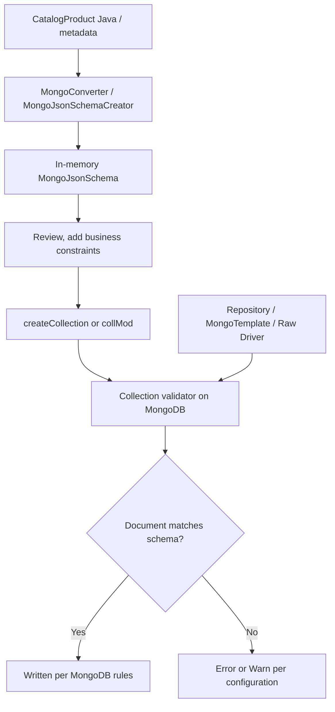

# MongoJsonSchema and Schema Generation from Metadata

## 1. Problem: Valid Java Entities Can Still Produce Invalid MongoDB Data

MongoDB allows documents in the same collection to have different structures. This flexibility helps when models evolve, yet causes trouble when multiple applications, batch jobs, or the raw MongoDB Driver write to the same collection.

Suppose a catalog service uses **Spring Data MongoDB** with entity `CatalogProduct`. Java defines prices as `BigDecimal`, status as an `enum`, and `tags` as a list, yet real data in the collection might look like:

```javascript
// Valid document per application contract.
{
  _id: "product-01",
  tenant_id: "tenant-A",
  sku: "KB-001",
  name: "Mechanical Keyboard",
  price_amount: NumberDecimal("1850000.00"),
  status: "ACTIVE",
  tags: ["keyboard", "wireless"],
  schemaVersion: 1
}

// Document written with wrong types by an older job.
{
  _id: "product-02",
  tenant_id: "tenant-A",
  sku: 12345,
  name: "Mouse",
  price_amount: "650000",
  status: "UNKNOWN_STATE",
  tags: "mouse",
  schemaVersion: "1"
}
```

Both are syntactically valid BSON documents. However, the second document violates the contract across services: `sku` and `tags` have wrong types, money is stored as a string, and `schemaVersion` is not an integer.

**MongoDB JSON Schema validation** lets you attach a rule set to a collection so MongoDB automatically checks documents on write. Spring Data MongoDB provides:

- **`MongoJsonSchema`:** Java model to build and represent MongoDB JSON Schema.
- **`MongoJsonSchemaCreator`:** generates an initial schema from entity mapping metadata and converters.
- **`CollectionOptions.schema(...)`:** attaches a schema when creating a collection.
- **`MongoTemplate` / `ReactiveMongoTemplate`:** interacts with collections and data under configured validator rules.
- **`collMod`:** updates the validator on an existing collection without deleting data.

This lesson belongs to the **Collections and Schema** chapter of the **SPRING_DATA_MONGODB** module, connecting document mapping with repositories, `MongoTemplate`, indexes, transactions, reactive access, testing, and performance diagnostics.

**Key takeaway:** *generating a `MongoJsonSchema` object in Java does not automatically activate validation on MongoDB*. Server-side validation only takes effect once the schema is installed as a **collection validator** with appropriate `validationLevel` and `validationAction`.

## 2. Three Data Contract Layers Not to Equate

| Layer | Common Tools | Scope of Enforcement |
| --- | --- | --- |
| **Java Model** | `@Document`, `@Field`, `@MongoId`, `MongoConverter` | Converts Java objects to BSON and back |
| **Application Validation** | Bean Validation, service/domain rules | Validates on configured application call paths |
| **MongoDB-Side Validation** | `validator: {$jsonSchema: ...}` | Checks inserts/updates on the collection per configuration |

For instance, `@Field(targetType = FieldType.DECIMAL128)` instructs Spring Data to write `BigDecimal` as BSON Decimal128. That annotation **does not** turn a collection already holding invalid data into a strictly validated collection.

Similarly, `@NotNull` in Java can be evaluated by Bean Validation when the application invokes a validator properly, yet you **must not assume** every validation annotation automatically becomes MongoDB `required` when using a schema generator. Inspect the actual generated schema.



The critical boundary is the **`createCollection`/`collMod`** arrow. Without deploying the schema to the server, invoking `MongoJsonSchemaCreator` only aids inspection/design and does not constrain other clients writing to the database.

## 3. What Is MongoDB `$jsonSchema`?

MongoDB has supported JSON Schema validation since MongoDB 3.6, using keywords such as:

| Keyword | Meaning | Example |
| --- | --- | --- |
| `bsonType` | Accepted BSON type(s) | `"string"`, `"decimal"`, `"int"`, `"date"`, `"array"` |
| `required` | List of fields **required to be present** | `["sku", "name"]` |
| `properties` | Rules for each field in an object | `"price_amount": {...}` |
| `minLength` / `maxLength` | String length | `minLength: 2` |
| `pattern` | Regex for strings | SKU code pattern |
| `enum` | Allowed set of values | `["ACTIVE","ARCHIVED"]` |
| `minimum` / `maximum` | Numeric value bounds | `minimum: NumberDecimal("0")` |
| `items` | Array element rules | `items: {bsonType:"string"}` |
| `minItems` / `maxItems` | Array element count | `maxItems: 30` |
| `additionalProperties` | Whether fields outside `properties` are allowed | `false` for strict shape control |

**`bsonType` is a key MongoDB extension**, distinct from standard JSON Schema's `type` keyword. MongoDB's JSON Schema does not implement every feature of all JSON Schema Draft specifications; check the keywords supported by your running server version.

### 3.1. Which Document Does JSON Schema Validate?

`$jsonSchema` describes **a complete MongoDB document** starting from the root, including embedded subdocuments. A schema is not just an API response DTO.

For collections with `_id`, MongoDB generates `_id` on insert if omitted; if you enable `additionalProperties:false`, `_id` must also be listed in `properties`. If Spring Data writes a `_class` discriminator field, that field must be accounted for as well.

### 3.2. `required` Differs from "Non-Null"

Schema:

```javascript
{
  bsonType: "object",
  required: ["name"],
  properties: {
    name: { bsonType: "string" }
  }
}
```

- Missing `name`: invalid due to `required`.
- `name: null`: invalid due to `bsonType:"string"`.
- `name: ""`: **still a valid string**, since `minLength` is not set.
- `name: "Keyboard"`: valid under all three rules above.

If a field is **optional** yet may be null:

```javascript
description: {
  bsonType: ["string", "null"]
}
```

If a field is only allowed to be a string when present, omit `description` from `required` and keep `bsonType:"string"`; when absent, it is not evaluated as null.

## 4. Designing the Schema in `mongosh` Before Writing Java

Use an experimental collection named `catalog_products_demo`:

```javascript
db.createCollection("catalog_products_demo", {
  validator: {
    $jsonSchema: {
      bsonType: "object",
      required: [
        "tenant_id",
        "sku",
        "name",
        "price_amount",
        "status",
        "schemaVersion"
      ],
      properties: {
        _id: {
          bsonType: "string"
        },
        tenant_id: {
          bsonType: "string",
          minLength: 1
        },
        sku: {
          bsonType: "string",
          minLength: 3
        },
        name: {
          bsonType: "string",
          minLength: 2
        },
        price_amount: {
          bsonType: "decimal",
          minimum: NumberDecimal("0")
        },
        status: {
          enum: ["DRAFT", "ACTIVE", "ARCHIVED"]
        },
        schemaVersion: {
          bsonType: "int",
          minimum: 1
        },
        tags: {
          bsonType: "array",
          items: { bsonType: "string" },
          maxItems: 30
        },
        shipping: {
          bsonType: "object",
          required: ["country"],
          properties: {
            country: { bsonType: "string" },
            postalCode: { bsonType: "string" }
          }
        }
      }
    }
  },
  validationLevel: "strict",
  validationAction: "error"
});
```

This example is a **hand-written validation contract**:

- `tenant_id`, `sku`, `name`, `price_amount`, `status`, `schemaVersion` are required fields.
- `price_amount` must be a non-negative BSON Decimal128.
- `status` accepts only three values.
- `tags`, if present, must be an array of strings with at most 30 elements.
- `shipping.country` must be present **if the `shipping` subdocument exists**; `shipping` itself is optional since it is not in root `required`.

**Do not install an overly strict schema immediately on production** if the collection holds legacy data. This example is for a test database or a reviewed migration.

### 4.1. Testing a Valid Document

```javascript
db.catalog_products_demo.insertOne({
  _id: "product-01",
  tenant_id: "tenant-A",
  sku: "KB-001",
  name: "Mechanical Keyboard",
  price_amount: NumberDecimal("1850000.00"),
  status: "ACTIVE",
  schemaVersion: NumberInt(1),
  tags: ["keyboard", "wireless"],
  shipping: {
    country: "VN",
    postalCode: "700000"
  }
});
```

Expected outcome: insert is acknowledged unless another error such as duplicate `_id` occurs.

### 4.2. Testing a Wrong-Type Document

```javascript
db.catalog_products_demo.insertOne({
  _id: "product-02",
  tenant_id: "tenant-A",
  sku: 1001,
  name: "Mouse",
  price_amount: "650000",
  status: "ACTIVE",
  schemaVersion: NumberInt(1)
});
```

Expected outcome: the server rejects the write for failing validation rules; MongoDB typically reports validation error code **121 — DocumentValidationFailure** in standard cases.

**Do not write tests asserting exact error message text.** `errInfo` content and error messages can change across versions; assert the error type/code and verify the document is absent after rejection.

### 4.3. Verifying the Validator Is Installed on the Collection

```javascript
db.getCollectionInfos({
  name: "catalog_products_demo"
})[0].options;
```

You should see the expected `validator`, `validationLevel`, and `validationAction`. This distinguishes a **schema existing in Java** from a **schema actually installed on MongoDB**.

## 5. Spring Data MongoDB Entity as Schema Generation Input

We define an entity representing the storage contract.

```java
import java.math.BigDecimal;
import java.util.List;

import org.springframework.data.mongodb.core.mapping.Document;
import org.springframework.data.mongodb.core.mapping.Field;
import org.springframework.data.mongodb.core.mapping.FieldType;
import org.springframework.data.mongodb.core.mapping.MongoId;

@Document(collection = "catalog_products")
public record CatalogProduct(
    @MongoId(FieldType.STRING)
    String id,

    @Field("tenant_id")
    String tenantId,

    String sku,
    String name,

    @Field(
        value = "price_amount",
        targetType = FieldType.DECIMAL128
    )
    BigDecimal price,

    ProductStatus status,
    List<String> tags,

    int schemaVersion,
    Boolean active,

    ShippingInfo shipping
) {
    public enum ProductStatus {
        DRAFT, ACTIVE, ARCHIVED
    }

    public record ShippingInfo(
        String country,
        String postalCode
    ) {}
}
```

### 5.1. Metadata Meaningful for Schema Generation

| Metadata / Java Type | Verifiable Effect |
| --- | --- |
| `@Document(collection = "...")` | Identifies the collection the entity maps to |
| `@MongoId(FieldType.STRING)` | Explicitly states intent to store `_id` as a string |
| `@Field("tenant_id")` | Maps Java property `tenantId` to BSON `tenant_id` |
| `@Field(targetType = DECIMAL128)` | Guides converter to write money as BSON decimal |
| `ProductStatus enum` | Can generate constraints for enum names |
| `List<String> tags` | Generates array type and element description per available generic metadata |
| `int schemaVersion` | Java primitive; generator treats it as a required field |
| `Boolean active` | Wrapper; may be missing or null depending on model usage |
| `ShippingInfo` | A subdocument with nested properties |

**Caution with IDs:** a `String` field can be converted by Spring Data into a BSON ObjectId under certain default ID mappings when values are compatible. `@MongoId(FieldType.STRING)` clarifies the ID key's schema. A schema requiring `_id` as string will reject documents with an ObjectId `_id`.

### 5.2. Generating a Schema Does Not Infer All Business Rules

From Java `String sku`, the generator cannot know that SKUs must be **at least three characters**, unique within a tenant, and conform to a code format. From `BigDecimal price`, it does not automatically know **price must be ≥ 0**. These are rules to review and add manually.

Likewise, the domain model has `active` and `status`, yet business rules might require `status=ARCHIVED => active=false`. Such cross-field inference does not emerge merely from having two Java properties.

## 6. `MongoJsonSchemaCreator`: Generating Schema from Mapping Metadata

The central API resides at **`org.springframework.data.mongodb.core.MongoJsonSchemaCreator`**:

```java
import org.springframework.data.mongodb.core.MongoJsonSchemaCreator;
import org.springframework.data.mongodb.core.MongoTemplate;
import org.springframework.data.mongodb.core.schema.MongoJsonSchema;

public class CatalogSchemaGenerator {

    private final MongoTemplate template;

    public CatalogSchemaGenerator(MongoTemplate template) {
        this.template = template;
    }

    public MongoJsonSchema generate() {
        return MongoJsonSchemaCreator
            .create(template.getConverter())
            .createSchemaFor(CatalogProduct.class);
    }
}
```

Breakdown:

1. `template.getConverter()` obtains the **`MongoConverter`** configured in the application.
2. `MongoJsonSchemaCreator.create(converter)` builds a schema creator aware of mapping and conversions.
3. `createSchemaFor(CatalogProduct.class)` inspects metadata on the domain type and produces a **`MongoJsonSchema`**.
4. The output is **only an in-memory schema object**; it creates no collection, modifies no validator, and does not invoke `collMod`.

Using the real converter matters when the application registers custom converters or non-default field storage rules. Do not construct a `MongoJsonSchemaCreator` detached from production converter configuration and expect its schema to reflect production type mappings.

### 6.1. Inspecting the Generated BSON Schema

```java
import org.bson.Document;

MongoJsonSchema generated = MongoJsonSchemaCreator
    .create(template.getConverter())
    .createSchemaFor(CatalogProduct.class);

Document rootSchema = generated.schemaDocument();
Document validatorDocument = generated.toDocument();

System.out.println(rootSchema.toJson());
System.out.println(validatorDocument.toJson());
```

Distinguish:

- `schemaDocument()`: contents of the root schema (e.g., `{type:"object",properties:{...}}`).
- `toDocument()`: document containing the **`$jsonSchema`** wrapper used in validators.

**Mapping caveat:** `MongoJsonSchema` Javadoc notes that field names may need processing via `JsonSchemaMapper` to apply custom property naming. When using `@Field` and custom converters, **inspect the actual BSON output** to confirm it contains `tenant_id` and `price_amount`, rather than relying on Java source property names.

Do not deploy an improperly mapped validator to production. If you need independently reviewed and maintained rules, you may prefer a hand-authored BSON schema with field names **matching MongoDB exactly**.

### 6.2. Can You Generate a Schema from a Class Other Than the Source Entity?

`MongoJsonSchemaCreator` accepts any `Class<?>`, but the input should be a **type reflecting the complete stored document**, not a summary response DTO missing fields. Passing `ProductSummaryDto.class` with `id,name,price` will produce a schema unaware of other fields in `catalog_products`.

To define the collection and schema of stored documents, use the mapped domain type and review the generated output carefully.

## 7. Metadata Schema Generation Rules: Knowing What Is "Predictable"

According to Spring Data MongoDB documentation, the schema generator applies key rules:

| Type / Annotation | Typical Schema Representation |
| --- | --- |
| Java primitives (`int`, `boolean`,...) | **Required** field |
| `String` and simple types | Corresponding BSON type |
| `Enum` | String with `enum` of enum names |
| `List<T>`, standard Java arrays | Array; element details per generic metadata |
| `Map<K,V>` | Object |
| Nested class/record | Object with nested properties |
| `byte[]` | BSON binary data (`binData`) |
| `@Transient` | Property excluded from schema |
| `@Field(...)` | Field name / target BSON type mapping per metadata and converter |
| `@MongoId(...)` | Provides clearer BSON type information for `_id` |
| Custom converters | Can influence inferred BSON types |

Simple class example:

```java
import org.springframework.data.annotation.Transient;

public class ExampleMetadata {
    public String name;
    public int revision;
    public Boolean published;

    @Transient
    public String computedLabel;
}
```

Expected semantics:

- Primitive `revision` is treated as required when generating the schema.
- Wrapper `Boolean` `published` is not automatically required.
- `computedLabel` is omitted due to `@Transient`.
- `name` is a string field, without an automatic `minLength>0` constraint.

**Do not treat "non-null property in constructor" as proof that the schema generator inferred business requiredness.** Verify the `required` array emitted by the creator and add fields truly mandated by your contract.

## 8. `@MongoId`, `@Field`, and BSON Type Mismatches

This is the category of discrepancies that causes many projects to fail writes once a validator is installed.

### 8.1. String ID or ObjectId?

Two entities may both declare `String id` in Java yet map to different BSON types depending on annotations/converters:

```java
// Explicitly BSON string ID.
@MongoId(FieldType.STRING)
String id;
```

versus an entity using `@Id String id` that converts to ObjectId under suitable conditions.

If an existing collection contains:

```javascript
{ _id: ObjectId("64f000000000000000000001"), name: "A" }
{ _id: "product-02", name: "B" }
```

then a validator forcing `_id` to string-only will interfere with updating legacy ObjectId documents. Before locking down the schema, survey existing BSON types and plan a migration.

### 8.2. Decimal128 Differs from String or Double

Model:

```java
@Field(
    value = "price_amount",
    targetType = FieldType.DECIMAL128
)
BigDecimal price;
```

When configured with a proper converter, prices are stored as BSON Decimal128. Matching validator:

```javascript
price_amount: {
  bsonType: "decimal",
  minimum: NumberDecimal("0")
}
```

`"1850000.00"` (string) or `1850000.00` interpreted as double in shell contexts are **not equivalent** to Decimal128.

**Do not leave `bsonType:["decimal","double","string"]` forever just to "avoid errors"** if your goal is standardizing monetary values. A temporary compatibility window with an explicit migration plan may be needed, followed by tightening to decimal.

### 8.3. Field Renames and Nested Paths

Java:

```java
@Field("tenant_id")
String tenantId;
```

MongoDB schema:

```javascript
tenant_id: {
  bsonType: "string"
}
```

A validator mistakenly written with `tenantId` checks a different field than the one Spring Data actually writes. With nested classes using `@Field` on child fields, verify BSON names at **every nesting level**.

## 9. Building `MongoJsonSchema` Manually with the Builder

You do not have to start from the generator. Spring Data offers `MongoJsonSchema.builder()` and `JsonSchemaProperty` factory methods.

```java
import static org.springframework.data.mongodb.core.schema
    .JsonSchemaProperty.object;
import static org.springframework.data.mongodb.core.schema
    .JsonSchemaProperty.string;

import org.springframework.data.mongodb.core.schema.MongoJsonSchema;

MongoJsonSchema schema = MongoJsonSchema.builder()
    .required("sku", "name")
    .properties(
        string("sku").minLength(3),
        string("name").minLength(2),
        object("shipping")
            .properties(
                string("country").minLength(2),
                string("postalCode").minLength(5)
            )
    )
    .build();
```

This is a **minimal manual schema** for demonstrating the builder, not the complete validator for `CatalogProduct`. It does not require `shipping` to be present; it only describes the shape when `shipping` is written.

Strengths of the builder:

- Type-safe API for common JSON Schema rules.
- Avoids raw JSON strings for straightforward schemas.
- Easy to reuse helper factory methods and read in Java code.

Limitations:

- Structures with many specialized rules can make builder code verbose and harder to review.
- Does not infer business invariants when only declaring types.
- Schema field names must still be checked against real BSON, especially when mapping renames fields.
- `MongoJsonSchema.of(Document)` may be better when a data team maintains canonical BSON schemas independently.

### 9.1. Manual Schema via BSON Document

```java
import org.bson.Document;
import org.springframework.data.mongodb.core.schema.MongoJsonSchema;

Document rawSchema = Document.parse("""
{
  "bsonType": "object",
  "required": ["sku", "name"],
  "properties": {
    "sku":  { "bsonType": "string", "minLength": 3 },
    "name": { "bsonType": "string", "minLength": 2 }
  }
}
""");

MongoJsonSchema schema = MongoJsonSchema.of(rawSchema);
```

Text blocks require Java 15+; in older Java projects, use ordinary strings or construct the `Document` with `append`.

**Note:** `rawSchema` here is the **root schema**, without a `$jsonSchema` wrapper. Calling `schema.toDocument()` adds the `$jsonSchema` wrapper. Never wrap it twice, as `{$jsonSchema:{$jsonSchema:...}}` is invalid.

## 10. Combining Metadata-Generated Schema with Business Rules

A practical strategy is typically:

1. Use `MongoJsonSchemaCreator` to generate a **draft type/schema** from the domain model.
2. Print `schemaDocument()` or export BSON for review.
3. Add business conditions such as `required`, `minimum`, `minLength`, `enum`, `maxItems`, and null policy.
4. Reconcile BSON field names, converters, legacy documents, and write paths.
5. Place the reviewed validator into a versioned migration/configuration; **never** overwrite production validators on every deploy merely because a Java entity changed.

Examples of contract rules to add:

| Rule | Generated from Java Types? | Additional Design Needed? |
| --- | --- | --- |
| `schemaVersion` is BSON int | Possibly from primitive `int` | Validate allowed version ≥ 1 |
| `tenant_id` is string | Possibly from mapping metadata | Required and non-empty |
| `price_amount` is Decimal128 | From appropriate target BSON type/converter | Non-negative; currency policy |
| `sku` is string | Yes | MinLength/pattern and **unique index** |
| `status` is enum | Typically includes enum values | State transition rules |
| `tags` is array | Possibly | MaxItems, item type, internal uniqueness if needed |
| `active` is `Boolean` | Possibly | Required or optional? Nullable? |

### 10.1. Should You Mutate `schemaDocument()` in Java?

Technically, `schema.schemaDocument()` returns a `Document` that can be modified; however, ad-hoc mutation of a generated `Document` easily omits or overwrites fields by mistake. For a production validator:

- Author the canonical schema cleanly with tests and review.
- If merging schemas is needed, use `MongoJsonSchema.merge(...)`/schema builder capabilities per your version, **but do not assume merging resolves every type conflict**.
- When two sources define conflicting rules for the same field, explicitly decide **which rule wins** rather than silently overwriting.
- Document *why* min/max/enum constraints exist; that knowledge cannot be inferred from Java types.

## 11. Creating a Schema-Validated Collection with `MongoTemplate`

Once `MongoJsonSchema` has been reviewed, you can create the collection and attach the validator at creation time.

```java
import org.springframework.data.mongodb.core.CollectionOptions;
import org.springframework.data.mongodb.core.MongoTemplate;
import org.springframework.data.mongodb.core.MongoJsonSchemaCreator;
import org.springframework.data.mongodb.core.schema.MongoJsonSchema;

public void createCatalogCollection(MongoTemplate template) {
    MongoJsonSchema schema = MongoJsonSchemaCreator
        .create(template.getConverter())
        .createSchemaFor(CatalogProduct.class);

    CollectionOptions options = CollectionOptions.empty()
        .schema(schema)
        .strictValidation()
        .failOnValidationError();

    template.createCollection(
        CatalogProduct.class,
        options
    );
}
```

`createCollection(Class<T>, CollectionOptions)` uses entity metadata to target the collection matching `@Document(collection="catalog_products")`.

**Why review before running?** The snippet above installs an **auto-generated schema**, which may lack business constraints such as price ≥ 0 or SKU patterns. In real systems, replace `schema` with a **reviewed and tested schema**.

### 11.1. What If the Collection Already Exists?

`createCollection(...)` is a **collection creation** operation, not a validator update for an existing collection. If the collection already exists, creation can fail; **never drop the collection to re-run** in production.

For existing collections, use `collMod` via a controlled migration (section 12). Checking `template.collectionExists(...)` only helps decide the creation branch; **it does not prove the validator is at the right version**.

### 11.2. Do Not Put Risky Bootstrapping into Every Startup

If multiple application instances start concurrently, having every instance execute `createCollection`/`collMod` can trigger races and make rollouts hard to control.

A more reliable operational model uses a migration/deployment step with clear ownership, permissions, auditing, and rollback capability. Normal runtime services only need required read/write permissions and should not necessarily hold privileges to alter collection structures.

## 12. Collections with Existing Data: Updating Validators via `collMod`

MongoDB supports the `collMod` command to change a validator without dropping the collection.

Illustrative minimal schema example:

```javascript
db.runCommand({
  collMod: "catalog_products",
  validator: {
    $jsonSchema: {
      bsonType: "object",
      required: ["tenant_id", "sku", "name"],
      properties: {
        tenant_id: { bsonType: "string" },
        sku: { bsonType: "string", minLength: 3 },
        name: { bsonType: "string", minLength: 2 }
      }
    }
  },
  validationLevel: "moderate",
  validationAction: "warn"
});
```

This command means:

- Update the validator on the existing `catalog_products` collection.
- Set level `moderate` to allow a transition period for invalid legacy data.
- Set action `warn` to record violations without blocking writes yet.
- **Does not automatically repair all old documents** to make them valid.

This is a **transitional** configuration, not final protection. After measuring and cleaning up data, you can switch to `strict` and `error` per plan.

### 12.1. Invoking `collMod` via `MongoTemplate`

For migrations executed by a Java application, `MongoTemplate.executeCommand(...)` can send a BSON command:

```java
import org.bson.Document;
import org.springframework.data.mongodb.core.MongoTemplate;

public Document addCatalogValidation(MongoTemplate template) {
    Document schema = Document.parse("""
    {
      "bsonType": "object",
      "required": ["tenant_id", "sku", "name"],
      "properties": {
        "tenant_id": {"bsonType": "string"},
        "sku": {"bsonType": "string", "minLength": 3},
        "name": {"bsonType": "string", "minLength": 2}
      }
    }
    """);

    Document command = new Document("collMod", "catalog_products")
        .append(
            "validator",
            new Document("$jsonSchema", schema)
        )
        .append("validationLevel", "strict")
        .append("validationAction", "error");

    return template.executeCommand(command);
}
```

This snippet illustrates an **intentional migration**; do not invoke it on every request. Beyond checking the command result, read back `getCollectionInfos` and test valid/invalid inserts and updates afterward.

### 12.2. Migration Steps with a Rollback Plan

1. Determine the current BSON contract, including field aliases and types.
2. Generate a draft schema from metadata and review with DBAs/data owners.
3. Run legacy data audits in a safe environment.
4. Choose transitional `moderate/warn` if appropriate.
5. Repair data or upgrade writers to the new version.
6. Switch to `strict/error` once evidence confirms data and write paths are compatible.
7. Monitor validation errors and invalid legacy rates.
8. Prepare a `collMod` command restoring the prior validator if **rule rollback** is required; rolling back a schema **does not revert data already modified**.

## 13. `validationLevel`: strict, moderate, off, and Newer Versions

Across common MongoDB versions, the three main levels are:

| `validationLevel` | Behavior |
| --- | --- |
| `strict` | Applies the validator to all inserts and updates, including updates to invalid legacy documents |
| `moderate` | Applies to inserts and updates to documents **currently valid**; updates to already-invalid legacy documents are not forced to pass the schema |
| `off` | Disables validation checks on inserts/updates |

### 13.1. Why Can `strict` Block Edits to Old Documents?

Suppose an old document lacks `sku`, while the collection now has a validator requiring `sku`.

```javascript
{
  _id: "legacy-01",
  name: "Legacy Product"
}
```

Under `strict/error`, an update modifying only `name` can still be rejected because the **post-update document** still lacks `sku`. Under `moderate`, MongoDB skips validation when updating a document that was **already invalid** previously; this helps during rollouts with legacy data.

**Do not interpret `moderate` as "only validate modified fields."** It depends on whether the prior document matched the validator, not solely on the field names in `$set`.

### 13.2. Does Not Retroactively Fix Old Data

Switching a collection's validator to `strict` does not automatically scan and repair old documents. Invalid old documents can remain in place; the effect applies to subsequent inserts/updates per level.

**Version note:** MongoDB 9.0 introduced the `constraint` level with specific rules: ensuring existing documents satisfy the validator via a check upon switching to this level, alongside rules regarding validation actions and modifying validators. Do not use `constraint` on MongoDB 8.x or earlier deployments; consult the exact version documentation and assess collection scan costs.

### 13.3. Choose Level by Rollout Phase, Not Personal Preference

- New, empty collection: `strict` is usually the straightforward choice.
- Old collection with many unstandardized documents: consider `moderate` for a monitored transition period.
- `off`: deliberately turns validation off; never treat this as a long-term fix for bad data.
- `constraint` (MongoDB 9.0+): use only when stronger guarantees are truly required and you have prepared the data, operational overhead, and validator modification constraints.

## 14. `validationAction`: error, warn, and a Newer Option

`validationAction` controls what MongoDB does when an operation is evaluated as violating the validator under the chosen `validationLevel`.

| `validationAction` | Behavior |
| --- | --- |
| `error` | Rejects the violating write operation; this is the common default |
| `warn` | Permits the write operation and logs a violation warning |
| `errorAndLog` (MongoDB 8.1+) | Rejects the write and logs the validation error |

**`warn` does not mean the writer sees a failure.** A job can receive a successful write acknowledgement even though the validator detected a violation and logged a warning. Therefore, if a rollout uses `warn`, monitor server logs/metrics rather than counting service exceptions alone.

Clear combinations:

| Level | Action | Practical Meaning |
| --- | --- | --- |
| strict | error | Blocks any insert/update producing an invalid post-write document |
| strict | warn | Observes violations across all inserts/updates, while still allowing writes |
| moderate | error | Blocks invalid writes for inserts and updates to valid documents |
| moderate | warn | Transitional phase, observes violations across the validated subset |
| off | any | Validation is not enforced |

If your goal is to guarantee valid data, choosing `warn` solely to "avoid disruption" **does not achieve the end goal**. It is a controlled rollout stage requiring an end date or criteria for moving to `error`.

## 15. Auditing Legacy Data Using `$jsonSchema` in Queries

MongoDB offers the `$jsonSchema` query operator. You can use it to match conforming documents, or combine it with `$nor` to find **non-conforming** documents.

Minimal audit schema example:

```javascript
const schema = {
  bsonType: "object",
  required: ["tenant_id", "sku", "price_amount"],
  properties: {
    tenant_id: { bsonType: "string" },
    sku: { bsonType: "string" },
    price_amount: { bsonType: "decimal" }
  }
};

// Find documents NOT matching the rules.
db.catalog_products.find({
  $nor: [
    { $jsonSchema: schema }
  ]
});
```

This is a **data inspection** tool, not a migration command. Results may include:

- Documents missing SKU.
- Documents storing prices as string/double.
- Documents missing tenant.
- Documents with wrong BSON types even though Java code assumes prices are `BigDecimal`.

### 15.1. Counting Errors Before Fixing

```javascript
db.catalog_products.countDocuments({
  $nor: [
    { $jsonSchema: schema }
  ]
});
```

To classify root causes, build an aggregation summarizing `$type` per field/group, paired with batched processing instead of loading all invalid documents into Java.

Note that `$jsonSchema` does not automatically have an index able to serve arbitrary complex rules; check `explain("executionStats")`, narrow the scope, and avoid scanning huge collections during peak hours without understanding the cost.

### 15.2. Inspecting BSON Types via Aggregation

```javascript
db.catalog_products.aggregate([
  {
    $project: {
      skuType: { $type: "$sku" },
      priceType: { $type: "$price_amount" },
      tagsType: { $type: "$tags" }
    }
  },
  {
    $group: {
      _id: {
        skuType: "$skuType",
        priceType: "$priceType",
        tagsType: "$tagsType"
      },
      count: { $sum: 1 }
    }
  },
  { $sort: { count: -1 } }
]);
```

Run only on databases you are authorized to read, within controlled scopes. Results such as `$type:"missing"`, `"null"`, `"string"`, and `"decimal"` help spot mismatches. It does not fix data automatically.

## 16. Avoid Letting `additionalProperties:false` Break Spring Data Write Paths

An overly strict schema:

```javascript
{
  bsonType: "object",
  additionalProperties: false,
  properties: {
    sku: { bsonType: "string" },
    name: { bsonType: "string" }
  }
}
```

can reject documents due to fields **not listed in `properties`**, including:

- MongoDB `_id`.
- Spring Data's `_class` discriminator, depending on mapping configuration.
- `tenant_id`, `price_amount`, `schemaVersion`, auditing metadata, or newly added application fields.

If you truly need to forbid unlisted fields, declare them **completely**:

```javascript
{
  bsonType: "object",
  additionalProperties: false,
  required: ["sku", "name"],
  properties: {
    _id: { bsonType: "string" },
    _class: { bsonType: "string" },
    tenant_id: { bsonType: "string" },
    sku: { bsonType: "string" },
    name: { bsonType: "string" },
    price_amount: { bsonType: "decimal" },
    status: { bsonType: "string" },
    schemaVersion: { bsonType: "int" }
  }
}
```

This is still only an **abbreviated example**, omitting `tags`, `shipping`, `active`, and other fields of the full entity, so **it cannot be used verbatim** for all `CatalogProduct` writes. Whenever a converter emits a new field, the schema must be updated.

### 16.1. Do Not Forbid Unknown Fields on Every Collection

When schemas evolve quickly or multiple writers deploy at staggered versions, `additionalProperties:false` can make rollouts difficult. You can start with type/required validation on the most critical fields, then tighten once lifecycle and migration strategies are aligned.

**Separate two goals:** reducing mistyped data is different from prohibiting every unregistered field. Pick strictness proportionate to business risk and operational readiness.

## 17. Enums, Arrays, Subdocuments, and Polymorphism

### 17.1. Java Enums

```java
public enum ProductStatus {
    DRAFT, ACTIVE, ARCHIVED
}
```

With default converters, enums are typically stored as string names. The schema generator can emit `enum` with the three values. However, if the application uses a custom converter storing codes `"A"`, `"D"`, or numbers, the schema must reflect the **actual BSON** emitted by the converter; Java enum names are no longer the sole source of truth.

When adding a new enum constant, if an older validator still permits only the three values, new writers will be rejected. **Deploy schema and application changes in compatible order.**

### 17.2. Arrays

```javascript
tags: {
  bsonType: "array",
  items: { bsonType: "string" },
  maxItems: 30
}
```

This rule checks element types and array length on write; it **does not create a multikey index** for tag queries. To look up products by tag efficiently, still create an appropriate index and verify the query plan.

### 17.3. Embedded Documents

```javascript
shipping: {
  bsonType: "object",
  required: ["country"],
  properties: {
    country: { bsonType: "string" },
    postalCode: { bsonType: "string" }
  }
}
```

`shipping.country` is required **only when `shipping` is present as a valid object**. To require every product to have `shipping`, add `"shipping"` to root `required`.

If an application stores multiple subtypes in the same collection, generating from a **single concrete class** may not cover all subtypes. Spring Data supports merging schemas and specifying additional types on `MongoJsonSchemaCreator` in supported releases, though merging still requires resolving conflicts when properties share a name with different types.

## 18. Cases Where the Generator Cannot Guess Accurately

### 18.1. `Object`, Generics, and Dynamic Maps

```java
public record FlexibleEvent(
    String kind,
    Object payload,
    java.util.Map<String, Object> attributes
) {}
```

A schema generated from `Object payload` or `Map<String,Object> attributes` cannot know all real subtypes. The output may be very permissive (an object with few constraints), creating a false sense of "having a schema" while still accepting non-conforming data.

Approaches:

- Replace `Object` with a sealed hierarchy or strongly typed DTOs where possible.
- Use `oneOf`/`anyOf` or branch by `kind` in a manual schema within MongoDB's supported keywords.
- Use `MongoJsonSchemaCreator.property("payload")` to supply allowed types when supported by your API/version.
- Split collections if subtypes have very different lifecycles and schemas.
- Write tests for **every subtype**, not just the most common one.

### 18.2. Custom Converters and Property Converters

A value object may be written as a BSON string or Document:

```java
public record Money(java.math.BigDecimal amount, String currency) {}
```

If a `@WritingConverter` turns `Money` into a `Document` or Decimal128, the schema creator must be supplied the matching converter to infer types. Even then, complex or conditional converters often need a **human-reviewed schema**.

Do not assume that because the creator ran without throwing, every converter variant is covered. A schema misdescribing BSON produces a validator that blocks valid writes.

### 18.3. Auditing and Framework-Populated Fields

Fields like `createdAt`, `lastModifiedAt`, `_class`, and version may be populated by the framework depending on configuration. If a validator requires those fields while other write paths (raw driver, bulk, migration) bypass callbacks/auditing, those operations can be rejected.

Sometimes this is **desirable** to force all writers to uphold a contract; in that case, update all writers rather than quietly weakening the validator.

## 19. Relationship to Repositories, `MongoTemplate`, and Bulk Writes

Once a server validator is installed on a collection, ordinary write commands are checked regardless of whether they originate from:

- `MongoRepository.save(...)` or `insert(...)`.
- `MongoTemplate.insert(...)`, `save(...)`, `updateFirst(...)`, `upsert(...)`.
- `MongoTemplate.bulkOps(...)`.
- The MongoDB Java Driver directly.
- `mongosh` or another service.

**Exception option:** certain operations/roles support `bypassDocumentValidation`; never treat schema validators as an unbypassable access control. Database privileges and operational procedures remain essential.

### 19.1. Partial Updates Must Still Respect the Resulting Schema

```java
import org.springframework.data.mongodb.core.MongoTemplate;
import org.springframework.data.mongodb.core.query.Criteria;
import org.springframework.data.mongodb.core.query.Query;
import org.springframework.data.mongodb.core.query.Update;

Query query = Query.query(
    Criteria.where("id").is("product-01")
);

Update update = new Update()
    .set("name", "New Keyboard");

template.updateFirst(
    query,
    update,
    CatalogProduct.class
);
```

The server validates the **post-update document** per the configured level/action. If the update changes `name` to a one-character string while `minLength:2` is active, it can be rejected. If an old document was already missing `sku`, `strict` can even block unrelated updates.

### 19.2. Bulk Operations and Partial Outcomes

An unordered bulk write with multiple updates where one violates the validator can still apply the other independent operations. `ORDERED` stops early upon error, yet does not automatically roll back prior successful operations outside a transaction.

Thus, schema validation does not make bulk operations all-or-nothing. When handling retried imports, maintain operation IDs/idempotency and reconcile per-operation results, especially if the client loses connectivity after sending writes.

### 19.3. Validation Does Not Guarantee Uniqueness

`$jsonSchema` can mandate SKU to be a formatted string, yet it cannot prevent **two documents from sharing the same SKU within a tenant**. A unique compound index is required:

```javascript
db.catalog_products.createIndex(
  { tenant_id: 1, sku: 1 },
  { unique: true, name: "uniq_tenant_sku" }
);
```

`@Indexed(unique=true)` or `@CompoundIndex` belong to **indexes**, not `MongoJsonSchema`. Modern Spring Data MongoDB does not auto-create all annotation-defined indexes by default; index migrations must be managed separately.

## 20. Reactive MongoDB and Validation

`ReactiveMongoTemplate` operates under the **same collection validator rules** as imperative `MongoTemplate`. Reactive drivers do not change server-side semantics.

```java
import org.springframework.data.mongodb.core.ReactiveMongoTemplate;

import reactor.core.publisher.Mono;

public Mono<CatalogProduct> createProductReactive(
    ReactiveMongoTemplate template,
    CatalogProduct product
) {
    return template.insert(product);
}
```

If `product` violates the validator with `validationAction:error`, the publisher terminates with a database/driver error translated by Spring at the appropriate layer. Do not use `onErrorResume(...)` to **pretend a save succeeded** when the write was rejected.

### 20.1. Creating Reactive Collections Only When Truly Necessary

In supported Spring Data lines, `ReactiveMongoTemplate.createCollection(...)` accepts `CollectionOptions`, yet should only be invoked inside orchestrated migrations/provisioning. Never let concurrent requests subscribe and attempt to create/`collMod` the collection simultaneously.

### 20.2. Transactions Do Not Replace Schema Validation

MongoDB transactions bundle multiple writes into an atomic commit/rollback unit on supported deployments. However, **transactions do not fix mistyped documents**. Validators still apply to writes inside transactions per server semantics.

For multi-document transactions, use `MongoTransactionManager` imperatively or `ReactiveMongoTransactionManager` reactively with the proper context. Never treat `@Transactional` as a way to "ignore validation errors."

## 21. Integration Testing: Confirming the Schema Is Installed and Rejects Bad Data

A unit test asserting only that `MongoJsonSchemaCreator.createSchemaFor(...)` returns an object does not prove MongoDB has the validator installed. Test both **generated schema** and **server behavior**.

### 21.1. Integration Test with an Isolated Collection

Example using JUnit 5, AssertJ, and Spring Boot `@DataMongoTest`; the test creates a uniquely named collection and drops it on completion.

```java
import static org.assertj.core.api.Assertions.assertThat;
import static org.assertj.core.api.Assertions.assertThatThrownBy;

import java.util.UUID;

import com.mongodb.MongoWriteException;

import org.bson.Document;
import org.junit.jupiter.api.Test;
import org.springframework.beans.factory.annotation.Autowired;
import org.springframework.boot.test.autoconfigure.data.mongo.DataMongoTest;
import org.springframework.data.mongodb.core.CollectionOptions;
import org.springframework.data.mongodb.core.MongoTemplate;
import org.springframework.data.mongodb.core.schema.MongoJsonSchema;

@DataMongoTest
class MongoJsonSchemaValidationIntegrationTest {

    @Autowired MongoTemplate template;

    @Test
    void collectionValidatorRejectsWrongBsonTypes() {
        String collection = "schema_test_"
            + UUID.randomUUID().toString().replace("-", "");

        MongoJsonSchema schema = MongoJsonSchema.of(
            Document.parse("""
            {
              "bsonType": "object",
              "required": ["sku", "price_amount"],
              "properties": {
                "sku": { "bsonType": "string" },
                "price_amount": { "bsonType": "decimal" }
              }
            }
            """)
        );

        template.createCollection(
            collection,
            CollectionOptions.empty()
                .schema(schema)
                .strictValidation()
                .failOnValidationError()
        );

        try {
            template.getCollection(collection).insertOne(
                new Document("_id", "valid")
                    .append("sku", "KB-001")
                    .append(
                        "price_amount",
                        new org.bson.types.Decimal128(
                            new java.math.BigDecimal("120000.00")
                        )
                    )
            );

            assertThat(
                template.getCollection(collection)
                    .countDocuments()
            ).isEqualTo(1L);

            assertThatThrownBy(() ->
                template.getCollection(collection).insertOne(
                    new Document("_id", "invalid")
                        .append("sku", 123)
                        .append("price_amount", "120000")
                )
            ).isInstanceOf(MongoWriteException.class);

            assertThat(
                template.getCollection(collection)
                    .countDocuments()
            ).isEqualTo(1L);
        } finally {
            template.dropCollection(collection);
        }
    }
}
```

The test goes through the **raw driver collection** to make sure invalid data is not converted into valid types by Java mapping before transmission. If the database lacks create/drop collection permissions, configure an appropriate test environment with sufficient privileges.

This code is an educational example; during Markdown authoring **tests are not executed** per the STEP 4 workflow.

### 21.2. Testing a Schema Generated from Metadata

```java
import static org.assertj.core.api.Assertions.assertThat;

import org.bson.Document;
import org.junit.jupiter.api.Test;
import org.springframework.beans.factory.annotation.Autowired;
import org.springframework.boot.test.autoconfigure.data.mongo.DataMongoTest;
import org.springframework.data.mongodb.core.MongoJsonSchemaCreator;
import org.springframework.data.mongodb.core.MongoTemplate;
import org.springframework.data.mongodb.core.schema.MongoJsonSchema;

@DataMongoTest
class GeneratedProductSchemaTest {

    @Autowired MongoTemplate template;

    @Test
    void generatedSchemaUsesExpectedMappedFields() {
        MongoJsonSchema schema = MongoJsonSchemaCreator
            .create(template.getConverter())
            .createSchemaFor(CatalogProduct.class);

        Document root = schema.schemaDocument();

        assertThat(root).isNotNull();
        assertThat(root.toJson())
            .contains("schemaVersion");

        // Continue checking tenant_id, price_amount, enum,
        // _id, and nested structures per real converter.
    }
}
```

**Note:** checking that `root.toJson()` contains a substring is only a starting point. Production tests should inspect `properties` structurally in BSON and compare each type/required constraint rather than scanning raw JSON text. Since field-name mapping can require special handling, tests must also verify the **actual installed validator** on the collection after schema deployment.

### 21.3. Test Cases to Add

| Case | Expectation |
| --- | --- |
| `@MongoId(FieldType.STRING)` | String `_id`, not converted to ObjectId |
| `@Field("tenant_id")` | Validator uses exact BSON name |
| `@Field(targetType=DECIMAL128)` | Writes Decimal128 and matching schema type |
| Primitive `int schemaVersion` | Required generated/reviewed accurately |
| Wrapper `Boolean active` | Null/missing per intended policy |
| Adding new enum constant | Compatible schema and writer migration |
| `List<String> tags` | Array of string items, maxItems if added |
| Nested `shipping` | Required at right nesting level |
| `@Transient` | Not inferred as a stored field |
| Custom converter | Schema reflects written BSON |
| `additionalProperties:false` | Does not accidentally reject `_id`/`_class` |
| `strict/error` | Invalid inserts/updates rejected |
| `moderate/error` | Invalid legacy data handled per moderate rules |
| `warn` | Write may succeed while violation is logged |
| `collMod` | New server validator applied; old data untouched |
| Bulk writes | Per-item errors recorded; no default rollback of whole bulk |
| Reactive insert | Publisher surfaces validation error |
| Unique index | Blocks duplicate SKUs per tenant, independent of schema |

## 22. Diagnosing When a Validator Rejects a Seemingly Valid Write

| Symptom | What to Check |
| --- | --- |
| Java `BigDecimal` yet MongoDB reports expected decimal | Converter/custom mapping, actual BSON before write |
| Java `String id` yet validator expects ObjectId | `@MongoId`/`@Id`, legacy data with mixed types |
| `tenantId` is set yet validator reports missing `tenant_id` | `@Field` mapping and names emitted by generator/validator |
| Newly added enum constant rejected | Validator `enum` not yet migrated |
| Updating only `name` fails for missing other field | `strict` validates post-update doc on invalid legacy data |
| Raw insert succeeds yet repository insert fails | Converter adds `_class`/auditing or writes different BSON |
| Repository insert succeeds and invalid raw insert also succeeds | Validator not installed, or `warn/off`/bypass active |
| `@Indexed(unique=true)` does not prevent duplicates | Index not created/wrong scope; schema validator does not create unique index |
| `collMod` succeeded yet old data remains invalid | Validator does not retroactively fix documents |
| `additionalProperties:false` blocks all writes | Missing `_id`/`_class` and actual fields |
| Reactive API fails only after subscribe | MongoDB validation runs when publisher executes |
| Reads/aggregations still return bad documents | Validation checks writes; legacy data may still exist |

### 22.1. Quick Diagnostic Workflow

1. Read the actual validator with `db.getCollectionInfos({name:"..."})`.
2. Confirm `validationLevel` and `validationAction`.
3. Inspect the written BSON document, not just Java getters.
4. Reconcile `required`/`properties`/`bsonType` and field aliases.
5. If the schema was recently changed, check legacy data.
6. Inspect MongoDB errors and `errInfo` (without logging sensitive data).
7. Craft a minimal insert/update on a **test database** to reproduce.
8. Fix writers/schemas via versioned contracts rather than silently disabling validation.
9. If needed, run a `$jsonSchema` audit to measure impact scope.

## 23. Performance, Indexes, and Safety of Schema Validation

Schema validation adds checking cost on write. For a simple validator requiring a few fields, the overhead may be small relative to I/O, whereas validators with deep subdocuments, long arrays, or complex expressions can increase CPU and latency.

Key points:

- **Validators do not create indexes** for `sku`/`tenant_id` or array fields.
- **Indexes do not replace validators** for type/required constraints or document shape.
- Reads are not automatically filtered by schema; invalid legacy documents can still be returned.
- `$jsonSchema` queries to audit an entire collection can be expensive; use partitioned filters, off-peak scheduling, and `explain`.
- Large collections, multiple writers, and staggered deployments need rollout/monitoring plans.
- `bypassDocumentValidation` may exist for privileged paths; control database roles and auditing rather than treating validators as authorization.

Independent index example:

```javascript
db.catalog_products.createIndex(
  { tenant_id: 1, sku: 1 },
  { unique: true, name: "uniq_tenant_sku" }
);

db.catalog_products.find({
  tenant_id: "tenant-A",
  status: "ACTIVE"
}).explain("executionStats");
```

The query plan here evaluates read paths and **does not directly measure** validator CPU during inserts. To evaluate schema validation overhead, measure write throughput, p95/p99 write latency, and error rates on representative workloads in a test environment.

## 24. Schema Lifecycle Deployment Checklist

| Step | Question to Answer |
| --- | --- |
| Select source entity | Does it reflect the actual BSON document, not just a response DTO? |
| Generate draft | Did you use `MongoJsonSchemaCreator` with the real converter? |
| Check types | Are `_id`, `price_amount`, enums, arrays, and nested fields accurate? |
| Required/null | Which fields must be present, and which may be null/missing? |
| Business rules | Were necessary min/max/pattern/enum/array length bounds added? |
| Mapping | Have BSON names after `@Field` and type conversions been tested? |
| Extra fields | Are `_id`, `_class`, auditing, and version permitted? |
| Legacy data | Were violating documents identified prior to migration? |
| Migration | Is there an owner, version, rollback plan, and test environment? |
| Validator action | Is `warn` purely for observation and `error` actually enforcing? |
| Validation level | Is strict/moderate/off/constraint compatible with the server version? |
| New collection | Is `createCollection(...schema(...))` executed once in a controlled manner? |
| Existing collection | Is `collMod` applying the full schema without dropping the collection? |
| Polymorphic data | Does the schema cover subtypes and custom converters? |
| Bulk/retry | Are partial failures and idempotency handled? |
| Reactive | Are validation errors tested upon subscription? |
| Indexes | Are unique and query indexes managed separately? |
| Privileges | Are bypass/DDL privileges withheld from ordinary application accounts? |
| Testing | Are both raw driver and repository/template/DTO paths tested? |
| Observability | Are validation failures, logs, and write latency monitored? |
| Rollout | Are new writers and new validators coordinated in compatible order? |

## 25. Official Documentation and Version Notes

`MongoJsonSchema` and `MongoJsonSchemaCreator` belong to Spring Data MongoDB; `$jsonSchema`, `collMod`, `validationLevel`, and `validationAction` are defined by MongoDB Server. Do not assume the latest APIs/behaviors exist across every version.

Official sources for verification:

- [Spring Data MongoDB — JSON Schema](https://docs.spring.io/spring-data/mongodb/reference/mongodb/mapping/mapping-schema.html)
- [Spring Data MongoDB — MongoJsonSchemaCreator API](https://docs.spring.io/spring-data/mongodb/reference/api/java/org/springframework/data/mongodb/core/MongoJsonSchemaCreator.html)
- [Spring Data MongoDB — MongoJsonSchema API](https://docs.spring.io/spring-data/mongodb/reference/api/java/org/springframework/data/mongodb/core/schema/MongoJsonSchema.html)
- [Spring Data MongoDB — CollectionOptions API](https://docs.spring.io/spring-data/mongodb/reference/api/java/org/springframework/data/mongodb/core/CollectionOptions.html)
- [MongoDB Manual — Schema Validation](https://www.mongodb.com/docs/manual/core/schema-validation/)
- [MongoDB Manual — Specify Validation Level](https://www.mongodb.com/docs/manual/core/schema-validation/specify-validation-level/)
- [MongoDB Manual — Handle Invalid Documents](https://www.mongodb.com/docs/manual/core/schema-validation/handle-invalid-documents/)
- [MongoDB Manual — Modify Schema Validation](https://www.mongodb.com/docs/manual/core/schema-validation/update-schema-validation/)
- [MongoDB Manual — `$jsonSchema` Operator](https://www.mongodb.com/docs/manual/reference/operator/query/jsonSchema/)
- [MongoDB Manual — `collMod` Command](https://www.mongodb.com/docs/manual/reference/command/collmod/)

**Version note:** MongoDB 8.1 added `validationAction:"errorAndLog"`, and MongoDB 9.0 added `validationLevel:"constraint"`. If your environment runs MongoDB 7.x or 8.0, do not use those newer options. Some Spring Data builders/overloads can differ between 3.x, 4.x, and 5.x; verify against the Javadoc for your exact dependency version.

**Conclusion:** In Spring Data MongoDB, **`MongoJsonSchema`** models BSON schemas while **`MongoJsonSchemaCreator`** generates a draft from mapping metadata and converters. The generator reuses knowledge from `@Document`, `@Field`, `@MongoId`, enums, primitives, and nested types, yet **does not capture all business invariants**. Only once the schema is installed as a **collection validator** via `CollectionOptions.schema(...)` or `collMod` does MongoDB enforce validation according to `validationLevel`/`validationAction`. Safe operation requires reconciling real BSON, auditing legacy data, versioning migrations, testing both raw driver and Spring Data paths, and continuing to rely on unique indexes, transactions, and authorization for concerns outside JSON Schema's scope.
