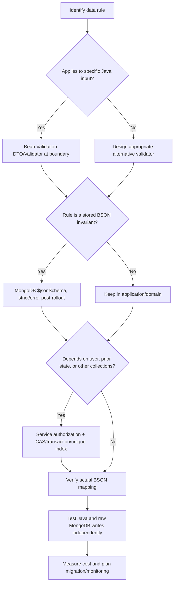

# Distinguishing Java Bean Validation from MongoDB Validation

In systems using **Spring Data MongoDB**, two kinds of data checks are easily mistaken for the same mechanism:

- **Bean Validation** (Jakarta Validation) validates **Java objects** using constraints such as `@NotBlank`, `@NotNull`, `@Size`, `@DecimalMin`, `@Valid`.
- **MongoDB collection validation** validates **BSON documents written to the database**, typically via `$jsonSchema` rules attached to a collection.

They solve related problems but **do not replace one another**. An HTTP request can be rejected by Bean Validation before reaching a service; a `mongosh` script bypasses Java controllers yet can still be rejected by MongoDB for violating the schema. Conversely, adding `@NotNull` to an entity does not create a MongoDB validator, and a collection with `$jsonSchema` does not automatically feed errors into Jakarta Validation's `ConstraintViolation` list.

For example, an order must have a non-empty customer ID, non-negative amount, valid status, and creation time:

```text
HTTP client
    │
    ▼
CreateOrderRequest  ── @Valid / Bean Validation ──► input error (400)
    │ valid
    ▼
Service ── verify tenant, state, business rules ──► business/auth error
    │
    ▼
MongoRepository / MongoTemplate
    │ BSON insert/update
    ▼
MongoDB collection ── $jsonSchema validator ──► write error (e.g., code 121)
    │ valid
    ▼
Document stored
```

This lesson belongs to the **Collections and Schema** chapter of the **SPRING_DATA_MONGODB** module: connecting, mapping, and manipulating documents via repositories or `MongoTemplate`, testing, transactions, indexes, and diagnosing data errors. The focus is distinguishing the **scope, timing, enforcement, and limits** of Java validation versus MongoDB validation, in order to design complementary layers of defense.

After this lesson, you will be able to:

1. Distinguish **Jakarta Bean Validation**, business validation, and **MongoDB collection validators**.
2. Use `@Valid`, `@Validated`, and `Validator` to validate DTOs/Java objects at the right invocation points.
3. Author MongoDB `$jsonSchema` with `bsonType`, `required`, `properties`, `enum`, `minimum`, and `items`.
4. Explain why `repository.save(...)`, `MongoTemplate.updateFirst(...)`, the raw driver, and `mongosh` can pass through **different Java check paths**, while sharing the MongoDB validator when writing to the collection.
5. Understand `validationLevel`, `validationAction`, legacy data, and authorized bypass cases.
6. Identify BSON mappings such as `ObjectId`, `Decimal128`, BSON Date, and the impact of `_class`.
7. Test both Java-side and database-side errors, including updates and bulk writes.
8. Design safe schema migrations without inadvertently blocking existing data or writes.

## 1. Three Validation Layers Must Be Named Properly

| Layer | Rule Examples | Where It Executes | Checks Every Write Source to MongoDB? |
| --- | --- | --- | --- |
| **Jakarta Bean Validation** | `@NotBlank`, `@DecimalMin("0")` | JVM at points where the application actually invokes validation | **No**. Scripts, other drivers, and unvalidated Java paths bypass it |
| **Business/Authorization Validation** | Only owner can change status; no overselling | Service/domain or conditional writes | Not automatic; must be designed explicitly |
| **MongoDB Collection Validation** | BSON `totalAmount` must be `decimal`, status in enum | MongoDB server when handling writes to a validated collection | Applies per config, level/action, and bypass privileges; **not absolute for all commands** |

Example:

```java
@NotNull
@DecimalMin("0.00")
private BigDecimal totalAmount;
```

This is a rule for the **Java object's BigDecimal value**. In the database, the corresponding BSON rule might be:

```javascript
{
  totalAmount: {
    bsonType: "decimal",
    minimum: NumberDecimal("0.00")
  }
}
```

The two mechanisms differ in at least three ways:

- Bean Validation can run **before** the entity is mapped to BSON.
- MongoDB's validator inspects the **actual BSON type**, such as Decimal128, not the Java `BigDecimal` class.
- Error reporting, configuration procedures, and bypass capabilities differ.

### 1.1. "@Valid on the Entity" Does Not Mean the Database Is Protected

`@Document` is metadata telling Spring Data which collection stores the entity; `@Field`, `@Id`, and `@Version` serve mapping/persistence. They **do not replace** database `$jsonSchema`.

Likewise, `@Valid` **is not a MongoDB index**, creates no BSON constraints, and cannot constrain clients running outside the JVM.

### 1.2. "Having a MongoDB Schema" Does Not Mean Java Needs No Validation

If you rely solely on MongoDB's validator, a bad request travels through controllers, services, converters, and the network before the server rejects it. Bean Validation yields clearer input error messages earlier; it can also check DTO fields that do not exist verbatim in BSON, such as confirmation fields, input email formats, or nested request structures.

**Conclusion:** use Bean Validation to protect the **Java input contract**, business validation for **domain invariants**, and MongoDB validators for a **server-side storage guardrail**.

## 2. Domain Example: Multi-Tenant Orders

A system accepts order-creation commands. Clients provide customer ID, amount, and tags; **tenantId and initial status are determined by the server**, never trusting tenant identity from client JSON.

Intended document:

```javascript
{
  _id: ObjectId("665f1f2a4b6c7d8e9f001234"),
  tenantId: "T1",
  customerId: "C-100",
  status: "NEW",
  totalAmount: NumberDecimal("150.00"),
  createdAt: ISODate("2026-11-20T09:00:00Z"),
  tags: ["online", "priority"]
}
```

Practice constraints:

| Field | Contract |
| --- | --- |
| `_id` | BSON ObjectId |
| `tenantId` | String with at least one non-whitespace character, max 64 chars |
| `customerId` | Non-blank String, max 80 chars |
| `status` | One of `NEW`, `PAID`, `CANCELLED` |
| `totalAmount` | BSON Decimal128, greater than or equal to 0 |
| `createdAt` | BSON Date |
| `tags` | Array of 1–20 non-blank strings, each max 40 chars |

These are **example rules** for studying validation, not mandatory business schemas for every e-commerce platform. Another system might permit draft orders without tags or use a multi-stage state machine.

### 2.1. API Inbound DTO

In projects using **Jakarta Validation** (Spring Boot 3+/Jakarta namespace), a Java record can declare:

```java
import java.math.BigDecimal;
import java.util.List;
import jakarta.validation.constraints.DecimalMin;
import jakarta.validation.constraints.NotBlank;
import jakarta.validation.constraints.NotNull;
import jakarta.validation.constraints.Size;

public record CreateOrderRequest(

    @NotBlank
    @Size(max = 80)
    String customerId,

    @NotNull
    @DecimalMin("0.00")
    BigDecimal totalAmount,

    @NotNull
    @Size(min = 1, max = 20)
    List<
        @NotBlank
        @Size(max = 40)
        String
    > tags
) {}
```

Here:

- `@NotBlank` rejects `null`, empty strings, and whitespace-only strings (for supported CharSequences).
- `@Size(max = 80)` bounds customer ID length, **without automatically requiring** non-null.
- `@NotNull` ensures `totalAmount`/`tags` are not null.
- `@DecimalMin("0.00")` validates the Java numeric value, without dictating BSON type.
- `@Size(min=1,max=20)` checks list length, while the **element** constraint `List<@NotBlank @Size(max=40) String>` validates each tag.

Container element constraints require Bean Validation provider support per Jakarta Validation; Spring Boot typically uses Hibernate Validator when the validation starter dependency is declared.

### 2.2. Entity Mapped to MongoDB

```java
import java.math.BigDecimal;
import java.time.Instant;
import java.util.List;
import org.bson.types.ObjectId;
import org.springframework.data.annotation.Id;
import org.springframework.data.mongodb.core.mapping.Document;
import org.springframework.data.mongodb.core.mapping.Field;
import org.springframework.data.mongodb.core.mapping.FieldType;

@Document(collection = "orders_schema_lab")
public class OrderDocument {
    @Id
    private ObjectId id;

    private String tenantId;
    private String customerId;
    private String status;

    @Field(targetType = FieldType.DECIMAL128)
    private BigDecimal totalAmount;

    private Instant createdAt;
    private List<String> tags;

    protected OrderDocument() {}

    public OrderDocument(
            String tenantId,
            String customerId,
            String status,
            BigDecimal totalAmount,
            Instant createdAt,
            List<String> tags) {
        this.tenantId = tenantId;
        this.customerId = customerId;
        this.status = status;
        this.totalAmount = totalAmount;
        this.createdAt = createdAt;
        this.tags = List.copyOf(tags);
    }

    public ObjectId getId() { return id; }
    public String getTenantId() { return tenantId; }
    public String getCustomerId() { return customerId; }
    public String getStatus() { return status; }
    public BigDecimal getTotalAmount() { return totalAmount; }
    public Instant getCreatedAt() { return createdAt; }
    public List<String> getTags() { return tags; }
}
```

`@Id` maps `id` to BSON `_id`. `@Field(targetType = FieldType.DECIMAL128)` guides storing `BigDecimal` as Decimal128. `Instant` maps to a MongoDB time representation (typically BSON Date under standard mapping). Java and BSON types must be **verified via raw documents**, not merely assumed from class definitions.

### 2.3. Why Should DTOs and Entities Have a Clear Boundary?

`CreateOrderRequest` omits `tenantId` and `status` because clients do not decide them. The service constructs `OrderDocument` using a trusted tenant and initial status `NEW`. This prevents "client spoofing another user's tenantId" right at the API contract.

An entity may be loaded via repositories, updated by jobs, or produced by migrations, whereas a DTO represents one specific request. Placing validation at the right layer prevents mixing up **input**, **business transition**, and **storage** rules.

## 3. Jakarta Bean Validation: Where and When Does It Run?

Bean Validation is an **API specification** for declaring and evaluating constraints on Java objects, not a MongoDB-specific feature. In Spring Boot applications, you need a provider such as **Hibernate Validator** and the proper dependency.

Example Maven dependency for a Spring Boot app supporting this starter:

```xml
<dependency>
    <groupId>org.springframework.boot</groupId>
    <artifactId>spring-boot-starter-validation</artifactId>
</dependency>
```

Spring Boot 3+ uses `jakarta.validation.*`; older Spring Boot 2.x/Java EE projects may still use `javax.validation.*`. Never mix both namespaces by swapping imports in an example expecting a different version's provider to align automatically.

### 3.1. `@Valid` at the HTTP Boundary

In Spring MVC, when validation infrastructure is configured, you can apply:

```java
import jakarta.validation.Valid;
import org.springframework.http.ResponseEntity;
import org.springframework.web.bind.annotation.PostMapping;
import org.springframework.web.bind.annotation.RequestBody;
import org.springframework.web.bind.annotation.RequestMapping;
import org.springframework.web.bind.annotation.RestController;

@RestController
@RequestMapping("/orders")
public class OrderController {

    private final OrderApplicationService service;

    public OrderController(OrderApplicationService service) {
        this.service = service;
    }

    @PostMapping
    public ResponseEntity<Void> create(
            @Valid @RequestBody CreateOrderRequest request) {

        // Assumes service verifies tenant from the security context.
        service.createForAuthenticatedTenant(request);
        return ResponseEntity.accepted().build();
    }
}
```

In this example, `OrderApplicationService` is an **application-defined service**, not a built-in Spring Data class. `createForAuthenticatedTenant` must obtain the tenant from a trusted security context and manage outcomes/errors per the API contract. The controller merely illustrates the **trigger point for `@Valid`**.

When a request contains:

```json
{
  "customerId": "   ",
  "totalAmount": -20.5,
  "tags": []
}
```

then `@NotBlank`, `@DecimalMin`, and `@Size(min=1)` all produce constraint violations. In standard Spring MVC, `@RequestBody` validation failures result in HTTP 400 through framework exception handling or an application-configured handler. Exact exception classes and handling depend on method signature and Spring MVC version; `MethodArgumentNotValidException` is common.

**Simply placing `@Valid` on any arbitrary method does not mean validation runs.** The framework layer must actively trigger validation, or code must invoke a `Validator`. For example, calling `new CreateOrderRequest(...)` directly does not trigger annotation checks automatically.

### 3.2. Using `jakarta.validation.Validator` Explicitly

A processing step can validate an object without depending on an HTTP controller:

```java
import jakarta.validation.ConstraintViolation;
import jakarta.validation.ConstraintViolationException;
import jakarta.validation.Validator;
import java.util.Set;

public class ValidatedOrderInput {

    private final Validator validator;

    public ValidatedOrderInput(Validator validator) {
        this.validator = validator;
    }

    public void requireValid(CreateOrderRequest request) {
        Set<ConstraintViolation<CreateOrderRequest>> violations =
            validator.validate(request);

        if (!violations.isEmpty()) {
            throw new ConstraintViolationException(violations);
        }
    }
}
```

Explicit invocation suits jobs, message consumers, or services that want guaranteed validation before writing. Still, it only validates the **passed object**, never scanning database entities or intercepting non-JVM clients.

### 3.3. `@Valid` for Nested Objects

Suppose a request carries a shipping address:

```java
import jakarta.validation.Valid;
import jakarta.validation.constraints.NotBlank;
import jakarta.validation.constraints.NotNull;

public record AddressRequest(
    @NotBlank String city,
    @NotBlank String street
) {}

public record ShippingRequest(
    @NotNull @Valid AddressRequest address
) {}
```

`@Valid` on `address` activates **cascade validation** for constraints inside `AddressRequest`. Putting only `@NotNull` on `address` without `@Valid` allows a non-null address containing `city = " "` to pass without its inner fields being checked at that point.

For nested lists of objects, `List<@Valid ItemRequest>` can be used per supported Jakarta Bean Validation versions. When applying validation across multi-level aggregates, watch out for **reference cycles**, parent-child relationships, and object-graph validation cost.

### 3.4. `@Validated`, Method Validation, and Groups

`@Validated` is a Spring annotation often used to enable **method-level validation** and specify validation groups. Example of method parameter constraints:

```java
import jakarta.validation.constraints.NotBlank;
import org.springframework.stereotype.Service;
import org.springframework.validation.annotation.Validated;

@Service
@Validated
public class OrderLookupService {

    public String normalizeCustomerId(
            @NotBlank String customerId) {
        return customerId.trim();
    }
}
```

Depending on version and configuration, Spring-proxied method validation runs only when calls **pass through the proxy**. Calling a method from another method **inside the same instance** (self-invocation) bypasses interception, so never hinge correctness solely on an annotation without testing actual call paths.

Bean Validation also supports groups:

```java
public interface CreateGroup {}
public interface UpdateGroup {}
```

Constraints can then belong to specific groups and be evaluated with those groups. However, **groups do not become MongoDB schema versions**. When using multiple groups, avoid proliferating hard-to-maintain duplicate rules; differences between creation and updates are often clearer via distinct API/domain models.

### 3.5. `@NotNull`, `@NotEmpty`, and `@NotBlank` Differ

| Constraint | Checks | Passes Example? |
| --- | --- | --- |
| `@NotNull` | Value is not null | String `""` still passes |
| `@NotEmpty` | String/collection/array... is non-empty for supported types | String `"   "` can still pass |
| `@NotBlank` | CharSequence has at least one non-whitespace character | `"   "` fails |
| `@Size(min=1,max=20)` | Length/size within bounds; null is normally valid | `null` is not rejected unless `@NotNull` is added |
| `@DecimalMin("0.00")` | Numeric value is at or above threshold; null is normally valid | Must add `@NotNull` if required |

**Important:** many constraints **treat null as valid** so presence rules can be separated from format/value rules. Do not apply `@Size` or `@DecimalMin` alone assuming a field is forced to be present.

### 3.6. Bean Validation Does Not Cover All Domain Invariants

Annotations fit local constraints well:

- Non-blank customer ID.
- Non-negative amount.
- Bounded list size.
- Valid input date/type formats.

However, rules like "transition NEW to PAID only when payment is CAPTURED," "do not oversell inventory," or "current tenant may edit this order" are **stateful or system-dependent business rules**. They require service logic, conditional updates, transactions, and/or appropriate database constraints. Avoid stuffing database queries into a `ConstraintValidator` across annotations indiscriminately, which creates unpredictable queries and race conditions.

## 4. Blind Spot: Java Annotations Do Not Run Automatically on Every Write Path

Suppose the entity is also annotated with:

```java
@NotBlank
private String customerId;
```

This **does not** mean every snippet below will automatically be blocked by Bean Validation:

```java
repository.save(entity);

mongoTemplate.insert(entity);

mongoTemplate.updateFirst(query, update, OrderDocument.class);

mongoTemplate.getCollection("orders_schema_lab")
    .insertOne(rawBsonDocument);
```

Distinguish clearly:

| Write Path | Does Bean Validation Run Automatically? | MongoDB Collection Validator |
| --- | --- | --- |
| Controller receives `@Valid @RequestBody` then calls `save` | Ran on the **DTO** at HTTP boundary | Yes, per server validator/level/action on write |
| Service calls `validator.validate(entity)` then `save` | **Yes**, because invoked explicitly | Yes |
| `repository.save(entity)` from unvalidated job | **Must not assume** automatic Bean Validation | Yes |
| `MongoTemplate.updateFirst(...)` with `$set` | Does not assemble a full entity for DTO Bean Validation | Yes |
| Repository update method `@Update` | Not the same lifecycle as validating a Java object | Yes |
| Java Driver operating on raw BSON | Does not run DTO Bean Validation | Yes |
| `mongosh` or another language's app | Does not run Java Bean Validation | Yes |

The MongoDB validator is the common choke point across all those paths **provided** the collection actually has an enforcing validator and the write does not bypass it. That is why it adds real defensive value.

### 4.1. Combining Spring Data Lifecycle with Bean Validation

Spring Data MongoDB provides entity lifecycle events/callbacks, and releases support ways to wire validation **before converting entities into documents** (such as an appropriate validating callback/listener). If an application explicitly configures pre-save entity validation, entity write paths can throw Bean Validation errors.

However:

- Never assume Bean Validation is **automatically enabled for all entities** just because a class has `@Document` and `@NotBlank`.
- Configuration class names, timing, and callback/listener behavior can vary across Spring Data MongoDB versions.
- Query updates via `MongoTemplate.updateFirst`, `Update`, or the raw driver **do not re-run full-entity Bean Validation** merely because save callbacks exist.
- Lifecycle callbacks on read/write are not **server-side MongoDB collection validation**.

An easy check is creating an entity with a blank `customerId`, calling `save` in an integration test, and observing whether Java rejects it before hitting MongoDB. Tests should explicitly state whether validation configuration is active.

### 4.2. Never Use Java Checks to Replace Atomic Conditions

Lost update risk:

```java
// Illustrates a concurrency-prone flow.
OrderDocument order = repository.findById(id).orElseThrow();
// Check status == NEW in the JVM.
// Another request may modify status right after this line.
repository.save(order);
```

Bean Validation confirms individual fields are well-formed, but **cannot guarantee** status/version remained unchanged between read and write. For compare-and-set transitions, use filters matching `_id`, tenant, expected status, and expected version with atomic MongoDB updates. A collection `$jsonSchema` checking shapes/types also **does not replace** state-transition guards.

## 5. MongoDB Collection Validation via `$jsonSchema`

MongoDB allows configuring a **collection-level validator**. A common form is `$jsonSchema`, specifying required fields, BSON types, and content constraints.

### 5.1. `$jsonSchema` Inspects BSON, Not Java Classes

Example schema for `orders_schema_lab`:

```javascript
const orderSchema = {
  $jsonSchema: {
    bsonType: "object",
    required: [
      "tenantId",
      "customerId",
      "status",
      "totalAmount",
      "createdAt",
      "tags"
    ],
    properties: {
      _id: {
        bsonType: "objectId"
      },
      tenantId: {
        bsonType: "string",
        minLength: 1,
        maxLength: 64,
        pattern: "\\S"
      },
      customerId: {
        bsonType: "string",
        minLength: 1,
        maxLength: 80,
        pattern: "\\S"
      },
      status: {
        bsonType: "string",
        enum: ["NEW", "PAID", "CANCELLED"]
      },
      totalAmount: {
        bsonType: "decimal",
        minimum: NumberDecimal("0.00")
      },
      createdAt: {
        bsonType: "date"
      },
      tags: {
        bsonType: "array",
        minItems: 1,
        maxItems: 20,
        items: {
          bsonType: "string",
          minLength: 1,
          maxLength: 40,
          pattern: "\\S"
        }
      }
    }
  }
};
```

In `mongosh` JavaScript, `"\\S"` produces a regex pattern requiring **at least one non-whitespace character**. This catches `"   "` where `minLength:1` alone would not. Unicode whitespace definitions may differ between Jakarta Validation and MongoDB's regex engine; if your application handles international whitespace characters, test boundary cases explicitly.

### 5.2. `required` Does Not Imply Non-Null or Non-Blank

`required` only guarantees **the field name exists** in the BSON document. If you only write:

```javascript
{
  $jsonSchema: {
    bsonType: "object",
    required: ["customerId"]
  }
}
```

a document with `customerId: null` **still has that field**. To forbid null, add `properties.customerId.bsonType: "string"` (excluding `"null"`). To forbid empty or whitespace-only strings, add constraints such as `minLength` and `pattern` per contract.

This is a key difference from Java's `@NotBlank`, which combines null, empty, and whitespace checks on CharSequence.

### 5.3. BSON Types: `decimal`, `long`, `int`, `date`, and `objectId`

`bsonType` keywords operate at the **storage layer**:

| Java or BSON Input | Expected BSON Type | Notes |
| --- | --- | --- |
| Java `ObjectId` | `objectId` | IDs/FKs must stay consistent across collections |
| `BigDecimal` mapped to Decimal128 | `decimal` | Avoid treating BSON Strings as monetary values |
| `Instant` mapped to Date | `date` | BSON Date represents UTC instant at millisecond precision |
| Java `Long` | `long` | BSON Int64; not interchangeable with Int32 `int` |
| Java `Integer` | `int` | BSON Int32; legacy data might use long |
| Java `Boolean` | `bool` | String `"false"` is not boolean |
| `List<String>` | `array` with `items.bsonType:"string"` | Can combine with `minItems/maxItems` |

If the schema expects Decimal128 yet a converter stores String or Double, MongoDB rejects the write even though Java `@DecimalMin` passed. That is a **mapping/schema mismatch**, not an arithmetic amount failure.

### 5.4. MongoDB Schemas Do Not Understand Jakarta Annotations

MongoDB does not inspect Java source or bytecode to derive schemas. It does not natively understand `@Email`, `@Past`, `@Valid`, validation groups, custom `ConstraintValidator`s, DTO distinctions, or localized messages.

You must **explicitly express required storage invariants** in MongoDB's validator. Some Java constraints have no 1-to-1 `$jsonSchema` translation; keep those in the application/domain layer and pair with suitable MongoDB mechanisms if storage protection is needed.

## 6. Creating Collection Validators: `createCollection` and `collMod`

### 6.1. Creating a New Collection

MongoDB can create a collection with a validator upfront:

```javascript
db.createCollection("orders_schema_lab", {
  validator: orderSchema,
  validationLevel: "strict",
  validationAction: "error"
});
```

Here `orderSchema` is the `$jsonSchema` object declared in section 5.1 within the **same `mongosh` session**.

- `validator` is the condition documents must satisfy.
- `validationLevel` defines the scope of documents/operations validated.
- `validationAction` sets whether the server **rejects** or **warns** on non-conforming documents.

**Do not run this verbatim on an existing shared collection.** In the hands-on section, we create a **dedicated collection with a randomized name** to avoid colliding with other services or users.

### 6.2. Changing the Validator on an Existing Collection

For an existing collection, use **`collMod`** within a schema management workflow:

```javascript
db.runCommand({
  collMod: "orders_schema_lab",
  validator: orderSchema,
  validationLevel: "strict",
  validationAction: "error"
});
```

This alters the collection validator configuration; it **does not convert existing documents** to the new schema. Therefore, if legacy data violates rules, audit and migrate before enabling strict rejection.

In production, treat `collMod` as an **operational schema migration**: proper privileges, change review, rollout plan, observability, and rollback. Do not run it on every API startup or every request without proper governance.

### 6.3. Verifying the Server Received the Validator

In `mongosh`:

```javascript
db.getCollectionInfos({ name: "orders_schema_lab" });
```

Inspect the validator, `validationLevel`, and `validationAction` in collection metadata. Never rely solely on a Java entity having `@NotBlank` or a committed migration file: what matters is the **actual schema state on the MongoDB server**.

### 6.4. Validators Are Not Indexes

`$jsonSchema` and indexes solve two distinct problems:

| Feature | Purpose | Creates Counterpart Constraint Automatically? |
| --- | --- | --- |
| `$jsonSchema` with `required`/`bsonType` | Checks BSON document shape/types on write | Does not create indexes |
| Compound index `{tenantId:1,status:1}` | Optimizes filtering/sorting | Does not forbid statuses outside enum |
| Unique index `{tenantId:1,customerId:1}` | Enforces uniqueness per key if domain requires | Does not check blank customerId |
| Bean Validation `@NotBlank` | Checks Java String where validator is invoked | Does not create MongoDB indexes/validators |

If customerId must be unique per tenant, a properly designed **unique index** enforces uniqueness in the database far better than service "query-then-insert" checks (which suffer race conditions). Still, unique indexes do not replace `@NotBlank` or JSON Schema type checks.

## 7. `validationLevel` and `validationAction`: Two Different Switches

### 7.1. Validation Scope: `strict` and `moderate`

| `validationLevel` | New Insert | Update Valid Legacy Doc | Update **Already-Invalid** Legacy Doc |
| --- | --- | --- | --- |
| `strict` | Checked | Checked | **Checked**; rejected if post-update doc remains invalid |
| `moderate` | Checked | Checked | **Skips normal validation** for already-invalid docs; used during compatibility phases |

`strict` is the clean default once a collection is standardized. It ensures an update like:

```javascript
db.orders_schema_lab.updateOne(
  { _id: orderId },
  { $set: { status: "BROKEN" } }
);
```

is rejected because status falls outside the enum.

With **already-invalid legacy data**, a `$set` changing only an unrelated field can still be blocked under `strict`, because the server evaluates the **post-update document** against the validator. This can cause friction when rolling out a new schema over millions of historical documents.

`moderate` provides compatibility: MongoDB validates new inserts and updates to **currently valid** documents; updates to **already-invalid** documents do not undergo the same blocking check. Consequently, it **should not be treated as the final protection state** if the goal is enforcing valid data across all documents.

### 7.2. Action: `error` and `warn`

| `validationAction` | When Write Violates Validator | Typical Use |
| --- | --- | --- |
| `error` | MongoDB **rejects the invalid write** within validation scope | Enforce storage invariants |
| `warn` | MongoDB permits the write while emitting a **server-side validation warning** | Observe violation rates before enforcing rejection |

**`warn` is not a security or data-integrity guarantee.** If invalid data still gets written, the team must track and monitor violations; never declare a collection "schema-enforced" while running `warn`.

Distinction:

- `strict + error`: broad checking and rejects violations.
- `strict + warn`: broad evaluation without rejection; fits error-discovery phases.
- `moderate + error`: rejects violations on inserts and valid-doc updates, while giving leeway to already-invalid legacy docs.
- `moderate + warn`: limited observation, weak overall protection.

Beyond these modes, newer MongoDB versions may add other validation options; this lesson uses **`error`/`warn` and `strict`/`moderate`** because they clearly illustrate the fundamental differences. Verify exact support against your running MongoDB version.

### 7.3. MongoDB Validators Can Be Bypassed When Authorized

MongoDB supports **bypassing document validation** on certain commands/driver APIs for authorized tasks and roles. If a user or app holds that privilege and enables bypass, schema-violating data can enter the collection.

Therefore:

- Do not grant bypass privileges to ordinary application accounts without clear justification.
- Do not use bypass to "patch over" daily production errors.
- For intentional migrations, audit every bypass invocation and plan data remediation back to the standard schema.
- A validator is **not** proof that even admins or privileged tools cannot possibly write non-conforming data.

In this hands-on lab, **do not use bypass**: the goal is observing MongoDB reject schema-invalid writes.

## 8. Comparing Java and MongoDB Rules: Not a Complete 1-to-1 Mapping

| Data Contract | Bean Validation / Java | MongoDB `$jsonSchema` |
| --- | --- | --- |
| Cannot be null | `@NotNull` | `required` + `bsonType` excluding null |
| Non-blank String | `@NotBlank` | `bsonType:"string"`, `minLength`, and `pattern` rejecting whitespace-only |
| String max length N | `@Size(max=N)` | `maxLength:N` |
| List of 1–20 items | `@NotNull @Size(min=1,max=20)` | `required` + `bsonType:"array"` + `minItems/maxItems` |
| Every tag is a String | `List<String>` + element constraint | `items:{bsonType:"string",...}` |
| Non-negative money | `@DecimalMin("0.00")` | `minimum:NumberDecimal("0.00")` with `bsonType:"decimal"` |
| Fixed status values | Java enum or custom constraint | `enum:["NEW","PAID","CANCELLED"]` |
| Properly typed timestamp | Java `Instant`; optional extra constraints | `bsonType:"date"` |
| Transition NEW → PAID only when valid | Service/domain + conditional update | Pure JSON Schema has no state history |
| Only tenant T1 edits T1 orders | Authentication/authorization | JSON Schema knows nothing about authenticated users |
| Unique customer ID per tenant | Domain logic + unique index | Per-document JSON Schema does not enforce collection-wide uniqueness |
| `payment.orderId` points to real order | Service/transaction/consistency workflow | Payment JSON Schema does not create foreign keys |

### 8.1. Validation Groups and Document Versions

A "create order" DTO and a "change status" DTO can use different constraints. Bean Validation provides groups or separate DTOs per operation. In MongoDB, stored documents must comply with the **storage schema at write time**, regardless of which endpoint sent the request.

Thus, a field required on creation APIs yet hidden/absent from update APIs **cannot simply be deleted from the document**. Partial `$set` updates leave existing fields intact; `$unset` removes the field and causes the MongoDB validator to reject the write.

### 8.2. Error Messages Differ

Bean Validation might report:

```text
customerId: must not be blank
totalAmount: must be greater than or equal to 0.00
```

MongoDB on schema failure typically returns a write error with **code 121 (DocumentValidationFailure)** and version/driver-specific details. Code 121 is a helpful signal, though exact Java exception classes depend on driver, bulk operations, and Spring exception translation.

**Never return raw database validation errors directly to public clients**, as messages can expose internal field names, rules, data values, or details unsuitable for disclosure. Applications should log safely and map to stable API error codes.

## 9. Operations That "Bypass Java Validation" Yet Still Hit the Server

### 9.1. Raw Insert from Another Application

An admin script or service written in another language:

```javascript
db.orders_schema_lab.insertOne({
  tenantId: "T1",
  customerId: "",
  status: "NEW",
  totalAmount: NumberDecimal("10.00"),
  createdAt: new Date(),
  tags: ["online"]
});
```

It never passes through `CreateOrderRequest`'s `@Valid`. If the collection validator enforces non-blank `customerId`, MongoDB still rejects the write. That is the direct value of **storage validation**.

### 9.2. Partial Update from `MongoTemplate`

Suppose a valid record is already stored:

```java
import org.springframework.data.mongodb.core.query.Criteria;
import org.springframework.data.mongodb.core.query.Query;
import org.springframework.data.mongodb.core.query.Update;

Query scope = Query.query(
    Criteria.where("id").is(orderId)
        .and("tenantId").is(trustedTenantId)
);

Update change = new Update()
    .set("status", "UNKNOWN");

mongoTemplate.updateFirst(
    scope, change, OrderDocument.class
);
```

This `Update` path never instantiates a `CreateOrderRequest` for `@Valid`. When `$jsonSchema.status.enum` is enforced, MongoDB rejects it because the post-update document is invalid. However, if `validationAction = "warn"` or bypass privileges are used, the validator will not reject the write.

### 9.3. `$unset` on a Required Field

```java
Update removeCustomer = new Update()
    .unset("customerId");
```

A completely valid Java DTO at order creation **cannot prevent** this update query if invoked by a job. A MongoDB validator with `required:["customerId"]` blocks deleting the field under `strict/error`.

### 9.4. Bulk Writes and Transactions

MongoDB applies collection validation to various writes—inserts, updates, and bulk operations—within normal validation rules. However:

- **Bulk writes** can yield multiple per-operation errors; design for ordered/unordered modes and retry contracts.
- Within a supported **transaction**, a validation error on one write prevents the transaction from committing per error/rollback handling.
- **MongoDB validators do not turn multiple independent writes into a transaction**; each document being valid does not make a multi-collection workflow consistent.
- When an application has multiple write sources, test the same schema across client paths rather than assuming only the Java repository governs stored data.

## 10. `mongosh` Lab: Java Is Never Called Yet MongoDB Still Blocks

The goal is proving MongoDB's validator works on **direct BSON inserts/updates**, with no Java controller involved. Practice uses a dedicated training database `spring_data_training` and a **unique collection name per session**.

**Never run on production.** Commands target a collection created by this practice session; never alter validators or delete data in shared collections.

### 10.1. Creating a Dedicated Collection with a Validator

In `mongosh`:

```javascript
use spring_data_training

const labCollectionName =
  "orders_schema_lab_" + new ObjectId().toHexString();

const schema = {
  $jsonSchema: {
    bsonType: "object",
    required: [
      "tenantId", "customerId", "status",
      "totalAmount", "createdAt", "tags"
    ],
    properties: {
      _id: { bsonType: "objectId" },
      tenantId: {
        bsonType: "string",
        minLength: 1,
        maxLength: 64,
        pattern: "\\S"
      },
      customerId: {
        bsonType: "string",
        minLength: 1,
        maxLength: 80,
        pattern: "\\S"
      },
      status: {
        bsonType: "string",
        enum: ["NEW", "PAID", "CANCELLED"]
      },
      totalAmount: {
        bsonType: "decimal",
        minimum: NumberDecimal("0.00")
      },
      createdAt: {
        bsonType: "date"
      },
      tags: {
        bsonType: "array",
        minItems: 1,
        maxItems: 20,
        items: {
          bsonType: "string",
          minLength: 1,
          maxLength: 40,
          pattern: "\\S"
        }
      }
    }
  }
};

db.createCollection(labCollectionName, {
  validator: schema,
  validationLevel: "strict",
  validationAction: "error"
});

const lab = db.getCollection(labCollectionName);

printjson({
  collection: labCollectionName,
  metadata: db.getCollectionInfos({
    name: labCollectionName
  }).map(x => x.options)
});
```

Run all section 10 examples in the **same `mongosh` session**, because `labCollectionName` and `lab` exist only in this session. The name includes a random ObjectId to avoid colliding with anyone else's data.

### 10.2. Inserting a Valid Document

```javascript
const validId = new ObjectId();

const accepted = lab.insertOne({
  _id: validId,
  tenantId: "T1",
  customerId: "C-100",
  status: "NEW",
  totalAmount: NumberDecimal("150.00"),
  createdAt: ISODate("2026-11-20T09:00:00Z"),
  tags: ["online", "priority"]
});

printjson(accepted);
printjson(lab.findOne({ _id: validId }));
// Expected: one valid NEW document.
```

This insert never passed through Java `@Valid`, yet MongoDB's validator permits it because the document satisfies the schema.

### 10.3. Helper Function to Observe Rejected Writes

```javascript
function expectValidationFailure(label, writeAction) {
  try {
    writeAction();
    print("UNEXPECTED PASS: " + label);
  } catch (error) {
    printjson({
      caseName: label,
      code: error.code,
      message: String(error.message).slice(0, 250)
    });
  }
}
```

When commands do not violate unique keys or other errors, MongoDB typically returns validation errors with `code = 121`. Driver/shell versions may wrap errors differently, so always inspect the root cause rather than assuming every exception is schema validation.

### 10.4. Missing Required Field

```javascript
expectValidationFailure("missing customerId", () => {
  lab.insertOne({
    tenantId: "T1",
    status: "NEW",
    totalAmount: NumberDecimal("10.00"),
    createdAt: new Date(),
    tags: ["online"]
  });
});
```

`customerId` is absent; `required` rejects the document.

### 10.5. Present Field That Is Blank

```javascript
expectValidationFailure("blank customerId", () => {
  lab.insertOne({
    tenantId: "T1",
    customerId: "    ",
    status: "NEW",
    totalAmount: NumberDecimal("10.00"),
    createdAt: new Date(),
    tags: ["online"]
  });
});
```

Here the field exists, so `required` alone is insufficient. `pattern:"\\S"` in the schema blocks whitespace-only values.

### 10.6. Non-Negative Amount with Wrong BSON Type

A String that looks like money:

```javascript
expectValidationFailure("amount stored as String", () => {
  lab.insertOne({
    tenantId: "T1",
    customerId: "C-101",
    status: "NEW",
    totalAmount: "100.00",
    createdAt: new Date(),
    tags: ["online"]
  });
});
```

`"100.00"` looks reasonable visually, yet its BSON type is **String**, not `decimal`.

A negative Decimal128:

```javascript
expectValidationFailure("negative decimal", () => {
  lab.insertOne({
    tenantId: "T1",
    customerId: "C-101",
    status: "NEW",
    totalAmount: NumberDecimal("-1.00"),
    createdAt: new Date(),
    tags: ["online"]
  });
});
```

This case has the right BSON type but fails `minimum:0`. Distinguish the two failures because the fixes differ: **fixing converter/type** versus **fixing business values**.

### 10.7. Status Outside Enum

```javascript
expectValidationFailure("unknown status", () => {
  lab.insertOne({
    tenantId: "T1",
    customerId: "C-102",
    status: "BROKEN",
    totalAmount: NumberDecimal("10.00"),
    createdAt: new Date(),
    tags: ["online"]
  });
});
```

MongoDB does not know Java's `OrderStatus` enum, yet enforces `enum` in the BSON validator. When adding or changing business statuses, coordinate DTOs/services, other producers, and the server schema via a rollout workflow.

### 10.8. Insufficient Array or Invalid Element

```javascript
expectValidationFailure("empty tags", () => {
  lab.insertOne({
    tenantId: "T1",
    customerId: "C-103",
    status: "NEW",
    totalAmount: NumberDecimal("10.00"),
    createdAt: new Date(),
    tags: []
  });
});

expectValidationFailure("blank tag element", () => {
  lab.insertOne({
    tenantId: "T1",
    customerId: "C-104",
    status: "NEW",
    totalAmount: NumberDecimal("10.00"),
    createdAt: new Date(),
    tags: ["online", "   "]
  });
});
```

`minItems` checks array length; `items` with `pattern` checks each element, paralleling `@Size` and `List<@NotBlank String>` on the DTO.

### 10.9. Updating a Valid Document to Invalid

```javascript
expectValidationFailure("update invalid status", () => {
  lab.updateOne(
    { _id: validId, tenantId: "T1" },
    { $set: { status: "BROKEN" } }
  );
});

expectValidationFailure("unset required field", () => {
  lab.updateOne(
    { _id: validId, tenantId: "T1" },
    { $unset: { customerId: "" } }
  );
});

printjson(lab.findOne({ _id: validId }));
// Original valid document still has status NEW and customerId C-100.
```

This clearly demonstrates the validator's role: even with `$set` or `$unset`, MongoDB checks the write outcome under enforcement. The application does not need to load `OrderDocument` and invoke `@Valid` for the server to catch the mistake.

### 10.10. Testing `warn` — Invalid Write Not Blocked

On a **lab-only** collection, you can switch:

```javascript
db.runCommand({
  collMod: labCollectionName,
  validationLevel: "strict",
  validationAction: "warn"
});

const warned = lab.insertOne({
  tenantId: "T1",
  customerId: "   ",
  status: "BROKEN",
  totalAmount: NumberDecimal("10.00"),
  createdAt: new Date(),
  tags: ["online"]
});

printjson(warned);
// Command can succeed even though the document violates the schema.
```

In `warn` mode, MongoDB allows the write and logs a server-side warning, so **rejection-based data protection is no longer active**. Inspect server logs/monitors with authorized access; a successful `insertOne` result does not surface the warning directly.

Restore `error`:

```javascript
db.runCommand({
  collMod: labCollectionName,
  validationLevel: "strict",
  validationAction: "error"
});
```

**Note:** the invalid document inserted during `warn` **does not vanish** when switching back to `error`. It becomes an invalid legacy record in the collection. Future updates to it under `strict/error` will be blocked if the post-update document remains invalid.

### 10.11. Clean Up Only the Session-Owned Collection

```javascript
printjson({
  collection: labCollectionName,
  documents: lab.countDocuments({})
});

// Execute ONLY after confirming the collection name is the
// randomized one created by this lab session.
lab.drop();
```

`drop()` deletes the entire collection, so it is **safe in this example solely because a unique per-session collection was created**. Never run `drop()` on application or shared collections; in multi-user environments, verify ownership before cleaning up.

## 11. Java Service: Validate Input First, Server Still Checks BSON

A service can invoke `Validator` explicitly even when controllers also use `@Valid`. This helps when order creation is triggered from batch jobs, message consumers, or non-HTTP paths:

```java
import java.time.Instant;
import java.util.Set;
import jakarta.validation.ConstraintViolation;
import jakarta.validation.ConstraintViolationException;
import jakarta.validation.Validator;
import org.bson.types.ObjectId;
import org.springframework.data.mongodb.core.MongoTemplate;

public class OrderWriteService {

    private final MongoTemplate template;
    private final Validator validator;

    public OrderWriteService(
            MongoTemplate template,
            Validator validator) {
        this.template = template;
        this.validator = validator;
    }

    public ObjectId create(
            String trustedTenantId,
            CreateOrderRequest request) {

        // Still need to verify and authenticate tenant at the boundary.
        if (trustedTenantId == null
                || trustedTenantId.isBlank()) {
            throw new IllegalArgumentException(
                "Tenant has not been identified"
            );
        }
        if (request == null) {
            throw new IllegalArgumentException("Missing request");
        }

        Set<ConstraintViolation<CreateOrderRequest>> errors =
            validator.validate(request);
        if (!errors.isEmpty()) {
            throw new ConstraintViolationException(errors);
        }

        OrderDocument order = new OrderDocument(
            trustedTenantId,
            request.customerId(),
            "NEW",
            request.totalAmount(),
            Instant.now(),
            request.tags()
        );

        OrderDocument saved = template.insert(order);
        return saved.getId();
    }
}
```

**Responsibilities in this flow:**

1. Boundary resolves the authenticated user/tenant; this method accepts only `trustedTenantId` from a trusted source.
2. `Validator` checks the Java DTO and fails fast.
3. The service sets `NEW` status and creation timestamp; the client never chooses them.
4. `MongoTemplate.insert` maps the entity to BSON.
5. MongoDB's validator checks the actual document on write.

If the service has a mapping bug, another producer writes invalid shapes, or a job uses the raw driver, the MongoDB validator still provides a storage guardrail. Yet if the MongoDB validator is in `warn` mode or bypassed, the service cannot rely on it as a hard barrier.

### 11.1. Java Validation Does Not Know the Final BSON

For example, `BigDecimal totalAmount = new BigDecimal("100.00")` passes `@DecimalMin("0.00")`. Yet the stored representation depends on mapping and converters:

- Mapped to BSON **Decimal128**: matches `bsonType:"decimal"`.
- If a custom converter turns `BigDecimal` into **String**: schema rejects due to wrong type.
- If another writer stores **Double**: values risk binary precision loss against monetary policy and fail the decimal rule.

Therefore, tests should read raw data via the MongoDB driver, not solely via repositories returning entities (whose converters can hide BSON differences).

### 11.2. When Using `repository.save(...)`

`MongoRepository<OrderDocument,ObjectId>` can be used instead of `MongoTemplate.insert` where appropriate:

```java
public interface OrderRepository
        extends MongoRepository<OrderDocument, ObjectId> {
}
```

And:

```java
OrderDocument saved = orderRepository.save(order);
```

Separate two questions:

- **Did the application run Bean Validation on the object?** That is the responsibility of the boundary/service or configured lifecycle validation.
- **Does the collection enforce a server validator?** That is a MongoDB server setting, independent of whether Java called `save` or `insert`.

Do not assume `repository.save` calls `validator.validate(order)` automatically just because annotations exist on the entity.

### 11.3. API Exception Mapping

An API contract can categorize errors:

| Error Source | Common Indicator | Handling Approach |
| --- | --- | --- |
| HTTP DTO Bean Validation | Constraint violations; Spring MVC argument validation error | Return **400 Bad Request** with controlled field messages |
| Service Bean Validation | `ConstraintViolationException` thrown by service | Map to input error or internal error depending on data origin |
| MongoDB collection validation | BSON write error, typically code 121 | Log safely server/driver-side; translate by root cause |
| Unique key collision | Duplicate key error (typically code 11000) | Handle as business conflict, not schema error |
| Stale version / invalid transition | CAS filter matched zero documents | Return conflict or status error per API contract |
| Unauthorized tenant | Authorization failure | Do not let DB exceptions leak existence of another tenant's data |

For an invalid client value that slipped past missing Java validation down to the database, you may return an appropriate 4xx after classifying the cause. However, **never blindly map every MongoDB code 121 error to a client error**: it could stem from a converter bug, migration mismatch, or server-side code bug. Never expose raw stack traces or server validation internals to the Internet.

## 12. Schema Migration: Rolling Out a Validator on Collections with Legacy Data

A live system may contain documents from multiple code versions:

```javascript
// Legacy document: amount is String, missing tags.
{
  tenantId: "T1",
  customerId: "C-OLD",
  status: "NEW",
  totalAmount: "100.00",
  createdAt: ISODate("2026-01-01T00:00:00Z")
}
```

Enabling `strict + error` immediately requiring Decimal128 amount and tags array blocks bad **new** writes (as desired), yet also blocks **updates to legacy documents** because post-update documents still fail the schema. That is a **data compatibility** challenge, not a reason to abandon validators.

### 12.1. Step 1 — Survey Actual BSON

On a data copy or authorized inspection environment:

```javascript
db.orders.aggregate([
  {
    $group: {
      _id: {
        amountType: { $type: "$totalAmount" },
        tagsType: { $type: "$tags" },
        createdType: { $type: "$createdAt" }
      },
      documentCount: { $sum: 1 }
    }
  },
  { $sort: { documentCount: -1 } }
]);
```

`$type` identifies BSON types and missing fields (represented differently from null). On large collections, this aggregation incurs cost; plan query timing, sampling, backups, and access privileges accordingly.

Next, quantify:

- How many documents lack required fields?
- How many amounts are String, Double, Int32, or Decimal128?
- How many statuses fall outside the supported set?
- Are there empty tags, non-String tags, or oversized arrays?
- Is data still being written by **older application versions**?

### 12.2. Step 2 — Align All Producers

Before tightening the validator, ensure **every write path** is compatible:

- HTTP apps use proper DTO/Bean Validation.
- Jobs and message consumers have updated mappings.
- Services in other languages write the exact BSON types.
- Migrations/ETL emit Decimal128 and BSON Dates properly.
- `Update`, `$set`, and `$unset` paths never strip required fields.

If an older producer still writes String amounts, turning on `strict+error` immediately causes widespread production errors. Schema rollouts must coordinate with code deployments.

### 12.3. Step 3 — Observe Before Blocking

In a reviewed environment **where an approved validator is already attached to the collection**, switch mode to observe bad writes before rejecting them:

```javascript
db.runCommand({
  collMod: "orders",
  validationLevel: "strict",
  validationAction: "warn"
});
```

This example **assumes `orders` already has a validator** from an earlier `createCollection`/`collMod` command; it updates only level/action and **does not install a new validator**. If the collection lacks a schema, deploy the approved `validator` first. Never copy commands into production without verifying target collection and change procedures. `warn` records violating writes without rejecting them. Know which logs/monitors capture warnings and who owns remediation.

If invalid legacy records block routine updates, `moderate` can serve as a transitional step, though it **does not enforce across all documents**. Document the risk and transition deadline clearly.

### 12.4. Step 4 — Backfill and Normalize Data

The migration plan needs:

1. Backups/snapshots with verified restore capability.
2. Batched migration by explicit markers/IDs/ranges.
3. Parsing validation before turning String amounts into Decimal128; `"abc"` cannot be coerced into money.
4. Adding default tags **only when business rules allow**; never inject `["unknown"]` just to fool the schema.
5. Mapping legacy statuses using a product/domain-approved mapping table.
6. Confirming producers have stopped writing bad data during backfill.
7. Reconciling counts, raw BSON samples, and business invariants.

MongoDB expressions like `$convert` can convert types inside pipelines, but require handling `onError`/`onNull`, dirty data, and batching. **Never run an unfiltered `updateMany({})` converting every document without inspecting data and scope.**

### 12.5. Step 5 — Switch to Enforcement

Once data and producers are clean and tests pass, switch from `warn` to `error`, and once legacy exceptions are no longer needed, use `strict`:

```javascript
db.runCommand({
  collMod: "orders",
  validationLevel: "strict",
  validationAction: "error"
});
```

Success must be proven by:

- Collection metadata reflects the deployed mode.
- An intentional test write in a **test environment** is rejected for schema violation.
- Valid application and batch write paths continue succeeding.
- Monitoring shows no unexpected validation errors post-rollout.
- A runbook exists for rollback/remediation if an un-upgraded producer surfaces.

**Never mark a migration complete merely because `collMod` returned `ok:1`.** Technical success of a metadata change does not prove the entire data lifecycle is compatible.

### 12.6. Schema Evolution and Reading Legacy Documents

When introducing a new field:

- If the field has a sensible default, services can temporarily tolerate missing values while backfilling.
- If required on new writes yet absent from legacy documents, coordinate schema versions, backward-compatible readers, and validation modes.
- If renaming a field, update Java `@Field` and MongoDB `properties` along a staged path.
- When multiple app versions run concurrently, the schema must remain compatible with **all active writer versions**, not just the latest.

Avoid reflexively enabling `additionalProperties:false` without checking mapped fields like `_id`, `_class`, and legacy fields. If you enable `additionalProperties:false`, list every allowed field (including actual metadata) and test against Spring Data-written documents, or valid app writes may be rejected.

## 13. Integration Testing: Must Prove Both Independent Layers

To verify validation design, a test calling only `validator.validate(request)` or only confirming `repository.save` succeeds is insufficient. Include at least two test suites:

1. **Bean Validation:** an invalid DTO is rejected by Java regardless of whether MongoDB exists.
2. **MongoDB validation:** an invalid raw BSON write is rejected by the server **without running Java Bean Validation**.

### 13.1. Test Case Matrix

| Case | Layer Tested | Expected Result |
| --- | --- | --- |
| Blank Customer ID | DTO Bean Validation | `ConstraintViolation` on `customerId` |
| Negative Amount | DTO Bean Validation | `ConstraintViolation` on `totalAmount` |
| Empty Tags | DTO Bean Validation | `ConstraintViolation` on `tags` |
| Whitespace-only Tag | List Element Bean Validation | Error on `tags` element |
| Valid Object | DTO Bean Validation | Zero violations |
| Missing customerId in raw BSON | MongoDB strict/error | Write rejected |
| Null or blank customerId in BSON | MongoDB strict/error | Rejected by type/pattern |
| Amount as String `"100.00"` | MongoDB strict/error | Rejected because Decimal128 required |
| Status outside enum | MongoDB strict/error | Rejected |
| `$set` status from NEW to BROKEN | MongoDB strict/error | Update rejected, original document unchanged |
| `$unset` customerId | MongoDB strict/error | Update rejected |
| `validationAction:warn` | MongoDB | Invalid write may succeed; inspect warning logs |
| Invalid legacy doc under `moderate` | MongoDB | Verify legacy update behavior per mode |
| Spoofed tenant in request | Authentication/service | Client-chosen tenant is never used |
| BigDecimal converter mismatch | Java mapping + MongoDB | BSON schema blocks before storage when enforced |

### 13.2. JUnit 5: Testing Bean Validation on DTOs

Example using a Jakarta Validation provider:

```java
import static org.junit.jupiter.api.Assertions.*;

import java.math.BigDecimal;
import java.util.List;
import java.util.Set;
import java.util.stream.Collectors;
import jakarta.validation.ConstraintViolation;
import jakarta.validation.Validation;
import jakarta.validation.Validator;
import jakarta.validation.ValidatorFactory;
import org.junit.jupiter.api.Test;

class OrderRequestValidationTest {

    @Test
    void invalidDtoIsRejectedBeforeDatabase() {
        try (ValidatorFactory factory =
                 Validation.buildDefaultValidatorFactory()) {

            Validator validator = factory.getValidator();

            CreateOrderRequest invalid =
                new CreateOrderRequest(
                    "   ",
                    new BigDecimal("-1.00"),
                    List.of()
                );

            Set<ConstraintViolation<CreateOrderRequest>> errors =
                validator.validate(invalid);

            Set<String> paths = errors.stream()
                .map(v -> v.getPropertyPath().toString())
                .collect(Collectors.toSet());

            assertTrue(paths.contains("customerId"));
            assertTrue(paths.contains("totalAmount"));
            assertTrue(paths.contains("tags"));
        }
    }

    @Test
    void validDtoHasNoViolations() {
        try (ValidatorFactory factory =
                 Validation.buildDefaultValidatorFactory()) {

            Validator validator = factory.getValidator();

            CreateOrderRequest valid =
                new CreateOrderRequest(
                    "C-100",
                    new BigDecimal("100.00"),
                    List.of("online")
                );

            assertTrue(validator.validate(valid).isEmpty());
        }
    }
}
```

This is a **unit test** requiring no MongoDB. It proves DTO constraints fire when `Validator` is called, but **does not prove** the collection has `$jsonSchema` or that the server rejects bad raw writes.

### 13.3. JUnit 5 + `@DataMongoTest`: MongoDB Rejects Bad BSON

The following code requires Java text blocks and an **isolated test MongoDB** (e.g., Testcontainers). The test creates a collection with a **randomized name**, attaches a subset of schema rules to verify, and drops only its own collection in `finally`. It deliberately uses the **MongoDB Java Driver directly**, bypassing `Validator` and `repository.save`.

```java
import static org.junit.jupiter.api.Assertions.*;
import static com.mongodb.client.model.Filters.eq;
import static com.mongodb.client.model.Updates.set;

import com.mongodb.MongoWriteException;
import com.mongodb.client.MongoCollection;
import java.math.BigDecimal;
import java.util.Date;
import java.util.List;
import java.util.UUID;
import org.bson.Document;
import org.bson.types.Decimal128;
import org.bson.types.ObjectId;
import org.junit.jupiter.api.Test;
import org.springframework.beans.factory.annotation.Autowired;
import org.springframework.boot.test.autoconfigure.data.mongo.DataMongoTest;
import org.springframework.data.mongodb.core.MongoTemplate;

@DataMongoTest
class MongoCollectionValidationTest {

    @Autowired
    MongoTemplate template;

    @Test
    void serverRejectsInvalidBsonWithoutBeanValidation() {
        String collectionName = "schema_validation_test_" +
            UUID.randomUUID().toString().replace("-", "");

        // Abbreviated schema: only rules verified in this test.
        Document validator = Document.parse("""
            {
              "$jsonSchema": {
                "bsonType": "object",
                "required": [
                  "tenantId", "customerId", "status",
                  "totalAmount", "createdAt", "tags"
                ],
                "properties": {
                  "_id": { "bsonType": "objectId" },
                  "tenantId": { "bsonType": "string" },
                  "customerId": {
                    "bsonType": "string", "minLength": 1
                  },
                  "status": {
                    "enum": ["NEW", "PAID", "CANCELLED"]
                  },
                  "totalAmount": {
                    "bsonType": "decimal", "minimum": 0
                  },
                  "createdAt": { "bsonType": "date" },
                  "tags": {
                    "bsonType": "array", "minItems": 1
                  }
                }
              }
            }
            """);

        template.getDb().runCommand(
            new Document("create", collectionName)
                .append("validator", validator)
                .append("validationLevel", "strict")
                .append("validationAction", "error")
        );

        MongoCollection<Document> coll =
            template.getDb().getCollection(collectionName);

        try {
            ObjectId id = new ObjectId();
            Document valid = new Document("_id", id)
                .append("tenantId", "T1")
                .append("customerId", "C-100")
                .append("status", "NEW")
                .append("totalAmount",
                    new Decimal128(new BigDecimal("10.00")))
                .append("createdAt", new Date())
                .append("tags", List.of("online"));

            coll.insertOne(valid);

            // Bypasses Spring Data entity/Bean Validation:
            // String amount fails BSON decimal.
            Document wrongAmount = new Document("_id", new ObjectId())
                .append("tenantId", "T1")
                .append("customerId", "C-101")
                .append("status", "NEW")
                .append("totalAmount", "10.00")
                .append("createdAt", new Date())
                .append("tags", List.of("online"));

            MongoWriteException insertError = assertThrows(
                MongoWriteException.class,
                () -> coll.insertOne(wrongAmount)
            );
            assertEquals(121, insertError.getError().getCode());

            // Directly update a valid document.
            MongoWriteException updateError = assertThrows(
                MongoWriteException.class,
                () -> coll.updateOne(
                    eq("_id", id),
                    set("status", "INVALID")
                )
            );
            assertEquals(121, updateError.getError().getCode());

            Document stored = coll.find(eq("_id", id)).first();
            assertNotNull(stored);
            assertEquals("NEW", stored.getString("status"));
        } finally {
            // Drop only the isolated collection created by this test.
            coll.drop();
        }
    }
}
```

Analysis:

- `Document.parse` reads only a **hardcoded schema JSON in test source**, never parsing user-supplied input.
- At creation time, `validator` is a BSON object containing `$jsonSchema`, not Java Bean Validation.
- `wrongAmount` holds String `"10.00"`, violating `bsonType:"decimal"`.
- Updating `status = INVALID` violates `enum`; the raw driver gets a write error without `@Valid`.
- Asserting the original document still holds `status = NEW` confirms the failed update left the field intact.
- `finally` cleans up only the test's randomized collection. Real test environments need test accounts with create/drop collection privileges, never targeting production.

**Code status:** example was not executed during documentation authoring. Configure an appropriate test MongoDB, matching MongoDB/Java Driver/Spring Boot versions, and JUnit/Hibernate Validator dependencies, then run via QA after authoring. Never let a test holding create/drop privileges connect to production.

### 13.4. Testing the Difference Between `warn` and `error`

In an integration test **using an isolated collection**, you can:

1. Enable `validationAction: "error"` and assert an invalid raw insert is rejected.
2. Run `collMod` to switch to `"warn"`.
3. Insert the same invalid document and verify the write succeeds.
4. Restore `"error"`.
5. Read back the invalid document and confirm **it still exists**; changing mode does not perform retroactive cleanup.

This test prevents operational bugs where teams mistake `warn` for "enforcing." You need appropriate tools/permissions to inspect server warnings separately; do not assume warnings appear in insert responses.

### 13.5. Testing Updates via Spring Data

Beyond the raw driver, insert a valid `OrderDocument` with `MongoTemplate.insert`, then call:

```java
Query query = Query.query(
    Criteria.where("id").is(orderId)
        .and("tenantId").is("T1")
);

Update change = new Update().unset("customerId");

template.updateFirst(query, change, OrderDocument.class);
```

With a `strict+error` validator requiring `customerId`, this operation must be rejected by MongoDB even though Java never instantiated a new DTO. In tests, catch the exception matching your **project version's Spring Data exception translation**, rather than assuming every driver/template path throws the exact same exception class.

### 13.6. Distinguishing Correctness Tests from Operational Tests

A small-fixture integration test proves schema accept/reject and BSON mapping, yet **does not prove validation cost at millions of writes/sec**, migration durations, or latency impact of complex validators.

Performance must be measured separately on representative workloads. Schema validation sits on the write path, does not replace query indexes, and should not be "optimized" by disabling `validationAction:error` when guarding critical storage invariants.

## 14. Common Errors and Remedies

| Symptom | Common Cause | Remediation |
| --- | --- | --- |
| `@NotBlank` on entity yet raw insert still saves blank | No Bean Validation on raw write path; collection lacks enforcement | Configure MongoDB validator and test raw BSON |
| `@Valid` does not run on constructor call | Java constructors do not trigger Bean Validation automatically | Invoke `Validator` or validate at framework boundary |
| Controller request not rejected as expected | Missing validation provider, `@Valid`, or config | Check dependencies, annotations, and HTTP tests |
| `@Validated` method does not check parameters | Call bypassed proxy/interceptor, or method validation unconfigured | Check Spring configuration and actual call path |
| `@Size(max=80)` does not block null | `@Size` is not `@NotNull` | Add appropriate presence constraint |
| `@NotNull` does not block `"   "` | Checks non-null only | Use `@NotBlank` for Strings |
| JSON Schema has `required` yet accepts null | `required` checks field existence only | Add `bsonType` excluding null |
| MongoDB allows whitespace-only String | Only `minLength` set, no non-whitespace check | Add `pattern`/appropriate data rule |
| MongoDB rejects valid Java BigDecimal | Stored BSON is String/Double while schema expects decimal | Check converter and `@Field(targetType = DECIMAL128)` |
| Error 121 after `$unset` | Removed field is listed in `required` | Do not unset required fields; fix update logic |
| Update query bypasses entity Bean Validation | BSON-level update does not validate full Java object | Validate input/service and enforce server validator |
| `@Document` present yet collection has no schema | Mapping annotation does not create MongoDB `$jsonSchema` | Create/update validator via migration |
| Legacy data blocked when updating unrelated field | `strict/error` validates post-update doc still failing schema | Backfill, staged rollout, or temporary compatibility mode |
| `moderate` does not block updates on already-invalid docs | Intentional behavior of `moderate` level | Never treat `moderate` as full enforcement; clean legacy and move to `strict` |
| `warn` does not block bad writes | `validationAction:"warn"` only warns | Switch to `error` after resolving violations |
| Switched `warn` → `error` yet invalid docs remain | Mode change does not fix historical data | Backfill/reconcile separately |
| Account can bypass validator | Holds bypass privilege/option | Apply least privilege and audit |
| Error code 121 leaked directly to Internet | API exposes internal schema/server details | Use safe error mapping and observability |
| Error code 11000 mistaken for JSON Schema error | Typically duplicate unique key, not code 121 | Classify errors separately |
| `additionalProperties:false` rejects valid entity | BSON includes `_id`, `_class`, or unlisted fields | Inspect raw BSON and list all allowed properties |
| Collection validator does not block backward state transitions | JSON Schema sees current doc only, not history | Service/domain + conditional CAS queries |
| Two concurrent requests create duplicate customerId | Service only queried existence before insert (race) | Use unique index if domain requires |
| Payment points to non-existent order | JSON Schema creates no cross-collection foreign keys | Design consistency/transactions/reconciliation |
| DTO unit tests pass yet production writes fail | BSON mapping/schema differs from expectations | Test raw driver on test MongoDB and check validator metadata |
| Server test throws no error despite writing JSON Schema | Collection lacks validator, in warn mode, or wrong database | Check `getCollectionInfos`/connection/validation mode |

### 14.1. Separating Schema Errors from Business Errors

For instance, an order with `status = "PAID"` is completely valid under the enum schema, yet the application wants to forbid transitioning `CANCELLED` back to `PAID`. The collection validator **cannot tell** what status the pre-update document had solely from a JSON Schema evaluated on the post-update document.

Write commands should include business guards:

```javascript
db.orders.updateOne(
  {
    _id: orderId,
    tenantId: trustedTenantId,
    status: "NEW"
  },
  {
    $set: { status: "PAID" }
  }
);
```

If status was already `CANCELLED`, the filter matches nothing and writes nothing. **That is a concurrency/business guard**, whereas the collection validator's `enum` prevents anyone from writing `status = "BROKEN"`. The two layers operate differently.

### 14.2. Separating Validation Errors from Access Control Errors

A MongoDB schema can mandate `tenantId` be a non-blank String, yet it **does not know which tenant the caller's token is authorized for**. A client submitting `tenantId = "T2"` sends a schema-valid String, yet violates authorization if the user belongs to T1.

Therefore:

- Obtain the tenant from server-verified identity/context.
- Apply the tenant to query/update filters and inserted data.
- Restrict roles/privileges on MongoDB connection accounts.
- For cross-collection reports/lookups, enforce tenant scope at every query stage.
- Never leak the existence of another tenant's documents when a filter fails.

No `@NotBlank` annotation or `$jsonSchema.bsonType` replaces authorization.

## 15. Validation Architecture Across Multiple Write Paths

A real-world Spring Data MongoDB application often has:

```text
                         ┌─ HTTP API ─ @Valid DTO ─┐
                         │                          │
                         ├─ Message consumer ──────┤
                         │                          │
                         ├─ Scheduled batch ────────┤
                         │                          │
                         └─ Admin/import tool ──────┤
                                                    ▼
                                      Business/service rules
                                                    │
                         ┌──────────────────────────┼────────────────────┐
                         ▼                          ▼                    ▼
                  MongoRepository             MongoTemplate         Java Driver
                         │                          │                    │
                         └──────────────────────────┼────────────────────┘
                                                    ▼
                                        BSON write to MongoDB
                                                    │
                                       $jsonSchema validator
                                                    │
                                      accepted / rejected / warned
```

The final convergence point is the **MongoDB storage layer**, though you should never rely solely on it for input-contract error messages:

| Need | Practical Design |
| --- | --- |
| Clear, early input errors | Bean Validation on DTOs at each boundary |
| Batch order creation from messages | Validate message/DTO in consumer or service |
| Tenant isolation | Authentication/authorization + scoped queries |
| Valid concurrent state transitions | Conditional updates/CAS and domain invariants |
| Never store String in Decimal128 field | Mapping/tests + MongoDB `bsonType:"decimal"` |
| Block out-of-enum status from any client | Collection validator at `strict/error` post-rollout |
| Prevent duplicate unique codes | Appropriate unique index if business requires |
| Consistent multi-collection writes | Transactions/workflows/outbox as appropriate |
| Zero-outage schema changes | Phased migration, observation, backfill |

### 15.1. When Is Java Validation Alone Acceptable?

A small system with a single writer and stable data might initially rely mainly on application-layer validation if the risk is accepted. Keep in mind:

- Every write path must genuinely pass through that validation.
- Once scripts, ETLs, or other services appear, the assumption breaks.
- Mapping can produce mismatched BSON types even when the Java object passed.
- Code bugs or bypassed paths can still insert invalid data.

Hence, for key storage invariants, **MongoDB collection validation is usually a valuable additional defense layer**.

### 15.2. When Is a Strong MongoDB Validator Essential?

Especially worthwhile when:

- Multiple applications or languages write to the same collection.
- Data requires consistent BSON types for queries, indexes, and aggregations to work reliably.
- Required fields and status enums are stable storage invariants.
- Historical data is clean and a clear migration lifecycle exists.
- Write mistakes must be caught at the source rather than discovered later in broken reports.

Still, complex validators increase write overhead, complicate schema evolution, and require legacy remediation. Enforce stable core invariants rather than cramming full business workflows into one JSON Schema.

### 15.3. Observability and Operations

When deploying validators, track:

1. Count of writes rejected due to schema.
2. Error distribution by application, job, endpoint, and producer version.
3. Most frequently violated fields/BSON types.
4. Remaining unmigrated legacy document count.
5. Active validator mode post-deployment.
6. Changes in write latency/throughput.
7. Retry, transaction abort, and bulk write error rates.
8. Authorized bypass invocations and reasons.

Never dump full documents, customer info, or payment payloads into logs just to debug validators. Follow masking/redaction, retention, and operational access policies.

## 16. Decision Flow: Validate in Java or in MongoDB?



**Example choices:**

```text
customerId non-blank            -> Bean Validation and MongoDB schema
totalAmount non-negative        -> Bean Validation and MongoDB schema
totalAmount must be Decimal128  -> MongoDB schema + Spring Data mapping
client cannot pick tenant       -> API/security/service
NEW -> PAID must be valid       -> service + conditional update
customerId unique per tenant    -> unique index if domain requires
payment references real order   -> consistency workflow, not pure JSON Schema
```

### 16.1. Checklist Before Enabling Collection Validation

1. **Is DTO validation in the right places?** Which endpoints/jobs/consumers skip validators?
2. **Is access control enforced?** Is tenant derived from a trusted context?
3. **Are BSON rules clear?** `required`, `bsonType`, `enum`, patterns, array limits?
4. **Are metadata fields outside schema?** `_id`, `_class`, legacy fields?
5. **Has existing data been audited?** BSON types, missing, null, out-of-range?
6. **Are all producers compatible?** Java services, ETLs, jobs, scripts?
7. **What are `validationLevel` and `validationAction`?** Are warn/moderate mistaken for enforcement?
8. **Is rollout/migration needed?** Backups, backfill, observation, rollback?
9. **Do bypass privileges exist?** Who holds them and are they audited?
10. **Have raw BSON inserts and updates been tested?** Are `$set` and `$unset` blocked as expected?
11. **Are valid cases tested?** Are compliant records accepted?
12. **Is API error mapping clean?** Are server/internal fields hidden?
13. **Are write failures monitored post-rollout?** Alerts and owners assigned?
14. **Are non-schema business rules handled?** State transitions, uniqueness, cross-collection?

## 17. Practice Exercises

**Exercise 1 — Comparing three validation layers.** Given the rule "customerId required, amount non-negative, user T1 cannot edit T2's order," assign each part to Bean Validation, MongoDB `$jsonSchema`, or authentication/service. Explain why one layer alone is not enough.

**Exercise 2 — `@NotNull` and `@NotBlank`.** Create a DTO with `customerId = null`, `""`, `"   "`, and `"C-100"`. Compare outcomes for `@NotNull`, `@NotEmpty`, `@NotBlank`, and `@Size(min=1)` using a `Validator` in a unit test.

**Exercise 3 — Collection constraints.** Define `List<@NotBlank String> tags` with `@NotNull` and `@Size(min=1,max=20)`. Test `null`, `[]`, `["online","  "]`, and a valid list. Explain how **container** and **element** validation differ.

**Exercise 4 — Nested DTOs.** Create `AddressRequest(city,street)` with `@NotBlank`. Use `@Valid` in `ShippingRequest` and test a non-null address with a blank city. Compare behavior with and without cascade validation.

**Exercise 5 — Activation points.** Consider three paths: controller `@Valid @RequestBody`, consumer calling `new CreateOrderRequest(...)`, and service calling `validator.validate(request)`. Identify which definitely trigger Bean Validation when configured and which do not.

**Exercise 6 — Raw MongoDB insert.** Create an isolated collection with `$jsonSchema` requiring non-blank String `customerId`. Use `mongosh` to insert a doc missing `customerId`, one with `null`, and one with whitespace only. Verify outcomes and explain the roles of `required`, `bsonType`, and `pattern`.

**Exercise 7 — Decimal128.** In Java create `BigDecimal("150.00")`, add `@Field(targetType = FieldType.DECIMAL128)`, save it, and read raw BSON. Compare against a raw insert with String `totalAmount:"150.00"`. How does `bsonType:"decimal"` handle both?

**Exercise 8 — Update bypassing Java validation.** Insert a valid document. Use `MongoTemplate.updateFirst` to set `status = "BROKEN"` and then `$unset customerId`. Under `strict+error`, what happens? What changes if the validator is disabled or set to warn?

**Exercise 9 — `warn` vs. `error`.** On a lab-only collection, try invalid inserts under `validationAction:"warn"` and `validationAction:"error"`. Record write results, inspect server logs/warnings if authorized, and confirm invalid documents written under warn **do not vanish** upon switching back to error.

**Exercise 10 — `moderate` and legacy.** A collection holds old documents missing `tags`, yet an update job needs to edit `customerId`. Explain how `strict` and `moderate` differ when `tags` is required, and propose a migration path toward `strict/error`.

**Exercise 11 — `additionalProperties:false`.** A Spring Data entity stores `_id`, `_class`, `tenantId`, and `customerId`. Design a JSON Schema permitting only the needed fields with `additionalProperties:false`, then test Spring Data writes. Discuss risks when a future entity adds a field.

**Exercise 12 — Schema version rollout.** One million orders store amounts as Strings; a new service wants Decimal128. Plan the survey, producer alignment, `warn` rollout, batched backfill, `strict/error` cutover, monitoring, and rollback. Explain why enabling `strict/error` before migration fails.

**Exercise 13 — Comparing error codes.** Trigger a JSON Schema error and a unique index error on a test database, and distinguish code 121 from duplicate key errors. Design API exception mapping without exposing raw documents or internal schemas.

**Exercise 14 — Do not confuse schema with authorization.** A client sends `tenantId = "T2"` while authenticated as T1. Both `@NotBlank` and `bsonType:"string"` accept it. Propose deriving tenant from identity and scoping updates by tenant.

**Exercise 15 — Do not confuse schema with transitions.** Schema allows `NEW/PAID/CANCELLED`. Explain why it still does not block `CANCELLED → PAID`. Write an `updateOne` transitioning `NEW → PAID` only when `_id` and tenant match.

**Exercise 16 — Multi-application write paths.** A Spring Boot API, Python ETL, and `mongosh` admin all write to one collection. Propose schema verification across all three and minimum privileges preventing unintended validator bypass.

**Exercise 17 — Two-tier testing.** Write a JUnit test running `Validator` on a DTO and a `@DataMongoTest` using the raw driver to send bad BSON to a validated collection. Demonstrate why passing Java tests does not replace testing the database server.

**Exercise 18 — Array validation.** In JSON Schema use `minItems/maxItems/items` to require 1–20 non-blank String tags. Test empty arrays, numeric elements, whitespace String elements, and valid lists.

**Exercise 19 — Inspecting metadata.** Use `db.getCollectionInfos` to verify which validator, `validationLevel`, and `validationAction` are active. Explain why Java annotations do not prove server state.

**Exercise 20 — Architectural decisions.** For each requirement—valid input email format, Decimal128 total, unique customer code per tenant, valid status transitions, existing order reference, tenant access control, and schema history—choose Bean Validation, JSON Schema, unique index, service/CAS, transaction, or migration workflow. State trade-offs and testing strategy.

## 18. Summary

**Java Bean Validation** and **MongoDB validation** operate at **two distinct layers**. `@Valid`, `@Validated`, and `jakarta.validation.Validator` check Java objects **where validation is triggered**; they are ideal for API/DTO contracts, early feedback, and nested structures. However, they do not create database schemas and do not guarantee every `save`/`update`/raw write is checked.

**MongoDB collection validation** evaluates **BSON documents** on the server, typically using `$jsonSchema` with `required`, `bsonType`, `enum`, `minimum`, and array rules. Under `validationLevel:"strict"` and `validationAction:"error"` on standardized collections, it blocks raw inserts, updates, scripts, and non-Java writers from persisting schema violations. Conversely, `warn` does not reject writes, `moderate` skips some invalid legacy updates, and bypass-privileged accounts require governance.

A reliable design usually combines **DTO Bean Validation + service/domain authorization and conditional updates + MongoDB validators + indexes/transactions where invariants demand**. Before enabling strict validators over legacy data, audit real BSON, align producers, migrate data, test with the raw driver, and monitor errors.

**Key takeaway:** Java validation checks **program values and inbound contracts**; MongoDB validation checks the **final stored shape and data types**. Never equate where a constraint is declared with where it is actually enforced.


