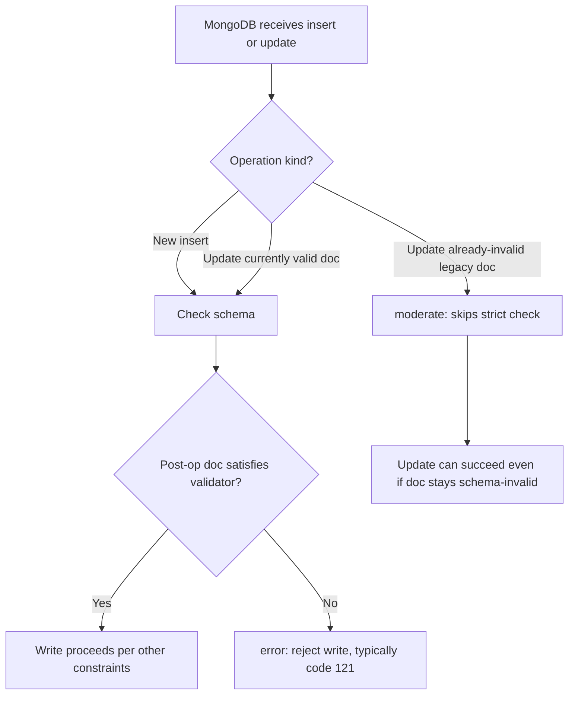

# Changing Validators When Existing Data Does Not Match the New Schema

## 1. Problem: Tightening the Schema Without Being Able to Fix All Data at Once

MongoDB allows documents in a collection to have varying structures and BSON types. This flexibility helps when a product iterates rapidly, yet after a few years in production, data may span multiple versions:

- New documents have all fields, the right types, and values following current conventions.
- Legacy documents lack fields that were never previously required.
- Older programs stored money as `String`, while newer programs store `Int64`.
- Order states contain `"paid"`, `"PAID"`, and obsolete codes.
- One application already deployed the new schema, while other workers or services still write the old schema.

Suppose `fulfillment_orders` is about to enforce new rules: every order must have `tenantId`, `state` in the allowed set, `totalCents` as non-negative BSON `long`, `currency`, and `schemaVersion=2`.

If you turn on a **strict validator** immediately before inventorying legacy data, updates to legacy documents will fail—even an update that merely adds an operational note. Conversely, loosening the validator indefinitely to "avoid errors" lets new documents keep being written wrongly, growing data debt.

**Design question:** how do you change a MongoDB collection validator so that:

1. Pre-existing data is not mistaken for valid data.
2. Critical write flows are not disrupted.
3. Invalid **new writes** are blocked.
4. You have a plan to repair, audit, and prove legacy documents meet the standard.
5. You can transition to strict enforcement without assuming `collMod` repairs data automatically?

This lesson belongs to the **Collections and Schema** chapter of the **SPRING_DATA_MONGODB** module. We practice with MongoDB `$jsonSchema` and `collMod`, combined with `MongoTemplate`, repositories, integration testing, access control, operations, and troubleshooting.

**Key conclusion upfront:** changing a validator changes **validation rules for future writes**, not an automatic migration rewriting existing documents. Safe rollout requires separating **observation, blocking new bad writes, converting legacy data, and verifying completion**.

## 2. `validator`, `validationLevel`, and `validationAction` Are Three Distinct Concepts

A collection stores a **validator** defining what a valid document looks like. Two additional options decide **when** checking runs and **how** MongoDB responds to failures.

| Property | Decides | Example |
| --- | --- | --- |
| `validator` | Conditions a document must satisfy | `$jsonSchema` with `required`, `bsonType`, `enum` |
| `validationLevel` | Which writes are evaluated against the validator | `strict`, `moderate`, `off` |
| `validationAction` | Handling of invalid writes when checked | `error`, `warn`; newer servers add version-specific options |

Example MongoDB command:

```javascript
db.runCommand({
  collMod: "fulfillment_orders",
  validator: {
    $jsonSchema: {
      bsonType: "object",
      required: ["tenantId", "state"],
      properties: {
        tenantId: { bsonType: "string" },
        state: { enum: ["PENDING", "PAID", "CANCELLED"] }
      }
    }
  },
  validationLevel: "moderate",
  validationAction: "error"
});
```

This command modifies the validator settings on an **existing collection**. `collMod` does not automatically iterate over documents to rewrite `state` or fill in `tenantId`. All data updates must be designed separately.

### 2.1. Validation Is Not Java Schema Mapping

Spring Data MongoDB provides `@Document`, `@Field`, `@MongoId`, and converters to map Java objects to and from BSON. However, a valid Java entity **does not automatically create** an equivalent MongoDB validator on the server.

Conversely, a server-side MongoDB validator checks write commands from **`mongosh`, the Java driver, Spring Data, ETL tools, or other services** whenever operations are not exempt from checks. Hence, to enforce shared rules across multiple producers, a server-side validator is a useful safeguard.

Still, validators do not replace Java business validation, tenant access controls, unique indexes, transactions, or state-transition checks.

## 3. Two Control Axes: `strict`/`moderate` and `error`/`warn`

### 3.1. `strict`: Checks All Standard Inserts and Updates

With `validationLevel: "strict"`, MongoDB applies the validator to newly created documents and updated documents per standard enforcement rules.

Common misconception: **`strict` does not delete or reject all legacy data the moment `collMod` runs.** Existing invalid documents stay in the collection; errors surface later if an update attempts to modify them and the resulting document still violates the validator.

### 3.2. `moderate`: Checks Inserts and Updates to Already-Valid Documents

With `validationLevel: "moderate"`, MongoDB validates **inserts** and updates on documents **already valid under the validator**. When a legacy document already failed the validator, updates to it are not subjected to the validator check the way `strict` applies.

This creates a very helpful **transition window**:

- **New** documents must follow the schema when `validationAction: "error"`.
- **Already-valid** documents cannot freely degrade into invalid documents on update.
- **Already-invalid legacy** documents can still be modified gradually, even while not yet fully schema-compliant.

**Trade-off:** `moderate + error` **does not guarantee every document in the collection is valid**. Nor does it check every update to legacy documents. It is a transitional policy, not proof that migration is done.

### 3.3. `error` and `warn` Decide What Happens on Violation

- `validationAction: "error"`: checked writes violating the validator fail; MongoDB typically reports **DocumentValidationFailure**, code **121**.
- `validationAction: "warn"`: MongoDB lets the write proceed and emits a warning via server logging. Applications can observe write success without automatically receiving an exception.

Do not rely on `warn` long-term to block bad data. To know how many records violate the rules, build proper audits and monitoring; warning logs alone do not provide a complete, permanently queryable report.

### 3.4. Behavior Matrix Worth Memorizing

Suppose a write yields a **post-operation document failing the validator**, ignoring other errors such as unique indexes or write conflicts:

| Setting | Insert Invalid New Doc | Update Valid Old Doc to Invalid | Update Already-Invalid Old Doc Remaining Invalid |
| --- | --- | --- | --- |
| `strict + error` | Rejected | Rejected | Rejected |
| `strict + warn` | Allowed, warns | Allowed, warns | Allowed, warns |
| `moderate + error` | Rejected | Rejected | **Can succeed**, exempt from strict check |
| `moderate + warn` | Allowed, warns | Allowed, warns | Can succeed, usually unchecked |
| `off` | Skips validator check for write | Skips check | Skips check |

`validationLevel: "off"` does not delete the validator; it disables validator enforcement for those operations. Never use `off` as a default "migration shortcut," as new writes can continue drifting from the schema.

## 4. Sample Data: v2 Is Stricter Than v1

### 4.1. Data Already Valid Under v2

```javascript
db.fulfillment_orders.insertOne({
  _id: "o-101",
  tenantId: "shop-01",
  state: "PAID",
  totalCents: NumberLong("120000"),
  currency: "VND",
  schemaVersion: NumberInt("2")
});
```

Assuming `totalCents` represents the **smallest integer currency unit** per system contract. For VND, define unit semantics explicitly; the name `totalCents` in this example is an integer-storage convention, not advice to convert all VND amounts into "cents." In production apps, name fields consistently with your monetary model and currencies.

### 4.2. Legacy Data with Older Types and State Codes

```javascript
db.fulfillment_orders.insertOne({
  _id: "o-102",
  tenantId: "shop-01",
  state: "paid",
  totalCents: "80000",
  currency: "VND"
  // Missing schemaVersion.
});
```

This document fails validator v2 because:

1. `state` uses `"paid"`, outside the new canonical enum.
2. `totalCents` is BSON String, not Int64.
3. `schemaVersion` is missing.

### 4.3. Legacy Data Missing Business Information

```javascript
db.fulfillment_orders.insertOne({
  _id: "o-103",
  tenantId: "shop-01",
  state: "PENDING",
  totalCents: NumberInt("5000")
  // Missing currency and schemaVersion; amount is Int32.
});
```

You cannot simply run:

```javascript
// DO NOT DO THIS BLINDLY:
db.fulfillment_orders.updateMany(
  { currency: { $exists: false } },
  { $set: { currency: "VND" } }
);
```

because lacking `currency` does not prove all orders are in VND. Completing migration requires an **authoritative source** such as the payment processor, tenant historical settings, receipts, or other source-of-truth records.

### 4.4. New Rules Must Be Stated Clearly

We want `validator v2`:

| Field | Required | Type / Constraint |
| --- | --- | --- |
| `tenantId` | Yes | BSON String |
| `state` | Yes | `PENDING`, `PAID`, `CANCELLED` |
| `totalCents` | Yes | BSON `long`, non-negative |
| `currency` | Yes | `VND` or `USD` within example scope |
| `schemaVersion` | Yes | BSON `int`, value `2` |

Fields such as `_id` or `_class` can also exist. By default, `$jsonSchema` allows extra properties unless `additionalProperties: false` is set. This helps when using Spring Data with type-hint metadata; if you later enable `additionalProperties: false`, account for `_id`, `_class`, and any converter-emitted fields.

**Setting a non-negative minimum** is a policy for new documents. Negative entries for refunds/adjustments may need distinct document types or an event model; validators cannot understand accounting semantics on their own.

## 5. Declaring `$jsonSchema` v2 in `mongosh`

### 5.1. Defining a Reusable Schema

```javascript
const orderSchemaV2 = {
  bsonType: "object",
  required: [
    "tenantId",
    "state",
    "totalCents",
    "currency",
    "schemaVersion"
  ],
  properties: {
    tenantId: {
      bsonType: "string",
      description: "Order tenant"
    },
    state: {
      enum: ["PENDING", "PAID", "CANCELLED"]
    },
    totalCents: {
      bsonType: "long",
      minimum: 0
    },
    currency: {
      enum: ["VND", "USD"]
    },
    schemaVersion: {
      bsonType: "int",
      enum: [NumberInt("2")]
    }
  }
};

const orderValidatorV2 = {
  $jsonSchema: orderSchemaV2
};
```

`bsonType: "long"` means BSON Int64. A document storing `NumberInt("5000")` is Int32 and **does not match the schema** even though both represent 5000 arithmetically.

### 5.2. Validators Support More Than One Rule

MongoDB validators can combine `$jsonSchema` and supported query expressions (such as combining allowed conditions). Yet for initial migrations, prefer rules that are **easy to explain, easy to query during audits, and easy to test**.

Do not cram all business rules into JSON Schema. For instance, "PAID only if a verified payment transaction exists" is a cross-collection/system rule that a single-document schema validator cannot verify.

### 5.3. Should `schemaVersion` Be Added to Every Document?

`schemaVersion` helps applications and migration jobs identify which contract a document follows. However, it is **just a data field**; if a script sets `schemaVersion: 2` without converting the other fields, the document will still fail the validator.

In systems with multiple concurrent reader/writer versions, distinguish:

- Version of **application code**.
- Version of **document schema**.
- Version of **configured validator**.
- Version of **migration procedure** and deployment timestamp.

These numbers relate to each other, yet are not synonymous.

## 6. Before `collMod`: Inventorying Violating Documents

### 6.1. Inspecting Data Using the Target Validator

MongoDB supports `$jsonSchema` as a query expression to find conforming documents. Negate it with `$nor`:

```javascript
db.fulfillment_orders.find({
  $nor: [
    { $jsonSchema: orderSchemaV2 }
  ]
});
```

On the section 4 fixture, this query returns `o-102` and `o-103`. This audits **directly against the target schema**, rather than checking just one field.

Count non-conforming documents:

```javascript
db.fulfillment_orders.countDocuments({
  $nor: [
    { $jsonSchema: orderSchemaV2 }
  ]
});
// With fixture having only o-101, o-102, o-103: expected 2.
```

**Do not mistake `countDocuments` for an automatic full-collection validation run upon config change.** This is a manual read audit you run deliberately.

### 6.2. Inventorying Failure Causes, Not Just Counts

A query listing invalid documents shows "there are errors" without detailing every cause. Inspect types and values:

```javascript
db.fulfillment_orders.aggregate([
  {
    $project: {
      _id: 1,
      state: 1,
      currency: 1,
      stateType: { $type: "$state" },
      amountType: { $type: "$totalCents" },
      currencyType: { $type: "$currency" },
      versionType: { $type: "$schemaVersion" }
    }
  }
]);
```

`$type` in aggregation distinguishes `"missing"`, `"null"`, `"string"`, `"int"`, and `"long"`. When migrating large datasets, generate a report **grouped by cause with counts** and inspect real document samples, avoiding jobs that fix one flaw while overlooking a second flaw.

### 6.3. Cost of Auditing

`$jsonSchema` with many rules can be resource-heavy on large collections. Do not run full-collection audits repeatedly on a busy primary without assessing runtime, read preferences, resource usage, and result consistency.

On very large datasets, chunk by tenant, time, or stable keys while keeping summary stats. Note that **chunked audits observe different points in time** if writes remain active; plan cutover strategy and final verification accordingly.

## 7. Phase A: `strict + warn` to Observe Without Blocking Writes

Before deploying, take backups, verify impact and `collMod` privileges, and align on the deployment window. On the existing collection:

```javascript
db.runCommand({
  collMod: "fulfillment_orders",
  validator: orderValidatorV2,
  validationLevel: "strict",
  validationAction: "warn"
});
```

During this phase:

- Schema-failing inserts/updates can still succeed.
- The server logs violation warnings per logging policy.
- Applications must still **observe write paths independently**: invalid payload rates, writer origins, producer versions, and document IDs in safe monitoring tools.

**Why choose `strict` during observation?** It catches updates to legacy documents that violate the validator, instead of skipping them as `moderate` does. Still, logs are not a complete inventory and reveal nothing about untouched legacy documents.

### 7.1. Enabling `warn` Does Not Verify Old Data Immediately

Right after `collMod`, `o-102` and `o-103` remain in the collection; they are neither automatically flagged nor emitted to logs until a write touches them.

To measure legacy non-compliance, run the audit queries from section 6. Never conclude "no validator warnings in logs" means "the whole collection is clean."

### 7.2. Risk of Leaving `warn` On Too Long

An older service can keep writing invalid documents while HTTP requests return success. Meanwhile, the invalid document count can **grow** as the migration team works on old records. Set a deadline and exit criteria for moving to blocking mode; never treat `warn` as a permanent setting just to avoid incidents.

## 8. Phase B: `moderate + error` to Block Bad New Writes While Allowing Legacy Fixes

Once **producers creating new documents** support schema v2, transition to:

```javascript
db.runCommand({
  collMod: "fulfillment_orders",
  validator: orderValidatorV2,
  validationLevel: "moderate",
  validationAction: "error"
});
```

Current behavior:



### 8.1. Trying an Invalid Insert: Blocked

```javascript
db.fulfillment_orders.insertOne({
  _id: "o-new-invalid",
  tenantId: "shop-01",
  state: "paid",
  totalCents: "9000"
});
// Expected DocumentValidationFailure (code 121).
```

Under `moderate + error`, **new inserts** are not exempt from validation. Missing `currency`, `schemaVersion`, and wrong `totalCents` type make it fail.

### 8.2. Trying to Update a Valid Document into Invalid: Blocked

```javascript
db.fulfillment_orders.updateOne(
  { _id: "o-101" },
  { $set: { state: "paid" } }
);
// Expected validation error: o-101 was valid, update breaks enum.
```

### 8.3. Trying to Update an Invalid Legacy Document While Still Invalid: Allowed

```javascript
db.fulfillment_orders.updateOne(
  { _id: "o-102" },
  { $set: { migrationNote: "Reconciling" } }
);
// Under moderate, the doc was already invalid so
// this update can succeed even though the doc remains invalid afterward.
```

This is both the **benefit and risk** of `moderate`. Benefit: legacy processing flows are not locked out. Risk: an old worker can keep modifying bad documents repeatedly without being stopped by the validator.

Therefore you must:

1. Maintain a list or dashboard of non-compliant documents.
2. Design idempotent, reconcilable migrations.
3. Time-box the `moderate` phase.
4. Never claim "all data is protected" merely because invalid new inserts are blocked.

### 8.4. `moderate` Does Not Replace Stopping Old Producers

During this phase, an old producer **inserting** invalid documents will receive errors; if it retries infinitely, queues can back up and drop messages. Upgrade consumers/producers before cutover, handle code 121 cleanly, and monitor dead-letter queues or rejected records.

## 9. Migration: Fix the Real Data, Not Just `schemaVersion`

### 9.1. Grouping by Verifiability

| Legacy Group | Safe Action | Do Not Guess |
| --- | --- | --- |
| `state="paid"` with payment proof confirming paid | Convert to `"PAID"` | Do not assume every similar string means PAID |
| `totalCents="80000"`, verified positive integer format | Convert to BSON Int64 | Do not coerce arbitrary Strings to 0 |
| Missing `currency`, payment source confirms VND | Fill VND with audit trail | Do not default the entire collection to VND |
| Unrecoverable missing info | Route to review/exception list | Do not invent fake values just to pass the validator |
| Negative amounts needing explanation | Check refund/adjustment nature | Do not blindly take absolute values |

Migrations must preserve **data meaning** before satisfying BSON types. A migration making every document pass `$jsonSchema` with wrong monetary values or statuses is worse than temporarily keeping legacy records under review.

### 9.2. Converting a Verified Document

Assuming `o-102` was confirmed paid and `"80000"` is an integer in the system's currency unit:

```javascript
db.fulfillment_orders.updateOne(
  {
    _id: "o-102",
    state: "paid",
    totalCents: "80000",
    currency: "VND"
  },
  {
    $set: {
      state: "PAID",
      totalCents: NumberLong("80000"),
      schemaVersion: NumberInt("2")
    },
    $unset: {
      migrationNote: ""
    }
  }
);
```

The filter matches the old state to prevent overwriting concurrent updates from other services. If `matchedCount=0`, investigate why rather than **blindly broadening the filter** to force success.

`$set`/`$unset` commands are far safer to rerun than `$inc` or revenue accumulations; nevertheless, filter guards and concurrency coordination remain essential.

### 9.3. Never Auto-Fix Data Lacking Authoritative Proof

`o-103` lacks `currency`. If the **currency is unknown**, keep the document in a review queue. Only once payment receipts or operational records verify VND should you update it:

```javascript
db.fulfillment_orders.updateOne(
  {
    _id: "o-103",
    currency: { $exists: false },
    totalCents: { $type: "int" },
    state: "PENDING"
  },
  {
    $set: {
      currency: "VND",
      totalCents: NumberLong("5000"),
      schemaVersion: NumberInt("2")
    }
  }
);
```

**Mandatory external prerequisite:** reliable proof that `o-103` is VND. The snippet does not infer currency from `tenantId` or `state`. In real environments, store migration audit trails in an authorized location without bloating documents with sensitive info.

### 9.4. Controlled Batch Type Conversion

On large datasets, individual per-ID statements are impractical. One option is an **aggregation pipeline update** for records whose format has already been verified:

```javascript
db.fulfillment_orders.updateMany(
  {
    state: "paid",
    currency: "VND",
    totalCents: { $type: "string" }
  },
  [
    {
      $set: {
        state: "PAID",
        totalCents: {
          $convert: {
            input: "$totalCents",
            to: "long",
            onError: null,
            onNull: null
          }
        },
        schemaVersion: NumberInt("2")
      }
    }
  ]
);
```

**This is only an illustrative skeleton, not safe to run directly on production.** If a string cannot convert, `onError: null` leaves the document invalid; under `moderate`, it could even be saved because the old document was already invalid. Therefore, before updating:

1. Verify valid formats in a separate audit step (e.g., digits only, no unexpected separators).
2. Test conversion on a copy/staging environment and count resulting `null`s.
3. Log failing IDs and **skip updating** those records.
4. Batch by chunk/tenant, verifying `matchedCount`, `modifiedCount`, and post-batch state.
5. Re-run the `$jsonSchema` query to verify invalid counts did not rise.

In practice, a Java job reading raw BSON, validating format with tested logic, converting to `Long`/`Decimal128` per policy, and writing via `MongoTemplate` or chunked bulk writes is often safer and more observable than a collection-wide `updateMany`.

### 9.5. Do Not Equate `modifiedCount > 0` with Migration Success

`modifiedCount > 0` only reports that some documents changed. It does not guarantee:

- All target documents were repaired.
- No semantically wrong values were written.
- Old producers did not insert new invalid records mid-run.
- Zero documents still lack currency or have wrong enums.
- No concurrent race overwrote newer data.

**The strongest evidence** for schema readiness is a post-migration validator audit combined with business reconciliation and producer checks.

## 10. Phase C: `strict + error` Once Data Meets Requirements

Once new producers are ready and audits report **0 violating documents**, switch to:

```javascript
db.runCommand({
  collMod: "fulfillment_orders",
  validator: orderValidatorV2,
  validationLevel: "strict",
  validationAction: "error"
});
```

Now:

- Schema-invalid new inserts are rejected.
- Updates to existing documents producing invalid results are rejected.
- Valid writes still must satisfy other constraints such as unique indexes, permissions, and transactions.

### 10.1. Pre-Cutover and Immediate Post-Cutover Checks

```javascript
// Before cutover:
db.fulfillment_orders.countDocuments({
  $nor: [{ $jsonSchema: orderSchemaV2 }]
});
// Requirement: 0 per chosen deployment policy.

// After cutover, verify again:
db.fulfillment_orders.countDocuments({
  $nor: [{ $jsonSchema: orderSchemaV2 }]
});
```

In systems with concurrent writes, **a count=0 check is not an immutable snapshot**. Coordinate producer/validator cutover, monitor write streams, and re-verify. Across multiple services, define when "all producers support v2" and how deployment rollback works if an older service lingers.

### 10.2. What If Legacy Records Still Remain?

Do not prematurely declare completion or turn on strict hoping old updates never arrive. Evaluate options:

1. Keep `moderate + error` temporarily with a firm deadline while reconciling.
2. Isolate/quarantine unfixable documents and adapt read/write paths per business policy.
3. Design a transitional validator permitting multiple valid schema branches, if v1 and v2 truly must coexist temporarily.
4. Halt legacy writers, upgrade producers, or complete migration before enabling strict.

Never fake `schemaVersion` or fabricate missing data merely to hit a count=0 metric.

## 11. Dual-Schema Compatibility Strategy for Extended Rollouts

### 11.1. Intentionally Expanded Validator

If some services cannot upgrade right away, you can craft a validator allowing **two defined document shapes**, instead of turning validation off:

```javascript
const transitionalValidator = {
  $or: [
    {
      $jsonSchema: {
        bsonType: "object",
        required: ["tenantId", "state", "totalCents"],
        properties: {
          tenantId: { bsonType: "string" },
          state: { enum: ["PENDING", "PAID", "CANCELLED"] },
          totalCents: { bsonType: "long", minimum: 0 }
        }
      }
    },
    {
      $jsonSchema: orderSchemaV2
    }
  ]
};
```

In this snippet, the **first branch is an illustrative transitional schema**, not a full historical v1 schema; it is overly permissive if kept long-term because documents missing `currency` or `schemaVersion` pass. Moreover, if the first branch already subsumes every condition of v2, `$or` adds little value. In real usage, branches should use a **discriminator** or explicit conditions so an incomplete v2 document cannot accidentally "fall back" into the v1 branch.

Example branching by `schemaVersion`:

```javascript
const versionedValidator = {
  $or: [
    {
      $and: [
        { schemaVersion: { $exists: false } },
        {
          $jsonSchema: {
            bsonType: "object",
            required: ["tenantId", "state", "totalCents"],
            properties: {
              tenantId: { bsonType: "string" },
              state: { enum: ["paid", "pending"] },
              totalCents: { bsonType: "string" }
            }
          }
        }
      ]
    },
    { $jsonSchema: orderSchemaV2 }
  ]
};
```

**Note:** this example covers two specific legacy shapes and excludes `o-103` (which had Int32 `totalCents`). To support that too, align with the real contract. Never copy a transitional validator to production without auditing actual data and business constraints.

### 11.2. Sunset Plan for Backward Compatibility

A dual v1/v2 validator aids phased rollouts, yet requires:

- Cutoff date for v1 writes and inventory of remaining v1 producers.
- Tracking document counts per version.
- Migration jobs converting remaining v1 records to v2.
- Auditing unused legacy branches.
- Final cutover to a v2-only validator.

Without a sunset plan for v1, transitional validators easily become **permanent loopholes** for stale or broken data.

### 11.3. Prioritize Not Breaking Older Readers

Do not focus solely on write paths. Older readers may:

- Fail to understand `CANCELLED` state.
- Fail to parse BSON Int64 `totalCents` if previously expecting String.
- Overwrite whole documents via `save`, inadvertently dropping `currency` or `schemaVersion`.
- Fail deserializing enums lacking new values.

With Spring Data, inspect converters, entity mappings, and `save` calls on partially mapped objects. Roll out schemas using **expand → migrate → contract** rather than making a one-shot change hoping every service remains compatible.

## 12. Spring Data MongoDB: Entities and BSON Types Must Match the Validator

### 12.1. Entity for v2 Documents

```java
package example.orders;

import org.springframework.data.mongodb.core.mapping.Document;
import org.springframework.data.mongodb.core.mapping.FieldType;
import org.springframework.data.mongodb.core.mapping.MongoId;

@Document(collection = "fulfillment_orders")
public record FulfillmentOrder(
    @MongoId(FieldType.STRING) String id,
    String tenantId,
    String state,
    long totalCents,
    String currency,
    int schemaVersion
) {}
```

Under standard converters, `long` stores as BSON Int64 and `int` as Int32. However, **never use this v2 record to read unmigrated legacy documents blindly**. Legacy records with String `totalCents`, missing `currency`, or bad `state` may cause converters to coerce, default, or throw depending on field and configuration. Prior to migration, read raw `Document` to inspect real BSON types.

### 12.2. Repositories Define the Clean Data Contract

```java
package example.orders;

import java.util.List;
import org.springframework.data.mongodb.repository.MongoRepository;

public interface FulfillmentOrderRepository
        extends MongoRepository<FulfillmentOrder, String> {

    List<FulfillmentOrder> findByTenantIdAndState(
        String tenantId, String state
    );
}
```

Repositories excel once documents match the Java model. For unmigrated historical data not yet meeting v2, custom repositories or `MongoTemplate` reading raw BSON are often safer for auditing and migration.

### 12.3. Pitfalls of `@NotNull` and Bean Validation

`@NotNull` on Java DTOs/entities or request-time validation applies only along **specific application call paths**, and cannot guarantee operations from `mongosh`, ETLs, or standalone drivers are checked. MongoDB `$jsonSchema` sets a server boundary, yet does not replace Java rules.

**Never treat Java annotations as MongoDB migrations.** Deploying a new Java class never runs `collMod`, creates no validator, and modifies no stored BSON.

## 13. Spring Data `MongoTemplate`: Changing Validators via `collMod`

### 13.1. `MongoTemplate.executeCommand`

`MongoTemplate` lets you send MongoDB commands. This example uses BSON `Document` to update a validator **after the collection already exists**:

```java
package example.orders;

import java.util.List;
import org.bson.Document;
import org.springframework.data.mongodb.core.MongoTemplate;
import org.springframework.stereotype.Service;

@Service
public class OrderSchemaAdministration {

    private final MongoTemplate template;

    public OrderSchemaAdministration(MongoTemplate template) {
        this.template = template;
    }

    private Document schemaV2() {
        return new Document("bsonType", "object")
            .append("required", List.of(
                "tenantId", "state", "totalCents",
                "currency", "schemaVersion"
            ))
            .append("properties", new Document()
                .append("tenantId",
                    new Document("bsonType", "string"))
                .append("state",
                    new Document("enum", List.of(
                        "PENDING", "PAID", "CANCELLED"
                    )))
                .append("totalCents",
                    new Document("bsonType", "long")
                        .append("minimum", 0))
                .append("currency",
                    new Document("enum", List.of("VND", "USD")))
                .append("schemaVersion",
                    new Document("bsonType", "int")
                        .append("enum", List.of(2))));
    }

    public Document changeValidator(
            String validationLevel,
            String validationAction) {

        if (!List.of("strict", "moderate").contains(
                validationLevel)) {
            throw new IllegalArgumentException(
                "Unsupported validationLevel"
            );
        }
        if (!List.of("warn", "error").contains(
                validationAction)) {
            throw new IllegalArgumentException(
                "Unsupported validationAction"
            );
        }

        Document command = new Document(
            "collMod", "fulfillment_orders"
        ).append(
            "validator",
            new Document("$jsonSchema", schemaV2())
        ).append(
            "validationLevel", validationLevel
        ).append(
            "validationAction", validationAction
        );

        return template.executeCommand(command);
    }
}
```

Allowlisting levels/actions here only demonstrates safe parameter checking; it **does not turn schema updates into a client-facing endpoint**. `collMod` is a high-impact admin command. In production, invoke it via controlled migration/deployment pipelines with proper privileges, change management, and rollback—never expose a public HTTP API allowing arbitrary users to change validators.

### 13.2. Configuring Validation Across Phases

Using the admin service above, phased rollout maps to:

```java
// Phase A: observation.
admin.changeValidator("strict", "warn");

// Phase B: block bad new writes, allow legacy handling.
admin.changeValidator("moderate", "error");

// Phase C: strict enforcement once data is clean.
admin.changeValidator("strict", "error");
```

These three commands are **steps executed at different deployment stages**, never run back-to-back in a single application startup. Each step requires meeting exit criteria, especially producer compatibility and audit verification.

### 13.3. Spring Data Also Has APIs to Build `MongoJsonSchema`

Beyond raw `Document`, Spring Data MongoDB provides JSON Schema types such as `MongoJsonSchema` and related operations. When using the DSL, check the API in your exact Spring Data version. Whether built with the DSL or raw BSON, **the server semantics of `validationLevel`/`validationAction` remain identical**.

For long-lived migrations, keep validator definitions under version control (in an approved migration system) for review, diffing, and rollback. This lesson only documents the concepts and does not create or modify external migration files.

## 14. Confirming the Active Validator on the Collection

### 14.1. Reading Collection Metadata

In `mongosh`:

```javascript
db.getCollectionInfos({
  name: "fulfillment_orders"
});
```

Inspect fields under `options`:

```javascript
{
  validator: {
    $jsonSchema: { /* configured schema */ }
  },
  validationLevel: "moderate",
  validationAction: "error"
}
```

The output above shows only the relevant fields to inspect; real metadata objects include additional details. Never rely solely on `db.runCommand({collMod:...})` not throwing an error if deployments span multiple databases or similarly named collections.

### 14.2. Verifying Target Database and Collection

A dangerous mistake is running `collMod` against the wrong staging/prod database or a similarly named collection. Before modifying:

1. Verify the authorized connection string and database.
2. Confirm the collection exists and is not an out-of-scope view.
3. Read current metadata and back up the prior validator for controlled rollback.
4. Verify checksum/contents of the target schema version.
5. Inspect post-command state and test both valid and invalid writes.

### 14.3. Error 121 and Diagnostic Details

When `validationAction: "error"` rejects an insert/update, MongoDB typically raises `DocumentValidationFailure` (code 121). Depending on server/driver version, the error includes `errInfo` or details of which validator rules failed.

Never log full failing payloads in production if they contain sensitive customer data. Log error code, collection name, operation type, correlation ID, application version, and redacted details per policy.

### 14.4. Do Not Handle 121 Like a Network Error

Validation failure is usually a **data or producer-version bug**, not a transient outage cured by retrying the exact same payload.

```text
Insert schema-invalid document
    -> MongoDB returns code 121
    -> app does not retry infinitely with the same payload
    -> classify error (input, producer version, migration)
    -> return contract error or route to manual handling
```

For queue consumers, implement dead-letter/poison-message handling, monitoring, and replay after fixing data or upgrading producers, instead of wedging the queue.

## 15. Temporary Validation Workarounds Requiring Caution

### 15.1. `bypassDocumentValidation` Is Not a General Fix

MongoDB offers `bypassDocumentValidation` on certain write commands for privileged callers. It is not a flag for "anyone can skip the validator."

If a migration is granted bypass to load data, it avoids validation errors for that run **at the cost of losing data-validation checks**. Only use it when:

- Properly approved and privilege-controlled.
- The exact target document set is identified.
- Independent pre- and post-load data checks exist.
- Audit logging and a plan to revoke bypass privileges are in place.

Never grant bypass privileges to ordinary application accounts just to mask schema-entity mismatches.

### 15.2. Turning `validationLevel` Completely Off

`validationLevel: "off"` unblocks writes during an emergency window, yet opens the door for **all producers** to keep writing bad data. Special operational emergencies might call for it, but it carries high risk and demands compensating controls, time limits, audits, and a re-enablement plan.

### 15.3. Enabling `warn` and Forgetting to Monitor

`validationAction: "warn"` does not protect data integrity by itself. Without dashboards and exit criteria, teams can mistakenly assume validation succeeded while bad documents keep piling up.

## 16. Validators Do Not Replace Unique Indexes, Transactions, or Authorization

### 16.1. `$jsonSchema` Does Not Enforce Cross-Document Uniqueness

A validator can mandate `tenantId` and `externalOrderId` be Strings, yet cannot prevent two documents from sharing the same `(tenantId, externalOrderId)`.

When business rules require uniqueness:

```javascript
db.fulfillment_orders.createIndex(
  { tenantId: 1, externalOrderId: 1 },
  {
    name: "uk_tenant_external_order",
    unique: true
  }
);
```

Audit and resolve duplicate data before building unique indexes. In the v2 schema example above, `externalOrderId` was not marked required; to use this index in production, clarify the contract and behavior for documents lacking the field, including sparse/partial index options. Ordinary unique compound indexes have specific rules regarding null/missing values that must be tested.

### 16.2. Validators Do Not Turn Bulk Writes into Transactions

If a bulk write sends three documents and the second fails validation, the others **can still succeed** outside a transaction, depending on ordered/unordered mode and specific errors.

To commit or abort multiple document changes atomically, configure MongoDB and Spring Data multi-document transactions. Validation checks individual operations/documents in scope and provides no bulk atomicity.

### 16.3. Validators Do Not Replace Tenant Authorization

Simply because a document has `tenantId: "shop-01"` as a valid String does not mean the caller may read or modify it. Access control must come from server-side authentication/authorization, tenant filters, and data-access policies.

## 17. Performance and Operational Notes When Changing Validators

### 17.1. Write-Path Cost

Validation spends CPU inspecting written documents. Overly complex schemas or excessive rules can raise latency and hinder diagnostics. Benchmark with realistic write payloads, especially under high update rates and multiple writing services.

Still, **never skip validators solely over "added cost."** Aim for a balance between protecting data and acceptable overhead, keeping complex multi-entity logic in appropriate layers.

### 17.2. `collMod` Is a High-Impact Metadata Change

`collMod` can require administrative privileges and interact with other collection operations. On busy clusters, consult operational runbooks and schedule deployments carefully. Never invoke `collMod` per request or per repository initialization.

Systems running multiple versions concurrently should designate a single migration coordinator rather than letting instances overwrite validator settings back and forth.

### 17.3. Chunked Bulk Migration

For millions of documents:

1. Scan by bounded ID/tenant/time ranges.
2. Select only documents genuinely violating the schema and safe to convert.
3. Update using conditional `$set`/pipeline updates.
4. Cap chunk sizes and concurrency.
5. Track `matchedCount`, `modifiedCount`, errors, duration, and rollback strategy.
6. Re-inspect sample raw BSON and run chunked `$jsonSchema` audits.
7. Continue until exit criteria are met before `strict` cutover.

**Never use `$inc` as a "migrated marker"** if jobs can retry; repeated increments are not idempotent. Use explicit version/migration markers with proper preconditions, payload reconciliation, and invariant checks.

### 17.4. Audit Freshness in Active Write Systems

If applications still write v1 while an audit runs for hours, counts at start and end can diverge. Bound the cutover window, verify producers, run a final audit, and monitor continuously post-cutover.

Seeing invalid=0 at 10:00 while a lingering writer inserts bad docs at 10:01 means migration is not operationally complete.

## 18. Integration Testing `strict`, `moderate`, and Migration

Thorough tests must prove **actual behavior on the MongoDB server**, not just Java `Document` schema assembly.

### 18.1. Scenario to Prove

1. Insert a legacy document **before** enabling the validator.
2. Enable `moderate + error`.
3. Insert an invalid new document → **rejected**.
4. Update the invalid legacy document while leaving it invalid → **allowed**.
5. Insert a valid new document → succeeds.
6. Update the valid new document into invalid → **rejected**.
7. Migrate the legacy document to valid.
8. Switch to `strict + error`.
9. Update turning it invalid → **rejected**.
10. Final audit finds zero invalid documents.

The test below creates a randomized collection name to avoid colliding with real data.

### 18.2. JUnit 5 + MongoDB Test Instance

```java
package example.orders;

import static com.mongodb.client.model.Filters.eq;
import static com.mongodb.client.model.Updates.set;
import static org.junit.jupiter.api.Assertions.*;

import java.util.List;
import java.util.UUID;
import com.mongodb.MongoWriteException;
import com.mongodb.client.MongoCollection;
import org.bson.Document;
import org.junit.jupiter.api.Test;
import org.springframework.beans.factory.annotation.Autowired;
import org.springframework.boot.test.autoconfigure.data.mongo.DataMongoTest;
import org.springframework.data.mongodb.core.MongoTemplate;

@DataMongoTest
class CollectionValidatorMigrationTest {

    @Autowired
    MongoTemplate template;

    private Document validator() {
        Document properties = new Document()
            .append("tenantId", new Document("bsonType", "string"))
            .append("state", new Document("enum", List.of(
                "PENDING", "PAID", "CANCELLED"
            )))
            .append("totalCents", new Document("bsonType", "long")
                .append("minimum", 0))
            .append("currency", new Document("enum", List.of(
                "VND", "USD"
            )))
            .append("schemaVersion",
                new Document("bsonType", "int")
                    .append("enum", List.of(2)));

        return new Document("$jsonSchema",
            new Document("bsonType", "object")
                .append("required", List.of(
                    "tenantId", "state", "totalCents",
                    "currency", "schemaVersion"
                ))
                .append("properties", properties));
    }

    private void changeValidator(
            String collection,
            String level,
            String action) {

        template.executeCommand(
            new Document("collMod", collection)
                .append("validator", validator())
                .append("validationLevel", level)
                .append("validationAction", action)
        );
    }

    @Test
    void moderateAllowsLegacyUpdatesButRejectsNewInvalidData() {
        String collectionName =
            "validator_test_" +
            UUID.randomUUID().toString().replace("-", "");

        template.getDb().createCollection(collectionName);
        MongoCollection<Document> collection =
            template.getDb().getCollection(collectionName);

        try {
            // Legacy insert before creating validator:
            collection.insertOne(
                new Document("_id", "legacy")
                    .append("tenantId", "tenant-01")
                    .append("state", "paid")
                    .append("totalCents", "100")
            );

            changeValidator(
                collectionName, "moderate", "error"
            );

            MongoWriteException rejectedInsert =
                assertThrows(MongoWriteException.class, () ->
                    collection.insertOne(
                        new Document("_id", "new-invalid")
                            .append("tenantId", "tenant-01")
                            .append("state", "paid")
                            .append("totalCents", "100")
                    )
                );
            assertEquals(121,
                rejectedInsert.getError().getCode());

            // Already-invalid document: moderate permits
            // adding a note even though it stays invalid.
            collection.updateOne(
                eq("_id", "legacy"),
                set("reviewed", true)
            );
            assertEquals(
                true,
                collection.find(eq("_id", "legacy"))
                    .first().getBoolean("reviewed")
            );

            // Insert a new valid document.
            collection.insertOne(
                new Document("_id", "valid")
                    .append("tenantId", "tenant-01")
                    .append("state", "PAID")
                    .append("totalCents", 100L)
                    .append("currency", "VND")
                    .append("schemaVersion", 2)
            );

            // When document is already valid, moderate blocks
            // updates turning it invalid.
            MongoWriteException rejectedUpdate =
                assertThrows(MongoWriteException.class, () ->
                    collection.updateOne(
                        eq("_id", "valid"),
                        set("state", "paid")
                    )
                );
            assertEquals(121,
                rejectedUpdate.getError().getCode());

            // Migrate legacy document from verified data:
            collection.updateOne(
                eq("_id", "legacy"),
                com.mongodb.client.model.Updates.combine(
                    set("state", "PAID"),
                    set("totalCents", 100L),
                    set("currency", "VND"),
                    set("schemaVersion", 2)
                )
            );

            changeValidator(
                collectionName, "strict", "error"
            );

            MongoWriteException rejectedStrictUpdate =
                assertThrows(MongoWriteException.class, () ->
                    collection.updateOne(
                        eq("_id", "legacy"),
                        set("state", "paid")
                    )
                );
            assertEquals(121,
                rejectedStrictUpdate.getError().getCode());

            Document invalidQuery = new Document(
                "$nor", List.of(validator())
            );
            assertEquals(0L,
                collection.countDocuments(invalidQuery));

        } finally {
            // Collection belongs strictly to this test.
            collection.drop();
        }
    }
}
```

**Execution prerequisites:** `@DataMongoTest` only boots Spring's test context; it does not provide a MongoDB server by itself. Configure an isolated test MongoDB or Testcontainers per your Spring Boot version; the test user must hold `createCollection`, `collMod`, and `drop` privileges on the test database.

In practice, exceptions may be translated differently by Spring Data when using `MongoTemplate.insert/update`; this test intentionally uses the **raw MongoDB Java driver** to assert MongoDB error code 121 directly. Do not assume every service catches `MongoWriteException`.

### 18.3. Testing `strict + warn` Before Blocking

You can add a snippet on an isolated collection:

```java
changeValidator(collectionName, "strict", "warn");

// Invalid document can still insert successfully,
// because action is warn rather than error.
collection.insertOne(
    new Document("_id", "warn-invalid")
        .append("tenantId", "tenant-01")
        .append("state", "paid")
);

assertNotNull(
    collection.find(eq("_id", "warn-invalid")).first()
);
```

This is only a **fragment inside a test method** that already initialized `collectionName`/`collection` for the warn phase. It does not assert server logs directly; verifying warnings requires a configured logging/profiler environment.

### 18.4. Edge Cases to Test Further

| Case | Expectation |
| --- | --- |
| `totalCents` is BSON Int32 | Invalid when schema requires `long` |
| `totalCents` is String `"100"` | Invalid unless migrated to Int64 |
| `totalCents` = -1L | Invalid due to minimum 0 |
| Missing `currency` | Invalid |
| `currency = "EUR"` | Invalid when enum allows only VND/USD |
| Missing `schemaVersion` | Invalid |
| `schemaVersion=2L` (Int64) | Invalid when Int32 required |
| `state="paid"` | Invalid |
| `state="PAID"` | Valid if other fields comply |
| Spring Data doc with `_class` | Not rejected merely for extra field if schema permits |
| Invalid new insert under `moderate + error` | Rejected |
| Invalid legacy update under `moderate` | Can succeed despite remaining invalid |
| Invalid legacy update under `strict + error` | Rejected if result stays invalid |
| Bulk write with one schema-invalid op | May partially succeed without a transaction |

## 19. Monitoring and Rollout Criteria

Safe rollouts rely on **quantitative criteria**, not just "validator updated."

| Phase | Goal | Promotion Criteria |
| --- | --- | --- |
| Initial inventory | Understand document counts and flaw categories | Breakdown by tenant/field/type available |
| `strict + warn` | Observe active producers | New flaws fixed at writers; logs/metrics actively watched |
| `moderate + error` | Block bad new writes, allow legacy remediation | Producers compatible; no retry storms; legacy invalid count falling |
| Migration | Fix legacy data accurately per business rules | Final audit near 0; exceptions have owners and decisions |
| `strict + error` | Enforce across all future writes | Zero audit failures in scope; all producers/readers support v2 |
| Post-cutover watch | Prevent regressions | No unexpected spike in code 121; stable data and latency |

### 19.1. Useful Metrics to Track

- Count of documents violating `orderSchemaV2` over time.
- Violation rate by `tenantId`, producer version, and failure category.
- Count of MongoDB code 121 errors per operation/collection.
- Migration chunk success/failure counts and IDs needing reconciliation.
- Rate of old-schema documents appearing after blocking bad new writes.
- p95/p99 write latency and server CPU before/after validator.
- Retried or dead-lettered requests/queue messages.

Never dump full customer documents into dashboards. Collect only needed metadata under appropriate security and retention rules.

### 19.2. Rollback Plan

If cutover to `strict + error` triggers severe write failures:

1. Pause/throttle offending write flows if possible.
2. Identify the offending producer/version and impacted data set.
3. If loosening enforcement is needed, consider **stepping back to `moderate + error`** via approved deployment controls rather than disabling validation indefinitely.
4. Keep audits/metrics running, resolve root causes, and reschedule tightening.
5. Restore the prior validator from saved configuration if rollback policy requires and impact has been assessed.

**Relaxing a validator is only incident mitigation**; it does not make legacy data or rejected requests valid.

## 20. Common Errors and Troubleshooting

| Symptom | Possible Cause | Remediation |
| --- | --- | --- |
| Legacy updates fail with 121 right after enabling `strict` | Old documents do not match schema v2 | Audit, migrate, or use transitional `moderate` |
| Enabled `moderate` yet old data stays broken | Moderate does not retroactively fix documents | Run migrations and audit queries |
| Invalid update succeeds under `moderate + error` | Document was already invalid so skipped by moderate | Check pre-update state; do not equate moderate with clean data |
| Enabled `warn` yet clients get no exception | Warn logs warnings while allowing writes | Monitor logs and audit data |
| Added validator yet bad data persists | `collMod` runs no migration | Separate schema updates from data migrations |
| `NumberInt` fails `bsonType:"long"` | BSON Int32 differs from Int64 | Convert types in controlled batches |
| Migration turned amounts into null | `$convert.onError:null` hid conversion failures | Check input formats, exclude bad records before writing |
| Set `schemaVersion=2` yet validator still rejects | Other fields remain non-compliant | Audit fully against `$jsonSchema` |
| Old producers retry endlessly | Bad new inserts are rejected | Upgrade producers; never retry code 121 infinitely |
| JSON schema passes yet business logic breaks | Validator checks local shape/values only | Add business checks, transactions, and reconciliation |
| Docs with `_class` fail unexpected property | `additionalProperties:false` omitted mapped fields | Reconcile real BSON and converters |
| `collMod` fails to run | Missing privileges, wrong database/collection, bad command | Check roles, namespace, and command response |
| Unique index fails even after schema passes | Duplicate keys across documents | Audit uniqueness separately |
| Invalid count hit 0 then rose again | Un-upgraded producer or unsynchronized audit/cutover | Block bad writers, check writer versions, re-audit |
| Spring Data entity fails reading legacy | New Java types/enums cannot parse legacy BSON | Read raw `Document` or use tested converters/migrations |
| Bulk write partially missing | One op failed validation; bulk is non-atomic | Handle partial success or use transactions |

### Sequential Diagnostic Checklist

1. Inspect `getCollectionInfos` to confirm the **actual** validator, `validationLevel`, and `validationAction`.
2. Verify target collection/database and MongoDB/driver versions.
3. Inspect raw document BSON (types, missing/null, enums, currency).
4. Run `$nor + $jsonSchema` queries to audit against the target schema.
5. Distinguish new inserts, updates to valid documents, and updates to invalid legacy documents.
6. Check logs, correlation IDs, and error code 121; avoid blind retries.
7. Check every producer writing to the collection, especially batch/ETL jobs.
8. For migrations, inspect filter predicates, matched/modified counts, and concurrent write handling.
9. Run integration tests for `moderate`/`strict`/`warn` and BSON types.
10. Declare completion only when both schema **and** business/operational criteria pass.

## 21. Practice Exercises

### Exercise 1 — Observing Without Blocking

Create a test collection containing a legacy document missing `currency`. Install validator v2 with `strict + warn`. Try inserting another invalid document; check whether the write succeeds, explore how to inspect server warnings, and count invalid documents with `$jsonSchema`.

### Exercise 2 — `moderate` vs. `strict`

On another test collection, insert one valid document and one invalid document **before enabling the validator**. Switch to `moderate + error` and:

- Insert a new invalid document.
- Update the valid document to invalid.
- Add a note field to the invalid legacy document.

Predict the outcomes. Then switch to `strict + error` and rerun the update on the still-invalid legacy document to observe the difference.

### Exercise 3 — Type Migration

Insert three `totalCents` values as Int32, Int64, and String. Create `$jsonSchema` requiring `bsonType:"long"`. Inventory each type with `$type`; write a job converting only valid Strings to Long without coercing malformed Strings to 0.

### Exercise 4 — Missing Currency

Create several orders missing `currency`. Build a classification table: orders recoverable from payment receipts, orders verifiable from tenant history, and orders with insufficient data. Migrate only the reliably sourced groups; design a review flow for the rest.

### Exercise 5 — Two-Version Producer Rollout

Simulate v1 and v2 producers. Present a `warn → moderate/error → strict/error` plan, producer upgrade gates, transition window, invalid dashboard, and rollback if v1 keeps writing.

### Exercise 6 — Spring Data Testing

Implement the section 18 integration test against a MongoDB test instance. Verify code 121 with the raw driver, confirm `moderate` allows invalid legacy updates while `strict` rejects updates leaving documents invalid, and run the final audit.

### Exercise 7 — Parallel v1/v2 Schema

Create a validator with two clear branches keyed off `schemaVersion`. Design a guard ensuring a document claiming v2 cannot sneak into the v1 branch, and specify when to retire the old branch.

### Exercise 8 — Bulk Writes and Atomicity

Create a bulk insert of three orders where the second violates the validator. Compare ordered vs. unordered outside a transaction with bulk writes inside a suitable MongoDB transaction. Explain why schema validation is not all-or-nothing.

### Self-Check Questions

- Does `collMod` automatically fix or delete old documents?
- How do `validator`, `validationLevel`, and `validationAction` differ?
- Why is `strict + warn` well suited for initial observation?
- How does `moderate + error` treat new inserts?
- Can an update to an already-invalid legacy document pass `moderate` while staying invalid?
- Why must an `invalid=0` count be cross-checked against active producers?
- Does `bsonType:"long"` accept `NumberInt("100")`?
- Why is converting `"not-a-number"` to null or 0 an unsafe monetary migration?
- Is setting `schemaVersion=2` enough for a document to pass schema v2?
- Do validators guarantee cross-document uniqueness or transactions?
- When should a parallel v1/v2 schema with an explicit discriminator be considered?
- Should error 121 be retried like a connection timeout?
- Why shouldn't `@Document` or `@NotNull` be treated as proof that MongoDB has a server validator?
- When is stepping back to `moderate + error` an acceptable emergency mitigation, and what must be monitored?

## Key Takeaways

**Changing a validator when legacy data does not match the new schema is a controlled migration workflow, not a single `collMod` command.** Use `strict + warn` to observe write violations, `moderate + error` to **block invalid new inserts and updates degrading valid documents** while letting invalid legacy records be processed, and `strict + error` once producers and data meet requirements. **`collMod` does not retroactively repair documents**, and `moderate` does not prove the collection is clean. Use `$jsonSchema` to audit, convert BSON types and backfill strictly from verified sources, check both schema and business rules, and verify with tests and metrics. In **Spring Data MongoDB**, entities/repositories and `MongoTemplate` must align on BSON types, yet Java annotations never replace server validators; unique indexes, transactions, and authorization retain their own responsibilities.

## References

- [MongoDB Manual — Schema Validation](https://www.mongodb.com/docs/manual/core/schema-validation/)
- [MongoDB Manual — Specify Validation Level for Existing Documents](https://www.mongodb.com/docs/manual/core/schema-validation/specify-validation-level/)
- [MongoDB Manual — Specify Validation Action](https://www.mongodb.com/docs/manual/core/schema-validation/specify-validation-action/)
- [MongoDB Manual — Modify Schema Validation](https://www.mongodb.com/docs/manual/core/schema-validation/update-schema-validation/)
- [MongoDB Manual — $jsonSchema](https://www.mongodb.com/docs/manual/reference/operator/query/jsonSchema/)
- [MongoDB Manual — collMod Command](https://www.mongodb.com/docs/manual/reference/command/collMod/)
- [MongoDB Manual — Bypass Document Validation](https://www.mongodb.com/docs/manual/core/schema-validation/bypass-document-validation/)
- [Spring Data MongoDB Reference — JSON Schema](https://docs.spring.io/spring-data/mongodb/reference/mongodb/mapping/mapping-schema.html)
- [Spring Data MongoDB Reference — MongoTemplate](https://docs.spring.io/spring-data/mongodb/reference/mongodb/template-api.html)
