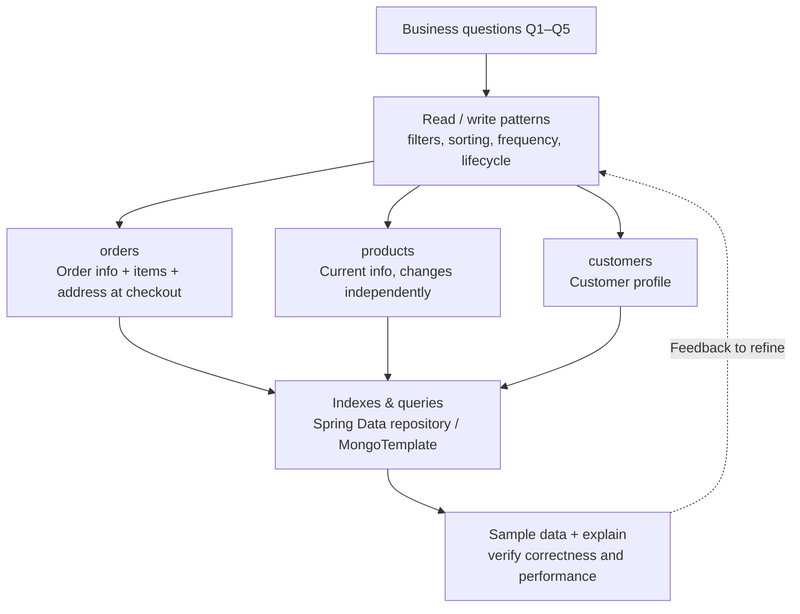

# Designing by Access Patterns and Business Questions

## 1. Why Start from Business Questions?

When designing documents in **Spring Data MongoDB**, the first question should not merely be "what entities does the system have?", but rather **"how do users and the system need to read, write, filter, sort, and update data?"**. MongoDB stores BSON documents in collections; Spring Data MongoDB maps documents to Java entities and lets you operate on them via repositories or `MongoTemplate`. Therefore, document structure choices directly affect the number of queries, index usability, consistency, and performance of your Java code.

For example, a bookstore application has `Customer`, `Product`, and `Order`. If you mechanically mirror a relational model into many collections and join everything on read, the order details page might require multiple queries. Conversely, if you embed *all of a customer's orders* into a single customer document, that document can grow indefinitely and become difficult to update. An appropriate design usually lies between these two extremes, based on **actual access patterns, data lifecycle, and business constraints**.

The goal of this lesson is to turn a set of business questions into a testable document model, queries, and indexes, while identifying cases that require aggregation, transactions, or concurrency control mechanisms.

## 2. Turning Requirements into an Access Pattern Table

Suppose the product team confirms the following requirements for the bookstore application. Frequencies and response times in the table are **illustrative assumptions**; in a real project, replace them with agreed-upon measurements and service levels.

| Code | Business question or operation | Filters, sorting, and returned data | Load characteristics to know |
| --- | --- | --- | --- |
| Q1 | Customer views their 20 most recent orders | `customer_id`; sort `created_at` descending, use `_id` as tie-breaker; only summary info needed | Frequent reads, data grows over time |
| Q2 | Open an order to view items, purchase-time price, and shipping address | Find by `_id`; return the order's item list and shipping details | Read less often than Q1, but needs complete, stable data |
| Q3 | Look up an active book by SKU | `products.sku`; return current info, current price, and sale status | Read-heavy, product title and price may change |
| Q4 | Staff transitions an order from `PAID` to `PACKING` | `_id` + current status; update status if valid | Contended writes, avoid invalid state transitions |
| Q5 | Operations team aggregates order counts by day and status | Filter by date range; group by day and status | Periodic aggregation query, may scan many documents |

Next, clarify each access pattern:

1. **Who performs it and on which screen?** For example, Q1 is a short list on mobile, so there is no need to load the entire `items` array and address.
2. **Which fields are filtered and sorted?** A requirement like "view recent orders" is not enough; you must determine which customer to filter by, what time range, ordering, and pagination.
3. **Does the data grow without bound?** The number of orders per customer can grow indefinitely; the number of items in *a single order* can usually be bounded by ordering rules.
4. **Which fields change independently?** A product price change must not alter prices already finalized in past orders.
5. **Which changes must be consistent together?** Transitioning order status in one document is separate from deducting stock in a product document.
6. **What are the expected load and latency targets?** For instance, keeping Q1 p95 under 200 ms with many orders is a target *to verify and measure*, not a guarantee provided automatically by MongoDB.

A good design keeps the access pattern table alongside the schema and indexes. Whenever a new feature arrives, the development team re-checks whether the current model still supports the critical queries.

## 3. From Access Patterns to Document Boundaries

With the five access patterns above, we can choose three main collections: `customers`, `products`, and `orders`. The order document is a **business aggregate**: users typically need to read all finalized information of an order at once.



A document in `orders` might look like this (the syntax below is an illustration in `mongosh`, where `ObjectId` and `ISODate` represent BSON types):

```javascript
{
  _id: ObjectId("507f1f77bcf86cd799439011"),
  customer_id: "CUS-007",
  created_at: ISODate("2026-11-10T09:30:00Z"),
  status: "PAID",
  currency: "VND",
  items: [
    {
      sku: "BOOK-101",
      title_at_purchase: "Programming with Spring Data",
      unit_price_minor: 159000,
      quantity: 2
    }
  ],
  shipping: {
    recipient: "Nguyen A",
    city: "Ha Noi",
    address_line: "Shipping address at the time of order"
  },
  total_minor: 318000
}
```

In the example, `total_minor` and `unit_price_minor` are integers in the **smallest currency unit for the given currency**; for VND, this represents whole dong. A real application needs consistent currency, rounding, and overflow-checking rules; binary floating-point numbers should not be used arbitrarily for money calculations.

The `products` document can store current data:

```javascript
{
  _id: ObjectId("507f191e810c19729de860ea"),
  sku: "BOOK-101",
  title: "Programming with Spring Data - new edition",
  current_price_minor: 179000,
  currency: "VND",
  available_stock: 36
}
```

Both documents may mention `BOOK-101`, yet serve two distinct purposes:

- `orders.items[].title_at_purchase` and `unit_price_minor` are **historical snapshots**: they must preserve the title and price the customer agreed to when purchasing.
- `products.title`, `current_price_minor`, and `available_stock` represent the **current state** of the product: they can change independently.
- `orders.customer_id` is a **logical reference** to the customer. The shipping address at checkout is a snapshot belonging to the order, because the customer might update their profile address later.

This model lets Q2 read most of its data from **a single order document**, while Q3 does not have to modify every historical order whenever a book's price changes.

## 4. Choosing Between Embedding and Referencing

MongoDB supports nested documents and arrays. This makes it possible to co-locate data that is frequently read together, though there is no universal rule to "always embed" or "always reference".

| Criterion | Embed | Reference |
| --- | --- | --- |
| Data frequently read together | Good fit; usually fetched in a single read | May require extra queries or `$lookup` |
| Number of child elements | Works well when size is bounded and predictable | Usually better suited for unbounded relationships |
| Change lifecycle | Good when child follows parent, or is a historical snapshot | Good when child changes and is managed independently |
| Update consistency | Changes within one document are atomic | Multi-document updates may require transactions or compensation workflows |
| Cost | May duplicate data and increase document size | May add round trips, joins, or aggregation logic |

**Applying this to the bookstore problem:**

1. **Embed `items` in `orders`.** Line-item details and finalized prices are read with the order. Enforce a business limit on the number of line items so the array cannot grow without bound.
2. **Embed `shipping` as a snapshot.** When a user edits their address in `customers`, already-placed orders retain their original delivery destination.
3. **Reference `customer_id`.** Do not put the entire order history inside the customer document; each order has its own lifecycle, and total orders have no useful upper bound.
4. **Keep `products` independent.** Prices, inventory, and sale status change frequently. The SKU in the order enables tracing the product; the price snapshot serves transaction history.

If a customer has 100,000 orders, a `customers.orders: [...]` design would cause an endlessly growing array, writes to a huge document, and the risk of hitting the **16 MiB** BSON document size limit. Storing each order as its own document in `orders` enables pagination, filtering, and indexing by customer and timestamp.

On the other hand, you should not split every attribute of an order into a separate collection if every screen needs them together. Over-splitting forces application logic to stitch data back together and makes consistency harder to ensure.

### Intentional Data Duplication

The book title in `products` and `title_at_purchase` in `orders` are two values with different temporal meanings. This is duplication **with a business purpose**. For duplicated fields meant to speed up reads while staying synchronized with source data, define data ownership, update timing, and behavior under sync lag; otherwise, figures can silently drift out of sync.

## 5. Design Queries Before Deciding on Indexes

A document design is incomplete without concrete query examples. From table Q1–Q5, you can write the MongoDB queries first and then derive suitable indexes.

### Q1: A Customer's 20 Most Recent Orders

```javascript
db.orders.find(
  {
    customer_id: "CUS-007",
    created_at: { $gte: ISODate("2026-10-01T00:00:00Z") }
  },
  {
    _id: 1,
    created_at: 1,
    status: 1,
    currency: 1,
    total_minor: 1
  }
).sort({ created_at: -1, _id: -1 }).limit(20)
```

The query has an **equality predicate** on `customer_id`, a **range predicate** on `created_at`, and then sorts descending by timestamp and `_id`. The `_id` field breaks ties when two orders share the same creation timestamp, keeping pagination order stable.

A candidate index:

```javascript
db.orders.createIndex(
  { customer_id: 1, created_at: -1, _id: -1 },
  { name: "orders_customer_time_id" }
)
```

The key order is chosen from the **query shape**: filter by a single customer first, then scan data in the required time and sort order. This is a candidate index for Q1, not a universal rule for every screen. If the application frequently filters by `status` first, measure that workload and consider another index.

To keep the list lightweight, the projection selects only the fields needed for display, avoiding loading `items` or `shipping`. Projection reduces bytes transferred and application mapping cost; whether the query is completely *covered* by the index must be checked in the actual execution plan.

### Paginating Continuously Growing Data

`skip`/`limit` is simple for the first page, but a large `skip` can force the database to walk past many results before returning the requested page. For unbounded lists, you can use **keyset pagination** (a cursor based on timestamp and `_id`):

```javascript
const lastCreatedAt = ISODate("2026-11-10T09:30:00Z");
const lastId = ObjectId("507f1f77bcf86cd799439011");

db.orders.find({
  customer_id: "CUS-007",
  $or: [
    { created_at: { $lt: lastCreatedAt } },
    { created_at: lastCreatedAt, _id: { $lt: lastId } }
  ]
}).sort({ created_at: -1, _id: -1 }).limit(20)
```

The cursor must come from the **last row of the previous page**, carrying both sort keys; other filter conditions (such as date ranges) must stay consistent across pages. This design reduces the cost of skipping large numbers of records; it does not automatically produce an immutable snapshot if data is being modified concurrently.

### Q2, Q3: Querying One Order and One Product

Q2 looks up by `_id`, using the default `_id` index of the `orders` collection. Q3 looks up by SKU and can use an index:

```javascript
db.products.createIndex(
  { sku: 1 },
  { unique: true, name: "products_sku_unique" }
)

db.products.findOne({ sku: "BOOK-101" })
```

`unique: true` reflects the rule "every SKU is unique" **if** that is truly a system constraint. Before creating a unique index on existing data, clean up any duplicate or non-conforming records. The `_id` identifier already has its own unique index.

## 6. Mapping from Document to Spring Data MongoDB Entities and APIs

MongoDB contains stored fields such as `customer_id` and `created_at`, while Java code typically uses camelCase naming. Spring Data lets you describe that mapping with `@Document`, `@Id`, and `@Field`.

Example entity excerpt:

```java
import java.time.Instant;
import java.util.List;
import org.bson.types.ObjectId;
import org.springframework.data.annotation.Id;
import org.springframework.data.mongodb.core.mapping.Document;
import org.springframework.data.mongodb.core.mapping.Field;

@Document(collection = "orders")
public class OrderDocument {
    @Id
    private ObjectId id;

    @Field("customer_id")
    private String customerId;

    @Field("created_at")
    private Instant createdAt;

    private String status;

    private List<OrderItem> items;

    @Field("total_minor")
    private long totalMinor;

    private String currency;

    protected OrderDocument() {}

    // Constructors, getters, and OrderItem/ShippingSnapshot types
    // are omitted to focus on mapping decisions.
}
```

A repository can serve a simple version of Q1:

```java
import java.time.Instant;
import java.util.List;
import org.bson.types.ObjectId;
import org.springframework.data.mongodb.repository.MongoRepository;

public interface OrderRepository
        extends MongoRepository<OrderDocument, ObjectId> {

    List<OrderDocument>
    findTop20ByCustomerIdAndCreatedAtGreaterThanEqualOrderByCreatedAtDescIdDesc(
        String customerId, Instant fromInclusive);
}
```

Repositories express stable queries cleanly through method names. When conditions vary by screen, `MongoTemplate` is more flexible:

```java
import java.time.Instant;
import java.util.List;
import org.springframework.data.domain.Sort;
import org.springframework.data.mongodb.core.MongoTemplate;
import org.springframework.data.mongodb.core.query.Criteria;
import org.springframework.data.mongodb.core.query.Query;

public class OrderLookup {
    private final MongoTemplate mongoTemplate;

    public OrderLookup(MongoTemplate mongoTemplate) {
        this.mongoTemplate = mongoTemplate;
    }

    public List<OrderDocument> recentOrders(String customerId, Instant from) {
        Query query = Query.query(
            Criteria.where("customerId").is(customerId)
                .and("createdAt").gte(from)
        );
        query.with(Sort.by(
            Sort.Order.desc("createdAt"),
            Sort.Order.desc("id")
        ));
        query.limit(20);
        return mongoTemplate.find(query, OrderDocument.class);
    }
}
```

On the Java side, `customerId` and `createdAt` are property names. Spring Data MongoDB uses mapping metadata to build queries against `customer_id` and `created_at`; `id` maps to `_id`. The benefit of access-pattern-driven design is that **both the Java API and the MongoDB index originate from the same Q1 question**, avoiding repository methods that look right in Java but fail to use indexes in practice.

The `recentOrders` example currently returns the full entity. If the UI only needs an order summary, use a projection or matching DTO to avoid transferring and mapping large unnecessary fields; verify the mapping output in integration tests.

## 7. Designing for Updates and Consistency

Design is not just for reads. For Q4, suppose the business rule allows transitioning `PAID → PACKING` exactly once. A conditional update prevents two staff members from acting on stale state simultaneously:

```java
import com.mongodb.client.result.UpdateResult;
import org.bson.types.ObjectId;
import org.springframework.data.mongodb.core.MongoTemplate;
import org.springframework.data.mongodb.core.query.Criteria;
import org.springframework.data.mongodb.core.query.Query;
import org.springframework.data.mongodb.core.query.Update;

public class OrderTransition {
    private final MongoTemplate mongoTemplate;

    public OrderTransition(MongoTemplate mongoTemplate) {
        this.mongoTemplate = mongoTemplate;
    }

    public boolean startPacking(ObjectId orderId) {
        Query query = Query.query(
            Criteria.where("id").is(orderId)
                .and("status").is("PAID")
        );
        Update update = new Update().set("status", "PACKING");
        UpdateResult result =
            mongoTemplate.updateFirst(query, update, OrderDocument.class);
        return result.getModifiedCount() == 1;
    }
}
```

Because both the filter and update apply to the **same order document**, MongoDB executes that single-document update atomically. If the status is no longer `PAID`, the statement does not transition it to `PACKING` and the method returns `false`. More complex state rules also require proper error reporting, authorization checks, and history recording.

**Atomicity boundaries do not automatically extend to other documents.** If placing an order must both create the order and decrement stock in `products`, you must design inventory control, idempotency, and failure handling. Multi-document transactions are an option when MongoDB infrastructure and Spring configuration support them (for example, configuring a transaction manager on a replica set or sharded deployment); transactions add overhead and do not replace sound document boundary design. Workflows involving external services may use events, intermediate states, and compensating actions.

For fast-growing fields, such as a status log spanning tens of thousands of events, evaluate a separate event collection rather than appending endlessly to `orders.status_history`. When only a short, bounded history is needed, embedding may work; base the choice on volume and retrieval requirements.

## 8. Summary Questions and Aggregation

Q5 differs from Q1: the operations dashboard wants **order counts by day and status**, without pulling every order into Java to group in memory. MongoDB aggregation can perform filtering and grouping close to where the data lives:

```javascript
db.orders.aggregate([
  {
    $match: {
      created_at: {
        $gte: ISODate("2026-11-01T00:00:00Z"),
        $lt: ISODate("2026-12-01T00:00:00Z")
      }
    }
  },
  {
    $group: {
      _id: {
        day: {
          $dateToString: {
            format: "%Y-%m-%d",
            date: "$created_at",
            timezone: "Asia/Ho_Chi_Minh"
          }
        },
        status: "$status"
      },
      order_count: { $sum: 1 }
    }
  },
  { $sort: { "_id.day": 1, "_id.status": 1 } }
])
```

Timestamps in MongoDB are typically represented in UTC; grouping by "business day" requires specifying a **timezone**. The filter range and grouping timezone must also align: for instance, filtering "November in Vietnam time" requires converting the start and end of that month in that timezone to UTC before issuing the query. The two fixed UTC values in the example are only an illustrative range and do not precisely express month boundaries in Vietnam time.

Q5 may need an index on `created_at`, or a dedicated reporting model when data is very large and reports run frequently. Do not assume Q1's `{ customer_id, created_at, _id }` index can be reused: without a `customer_id` filter, that index prefix is poorly suited. A candidate index for time-range filtering is:

```javascript
db.orders.createIndex(
  { created_at: -1 },
  { name: "orders_created_at" }
)
```

Only add indexes once you have data and a measurement plan. Every index consumes space and adds write overhead; a collection with many indexes is not necessarily faster across the whole workload. If reports repeat frequently and scan large numbers of documents, you may need caching or an aggregated collection with clear update and reconciliation policies.

## 9. Testing the Design with Data and Execution Plans

An access-pattern-driven design must be verified. Do not conclude an index is effective just because the key order "looks right". Prepare representative data covering customer counts, orders per customer, status ratios, items per order, and growth rate; having customers with many orders is especially important for Q1.

In `mongosh`, you can inspect statistics for query Q1:

```javascript
db.orders.find({
  customer_id: "CUS-007",
  created_at: { $gte: ISODate("2026-10-01T00:00:00Z") }
}).sort({ created_at: -1, _id: -1 })
  .limit(20)
  .explain("executionStats")
```

Metrics to inspect include:

| Indicator | Check question |
| --- | --- |
| `winningPlan`, `IXSCAN`, `COLLSCAN` | Is the expected index used, or is it doing a collection scan? |
| `totalKeysExamined` | How many index keys must be scanned to find the results? |
| `totalDocsExamined` | Does it have to read many more documents than it returns? |
| `nReturned` | Does the actual returned count match `limit` and the filter? |
| `executionTimeMillis` | How fast is this measurement, and how does it behave under repeated runs with representative load? |

Do not draw conclusions from a single metric or a single run. An index scan can still read many keys if the filter is not selective. A `COLLSCAN` on a tiny collection is sometimes harmless, but becomes a problem as the collection grows. Also check application-side latency, queries per request, bytes transferred, and impact on write throughput.

With Spring Data MongoDB, write integration tests against a real MongoDB instance (for example, a Testcontainers environment) to verify mapped field names, repository results, pagination order, status updates, and expected index creation. `@DataMongoTest` can help test the data access layer depending on project setup.

A minimal test suite for this model includes: two orders with identical `created_at`; a customer with thousands of orders; an order at the maximum allowed line-item count; a product changing price after an order is placed; two concurrent status-transition requests; and a report crossing a day boundary in the business timezone.

## 10. Common Design Mistakes

| Symptom | Typical problem | How to fix |
| --- | --- | --- |
| `customers.orders` stores the entire order history | Unbounded array growth, hard to paginate, huge documents | Store each order in `orders`, index `customer_id` and timestamp |
| Order stores only SKU, without purchase-time title and price | Old orders "change price" when looking up the current product | Embed item snapshots inside the order |
| Copying all product fields everywhere and updating in bulk | Heavy write amplification, risk of desynchronization | Snapshot only fields needed for history; reference current data |
| Every screen loads the full order document | Wastes bandwidth and mapping, especially for `items`/`shipping` | Use projections/DTOs for list views |
| Indexing only `created_at` for Q1 | Inefficient customer filtering when there are many customers | Test a compound index combining `customer_id` and sort keys |
| Expecting an index on `customer_id` to speed up system-wide reports | Reporting query has no customer filter | Measure and design a separate index for the reporting query |
| Very large `skip` for deep pagination | Must skip past many results, increasing latency | Consider cursor/keyset pagination |
| Embedding unbounded event history in orders | Huge documents, frequent rewrites | Separate events into their own collection or keep a bounded embedded history |
| Assuming order update and stock update are one atomic operation | Can drift out of sync across documents | Design transactions or a compensating/idempotent workflow |

## 11. Decision Workflow You Can Apply Immediately

When receiving a new requirement in a Spring Data MongoDB project, follow these steps in order:

1. **Write business questions as concrete queries.** Who accesses it, which filters, which sort order, how many rows per call, and how frequently?
2. **Determine the lifecycle of each field group.** Which fields are snapshots, which are current state, and which grow without bound?
3. **Draw document boundaries.** Prefer embedding data read/updated together with bounded size; use references when lifecycles or growth are independent.
4. **Design queries and indexes together.** Use critical queries as input to index key order; consider projections and pagination.
5. **Specify update constraints.** Identify single-document atomic operations, conditional state transitions, and where multi-document consistency is required.
6. **Write entities, repositories, and `MongoTemplate` code matching the schema.** Align Java property names with BSON field names using `@Field` and `@Id`.
7. **Measure with representative data.** Inspect `explain("executionStats")`, test results, concurrent transitions, deep pages, and aggregations; revise the design if targets are not met.
8. **Document assumptions and review triggers.** Access patterns can shift as the product adds new reports, filters, or scale.

### Self-Practice

Answer these three scenarios before checking the hints:

**Scenario A.** The app needs to fetch each customer's 20 most recent orders, and occasionally open an order's details. Should all orders be embedded in `customers`? **Hint:** No; each order should be a separate document with an index supporting customer filtering and time sorting.

**Scenario B.** A customer buys a book for 159,000 VND. A week later the list price changes to 179,000 VND. Which price should the old order display? **Hint:** The price at checkout, stored as a snapshot in `orders.items`.

**Scenario C.** An index `{ customer_id: 1, created_at: -1 }` already exists, yet a monthly report counting all orders is still slow. Why? **Hint:** The report does not filter by `customer_id`, so an index optimized for Q1 is not necessarily useful; analyze the aggregation and query plan for the actual reporting pattern.

**Key takeaway:** document design is a decision about **how data is accessed and changed**. Access patterns dictate what to embed, what to reference, which indexes to create, and how to use repositories, `MongoTemplate`, or aggregation. Ultimately, a design is only validated when business behavior is correct and performance tests meet real workload demands.
