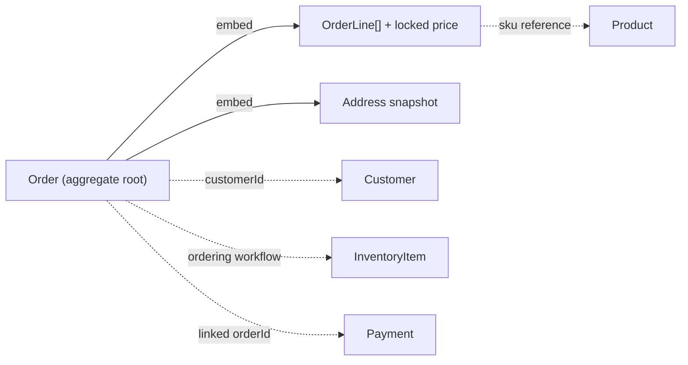
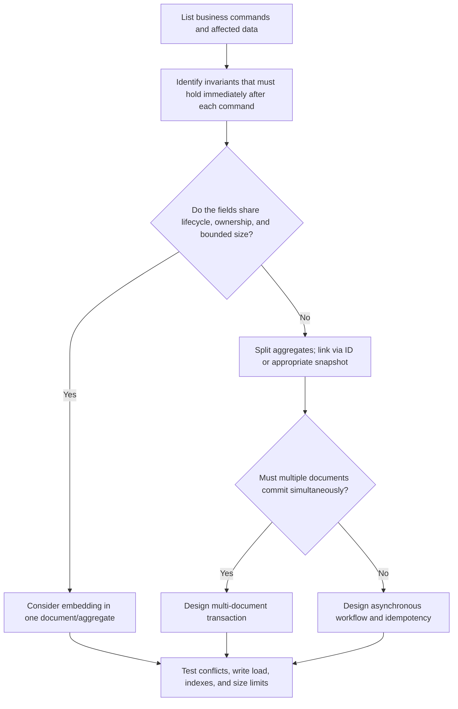

# Defining Aggregate Boundaries and Data Updated Together

A critical decision when designing MongoDB documents is **which data must change together to remain business-valid**. This decision defines *aggregate* boundaries and directly impacts how you embed documents, reference by ID, use repositories or `MongoTemplate` in Spring Data MongoDB, handle write conflicts, and decide when multi-document transactions are necessary.

For instance, when a customer adds a line item to a draft order, the line-item list and the order total must stay consistent. But when a product's catalog price changes, finalized prices in past orders must not automatically change. Both situations involve "products", yet they have different consistency boundaries.

After this lesson, you will be able to:

- Identify an aggregate root and the **business invariants** that must be protected within a single change.
- Decide whether data should be **embedded**, **referenced**, or stored as a **snapshot** in a document.
- Leverage the atomicity of **single-document** write operations in MongoDB.
- Use `@Version`, conditional writes, `MongoTemplate`, and transactions when needed.
- Evaluate how document size, growth, queries, indexes, and write contention affect aggregate boundaries.

## 1. An Aggregate Is a Business Consistency Boundary

In Domain-Driven Design (DDD), an **aggregate** is a cluster of objects managed as a single consistency unit. External callers should only mutate the state of this cluster through the **aggregate root**. The aggregate root is responsible for validating and maintaining the rules that must always hold after a business operation completes.

For example, with `Order`:

- Confirmed orders cannot arbitrarily accept new line items.
- Every line item's quantity must be greater than 0.
- The total amount must match the line items and the order's pricing rules.
- The shipping address is locked to the version at order placement, rather than changing automatically with the customer's profile.

Data tied to these rules typically belongs to the same `Order` aggregate. By contrast, a SKU's inventory count has its own rules and write load, so it is usually managed by a separate inventory aggregate.

**Distinguish two terms:** an *aggregate* in domain design is a consistency boundary; MongoDB's *aggregation pipeline* (`$match`, `$group`, `$lookup`, etc.) is a data-processing and querying mechanism. They are not the same concept.

### How Do Aggregates and Documents Relate?

MongoDB guarantees that every write operation on a **single document** is atomic, even when updating multiple fields or embedded elements within that document. Therefore, mapping **one aggregate to one document** is often a sound starting point: a single write can uphold invariants contained entirely within the document.

However, **there is no mandatory rule that every aggregate must be a single document in all cases**. Large aggregates, unbounded child collections, or hot write components may call for a different design. If an invariant truly must be enforced simultaneously across multiple documents, an appropriate coordination mechanism is required—such as a multi-document transaction or revisiting the business boundary.

## 2. Start from Behaviors and Invariants, Not from Data Tables

Before sketching documents, list the **business commands** and ask: "If the system stops immediately after a write operation, what must remain true?"

| Behavior | Data that must be immediately consistent | Suggested boundary |
| --- | --- | --- |
| Add a line item to a draft order | `lines` and `totalMinor`; allowed only when status is `DRAFT` | Inside `Order` |
| Confirm an order | Order status must transition according to valid rules | Inside `Order`; may need coordination with inventory |
| Change catalog price | Current product price | `Product`, independent of finalized orders |
| Reserve stock | Available stock must not go negative or exceed defined limits | `InventoryItem` or appropriate stock unit |
| Update account address | Current customer profile | `Customer`; does not mutate address snapshots on old orders |
| Receive payment result | Record payment transaction/session, reconcile, and update order | Typically involves `Payment` and `Order`, needing a cross-aggregate consistency flow |

Do not lump everything "related" into one aggregate. Relatedness on a UI screen or in a query **does not equal** a requirement for atomic updates.

A useful analysis checklist:

1. **Invariants:** what must hold immediately after every command? For example, `available >= 0`.
2. **Owner:** which root object is responsible for changing this value?
3. **Lifecycle:** are the components created, updated, and deleted together?
4. **Size and write frequency:** can the subset grow unbounded or be updated concurrently by many processes?
5. **Read needs:** which screens or use cases commonly read these pieces together?
6. **Tolerance for lag:** which data can synchronize a few seconds later via events or compensating workflows?

## 3. Example: Boundaries of an E-Commerce Order

Suppose a bookstore application has the concepts `Order`, `OrderLine`, `Product`, `Customer`, `InventoryItem`, and `Payment`.

### 3.1. What Does the Order Document Contain?

In `mongosh`, an `orders` document might look like this:

```javascript
{
  _id: ObjectId("665f1f2a4b6c7d8e9f001234"),
  customerId: ObjectId("665f1f2a4b6c7d8e9f005678"),
  status: "DRAFT",
  currency: "VND",
  lines: [
    { sku: "BK-101", quantity: 2, unitPriceMinor: 129000 },
    { sku: "BK-202", quantity: 1, unitPriceMinor: 49000 }
  ],
  totalMinor: 307000,
  shippingAddressSnapshot: {
    recipient: "Nguyen Van A",
    city: "Ha Noi",
    street: "10 Sample Street"
  },
  version: 3,
  createdAt: ISODate("2026-11-20T02:00:00Z")
}
```

Here:

- `lines` are components **owned by the order**: they have no reason to exist independently if the order is deleted under the system's data policy.
- `unitPriceMinor` stores the **price at the time the line was created/finalized**, instead of always referencing the latest price from `Product`. The example uses the smallest currency unit defined by the system; for VND, this stores whole VND amounts.
- `totalMinor` is a derived value that must be updated consistently with `lines` according to pricing rules. This example does not yet include taxes, promotions, or shipping fees.
- `shippingAddressSnapshot` preserves the address used for this order, even if the customer updates their profile.
- `customerId` references `Customer`; the customer profile exists and changes independently.
- `version` can be used to detect write conflicts when Spring Data MongoDB manages the entity with `@Version`.

Some systems choose to recompute `totalMinor` from `lines` on read to avoid storing derived data. If you still store the total for querying, display, or reporting, every command that modifies line items must be designed so the total cannot drift.

### 3.2. Why Not Embed All of Product, Inventory, and Payment?

A product is referenced by many orders; its list price, description, and sale status change independently. Inventory often experiences high mutation rates and write contention. Payments involve multiple attempts, asynchronous callbacks, and separate reconciliation requirements.

If you embedded the **live state** of those objects into every order:

- Updating price or inventory would require modifying huge numbers of related orders, easily introducing inconsistencies.
- Order documents could bloat due to payment history or product variants.
- Independent tasks would contend on writes to the same document even though they do not share a consistency boundary.

A typical design looks like this:



Dashed arrows represent logical relationships or ID references; they are not foreign keys automatically enforced by MongoDB.

## 4. Deciding Between Embed, Reference, or Snapshot

| Option | Use when | Things to watch |
| --- | --- | --- |
| **Embed** child documents into root | Shared lifecycle; relatively small and bounded subset; frequently read/written together; single-document atomicity needed | Document grows larger; updating large sets causes contention; array indexes have overhead |
| **Reference** by ID | Entity has its own lifecycle; shared across multiple aggregates; related set is very large or changes independently | No automatic joins; needs extra queries or `$lookup` when combining data |
| **Snapshot** selected attributes | Historical values must be preserved, such as unit prices and finalized addresses | Define naming and update rules clearly: a snapshot is not a replica kept in sync at all times |
| **Separate documents in one workflow** | Size, write frequency, or business boundaries make embedding unsuitable | Clearly distinguish what needs transactions versus eventual consistency |

The criteria with the strongest impact:

**Growth limits.** MongoDB has a **16 MiB limit per BSON document**. Line-item arrays in an order can usually be bounded by business policy, whereas unbounded event histories, access logs, comments, or message streams should usually not all be embedded in one document.

**Write load and contention.** Hundreds of staff updating a single "summary" document creates a bottleneck and far more conflicts than partitioning across independently owned aggregates. Large documents or continuously growing arrays also impact storage and update costs.

**Query patterns.** Reading an order together with its lines in one query strongly favors embedding. Conversely, retrieving and paginating millions of individual child events is much cleaner when each event is its own document with proper indexes.

**Value ownership.** The customer owns their current profile address; the order owns the address snapshot used upon confirmation. These are two values with different meanings despite sharing field names.

## 5. Single-Document Atomicity and Its Limits

MongoDB guarantees that a write operation on a single document is **atomic**, even when using `$set`, `$push`, `$inc`, and multiple fields in the same command. This is a direct advantage when data that must stay consistent resides in the same document.

### 5.1. Updating Line Items and Total in One Command

Example of adding a line item to a draft order. Assume the SKU is valid and the quantity and unit price have already been verified:

```javascript
const orderId = ObjectId("665f1f2a4b6c7d8e9f001234");
const quantity = 2;
const priceMinor = 45000;

const result = db.orders.updateOne(
  { _id: orderId, status: "DRAFT" },
  {
    $push: {
      lines: {
        sku: "BK-303",
        quantity: quantity,
        unitPriceMinor: priceMinor
      }
    },
    $inc: { totalMinor: quantity * priceMinor }
  }
);

print(result.matchedCount);  // 1 when a DRAFT order is found
print(result.modifiedCount); // 1 when actually updated
```

Both `$push` and `$inc` are applied atomically on the **same document**. The `status: "DRAFT"` condition prevents modifying an order whose status changed before this operation ran.

However, this example is only valid when the total is simply the sum of line prices as defined. With taxes, discounts, currency conversion, or complex promotion rules, you need an update design that preserves **all** invariants—such as recomputing through the aggregate root with optimistic locking or an appropriate update pipeline. Do not casually combine `$push` and `$inc` when the business formula is non-trivial.

### 5.2. Check Condition and Update in the Same Operation

To reduce race conditions, place the check inside the filter itself:

```javascript
// Example: reserving stock in a separate inventory document:
db.inventory.updateOne(
  { sku: "BK-303", available: { $gte: 2 } },
  { $inc: { available: -2 } }
);
```

Checking `available >= 2` and decrementing stock happen in the same single-document write, preventing two concurrent requests from over-deducting stock for that SKU. Yet this change **does not simultaneously update the Order**: they are two documents, so a workflow-level coordination mechanism is still needed.

### 5.3. What Atomicity Does Not Automatically Solve

- **Two documents:** writing successfully to `orders` and then failing to write `inventory` can leave a partial state unless you use a transaction or a recovery flow.
- **Lost updates:** two processes reading the same Order, each editing a different Java instance, and calling `save` sequentially can overwrite each other unless version checks are in place.
- **Business validity:** MongoDB does not know rules like "only confirm orders with at least one line item" unless the application puts those rules into commands and write conditions.
- **Durability and visibility:** atomicity is distinct from write concern, read concern, network error handling, and handling retried commands. Durability and consistent read requirements must be configured appropriately.

## 6. Implementing the Aggregate Root in Spring Data MongoDB

Spring Data MongoDB supports mapping nested objects, `MongoRepository`, and `MongoTemplate`. The pattern below makes `Order` the aggregate root; business code only manipulates line items through methods on the root.

### 6.1. Document Mapping and Invariants

```java
import java.util.ArrayList;
import java.util.List;
import java.util.Objects;

import org.bson.types.ObjectId;
import org.springframework.data.annotation.Id;
import org.springframework.data.annotation.Version;
import org.springframework.data.mongodb.core.mapping.Document;

@Document(collection = "orders")
public class Order {
    @Id
    private ObjectId id;

    @Version
    private Long version;

    private ObjectId customerId;
    private String status;
    private List<OrderLine> lines = new ArrayList<>();
    private long totalMinor;

    protected Order() { } // Used by Spring Data when mapping data

    public Order(ObjectId customerId) {
        this.customerId = Objects.requireNonNull(customerId);
        this.status = "DRAFT";
    }

    public void addLine(String sku, int quantity, long unitPriceMinor) {
        if (!"DRAFT".equals(status)) {
            throw new IllegalStateException("Only DRAFT orders can be modified");
        }
        if (sku == null || sku.isBlank() || quantity <= 0
                || unitPriceMinor < 0) {
            throw new IllegalArgumentException("Invalid order line");
        }

        long lineTotal = Math.multiplyExact(quantity, unitPriceMinor);
        long newTotal = Math.addExact(totalMinor, lineTotal);
        lines.add(new OrderLine(sku, quantity, unitPriceMinor));
        totalMinor = newTotal;
    }

    public ObjectId getId() {
        return id;
    }

    public long getTotalMinor() {
        return totalMinor;
    }

    public static class OrderLine {
        private String sku;
        private int quantity;
        private long unitPriceMinor;

        protected OrderLine() { }

        public OrderLine(String sku, int quantity, long unitPriceMinor) {
            this.sku = sku;
            this.quantity = quantity;
            this.unitPriceMinor = unitPriceMinor;
        }
    }
}
```

`OrderLine` is stored inside the `orders` document because it has no separate `@Document` annotation or repository; when modifying line items, business logic calls `order.addLine(...)` to keep the total synchronized. The example uses `long` for whole currency units by convention; for multi-currency or decimal systems, use an appropriate rounding policy and storage type (such as BSON Decimal128).

This is a simplified example. A production system also needs line-item count limits, duplicate-SKU prevention if required, line editing/removal controls, tax/promotion calculations, and authorization checks.

### 6.2. Repositories and Optimistic Locking

```java
import org.bson.types.ObjectId;
import org.springframework.data.mongodb.repository.MongoRepository;

public interface OrderRepository
        extends MongoRepository<Order, ObjectId> {
}
```

When `@Version` is present, Spring Data checks the existing version before writing the entity through Spring Data's save mechanism and increments it upon success. A simple session flow:

```java
Order order = orderRepository.findById(orderId)
    .orElseThrow(() -> new IllegalArgumentException("Order not found"));

order.addLine("BK-303", 2, 45000);
orderRepository.save(order); // May throw OptimisticLockingFailureException
```

If two requests read version `3` and modify it concurrently, the first successful save increments the version; the second does not silently overwrite it, instead receiving an optimistic locking conflict. The application can re-read, re-evaluate business rules, and retry **a bounded number of times**, or return a conflict error (such as HTTP 409) depending on requirements.

**Requirement for conflict detection:** use write APIs that respect `@Version` and an acknowledged write concern. A custom update statement filtering only by `_id` will not automatically include the version match condition that optimistic locking `save` provides. If you need a version check in a custom update, include that condition in the filter.

### 6.3. MongoTemplate When Conditional Updates Are Needed

When you only need to transition an order's status without loading the entire aggregate, you can place the condition directly at MongoDB:

```java
import org.bson.types.ObjectId;
import org.springframework.data.mongodb.core.MongoTemplate;
import org.springframework.data.mongodb.core.query.Criteria;
import org.springframework.data.mongodb.core.query.Query;
import org.springframework.data.mongodb.core.query.Update;

public boolean confirmDraft(MongoTemplate template, ObjectId orderId) {
    Query query = Query.query(
        Criteria.where("_id").is(orderId)
                .and("status").is("DRAFT")
    );
    Update update = new Update().set("status", "CONFIRMED");
    return template.updateFirst(query, update, Order.class)
                   .getModifiedCount() == 1;
}
```

This is a **single-document** update. A `false` result could mean the order was not found, was not in `DRAFT` status, or another condition failed; categorize these cases according to the business API. The example only demonstrates checking a status transition; if confirmation must check additional invariants (non-empty lines, valid payment, etc.), the application must add those conditions or implement an appropriate consistency workflow.

When multiple paths write to `Order` (repositories, templates, scripts), establish a unified mechanism for managing `version` and invariants. Avoid letting one update path bypass conditions that another path relies on.

## 7. When an Operation Must Update Multiple Aggregates

Consider the command "confirm order and deduct stock":

1. The order is in `DRAFT`.
2. Stock is sufficient and is deducted by the exact quantity.
3. The order transitions to `CONFIRMED` if and only if stock deduction succeeds.

`Order` and `InventoryItem` have independent lifecycles. If the requirement demands that **both changes succeed or fail together**, you can use MongoDB multi-document transactions on supported infrastructure (typically a replica set or sharded cluster).

### 7.1. Configuring Spring Data MongoDB Transactions

For synchronous access, Spring manages transactions via `MongoTransactionManager`:

```java
import org.springframework.context.annotation.Bean;
import org.springframework.context.annotation.Configuration;
import org.springframework.data.mongodb.MongoDatabaseFactory;
import org.springframework.data.mongodb.MongoTransactionManager;

@Configuration
class MongoTxConfig {
    @Bean
    MongoTransactionManager mongoTransactionManager(
            MongoDatabaseFactory databaseFactory) {
        return new MongoTransactionManager(databaseFactory);
    }
}
```

Example transactional service for **a single SKU** to focus on the transaction boundary:

```java
import org.bson.types.ObjectId;
import org.springframework.stereotype.Service;
import org.springframework.transaction.annotation.Transactional;
import org.springframework.data.mongodb.core.MongoTemplate;
import org.springframework.data.mongodb.core.query.Criteria;
import org.springframework.data.mongodb.core.query.Query;
import org.springframework.data.mongodb.core.query.Update;

@Service
public class OrderConfirmationService {
    private final MongoTemplate template;

    public OrderConfirmationService(MongoTemplate template) {
        this.template = template;
    }

    @Transactional
    public void confirmOneItem(
            ObjectId orderId, ObjectId inventoryId, long quantity) {
        if (quantity <= 0) {
            throw new IllegalArgumentException("quantity must be positive");
        }

        Query inventoryQuery = Query.query(
            Criteria.where("_id").is(inventoryId)
                    .and("available").gte(quantity)
        );
        long changedStock = template.updateFirst(
            inventoryQuery,
            new Update().inc("available", -quantity),
            InventoryItem.class
        ).getModifiedCount();
        if (changedStock != 1) {
            throw new IllegalStateException("Out of stock or SKU not found");
        }

        Query orderQuery = Query.query(
            Criteria.where("_id").is(orderId)
                    .and("status").is("DRAFT")
        );
        long changedOrder = template.updateFirst(
            orderQuery,
            new Update().set("status", "CONFIRMED"),
            Order.class
        ).getModifiedCount();
        if (changedOrder != 1) {
            throw new IllegalStateException("Cannot confirm order");
        }
    }
}
```

In this example, `InventoryItem` is a separate `@Document` entity with a numeric `available` field and an `_id` mapped from `id`. All `MongoTemplate` commands participate in the same Spring-managed transaction/session. When a runtime exception rolls back the transaction, neither update is committed. A `@Transactional` method must be invoked through the Spring proxy; internal self-invocation from another method in the same instance can prevent the transaction from being applied as expected.

**Scope of the example:** this is not yet a complete order-placement feature. In practice, you must read the item list from the validated `Order` aggregate itself, check quantities per SKU, handle pricing/promotions, prevent duplicate requests with an idempotency key, and choose lock/update ordering to reduce contention. Never trust a client-supplied `quantity` if it could differ from the order's contents.

### 7.2. Should You Always Use Multi-Document Transactions?

No. Multi-document transactions add session management, resource, and conflict-handling overhead, increasing complexity under high load. If data can reasonably live in **one well-shaped document**, designing proper boundaries is simpler than using transactions.

When **immediate consistency is not strictly required**, consider:

- Writing the change in the source aggregate and publishing domain/integration events reliably.
- Processing changes asynchronously in other aggregates, designed to be **idempotent** so redelivered events do not cause duplicate processing.
- Tracking `PENDING` / `COMPLETED` / `FAILED` states and providing compensating actions when needed.
- Using a transactional outbox or reliable event-recording approach if you need to avoid losing events between database writes and the message broker.

For example, sending a payment request to an external gateway cannot be wrapped inside a MongoDB transaction the way two MongoDB documents can. It requires workflows, idempotency keys, webhook reconciliation, and handling delayed or duplicate callbacks.

## 8. Validating Boundaries Against Query Patterns and Performance

Business boundaries come first; then verify them against real query patterns:

| Common query/operation | Design suggestion | Risks to measure |
| --- | --- | --- |
| Display an order with 5–30 lines | Embed `lines` inside `orders` | Document size; handling line and total updates |
| Display history of 100,000 changes for an order | Store `order_events` separately, query by `orderId` | Indexes, pagination, and event retention |
| Find all customer orders by date | Index `customerId` combined with creation date, filter and paginate | Selectivity, keys/documents examined |
| Deduct stock of a concurrently accessed SKU | Keep separate inventory aggregate and use conditional writes | SKU hot spots and contention retries |
| View current product price | Query `Product` | Do not confuse current price with finalized price in Order |
| Analyze monthly revenue | Aggregation pipeline on properly structured data | Analytical load, indexes, read-model strategy |

Example indexes for an order history page:

```javascript
db.orders.createIndex({ customerId: 1, createdAt: -1 });
db.order_events.createIndex({ orderId: 1, occurredAt: -1 });
```

Indexes improve read paths, but they do not turn data across two collections into a single aggregate. Use `explain("executionStats")` and real metrics to inspect keys/documents scanned rather than assuming more indexes are always better. Indexes also incur maintenance cost on writes.

## 9. Decision Process for Aggregate Boundaries

Apply this sequence for each use case:



Questions to answer in your design doc:

1. **Who is the aggregate root?** Which object accepts commands and enforces the rules?
2. **What are the invariants?** Can they be verified in a single-document write operation?
3. **What is the maximum document size?** Is that number grounded in real business limits?
4. **Which data is a historical snapshot?** Is it allowed to diverge from the current source?
5. **Who has write access?** Is there any update path bypassing the aggregate root, `@Version`, or state-transition conditions?
6. **What happens on mid-flight failure?** How are transactions, retries, events, and compensating actions defined?
7. **What will be verified?** Formulate testable hypotheses about document size, concurrent load, query latency, and write counts.

## 10. Common Design Mistakes

**Embedding data solely because it is displayed together.** The order detail screen shows product information, yet product details are not owned by `Order`. You can store a snapshot of needed attributes and reference the source for current information.

**Splitting every entity into its own collection out of relational design habits.** This can turn a simple update into multiple writes or transactions, while causing extra reads to fetch line items.

**Putting too much behavior into a "giant" aggregate.** Huge roots, unbounded arrays, and write hot spots degrade performance and increase conflict rates.

**Check-then-write without a conditional filter.** Reading `available=2` and later subtracting 2 is unsafe under concurrent requests. The `available >= 2` condition must be inside the inventory update command itself.

**Treating `@Version` as a universal transaction lock.** Version prevents overwriting one entity across version-checked write paths; it does not create atomicity between `Order` and `Inventory`, nor does it replace business validation.

**Modifying only the order and forgetting external workflows.** Confirming an order may involve inventory, payments, and shipping. Distinguish data that must be **immediately** consistent from data that can synchronize via workflows.

## 11. Testing Against Invariants

Instead of checking only whether a document saves, test **each invariant under contention and failure**:

- **Single document:** adding a line item increments the total once; a `CONFIRMED` order rejects additional line items.
- **Concurrent save:** two requests modifying the same version result in one success and one conflict, or an application-designed valid merge behavior.
- **Inventory:** two concurrent requests reserving stock never drive `available` negative; inspect `matchedCount`/`modifiedCount` when conditional commands do not match.
- **Transactions:** deliberately inject a failure after updating stock and before updating the order; when the transaction works properly, both changes roll back.
- **Idempotency:** re-sending the same command or event does not cause extra stock deductions or invalid payments.
- **Growth:** generate orders at the expected line-item limit; measure BSON size, read/write counts, and update latency.

For Spring Data MongoDB integration tests, use a real MongoDB instance or Testcontainers configured as a replica set when testing transactions. A standalone MongoDB instance does not provide the same multi-document transaction support as a replica set. When verifying performance, use representative workloads and real query metrics.

## 12. Practice Exercises

**Exercise 1 — Boundary analysis.** An online learning platform has `Course`, `Lesson`, `Enrollment`, `Progress`, and `Comment`. Identify the aggregate root for each group, specify which data should be embedded and which unbounded data should be separated, and state at least three invariants that must hold immediately.

**Exercise 2 — Order design.** Extend the order example with operations to change a line item's quantity and remove a line. Write methods on `Order` ensuring the total always matches; specify how updates are blocked once the order is confirmed.

**Exercise 3 — Two requests deducting stock concurrently.** SKU X has 1 item left, and two clients concurrently try to buy 1 item each. Write the `MongoTemplate` filter and update so only one request succeeds in deducting stock. Explain why reading the count first and writing afterward can fail.

**Exercise 4 — Changing boundaries.** A system initially embedded all `orderEvents` inside `Order`. After a year, each order has tens of thousands of events. Propose how to split into a separate collection, the indexes, pagination queries, and a strategy to ensure events are neither lost nor duplicated.

**Exercise 5 — Transaction or workflow?** Compare two flows: (a) reserving stock and confirming an `Order` both in MongoDB; (b) creating a payment request through an external gateway. For each flow, determine which parts can use a transaction and which parts require idempotency, retries, or compensating actions.

### Key Takeaway

**Aggregate boundaries are defined by the rules that must always remain true together.** In Spring Data MongoDB, an aggregate stored cleanly in one document makes full use of MongoDB's atomic write operations. Only embed components with matching lifecycle, size, and ownership; reference independent aggregates and use snapshots when historical state must be preserved. When invariants span multiple documents, deliberately choose either transactions or asynchronous workflows, and test conflicts and failure scenarios thoroughly.
