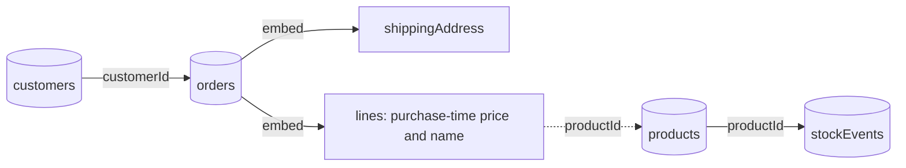

# Choosing Between Embedding Data and Referencing Another Collection

When designing documents in **MongoDB**, a key decision is whether to store related data **inside the same document (embedding)** or in a **separate collection linked by ID (referencing)**. This decision directly affects query count, document size, update patterns, consistency, and application scalability.

In **Spring Data MongoDB**, both approaches can be represented with Java objects and accessed through `MongoRepository` or `MongoTemplate`. However, convenient object mapping **is no substitute for designing BSON structures suited to real-world needs**. This lesson belongs to the **Document Design** chapter, focusing on how to choose and validate a design; the examples also connect to aggregation, indexes, transactions, reactive access, testing, and data performance diagnostics.

After this lesson, you will be able to:

- Distinguish embedding and referencing by document structure and query model.
- Choose an approach based on **how data is read and written together**, cardinality, growth rate, and data lifecycle.
- Recognize cases that call for **combining embedding and referencing** instead of applying an all-or-nothing rule.
- Map these models with Spring Data MongoDB, understanding the limits of `@DocumentReference` and `@DBRef`.
- Identify the indexes, queries, tests, and performance metrics to evaluate before finalizing a design.

## 1. Two Fundamental Storage Models

Suppose an e-commerce system has `orders`, `customers`, and `products`.

### 1.1. Embedding: Related Data Lives Inside the Parent Document

An order must preserve the shipping address and product line details **at the time of purchase**. Since this data is typically read with the order and shares its lifecycle, it is a strong candidate for embedding:

```javascript
// Collection: orders
{
  _id: "ORD-1001",
  customerId: "CUS-15",
  shippingAddress: {
    recipient: "An",
    city: "Da Nang",
    street: "12 Hoa Street"
  },
  lines: [
    { productId: "PROD-1", sku: "BK-01", nameAtPurchase: "Notebook",
      unitPriceVnd: 85000, quantity: 2 },
    { productId: "PROD-2", sku: "PN-02", nameAtPurchase: "Fountain Pen",
      unitPriceVnd: 25000, quantity: 1 }
  ],
  totalVnd: 195000,
  createdAt: ISODate("2026-11-20T02:00:00Z")
}
```

Querying an order can return **the address and all line items in a single document read**:

```javascript
db.orders.findOne({ _id: "ORD-1001" });
```

**Benefits:** data frequently used together is retrieved in one query; changes within a **single document** are atomic at the document level. **Trade-offs:** documents become larger, data may be duplicated, and bulk updates to embedded parts become difficult.

### 1.2. Referencing: A Document Holds the ID of Another Document

Each product has a current selling price, inventory status, and description. Because this information is used by many features outside of orders, it should have its own source of truth:

```javascript
// Collection: products
{ _id: "PROD-1", sku: "BK-01", name: "Notebook",
  currentPriceVnd: 90000, stock: 120 }
{ _id: "PROD-2", sku: "PN-02", name: "Fountain Pen",
  currentPriceVnd: 25000, stock: 80 }

// Collection: orders (example excerpt)
{
  _id: "ORD-1001",
  customerId: "CUS-15",
  lines: [
    { productId: "PROD-1", quantity: 2, unitPriceVnd: 85000 },
    { productId: "PROD-2", quantity: 1, unitPriceVnd: 25000 }
  ]
}
```

The `productId` field is a **logical reference**. MongoDB does not automatically enforce relational foreign-key constraints on this ID. The application must decide how to handle deleted, hidden, or missing products.

To fetch the latest product details, you can query by a list of IDs:

```javascript
db.products.find({ _id: { $in: ["PROD-1", "PROD-2"] } });
```

**Benefits:** product source data is managed centrally; changing the current price does not require updating every order. **Trade-offs:** data is spread across collections, potentially requiring extra queries or `$lookup` aggregations; a business operation modifying multiple documents may need orchestration or transactions.

Notably, the order example **already combines both techniques**. `customerId` and `productId` provide access to live entities; `shippingAddress`, `nameAtPurchase`, and `unitPriceVnd` are historical snapshots. This is usually much more practical than embedding the entire product or storing only `productId`.

## 2. Questions That Decide Between Embedding and Referencing

There is no rule saying "one-to-many always embeds" or "if a separate collection exists, always reference". Start from queries and update behavior.

| Question | Favors **embedding** | Favors **referencing** |
| --- | --- | --- |
| **Are they usually read together?** | Child data is almost always read with the parent document | Child data is often queried separately or by many features |
| **Is the number of children bounded?** | Small, clearly bounded, and predictable size | Grows without bound, potentially thousands or millions |
| **Is the lifecycle tied to the parent?** | Child only makes sense within the parent document | Child exists, is managed, and is authorized independently |
| **Do updates happen together?** | Multiple related fields need atomic updates in one document | Child entity is modified frequently, independent of the parent |
| **Is it shared across multiple entities?** | Value is an intentional snapshot or copy | One entity is referenced from many places and needs a single canonical source |
| **Do children need independent pagination, filtering, and sorting?** | No; the child set is small and read in full | Yes, such as comments, activity logs, or transaction histories |
| **Does the data change rapidly?** | Changes rarely, or a historical snapshot is desired | Changes frequently and every reader must see the new value |

### 2.1. Cardinality and Document Growth

- **One-to-one:** small supplementary data that always accompanies the main entity (such as the shipping address of *one order*) is usually a good fit for embedding. If separate permissions, access patterns, or lifecycles apply, referencing remains reasonable.
- **One-to-few:** a configuration with a handful of options or an article with a few fixed tags can generally embed a small array.
- **One-to-many (large):** comments, events, and continuously generated transactions should usually live in their own collection. Avoid unbounded arrays inside a parent document.
- **Many-to-many:** for example, users joining many groups and groups having many users; typically use references or an intermediate collection such as `memberships` to manage links, roles, and join timestamps.

MongoDB enforces a **16 MiB BSON document size limit**. However, a design can become slow or resource-heavy **well before** hitting this limit: large arrays create heavy documents, increase network transfer, degrade updates, and bloat multikey indexes.

**Anti-pattern to avoid:** embedding hundreds of thousands of comments inside a blog post just because it is a one-to-many relationship. When the UI only shows 20 comments per page, a `comments` collection with `postId` and an appropriate index is far more effective.

### 2.2. Consistency and Atomicity Requirements

MongoDB guarantees the atomicity of a **single write operation on a single document**, including any embedded elements modified in that operation. That is why embedding fits data that must change together, such as an order's status and a few accompanying attributes.

When updating **multiple documents**, a write to document A does not automatically make a write to document B atomic with it. If business rules require committing or rolling back both together, you may need a **multi-document transaction** on a supported MongoDB deployment, using the appropriate Spring Data session/transaction manager. Transactions carry overhead; do not use them merely to compensate for a data model that could be simplified by embedding.

Conversely, embedding a customer's name into 100,000 orders can be entirely appropriate **if it is a historical snapshot**. If the product requires displaying the customer's **current name**, duplicating that name across many places creates a synchronization problem. Always clarify **immutable historical values** versus **live current values** directly in the business requirements.

## 3. Designing from Real Queries

Suppose the system supports:

1. Opening an order detail page, including the address and purchased lines.
2. Looking up a customer's order history, 20 orders per page, newest first.
3. Viewing current stock and selling price of a product.
4. Finding orders containing a specific SKU or product.

From this, we can determine:

| Data | Suggested placement | Reason |
| --- | --- | --- |
| `orders.shippingAddress` | Embed in `orders` | Checkout address snapshot; routinely read with the order |
| `orders.lines[]` with a reasonable line limit | Embed in `orders` | Lines belong to the order, viewed together, and preserve purchase price |
| `orders.customerId` | Logical reference to `customers` | Customers have independent lifecycles and many orders |
| `orders.lines[].productId` | Logical reference to `products` | Look up current product/stock info when needed |
| `products` | Separate collection | Manage current price, inventory, description, and independent updates |
| Potentially unbounded stock change history | Separate event collection | Needs time-based querying/pagination; avoid unbounded arrays on products |

Logical relationship diagram (does not imply MongoDB enforces foreign keys automatically):



### 3.1. Queries and Indexes Aligned with the Design

Example for finding a customer's 20 most recent orders:

```javascript
db.orders.createIndex({ customerId: 1, createdAt: -1 });

db.orders.find({ customerId: "CUS-15" })
  .sort({ createdAt: -1 })
  .limit(20);
```

A compound index on `customerId` and `createdAt` can support both filtering and sorting for this query pattern. If deep pagination is required, consider **keyset pagination** with a stable sort key (such as `createdAt` and `_id`) instead of letting `skip` grow large.

If you need to find orders containing a specific product:

```javascript
db.orders.createIndex({ "lines.productId": 1 });
db.orders.find({ "lines.productId": "PROD-1" }).limit(20);
```

An index on a field inside an array becomes a **multikey index**. It helps certain queries on arrays, though index storage and update costs grow with the number of elements. Verify indexes with realistic data and `explain("executionStats")`.

### 3.2. When You Need to Combine Data Across Two Collections

The application can load the order and then query products by ID list, or use an **aggregation `$lookup`** on the MongoDB Server:

```javascript
db.orders.aggregate([
  { $match: { _id: "ORD-1001" } },
  { $unwind: "$lines" },
  {
    $lookup: {
      from: "products",
      localField: "lines.productId",
      foreignField: "_id",
      as: "product"
    }
  },
  { $unwind: { path: "$product", preserveNullAndEmptyArrays: true } },
  {
    $project: {
      _id: 1,
      productId: "$lines.productId",
      nameAtPurchase: "$lines.nameAtPurchase",
      currentName: "$product.name",
      quantity: "$lines.quantity"
    }
  }
]);
```

`$lookup` is conceptually similar to a join operation, but do not assume it is free or superior to embedding. Measure the number of matched documents, indexes on the target collection, bytes returned, and network round trips. In the snippet above, `preserveNullAndEmptyArrays` keeps order lines even if the original product no longer exists.

## 4. Mapping Embedded Data with Spring Data MongoDB

An embedded structure can be mapped cleanly into nested Java types. The example below illustrates Java 17+ and Spring Data MongoDB:

```java
import java.time.Instant;
import java.util.List;
import org.springframework.data.annotation.Id;
import org.springframework.data.mongodb.core.mapping.Document;

@Document(collection = "orders")
public record Order(
        @Id String id,
        String customerId,
        Address shippingAddress,
        List<Line> lines,
        long totalVnd,
        Instant createdAt
) {
    public record Address(String recipient, String city, String street) {}

    public record Line(
            String productId,
            String sku,
            String nameAtPurchase,
            long unitPriceVnd,
            int quantity
    ) {}
}
```

`Address` and `Line` do not declare `@Document`; Spring Data maps them as **nested documents** inside an `orders` document. `customerId` and `productId` remain **plain String IDs**: reading an order does not automatically load `customers` or `products`.

Repository for orders:

```java
import java.util.List;
import org.springframework.data.domain.Pageable;
import org.springframework.data.mongodb.repository.MongoRepository;

public interface OrderRepository extends MongoRepository<Order, String> {
    List<Order> findByCustomerIdOrderByCreatedAtDesc(
            String customerId, Pageable pageable);
}
```

Usage example:

```java
import org.springframework.data.domain.PageRequest;

List<Order> firstPage = orderRepository
        .findByCustomerIdOrderByCreatedAtDesc(
                "CUS-15", PageRequest.of(0, 20));
```

Spring Data derives the query from the method name and maps BSON documents into `Order` and its nested records. This query still needs a proper index once order volume grows; the repository does not eliminate server-side filtering or sorting costs.

### 4.1. Logical Referencing by ID: The Most Transparent Approach

In many systems, storing just an ID like `customerId` or `productId` is sufficient. When current product information is needed, query by a **batch of IDs** to avoid the **N+1 queries** pattern:

```java
import java.util.List;
import java.util.Map;
import java.util.function.Function;
import java.util.stream.Collectors;
import java.util.stream.StreamSupport;
import org.springframework.data.annotation.Id;
import org.springframework.data.mongodb.core.mapping.Document;
import org.springframework.data.mongodb.repository.MongoRepository;
import org.springframework.stereotype.Service;

@Document(collection = "products")
record Product(@Id String id, String sku, String name, long currentPriceVnd) {}

interface ProductRepository extends MongoRepository<Product, String> {}

@Service
class ProductLookupService {
    private final ProductRepository productRepository;

    ProductLookupService(ProductRepository productRepository) {
        this.productRepository = productRepository;
    }

    Map<String, Product> findCurrentProducts(Order order) {
        List<String> productIds = order.lines().stream()
                .map(Order.Line::productId)
                .distinct()
                .toList();

        return StreamSupport
                .stream(productRepository.findAllById(productIds).spliterator(), false)
                .collect(Collectors.toMap(Product::id, Function.identity()));
    }
}
```

This snippet assumes `Order` from the previous example is in the same package; package-private types are grouped together for readability and can be placed in separate files in a real project. In production, cap the number of IDs per page/request and define how missing IDs are handled. Historical data still comes from `order.lines()`; the product lookup only serves needs requiring current information.

### 4.2. How Do `@DocumentReference` and `@DBRef` Differ from Manual IDs?

Spring Data MongoDB offers mechanisms to represent reference relationships:

| Approach | Meaning | Things to watch |
| --- | --- | --- |
| **Manual ID** (`String productId`) | Stores the identifier value; the service explicitly fetches related data | Transparent query count, easy to batch, does not auto-load other objects |
| **`@DocumentReference`** | Spring Data manages mapping and resolving logical references as configured | Eager or lazy loading depends on declaration; can trigger extra queries, does not cascade saves to target entities |
| **`@DBRef`** | Stores references in MongoDB's DBRef format | Carries resolution overhead; DBRef does not make MongoDB enforce foreign keys or auto-join in queries |

Example relationship between a post and an author (not intended as a mechanism to preserve historical order prices):

```java
import org.springframework.data.annotation.Id;
import org.springframework.data.mongodb.core.mapping.Document;
import org.springframework.data.mongodb.core.mapping.DocumentReference;

@Document(collection = "authors")
public record Author(@Id String id, String displayName) {}

@Document(collection = "posts")
public class Post {
    @Id
    private String id;

    @DocumentReference(lazy = true)
    private Author author;

    // Other fields and appropriate constructors/getters/setters.
}
```

Under common default reference configuration, `@DocumentReference` stores the author's ID and Spring Data can resolve that ID into an `Author` upon access. Exact capabilities, storage structure, and lazy-loading behavior depend on the Spring Data version and mapping configuration; **verify against the version you use**. `lazy = true` can face proxy or visibility limitations with certain Java types and runtime contexts; do not treat lazy loading as free.

In particular, **`@DBRef`/`@DocumentReference` do not automatically cascade-save** a new object or updates to a referenced object. Persist related entities intentionally and test the resulting database state.

### 4.3. N+1 Queries and Network Round Trips

Suppose you display 20 orders, each with 5 products. If a loop calls `findById` for every line item, the application could send up to **100 product lookup queries** in addition to the order query, absent batching or caching. Collecting the IDs and loading them in a batch typically cuts round trips dramatically.

Conversely, embedding the historical details already required for display (purchase-time name and price) can eliminate product lookups altogether on the invoice screen. Only fetch current products when the UI genuinely needs them.

## 5. Combining Embedding and Referencing: Three Useful Patterns

### 5.1. Snapshot / Extended Reference

Store `productId` **alongside** a few frequently used fields, such as `nameAtPurchase` and `unitPriceVnd`. This is an **intentional copy**:

- **Historical values** in the order do not change when the current price list updates.
- **Current values** in `products` remain the canonical source for quotes and inventory.
- Business rules must specify when snapshots are captured and when live data is read.

Do not copy every attribute of `products` out of habit; copy only what serves queries or historical requirements.

### 5.2. Subset Pattern

Suppose an article has tens of thousands of comments. The detail page only needs the **3 featured comments**:

```javascript
// Collection: posts
{
  _id: "POST-1",
  title: "MongoDB Article",
  commentCount: 24785,
  featuredComments: [
    { commentId: "C-12", authorName: "Lan", preview: "Very helpful" },
    { commentId: "C-87", authorName: "Minh", preview: "Clear examples" }
  ]
}

// Collection: comments
{ _id: "C-12", postId: "POST-1", authorId: "U-1",
  body: "Very helpful", createdAt: ISODate("2026-11-18T09:00:00Z") }
```

Embed a **bounded subset** for the initial view; keep all comments in a separate collection for pagination, filtering, and updates. Define how `featuredComments` is synchronized, as it is derived data that may be temporarily stale.

### 5.3. Membership / Intermediate Collection for Many-to-Many

For a group with millions of members, do not maintain an unbounded `memberIds` array on a single `groups` document. Instead, you can use:

```javascript
// Collection: memberships
{ _id: "M-1", groupId: "G-1", userId: "U-1",
  role: "ADMIN", joinedAt: ISODate("2026-10-01T00:00:00Z") }
```

Suggested indexes:

```javascript
db.memberships.createIndex(
  { groupId: 1, userId: 1 },
  { unique: true }
);
db.memberships.createIndex({ userId: 1, groupId: 1 });
```

The first index prevents duplicate group–user pairs (once existing data is clean); the second supports finding all groups for a user. Index design must follow the queries you actually run, not just the storage layout.

## 6. Avoiding Common Design Mistakes

| Mistake | Likely consequence | How to address |
| --- | --- | --- |
| Embedding an unbounded array | Large, slow documents that can eventually hit 16 MiB | Move children to a separate collection, indexed by parent ID and time |
| Storing only an ID even though immutable fields are always needed | Extra queries on every screen; old invoices change when source updates | Embed a small, business-meaningful snapshot |
| Duplicating live data everywhere without a sync strategy | Inconsistent read results | Define canonical source, sync timing, lag tolerance, or use references |
| Calling repository lookups per reference inside a loop | N+1 queries, excessive round trips | Batch IDs with `findAllById` or use aggregation where appropriate |
| Assuming `@DocumentReference` is a free automatic JOIN | Hidden extra queries, unexpected latency | Measure real queries, control lazy/eager behavior and batching |
| Treating reference IDs like enforced foreign keys | Orphaned data on delete or ID change | Define deletion policy, existence checks, and data reconciliation |
| Embedding solely to avoid all transactions | Hard to manage shared data and independent lifecycles | Revisit aggregate boundaries; use transactions where business rules truly require them |
| Creating indexes on every embedded field | Higher write, RAM, and storage overhead | Index according to queries; measure `explain` and write cost |

## 7. Testing and Diagnosing the Design

In Spring Data MongoDB, you can use **`@DataMongoTest`** and a test MongoDB instance (such as Testcontainers) to verify mapping, embedded data, repositories, and indexes. Pure repository mocks do not reveal round-trip counts, `@DocumentReference` resolution behavior, or server query plans.

A practical validation workflow:

1. **List the 3–5 most critical queries**, along with frequency, record counts, and latency targets.
2. **Seed representative data**, including high-cardinality parents and cases where referenced entities were deleted.
3. **Measure document sizes and read/write counts** from the application; observe connection pools and generated queries.
4. **Run `explain("executionStats")`** on key queries and aggregations to inspect `COLLSCAN`, `IXSCAN`, scanned documents, and returned data.
5. **Benchmark both read and write paths:** embedding can cut read round trips while enlarging documents; referencing may require batching or joins.
6. **Test consistency** during product price changes, address updates, account deletions, order refunds, and multi-document transactions.
7. **Re-test as data scales:** a model that performs well at 100 rows can perform poorly at millions of rows.

An unindexed query **is not always wrong** on very small datasets; conversely, having an index does not guarantee speed if the filter is unselective or returns too much data. Base conclusions on actual queries, bytes processed, update cost, and performance under load.

For **reactive** applications, embedding and referencing follow the exact same principles. `ReactiveMongoRepository` and `ReactiveMongoTemplate` handle I/O via Reactive Streams, but they do not eliminate N+1 queries, raise the 16 MiB limit, or change server-side query cost. Data and query design remain foundational.

## 8. Practice Exercise

A learning platform has `courses`, `lessons`, `enrollments`, and `lessonProgress`:

- Each course has 12–50 lessons. The lesson list has a title, order, and short description shown on the course page.
- Full lesson content can be very large and is edited independently.
- Each course can have hundreds of thousands of students.
- Each student's progress updates continuously as they complete lessons.

**Choose where each group of data belongs and explain why.** One solid option:

| Data | Suggested design | Rationale |
| --- | --- | --- |
| Course metadata and small, bounded lesson outline list | Embed summary entries inside `courses` | The course page usually reads the full list; embed only small display fields |
| Full content of each lesson | `lessons` collection, referenced by `courseId` | Independent editing lifecycle, potentially large; viewed one lesson at a time |
| Student–course relationship | `enrollments` collection | Large volume, requires lookups by either student or course |
| Per-student, per-lesson progress | `lessonProgress` collection or a bounded subset in enrollment depending on scale | Updated frequently; measure cardinality and primary queries |

Example indexes to consider for `enrollments`: `{ studentId: 1, courseId: 1 }` (unique if duplicate enrollments are disallowed), plus an index on `courseId` if rosters or statistics are needed. Do not choose indexes from field names alone; verify query directions and pagination first.

## 9. Decision Checklist

Before locking in a model, answer these questions:

1. **Which screens/APIs read this data?** Are they read together or independently?
2. **What is the maximum child count and growth rate?** Is there any risk of unbounded arrays or oversized documents?
3. **Should the data be a historical snapshot or live current value?** What is the canonical source?
4. **Which fields must change atomically?** Is one document enough, or is a multi-document transaction required?
5. **Which fields will queries filter, sort, and paginate by?** Do the indexes support them?
6. **If a referenced target disappears, how does the app behave?** Application-level cascade delete, keep snapshot, reject deletion, or display "deleted"?
7. **Have you measured query counts, document sizes, index overhead, and latency on realistic data?**

**Core principle:** embed when data is small/bounded, shares a lifecycle, and is usually used together; reference when data is large/unbounded, accessed independently, or requires a single canonical source for updates. When both needs appear together, **keep a reference to the live entity and embed a sufficient snapshot or subset**. Spring Data MongoDB handles mapping and querying for that design, while MongoDB Server determines the actual execution cost.
