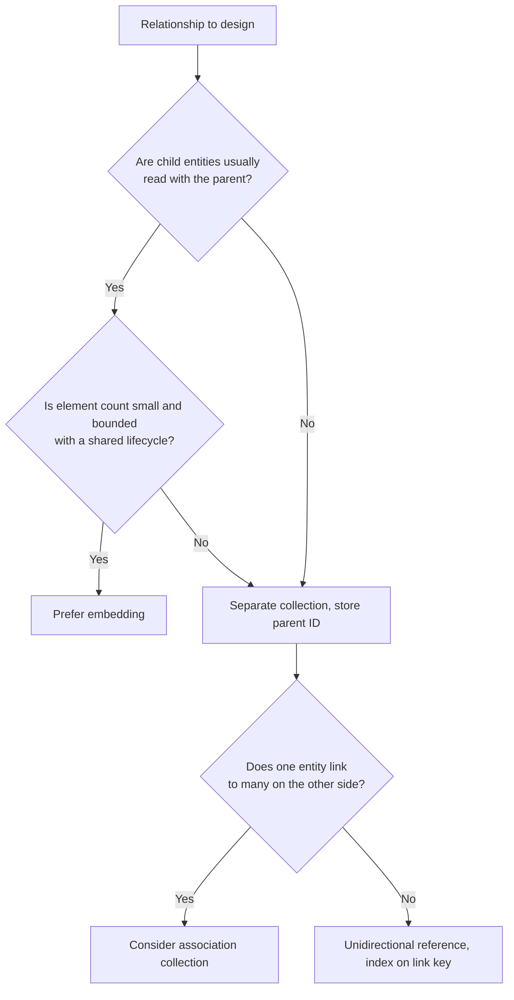

# Modeling One-to-One, One-to-Many, and Many-to-Many Relationships in Spring Data MongoDB

An application typically has interrelated entities: a user has a profile, an order has many line items, and a user can belong to many workspaces. When storing them in MongoDB, the key question is not merely **"how many elements are in the relationship?"** but **"how are these pieces of data read, written, and changed together?"**.

In **Spring Data MongoDB**, you map Java objects to BSON documents using `@Document`, `@Id`, `@Field`, `MongoTemplate`, or repositories. Even though Java objects can reference one another, MongoDB does not automatically turn them into relational tables with foreign keys and JOINs like an RDBMS. Designers must decide when to **embed**, when to **reference**, and when to introduce an **association collection**.

This lesson belongs to the **Document Design** chapter, focusing on the three relationship types and the practical consequences of each modeling choice: document size, queries, aggregation, indexes, atomic updates, transactions, reactive access, and testing.

## 1. Three Ways to Represent Relationships with Documents

### 1.1. Embedding Data

The child object resides directly inside the parent document:

```javascript
{
  _id: ObjectId("674000000000000000000001"),
  email: "an@example.test",
  profile: {
    displayName: "An",
    language: "vi"
  }
}
```

A single read of the parent document retrieves `profile` as well. Updating fields within the **same document** is guaranteed by MongoDB to be atomic at the document level. This approach generally fits when the child belongs to a single parent, shares the parent's lifecycle tightly, and stays within controllable size limits.

### 1.2. Referencing by Identifier

The two entity types live in separate collections, and one document stores the identifier of the other:

```javascript
// users
{ _id: ObjectId("674000000000000000000001"), email: "an@example.test" }

// user_preferences
{
  _id: ObjectId("674000000000000000000101"),
  user_id: ObjectId("674000000000000000000001"),
  theme: "dark"
}
```

Splitting collections allows independent reading, updating, and access control by lifecycle. However, the application must ensure `user_id` points to a valid user, decide how to handle orphaned records, and issue additional queries when both objects are needed together.

### 1.3. Association / Junction Collection

For many-to-many relationships that carry their own attributes, an intermediate collection stores each **relationship pair**:

```javascript
// workspace_members
{
  _id: ObjectId("674000000000000000000201"),
  workspace_id: ObjectId("674000000000000000000301"),
  user_id: ObjectId("674000000000000000000001"),
  role: "EDITOR",
  joined_at: ISODate("2026-11-01T09:00:00Z")
}
```

Each link document identifies which workspace the member belongs to and can also store the role and join timestamp. This design works well when link counts grow, bidirectional lookups are required, or relationship attributes are updated directly.

| Storage style | Reads | Writes / updates | Key considerations |
| --- | --- | --- | --- |
| Embedded object/array | Usually read with parent in one query | Single document can be updated atomically | Document bloat, unbounded arrays, write contention |
| ID reference to another collection | May need a second query or `$lookup` | Updated independently | Referential integrity is the application's responsibility |
| Association collection | Filter links first, then fetch related entities | Add/remove links independently | Needs unique index, bidirectional indexes, and cleanup rules |

These are **physical data organization strategies**, not rigid rules like "1:1 must always embed" or "N:M must always JOIN". One logical relationship can have different optimal storage layouts depending on actual workload.

## 2. Choosing a Model from Data Usage Patterns

Before writing Java entities, answer these questions:

1. **Read together?** Must most APIs return parent and children in the same response? Or do they frequently read only a slice of child data?
2. **Bounded count?** Does a parent have at most a few addresses, dozens of order lines, or millions of comments? Is that bound enforced by business logic?
3. **Updated together?** Must children change atomically with the parent, or are they written continuously by an independent stream?
4. **Shared across multiple parents?** Can a child belong to multiple owners, or need independent lookup via a stable ID?
5. **Which lookup directions?** "Fetch customer's orders", "fetch order's customer", or both? Do you need pagination, search, and sorting on child attributes?
6. **Limits and operations?** BSON documents have a **16 MiB** size limit; large arrays, ever-growing documents, excessive indexes, and multi-document transactions all carry costs.



This diagram is a starting point, not a substitute for measuring load: the model must reflect **access patterns**, integrity rules, and projected growth.

## 3. One-to-One (1:1) Relationships

Example: each `User` has at most one `Profile`.

### 3.1. Embedding Profile Inside User

```java
import org.bson.types.ObjectId;
import org.springframework.data.annotation.Id;
import org.springframework.data.mongodb.core.mapping.Document;

record Profile(String displayName, String language) {}

@Document("users")
class User {
    @Id
    private ObjectId id;
    private String email;
    private Profile profile;

    // Constructors/getters omitted to focus on storage model.
}
```

MongoDB stores `profile` as a nested document inside `users`; **there is no need for a `profiles` collection**. To update just one attribute without replacing the entire document, use `MongoTemplate`:

```java
import org.springframework.data.mongodb.core.query.Criteria;
import org.springframework.data.mongodb.core.query.Query;
import org.springframework.data.mongodb.core.query.Update;

Query byId = Query.query(Criteria.where("id").is(userId));
Update change = new Update().set("profile.language", "en");

mongoTemplate.updateFirst(byId, change, User.class);
```

This command is equivalent to `db.users.updateOne({_id: userId}, {$set: {"profile.language": "en"}})`. Because the nested field is updated on a single document, no multi-document transaction is required just to change this property. If `profile` does not exist yet, `$set` creates the nested path when the document structure permits.

**Good fit when:** the profile is small, nearly always read with the user, unshared, and bounded. **Poor fit when:** the profile has an independent lifecycle, is very large, is updated frequently by another service, or requires separate access policies from the user.

### 3.2. Splitting 1:1 into a Separate Collection

If user settings are managed independently:

```java
import org.bson.types.ObjectId;
import org.springframework.data.annotation.Id;
import org.springframework.data.mongodb.core.index.Indexed;
import org.springframework.data.mongodb.core.mapping.Document;
import org.springframework.data.mongodb.core.mapping.Field;

@Document("user_preferences")
class UserPreferences {
    @Id
    private ObjectId id;

    @Field("user_id")
    @Indexed(unique = true)
    private ObjectId userId;

    private String theme;
}
```

The logical one-to-one relationship is enforced via `user_id` and a **unique index that actually exists in MongoDB**. Without a server-side unique constraint, two concurrent write requests can still insert multiple `UserPreferences` for the same user even if Java code checks beforehand. Automatic index creation from annotations depends on environment and configuration; in production, manage indexes via migrations or controlled deployment pipelines.

```java
import java.util.Optional;
import org.bson.types.ObjectId;
import org.springframework.data.mongodb.repository.MongoRepository;

interface UserPreferencesRepository
        extends MongoRepository<UserPreferences, ObjectId> {
    Optional<UserPreferences> findByUserId(ObjectId userId);
}
```

Fetching the user and preferences in two queries can be acceptable if APIs read preferences infrequently. If creating both user and preferences simultaneously must **succeed or fail together**, consider MongoDB transactions when infrastructure and configuration support them; a unique index enforces uniqueness, not the existence of the referenced user.

A 1:1 variant reuses the exact same `_id` value for both documents instead of introducing a separate `user_id` field. This simplifies uniqueness enforcement, but requires the application to manage IDs consistently.

## 4. One-to-Many (1:N) Relationships

Two scenarios share the same cardinality yet lead to very different designs: **an order with a bounded number of line items** and **a post that can accumulate unbounded comments**.

### 4.1. An Order with Many Line Items: Embedded Array

```javascript
{
  _id: ObjectId("674000000000000000000401"),
  customer_id: "KH-101",
  lines: [
    { sku: "SKU-7", quantity: 2, unitPriceVnd: NumberLong("150000") },
    { sku: "SKU-9", quantity: 1, unitPriceVnd: NumberLong("99000") }
  ],
  status: "NEW"
}
```

Corresponding Java design:

```java
import java.util.ArrayList;
import java.util.List;
import org.bson.types.ObjectId;
import org.springframework.data.annotation.Id;
import org.springframework.data.mongodb.core.mapping.Document;
import org.springframework.data.mongodb.core.mapping.Field;

record OrderLine(String sku, int quantity, long unitPriceVnd) {}

@Document("orders")
class Order {
    @Id
    private ObjectId id;

    @Field("customer_id")
    private String customerId;

    private List<OrderLine> lines = new ArrayList<>();
    private String status;
}
```

Each `OrderLine` is a nested value inside the `Order` document, not a separate `@Document` entity. The price at checkout is typically **snapshotted** on the line item so historical invoices do not change when catalog prices change. This is intentional denormalization.

We can find orders containing a given SKU:

```java
Query query = Query.query(Criteria.where("lines.sku").is("SKU-7"));
List<Order> orders = mongoTemplate.find(query, Order.class);
```

And update the first matching line item without rewriting the whole order:

```java
Query query = Query.query(
    Criteria.where("id").is(orderId)
            .and("lines.sku").is("SKU-7")
);
Update update = new Update().set("lines.$.quantity", 3);

mongoTemplate.updateFirst(query, update, Order.class);
```

The positional operator `$` above modifies the **first array element matching the condition**. If multiple lines can carry the same SKU and all matching elements must change, use a different design rule or array filters (`$[identifier]`) to match intent. Note that the nested array still belongs to **one document**, so update contention on that order can increase if multiple processes write concurrently.

**Advantages:** one read fetches complete order details, atomic updates across the document, and clean historical snapshots. **Limits:** documents cannot exceed 16 MiB; huge arrays hurt payload size, index size, and update cost. Enforce business limits on line-item counts and avoid calling `save(order)` to overwrite an existing entity when only one line needs updating.

### 4.2. A Post with Many Comments: Separate Collection

If a post can receive hundreds of thousands of comments, do not pack them all into `posts.comments[]`. Store each comment as its own document and let the **many side hold the ID of the one side**:

```javascript
// posts
{ _id: ObjectId("674000000000000000000501"), title: "MongoDB" }

// comments
{
  _id: ObjectId("674000000000000000000601"),
  post_id: ObjectId("674000000000000000000501"),
  author_id: ObjectId("674000000000000000000001"),
  body: "Very helpful post",
  created_at: ISODate("2026-11-01T10:00:00Z")
}
```

In Spring Data MongoDB:

```java
import java.time.Instant;
import org.bson.types.ObjectId;
import org.springframework.data.annotation.Id;
import org.springframework.data.mongodb.core.index.CompoundIndex;
import org.springframework.data.mongodb.core.mapping.Document;
import org.springframework.data.mongodb.core.mapping.Field;

@Document("comments")
@CompoundIndex(name = "by_post_time",
               def = "{'post_id': 1, 'created_at': -1}")
class Comment {
    @Id
    private ObjectId id;

    @Field("post_id")
    private ObjectId postId;

    @Field("author_id")
    private ObjectId authorId;

    private String body;

    @Field("created_at")
    private Instant createdAt;
}
```

Querying the 20 newest comments:

```java
import org.springframework.data.domain.Sort;

Query query = Query.query(Criteria.where("postId").is(postId))
    .with(Sort.by(Sort.Direction.DESC, "createdAt"))
    .limit(20);

List<Comment> page = mongoTemplate.find(query, Comment.class);
```

`MongoTemplate` uses **Java property names** `postId` and `createdAt`, mapping them to `post_id` and `created_at`. The compound index `{post_id: 1, created_at: -1}` is a strong candidate for filtering by post and sorting descending by time, though it should be verified on real data with `explain("executionStats")`.

**Advantages:** comments scale independently, paginate easily, index cleanly, and update/delete individually. **Trade-offs:** loading the post and its comments typically takes multiple operations; deleting a post requires a policy to delete or archive related comments. At high scale, consider keyset pagination on `createdAt` combined with `_id` to avoid deep `skip` overhead.

### 4.3. Should You Also Store a List of Child IDs on the Parent?

For very small child counts, you might store `featuredCommentIds` or a bounded list of IDs on the parent. For unbounded child sets, however, an ID array still grows steadily and requires updating the parent on every child insert/delete. Storing the **parent ID on the child document** generally works much better for large collections: you can index `post_id`, paginate, and write independently.

Avoid storing both `post.commentIds[]` **and** `comment.postId` by default without a clear synchronization mechanism; the two copies of the relationship can drift apart if one operation fails.

## 5. Many-to-Many (N:M) Relationships

Suppose a user joins many workspaces and a workspace has many users. The relationship may carry attributes like `role`, `joinedAt`, and `invitedBy`.

### 5.1. Storing an ID Array on One Side When the Relationship Is Small and Simple

```javascript
{
  _id: ObjectId("674000000000000000000701"),
  name: "Content Team",
  member_ids: [
    ObjectId("674000000000000000000001"),
    ObjectId("674000000000000000000002")
  ]
}
```

An ID array works when member count has a small upper bound, the application usually loads the workspace together with its member IDs, and per-link metadata is unnecessary. If you also need to query "which workspaces contain user X?", you need an appropriate index on `member_ids` (a multikey index); the document can still become a write contention point if many users join or leave concurrently.

Do not maintain both `workspace.memberIds[]` and `user.workspaceIds[]` as two independent sources of truth. Concurrent updates to both sides increase drift risk and require transactions or synchronization mechanisms.

### 5.2. Using an Association Collection When the Relationship Has Attributes or Grows Large

```java
import java.time.Instant;
import org.bson.types.ObjectId;
import org.springframework.data.annotation.Id;
import org.springframework.data.mongodb.core.index.CompoundIndex;
import org.springframework.data.mongodb.core.index.CompoundIndexes;
import org.springframework.data.mongodb.core.mapping.Document;
import org.springframework.data.mongodb.core.mapping.Field;

@Document("workspace_members")
@CompoundIndexes({
    @CompoundIndex(
        name = "uniq_workspace_user",
        def = "{'workspace_id': 1, 'user_id': 1}",
        unique = true
    ),
    @CompoundIndex(
        name = "by_user_workspace",
        def = "{'user_id': 1, 'workspace_id': 1}"
    )
})
class WorkspaceMember {
    @Id
    private ObjectId id;

    @Field("workspace_id")
    private ObjectId workspaceId;

    @Field("user_id")
    private ObjectId userId;

    private String role;

    @Field("joined_at")
    private Instant joinedAt;

    public ObjectId getUserId() { return userId; }
}
```

Each document in `workspace_members` represents a `(workspaceId, userId)` pair. The **unique compound index** prevents duplicate relationship records. The second index supports queries by user; whether that second index is needed depends on how often the reverse lookup runs.

Repository for the association class:

```java
import java.util.List;
import java.util.Optional;
import org.bson.types.ObjectId;
import org.springframework.data.mongodb.repository.MongoRepository;

interface WorkspaceMemberRepository
        extends MongoRepository<WorkspaceMember, ObjectId> {

    List<WorkspaceMember> findByWorkspaceId(ObjectId workspaceId);

    Optional<WorkspaceMember> findByWorkspaceIdAndUserId(
        ObjectId workspaceId, ObjectId userId);
}
```

To retrieve a workspace's members, read the link documents and then query users by ID **in batch**:

```java
List<WorkspaceMember> links =
    workspaceMemberRepository.findByWorkspaceId(workspaceId);

List<ObjectId> userIds = links.stream()
    .map(WorkspaceMember::getUserId)
    .toList();

List<User> users = userIds.isEmpty()
    ? List.of()
    : mongoTemplate.find(
        Query.query(Criteria.where("id").in(userIds)),
        User.class
    );
```

At runtime, this is typically two queries instead of one query **per** user. If you need to preserve ordering or paginate by role or join date, paginate directly on `workspace_members` first and then look up the matching users; an `$in` query does not guarantee preserving the input ID order by default.

When you want MongoDB to combine the data on the server, `$lookup` is an option:

```javascript
db.workspace_members.aggregate([
  {
    $match: {
      workspace_id: ObjectId("674000000000000000000701")
    }
  },
  {
    $lookup: {
      from: "users",
      localField: "user_id",
      foreignField: "_id",
      as: "user"
    }
  },
  { $unwind: "$user" },
  {
    $project: {
      _id: 0,
      role: 1,
      "user._id": 1,
      "user.email": 1
    }
  }
]);
```

`$lookup` requires the **values and BSON types of the join fields to match**. The example above uses `ObjectId` for both `user_id` and `users._id`. If `user_id` is stored as a string while `_id` is an ObjectId, the join will not match as expected even if the string values look identical. MongoDB provides `$lookup`, but joining collections is not free: evaluate indexes, cardinality, and result size.

### 5.3. Variant Using Spring Data References

Spring Data MongoDB offers `@DBRef` and `@DocumentReference` to map relationships between documents:

| Mechanism | Reference format | Things to remember |
| --- | --- | --- |
| Manual `ObjectId userId` | Plain ID field | Queries and reference lifecycle are completely explicit in services |
| `@DBRef` | BSON DBRef containing collection name and ID | Can trigger reference resolution on read; does not create foreign keys or automatic server JOINs |
| `@DocumentReference` | Flexible reference, typically storing ID by default | Spring Data resolves referenced documents via queries; watch lazy loading and query counts |

Example of a small relationship needing navigation from one entity to a related entity:

```java
import org.bson.types.ObjectId;
import org.springframework.data.annotation.Id;
import org.springframework.data.mongodb.core.mapping.Document;
import org.springframework.data.mongodb.core.mapping.DocumentReference;

@Document("projects")
class Project {
    @Id
    private ObjectId id;

    @DocumentReference(lazy = true)
    private User owner;
}
```

The snippet illustrates **a single reference field** on `Project`; constructors and getters are omitted. `@DocumentReference` does not turn all reads into SQL-like JOINs, does not guarantee the referenced document still exists, and does not solve high-cardinality N:M graphs. When iterating over many parent documents and resolving references automatically, measure query counts to prevent **N+1** behavior. For large relationships and paginated APIs, explicit IDs plus an association collection are usually easier to control.

## 6. Consistency and Updates Along Document Boundaries

MongoDB guarantees atomicity for writes on **a single document**. This directly shapes how you model updates:

| Scenario | Natural atomic boundary | How to meet business requirements |
| --- | --- | --- |
| Change `profile.language` in `users` | One user document | `$set` on the nested field |
| Update `lines.$.quantity` on an order | One order document | `updateFirst` matching the exact element |
| Add a comment in `comments` | One comment document | Insert comment; if incrementing a post counter, consider counter consistency |
| Create separate user and preferences | Two documents in two collections | Transaction if they must commit together; or compensating/convergent handling if eventual consistency is acceptable |
| Add member and increment `memberCount` on workspace | Link document and workspace document | Use a transaction when immediate sync is required; or treat count as derived data updated via events |

MongoDB transactions require supported infrastructure (a replica set or compatible sharded cluster), sessions, and an appropriate transaction manager like `MongoTransactionManager` (with reactive transaction management for reactive apps). `@Transactional` only has effect when wired to the right transaction manager and when operations participate in the same transaction. Transactions preserve multi-document consistency at a cost: **design sound document boundaries first**.

Additionally, plan for:

- **Deleting parents:** when a post is deleted, should comments be deleted, retained for audit, or soft-deleted? MongoDB does not auto-cascade with plain ID references.
- **Duplicate link inserts:** a unique index on `(workspace_id, user_id)` is the authoritative guard, rather than relying only on an existence check before insert.
- **Concurrent writes:** for frequently updated fields, use `$inc`, `$addToSet`, `$pull`, or conditional updates; consider `@Version` where the model fits.
- **Duplicated data:** user names or catalog prices embedded elsewhere need refresh rules or a clear decision to keep a historical snapshot. Never sync every snapshot blindly.
- **Orphaned references:** perform periodic checks, controlled cleanup, or event-driven handling when a related document is removed.

## 7. Indexes and Queries Must Match the Model

Indexes should be chosen from business questions, not by indexing every field:

| Frequent query | Candidate index fields | Reason |
| --- | --- | --- |
| Fetch preferences by user | `user_preferences.user_id` **unique** | Ensures at most one preferences document per user |
| Filter orders by SKU in `lines[]` | `orders.lines.sku` (multikey) | Lets MongoDB look up values inside the array |
| Fetch a post's comments newest first | `comments: {post_id: 1, created_at: -1}` | Supports filtering followed by sorting |
| List workspace members and prevent duplicates | `workspace_members: {workspace_id: 1, user_id: 1}` unique | Lookups by workspace while keeping each pair unique |
| List workspaces a user belongs to | `workspace_members: {user_id: 1, workspace_id: 1}` | Serves the reverse lookup direction |

A unique multikey index does not replace the rule "no duplicate IDs within the **same array**"; index uniqueness applies to index keys across different documents. For small ID sets that must be deduplicated, `$addToSet` is safer than `$push` when adding elements.

Example measuring the comments query:

```javascript
db.comments
  .find({ post_id: ObjectId("674000000000000000000501") })
  .sort({ created_at: -1 })
  .limit(20)
  .explain("executionStats");
```

Inspect `winningPlan`, `nReturned`, `totalKeysExamined`, and `totalDocsExamined`, and compare on representative data. Indexes speed up many reads but increase write, RAM, and disk costs. Annotations like `@Indexed` and `@CompoundIndex` are mapping declarations; the index must actually exist in the database to take effect.

## 8. Choices for Reactive Access

`ReactiveMongoTemplate` and `ReactiveMongoRepository` follow the exact same document modeling principles: embedding, ID referencing, association collections, and indexes **do not change**. What changes is how results are returned and asynchronous streams are composed:

```java
import reactor.core.publisher.Flux;
import org.bson.types.ObjectId;
import org.springframework.data.mongodb.repository.ReactiveMongoRepository;

interface ReactiveCommentRepository
        extends ReactiveMongoRepository<Comment, ObjectId> {
    Flux<Comment> findByPostId(ObjectId postId);
}
```

A `Flux<Comment>` typically begins executing the query only when subscribed to. If you need a post together with comments, bound or paginate comments as needed instead of blindly collecting the whole `Flux` into a huge list. Reactive APIs handle non-blocking I/O; they **do not** fix missing indexes, oversized reference fan-outs, or flawed relationship modeling.

## 9. Common Design Mistakes and How to Avoid Them

1. **Embedding unbounded arrays:** stuffing all comments into a post or all events into a user. Split into a child collection keyed by parent ID and paginate.
2. **Over-normalizing:** separating a small profile always read with the user into another collection adds unnecessary round trips. Consider embedding.
3. **Confusing `@DBRef` with foreign keys:** MongoDB does not prevent deleting a referenced document or automatically delete children. Define explicit integrity logic.
4. **Creating two sources of truth:** storing the same membership list on both `user` and `workspace`. Pick one canonical store, or use verifiable transactions/sync events.
5. **Mixing `String` IDs and BSON `ObjectId`s:** Java entity queries may apply `@Id` conversion, but `$lookup` and direct queries on reference fields must match BSON types. Check real data when joining collections.
6. **Check-then-insert for creating links:** two concurrent requests can both "see nothing" and insert duplicates. Only a unique index enforces uniqueness server-side.
7. **Overwriting the whole entity when changing one field:** calling `save` on a stale entity or projected entity can drop data. Prefer conditional updates and atomic operators when appropriate.
8. **Unchecked reference resolution:** lazy references are not free. Measure server round trips, and use batch queries or aggregations suited to the API.

## 10. Hands-On Exercise: Choose a Model and Verify It

**Problem:** Design an application with users, personal profiles, orders, post comments, and workspaces. It must support: reading a user with their profile, viewing order details, loading the 20 newest comments, listing workspace members, and assigning member roles.

A solid initial model:

| Requirement | Model | Verification needed |
| --- | --- | --- |
| User + small profile | 1:1 embedded `users.profile` | Update one field with `$set`; verify readback |
| Order + bounded line items | 1:N embedded `orders.lines[]` | Test array updates, price snapshots, and total document size |
| Post + continuously growing comments | 1:N `comments.post_id` | Create compound index, paginate, run `explain` |
| User + workspace with roles | N:M `workspace_members` | Create unique pair index, query both directions, test duplicate insert |

With Spring Data MongoDB, write integration tests using a real MongoDB instance in an isolated environment (such as Testcontainers) to verify stored documents, BSON ID types, `@Field` names, indexes, `MongoTemplate` updates, and repository outputs. Mocked repositories alone cannot prove mapping and indexes behave properly against MongoDB.

Scenarios to verify carefully:

- **Concurrency:** two requests concurrently add a `WorkspaceMember` for the same `(workspaceId, userId)`; the outcome must be a single link and clear handling of the duplicate error.
- **Bidirectional queries:** find members by workspace and workspaces by user; verify whether corresponding indexes exist.
- **Pagination:** when a post grows to millions of comments, the API still reads only the requested page.
- **Deletion:** deleting a user or post executes the proper cleanup policy; do not leave referential integrity to assumption.
- **Transactions:** if business rules require creating two documents together, test commit/rollback on MongoDB infrastructure that supports transactions.

## 11. Self-Check Questions

**1.** A user has exactly one small UI preference config, nearly always read with the user. Which model should you start with?  
**Hint:** Embed inside the user document so they are read and updated together; split only if clear independent requirements emerge.

**2.** A post may receive one million comments. Why shouldn't they all be embedded in `posts.comments[]`?  
**Hint:** BSON document size limit, continuously growing array, update overhead, pagination issues, and loading excessive data.

**3.** You add `@Indexed(unique = true)` in Java, but the database does not have the actual index yet. Are two `UserPreferences` with the same `userId` guaranteed to be blocked?  
**Hint:** No; you must confirm that the unique index has actually been created in MongoDB.

**4.** A user can belong to many workspaces, and the link carries `role` and `joinedAt`. Which model is easiest to control as the link count grows large?  
**Hint:** An association collection with a unique compound index and indexes matching query directions.

**5.** A MongoDB Shell `$lookup` between `workspace_members.user_id` and `users._id` returns nothing even though the IDs look identical. What should you check first?  
**Hint:** Check the actual BSON types (string vs. ObjectId), then verify field names, collection names, and join conditions.

**6.** Inserting a comment succeeds, but incrementing `commentCount` on the post fails. Does this contradict MongoDB's atomicity guarantee?  
**Hint:** No; those are two separate documents. You must define a transaction, compensating repair, or treat the counter as derived data synchronized asynchronously.

The essence of modeling relationships in MongoDB is choosing **document boundaries** around data that is read and updated together. Spring Data MongoDB makes Java mapping, querying, aggregation, and updates convenient, but the choices of embedding, referencing, indexes, and consistency rules must still come from business characteristics and be verified with real data.
