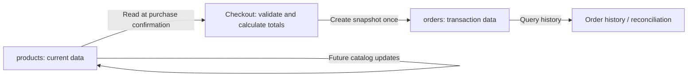

# Data Snapshots in Orders and Mutable Source Data

## 1. The Problem: Products Change After an Order Is Placed

A store sells the **KB-87 keyboard** named "87-Key Keyboard" for 1,250,000 VND. A customer orders 2 units on November 10, 2026, paying 2,500,000 VND. The next day, the store renames the product to "87-Key Mechanical Keyboard" and adjusts its list price to 1,450,000 VND.

When reopening the placed order, the customer must still see the product name, unit price, and total amount **confirmed at the time of purchase**. If the order history screen always reads the current price from the product catalog, the system could display the wrong amount, causing confusion during reconciliation, refund processing, or customer support.

This is a primary reason to learn **snapshots in document design** with MongoDB. In the **SPRING_DATA_MONGODB** module, we use Spring Data MongoDB to map documents to Java, read source products via repositories or `MongoTemplate`, build snapshots during checkout, and leverage queries, indexes, transactions, and testing so historical data stays semantically consistent.

A **snapshot** is an intentional copy of the attributes that must remain fixed as of a **business milestone**. It does not mean copying the entire source collection or creating a database backup.

### Illustrative Timeline

| Point in time | Source data in `products` | Data in `orders` |
| --- | --- | --- |
| T0: before purchase | Name "87-Key Keyboard", price 1,250,000 | No order yet |
| T1: order confirmed | Product version 7, price 1,250,000 | Stores name, unit price 1,250,000, quantity 2, total 2,500,000 |
| T2: store updates catalog | Name "87-Key Mechanical Keyboard", price 1,450,000, version 8 | Still stores the data confirmed at T1 |
| T3: customer views history | Catalog displays current name and price | Old order displays purchase-time details |

Core requirement: **changes at the source must not accidentally rewrite the historical truth of a transaction**.

## 2. Distinguishing Source Data, References, and Snapshots

An order document typically holds three kinds of information at once:

1. **Mutable source data:** `products.name`, `products.currentPrice`, `customers.defaultAddress`, active-for-sale flags, and inventory counts. These serve current operations and have their own lifecycle.
2. **Identifying references:** `productId`, `customerId`, variant ID, or promotion code. These link back to the source entity when needed.
3. **Historical snapshots:** `nameAtPurchase`, `skuAtPurchase`, `unitPrice`, checkout shipping address, applied discount amount, and confirmed pricing components.

| Attribute | Read live source or snapshot? | Why? |
| --- | --- | --- |
| `productId` | Keep reference in order | Identifies the product; allows looking up current info if needed |
| `nameAtPurchase`, `skuAtPurchase` | Snapshot | Displays the exact item the customer confirmed |
| `unitPrice`, `currency` | Snapshot | Prevents new prices from recalculating old orders |
| `quantity`, `lineTotal` | Snapshot | Records transaction quantity and line subtotal |
| `discountSnapshot`, `taxSnapshot` | Snapshot if part of business rules | Preserves the pricing/tax policy applied to the transaction |
| `shippingAddressAtCheckout` | Snapshot | Customer's default address can change after purchase |
| `customerId` | Reference | Connects to the current customer account |
| `currentStock` | Separate source data | Inventory is operational state and must not come from old orders |
| `orderStatus` | Mutable lifecycle status | Must update across payment, shipping, cancellation, etc. |

Not every field in an order is immutable. **Finalized transaction details** and **order fulfillment status** serve different roles: status can move from `PLACED` to `PAID` and `SHIPPED`, while the confirmed unit price must not be overwritten by a new catalog price.

Some businesses allow editing the delivery address before shipment. In that case, you can keep both `shippingAddressAtCheckout` and a current `deliveryAddress`, or store an address-change history. That way, delivery adjustments do not erase the original record.

## 3. Designing Two Collections in MongoDB

Treat `products` as the live product source; `orders` stores transaction snapshots.

### 3.1. Mutable Product Document

Example in `mongosh`:

```javascript
db.products.insertOne({
  _id: "p-001",
  sku: "KB-87",
  name: "87-Key Keyboard",
  currentPrice: NumberDecimal("1250000"),
  currency: "VND",
  active: true,
  version: NumberLong(7),
  updatedAt: ISODate("2026-11-09T10:00:00Z")
});
```

`currentPrice` is the currently published price, not the price of every historical transaction. The `version` field identifies which source state was read and can assist with concurrent update control.

### 3.2. Order Document Storing Snapshots

```javascript
db.orders.insertOne({
  _id: "o-1001",
  customerId: "c-01",
  placedAt: ISODate("2026-11-10T10:00:00Z"),
  status: "PLACED",
  currency: "VND",
  items: [
    {
      productId: "p-001",
      sourceProductVersion: NumberLong(7),
      skuAtPurchase: "KB-87",
      nameAtPurchase: "87-Key Keyboard",
      quantity: 2,
      unitPrice: NumberDecimal("1250000"),
      lineTotal: NumberDecimal("2500000")
    }
  ],
  shippingAddressAtCheckout: {
    recipient: "Nguyen An",
    city: "Da Nang",
    street: "12 Nguyen Van Linh"
  },
  subtotal: NumberDecimal("2500000"),
  shippingFee: NumberDecimal("0"),
  discountTotal: NumberDecimal("0"),
  grandTotal: NumberDecimal("2500000"),
  pricingPolicyVersion: "2026-11"
});
```

The `items` and `shippingAddressAtCheckout` fields are **embedded** into the order because they belong to the transaction record. MongoDB stores documents in BSON; the example uses `NumberDecimal` and `ISODate` to make decimal and timestamp types explicit rather than treating money or timestamps as strings.

Formulas in the example:

```text
lineTotal    = unitPrice × quantity
subtotal     = sum of lineTotal
grandTotal   = subtotal + shippingFee - discountTotal
             = 2,500,000 + 0 - 0 = 2,500,000 VND
```

In a real system, you may also need taxes, service fees, shipping charges, per-line discounts, rounding rules, and exchange-rate lock timing. Those factors must be modeled to match actual business rules so you can **reproduce the exact confirmed totals**, rather than inferring them from today's active policy.

### 3.3. Update the Source Product, Preserve Old Orders

Suppose the store updates the product after the order was placed:

```javascript
db.products.updateOne(
  { _id: "p-001", version: NumberLong(7) },
  {
    $set: {
      name: "87-Key Mechanical Keyboard",
      currentPrice: NumberDecimal("1450000"),
      updatedAt: ISODate("2026-11-11T10:00:00Z")
    },
    $inc: { version: NumberLong(1) }
  }
);

db.products.findOne({ _id: "p-001" });
db.orders.findOne({ _id: "o-1001" });
```

The `updateOne` on `products` does not touch already-saved `orders` documents. A customer viewing order `o-1001` still sees 1,250,000 VND per unit, while the product page shows 1,450,000 VND. The `version: 7` filter rejects the update if someone else modified the source first; the application must check `matchedCount` and handle mismatches.

**Rule:** when rendering receipts, payment history, or refund amounts for purchased items, read transaction fields from `orders`. You may look up `products` to enrich with current images or links, but that auxiliary data must never replace historical fields.

## 4. What to Snapshot and When to Capture It?

### 4.1. Choose Based on the Business Truth You Must Reconstruct

Keep values whose change at the source would alter the interpretation of an old transaction, such as:

- **Selected item characteristics:** SKU/variant code, display name, capacity, color, warranty plan; store enough to identify what was purchased.
- **Locked pricing terms:** unit price, quantity, currency, discounts, applied promo codes, relevant taxes/fees, and totals.
- **Delivery details:** recipient and address confirmed at placement; address-change history if business rules permit edits.
- **Transaction terms:** pricing policy or terms-and-conditions version, or warranty duration if they affect post-purchase resolution.

Do not blindly copy every field from the source document. Internal data such as stock counts, operational flags, edit history, supplier lists, or unrelated technical descriptions bloat documents and create accidental data-exposure risks.

### 4.2. The Snapshot Milestone Must Be Clearly Defined

Possible milestones differ: adding to cart, generating a quote, clicking "Place Order", payment confirmation, or invoice issuance.

- **Shopping cart:** displayed prices are usually reference values that may need re-validation at checkout.
- **Active quote:** if a price is guaranteed until an expiration time, store the quote ID, version, expiry, and applicability rules.
- **Order accepted:** capture the transaction snapshot using the confirmed prices and terms.
- **Payment/invoice:** may require separate accounting documents or recording steps depending on business workflow.

There is no single milestone that fits every system. What matters is defining the **effective milestone** so you avoid a situation where some lines take pre-change prices while others take post-change prices unintentionally.

### 4.3. A Snapshot Is Not Two-Way Synchronization

There are three distinct data flows:



Updating `products` after an order is created must not trigger overwrites of names or prices in `orders.items`. Only modify historical records when an **explicit** business process requires it—such as voiding and reissuing a receipt—with its own audit trail.

## 5. Mapping Snapshots with Spring Data MongoDB

Spring Data MongoDB supports two common access patterns: repositories for entity-oriented operations, and `MongoTemplate` when you need direct control over queries, projections, aggregations, or conditional updates.

### 5.1. Source Entity and Data Version

Java 17+ examples; the snippets below illustrate types in separate Java files with `package` and routine boilerplate omitted:

```java
import java.math.BigDecimal;
import java.time.Instant;

import org.springframework.data.annotation.Id;
import org.springframework.data.annotation.Version;
import org.springframework.data.mongodb.core.mapping.Document;
import org.springframework.data.mongodb.core.mapping.Field;
import org.springframework.data.mongodb.core.mapping.FieldType;

@Document(collection = "products")
public record ProductDocument(
    @Id String id,
    String sku,
    String name,
    @Field(targetType = FieldType.DECIMAL128)
    BigDecimal currentPrice,
    String currency,
    boolean active,
    @Version Long version,
    Instant updatedAt
) {}
```

`@Version` enables **optimistic locking** for entity saves routed through Spring Data. If two requests read the same version and both save changes, the stale-version write can fail with `OptimisticLockingFailureException` instead of silently overwriting. This mechanism requires writes to go through version-aware paths; with custom `MongoTemplate.updateFirst(...)` statements, the application must still construct appropriate update conditions and check the result.

`@Field(targetType = FieldType.DECIMAL128)` expresses the intent to store monetary values as BSON Decimal128; establish consistent currency unit, scale, and rounding rules. Using `double` for money arithmetic introduces binary floating-point rounding errors.

### 5.2. Order Entity and Embedded Structures

```java
import java.math.BigDecimal;
import java.time.Instant;
import java.util.List;

import org.springframework.data.annotation.Id;
import org.springframework.data.mongodb.core.mapping.Document;
import org.springframework.data.mongodb.core.mapping.Field;
import org.springframework.data.mongodb.core.mapping.FieldType;

@Document(collection = "orders")
public record OrderDocument(
    @Id String id,
    String customerId,
    Instant placedAt,
    String status,
    String currency,
    List<OrderLineSnapshot> items,
    AddressSnapshot shippingAddressAtCheckout,
    @Field(targetType = FieldType.DECIMAL128)
    BigDecimal subtotal,
    @Field(targetType = FieldType.DECIMAL128)
    BigDecimal shippingFee,
    @Field(targetType = FieldType.DECIMAL128)
    BigDecimal discountTotal,
    @Field(targetType = FieldType.DECIMAL128)
    BigDecimal grandTotal
) {
    public record OrderLineSnapshot(
        String productId,
        Long sourceProductVersion,
        String skuAtPurchase,
        String nameAtPurchase,
        int quantity,
        @Field(targetType = FieldType.DECIMAL128)
        BigDecimal unitPrice,
        @Field(targetType = FieldType.DECIMAL128)
        BigDecimal lineTotal
    ) {}

    public record AddressSnapshot(
        String recipient,
        String city,
        String street
    ) {}
}
```

`OrderLineSnapshot` and `AddressSnapshot` are embedded inside the same `orders` document. You do not need a separate collection for line items just because Java defines a separate record. `productId` remains a reference to the source, while `nameAtPurchase` and `unitPrice` are finalized data.

In multi-version systems, you can add `snapshotSchemaVersion` to distinguish old and new snapshot layouts. If audit requirements demand tracing subsequent edits, use a separate event history or audit log; storing the current snapshot alone does not automatically retain a complete log of every edit.

### 5.3. Repositories and History Queries

```java
import org.springframework.data.domain.Pageable;
import org.springframework.data.domain.Slice;
import org.springframework.data.mongodb.repository.MongoRepository;

interface ProductRepository extends MongoRepository<ProductDocument, String> {}

interface OrderRepository extends MongoRepository<OrderDocument, String> {
    Slice<OrderDocument> findByCustomerId(
        String customerId,
        Pageable pageable
    );
}
```

Example call:

```java
Pageable firstPage = PageRequest.of(
    0, 20, Sort.by(Sort.Direction.DESC, "placedAt")
);
Slice<OrderDocument> recentOrders =
    orderRepository.findByCustomerId("c-01", firstPage);
```

This snippet assumes the repositories and imports for `PageRequest`, `Sort`, `Pageable`, and `Slice` are present. `Slice` is helpful when the app only needs to know whether a next page exists, avoiding a full count query that `Page` may trigger. UI displays built from `OrderDocument` must read prices and names from the snapshot.

## 6. Creating Snapshots Safely During Checkout

Creating a snapshot is a **controlled business operation**. The application must never trust product prices or names sent by the browser, because client data can be stale or tampered with.

### 6.1. Recommended Flow

1. Receive requested `productId`/variant identifiers and quantities; validate quantities, identifiers, and business limits.
2. Read the authoritative product or valid quote from a server-controlled source; verify active status and currency match.
3. Compute applicable unit prices, discounts, taxes, fees, and totals using **server-side** business rules.
4. Build the snapshot containing product ID, source version, SKU/name, quantity, unit price, line total, address, and required terms.
5. Write the order document; use an idempotency/request key to handle retried requests without accidentally creating duplicate orders.
6. If the workflow also reserves inventory, records payments, or updates multiple documents, apply an explicit consistency strategy for those steps.

### 6.2. Example Order-Creation Service

Simplified example with a **single currency** and no discounts, taxes, or shipping fees. It illustrates copying fields into a snapshot; production applications must implement all applicable pricing rules.

```java
import java.math.BigDecimal;
import java.time.Clock;
import java.time.Instant;
import java.util.ArrayList;
import java.util.List;

import org.springframework.stereotype.Service;

@Service
public class CheckoutService {
    private final ProductRepository products;
    private final OrderRepository orders;
    private final Clock clock;

    public CheckoutService(
        ProductRepository products,
        OrderRepository orders,
        Clock clock
    ) {
        this.products = products;
        this.orders = orders;
        this.clock = clock;
    }

    public record RequestedLine(String productId, int quantity) {}

    public OrderDocument placeOrder(
        String orderId,
        String customerId,
        List<RequestedLine> requestedLines,
        OrderDocument.AddressSnapshot address
    ) {
        if (requestedLines == null || requestedLines.isEmpty()) {
            throw new IllegalArgumentException("Order must contain at least one item");
        }

        List<OrderDocument.OrderLineSnapshot> snapshots = new ArrayList<>();
        String currency = null;
        BigDecimal subtotal = BigDecimal.ZERO;

        for (RequestedLine line : requestedLines) {
            if (line.quantity() <= 0) {
                throw new IllegalArgumentException("Invalid quantity");
            }

            ProductDocument product = products.findById(line.productId())
                .orElseThrow(() -> new IllegalArgumentException(
                    "Product not found: " + line.productId()
                ));

            if (!product.active()) {
                throw new IllegalStateException("Product is no longer active");
            }

            if (currency == null) {
                currency = product.currency();
            } else if (!currency.equals(product.currency())) {
                throw new IllegalArgumentException("Multiple currencies are not supported");
            }

            BigDecimal lineTotal = product.currentPrice()
                .multiply(BigDecimal.valueOf(line.quantity()));

            snapshots.add(new OrderDocument.OrderLineSnapshot(
                product.id(),
                product.version(),
                product.sku(),
                product.name(),
                line.quantity(),
                product.currentPrice(),
                lineTotal
            ));
            subtotal = subtotal.add(lineTotal);
        }

        OrderDocument order = new OrderDocument(
            orderId,
            customerId,
            Instant.now(clock),
            "PLACED",
            currency,
            List.copyOf(snapshots),
            address,
            subtotal,
            BigDecimal.ZERO,
            BigDecimal.ZERO,
            subtotal
        );
        return orders.insert(order);
    }
}
```

Key points to understand:

- `orders.insert(order)` inserts a new document; if `_id` already exists, MongoDB rejects it via `_id` uniqueness. That alone is not full idempotency: bind a request/transaction key and intentionally return the existing result on retry.
- `sourceProductVersion` records which product record was read when building the snapshot. **Merely storing the version in the order does not lock the source price**; between reading the product and inserting the order, the product might be updated. If business rules commit price and stock at order acceptance, add price/version validation or a valid quote at confirmation.
- Writing the entire order in a single document makes **that single insert** atomic at the document level. Changes to products, inventory, invoices, or payments are separate scopes.
- This minimal model does not fully validate `customerId`, `address`, quantity caps, duplicate product lines, promotion validity, or negative prices. Those belong in real business validation.

### 6.3. When Prices Change Concurrently with Checkout

A subtle bug is **time-of-check/time-of-use**:

```text
Request A: reads product P, price = 1,250,000, version = 7
Request B: updates P, price = 1,450,000, version = 8
Request A: creates order with previously read price = 1,250,000
```

The snapshot records the price Request A read, but whether that is the *authorized selling price at confirmation* depends on policy. You can choose one of these approaches:

- **Honor a quote price:** issue a quote with an ID, version, terms, and expiration; at checkout, validate that the quote is still valid.
- **Re-check version at confirmation:** reject or prompt the customer to confirm the new price if the source version changed. Avoid leaving a race window between checking and writing.
- **Wrap in a transaction when appropriate:** if consistent reads/writes across multiple documents are required, design transactions and conditional writes to control concurrency, and define conflict/retry behavior properly.
- **Prefer immutable versioned prices by effective period:** store price versions or effective date intervals, then lock the price according to policy.

MongoDB multi-document transactions require appropriate deployment and configuration, such as a replica set or supported sharded cluster. With Spring Data MongoDB, configure `MongoTransactionManager` and use `@Transactional` for imperative flows when needed. Transactions do not replace defining valid pricing and concurrent-update rules.

## 7. Updating Order Status Without Corrupting Snapshots

Never run a product-sync job to "refresh" prices and names in old orders. When an order only transitions from `PAID` to `SHIPPED`, update just the status field together with a valid state-transition condition.

Example with `MongoTemplate`:

```java
Query query = Query.query(
    Criteria.where("_id").is("o-1001")
            .and("status").is("PAID")
);

Update update = new Update()
    .set("status", "SHIPPED")
    .set("shippedAt", Instant.now(clock));

UpdateResult result =
    mongoTemplate.updateFirst(query, update, OrderDocument.class);

if (result.getMatchedCount() == 0) {
    throw new IllegalStateException("Order is not in PAID status");
}
```

This code lives inside a service, assuming `mongoTemplate`, `clock`, and imports for `Query`, `Criteria`, `Update`, and `UpdateResult` are present. Filtering by status prevents two concurrent requests from performing an invalid transition. Snapshot fields are omitted from `Update`, so they remain untouched.

In a real design, also maintain `updatedAt`, status history, and authorization rules. If an order genuinely needs an address edit, item swap, or price adjustment after confirmation, model it as an **adjustment operation** with explicit rules rather than silently overwriting the original price record.

## 8. How Snapshots, References, Audit Logs, and Event Sourcing Differ

| Mechanism | Question it answers | What it does not automatically guarantee |
| --- | --- | --- |
| **Reference** via `productId` | "Which product is this?" | Historical product name or price |
| **Snapshot** in `orders.items` | "What did the customer buy, and on what terms?" | Complete sequence of changes before/after the transaction |
| **Source version** `sourceProductVersion` | "Which source state did the order use?" | Old version contents if the source overwrites history |
| **Audit log** | "Who changed what, and when?" | Full business state reconstruction if logs are incomplete or inconsistent |
| **Event sourcing** | "Which events produced the current state?" | Simplicity: requires event design, replay, versioning, and projections |

**An order snapshot is not a backup capturing every historical change.** If you need to investigate who changed a price, why, when it was approved, or reconstruct the exact catalog at another point in time, you need dedicated versioning or auditing.

If a product document is deleted or discontinued, old orders retain their embedded values. Fetching current product images may fail, but historical item names, quantities, and unit prices must never be lost because of that.

## 9. Indexes, Queries, and Aggregations on Snapshot Data

### 9.1. Indexes for Order History

If customers frequently open recent orders, consider an index on customer and placement time:

```javascript
db.orders.createIndex({ customerId: 1, placedAt: -1 });

db.orders.find(
  { customerId: "c-01" },
  {
    _id: 1,
    placedAt: 1,
    status: 1,
    currency: 1,
    grandTotal: 1,
    "items.nameAtPurchase": 1
  }
).sort({ placedAt: -1 }).limit(20);
```

Projection limits returned fields to what the UI displays. A compound index can support both filtering and sorting, but run `explain("executionStats")` on representative data to verify the query plan, keys scanned, and documents examined. Do not index every snapshot field, since indexes consume storage and write overhead.

If you need to find orders containing a specific product, consider indexing `items.productId` (a multikey index because `items` is an array):

```javascript
db.orders.createIndex({ "items.productId": 1, placedAt: -1 });

db.orders.find({ "items.productId": "p-001" })
         .sort({ placedAt: -1 })
         .limit(20);
```

### 9.2. Reporting by **Sold Price** Instead of Current Price

To calculate gross item sales recorded in orders, use `items.unitPrice` or `items.lineTotal` from the snapshot—never multiply historical quantities by `products.currentPrice`.

```javascript
db.orders.aggregate([
  { $match: { status: { $in: ["PAID", "SHIPPED", "DELIVERED"] } } },
  { $unwind: "$items" },
  {
    $group: {
      _id: {
        productId: "$items.productId",
        currency: "$currency"
      },
      units: { $sum: "$items.quantity" },
      grossLineAmount: { $sum: "$items.lineTotal" }
    }
  },
  { $sort: { grossLineAmount: -1 } }
]);
```

This illustrates total line-item amounts for selected orders, **not an accounting revenue report**: it does not yet allocate order-level discounts, fees, taxes, partial refunds/cancellations, or revenue recognition timing. Status filters, reporting periods, and refund handling must follow business accounting rules.

Spring Data MongoDB supports the equivalent aggregation pipeline via `MongoTemplate.aggregate(...)`. When processing many orders with many lines, watch `$unwind` and `$group` cost; push selective `$match` stages as early as possible, design indexes, and benchmark on real data.

## 10. Document Boundaries, Size Limits, and Schema Evolution

Embedding line items inside an order works well when items belong to one transaction, are read together, and stay reasonably bounded. MongoDB's standard BSON document size limit is **16 MiB**. Therefore:

- Do not embed a customer's entire order history into a customer document: order counts can grow forever. Each order belongs in its own document.
- Avoid snapshotting oversized structures such as full HTML descriptions, review histories, high-resolution images, or unnecessary internal metadata.
- If an order can contain massive numbers of line items or requires independent partial updates at extreme scale, re-evaluate aggregate boundaries, split collections, and add matching consistency mechanisms.
- If you add a new snapshot field such as `warrantyMonthsAtPurchase`, older orders will not automatically have it. Reader code must handle legacy records; you can add `snapshotSchemaVersion` and migrate only if truly needed.

### When Is Modifying Historical Data Legitimate?

The "immutability" of a snapshot is a **business rule**, not MongoDB blocking updates. Refunds, invoice corrections, data-entry errors, or personal data erasure requests must be designed explicitly. Depending on the domain, use **adjustment entries**, **replacement documents**, **modification events**, or **controlled redaction/anonymization per policy**.

Never promise that a snapshot field is "never modified" if business and data governance rules require controlled corrections. What matters is preserving traceability between the original record, the adjustment, and the reason.

## 11. Transactions, Reactive Access, and Performance

### 11.1. Single-Document Atomicity

MongoDB guarantees that a write operation on a **single document** is atomic, even when the document contains an array of line items and a nested address. Consequently, an order `insert` cannot write only half of the `items` array in that document.

However, placing an order often involves additional documents or systems: deducting inventory, creating payments, awarding loyalty points, and sending notifications. Those steps require transactions, conditional updates, idempotency, an outbox, or other coordination mechanisms as needed. A MongoDB multi-document transaction cannot wrap external payment APIs inside a single database transaction.

### 11.2. Reactive Spring Data MongoDB

In reactive applications, `ReactiveMongoRepository` and `ReactiveMongoTemplate` can read source entities and create orders through non-blocking `Mono`/`Flux` pipelines. Snapshot rules remain identical:

- Read valid product sources; compute totals and construct snapshot data in the application.
- Handle concurrency, idempotency, and transactions if multiple documents are involved.
- Avoid calling blocking repositories inside reactive pipelines; if using reactive transactions, configure `ReactiveMongoTransactionManager` and run operations within the proper transaction context.
- Reactive execution does not eliminate index requirements, document size limits, or business consistency, nor does it automatically make queries faster.

### 11.3. Diagnosing Performance and Data Accuracy

After deployment, monitor both **cost** and **data correctness**:

- Share of order reads that also query `products`, and whether history screens accidentally display current prices.
- Average and high-percentile size of order documents, plus `items` count per order.
- Execution plans via `explain("executionStats")`, documents scanned, index keys scanned, and actual latency.
- Index overhead, checkout write throughput, price/stock version conflicts, retry rates, and duplicate orders.
- Consistency between `lineTotal`, `subtotal`, and `grandTotal` according to the stored pricing policy.

An index-backed query can still be business-wrong if it joins `currentPrice` onto old orders; conversely, a business-accurate snapshot that copies bloated payloads inflates storage and I/O costs.

## 12. Testing Behavior When Source Data Changes

Test against a real MongoDB instance in integration tests (for example with Testcontainers), especially for mapping, Decimal128, indexes, transactions, and concurrency. Key scenarios:

| Scenario | Expected outcome |
| --- | --- |
| Place order at 1,250,000, then raise product price to 1,450,000 | Old order price/total stay unchanged; new orders follow active pricing rules |
| Rename source product or change SKU after purchase | `nameAtPurchase` and `skuAtPurchase` in old orders remain untouched |
| Customer changes default address after checkout | `shippingAddressAtCheckout` remains the confirmed address |
| Product is discontinued or deleted | Historical order details remain readable from snapshot |
| Client submits forged price | Server ignores client price and validates authoritative source/quote price |
| Two requests update the same product version | Optimistic locking or conditional update detects contention |
| Checkout retried with same idempotency key | Does not create two independent orders for one purchase intent |
| Status transition `PAID` → `SHIPPED` | Only status and allowed metadata change; snapshot remains intact |
| Old order lacks a newly added snapshot field | Application reads it cleanly with clear compatibility rules |
| Order placed concurrently with a price update | System obeys the defined price-lock timing and conflict policy |

Not every snippet in this lesson is a complete checkout system. In production, thoroughly test **business invariants**: totals match line items and applied rules; history is unaffected by catalog updates; retried requests do not duplicate orders; and concurrent updates never sell at the wrong price or oversell stock beyond allowed rules.

## 13. Common Design Mistakes

**Storing only `productId` and quantity.** Every time an old order is opened, the app has to fetch the latest name and price, altering history whenever the catalog changes. Fix by embedding important confirmed values.

**Copying the entire product document.** Bloats order size, stores fields with no historical value, and risks leaking internal data. Fix by defining a purposeful list of snapshot fields.

**Rewriting snapshots whenever the catalog updates.** Defeats the purpose of a point-in-time snapshot. Fix by separating source-update flows from order-recording flows.

**Using `double` for money.** Introduces floating-point precision drift in additions, subtractions, and multiplications. Fix by using `BigDecimal` or integer minor units, consistent rounding rules, and an appropriate BSON type.

**Assuming `@Version` alone locks checkout prices.** Version catches conflicts when saving an entity, but if checkout merely reads a price and inserts an order without further checks, the price can change between those two steps. Fix with a price-lock policy, quote/version checks, conditional updates, and transactions when needed.

**Confusing a snapshot with a full audit log.** A snapshot describes state at one milestone; tracking every change over time requires dedicated history records.

**Using current prices for historical order reports.** Distorts agreed revenue and totals. Fix by reading snapshot amounts and handling adjustments, taxes, and refunds per reporting rules.

## 14. Order Document Design Checklist

1. Define the business milestone where prices and purchase terms become a commitment.
2. List source fields that can change: name, SKU, price, tax, promotions, address, terms.
3. Decide which fields must be snapshotted, which only need references, and which continue mutating over the order lifecycle.
4. Store money using an appropriate type, consistent currency units, and explicit total formulas.
5. Build snapshots server-side; address concurrency, idempotency, and stock/price invariants.
6. Read historical data from the order document without substituting live source data.
7. Create indexes matching query patterns, inspect `explain`, and control document size.
8. Test source updates, concurrency conflicts, retries, and legacy schema compatibility.

When designed properly, an order document holds **references** linking to live products alongside **snapshots** sufficient to explain the transaction that occurred. That is how embedding and referencing work together in Spring Data MongoDB: use repositories or `MongoTemplate` to read and write along business boundaries, then govern indexes, aggregations, transactions, reactive access, and tests so order history remains trustworthy.
