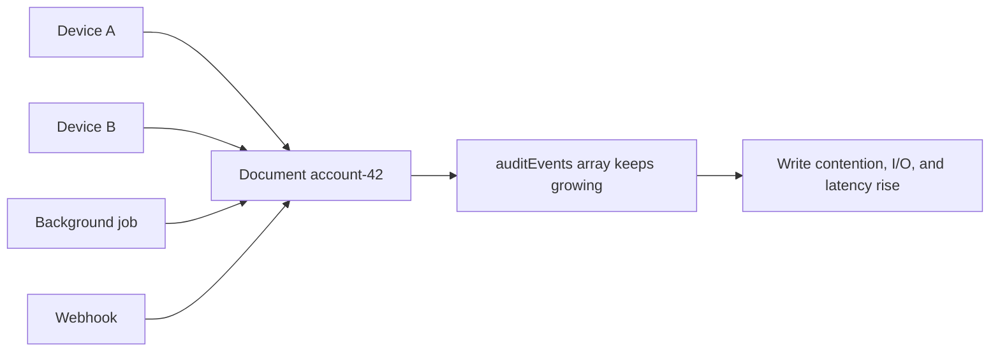
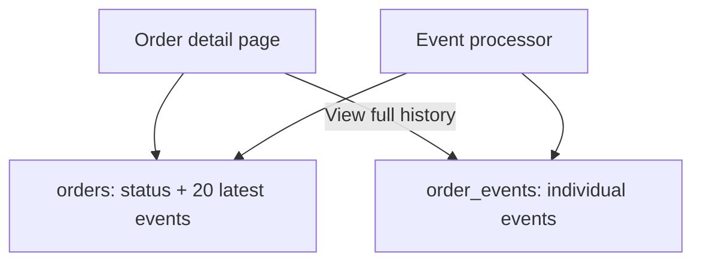

# Unbounded Arrays, Large Documents, and Hot-Document Risks

## 1. Why Is This a Document Design Problem?

MongoDB stores data as BSON documents. When two groups of information are usually read together, **embedding** (nesting objects or child arrays inside a parent document) lets a single query fetch everything and updates multiple fields of the same document atomically. However, this model only stays sustainable when the size and mutation rate of child data are controlled.

Consider an order with an event history:

```json
{
  "_id": "order-123",
  "customerId": "customer-7",
  "status": "SHIPPING",
  "events": [
    {
      "eventId": "evt-001",
      "type": "CREATED",
      "occurredAt": "2026-11-20T08:00:00Z"
    },
    {
      "eventId": "evt-002",
      "type": "PAID",
      "occurredAt": "2026-11-20T08:05:00Z"
    }
  ]
}
```

If the system keeps appending events into `events` via `$push` without any bound, a long-lived or frequently updated order can trigger three problems simultaneously:

1. **Unbounded array:** the element count has no enforced maximum threshold.
2. **Oversized document:** the BSON document holds the entire array alongside other fields; eventually it hits the size limit, slowing reads/writes and complicating operations.
3. **Hot document:** many concurrent requests modify *one document*, causing write contention and concentrating load on a single storage location even in a multi-node cluster.

In **SPRING_DATA_MONGODB**, this risk applies equally to `MongoTemplate`, `MongoRepository`, `ReactiveMongoTemplate`, and reactive repositories. Reactive access improves I/O scheduling, but it does not overcome BSON size limits or write contention on a single document. The fix primarily lies in **document design, queries, indexes, and time-oriented storage strategies**.

## 2. BSON Limits and the Consequences of Large Arrays

MongoDB imposes a **16 MiB limit on a single BSON document** (16,777,216 bytes). That limit counts the entire BSON structure—field names, data types, encoding metadata, subdocuments, and array elements—not just the payload fields your application cares about. MongoDB provides **GridFS** for storing large files, but GridFS is not a standard replacement for an event list queried by key and timestamp.

With every new element, document size grows. You can estimate growth to spot risks before deployment:

\[
\text{Daily growth} \approx \text{events per minute}
\times \text{average bytes per event} \times 60 \times 24
\]

For example, if an entity receives **5 events/minute** at roughly **512 BSON bytes** each, data grows by around **3.5 MiB/day**. Even ignoring other fields, this design approaches 16 MiB within a few days. Actual numbers depend on the payload and BSON encoding overhead; the point of the calculation is recognizing that arrays require an explicit bounding policy upfront.

Beyond failing at the hard ceiling, large documents incur ongoing costs:

| Impact | Explanation |
| --- | --- |
| Over-reading data | If the app fetches the whole document just to display `status`, it may pull a huge history along with it. Projections reduce bytes returned, but do not fix the write layout. |
| Increasingly expensive writes | Appending to large arrays can increase storage work, storage-engine version management, and replication traffic; exact impact depends on the update pattern and engine. |
| Network and memory pressure | Large documents increase network transfer, memory allocation, BSON decoding, and the risk of cache eviction by rarely used history. |
| Multikey indexes | Indexing an array field can generate many index keys per document and raise index maintenance overhead whenever the array changes. |
| Tail latency | A few "outlier" huge documents can degrade p95/p99 latency even if the average document size looks small. |
| Hard limit | Any command pushing BSON past 16 MiB fails; scaling up hardware does not remove this limit. |

**Note:** `$slice` at read time only limits what is returned; it never trims the stored array. You need a write-time cap or a separate storage structure for history.

## 3. What Is a Hot Document and Why Does It Happen?

MongoDB uses document-level concurrency control for normal write operations. Single-document updates are atomic. Yet **atomicity does not mean zero contention**: if hundreds of requests update the same document concurrently, writes still serialize or contend, causing write conflicts, retries, or queuing.

For example, every device on an account writes to:

```javascript
db.accounts.updateOne(
  { _id: "account-42" },
  { $push: { auditEvents: newEvent } }
);
```

All requests target the exact same `_id`. If that account carries heavy traffic, it becomes a hot spot even while most other accounts sit nearly idle. Updates targeting distinct documents can proceed concurrently far more smoothly.



Specifically in **sharded** deployments, multiple shards cannot split one document across shards for parallel updates. Writes to the same document still route to the shard owning that document. Adding shards or switching to a reactive driver does not cure a hot key. To truly distribute writes, split data into **multiple documents with a well-distributed key** and validate against access patterns.

A hot document does not even have to be large: a tiny counter document receiving thousands of `$inc` operations per second can still be a hot spot. Conversely, a huge mostly-read document carries a different risk profile. Measure **document size** and **write concentration** as two separate dimensions.

## 4. Identifying Arrays at Risk of Unbounded Growth

Before embedding, ask:

- How many child elements can a parent accumulate over its full lifetime? Is there a real enforced business cap or just today's assumption?
- How fast do elements arrive? Do specific customers, orders, chat sessions, or devices receive disproportionately high traffic?
- Do users usually read the **entire history** or only the **20–50 most recent items**?
- Do child elements need independent queries by timestamp, status, or author, or paginated history?
- Must events be retained forever for audit, or is there a TTL/retention policy?
- Do concurrent requests frequently append to or modify elements under the same parent key?

Common candidates to scrutinize: post comments, chat messages, audit logs, change histories, sensor readings, view events, notifications, unbounded shopping carts, or ever-growing membership lists.

**Not every array is bad.** Arrays that are small and business-bounded—such as 3–10 shipping addresses, a few roles, or up to 12 fixed specs—embed cleanly. Risk arises when **cardinality and growth rate are left unchecked**, especially when every write hits the same document.

## 5. Alternative Design Strategies

### 5.1. Bounded Array: Keep Only the Latest N Elements

If a screen only ever needs the 50 newest events, store a short array inside the parent document using `$push` combined with `$each` and `$slice`:

```javascript
db.orders.updateOne(
  { _id: "order-123" },
  {
    $push: {
      recentEvents: {
        $each: [
          {
            eventId: "evt-003",
            type: "SHIPPED",
            occurredAt: ISODate("2026-11-20T09:00:00Z")
          }
        ],
        $slice: -50
      }
    }
  }
);
```

`$slice: -50` keeps the **last 50 elements** after appending. When events append in chronological order, this neatly maintains a recent window. If events can arrive late or out of order, consider combining `$sort` with `$each` and `$slice`, defining ordering on `occurredAt` and a tie-breaker explicitly. Test behavior when two events share a timestamp.

Benefits: embedded size stays capped, recent items read fast, and single-document updates remain atomic.

Limits: evicted items are **no longer inside the parent document**; if full history is required, store it elsewhere. A single document can still become a hot spot even with a 50-item array. Never rely on a bounded array alone for mandatory audit logs.

### 5.2. Reference / Child Collection: Each Element Is a Separate Document

For large or paginated histories, keep stable order details in `orders` and events in `order_events`:

```javascript
// orders
{
  _id: "order-123",
  customerId: "customer-7",
  status: "SHIPPING",
  totalEventCount: 120000
}

// order_events: each event is a separate document
{
  _id: "evt-120000",
  orderId: "order-123",
  eventId: "provider-evt-120000",
  type: "SHIPPED",
  occurredAt: ISODate("2026-11-20T09:00:00Z")
}
```

Index for listing the newest events:

```javascript
db.order_events.createIndex({
  orderId: 1,
  occurredAt: -1,
  _id: -1
});

db.order_events.find({ orderId: "order-123" })
  .sort({ occurredAt: -1, _id: -1 })
  .limit(50);
```

Here `orderId` narrows down the event set; `occurredAt` sorts chronologically, and `_id` acts as a tie-breaker for stable ordering. For subsequent pages using a cursor, filter by the last `(occurredAt, _id)` pair from the previous page instead of relying on large `skip` offsets over long histories.

**Trade-offs:** combining order details with history requires a second query or join; writes to two collections are separate operations and not automatically atomic together. If business rules demand updating status and inserting an event atomically, consider a MongoDB transaction on a supported topology with proper error/retry handling. If eventual consistency is acceptable, use events/outbox plus reconciliation.

### 5.3. Subset Pattern: Parent Holds Summary and Latest Slice

A practical hybrid model:

- `orders` stores `status`, `totalEventCount`, and up to 20 `recentEvents` for instant display on the detail page.
- `order_events` stores the **complete** history for pagination, search, and analytics.



This pattern optimizes the common read path while avoiding unbounded embedded history. However, **declare the source of truth**. For instance, `order_events` is the complete history; `recentEvents` is a display copy. If updating the copy fails, the system needs a way to rebuild or resync it from the authoritative source.

Never store two copies and assume they stay in sync without transactions, retries, or reconciliation.

### 5.4. Bucket Pattern: Grouping into Multiple Bounded Documents

For sequential streams like sensor logs, audit events, or session events, group a **bounded number** of entries per bucket:

```json
{
  "_id": "device-9:2026-11-20:bucket-03",
  "deviceId": "device-9",
  "bucketStart": "2026-11-20T00:00:00Z",
  "sequence": 3,
  "count": 200,
  "events": [
    {"at": "2026-11-20T08:00:00Z", "value": 30.2},
    {"at": "2026-11-20T08:00:05Z", "value": 30.4}
  ]
}
```

The snippet illustrates the structure; `count` reflects the bucket's actual element count, not just the two truncated items shown. Once a bucket hits its item count, byte size, or time window threshold, open a new bucket.

Benefits: far fewer documents than one-document-per-event, smaller result sets for range reads, and partitioning a long history. Drawbacks: you must manage bucket boundaries, pagination, and concurrency. Multiple writers hitting the **current open bucket** can still create a hot spot, so high-throughput workloads may shard buckets further using carefully designed time-plus-partition keys.

For pure time-series measurements, also evaluate **MongoDB time series collections** and their feature constraints for your MongoDB version; do not assume you must always hand-roll buckets manually.

### 5.5. Outlier Pattern: Handling Extreme Cases

If 99% of posts have under 100 comments while a few posts receive millions, keep the recent display slice on the main document and overflow full history into a child collection once a threshold is crossed. This handles **outliers**.

Do not choose thresholds based solely on averages; examine `p95`, `p99`, extreme accounts, growth velocity, and write SLAs. Outlier layout transitions must be managed consistently so query logic does not become unpredictable.

### Quick Selection Table

| Pattern | Data size | Common reads | What you must manage |
| --- | --- | --- | --- |
| Business-bounded embed | Small, fixed | Read with parent | Enforcing the real limit |
| Bounded array | Up to N elements | Latest N items | Older items evicted; hot key can still occur |
| Child collection | Large or unbounded history | Paginate, filter, search | Indexes, round trips, syncing with parent |
| Subset + history | Small parent, huge history | Fast summary plus drill-down | Duplicated slice and consistency |
| Bucket | Long sequential streams | Range or batch scans | Bucket size, concurrency, and rollover |
| Outlier pattern | Heavily skewed distribution | Most entities remain small | Threshold rollover and dual read/write paths |

## 6. Implementing with Spring Data MongoDB

### 6.1. Child Document and Repository

For large event histories, create a dedicated collection. Example in imperative Spring Data MongoDB:

```java
import java.time.Instant;
import org.springframework.data.annotation.Id;
import org.springframework.data.mongodb.core.index.CompoundIndex;
import org.springframework.data.mongodb.core.mapping.Document;

@Document(collection = "order_events")
@CompoundIndex(
    name = "by_order_time",
    def = "{'orderId': 1, 'occurredAt': -1, '_id': -1}"
)
public record OrderEvent(
    @Id String id,
    String orderId,
    String eventId,
    String type,
    Instant occurredAt
) {}
```

```java
import java.util.List;
import org.springframework.data.mongodb.repository.MongoRepository;

public interface OrderEventRepository
        extends MongoRepository<OrderEvent, String> {

    List<OrderEvent> findTop50ByOrderIdOrderByOccurredAtDescIdDesc(
        String orderId
    );
}
```

The repository returns up to the 50 newest events for an order. `@CompoundIndex` declares the desired index in mapping metadata; **never assume annotations automatically create indexes in every environment**. Depending on Spring Data/Spring Boot settings, create indexes via migrations, explicit index management, or intentionally enabled auto-index creation. Verify live indexes with `getIndexes()` and `explain()`.

### 6.2. MongoTemplate for Dynamic History Queries

```java
import java.time.Instant;
import java.util.List;
import org.springframework.data.domain.Sort;
import org.springframework.data.mongodb.core.MongoTemplate;
import org.springframework.data.mongodb.core.query.Criteria;
import org.springframework.data.mongodb.core.query.Query;

public class OrderEventQueryService {
    private final MongoTemplate template;

    public OrderEventQueryService(MongoTemplate template) {
        this.template = template;
    }

    public List<OrderEvent> latest(String orderId, Instant since) {
        Query query = Query.query(
            Criteria.where("orderId").is(orderId)
                .and("occurredAt").gte(since)
        );
        query.with(Sort.by(
            Sort.Order.desc("occurredAt"),
            Sort.Order.desc("id")
        ));
        query.limit(50);
        return template.find(query, OrderEvent.class);
    }
}
```

In Spring Data, the Java property `id` maps to `_id`. With reactive MongoDB, collection design and indexes remain identical; swap `MongoTemplate` for `ReactiveMongoTemplate` and `List<OrderEvent>` for `Flux<OrderEvent>`:

```java
// Inside a service injected with ReactiveMongoTemplate reactiveTemplate:
Flux<OrderEvent> events = reactiveTemplate.find(query, OrderEvent.class);
```

Import `reactor.core.publisher.Flux` and consume `Flux` through your reactive pipeline or controller. What changes is the API and stream consumption; **extracting history out of the parent document** is what prevents unbounded arrays.

### 6.3. Bounding the Array Directly in the Update

If you only keep 50 events for display, `MongoTemplate` supports `$push` + `$slice`:

```java
import org.springframework.data.mongodb.core.MongoTemplate;
import org.springframework.data.mongodb.core.query.Criteria;
import org.springframework.data.mongodb.core.query.Query;
import org.springframework.data.mongodb.core.query.Update;

public void addRecentEvent(
        MongoTemplate template, String orderId, OrderEvent event) {

    Query query = Query.query(Criteria.where("_id").is(orderId));
    Update update = new Update();
    var pushBuilder = update.push("recentEvents");
    pushBuilder.slice(-50);
    pushBuilder.each(event);

    template.updateFirst(query, update, "orders");
}
```

The example targets collection `"orders"` and uses `OrderEvent` as the element shape. If you need immutability, exact counts, duplicate prevention, or full history retention, add extra safeguards; `$push` alone does not guarantee idempotency. `$slice` retains the tail of the array in its current order, so "newest" holds only if append order matches business order.

On a single document, the update is atomic. However, writing full events to `order_events` and updating the summary on `orders` are **two separate commands that do not form a transaction automatically**.

## 7. Indexes, Pagination, and Write Scalability

### Indexing the Read Path Properly

Once history is separated, a common query is:

```javascript
db.order_events.find({
  orderId: "order-123",
  occurredAt: { $gte: ISODate("2026-11-01T00:00:00Z") }
})
.sort({ occurredAt: -1, _id: -1 })
.limit(50);
```

An index `{ orderId: 1, occurredAt: -1, _id: -1 }` supports filtering by parent and scanning in chronological order. Still, an index only helps if it matches filters, sorts, selectivity, and workload; inspect the execution plan rather than relying on index names.

For deep pagination, `skip(100000)` forces the server to walk past many records. Keyset/cursor pagination can use the last `(occurredAt, _id)` pair from the previous page:

```javascript
const lastTime = ISODate("2026-11-19T10:00:00Z");
const lastId = "evt-050000";

db.order_events.find({
  orderId: "order-123",
  $or: [
    { occurredAt: { $lt: lastTime } },
    { occurredAt: lastTime, _id: { $lt: lastId } }
  ]
})
.sort({ occurredAt: -1, _id: -1 })
.limit(50);
```

This assumes `_id` is stored as a string matching `lastId`. Conditions must align with sort direction and the actual stored BSON types; mixing `ObjectId` and `String` breaks cursor comparisons.

### Avoid Indexing Huge Arrays Unnecessarily

An index on `events.type` where `events` is an array creates a multikey index. Large arrays mean maintaining many index keys per document and running into compound multikey index constraints (such as limits on parallel array fields). When queries primarily inspect individual events, a child collection indexed by `orderId`, timestamp, and event fields is much cleaner and more flexible.

### Shard Key Considerations

Splitting into many documents **does not guarantee** writes spread evenly for a hot parent. For instance, choosing a shard key of just `orderId` still routes all events for one order to a single shard. When write throughput for a single `orderId` is extreme, evaluate key distribution, time bucketing, or a compound partition component, balanced against `orderId` query efficiency. Shard key selection depends on real workload and MongoDB version capabilities, not a one-size-fits-all formula.

## 8. Measuring and Diagnosing Issues

### 8.1. Finding Large Documents and Long Arrays

The following aggregation finds documents with the largest `recentEvents` arrays in `orders`:

```javascript
db.orders.aggregate([
  { $match: { recentEvents: { $type: "array" } } },
  {
    $project: {
      sizeBytes: { $bsonSize: "$$ROOT" },
      eventCount: { $size: "$recentEvents" }
    }
  },
  { $sort: { sizeBytes: -1 } },
  { $limit: 20 }
]);
```

`$bsonSize` measures the BSON byte size of the current document. On large collections, this aggregation can be resource-intensive because it reads many documents; consider sampling, running off-peak, and narrowing the match criteria.

You can also find documents with at least 1,000 elements (checking index 999, zero-based):

```javascript
db.orders.find(
  { "recentEvents.999": { $exists: true } },
  { _id: 1, status: 1 }
);
```

This query is a diagnostic check, not a substitute for measuring BSON size, and may scan many documents without a supporting index.

### 8.2. Monitoring Hot-Document Symptoms

Observe these signals together:

| Signal | How to check |
| --- | --- |
| Rising p95/p99 update latency | APM/tracing grouped by operation name and `orderId`, correlated with load |
| Heavy updates hitting few parent keys | Controlled request logging aggregated by `_id` / business key |
| Rising write conflicts or retries | Server/driver metrics, profiler, and slow-operation logs |
| Growing document sizes | Sampled `$bsonSize` measuring median and tail percentiles |
| Index/I/O saturation | `explain("executionStats")`, index usage, cache, disk, network, connection pool |
| Element-append failures | Command/driver error monitoring, including BSON size limit errors |

Never diagnose "hot document" from a high CPU chart alone. Correlate **keys receiving heavy writes**, concurrent update counts, write conflicts/latency, and document size. A missing index slows queries, but does not produce the same single-document update contention signature.

### 8.3. Controlled Load Testing

Create at least three scenarios:

1. **Many keys:** 10,000 updates distributed across 10,000 documents.
2. **One hot key:** 10,000 updates concentrated on one document.
3. **Child documents:** 10,000 events written as separate documents with appropriate indexes and shard keys.

Measure throughput, p50/p95/p99 latency, write conflicts, storage usage, and CPU/I/O load. Keep cluster configuration, driver settings, write concern, and payload sizes constant. Results reveal whether the bottleneck is the data model or the infrastructure.

## 9. Consistency and Preventing Duplicate Writes

Moving an array to another collection keeps the parent small, but introduces new requirements:

- **Idempotency:** requests may retry after timeouts or network glitches. Each event needs a stable `eventId`; a unique index on the business key (such as `{ orderId: 1, eventId: 1 }`) prevents duplicate history entries.
- **Ordering:** timestamps are not unique when two events occur concurrently. Use a `(timestamp, uniqueKey)` pair or an assigned sequence under an appropriate design. Caution: a centralized sequence counter can itself become a hot document.
- **Atomicity:** updating parent status and inserting a child event touch two documents, requiring a transaction if cross-document invariants must hold; transactions add overhead and require a supported topology. If eventual consistency is acceptable, design retries and reconciliation explicitly.
- **Retention:** a TTL index can expire old event documents in a separate collection; TTL cannot automatically trim elements inside a parent document's array.
- **Deletion and privacy:** deleting a parent does not cascade like an RDBMS foreign key. Implement policy-driven deletion/updates and consistent recovery.

Example unique index to prevent duplicate insertion of the same event in `order_events`:

```javascript
db.order_events.createIndex(
  { orderId: 1, eventId: 1 },
  { unique: true }
);
```

This unique index assumes every record has a valid `eventId` per schema. If combining TTL retention or sharding, check compatibility constraints with unique and shard keys in your deployment. A unique index blocks duplicate storage, yet the application must still treat duplicate-key errors as an expected idempotent retry outcome when `eventId` already exists.

## 10. Migrating from a Large Array to a Child Collection

Suppose an existing system already stores long-lived history in `orders.events`. A phased migration can follow these steps:

1. **Audit:** measure BSON sizes, element counts, key distribution, and update rates. Identify which fields are read often and what cap to keep on the parent.
2. **Design the target:** create `order_events`, an event deduplication key, indexes for parent/time queries, and a retention policy.
3. **Batched backfill:** read historical entries, convert them into child documents, and write idempotently. Preserve timestamps, ordering, and original keys; avoid oversized batches.
4. **Keep up with new writes:** use controlled dual writes, events/outbox, or a sync mechanism so no events are dropped during transition. Test partial failure on either side.
5. **Reconcile:** compare counts and event keys (or appropriate checksums), verify queries and pagination, and monitor indexes/latency.
6. **Switch reads:** read full history from the child collection, keeping a small subset on the parent if needed. Handle records whose backfill is not yet complete.
7. **Stop writing the old array, then clean up:** remove/truncate legacy history on the parent only after confirming complete migration and having a recovery plan.

**Never** run one massive update to migrate or shrink every document at once during peak traffic. Test on representative data before each stage and watch replication lag, cache pressure, query latency, and error rates.

## 11. Practice Exercise and Evaluation Criteria

### Exercise

Design an order status tracking service where: the detail page displays the 20 latest events; support staff need the full history; some orders receive thousands of webhooks per hour; and requests may be redelivered.

Tasks:

1. Sketch schemas for `orders` and `order_events`; designate the source of truth and which fields are embedded as a subset.
2. Write the MongoDB command to maintain 20 `recentEvents` via `$push`/`$slice` and the insert command for full events.
3. Propose indexes to fetch 50 events sorted by `occurredAt` descending with stable pagination.
4. Design duplicate-event prevention and how to handle a parent write succeeding while the child write fails (or vice versa).
5. Use `MongoTemplate` or `ReactiveMongoTemplate` to query the event list with a time filter and limit.
6. Benchmark one hot order versus many orders; compare p95/p99 latency and MongoDB metrics.

### Self-Check Questions

- Why can a 1 MiB document receiving thousands of `$inc` operations per second still be a hot document?
- Why do projections and `$slice` on **reads** fail to stop an array in the database from growing?
- When is a bounded array sufficient, and when must you use a child collection or buckets?
- Why does adding shards not necessarily improve throughput when all requests update the same `_id`?
- How does moving history to a separate collection affect atomicity and idempotency requirements?

## Key Takeaway

Embedding works well when related data has bounded size and a shared lifecycle. **Unbounded arrays** both push documents toward the 16 MiB ceiling and inflate I/O, index cost, and latency. **Hot documents** stem from concentrated writes onto a single document—and can happen even when documents are small. In Spring Data MongoDB, the solution is redesigning document boundaries: keep a bounded subset, move history to a child collection, or use buckets appropriately; then verify with indexes, real queries, integration tests, and performance metrics.
