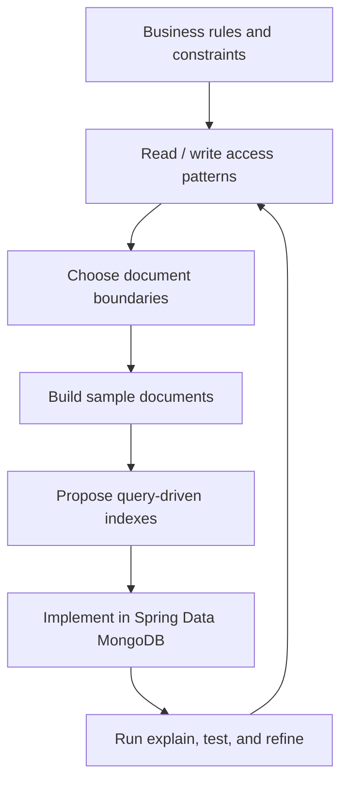

# From Business Requirements to Sample Documents and Candidate Indexes

## 1. Target Outcomes

MongoDB data modeling starts from **business requirements and how the application reads and writes data**, and only then determines document structure and indexes. Two systems both managing orders may require completely different models if one primarily inspects order details while the other mainly aggregates millions of shipping events.

In the **SPRING_DATA_MONGODB** module, Spring Data MongoDB provides `@Document`, Java-to-BSON object mapping, `MongoRepository`, `MongoTemplate`, and APIs for queries, aggregations, indexes, transactions, and reactive access. These tools implement your design; they do not replace requirements analysis prior to schema design.

After this lesson, you will be able to:

1. Translate business requirements into **access patterns**: who queries, what filters apply, how results sort, how much data is returned, and which fields update.
2. Choose embedding or referencing based on lifecycle, cardinality, growth limits, and consistency needs.
3. Design sample documents with explicit BSON types, identifiers, snapshot values, and update boundaries.
4. Propose compound indexes derived from concrete query shapes, including the purpose and cost of each index.
5. Map the model into Spring Data MongoDB and build a verification plan for correctness and performance.

**The deliverable of a reviewable design** is not just sample JSON: it includes a requirements table, query list, sample documents, candidate indexes, rationale, and a plan to validate on representative data.

## 2. Realistic Scenario: Multi-Tenant Order Management

Suppose we are building an order management service for multiple independent stores on a shared platform (multi-tenant). Each store is a tenant. Shoppers place orders; warehouse staff view orders awaiting packing; customers view their placed orders; and the system records processing events.

### 2.1. Business Requirements and Assumptions to Confirm

| Code | Requirement | Design impact |
| --- | --- | --- |
| BR-01 | Within one tenant, `orderNo` must be unique | Needs a unique constraint on `(tenantId, orderNo)` |
| BR-02 | View order details with purchased items and checkout shipping address | Essential details should be readable from one order document |
| BR-03 | Customers view their 20 most recent orders and can paginate further | Needs filtering by `tenantId + customerId` and sorting by time |
| BR-04 | Staff view the 20 newest `READY_TO_SHIP` orders | Needs filtering by `tenantId + status` and sorting by time |
| BR-05 | Order status can transition while verifying current status | Needs atomic conditional update and result checking |
| BR-06 | Event history can grow long and must be viewable per order | Consider a separate collection for continuously growing events |
| BR-07 | Each line item preserves purchase-time name and unit price | Needs snapshots to stay unaffected when the product catalog updates |
| BR-08 | Queries from tenant A must never return tenant B's data | Every business query must include `tenantId` in its criteria |

These are illustrative requirements, not production specs. Before finalizing, clarify: orders per day/tenant, max line items, write rate, retention period, large vs. small tenant distribution, reporting needs, read/write ratio, latency targets, and audit log strictness.

Example **testable assumptions**: a typical order has 1–30 line items and at most 100; event history can grow to thousands of entries over years; the UI fetches 20 orders per page. If these assumptions shift, re-evaluate embedding and index choices.

### 2.2. From Business Statements to Concrete Queries

Instead of writing vaguely "find orders quickly", turn requirements into testable query shapes:

| Access pattern | Filter | Sort / limit | Result |
| --- | --- | --- | --- |
| Q1 — Look up by order number | `tenantId = ?`, `orderNo = ?` | Single document | Order details |
| Q2 — Customer order history | `tenantId = ?`, `customerId = ?` | `placedAt DESC, _id DESC`; 20 | Order list |
| Q3 — Fulfillment queue | `tenantId = ?`, `status = READY_TO_SHIP` | `placedAt DESC, _id DESC`; 20 | Orders awaiting shipment |
| Q4 — Details by ID | `_id = ?`, `tenantId = ?` | Single document | Line items, address, status |
| Q5 — Event stream | `tenantId = ?`, `orderId = ?` | `occurredAt DESC, _id DESC`; 50 | Processing history |
| W1 — Status transition | `tenantId + orderNo + current status` | Update one document | New status, updated timestamp |

These query shapes are the **input for index decisions**, not an afterthought bolted on after code is written. If the app also needs a daily revenue dashboard or full-text search on product names, list those separately because they may require aggregations, summary data, or search indexes distinct from Q1–Q5.

### 2.3. Design Flow



The feedback arrow emphasizes a core truth: schemas and indexes are **measurable design hypotheses**. Neat JSON that fails real queries or write volumes is an unfinished design.

## 3. Choosing Document Boundaries: Embed or Reference?

MongoDB offers nested documents, arrays, and ID-based links. Deciding between embedding and referencing requires examining both **how data is read** and **how data changes**.

### 3.1. Decision Table for the Example

| Data | Approach | Rationale |
| --- | --- | --- |
| Shipping address at placement | Embed in `orders.shippingAddress` | Must be snapshotted and read with the order |
| Purchased line items | Embed `orders.items[]` | Bounded element count, read with the order, totals computed once |
| Purchase-time product name and unit price | Snapshot inside each line item | Catalog may rename or reprice items later |
| Customer account details | Store `customerId` reference | Customer has an independent lifecycle across many orders |
| Live product catalog | Separate `products` collection | Products are edited and reused independently |
| Continuously growing shipping/audit events | Separate `order_events` collection | Count can grow large; paginated per order |

Embedding `items[]` does not preclude referencing `productId`. You can store `productId` to correlate with the catalog while storing `sku`, name, and unit price **at checkout** so order history never mutates when catalog data changes.

### 3.2. Four Questions Before Embedding

1. **Read together?** If nearly every detail screen needs the address and line items, embedding cuts query round trips.
2. **Changed together?** If order and line items must stay consistent in one document update, embedding leverages single-document write atomicity.
3. **Bounded count?** Unbounded arrays bloat documents, inflate multikey index entries, and risk hitting BSON limits.
4. **Shared or independent lifecycle?** Data referenced by many entities or managed independently fits better in its own collection.

MongoDB caps **each BSON document at 16 MiB**. That is a hard technical ceiling, not a target operating size. Small, stable documents are easier to transfer, update, and cache.

There is no rule saying "always embed one-to-many" or "always split relational data". Element counts and query shapes dictate what works.

## 4. Sample Document for the `orders` Collection

### 4.1. Illustrative BSON Record in `mongosh`

```javascript
db.orders.insertOne({
  tenantId: "tenant-acme",
  orderNo: "ORD-2026-00042",
  customerId: "customer-018",
  status: "READY_TO_SHIP",
  placedAt: ISODate("2026-11-18T03:20:00Z"),
  updatedAt: ISODate("2026-11-18T03:30:00Z"),
  currency: "VND",
  totalAmountVnd: NumberLong("530000"),
  shippingAddress: {
    receiverName: "Nguyen A",
    city: "Da Nang",
    district: "Hai Chau",
    addressLine: "12 Sample Street"
  },
  items: [
    {
      lineNo: 1,
      productId: "product-101",
      sku: "BOOK-01",
      productName: "MongoDB Book",
      quantity: 2,
      unitPriceVnd: NumberLong("150000"),
      lineAmountVnd: NumberLong("300000")
    },
    {
      lineNo: 2,
      productId: "product-205",
      sku: "CASE-02",
      productName: "Book Sleeve",
      quantity: 1,
      unitPriceVnd: NumberLong("230000"),
      lineAmountVnd: NumberLong("230000")
    }
  ]
});
```

MongoDB generates `_id` automatically if omitted. Here `placedAt` and `updatedAt` are BSON Dates, while monetary amounts use BSON Int64 via `NumberLong`. For VND in this example, stored values represent **whole dong**. A multi-currency system must standardize smallest-unit rules per currency or use `Decimal128` properly; never add money casually with `double`.

Consistency check on the sample document:

```text
BOOK-01: 2 × 150,000 = 300,000 VND
CASE-02: 1 × 230,000 = 230,000 VND
Total:                 530,000 VND
```

**Snapshots vs. source data:** `customerId` and `productId` are reference IDs for looking up live records. `shippingAddress`, `productName`, and `unitPriceVnd` are transaction snapshots. Under this business rule, updating a product's name or a customer's account address must leave placed orders unchanged.

### 4.2. Field Contract

| Field | BSON type | Requirements and meaning |
| --- | --- | --- |
| `_id` | ObjectId | Document identifier generated by MongoDB |
| `tenantId` | String | Mandatory in business queries for tenant isolation |
| `orderNo` | String | Unique **within a tenant**, not required to be globally unique |
| `customerId` | String | Reference to customer |
| `status` | String / defined enum | Status governed by business state machine |
| `placedAt` | Date | Order creation timestamp in UTC |
| `updatedAt` | Date | Most recent modification timestamp |
| `currency` | String | Currency code (`VND` in this example) |
| `totalAmountVnd` | Int64 | Total of the order snapshot, including taxes/fees if required |
| `shippingAddress` | Embedded document | Shipping address snapshot |
| `items[]` | Array of embedded documents | Bounded line items; minimum one line per business rules |

Additional constraints to clarify before implementation: maximum line count, positive quantity per line, unique `lineNo` within an order, allowed status transitions, rounding rules, shipping/discount handling, display timezones, and personal data protection policies.

Do not confuse `@Document` object mapping with **validation**: combine API/service checks, Bean Validation, and MongoDB JSON Schema validators to guard against invalid documents from multiple writers.

## 5. Collection for Unbounded Event Growth

To satisfy BR-06, store each event in `order_events` instead of appending endlessly to an unbounded array inside the order:

```javascript
db.order_events.insertOne({
  tenantId: "tenant-acme",
  orderId: ObjectId("6732c8db5b9b6d0a9a61a111"),
  eventType: "READY_TO_SHIP",
  occurredAt: ISODate("2026-11-18T03:30:00Z"),
  actorType: "SYSTEM",
  detail: {
    previousStatus: "PAID",
    newStatus: "READY_TO_SHIP"
  }
});
```

The `orderId` shown here is an **illustrative ID** and must be replaced with an order's actual `_id` when testing. Store `orderId` using the exact same BSON `ObjectId` type as `orders._id` to avoid query mismatches from type drift.

Querying history:

```javascript
db.order_events.find({
  tenantId: "tenant-acme",
  orderId: ObjectId("6732c8db5b9b6d0a9a61a111")
})
  .sort({ occurredAt: -1, _id: -1 })
  .limit(50);
```

Separating the collection simplifies pagination, retention, and event lifecycle management. In exchange, if business rules require **updating order status and writing the event to succeed or fail together**, writing two documents may require a transaction or an equivalent reliable pattern such as a transactional outbox with idempotent handling. Do not assume cross-document atomicity from single-write atomicity.

## 6. Designing Candidate Indexes from Queries

### 6.1. Mapping Requirements to Indexes

A useful index serves an important query shape. Field order inside a compound index matters:

| Proposed index | Serves | Why fields are ordered this way |
| --- | --- | --- |
| `{ tenantId: 1, orderNo: 1 }` **unique** | Q1, W1 | Two equality predicates; enforces uniqueness per tenant |
| `{ tenantId: 1, customerId: 1, placedAt: -1, _id: -1 }` | Q2 | Equality on `tenantId, customerId`; returns newest orders with tie-breaker |
| `{ tenantId: 1, status: 1, placedAt: -1, _id: -1 }` | Q3 | Equality on `tenantId, status`; fetches ordered queue |
| Default `_id` index | Q4 | Exact ID lookup, still verifying `tenantId` |
| `{ tenantId: 1, orderId: 1, occurredAt: -1, _id: -1 }` on `order_events` | Q5 | Filters events by order and sorts newest first |

For compound indexes, a helpful guideline is placing **equality** fields first, followed by **sort** and **range** fields depending on query shape (often called ESR). However, that is a planning heuristic, not a guarantee that the planner picks the index. Verify with real queries and `explain`.

For Q2 and Q3, `_id` acts as a tie-breaker so sort order stays stable when two orders share `placedAt`. It also supports cursor pagination. The default `_id` index alone cannot replace compound indexes for filtering thousands of orders by tenant/status and sorting efficiently.

### 6.2. Index Creation Commands in `mongosh`

```javascript
// BR-01, Q1: a tenant cannot have two orders with the same orderNo.
db.orders.createIndex(
  { tenantId: 1, orderNo: 1 },
  { unique: true, name: "uq_orders_tenant_orderNo" }
);

// Q2: 20 most recent orders for a customer in a tenant.
db.orders.createIndex(
  { tenantId: 1, customerId: 1, placedAt: -1, _id: -1 },
  { name: "ix_orders_tenant_customer_recent" }
);

// Q3: status-based fulfillment queue.
db.orders.createIndex(
  { tenantId: 1, status: 1, placedAt: -1, _id: -1 },
  { name: "ix_orders_tenant_status_recent" }
);

// Q5: per-order event log, newest first.
db.order_events.createIndex(
  { tenantId: 1, orderId: 1, occurredAt: -1, _id: -1 },
  { name: "ix_order_events_tenant_order_recent" }
);
```

This is a **candidate list**, not an instruction to create all four blindly in every system. Confirm that these screens exist, check usage frequency, and check whether indexes can be shared. Every index consumes disk space, RAM, and write maintenance effort.

If the collection already holds duplicate `(tenantId, orderNo)` pairs, creating the unique index fails; detect and clean up duplicates before deploying. When sharding is involved, review both the shard key and unique-index constraints; never copy an unsharded index design into a sharded collection without checking compatibility.

### 6.3. Demonstrating Indexes Align with Query Shapes

```javascript
// Q1
db.orders.findOne({
  tenantId: "tenant-acme",
  orderNo: "ORD-2026-00042"
});

// Q2
db.orders.find({
  tenantId: "tenant-acme",
  customerId: "customer-018"
})
  .sort({ placedAt: -1, _id: -1 })
  .limit(20);

// Q3
db.orders.find({
  tenantId: "tenant-acme",
  status: "READY_TO_SHIP"
})
  .sort({ placedAt: -1, _id: -1 })
  .limit(20);
```

Q1 uses the unique compound index for fast lookup and per-tenant `orderNo` uniqueness. Q2 and Q3 match the equality prefix of their respective indexes followed by the exact sort order, providing a solid basis to avoid large in-memory sorts.

Note: tenant isolation is **not enforced merely by placing `tenantId` in an index**. Query code, API authorization checks, and tests must always bind the caller's tenant. A query filtering only by `orderNo` both misses the tenant-scoped unique index and risks cross-tenant data leaks.

### 6.4. When to Propose Another Index?

If a new requirement asks to "view all recent orders across a tenant regardless of status or customer", the Q2/Q3 indexes do not naturally serve that sort efficiently. You might consider:

```javascript
db.orders.createIndex(
  { tenantId: 1, placedAt: -1, _id: -1 },
  { name: "ix_orders_tenant_recent" }
);
```

Add it only if that query shape is genuinely important, carries substantial traffic, and measurements prove existing indexes fall short. Likewise, filtering by `items.sku` creates a **multikey index** with one entry per array element, which is unnecessary unless the app actually queries orders by SKU.

**Never index every field just because it appears in the schema.** Invest in frequent, critical queries and weigh read gains against write costs.

## 7. From Sample Document to Spring Data MongoDB

### 7.1. Mapping the Document to Java

The example below illustrates Java 17+ using `record`, `@Document`, and `@Id`. Helper records sit in the same package for brevity:

```java
import java.time.Instant;
import java.util.List;
import org.bson.types.ObjectId;
import org.springframework.data.annotation.Id;
import org.springframework.data.mongodb.core.mapping.Document;

@Document(collection = "orders")
public record OrderDocument(
    @Id ObjectId id,
    String tenantId,
    String orderNo,
    String customerId,
    String status,
    Instant placedAt,
    Instant updatedAt,
    String currency,
    long totalAmountVnd,
    ShippingAddress shippingAddress,
    List<OrderLine> items
) {}

record ShippingAddress(
    String receiverName,
    String city,
    String district,
    String addressLine
) {}

record OrderLine(
    int lineNo,
    String productId,
    String sku,
    String productName,
    int quantity,
    long unitPriceVnd,
    long lineAmountVnd
) {}
```

With this mapping, `shippingAddress` maps as an embedded document, `items` as a BSON array, and `Instant` represents timestamps (typically persisted as BSON Date through standard converters). Using `ObjectId` for IDs keeps types aligned with `order_events.orderId`. If you rename physical BSON fields with `@Field`, verify the impact on queries and indexes.

This is a minimal educational model: a production service also requires validation, monetary invariant enforcement, status update policies, auditing, and potentially a version field.

### 7.2. Repository for Lookup Queries

```java
import java.util.Optional;
import org.bson.types.ObjectId;
import org.springframework.data.domain.Page;
import org.springframework.data.domain.Pageable;
import org.springframework.data.mongodb.repository.MongoRepository;

public interface OrderRepository
    extends MongoRepository<OrderDocument, ObjectId> {

    Optional<OrderDocument> findByTenantIdAndOrderNo(
        String tenantId,
        String orderNo
    );

    Page<OrderDocument> findByTenantIdAndCustomerId(
        String tenantId,
        String customerId,
        Pageable pageable
    );
}
```

Example repository call:

```java
import org.springframework.data.domain.PageRequest;
import org.springframework.data.domain.Sort;

PageRequest firstPage = PageRequest.of(
    0,
    20,
    Sort.by(Sort.Order.desc("placedAt"), Sort.Order.desc("id"))
);

var orders = orderRepository.findByTenantIdAndCustomerId(
    "tenant-acme",
    "customer-018",
    firstPage
);
```

This snippet assumes an injected `orderRepository`. Using `Page` can trigger a total-count query; if the UI only needs a "load more" button or does not require total page counts, consider `Slice` or cursor pagination to avoid count overhead on large datasets.

### 7.3. `MongoTemplate` for Specific Query Shapes and Updates

```java
import java.time.Instant;
import java.util.List;
import org.springframework.data.domain.Sort;
import org.springframework.data.mongodb.core.MongoTemplate;
import org.springframework.data.mongodb.core.query.Criteria;
import org.springframework.data.mongodb.core.query.Query;
import org.springframework.data.mongodb.core.query.Update;

public class OrderService {
    private final MongoTemplate mongoTemplate;

    public OrderService(MongoTemplate mongoTemplate) {
        this.mongoTemplate = mongoTemplate;
    }

    public List<OrderDocument> readyToShip(String tenantId) {
        Query query = Query.query(
            Criteria.where("tenantId").is(tenantId)
                .and("status").is("READY_TO_SHIP")
        );
        query.with(Sort.by(
            Sort.Order.desc("placedAt"),
            Sort.Order.desc("id")
        ));
        query.limit(20);
        return mongoTemplate.find(query, OrderDocument.class);
    }

    public boolean markShipped(String tenantId, String orderNo) {
        Query query = Query.query(
            Criteria.where("tenantId").is(tenantId)
                .and("orderNo").is(orderNo)
                .and("status").is("READY_TO_SHIP")
        );
        Update update = new Update()
            .set("status", "SHIPPED")
            .set("updatedAt", Instant.now());

        return mongoTemplate.updateFirst(
            query, update, OrderDocument.class
        ).getModifiedCount() == 1;
    }
}
```

`markShipped` checks the current status in the same update operation to prevent two threads from blindly advancing status concurrently. Returning `false` has several possible causes—order not found, wrong tenant, or status already changed—so handle and distinguish them appropriately if the API requires it. Never blindly retry every failure without checking idempotency.

**Atomicity:** updating a single `orders` document is atomic. If you must simultaneously write `order_events` or deduct stock in another collection with all-or-nothing guarantees, evaluate multi-document transactions along with their deployment requirements (such as a MongoDB replica set or sharded cluster) and overhead. Reactive MongoDB changes asynchronous I/O execution without altering document/index design or transaction scope.

### 7.4. Managing Indexes from Spring Data

Indexes can be created via operational migrations or Spring Data `IndexOperations`. Example initializing the Q3 index:

```java
import org.springframework.data.domain.Sort;
import org.springframework.data.mongodb.core.MongoTemplate;
import org.springframework.data.mongodb.core.index.Index;

public void ensureShippingQueueIndex(MongoTemplate template) {
    Index index = new Index()
        .on("tenantId", Sort.Direction.ASC)
        .on("status", Sort.Direction.ASC)
        .on("placedAt", Sort.Direction.DESC)
        .on("_id", Sort.Direction.DESC)
        .named("ix_orders_tenant_status_recent");

    template.indexOps(OrderDocument.class).ensureIndex(index);
}
```

This is an **illustrative method snippet** to place inside an appropriate class. In real projects, specify how indexes and schema versions are managed: deploy via controlled migrations, verify existing indexes before creating, watch out for duplicate records when adding unique indexes, and account for build cost on large collections. Never assume annotations alone will automatically create every index in production.

## 8. Data Consistency and Transaction Boundaries

Document design is simultaneously **atomicity boundary** design. For orders:

- Updating status, `updatedAt`, or multiple fields on the same document can happen in one atomic command.
- Storing the shipping address snapshot and line items on the order keeps a transaction snapshot inside one document.
- Deducting inventory in `inventory` or writing `order_events` modifies other documents; enforcing atomicity across those documents requires a matching mechanism.
- Catalog price updates **must never** leak into finalized order snapshots.

An example valid state flow might look like:

```text
NEW -> PAID -> READY_TO_SHIP -> SHIPPED -> DELIVERED
  \-> CANCELLED
```

This is only an illustrative state machine; business rules must define from which states cancellation is permitted, how refunds operate, and which events are emitted. State-transition queries must validate the prior status. If multiple actors edit different attributes, you can add `@Version` for optimistic locking during entity saves—and keep direct `MongoTemplate` updates aligned so they do not bypass concurrency rules.

Under strict audit requirements, you cannot simply insert an event after updating an order and treat both writes as one transaction. Explicitly choose between transactions, an outbox, or acceptable eventual consistency with duplicate-event prevention/detection.

## 9. Diagnosing Indexes with `explain` and Representative Data

An index is a hypothesis about the execution plan. To verify Q3, run:

```javascript
db.orders.find({
  tenantId: "tenant-acme",
  status: "READY_TO_SHIP"
})
  .sort({ placedAt: -1, _id: -1 })
  .limit(20)
  .explain("executionStats");
```

Inspect these signals:

| Signal | How to interpret |
| --- | --- |
| `winningPlan`, `IXSCAN` / `COLLSCAN` | Is an index used, or is it scanning the collection? |
| `indexName` in plan | Which index was selected? |
| `executionStats.nReturned` | Number of documents returned |
| `totalKeysExamined` | Number of index keys scanned |
| `totalDocsExamined` | Number of documents inspected |
| `SORT` stage and resource usage | Is there an extra blocking sort, or did the index supply the order? |
| `executionTimeMillis` | Reference timing; measure repeatedly under representative load and environment |

There is no universal ratio like "`totalDocsExamined` must always equal `nReturned`" for every query. Complex filters, pagination, projections, or planner choices can require examining more documents than returned. Evaluate numbers against the query shape and dataset scale.

**Realistic tests should include hard cases**, not just a handful of sample records:

1. Large tenants and small tenants, common statuses and rare statuses.
2. Multiple orders sharing the exact same `placedAt` to verify stable sorting via `_id`.
3. Growing order counts, many line items, and many events; measure document size and write speed impact.
4. Concurrent status transitions, retried commands, missing orders, and cross-tenant attempts.
5. Duplicate `orderNo` within one tenant must be rejected; the same `orderNo` in another tenant must succeed.

For deep pagination, large `skip` values waste work walking past skipped documents. Switch to **keyset/cursor pagination** using `(placedAt, _id)`: the next page fetches records older than the cursor, or matching timestamp with a smaller `_id`. Write and test that query directly against the chosen index.

## 10. Common Pitfalls

| Hasty decision | Problem | How to fix |
| --- | --- | --- |
| Embedding all events in an order array | Unbounded array growth; huge documents and update cost | Use a separate event collection indexed by `orderId` and time |
| Storing only `productId` in line items | Catalog title/price changes erase purchase-time history | Snapshot name, unit price, and quantity on the order |
| Indexing only `status` | Fails to leverage tenant filter and timestamp sort | Derive compound index from Q3 |
| Indexing every field | High write, memory, and storage costs | Prioritize actual query shapes |
| Globally unique `orderNo` | BR-01 only requires uniqueness per tenant | Use unique compound index `(tenantId, orderNo)` |
| Omitting `tenantId` from queries | Risks leaking data across tenants | Mandate tenant filters in queries and service authorization |
| Storing money as `double` | Floating-point arithmetic rounding errors | Store integer minor units or `Decimal128` |
| Querying fine on a few documents | Hides missing indexes or giant sorts under real scale | Seed representative data, run `explain`, and benchmark |
| Updating status via read-then-overwrite | Can clobber concurrent updates from other flows | Use conditional updates or optimistic locking |

## 11. Practice Walkthrough: Adding a New Requirement

**New requirement:** Staff want to "view the 30 most recent `CANCELLED` orders in a tenant, limited to orders canceled since the start of the month."

**Step 1 — Write the query shape.** Equality on tenant and status, range on `placedAt` (temporarily assuming business means *order placement date*, not *cancellation date*), sorted descending by `placedAt`:

```javascript
const monthStart = ISODate("2026-11-01T00:00:00Z");

db.orders.find({
  tenantId: "tenant-acme",
  status: "CANCELLED",
  placedAt: { $gte: monthStart }
})
  .sort({ placedAt: -1, _id: -1 })
  .limit(30);
```

**Step 2 — Evaluate indexes.** Q3's index `{ tenantId: 1, status: 1, placedAt: -1, _id: -1 }` already orders fields to filter both equality fields, scan the range on `placedAt`, and satisfy the sort. So **no new index is needed yet before measuring**.

**Step 3 — Re-check semantics.** If "canceled since the start of the month" means **cancellation timestamp**, `placedAt` is wrong. Add `cancelledAt`, rewrite the query, and consider an index involving `cancelledAt` if frequency and latency justify it.

**Step 4 — Verify.** Test two orders placed on the same day but canceled on different days; compare results with business definitions. Run `explain("executionStats")` and test on a large tenant dataset.

This walkthrough shows how one small question about timestamp semantics directly affects **schema fields, queries, and indexes**. Writing code quickly cannot fix a misunderstood requirement.

## 12. Design Deliverable Template

When wrapping up a new document design, the team can record:

| Section | Required contents |
| --- | --- |
| Business context | User stories, data invariants, size caps, latency targets |
| Access patterns | Query shapes, sorts, limits, projections, relative frequencies |
| Document boundaries | Which entities embed vs. reference, rationale, and growth limits |
| Sample documents | Sample BSON/JSON, required fields, timestamp and money types |
| Candidate indexes | Collection, key pattern, unique/partial options, queries served |
| Consistency | Atomic boundaries, conditional updates, transactions or eventual consistency |
| Implementation | Spring Data mappings, repositories/`MongoTemplate`, index migrations, validation |
| Evidence | Functional tests, `explain` output, benchmarks on representative data |
| Open risks | Unknown real traffic, new reporting/search needs, data growth |

### Things to Remember

- Start from **how users read and write data**, not from Java class diagrams or field lists.
- Embed data read and mutated together when size is bounded; separate independent or continuously growing data.
- Sample documents must make data types, historical snapshots, invariants, and atomic boundaries explicit.
- Every candidate index must tie to a concrete query shape. In compound indexes, align field order with equality, sort, and range.
- Connect the design to `MongoRepository`, `MongoTemplate`, and an index rollout plan, then **verify with tests and `explain`**.
