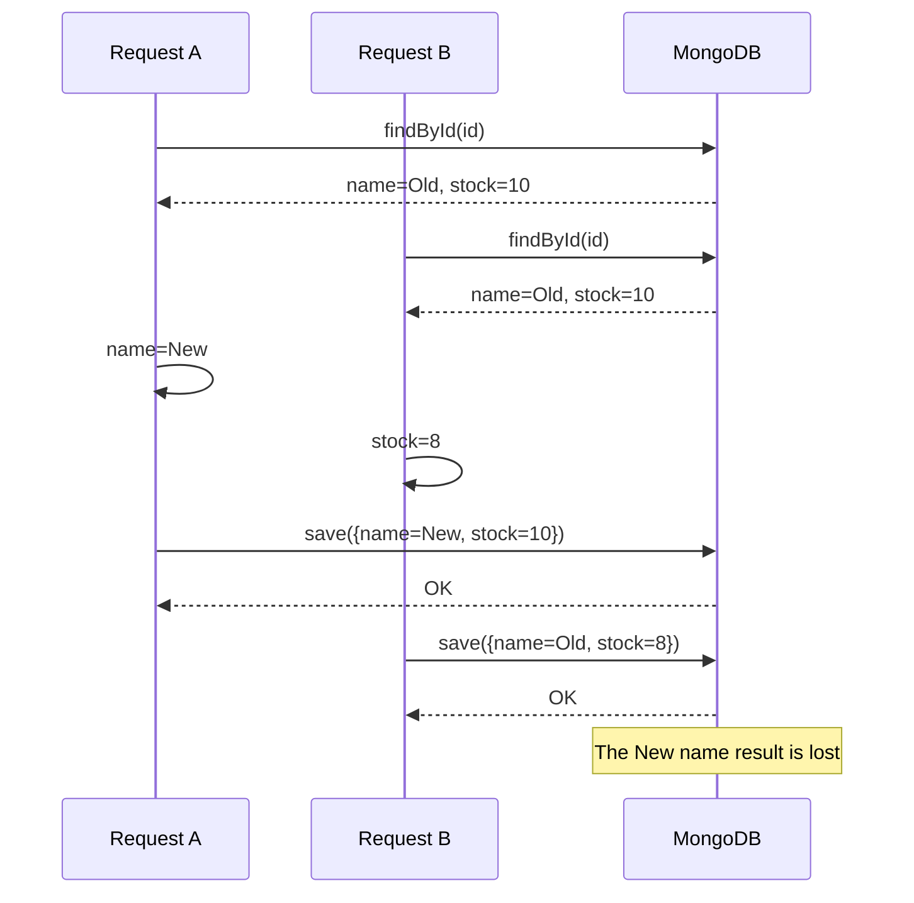
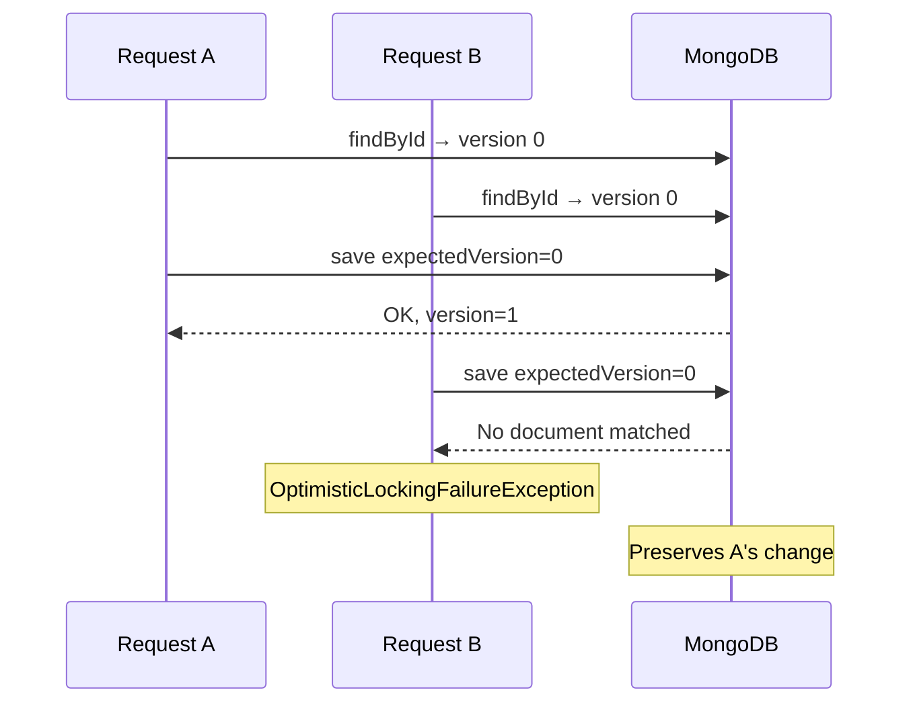

# Lost update when multiple requests save the same document concurrently

In **Spring Data MongoDB**, a document can be read by multiple HTTP requests, background jobs, or consumers at the same time. If two threads both read **the same stale version**, modify the entity independently in memory, and then call `save(...)`, the later write operation can **overwrite the valid change from the earlier operation**. That phenomenon is called a **lost update**.

MongoDB guarantees that **a single write operation on a single document is atomic**, but that **does not guarantee** that a sequence of *read → compute in Java → write back the entire document* is atomic. This is a core distinction to grasp when using `MongoRepository` or `MongoTemplate` in a multi-user application.

This lesson belongs to the **Concurrency Control** chapter of the **SPRING_DATA_MONGODB** module: connecting and mapping documents, operating on MongoDB via `MongoTemplate` or repositories, designing queries and indexes, transactions, reactive access, testing, and performance diagnostics. We will reproduce a lost update, compare three mitigation strategies (`@Version`, atomic updates, and compare-and-set), examine transactions/retries, and build integration tests to verify behavior against real MongoDB.

## 1. A very common example: editing a name and decrementing stock

Suppose the `inventory_items` collection has a product:

```javascript
{
  _id: ObjectId("674000000000000000003001"),
  tenant_id: "T1",
  sku: "KB-01",
  display_name: "Mechanical Keyboard",
  stock: 10
}
```

Two independent requests run almost simultaneously:

- **Request A**: a staff member updates `display_name` to `"Mechanical Keyboard Pro"`.
- **Request B**: the system records a stock outbound of 2 items, so it wants `stock=8`.

Both read the original record before the other saves. Each side holds a **different Java object** representing the same initial MongoDB document.

```text
Time        Request A (rename)             Request B (stock outbound)
---------   ----------------------------   ---------------------------
t0          Read name="Mechanical Keyboard" Read name="Mechanical Keyboard"
            stock=10                       stock=10
t1          Set name="... Pro"             Compute stock = 10 - 2 = 8
t2          save(A)                        ...
            DB: name="... Pro", stock=10
t3          ...                            save(B)
                                           DB: name="Mechanical Keyboard", stock=8
t4          A's new name has been overwritten!
```

Both individual `save` operations can succeed. **No exception** reports that A just lost its result because B wrote the stale entity. The final state depends on the actual write order.



This is not because MongoDB executed *half of A's save* and then *half of B's save*. Each write remains atomic at the document level; it is the **stale copy of data** written back by B that replaced the part A had just updated.

## 2. How lost update differs from dirty read and write conflict

These terms describe different failures:

| Term | Meaning | Relation to the example |
| --- | --- | --- |
| **Lost update** | A committed change is overwritten by another change based on stale data | A's new name disappears after `save(B)` |
| Dirty read | Reading uncommitted data from another transaction | Not the issue in the example |
| Write conflict | The server detects two operations cannot proceed together under transaction semantics and may require abort/retry | Can occur in a MongoDB transaction |
| Stale object | A Java entity read earlier that is outdated compared to the DB | B is stale once A has saved |
| Optimistic locking failure | An operation checks that the version no longer matches; the framework reports a conflict | `@Version` can be used to detect this |
| Duplicate business operation | The same request is processed multiple times, e.g., deducting stock twice | Requires idempotency; not strictly a lost update |

**A database-level successful operation is not always equivalent to business-level success.** When deciding whether to return 200, 409, or retry, the service needs to understand whether the executed write preserved the condition the user intended.

## 3. Why doesn't single-document atomicity automatically protect read-modify-write?

In MongoDB, commands such as:

```javascript
db.inventory_items.updateOne(
  { _id: ObjectId("674000000000000000003001") },
  { $set: { display_name: "Mechanical Keyboard Pro" } }
);
```

are atomic for **one document**. Another command:

```javascript
db.inventory_items.updateOne(
  { _id: ObjectId("674000000000000000003001") },
  { $inc: { stock: -2 } }
);
```

is also atomic. If two commands only modify **two independent fields** as above, they have no need to overwrite the entire document and can preserve both changes.

However, the following Java sequence **is not a single MongoDB atomic operation**:

```java
InventoryItem item = repository.findById(id).orElseThrow();
item.setStock(item.getStock() - 2);
repository.save(item);
```

Between `findById` and `save`, another request can modify the document. MongoDB cannot infer that Java only intended to change `stock` while the `item` object still carries the old `displayName`. Depending on the persistence mechanism, `save` on an existing entity can write back the entire mapped document, causing a lost update on fields not intentionally modified.

**Do not use `synchronized` on a single service instance to solve a distributed scenario:** multiple JVM replicas, background consumers, or admin scripts can still write to the same MongoDB document. In-process locking only controls threads within that single process.

## 4. Sample entity without version: the bug lies in read then save

We start with an entity **without `@Version`**:

```java
import org.bson.types.ObjectId;
import org.springframework.data.annotation.Id;
import org.springframework.data.mongodb.core.mapping.Document;
import org.springframework.data.mongodb.core.mapping.Field;

@Document("inventory_items_unversioned")
public class UnversionedItem {
    @Id
    private ObjectId id;

    @Field("tenant_id")
    private String tenantId;

    private String sku;

    @Field("display_name")
    private String displayName;

    private int stock;

    public UnversionedItem() {}

    public UnversionedItem(
            ObjectId id, String tenantId, String sku,
            String displayName, int stock) {
        this.id = id;
        this.tenantId = tenantId;
        this.sku = sku;
        this.displayName = displayName;
        this.stock = stock;
    }

    public ObjectId getId() { return id; }
    public String getTenantId() { return tenantId; }
    public String getSku() { return sku; }
    public String getDisplayName() { return displayName; }
    public int getStock() { return stock; }
    public void setDisplayName(String value) { displayName = value; }
    public void setStock(int value) { stock = value; }
}
```

Repository:

```java
import org.bson.types.ObjectId;
import org.springframework.data.mongodb.repository.MongoRepository;

public interface UnversionedItemRepository
        extends MongoRepository<UnversionedItem, ObjectId> {
}
```

A deterministic reproduction example, without needing to run two real threads:

```java
ObjectId id = new ObjectId();
repository.save(new UnversionedItem(
    id, "T1", "KB-01", "Mechanical Keyboard", 10
));

// Two identical snapshots, like two requests reading concurrently.
UnversionedItem fromA = repository.findById(id).orElseThrow();
UnversionedItem fromB = repository.findById(id).orElseThrow();

// A only wants to rename.
fromA.setDisplayName("Mechanical Keyboard Pro");
repository.save(fromA);

// B only wants to deduct stock, but saves the entire stale entity again.
fromB.setStock(8);
repository.save(fromB);

// May read displayName reverted back to "Mechanical Keyboard".
```

This is a **last write wins** scenario, not optimistic concurrency control. Reversing the save order would make request B the one overwritten.

**Note:** `MongoRepository.save(...)` can perform an insert/update/replace depending on entity state, ID type, version, and framework version. The risk here is **writing stale state across multiple fields**, not relying on a single internal command choice.

## 5. Solution 1 — @Version to detect concurrent modifications

Spring Data MongoDB supports **optimistic locking** via `@Version`. The entity holds a version field, and supported save paths will **match the current version** against the version of the object that was read.

```java
import org.bson.types.ObjectId;
import org.springframework.data.annotation.Id;
import org.springframework.data.annotation.Version;
import org.springframework.data.mongodb.core.mapping.Document;
import org.springframework.data.mongodb.core.mapping.Field;

@Document("inventory_items")
public class InventoryItem {
    @Id
    private ObjectId id;

    @Field("tenant_id")
    private String tenantId;

    private String sku;

    @Field("display_name")
    private String displayName;

    private int stock;

    @Version
    private Long version;

    public InventoryItem() {}

    public InventoryItem(
            ObjectId id, String tenantId, String sku,
            String displayName, int stock) {
        this.id = id;
        this.tenantId = tenantId;
        this.sku = sku;
        this.displayName = displayName;
        this.stock = stock;
    }

    public ObjectId getId() { return id; }
    public String getTenantId() { return tenantId; }
    public String getSku() { return sku; }
    public String getDisplayName() { return displayName; }
    public int getStock() { return stock; }
    public Long getVersion() { return version; }

    public void setDisplayName(String value) { displayName = value; }
    public void setStock(int value) { stock = value; }
}
```

Choose `Long` instead of `long` so that a new entity has a `null` version before its first insert; Spring Data typically initializes the version for a new entity and increments it upon each successful save across supported operations. **Do not manually modify the version field in DTOs/requests**; version is concurrency-control metadata managed by the application and persistence layer.

A record after insert typically looks like:

```javascript
{
  _id: ObjectId("674000000000000000003001"),
  tenant_id: "T1",
  sku: "KB-01",
  display_name: "Mechanical Keyboard",
  stock: 10,
  version: NumberLong("0")
}
```

The initial version value is `0` for numeric wrappers in common Spring Data versions. Do not hard-code the initial version number in business logic; tests should verify that **the version increments**, rather than relying on assumed pre-existing data before migration.

## 6. How does @Version handle two stale saves?

Suppose both A and B read `version=0`:

```text
t0  DB:  name=Old, stock=10, version=0
t1  A reads version=0; B reads version=0
t2  A saves(name=New, expectedVersion=0)
    → matches, writes, version increments to 1
t3  B saves(stock=8, expectedVersion=0)
    → mismatch: DB currently has version=1
    → OptimisticLockingFailureException
t4  DB still keeps name=New, stock=10, version=1
```



Normally, Spring Data matches `_id + version` and increments the version within the same write operation. If the version does not match, Spring Data throws **`OptimisticLockingFailureException`** instead of silently overwriting.

**Important prerequisite:** optimistic locking requires an **acknowledged write concern**. With `WriteConcern.UNACKNOWLEDGED`, the framework cannot reliably use the matched document count to detect version conflicts. Check the write concern configuration of your MongoTemplate/repository rather than relying blindly on the annotation.

## 7. Repository.save with @Version: basic handler snippet

```java
import org.bson.types.ObjectId;
import org.springframework.data.mongodb.repository.MongoRepository;

public interface InventoryRepository
        extends MongoRepository<InventoryItem, ObjectId> {
}
```

Service that reads then saves:

```java
import org.bson.types.ObjectId;
import org.springframework.dao.OptimisticLockingFailureException;
import org.springframework.stereotype.Service;

@Service
public class InventoryAdminService {
    private final InventoryRepository repository;

    public InventoryAdminService(InventoryRepository repository) {
        this.repository = repository;
    }

    public InventoryItem rename(
            ObjectId id, String expectedTenant, String newName) {

        InventoryItem item = repository.findById(id)
            .orElseThrow(() -> new IllegalArgumentException("Not found"));

        if (!expectedTenant.equals(item.getTenantId())) {
            throw new IllegalArgumentException("Not found");
        }
        if (newName == null || newName.isBlank()) {
            throw new IllegalArgumentException("Invalid name");
        }

        item.setDisplayName(newName.trim());

        // If another save with the same id ran based on the same version,
        // the @Version-supported save path will detect the mismatch.
        return repository.save(item);
    }
}
```

This example prioritizes simplicity to focus on `@Version`. In multi-tenant systems, you should **include the tenant directly in the read query** instead of calling `findById` and checking in Java, especially under strict data access policies. You can use a derived method `findByIdAndTenantId(...)` or `MongoOperations.findOne` with `id+tenantId`.

**Do not catch `OptimisticLockingFailureException` and return success by default.** If a conflict occurs, the request was not applied as intended. Return HTTP 409, or retry according to business rules after reloading the latest state.

## 8. @Version detects conflicts rather than auto-merging changes

Suppose A renames the item and B deducts stock. When B hits an optimistic-lock failure, Spring Data **does not automatically decide** whether the two changes can be merged. There are three options:

1. **Report the conflict** to the caller; the user reloads the data and confirms the action.
2. **Reload, re-apply B's intent** on the new version, and then save; only when the action is safe/idempotent.
3. **Change B's operation type** to an atomic `$inc`/conditional update rather than reading and saving the entire document.

If request B receives `stock=8` as an **absolute value** sent by the UI after reading stock=10, you must not assume the user wanted to subtract 2 from any state. Conversely, if request B is a command to **"deduct exactly 2 units"**, then `$inc:-2` combined with a sufficient-stock condition usually expresses the intent more accurately.

**A lost-update prevention pattern must protect business semantics**, not just make exceptions disappear.

## 9. Solution 2 — atomic update of only the fields that need changing

Instead of using `findById → set field → save entity`, you can use `MongoTemplate.updateFirst` with `$set` to update only the desired property:

```java
import com.mongodb.client.result.UpdateResult;
import org.bson.types.ObjectId;
import org.springframework.data.mongodb.core.MongoOperations;
import org.springframework.data.mongodb.core.query.Criteria;
import org.springframework.data.mongodb.core.query.Query;
import org.springframework.data.mongodb.core.query.Update;

public boolean renameWithoutReplacingOtherFields(
        MongoOperations operations,
        ObjectId id, String tenantId, String newName) {

    Query target = Query.query(
        Criteria.where("id").is(id).and("tenantId").is(tenantId)
    );

    Update patch = new Update().set("displayName", newName);

    UpdateResult result =
        operations.updateFirst(target, patch, InventoryItem.class);

    return result.getMatchedCount() == 1;
}
```

Because it uses the typed mapping `InventoryItem.class`, Spring Data knows that the Java property `displayName` maps to BSON `display_name` and `tenantId` maps to `tenant_id`. On a document with `@Version`, some Spring Data update APIs may automatically increment the version if it is not specified in the update; **incrementing the version does not automatically turn this operation into a CAS against an old version**.

Another concurrent command:

```java
Update patch = new Update().inc("stock", -2);
operations.updateFirst(target, patch, InventoryItem.class);
```

only adjusts `stock`. Two updates targeting two different fields are not a **full replacement from a stale entity**, so they do not cause a lost update of the type where "B reverts A's name change in the DB".

**Limitation:** two `$set` statements writing to **the same field** can still suffer from **last write wins** without a guard. Partial updates reduce the overwrite surface, but do not automatically solve every conflict.

## 10. Stock and counters: use conditional $inc

If the business requirement is "deduct 2 units when enough stock remains", avoid:

```java
// Risk: two requests both read stock=10 and then set 8.
InventoryItem item = repository.findById(id).orElseThrow();
if (item.getStock() >= 2) {
    item.setStock(item.getStock() - 2);
    repository.save(item);
}
```

Use a single atomic update that checks the condition and updates in **the same command**:

```java
import com.mongodb.client.result.UpdateResult;
import org.springframework.data.mongodb.core.query.Criteria;
import org.springframework.data.mongodb.core.query.Query;
import org.springframework.data.mongodb.core.query.Update;

Query target = Query.query(
    Criteria.where("id").is(id)
        .and("tenantId").is(tenantId)
        .and("stock").gte(2)
);

Update decrement = new Update().inc("stock", -2);

UpdateResult result =
    mongoOperations.updateFirst(
        target, decrement, InventoryItem.class
    );

if (result.getMatchedCount() == 0) {
    throw new IllegalStateException(
        "Product not found or insufficient stock"
    );
}
```

If two requests simultaneously deduct stock when 2 remain:

```text
DB: stock=2

A: filter stock >= 2, $inc -2  → matches, stock=0
B: filter stock >= 2, $inc -2  → does not match, stock stays 0
```

MongoDB evaluates the filter condition against the relevant document state when applying the update, so it cannot concurrently deduct into negative values via two guarded commands unless another write bypasses it. `matchedCount=0` **is not a write error**; the service must handle out-of-stock, not-found, or wrong-tenant cases according to policy.

**Idempotency still matters:** if a client sends **the same outbound request** twice, two `$inc:-2` operations can both be applied while sufficient stock remains. A conditional decrement does not automatically protect against duplicate processing of **the same business event**.

## 11. Solution 3 — compare-and-set with expectedVersion

If an operation needs to verify that the document **has not changed since the user viewed it**, use **CAS (compare-and-set)** with version:

```java
import com.mongodb.client.result.UpdateResult;
import org.bson.types.ObjectId;
import org.springframework.data.mongodb.core.MongoOperations;
import org.springframework.data.mongodb.core.query.Criteria;
import org.springframework.data.mongodb.core.query.Query;
import org.springframework.data.mongodb.core.query.Update;

public boolean renameWithExpectedVersion(
        MongoOperations operations,
        ObjectId id, String tenantId,
        long expectedVersion, String newName) {

    Query filter = Query.query(
        Criteria.where("id").is(id)
            .and("tenantId").is(tenantId)
            .and("version").is(expectedVersion)
    );

    Update patch = new Update()
        .set("displayName", newName)
        .inc("version", 1L);

    UpdateResult result = operations.updateFirst(
        filter, patch, InventoryItem.class
    );

    return result.getMatchedCount() == 1;
}
```

Here **checking the version and updating the field/version occur in a single MongoDB update**. When one request succeeds in bumping the version from 3 to 4, another request sending `expectedVersion=3` no longer matches.

### Why is .inc("version", 1L) present?

When writing explicit CAS, you must ensure the version **changes within the operation itself**. The snippet includes `version` in the update spec with `$inc`, so this is a version where the operation **explicitly controls both the predicate and the version increment**.

Spring Data MongoDB may automatically increment `@Version` for some `updateFirst/updateMulti` calls when version is not mentioned in `Update`. **Do not increment the version twice.** If you use `.inc("version",1L)` as in the example, do not add another increment operation in the service.

**Also do not increment the version without checking expectedVersion**: doing so bumps the counter but fails to detect stale writes from callers. In this example, `.and("version").is(expectedVersion)` is what enforces conflict control.

## 12. Choosing @Version or explicit CAS?

| Requirement | `@Version` with `repository.save` | CAS via `updateFirst` |
| --- | --- | --- |
| User edits multiple properties of an entity | Suitable, detects stale entity | Possible, but must build the patch manually |
| Editing only one field without touching others | Save may send multiple fields | **Prefer** single-field `$set` |
| Need expectedVersion from UI | Can load/edit entity by version, manage in service | **Explicit** via version filter |
| Need to decrement stock when sufficient | Requires read then save/conflict check | **Prefer** stock guard + `$inc` |
| Version mismatch error | Framework throws optimistic-lock exception | `matchedCount=0`; service maps to conflict |
| Auditing/lifecycle callbacks | Follows supported `save` path | Not necessarily identical to `save` |
| Payload size optimization | Typically operates on the full entity | Smaller patch |
| Need multiple documents to commit/rollback together | `@Version` does not solve this | CAS does not solve this either; see transactions |

Both approaches can coexist in a system: versioned `save` for entity editing and `updateFirst` for targeted field updates, provided both follow a consistent version policy so no writers bypass it.

## 13. An HTTP API must distinguish 404, 409, and 422

Suppose a user opens an edit form when the document has version 7, then submits after a colleague has already updated it to version 8. If the backend overwrites silently, the colleague's change can be lost.

A reasonable API contract:

```json
// Client has read:
{
  "id": "674000000000000000003001",
  "displayName": "Mechanical Keyboard",
  "stock": 10,
  "version": 7
}
```

Request:

```http
PATCH /api/inventory/674000000000000000003001
If-Match: "7"
Content-Type: application/json

{"displayName":"Mechanical Keyboard Pro"}
```

`If-Match` in this example is an **application-defined ETag/version convention**: if using standard HTTP ETags, generate, quote, and match ETags per the HTTP specification (you can encode the version into an opaque ETag instead of exposing the raw version).

The service translates the client-provided version into `expectedVersion` in CAS. Outcomes:

- **200/204** when matched and written successfully.
- **404** when no document exists within the authorized tenant scope; avoid leaking documents belonging to other tenants.
- **409 Conflict** or **412 Precondition Failed** when the version/precondition is no longer valid, depending on the HTTP contract.
- **400/422** when request data is invalid, such as an empty name or negative stock outbound.
- **503/5xx** for infrastructure errors where it cannot be concluded whether the write succeeded; requires a clear reconciliation/retry policy.

When `matchedCount=0` from CAS, the service can re-read to distinguish not-found from version mismatch, **but it must protect permissions/tenant scope** and accept that data may change further between reads. Do not distinguish 404/409 by running a global query that omits the tenant condition.

## 14. Cases where partial updates still cause lost updates

`$set` on independent fields avoids overwriting other fields, but if two requests update the same field, a semantic issue still remains:

```text
DB: price=100

A reads price=100, wants +10% → computes 110
B reads price=100, wants -5%  → computes 95

A: $set(price=110) → DB=110
B: $set(price=95)  → DB=95
```

B's `$set` **did not replace the entire document**, yet it still overwrote A's price of 110. If the business logic requires two relative transformations to be applied sequentially, you need to:

- Express the transformation with an **atomic update expression** when appropriate.
- Or use CAS with expectedVersion and recompute against the new value.
- Or reject the conflict so the data owner decides.
- Or have the business declare **last write wins** as a valid policy, and log/audit that decision.

Do not treat "using `MongoTemplate.updateFirst`" as universal insurance against every lost update.

## 15. findAndModify: read and modify in a single command

`findAndModify` performs a conditional update and returns the document **before or after the update** in a single atomic document operation.

```java
import org.springframework.data.mongodb.core.FindAndModifyOptions;
import org.springframework.data.mongodb.core.MongoOperations;
import org.springframework.data.mongodb.core.query.Criteria;
import org.springframework.data.mongodb.core.query.Query;
import org.springframework.data.mongodb.core.query.Update;

public InventoryItem allocateStock(
        MongoOperations operations,
        ObjectId id, String tenantId, int quantity) {

    if (quantity <= 0) {
        throw new IllegalArgumentException("Quantity must be positive");
    }

    Query filter = Query.query(
        Criteria.where("id").is(id)
            .and("tenantId").is(tenantId)
            .and("stock").gte(quantity)
    );

    Update patch = new Update().inc("stock", -quantity);

    InventoryItem updated = operations.findAndModify(
        filter,
        patch,
        FindAndModifyOptions.options().returnNew(true),
        InventoryItem.class
    );

    if (updated == null) {
        throw new IllegalStateException(
            "Product does not exist or insufficient stock"
        );
    }
    return updated;
}
```

Unlike the `find → compute stock in Java → save` sequence, the filter and update are processed by the server in the same command. `returnNew(true)` requests the post-update result; by default the API may return the pre-update value.

**Do not treat the returnNew result as proof of no further contention after the command**: another request can update it immediately afterward. The result only represents the state tied to this request's atomic operation.

## 16. Do transactions solve every lost update?

MongoDB multi-document transactions allow grouping writes to **commit or roll back together** on a supported topology. However:

- Creating a transaction does not replace identifying **which business conditions** must be protected.
- Two transactions attempting to write the same document can hit a **write conflict**; one transaction is aborted and the entire logic must be retried.
- A non-transactional request or legacy code can still overwrite data if it does not use appropriate optimistic locking/CAS.
- Transactions carry overhead, time limits, memory cost, and session rules; do not open a transaction just to change a single field when an atomic update suffices.

Example multi-document service structure:

```java
import org.springframework.stereotype.Service;
import org.springframework.transaction.annotation.Transactional;

@Service
public class OrderAllocationService {
    private final MongoOperations operations;

    public OrderAllocationService(MongoOperations operations) {
        this.operations = operations;
    }

    @Transactional(transactionManager = "mongoTransactionManager")
    public void allocateAndAudit(/* id, tenant, quantity, eventId */) {
        // 1. $inc stock with condition >= quantity.
        // 2. Only when matchedCount=1, insert audit event
        //    within the same MongoDB transaction.
        // 3. If audit insert fails, throw RuntimeException to roll back.
    }
}
```

This is a **conceptual skeleton**, not complete executable code: you still need dependency injection, validation, building the Query/Update, and writing the audit record. For transactions to actually work, you must have a `MongoTransactionManager` matching the `MongoDatabaseFactory` and a supported MongoDB replica set/sharded cluster; invoke `@Transactional` through a Spring proxy rather than manually opening a separate MongoClient/session inside the fragment.

**For a single document**, an atomic conditional update is usually shorter and has less overhead than a transaction. When you need to simultaneously update `inventory_items` and write `stock_movements` under an "all-or-nothing" invariant, a transaction may be necessary.

## 17. Retrying after an optimistic locking failure: you must reload

A common mistake:

```java
// Do not do this:
InventoryItem stale = repository.findById(id).orElseThrow();

try {
    repository.save(stale);
} catch (OptimisticLockingFailureException ex) {
    repository.save(stale); // Same stale object/version: does not resolve conflict.
}
```

A proper retry must **read the latest state** and **re-apply the business intent**. For example, renaming if the system permits the user to write on top of the latest state:

```java
import org.springframework.dao.OptimisticLockingFailureException;

public InventoryItem renameWithBoundedRetry(
        ObjectId id, String tenantId, String newName) {

    for (int attempt = 0; attempt < 3; attempt++) {
        InventoryItem latest = repository.findById(id).orElseThrow();
        if (!tenantId.equals(latest.getTenantId())) {
            throw new IllegalArgumentException("Not found");
        }

        latest.setDisplayName(newName);

        try {
            return repository.save(latest);
        } catch (OptimisticLockingFailureException conflict) {
            if (attempt == 2) {
                throw conflict; // Retry budget exhausted.
            }
        }
    }

    throw new IllegalStateException("Unreachable");
}
```

This snippet is a **conditional strategy example**, not advice to retry every conflict. It protects against stale full-document overwrites, but **continuing to rename** right after a colleague just renamed it may not be appropriate. For human-edited forms, it is better to report the conflict so they can compare.

For stock deduction, you typically **should not retry read-modify-save this way** if the event might have already been applied. Using conditional `$inc` and an idempotency key is more suitable.

## 18. Retries do not replace idempotency

Suppose `POST /allocations` receives a command to deduct 2 units of stock. The server executes `$inc:-2` successfully, but the connection drops **before the client receives the response**. The client resends the same request.

If there is only `stock>=2`, the retry can deduct another 2. This is **duplicate processing of the same business operation**, which differs from a lost update caused by a stale entity.

Solutions:

- Each allocation has a **requestId/stockMovementId** that remains stable across retries.
- A collection recording movements has a **unique index** on tenant and request ID.
- Inside a MongoDB transaction (if atomicity between stock and movement is required), insert the movement and decrement stock so both commit/roll back together.
- With an embedded model, a conditional update can store the requestId marker on the same document if the marker set is bounded and carefully designed.
- When the client is unsure whether the request completed, **reconcile by requestId** rather than guessing and deducting again.

`@Version` detects stale updates; `$inc` performs atomic addition/subtraction; **idempotency** prevents duplicate execution of the same request; transactions protect multi-document commit/rollback. The four mechanisms serve different purposes.

## 19. @Version and different write paths in Spring Data

`@Version` is particularly useful with Spring Data `save`, but **do not generalize** that every write path uses CAS based on the object's version.

| Write path | Key takeaway |
| --- | --- |
| `MongoRepository.save(entity)` | Uses optimistic locking with the entity's version on supported paths |
| `MongoTemplate.save(entity)` | Similar when mapping an entity with `@Version` and an acknowledged write concern |
| `MongoOperations.updateFirst(query, update, Entity.class)` | May auto-increment version if not in Update; **does not auto-compare the old object's expected version** |
| `MongoOperations.updateMulti(...)` | Updates multiple documents; version semantics differ from entity `save`; must design the filter |
| `MongoOperations.findAndModify(...)` | Atomic update by filter, can return the new result; for CAS, include version in the filter |
| `BulkOperations` | Does not rely on automatic per-entity optimistic locking like `save`; each operation needs its own policy |
| Native `MongoCollection<Document>.replaceOne/updateOne` | Does not read Spring's `@Version` annotation; must build filter/update manually if CAS is needed |
| Spring Data delete by entity/version | Some overloads check version; `deleteById`/raw delete have different semantics—check the API |

If a system has two write paths — one using `save` + `@Version`, and one using native driver `replaceOne` by `_id` alone — the native path can **bypass the conflict detection mechanism**. Inventory every writer (HTTP, consumers, schedulers, migrations, shell scripts) when investigating lost updates.

## 20. Pitfalls of "just adding @Version" to existing data

A production collection may contain millions of documents **without a version field**. If you suddenly add `@Version` to the entity:

- Old documents missing a version must be handled under clear **framework semantics and a migration plan**.
- Legacy programs unaware of version can still use updates/replaces that bypass the guard.
- Some DTOs might accidentally expose version while clients send arbitrary values.
- If an update pipeline/bulk operation auto-increments version, avoid incrementing twice.
- Reimport jobs might overwrite the version field or replace documents unexpectedly.

A safe rollout path:

1. Audit existing data: how many documents lack `version` or have the wrong BSON type?
2. Determine how to initialize/migrate versions and test on staging with realistic data.
3. List all write paths: repositories, templates, native drivers, bulk operations, change processing.
4. Stop or adapt write paths that do not respect version.
5. Deploy the new code and monitor optimistic-lock failures, duplicate jobs, and update latency.
6. Verify UI editing flows: are expectedVersion/ETag and conflict errors displayed properly?

**Do not blindly run `updateMany({},{$set:{version:0}})` across all production documents** if some writers already use other versions or some records have already been migrated; migrations must be idempotent and conditional.

## 21. Multi-tenant: right version with wrong filter is still dangerous

In a multi-tenant system, conflict protection and authorization protection are two independent constraints.

Do not write:

```java
Query unsafe = Query.query(
    Criteria.where("id").is(id)
        .and("version").is(expectedVersion)
);
// Missing tenant in filter if id comes from untrusted input.
```

Prefer:

```java
Query guarded = Query.query(
    Criteria.where("id").is(id)
        .and("tenantId").is(authenticatedTenant)
        .and("version").is(expectedVersion)
);
```

When using the `InventoryItem` entity, `tenantId` maps to BSON `tenant_id`. Do not take `authenticatedTenant` from the HTTP body and trust it immediately; retrieve it from a trusted principal/session/context.

If `matchedCount=0`, do not return an error that clearly distinguishes "document belongs to another tenant" from "does not exist" to an unauthorized user. Internal admin tools may show 404 vs 409 after properly scoped queries, but must not leak another tenant's identifiers.

## 22. Reactive access and optimistic locking

In reactive Spring Data MongoDB, repositories return `Mono`/`Flux` instead of direct values. Optimistic locking based on `@Version` still applies to supported reactive operations:

```java
import org.bson.types.ObjectId;
import org.springframework.data.mongodb.repository.ReactiveMongoRepository;
import reactor.core.publisher.Mono;

public interface ReactiveInventoryRepository
        extends ReactiveMongoRepository<InventoryItem, ObjectId> {
}
```

Service example:

```java
import org.springframework.dao.OptimisticLockingFailureException;
import reactor.core.publisher.Mono;

public Mono<InventoryItem> renameReactive(
        ObjectId id, String tenantId, String newName) {

    return reactiveRepository.findById(id)
        .switchIfEmpty(Mono.error(
            new IllegalArgumentException("Not found")
        ))
        .flatMap(item -> {
            if (!tenantId.equals(item.getTenantId())) {
                return Mono.error(
                    new IllegalArgumentException("Not found")
                );
            }

            item.setDisplayName(newName);
            return reactiveRepository.save(item);
        })
        .onErrorMap(
            OptimisticLockingFailureException.class,
            ex -> new IllegalStateException(
                "Document has changed; please reload", ex
            )
        );
}
```

This example uses an injected `reactiveRepository` field in the service. In production, define the full class/constructor and query by tenant directly at the repository layer.

- `Mono` normally executes when **subscribed**; do not call `subscribe()` inside the service and lose errors.
- Two subscribers sharing a single mutable Java entity object can create an additional race **right in memory**; keep state per request.
- Retrying a `Mono` must consider **re-reading** and idempotency, rather than repeating `save` on a stale object.
- Reactive transactions use `ReactiveMongoTransactionManager` and Reactor Context; do not mix sync/async APIs expecting them to share a transaction.
- For a single-document conditional update, a `ReactiveMongoTemplate.updateFirst` call usually suffices without opening a transaction.

## 23. Testing fundamentals: do not just mock the repository

Mocking `repository.save` to return success does not prove optimistic locking, because actual version/atomicity logic lives in Spring Data mapping + MongoDB Server.

A good test suite should:

- Use a **dedicated test MongoDB instance** (e.g., Testcontainers).
- Insert data via `MongoTemplate` or repository to preserve proper mapping metadata.
- Simulate **two snapshots of the same document** read before one is saved.
- Observe the version mismatch exception and the final BSON state.
- For stock decrement, verify `matchedCount` and non-negativity.
- For CAS updates, verify that one expectedVersion succeeds and an outdated version fails.
- For the native driver, verify presence/absence of version guards matching actual code.
- For transactions, test on an appropriate replica set; do not rely on a mocked transaction manager.

A deterministic test with **two independent objects and two sequential saves** already proves accurately that the race can occur. Additional multi-threaded tests are helpful, though prone to flakiness without barriers/latches.

## 24. Integration test: proving lost update without @Version

JUnit 5 and Spring Boot test slice, real test MongoDB:

```java
import static org.assertj.core.api.Assertions.assertThat;

import org.bson.types.ObjectId;
import org.junit.jupiter.api.Test;
import org.springframework.beans.factory.annotation.Autowired;
import org.springframework.boot.test.autoconfigure.data.mongo.DataMongoTest;
import org.springframework.data.mongodb.core.MongoTemplate;

@DataMongoTest
class UnversionedLostUpdateTest {
    @Autowired MongoTemplate template;

    @Test
    void staleSaveOverwritesAnotherFieldsChange() {
        ObjectId id = new ObjectId();

        template.insert(new UnversionedItem(
            id, "test-T1", "KB-01", "Old", 10
        ));

        UnversionedItem requestA =
            template.findById(id, UnversionedItem.class);
        UnversionedItem requestB =
            template.findById(id, UnversionedItem.class);

        assertThat(requestA).isNotNull();
        assertThat(requestB).isNotNull();

        requestA.setDisplayName("New");
        template.save(requestA);

        requestB.setStock(8);
        template.save(requestB); // Save stale document.

        UnversionedItem actual =
            template.findById(id, UnversionedItem.class);

        assertThat(actual).isNotNull();
        assertThat(actual.getStock()).isEqualTo(8);
        assertThat(actual.getDisplayName()).isEqualTo("Old");
    }
}
```

This test **intentionally demonstrates the bug**, not a recommendation to perform stale saves. Because both objects were read beforehand, it does not depend on thread scheduling; it reproduces the exact write schedule where A succeeds before B.

Tests must run against an isolated database, without modifying or deleting production collections. If the project uses custom entity scanning/constructor mapping, ensure both sample entities are scanned by the test context.

## 25. Integration test: @Version blocks stale saves

```java
import static org.assertj.core.api.Assertions.assertThat;
import static org.assertj.core.api.Assertions.assertThatThrownBy;

import org.bson.types.ObjectId;
import org.junit.jupiter.api.Test;
import org.springframework.beans.factory.annotation.Autowired;
import org.springframework.boot.test.autoconfigure.data.mongo.DataMongoTest;
import org.springframework.data.mongodb.core.MongoTemplate;
import org.springframework.dao.OptimisticLockingFailureException;

@DataMongoTest
class VersionedLostUpdateTest {
    @Autowired MongoTemplate template;

    @Test
    void versionRejectsSecondStaleSave() {
        ObjectId id = new ObjectId();

        InventoryItem created = template.insert(
            new InventoryItem(id, "test-T1", "KB-01", "Old", 10)
        );

        InventoryItem requestA =
            template.findById(id, InventoryItem.class);
        InventoryItem requestB =
            template.findById(id, InventoryItem.class);

        assertThat(requestA).isNotNull();
        assertThat(requestB).isNotNull();
        assertThat(requestA.getVersion())
            .isEqualTo(requestB.getVersion());

        requestA.setDisplayName("New");
        InventoryItem firstSaved = template.save(requestA);

        requestB.setStock(8);
        assertThatThrownBy(() -> template.save(requestB))
            .isInstanceOf(OptimisticLockingFailureException.class);

        InventoryItem actual =
            template.findById(id, InventoryItem.class);

        assertThat(actual).isNotNull();
        assertThat(actual.getDisplayName()).isEqualTo("New");
        assertThat(actual.getStock()).isEqualTo(10);
        assertThat(actual.getVersion())
            .isEqualTo(firstSaved.getVersion());
        assertThat(actual.getVersion())
            .isNotEqualTo(created.getVersion());
    }
}
```

**Note on object identity:** the example takes `created` from the insert and then performs `save(requestA)`. Depending on how Spring Data returns and updates the object's version, `created`'s version usually stays at the initial version, but so that tests **do not depend on whether an object is mutated unexpectedly**, record the version value before saving:

```java
// In real tests, capture before saving:
Long beforeVersion = requestA.getVersion();

// After saving:
assertThat(firstSaved.getVersion()).isGreaterThan(beforeVersion);
```

If switching the test to immutable records, update operations must construct new instances instead of using setters; optimistic locking still relies on the version of the saved instance.

## 26. Integration test: atomic update and CAS

Verify that stock of 2 only suffices for one request deducting 2:

```java
import static org.assertj.core.api.Assertions.assertThat;

import com.mongodb.client.result.UpdateResult;
import org.bson.types.ObjectId;
import org.junit.jupiter.api.Test;
import org.springframework.beans.factory.annotation.Autowired;
import org.springframework.boot.test.autoconfigure.data.mongo.DataMongoTest;
import org.springframework.data.mongodb.core.MongoTemplate;
import org.springframework.data.mongodb.core.query.Criteria;
import org.springframework.data.mongodb.core.query.Query;
import org.springframework.data.mongodb.core.query.Update;

@DataMongoTest
class ConditionalInventoryUpdateTest {
    @Autowired MongoTemplate template;

    @Test
    void stockGuardPreventsSecondAllocation() {
        ObjectId id = new ObjectId();
        String tenant = "test-" + new ObjectId().toHexString();

        template.insert(new InventoryItem(
            id, tenant, "KB-01", "Keyboard", 2
        ));

        Query filter = Query.query(
            Criteria.where("id").is(id)
                .and("tenantId").is(tenant)
                .and("stock").gte(2)
        );

        Update patch = new Update().inc("stock", -2);

        UpdateResult a = template.updateFirst(
            filter, patch, InventoryItem.class
        );
        UpdateResult b = template.updateFirst(
            filter, patch, InventoryItem.class
        );

        assertThat(a.getMatchedCount()).isEqualTo(1);
        assertThat(b.getMatchedCount()).isZero();

        InventoryItem stored =
            template.findById(id, InventoryItem.class);

        assertThat(stored).isNotNull();
        assertThat(stored.getStock()).isZero();
    }

    @Test
    void expectedVersionMakesCompareAndSet() {
        ObjectId id = new ObjectId();
        String tenant = "test-" + new ObjectId().toHexString();

        InventoryItem entity = template.insert(new InventoryItem(
            id, tenant, "KB-02", "Keyboard", 5
        ));
        long expectedVersion = entity.getVersion();

        Query guard = Query.query(
            Criteria.where("id").is(id)
                .and("tenantId").is(tenant)
                .and("version").is(expectedVersion)
        );

        Update change = new Update()
            .set("displayName", "Keyboard Plus")
            .inc("version", 1L);

        UpdateResult first =
            template.updateFirst(guard, change, InventoryItem.class);
        UpdateResult stale =
            template.updateFirst(guard, change, InventoryItem.class);

        assertThat(first.getMatchedCount()).isEqualTo(1);
        assertThat(stale.getMatchedCount()).isZero();
    }
}
```

Two consecutive updates with **the same version filter** prove the CAS logic; true concurrent execution can be added to test under load. With the stock filter, the second operation does not match because state changed from 2 to 0. With the version filter, the second operation does not match because version incremented.

`int stock` is used for the small example; when a system handles large quantities, consider `long` and validation to prevent overflow or invalid negative numbers.

## 27. Testing two real threads with a barrier: avoiding flaky race tests

A basic concurrency test can:

1. Seed a document with `@Version`.
2. Create **two tasks**; each task calls `findById` to get its own snapshot.
3. After both have finished reading, use a `CountDownLatch` to release both to save.
4. Each task modifies a different field.
5. Expected outcome: **one save succeeds**, **one throws optimistic-lock failure**.
6. Read the final document and confirm the version incremented exactly once from the pre-test state.

Core synchronization outline:

```java
import java.util.concurrent.CountDownLatch;
import java.util.concurrent.ExecutorService;
import java.util.concurrent.Executors;
import java.util.concurrent.TimeUnit;

ExecutorService pool = Executors.newFixedThreadPool(2);
CountDownLatch bothRead = new CountDownLatch(2);
CountDownLatch release = new CountDownLatch(1);

// Each Callable must:
// 1. findById -> independent copy.
// 2. bothRead.countDown(); release.await();
// 3. modify field and save inside try/catch.
// 4. return a SUCCESS or CONFLICT result.

try {
    // Submit 2 Callables to pool; keep the Futures.
    // Only release once both have read:
    if (!bothRead.await(5, TimeUnit.SECONDS)) {
        throw new IllegalStateException("Both tasks did not finish reading");
    }
    release.countDown();
    // Wait for Future.get with timeout and verify exactly 1 SUCCESS.
} finally {
    release.countDown(); // Prevent threads from hanging if test fails.
    pool.shutdownNow();
}
```

The snippet above is **Java pseudocode with a synchronization skeleton**, not a self-running test class; to make a full integration test, write two `Callable`s and handle `Future`/`ExecutionException`. Most importantly, ensure both requests **read the same version before writing**, otherwise the test might run sequentially and both saves would legitimately succeed.

For CI, the deterministic tests in the earlier sections are usually more stable for verifying functional contracts; the two-thread test is complementary for observing real contention behavior and latency.

## 28. Diagnosing lost updates in production

A recognizable symptom: a user reports "I edited the name successfully, and a few minutes later the old name reappeared", yet HTTP logs for both requests show 200 and MongoDB logged no errors.

Investigation steps:

1. Identify document `_id`, tenant, time window, and which services/consumers wrote to it.
2. Check whether any write path calls `repository.save` with a full entity after a long-lived read.
3. Check whether the entity has `@Version`, the document has a version field of the right type, and write concern is acknowledged.
4. Look for native driver writers, bulk updates, scheduled imports, or admin tools bypassing version.
5. Use audit logs/outbox if available: requestId, expectedVersion, observedVersion, field changed, actor, commit time.
6. Check whether client retries or queue redeliveries applied the same business command twice.
7. Distinguish **intentional last-write-wins** from accidental overwrite bugs.
8. Reproduce using a two-snapshot integration test and inspect before/after states.
9. Check performance: slow queries, heavy load, and network latency can widen the read–write window.
10. Establish a consistent policy across **all writers**.

There is no need to log full payloads containing PII or sensitive data. You can log a controlled `documentId`, internal tenant ID, `requestId`, expected/current version, and list of changed field names in compliance with data protection policies.

## 29. Strategy selection table by business scenario

| Scenario | Preferred approach | Reason |
| --- | --- | --- |
| Form editing multiple fields of an entity | `@Version` + 409/412 | Detects stale objects and lets the user resolve |
| Editing a single independent field | Tenant-scoped `$set` | Avoids writing back other fields from a stale copy |
| Incrementing/decrementing a counter | `$inc` | Atomic transformation on the document |
| Deducting stock without going negative | `$inc` + filter `stock >= quantity` | Evaluates condition and deducts in one command |
| Comparing the version the client saw | CAS query on `id+tenant+version` | Rejects a change based on an outdated version |
| Need the state after the update | `findAndModify(returnNew=true)` | Read and write in a single operation |
| Updating two documents with an invariant | MongoDB transaction (if needed) | Commit/roll back multiple writes together |
| Queue redelivery might repeat commands | Idempotency key + unique index | Prevents applying the same deduction/addition multiple times |
| Legacy data without version | Migration + audit of all writers | Avoids enabling the annotation while bypass paths remain |
| Reactive endpoints | Reactive repository/template + proper context | Preserves async semantics and controlled conflict handling |

Avoid picking the "heaviest solution" for every request. MongoDB excels at **atomic single-document updates**; optimistic locking and transactions complement cases that a simple update command cannot express.

## 30. Common mistakes

| Mistake | Consequence | Fix |
| --- | --- | --- |
| Assuming each `save` is atomic so read–save loses no data | Lost updates from stale entities | `@Version` or atomic updates |
| Two requests both read stock=10 and then `set(8)` | Two outbounds only deduct once | `$inc` with guard and idempotency |
| Adding `@Version` while using UNACKNOWLEDGED write concern | Cannot reliably detect version mismatches | Use acknowledged writes |
| Catching optimistic exception and returning HTTP 200 | Client thinks the request was applied | 409/412 or intentional retry |
| Retrying `save` with the same stale object | Keeps mismatching, fails to rebase intent | Reload and decide on merge |
| Assuming `updateFirst` automatically checks expectedVersion | Overwrites values when two requests both `$set` | Add version/status to filter |
| Manual CAS filters version without incrementing version | Subsequent requests still match old version | Bump version in the same update |
| Incrementing version twice | Version drift, false conflicts | Choose a single increment mechanism |
| Switching `$set` to `$inc` but forgetting requestId | Business command retries can deduct twice | Idempotency key/outbox |
| Using only Java `synchronized` | Does not protect across multiple JVMs/replicas | Atomic DB guard or proper locking |
| Believing transactions always replace optimistic locking | Can hit conflicts/aborts and require retries | Define invariants, use CAS where needed |
| Native `replaceOne` by ID omitting version | Bypasses Spring's `@Version` | Write CAS filter/update manually or use Spring Data |
| Adding `@Version` after legacy data exists | Missing versions, incompatible writers | Plan migration and schema checks |
| Client sends tenant in request body | Can modify another tenant's document | Derive tenant from auth, scoped filter |
| Relying only on mocked repository tests | Does not verify BSON atomicity/versioning | Integration tests against real MongoDB |

## 31. Hands-on lab and self-assessment questions

**Hands-on lab:** on a dedicated test MongoDB, create `UnversionedItem` and `InventoryItem`; insert the same initial data. Write a two-snapshot test to demonstrate a lost update with `UnversionedItem`, then add `@Version` and verify `OptimisticLockingFailureException`. Compare full-entity `save` with `MongoTemplate.updateFirst` using `$set` on a single field. Write an atomic stock decrement `$inc` with `stock >= quantity`, a `version` CAS, and a duplicate-retry case with the same request ID. Finally, test two concurrent tasks using `CountDownLatch`, inspect the result by reading the real BSON, and design an API returning 409 or 412 on conflict.

**Question 1.** Does a MongoDB single-document atomic write make the entire sequence `findById → modify field → save` atomic?  
**Answer:** No. Between read and save, another request can modify the document.

**Question 2.** Can two requests modifying two different fields still lose an update if both call `save` on a stale entity?  
**Answer:** Yes. A stale save can write back the entire document and overwrite the field the other request just changed.

**Question 3.** What does `@Version` solve?  
**Answer:** It detects stale entities on Spring Data operations that support optimistic locking, preventing stale saves from silently overwriting.

**Question 4.** If `@Version` detects a conflict, does Spring Data automatically merge the two sets of changes?  
**Answer:** No. The caller/service decides whether to retry on fresh data, merge intentionally, or return a conflict.

**Question 5.** Why is an acknowledged write concern required?  
**Answer:** The framework needs to know whether the update matched the document/version in order to determine an optimistic locking failure.

**Question 6.** When two requests both deduct stock, how does `$inc` differ from `$set(stock=8)`?  
**Answer:** `$inc` performs addition/subtraction on the current value in a single command; `$set` writes a value computed from a potentially stale snapshot.

**Question 7.** With `stock=2`, if two requests both use `stock>=2` and `$inc:-2`, can stock go down to -2?  
**Answer:** Not if every operation respects the guard; only one request matches, and the other gets matched=0.

**Question 8.** Does `updateFirst` automatically use the expectedVersion of an old client object?  
**Answer:** It does not automatically have expectedVersion unless the service includes it in the filter; it may auto-bump the version, but that is not CAS against the client's version.

**Question 9.** What two components make up CAS?  
**Answer:** A filter comparing expectedVersion and an update modifying the data **while incrementing the version** in a single atomic operation.

**Question 10.** Does a single `$inc` prevent the same business event from being applied twice on resend?  
**Answer:** No. You need an idempotency key/unique constraint and a replay-handling workflow.

**Question 11.** Should you hold a client-side Java lock to prevent multiple server instances from writing the same document?  
**Answer:** Insufficient; in-JVM locks do not cover other instances or external DB clients.

**Question 12.** When is a transaction needed?  
**Answer:** When a business operation requires **multiple documents/collections** to commit or roll back together, after evaluating whether a single-document atomic update suffices.

## 32. References and summary

**Official documentation to verify against your active version:**

- [Spring Data MongoDB — Optimistic Locking](https://docs.spring.io/spring-data/mongodb/reference/mongodb/template-crud-operations.html#mongo-template.optimistic-locking).
- [Spring Data MongoDB — Saving, Updating, and Removing Documents](https://docs.spring.io/spring-data/mongodb/reference/mongodb/template-crud-operations.html).
- [Spring Data MongoDB — Repositories](https://docs.spring.io/spring-data/mongodb/reference/mongodb/repositories/repositories.html).
- [MongoDB — Atomicity and Transactions](https://www.mongodb.com/docs/manual/core/write-operations-atomicity/).
- [MongoDB — Update Operators (`$inc`, `$set`)](https://www.mongodb.com/docs/manual/reference/operator/update/).
- [MongoDB Java Driver — Update Documents](https://www.mongodb.com/docs/drivers/java/sync/current/crud/update/).
- [MongoDB — Transactions](https://www.mongodb.com/docs/manual/core/transactions/).

**Conclusion:** MongoDB guarantees **atomicity for a single write command on a single document**, but does not automatically protect a **read stale data → modify in Java → `save` full entity** sequence against lost updates. With Spring Data MongoDB, use **`@Version` to detect stale saves**, use **`$set`/`$inc` and atomic update conditions** to express small changes, use **CAS with expectedVersion** when the caller must validate a snapshot, and use **transactions** only when multi-document commit/rollback is required. Whichever strategy you choose, protect tenant boundaries, design idempotency for retries, verify write concerns, audit all write paths, and prove behavior with integration tests on real MongoDB rather than just reading Java code.
