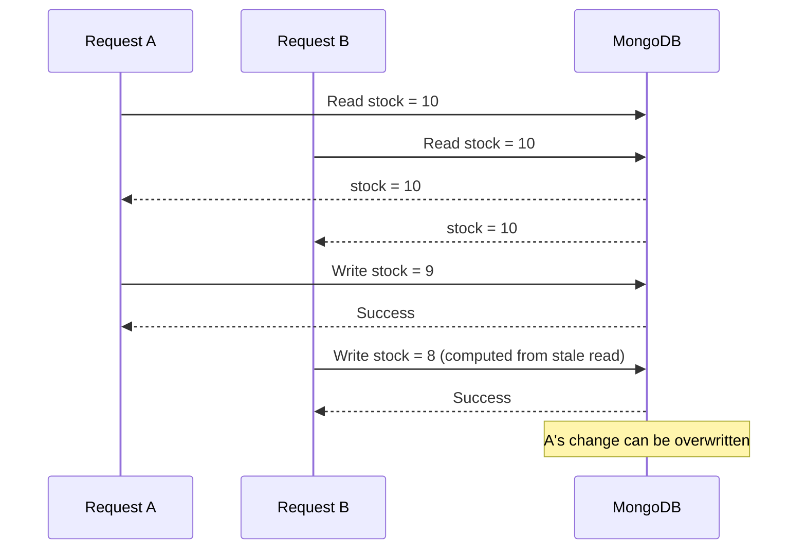

# @Version and optimistic locking

In systems where multiple users or multiple Spring Boot instances operate concurrently against MongoDB, a common scenario is **two requests reading the same document, both modifying from the old state, and then writing back**. If an operation simply replaces the document by `_id`, the later writer can **overwrite the earlier writer's change** without noticing: this is a **lost update**.

Spring Data MongoDB provides the **`@Version`** annotation to implement **optimistic locking** for version-aware CRUD operations. When saving an entity that was previously read, the framework uses **the version held by that entity** as an update condition. If the document on the server has already been modified and its version incremented, the stale write no longer matches; instead of silently overwriting, Spring Data can throw **`OptimisticLockingFailureException`**.

This lesson belongs to the **Concurrency Control** chapter of the `SPRING_DATA_MONGODB` module. Alongside connectivity, document mapping, `MongoTemplate`, and repositories, the module emphasizes query design, aggregation, indexes, transactions, reactive access, testing, and data performance diagnostics. This lesson focuses on the correctness of **read–modify–write**, distinguishing version checks from merely incrementing a version, and the practical boundaries when using query updates, raw/driver writes, bulk operations, deletes, or retries.

> **Core takeaway:** `@Version` does not turn every MongoDB command into optimistic locking. `repository.save(entity)`/`MongoTemplate.save(entity)` check the version against the loaded entity, whereas `updateFirst(Query, Update, Entity.class)`—even though it may **automatically increment the version field**—does not automatically know the request's `expectedVersion`. To perform CAS with this style of update, you must **put the version in the Query itself** and inspect the write result.

## 1. Learning objectives

After this lesson, you will be able to:

1. Explain lost updates when two requests modify the same document.
2. Distinguish **pessimistic locking** from **optimistic locking** and identify when each model fits.
3. Create a MongoDB entity with `@Id` and `@Version Long`.
4. Understand initial version values on insert (wrapper `Long` typically goes from `null` to `0`) and version progression after saves.
5. Explain `save` logic: matching `_id + version`, writing the document, and incrementing version or detecting conflicts.
6. Handle `OptimisticLockingFailureException` without automatically overwriting someone else's changes.
7. Distinguish `repository.save`, `MongoTemplate.save`, `updateFirst`, `findAndModify`, `remove`, and `deleteById`.
8. Build **compare-and-set** using a `Query` with expected version, `Update`, and `UpdateResult.matchedCount`.
9. Understand why **write acknowledgement** is a prerequisite for reliably detecting optimistic lock failures.
10. Explain limitations of `bulkOps`, native driver, untyped updates, and writers that ignore version.
11. Design controlled retries, idempotency, HTTP `409 Conflict`, and conflict logging/metrics.
12. Write integration tests: two stale reads, winning/losing save, CAS match/no-match, stale delete, and version increment.
13. Distinguish single-document atomicity from multi-document transactions.
14. Evaluate performance, contention, and options for reducing hot-document conflicts.

## 2. The lost update problem: without versioning

Suppose inventory for product `SKU-BOOK` currently has 10 units. Two requests both attempt to modify it from the read value.



If B thinks it is deducting 2 items from stock 10, the final result becomes 8. In another scenario, A and B might update **two different fields** of the same document using full-document `save`, causing one side to wipe out the other's change.

This is a **multi-operation read–modify–write** problem. MongoDB guarantees that a single write command on **one document** is atomic, yet that does **not** turn multiple requests' `findById → compute in Java → save` sequences into a shared transaction.

### 2.1. Not every update needs @Version

If the problem is simply adjusting a counter, an atomic command:

```javascript
db.product_stock.updateOne(
  { _id: "SKU-BOOK" },
  { $inc: { available: -1 } }
);
```

differs from reading `available` into Java, subtracting 1, and writing back with `$set`. `$inc` executes atomically on the document, avoiding lost updates **for simple additive/subtractive counters** even without optimistic versioning.

However, `$inc` does not automatically enforce the invariant `available >= 0`. For conditional stock deduction, include the stock predicate in the write command itself:

```javascript
db.product_stock.updateOne(
  { _id: "SKU-BOOK", available: { $gte: 1 } },
  { $inc: { available: -1 } }
);
```

For complex business rules or when you must verify data did not change between read and write, `@Version`/CAS plays a clear role.

## 3. Optimistic vs. pessimistic locking

| Characteristic | Optimistic locking | Pessimistic locking |
| --- | --- | --- |
| Assumption | Conflicts are relatively infrequent | Conflicts should be prevented via locks |
| Mechanism | Write with **expected version**, fail if changed | Lock the resource while a session is using it |
| Cost under low contention | Usually low; no long-held application locks | Locking/waiting management overhead |
| On conflict | Report conflict, controlled retry, merge, or ask user to reload | Wait for lock; timeout/deadlock depending on DB |
| In Spring Data MongoDB | `@Version`, CAS in `Query` | No equivalent to JPA `SELECT FOR UPDATE` for documents in normal queries |
| Holding locks across edit forms | No | Generally impractical for long-lived user requests |

MongoDB uses internal locks to execute commands and transactions safely, yet **Spring Data optimistic locking does not hold an application lock from the moment a user opens a form until they click Save**.

If the record changed while the user was editing, the UI should indicate a newer version exists instead of just reporting "Saved successfully".

## 4. Domain entity with @Version

A model can use a mutable class to easily demonstrate modifying fields before calling `save`.

```java
package dev.learning.stock;

import org.springframework.data.annotation.Id;
import org.springframework.data.annotation.Version;
import org.springframework.data.mongodb.core.mapping.Document;
import org.springframework.data.mongodb.core.mapping.Field;

@Document("versioned_product_stock")
public class ProductStock {

    @Id
    private String id;

    @Field("tenant_id")
    private String tenantId;

    private String sku;
    private long available;

    @Version
    private Long version;

    protected ProductStock() {
        // Spring Data needs to instantiate or use constructor mapping.
    }

    public ProductStock(String id, String tenantId,
                        String sku, long available) {
        this.id = id;
        this.tenantId = tenantId;
        this.sku = sku;
        this.available = available;
    }

    public String getId() { return id; }
    public String getTenantId() { return tenantId; }
    public String getSku() { return sku; }
    public long getAvailable() { return available; }
    public Long getVersion() { return version; }

    public void setAvailable(long available) {
        this.available = available;
    }
}
```

Spring Data MongoDB can read and write private fields through mapping metadata. There is no need for a public setter on `version` in typical applications; the framework manages version.

### 4.1. Corresponding BSON

After the initial insert:

```javascript
{
  _id: "STOCK-BOOK",
  tenant_id: "tenant-a",
  sku: "SKU-BOOK",
  available: NumberLong("10"),
  version: NumberLong("0"),
  _class: "dev.learning.stock.ProductStock"
}
```

The `_class` field is a common default type hint; projects may disable it or use `@TypeAlias`. BSON `version` for `Long` is a 64-bit integer; do not store string `"0"` instead of numeric `0`.

### 4.2. Why choose Long instead of long?

With wrapper `Long`:

- `null` represents a new, unversioned entity, convenient for newness detection.
- Spring Data MongoDB initializes the starting version to **0** upon inserting a wrapper type.
- After each valid save, version increments to **1**, then **2**, …

With primitive `long`/`int`, initialization and newness detection differ, typically starting from **1** in documented Spring Data releases. Do not switch `Long` to `long` in a system with existing data without verifying migration and newness semantics.

### 4.3. @Id and @Version do not replace each other

`@Id` identifies the document; `@Version` indicates **which generation an entity snapshot belongs to**. Two documents with different IDs can completely share version `0`. Version only has meaning **relative to the same document ID**.

Do not use `@Version` as a unique business key; if SKU must be unique within a tenant, add an appropriate constraint/index on `tenant_id + sku`.

## 5. Insert: how is a new version initialized?

```java
import org.springframework.data.mongodb.core.MongoTemplate;

ProductStock initial = new ProductStock(
    "STOCK-BOOK", "tenant-a", "SKU-BOOK", 10);

ProductStock inserted = mongoTemplate.insert(initial);

System.out.println(inserted.getVersion()); // 0 with Long @Version
```

The intent above is to insert a **new document**. `insert` does not mean "replace if ID collides"; if the ID already exists, MongoDB normally returns a duplicate-key error.

A repository can also be used:

```java
import org.springframework.data.mongodb.repository.MongoRepository;

public interface ProductStockRepository
        extends MongoRepository<ProductStock, String> {
}
```

```java
ProductStock inserted = repository.insert(
    new ProductStock("STOCK-BOOK", "tenant-a",
                     "SKU-BOOK", 10));
```

`repository.save` has logic to determine whether an entity is new or existing. For a `@Version` entity, **newness state** is influenced by version type/null/0. Therefore:

- Use `insert` when intentionally creating new records and wanting to catch duplicate IDs.
- Use `save` to persist a loaded state with version control.
- Do not force version to `null` to "reset" conflicts; doing so can trigger unexpected insert/`isNew` behavior.

### 5.1. @Version is entity metadata, not a server default

MongoDB server **does not know about the Java `@Version` annotation**. If you insert raw BSON via `mongosh` or the driver without `version`, the server does not automatically add a version field.

If a collection contains legacy data missing the `version` field, establish a clear migration/schema strategy before enabling optimistic locking. Do not assume old documents already have version `0`.

## 6. Save with version: comparing against the old read

Two reads of the same document:

```java
ProductStock first = repository.findById("STOCK-BOOK")
    .orElseThrow();

ProductStock second = repository.findById("STOCK-BOOK")
    .orElseThrow();

// Both see version 0 and available 10.
first.setAvailable(9);
ProductStock saved = repository.save(first);

// On server: available 9, version 1.
second.setAvailable(8);

repository.save(second); // OptimisticLockingFailureException
```

The first write matches old version **0** and bumps version to **1**. The second write tries to save from a read with version **0**, so it fails to match the current document at version **1**.

Diagram:

```mermaid
sequenceDiagram
  participant A as Request A (v0)
  participant B as Request B (v0)
  participant DB as MongoDB
  A->>DB: save: filter {_id, version:0}
  DB-->>A: matched; set fields; version -> 1
  B->>DB: save: filter {_id, version:0}
  DB-->>B: matchedCount = 0
  Note over B: OptimisticLockingFailureException
```

BSON interpretation (illustrating semantics, not necessarily the exact raw command emitted by the framework):

```javascript
db.versioned_product_stock.updateOne(
  { _id: "STOCK-BOOK", version: NumberLong("0") },
  {
    $set: {
      available: NumberLong("9"),
      sku: "SKU-BOOK",
      tenant_id: "tenant-a"
    },
    $inc: { version: NumberLong("1") }
  }
);
```

`MongoTemplate.save` may use a write form other than `$set/$inc` depending on implementation, yet **the expected version condition and version increment** form the essential contract. Do not write tests requiring internal commands to have one fixed shape across library upgrades.

### 6.1. Correct exception type and handling

Spring Data throws exceptions in the hierarchy of:

```java
org.springframework.dao.OptimisticLockingFailureException
```

Some call paths may use a specific subtype. Applications should catch **the base type** (or appropriate subtype) at the service/API boundary, rather than parsing driver message strings.

Do not catch `Exception` and return "Saved successfully". An optimistic lock error means **the intended write was not applied** at that moment; conflict resolution must be decided.

## 7. MongoTemplate.save and repository.save

```java
ProductStock loaded = mongoTemplate.findById(
    "STOCK-BOOK", ProductStock.class);

loaded.setAvailable(7);
ProductStock updated = mongoTemplate.save(loaded);
```

`MongoTemplate.save(entity)` and `repository.save(entity)` both operate via Spring Data MongoDB mapping, so supported save operations can apply `@Version` from the entity.

Common misconceptions to avoid:

- `save` does not require you to put version in a `Query`; the framework reads version from the **entity**.
- `save` does not turn edits into field-level merges: saving a stale full object can still cause lost updates if another writer does not participate in the version protocol.
- `save` typically determines create vs. update from entity newness; behavior may differ when version is null, ID is pre-assigned, or the entity implements `Persistable`.
- `@Version` does not replace business value validation. For inventory, you must still verify `available` is non-negative.
- If an entity contains large arrays and you only want to change one field, a conditional `Update` with expectedVersion can save payload size compared to a full save.

### 7.1. Do not share mutable entities across threads

Two threads mutating **the same Java object** and calling save does not accurately model "two independent reads". Concurrency examples should load the entity twice into **two separate objects**. Likewise, never put mutable entities into a singleton cache where multiple requests modify them directly.

### 7.2. Do not trust a client-supplied version alone

If an API receives `version=5` from a request, still verify **authorization** by tenant/user and confirm the document ID belongs to an accessible resource. Version does not protect data if the application skips authorization or accepts arbitrary IDs.

## 8. WriteConcern.ACKNOWLEDGED: prerequisite for conflict detection

Optimistic locking relies on receiving a **write result** from MongoDB. If **`WriteConcern.UNACKNOWLEDGED`** is used, the client lacks the information needed to know whether the update matched the version; Spring Data warns that optimistic locking failures may be **silently ignored**.

Illustrative configuration snippet in a context with an application-managed `MongoTemplate`:

```java
import com.mongodb.WriteConcern;

// Configure during template setup/initialization for workloads needing OCC:
mongoTemplate.setWriteConcern(WriteConcern.ACKNOWLEDGED);
```

Projects may configure write concern via connection/database/client settings instead of this setter. The core requirement is that the **effective write concern** enables the driver to know whether the server acknowledged the update/delete.

### 8.1. ACKNOWLEDGED vs. MAJORITY

- `ACKNOWLEDGED`: receives write acknowledgment from the server per write concern; provides the foundation to inspect matched counts and conflicts.
- `MAJORITY`: acknowledges with stronger replication guarantees depending on topology.
- `UNACKNOWLEDGED`: provides no reliable write result to detect conflicts.

Choose write concern based on durability, latency, and topology; do not equate "handling OCC properly" with "guaranteeing all durability/backup goals". For critical systems, evaluate retryable writes, read concern, failover, and monitoring as well.

### 8.2. Do not rely solely on the version field being incremented

A successful `updateOne({ _id }, { $inc:{version:1} })` **does not prove optimistic locking occurred**, because there is no expected version predicate. OCC requires all four:

1. The version value the client **expected** from its read or request.
2. A predicate comparing that version in **the same write command**.
3. An acknowledged result indicating whether the predicate matched.
4. A rule incrementing version on successful writes so subsequent writers notice.

## 9. updateFirst: auto-incrementing version does not mean auto-CAS

Spring Data `MongoTemplate.updateFirst(Query, Update, Entity.class)` supports **auto-incrementing the `@Version` property if `Update` does not explicitly set that field**. However, this method only receives the **`Query` you provide**; it has no loaded entity to know the caller's expectedVersion.

Example **filtering only by ID**:

```java
import org.springframework.data.mongodb.core.query.Criteria;
import org.springframework.data.mongodb.core.query.Query;
import org.springframework.data.mongodb.core.query.Update;

Query byId = Query.query(
    Criteria.where("id").is("STOCK-BOOK")
);

Update update = new Update().set("available", 8);

var result = mongoTemplate.updateFirst(
    byId, update, ProductStock.class);
```

With the typed entity `ProductStock.class`, Spring Data may increment `version` on a successful update. Yet if multiple requests run updates by ID concurrently, both can still write because **there is no version condition**. If both `$set` from stale values, lost updates still happen.

### 9.1. The right way: add expectedVersion to Query

```java
String id = "STOCK-BOOK";
String authorizedTenant = "tenant-a";
long expectedVersion = 3L;

Query compareAndSet = Query.query(
    Criteria.where("id").is(id)
        .and("tenantId").is(authorizedTenant)
        .and("version").is(expectedVersion)
);

Update change = new Update().set("available", 8L);

var result = mongoTemplate.updateFirst(
    compareAndSet, change, ProductStock.class);

if (result.getMatchedCount() != 1) {
    throw new org.springframework.dao.OptimisticLockingFailureException(
        "Data has changed or is no longer eligible");
}
```

When the document matches `_id`, tenant, and version, both the field change and version increment apply to one document. If the version differs, `matchedCount=0` and the service treats it as a conflict.

**Important:** when a query includes tenant, `matchedCount=0` could mean missing document, missing tenant permission, or changed version. Do not expose existence details of another tenant's document to unauthorized users.

### 9.2. UpdateResult.matchedCount vs. modifiedCount

- `getMatchedCount()`: number of **documents matching the query**.
- `getModifiedCount()`: number of **documents actually modified**.
- `getUpsertedId()`: ID of newly created document if an upsert occurred; not directly relevant to update-only CAS.

With an `_id + version` predicate, use `matchedCount` to know whether the expected version matched. `modifiedCount` can be 0 if fields are set to identical values in certain updates; if Spring Data auto-increments version, the document may still register as modified. Do not interpret `modifiedCount=1` as "only one field was modified".

### 9.3. Do not increment version twice

```java
// Avoid arbitrary mixing:
new Update().set("available", 8)
            .inc("version", 1);
```

If you specify version directly in `Update`, Spring Data stops applying the same auto-increment rule. That can be valid in an explicitly designed and tested flow, but should not be mixed with assumptions about auto-versioning. For typical typed updates, let the framework increment version if you have not included that field.

## 10. Deducting stock with CAS and business conditions in one command

A stock-decrement service must protect both **version** and **available ≥ quantity**.

```java
package dev.learning.stock;

import com.mongodb.client.result.UpdateResult;
import org.springframework.dao.OptimisticLockingFailureException;
import org.springframework.data.mongodb.core.MongoTemplate;
import org.springframework.data.mongodb.core.query.Criteria;
import org.springframework.data.mongodb.core.query.Query;
import org.springframework.data.mongodb.core.query.Update;

public final class InventoryService {

    private final MongoTemplate template;

    public InventoryService(MongoTemplate template) {
        this.template = template;
    }

    public void reserve(
            String productId,
            String authorizedTenant,
            long expectedVersion,
            long quantity) {

        if (quantity <= 0) {
            throw new IllegalArgumentException(
                "quantity must be > 0");
        }

        Query query = Query.query(
            Criteria.where("id").is(productId)
                .and("tenantId").is(authorizedTenant)
                .and("version").is(expectedVersion)
                .and("available").gte(quantity)
        );

        Update update = new Update()
            .inc("available", -quantity);

        UpdateResult result = template.updateFirst(
            query, update, ProductStock.class);

        if (result.getMatchedCount() != 1) {
            throw new OptimisticLockingFailureException(
                "Invalid version, status, or insufficient stock");
        }
    }
}
```

Both `version + available` conditions are evaluated **in the same update command** as `$inc`; there is no race window like `findOne` followed by an unconditional `save`.

If stock is insufficient, the query does not match. The service may need to distinguish `out-of-stock` from `version conflict`, but must do so per valid information and authorization policy, avoiding an extra read followed by silent overwrite. For APIs, errors can be classified via a post-mismatch readback if appropriate to the design.

### 10.1. Is version required for every $inc?

An `$inc` with predicate `available >= quantity` already protects the inventory invariant on a single document. When there is a requirement that "the client's request is only valid against **the exact version it observed**", add version for stronger semantics.

Conversely, if all requests simply deduct valid amounts independently, forcing clients to send version via OCC can cause **unnecessary conflicts** on a hot stock document. Choose based on business rules rather than applying version mechanically.

## 11. findAndModify: atomic read-modify-write with a version predicate

`MongoTemplate.findAndModify` combines query and update on one document, optionally returning **the state before or after the update**.

```java
import org.springframework.data.mongodb.core.FindAndModifyOptions;
import org.springframework.data.mongodb.core.query.Criteria;
import org.springframework.data.mongodb.core.query.Query;
import org.springframework.data.mongodb.core.query.Update;

Query query = Query.query(
    Criteria.where("id").is(productId)
        .and("tenantId").is(authorizedTenant)
        .and("version").is(expectedVersion)
        .and("available").gte(quantity)
);

Update update = new Update()
    .inc("available", -quantity);

ProductStock after = mongoTemplate.findAndModify(
    query,
    update,
    FindAndModifyOptions.options().returnNew(true),
    ProductStock.class
);

if (after == null) {
    throw new org.springframework.dao.OptimisticLockingFailureException(
        "Unable to apply update for expected version");
}
```

With `returnNew(true)`, the method returns the **post-update** document. With the default `returnNew(false)`, the result is the **pre-update** state. Do not assume a document returned from `findAndModify` was updated just because it has an ID; know the options and `null` semantics.

Per `MongoOperations` Javadoc, typed `findAndModify` may also auto-increment `@Version` if the field is absent from `Update`. However, **auto-increment does not replace expectedVersion in the Query**.

### 11.1. Avoid upsert when performing CAS

Do not set `upsert(true)` for a command **meant only to update an entity with an expected version**. If the query has `_id + version` while the current document has a different version, upsert can enter the insert branch and trigger a duplicate key error or unintended behavior.

For compare-and-set, **update-only** is the sensible default. A "create new product" flow should use `insert` or a separate creation path with unique keys/idempotency.

## 12. Deleting an entity with @Version: delete(Object) differs from deleteById

Spring Data MongoDB makes an important distinction in versions supporting optimistic locking for deletes.

Suppose an entity was loaded:

```java
ProductStock stale = repository.findById(productId)
    .orElseThrow();

// Another request modifies the document, version 4 -> 5.
repository.delete(stale);
```

With **`CrudRepository.delete(entity)`** on a versioned entity, the framework checks the version; if it cannot delete matching the read version, it can throw `OptimisticLockingFailureException` when the write is acknowledged.

Similarly, `MongoTemplate.remove(entity)` can include version in the delete condition.

By contrast:

```java
repository.deleteById(productId);
```

`deleteById` **bypasses the optimistic version check** on versioned entities and deletes by ID. It fits "delete regardless of version", and is **unsuitable** if the API must reject deletions from a stale read.

### 12.1. Comparison table

| Operation | Checks version? | Caveat |
| --- | --- | --- |
| `repository.delete(entity)` with `@Version` | Yes, per optimistic locking | Entity must carry the version from the read |
| `mongoTemplate.remove(entity)` | Yes, for versioned entities | Differs from query-based remove |
| `repository.deleteById(id)` | Bypasses version | Can delete even if the record was modified |
| `mongoTemplate.remove(Query, Class)` | Per **Query**; does not pull version from an entity | For CAS delete, add version to Query |
| Raw driver `deleteOne` | Per BSON filter you provide | Unaware of `@Version` |

If a codebase switches from `delete(entity)` to `deleteById(id)` to "simplify", it may have **changed the concurrency semantics** of the business operation. Review carefully.

### 12.2. Explicit CAS delete via Query

```java
Query query = Query.query(
    Criteria.where("id").is(productId)
        .and("tenantId").is(authorizedTenant)
        .and("version").is(expectedVersion)
);

var result = mongoTemplate.remove(query, ProductStock.class);

if (result.getDeletedCount() != 1) {
    throw new org.springframework.dao.OptimisticLockingFailureException(
        "Cannot delete because data changed or access denied");
}
```

In this approach, the **caller** writes the version predicate and checks `DeleteResult`. This is an explicit CAS check rather than the framework extracting version from an entity.

## 13. Write paths that do not automatically enforce optimistic locking

A common mistake when adopting `@Version` is assuming **every write to the collection** honors version.

| Write path | Uses version properly? | Recommended handling |
| --- | --- | --- |
| `repository.save(versionedEntity)` | Yes, using the read version attached to the entity | Catch conflict |
| `mongoTemplate.save(versionedEntity)` | Yes, on supported CRUD | Catch conflict |
| `updateFirst(Query, Update, Entity.class)` | May auto-increment version, **does not auto-attach expectedVersion** | Put version in Query |
| `findAndModify(Query, Update, Entity.class)` | May auto-increment version, **does not auto-attach expectedVersion** | Put version in Query |
| `updateMulti(Query, Update, Entity.class)` | May increment version on typed updates | Not per-snapshot CAS if predicate is omitted |
| `remove(Query, Entity.class)` | Does not pull stale entity version | Add version filter if needed |
| `deleteById(id)` | Bypasses version | Use only when intentionally bypassing |
| `getCollection(...).updateOne(...)` | Raw driver is unaware of annotations | Write CAS and increment version manually |
| `mongosh db.collection.updateOne` | Raw BSON query | Write CAS and increment version manually |
| `bulkOps(...)` | **Does not support automatic entity-save-style optimistic locking** | Design per-item result handling and CAS |
| `repository.saveAll(...)` | Depends on save/insert execution path and each entity's state | Test explicitly; do not treat batch as transaction |

`MongoOperations` overloads that take only `String collectionName` without `Class<?> entityClass` typically **lack domain metadata** to support versioning/mapping like typed overloads. Do not call untyped overloads expecting the framework to handle `@Version`.

### 13.1. Writers that fail to increment version can break the entire protocol

Suppose the server currently holds:

```javascript
{ _id: "STOCK-BOOK", available: 10, version: NumberLong("5") }
```

A worker using the raw driver runs:

```javascript
db.versioned_product_stock.updateOne(
  { _id: "STOCK-BOOK" },
  { $set: { available: 7 } }
);
```

It modifies `available` yet **does not increment version**. A stale entity still holding `version=5` can still `save` successfully—because server version is still 5—and **overwrite available=7**.

For an OCC system to be trustworthy, **every write path affecting protected state** must follow the version protocol or use another explicitly designed concurrency mechanism.

### 13.2. CAS protocol in raw BSON

```javascript
db.versioned_product_stock.updateOne(
  {
    _id: "STOCK-BOOK",
    tenant_id: "tenant-a",
    version: NumberLong("5")
  },
  {
    $set: { available: NumberLong("7") },
    $inc: { version: NumberLong("1") }
  }
);
```

Inspect `matchedCount` on the acknowledged result. If 0, the document may have changed version, been deleted, or failed the authorization filter.

**Do not assume the raw driver uses `@Version`.** This is a protocol **enforced by the caller**.

## 14. Bulk operations and @Version: limits to know

`BulkOperations` batches multiple insert/update/delete operations. This cuts round-trip overhead, yet **does not share the same automatic optimistic locking protocol as entity `save`**: Spring Data MongoDB Javadoc explicitly states that operations requiring per-operation results (such as optimistic locking) are **not supported** on `BulkOperations`; the version field may not be populated as expected.

Example batch:

```java
import org.springframework.data.mongodb.core.BulkOperations.BulkMode;
import org.springframework.data.mongodb.core.query.Criteria;
import org.springframework.data.mongodb.core.query.Query;
import org.springframework.data.mongodb.core.query.Update;

var result = mongoTemplate.bulkOps(
        BulkMode.ORDERED, ProductStock.class)
    .updateOne(
        Query.query(Criteria.where("id").is("STOCK-A")),
        new Update().inc("available", -1))
    .updateOne(
        Query.query(Criteria.where("id").is("STOCK-B")),
        new Update().inc("available", -1))
    .execute();
```

These two updates **do not bind expectedVersion** from a loaded entity. If the business flow requires CAS, you must design each `_id + version` filter, version increment, and result handling accordingly; do not expect `BulkOperations` to throw `OptimisticLockingFailureException` per item like `repository.save(entity)`.

### 14.1. Batch is not a multi-document transaction

`ORDERED` means operations in the batch execute sequentially and may stop on error depending on the command; **it does not turn the whole batch into an atomic transaction**. Writes that succeeded before the error can remain persisted.

When an invariant spans multiple documents, consider a transaction or a data model consolidating the invariant into one document. When high throughput and independent operations are the goal, bulk fits well while accepting batch result semantics.

### 14.2. Separate OCC flows from general batch updates

An application may use:

- `repository.save` when a user edits a form from a snapshot.
- `updateFirst` with version + business conditions for narrow-scope CAS.
- Atomic `$inc` for independent counters when invariants are guarded.
- Bulk writes for batches that handle per-operation failures per an explicit policy—**do not call it automatic optimistic locking**.

Avoid mixing these write paths on the same document without a unified version increment rule.

## 15. Repository delete, update-by-query, and API design issues

Suppose an API exposes:

```text
GET    /products/STOCK-BOOK
PUT    /products/STOCK-BOOK
DELETE /products/STOCK-BOOK
```

A client reads product version `7`, then sends a change.

### 15.1. Editing from a snapshot with repository.save

If the server loads the latest entity right before editing and saving **without comparing the client's expected version**, it defeats the purpose of the concurrency token:

```java
// INSUFFICIENT to protect the snapshot the client read earlier:
ProductStock current = repository.findById(id).orElseThrow();
current.setAvailable(requestedAvailable);
repository.save(current);
```

This checks the version of the entity the server just read, not **which version the user saw** before submitting. It can still catch another request sneaking in between that fresh `findById` and `save`, yet **fails to reject a very stale client** if no write happened in that tiny window.

When a request carries `expectedVersion`, use it in a CAS query or compare first while still enforcing CAS at write time. **Comparing version in Java then saving does not eliminate all races** unless the expected version is preserved properly.

### 15.2. PUT needs lost-update protection

Example DTO allowing quantity updates only:

```java
public record ChangeStockRequest(
    long available,
    long expectedVersion) {
}
```

Safer implementation:

```java
public void replaceAvailable(
        String id,
        String authorizedTenant,
        ChangeStockRequest request) {

    if (request.available() < 0) {
        throw new IllegalArgumentException(
            "available cannot be negative");
    }

    Query filter = Query.query(
        Criteria.where("id").is(id)
            .and("tenantId").is(authorizedTenant)
            .and("version").is(request.expectedVersion())
    );

    Update change = new Update()
        .set("available", request.available());

    UpdateResult result = mongoTemplate.updateFirst(
        filter, change, ProductStock.class);

    if (result.getMatchedCount() != 1) {
        throw new OptimisticLockingFailureException(
            "Record changed or is inaccessible");
    }
}
```

This is a **partial update** and does not erase other fields of the document. Typed update supports incrementing version if not set directly in `Update`; the client should re-read or receive the new version after a successful write.

### 15.3. HTTP 409 or 412?

- For API protocols sending version in the body and reporting business conflicts, **`409 Conflict`** is a common choice.
- If using HTTP conditional requests with **`If-Match`/`ETag`** headers, when the precondition fails, **`412 Precondition Failed`** usually conveys clearer semantics.
- **`404 Not Found`** or **`403 Forbidden`** depends on access policy; never reveal another tenant's document via version conflict messages.

Example exchange using ETag:

```http
GET /products/STOCK-BOOK
HTTP/1.1 200 OK
ETag: "7"
Content-Type: application/json

{"id":"STOCK-BOOK","available":10}
```

```http
PUT /products/STOCK-BOOK
If-Match: "7"
Content-Type: application/json

{"available":8}
```

If the server document is at version 8, return `412` rather than silently overwriting. ETag/If-Match must map accurately to the real version and be combined with authorization. Never treat a user-supplied ETag string as an authorization source.

## 16. Conflict responses: do not swallow OptimisticLockingFailureException

A sample handler in Spring Web MVC:

```java
package dev.learning.stock;

import java.util.Map;
import org.springframework.dao.OptimisticLockingFailureException;
import org.springframework.http.HttpStatus;
import org.springframework.http.ResponseEntity;
import org.springframework.web.bind.annotation.ExceptionHandler;
import org.springframework.web.bind.annotation.RestControllerAdvice;

@RestControllerAdvice
public class StockConflictAdvice {

    @ExceptionHandler(OptimisticLockingFailureException.class)
    public ResponseEntity<Map<String, String>> conflict(
            OptimisticLockingFailureException ex) {

        return ResponseEntity.status(HttpStatus.CONFLICT)
            .body(Map.of(
                "code", "STALE_VERSION",
                "message", "Data has changed; please reload"));
    }
}
```

This is an example for a **body-version API**, so it returns `409`. If an endpoint uses `If-Match` as an HTTP precondition, the controller/service can use a separate exception and mapping to return `412`.

### 16.1. Avoid sensitive leaks and false errors

If a CAS query contains `id + tenantId + version + available≥quantity`, `matchedCount=0` **cannot distinguish the cause**. It could be:

- ID does not exist.
- Document belongs to another tenant.
- Stale version.
- Insufficient stock or ineligible status.
- Another business rule in the filter.

The handler must never claim "stale version" for data the user is unauthorized to read. Domain error design can classify after a safe read, though a subsequent read may still see state that changed afterward.

### 16.2. Logging and metrics

Log:

- Operation name, hashed or authorized tenant identifier, correlation ID.
- Conflict count per endpoint/collection.
- Retry count, outcome, latency between read and save.
- Ratio of `OptimisticLockingFailureException` errors to total updates.
- Whether any writers use raw driver or bulk bypassing version.

Avoid logging full financial records, PII, or request bodies containing sensitive data in conflict logs.

## 17. Retry: when should you and when should you not?

A common pattern is catching `OptimisticLockingFailureException` and **retrying**. Yet retrying is not always valid: a user's edit might depend on the **stale data they viewed**.

### 17.1. Do not retry by re-saving the stale entity

Wrong:

```java
ProductStock stale = repository.findById(id).orElseThrow();
stale.setAvailable(7);

for (int i = 0; i < 3; i++) {
    try {
        repository.save(stale);
        break;
    } catch (OptimisticLockingFailureException ex) {
        // Wrong: retrying the same stale.version without reloading/merging.
    }
}
```

If the version is already wrong, repeating the same version usually keeps failing. Never "fix" it by arbitrarily bumping version on the client object, as that ignores changes the client never saw.

### 17.2. Retry by reloading and recomputing

For transformations that **can be recomputed from the latest state** and have no external side effects:

```java
public ProductStock applyBusinessChangeWithRetry(
        String id, long delta) {

    final int maxAttempts = 3;

    for (int attempt = 0; attempt < maxAttempts; attempt++) {
        ProductStock current = repository.findById(id)
            .orElseThrow();

        long next = Math.addExact(current.getAvailable(), delta);
        if (next < 0) {
            throw new IllegalStateException("Insufficient stock");
        }

        current.setAvailable(next);

        try {
            return repository.save(current);
        } catch (OptimisticLockingFailureException ex) {
            if (attempt == maxAttempts - 1) {
                throw ex;
            }
            // Next attempt will reload and recompute from the new version.
        }
    }
    throw new IllegalStateException("Unable to retry");
}
```

**This is an algorithmic illustration**, not a production-ready implementation. Add tenant authorization, deadlines, controlled backoff/jitter, monitoring, and idempotency. With `delta` sent over the network, a client might resend the same operation after a timeout and add/deduct **twice** even though OCC worked properly.

### 17.3. Distinguish conflict retry from network error retry

- **Confirmed version conflict**: the CAS operation was not applied; reloading/re-evaluating is safe if rules permit.
- **Network timeout after write**: the client is unsure whether the server applied it. Blindly repeating an `$inc` operation can double the change.
- **Transient transaction error**: retrying an entire transaction per the MongoDB driver contract follows different rules than retrying a stale entity.

To prevent duplicate execution of payment/order requests, use an **idempotency key** or appropriate transaction/outbox; `@Version` does not solve duplicate HTTP requests.

### 17.4. When users must merge manually

For multi-field documents edited by users, never automatically do `reload → copy old values → save`, as that simply overwrites someone else's changes onto a newer version.

The UI should let the user:

1. View the latest revision.
2. Compare their edits against what changed.
3. Choose to keep, merge, or cancel.
4. Submit changes against the **current version**, with user confirmation.

## 18. Reactive repositories and optimistic locking

Reactive Spring Data MongoDB shares the same version mechanism on supported operations, except errors are emitted via the **publisher** rather than thrown synchronously when assembling the pipeline.

```java
import org.springframework.data.mongodb.repository.ReactiveMongoRepository;

public interface ReactiveProductStockRepository
        extends ReactiveMongoRepository<ProductStock, String> {
}
```

Example:

```java
import reactor.core.publisher.Mono;

Mono<ProductStock> update = reactiveRepository.findById(productId)
    .switchIfEmpty(Mono.error(
        new IllegalArgumentException("Product not found")))
    .flatMap(current -> {
        current.setAvailable(current.getAvailable() - 1);
        return reactiveRepository.save(current);
    });
```

This publisher **has not executed** when merely assigned to a variable. Upon subscription, `save` can fail with `OptimisticLockingFailureException` if the document changed between read and write.

### 18.1. Catching optimistic conflicts specifically

```java
Mono<ProductStock> safeUpdate = update
    .onErrorMap(
        OptimisticLockingFailureException.class,
        ex -> new IllegalStateException(
            "Update conflicted with a newer version", ex)
    );
```

In a WebFlux application, map the error to `409`/`412` at the HTTP layer instead of wrapping in `IllegalStateException` as shown here. Never use `onErrorResume(ex -> Mono.empty())` indiscriminately: you could turn a failed write into "empty result", misleading the client.

### 18.2. retryWhen does not guarantee correctness on its own

```java
import reactor.util.retry.Retry;

Mono<ProductStock> retried = Mono.defer(
    () -> reactiveRepository.findById(productId)
        .switchIfEmpty(Mono.error(
            new IllegalArgumentException("Not found")))
        .flatMap(current -> {
            current.setAvailable(current.getAvailable() - 1);
            return reactiveRepository.save(current);
        })
).retryWhen(
    Retry.max(2)
        .filter(OptimisticLockingFailureException.class::isInstance)
);
```

Using `Mono.defer` ensures each retry actually **re-reads** state. Yet this pattern still needs `available≥1` validation, authorization, backoff, and idempotency. For reservations with high concurrency, predicated `$inc` may suit better than read-save-retry; do not treat this example as a production business service template.

### 18.3. Do not block on the event loop

`reactiveRepository.save(...)` returns `Mono<ProductStock>`. Never call `block()` inside a reactive HTTP handler just to write imperative code; doing so can stall the event loop. If integrating blocking systems is unavoidable, use a proper boundary and bounded resources.

## 19. Version and transactions: two mechanisms that do not replace each other

MongoDB guarantees atomicity on **one document** per write operation. Optimistic locking uses `version` to detect when a client writes from a **stale snapshot**. Multi-document transactions solve keeping multiple writes/reads consistent within a transaction boundary.

| Need | Typically suitable mechanism |
| --- | --- |
| User edits an entity from a loaded snapshot | `@Version` with `save` or CAS |
| Conditional deduction of one product's stock | `updateFirst` with predicate `available≥n`, optionally with version |
| Incrementing a counter without read-modify-write | Atomic `$inc` |
| Changing two documents that must succeed/fail together | MongoDB transaction if topology/workload supports it |
| Preventing duplicate HTTP requests after timeout | Idempotency key |
| Locking tenant access | Authorization filter + role/permission, not version |

Example: an order and stock live in **two separate documents**. `@Version` on each entity detects per-document conflicts, yet if saving the order succeeds and saving stock fails, **it does not automatically roll back the order**. You need a transaction, saga, or appropriate eventual-consistency/outbox design.

### 19.1. Transactions do not automatically fix stale UI clients

Even when a service uses a transaction, if a user opened a form at version 5 and submits an update when the document is at version 8, a transaction starting **when the write request arrives** does not inherently know the user edited from v5. When the business requires rejecting stale UI updates, expected version/ETag still matters.

### 19.2. Do not hold transactions open across user interactions

Never keep a MongoDB transaction open from the initial GET until the user clicks Save minutes later. Long transactions increase cost and risk; optimistic locking is designed for longer read–write intervals at the application tier.

## 20. Idempotency and side effects outside MongoDB

Consider the flow:

```text
1. Read product version 3
2. Send email / charge payment
3. Save product with @Version
```

If `save` fails due to conflict, the email or charge **already happened**. Retrying the entire function can send the email or charge **twice**.

The order or execution boundary must be redesigned:

- Record the change intent and idempotency key.
- Use transactions/outbox for MongoDB changes within an appropriate boundary.
- Emit side effects only after confirmed write outcomes or via idempotent consumers.
- Distinguish commit success, write timeout, and duplicate retry.
- For external payments, use an idempotency key per the provider's contract.

### 20.1. Storing idempotency keys

A common pattern uses a `processed_requests` collection with a unique index on `request_key`, or an idempotency field on the entity with conditional updates. However, **creating a separate processed record and updating the product in two independent commands** still leaves an inconsistency window; design a clear transaction/outbox or atomic boundary if all-or-nothing is required.

`@Version` does not replace the uniqueness of `request_key`.

## 21. Performance optimization under high contention

Optimistic locking works best when most requests **do not directly contend**. On a "hot document" written by hundreds of requests per second, reads quickly go stale and retries can cause bottlenecks.

Ways to reduce contention:

- Avoid funneling all independent system counters into a single document.
- Use atomic `$inc` with predicates instead of read-save for additive updates.
- Split aggregates along business boundaries and choose sensible sharding/partitioning.
- Use event/append-only or reconciliation models when consistency requirements allow.
- Shorten the window between read and save; never call network APIs while holding a stale snapshot.
- For UIs, send only changed fields plus expected version rather than saving a full stale entity.
- Bound retry attempts and apply backoff/jitter.
- Check indexes on lookup keys; `_id` already has a default index.
- Measure optimistic conflict rates separately from validation/permission errors rather than lumping them together.

### 21.1. Index cost for CAS

For a query `{_id:id,version:n}`, MongoDB can locate the document using the `_id` index and then check `version`. A compound index `{_id:1,version:1}` is not necessarily needed on every collection: `_id` is already unique and highly selective. Measure `explain`, latency, and workload before adding extra indexes.

If queries mostly filter by `tenant_id + sku` without ID, a compound unique index matching the business key can matter more. Version is a concurrency condition, not always the best leading index field.

### 21.2. Observing acknowledged results

Monitor `matchedCount`/`modifiedCount` on explicit CAS commands and `save` exception counts. If write concern is configured as `UNACKNOWLEDGED`, the system may fail to observe conflicts; this is a design/observability flaw to fix before investigating throughput.

## 22. Integration test: stale save is rejected

Tests must actually read **two independent copies** of the same document before saving. Use an isolated test MongoDB (test URI/Testcontainers) and randomized IDs/tenants; never call `deleteAll()` on a database that could point to production.

```java
package dev.learning.stock;

import static org.assertj.core.api.Assertions.assertThat;
import static org.assertj.core.api.Assertions.assertThatThrownBy;

import java.util.UUID;

import org.junit.jupiter.api.Test;
import org.springframework.beans.factory.annotation.Autowired;
import org.springframework.boot.test.context.SpringBootTest;
import org.springframework.dao.OptimisticLockingFailureException;

@SpringBootTest
class VersionedProductStockIntegrationTest {

    @Autowired ProductStockRepository repository;

    private ProductStock fresh(long available) {
        String suffix = UUID.randomUUID().toString();
        return repository.insert(
            new ProductStock(
                "STOCK-" + suffix,
                "tenant-test-" + suffix,
                "SKU-" + suffix,
                available)
        );
    }

    @Test
    void twoStaleSnapshotsCannotBothSave() {
        ProductStock original = fresh(10);

        assertThat(original.getVersion()).isEqualTo(0L);

        ProductStock first = repository.findById(original.getId())
            .orElseThrow();

        ProductStock second = repository.findById(original.getId())
            .orElseThrow();

        assertThat(first.getVersion()).isEqualTo(0L);
        assertThat(second.getVersion()).isEqualTo(0L);

        first.setAvailable(9);
        ProductStock saved = repository.save(first);

        assertThat(saved.getVersion()).isEqualTo(1L);

        second.setAvailable(8);

        assertThatThrownBy(() -> repository.save(second))
            .isInstanceOf(OptimisticLockingFailureException.class);

        ProductStock persisted = repository.findById(
            original.getId()).orElseThrow();

        assertThat(persisted.getAvailable()).isEqualTo(9L);
        assertThat(persisted.getVersion()).isEqualTo(1L);
    }
}
```

This is a **deterministic test** for stale snapshots: no multiple threads needed; two reads are held in two distinct objects, cleanly verifying conflict behavior.

### 22.1. Why not wipe shared data before each test?

This test suite uses UUID IDs to avoid colliding with other tests and avoids `repository.deleteAll()`. If cleanup is needed, delete only **resources created by the test** inside a dedicated test database per test fixture policy. Never `dropCollection` on a shared collection just to clean up one test.

## 23. Integration test: CAS update, version increment, and stale delete

Add to the **same class** `VersionedProductStockIntegrationTest`:

```java
@Autowired org.springframework.data.mongodb.core.MongoTemplate template;

@Test
void typedUpdateIncrementsVersionButRequiresCallerCasPredicate() {
    ProductStock initial = fresh(10);
    long v0 = initial.getVersion();

    var query = org.springframework.data.mongodb.core.query.Query.query(
        org.springframework.data.mongodb.core.query.Criteria
            .where("id").is(initial.getId())
            .and("tenantId").is(initial.getTenantId())
            .and("version").is(v0)
    );

    var delta = new org.springframework.data.mongodb.core.query.Update()
        .inc("available", -2);

    var first = template.updateFirst(
        query, delta, ProductStock.class);

    assertThat(first.getMatchedCount()).isEqualTo(1L);

    ProductStock after = repository.findById(initial.getId())
        .orElseThrow();

    assertThat(after.getAvailable()).isEqualTo(8L);
    assertThat(after.getVersion()).isEqualTo(v0 + 1);

    var staleAttempt = template.updateFirst(
        query,
        new org.springframework.data.mongodb.core.query.Update()
            .inc("available", -3),
        ProductStock.class);

    assertThat(staleAttempt.getMatchedCount()).isZero();

    ProductStock unchanged = repository.findById(initial.getId())
        .orElseThrow();

    assertThat(unchanged.getAvailable()).isEqualTo(8L);
    assertThat(unchanged.getVersion()).isEqualTo(v0 + 1);
}
```

Takeaways:

1. Typed `updateFirst` auto-increments version if `Update` does not specify the version field.
2. Because `Query` includes `version=v0`, the second attempt cannot match.
3. `updateFirst` normally returns `UpdateResult` rather than throwing `OptimisticLockingFailureException` for caller-written version predicates; the service **must check matchedCount**.

### 23.1. Testing stale entity delete

```java
@Test
void staleEntityDeleteFailsButCurrentEntityStillExists() {
    ProductStock initial = fresh(10);

    ProductStock stale = repository.findById(initial.getId())
        .orElseThrow();

    ProductStock current = repository.findById(initial.getId())
        .orElseThrow();

    current.setAvailable(9);
    repository.save(current);

    assertThatThrownBy(() -> repository.delete(stale))
        .isInstanceOf(OptimisticLockingFailureException.class);

    assertThat(repository.findById(initial.getId())).isPresent();
}
```

Add a separate test if you want to verify `repository.deleteById(id)` **bypasses version**; when doing so, remember to use a **test-generated random ID** and assert the document was deleted. Never use `deleteById` as an automatic fallback after a stale delete is rejected, as that defeats OCC.

### 23.2. Testing update by ID without expectedVersion

A valuable counter-example test: two `updateFirst` calls filtering only by ID with `$set("available",…)` can both match and write, even though version increments. This test is not for production flows; it proves **auto-version-increment ≠ optimistic version check**.

### 23.3. Testing write concern and raw driver

To verify protection boundaries, configure a separate test observing `CommandListener` or raw BSON:

- `repository.save` adds the version predicate.
- `updateFirst(Query, Update, ProductStock.class)` increments version in the update yet **does not automatically add expectedVersion** if missing from the query.
- `getCollection(...).updateOne` ignores annotations.
- `bulkOps` lacks per-entity optimistic lock failures like `save`.
- Effective write concern must not be `UNACKNOWLEDGED` for flows needing OCC.

Do not rely solely on unit mocks; concurrency behavior and update results must be verified on real MongoDB.

## 24. Multi-threaded tests: exposing conflicts without flaky assertions

An advanced concurrency exercise uses two threads reading the same old version and then saving simultaneously. Use `CountDownLatch` or `CyclicBarrier` to guarantee **both finished reading before either writes**; otherwise thread B might read the new version and succeed, making a "two writers, one fails" test unstable.

Pseudocode:

```text
seed document version=0
create barrier(participants=2)

worker A:
    a = repository.findById(id)
    barrier.await()
    a.available = 9
    repository.save(a)

worker B:
    b = repository.findById(id)
    barrier.await()
    b.available = 8
    repository.save(b)

collect results:
    exactly one save succeeds
    exactly one fails with OptimisticLockingFailureException
    final version == 1
    final available == 9 OR 8 (depending on winner)
```

Do not assume worker A always wins simply because its thread started first. Tests should assert **winner count**, error type, and final version—not a specific scheduling order.

### 24.1. Why can two requests both succeed in a different problem?

If two requests both invoke `$inc` on a document with a valid predicate yet **do not** require a specific expectedVersion, both can succeed and the combined outcome adds both deltas. That is valid semantics for counters. What matters is checking invariants and requirements, not assuming "every concurrent update must throw a conflict".

## 25. Common errors and troubleshooting

| Symptom | Possible cause | Resolution |
| --- | --- | --- |
| Stale save still overwrites data | Entity lacks `@Version` or another writer omits version increment | Add and unify version protocol |
| Never see `OptimisticLockingFailureException` | Unacknowledged write concern, or test didn't use same old version | Enable acknowledgment, test read-twice |
| `updateFirst` loses updates even as version increments | Query filters only by ID, no expectedVersion | Put version in Query and check matchedCount |
| Version increments even when request "did nothing" | Typed update auto-bumps version even if business fields match | Inspect UpdateResult and update semantics |
| `repository.save` fails after client edited long ago | Expected version is stale; OCC is working properly | Return conflict, reload/merge |
| `delete(entity)` fails while `deleteById` deletes | `deleteById` bypasses version | Avoid bypass if business requires OCC |
| `remove(Query)` deletes newer record | Query lacks version | Add expectedVersion and check deletedCount |
| New entity gets version 1 instead of 0 | Primitive vs. wrapper `@Version` newness difference | Use wrapper and test mapping |
| Legacy data missing version | Migration has not backfilled BSON version | Design backfill/compatibility |
| Raw driver update doesn't bump version | Annotation only works via compatible mapper/framework | Explicit CAS protocol or forbid that write path |
| `bulkOps` doesn't throw OCC exception | Batch does not support per-entity optimistic locking | Use separate save/CAS or inspect batch results |
| Upsert CAS hits duplicate key | Stale version misses match, upsert attempts insert | Do not upsert in update-only CAS |
| Retrying repeatedly still conflicts | Retrying the same stale entity without reloading | Bounded retry with proper reload |
| Retrying after timeout deducts stock twice | Missing idempotency key | Design idempotent commands |
| Transaction succeeds yet UI was stale | Did not check client expectedVersion | Add ETag/version precondition |
| Hot document suffers frequent conflicts | Too many writers depending on the same snapshot | Atomic updates, partitioning, fewer read-saves |
| Query by tenant and version fails to match | Could be wrong permissions/ID/version | Classify errors safely, avoid leaks |
| Version overflow or type mismatch | Using small primitive or inconsistent BSON types | Use Long, check migration/retention |
| Testing only a single save | Does not verify conflict behavior | Add stale snapshot and CAS tests |

### 25.1. Checklist for debugging optimistic conflicts

1. Which **document ID and version** did the client read?
2. What is the current BSON version on the server, and what numeric type is it?
3. Did another write modify the document between read and save?
4. Did the other writer **increment version**?
5. Is the code calling `save(entity)`, `updateFirst`, or `bulkOps`?
6. If `updateFirst`, is `version` included in Query or only incremented?
7. Is write concern acknowledged?
8. Does the query include proper tenant/authorization filters without leaking cross-tenant info?
9. Do any retries reuse a stale object or repeat side effects?
10. Is the conflict an expected business event or a symptom of abnormal hot-document contention?

## 26. Practice exercises

**Exercise 1 — Lost update.** Two requests both read `available=10`, then `save` values 9 and 8 when the entity **has no `@Version`**. What can happen? *Answer:* last writer wins; one change can be overwritten.

**Exercise 2 — @Version Long.** Add `@Version Long version`, insert a new entity, and read version after insert and save. *Typical answer:* 0 then 1.

**Exercise 3 — Two snapshots.** Read the same product twice, save one, then save the other. Verify `OptimisticLockingFailureException`.

**Exercise 4 — UpdateFirst with and without CAS.** Write two `Update` calls by ID; then add `Criteria.where("version").is(expectedVersion)` and prove the second call does not match.

**Exercise 5 — Counting results.** What can cause `matchedCount=0` if a query contains tenant, version, and available? Why shouldn't details be returned directly to an unauthorized client?

**Exercise 6 — findAndModify.** Use `returnNew(true)` to deduct 2 units and retrieve the post-write state. Remember expectedVersion and `available≥2` in the query.

**Exercise 7 — Delete.** Compare `repository.delete(staleEntity)` with `repository.deleteById(id)` when the document version has changed.

**Exercise 8 — Bulk.** Write a batch updating 10 products. Why isn't `OptimisticLockingFailureException` automatically thrown per stale product as with 10 individual `save` calls?

**Exercise 9 — Raw writer.** Run a raw `updateOne` changing `available` without incrementing version. Explain why a stale entity can overwrite this update.

**Exercise 10 — HTTP.** Define an API taking expectedVersion in the body and an API using `If-Match`. Distinguish when to return `409` vs. `412`.

**Exercise 11 — Retry.** Test retrying with the same stale entity vs. retrying after reload; state when you must not auto-merge manual user form edits.

**Exercise 12 — Idempotency.** Design a reservation request with a unique requestId. If a network timeout happens after the write, why isn't version enough to prevent deducting twice?

**Exercise 13 — Concurrency test.** Use a barrier so both threads read v0 before saving; assert one succeeds and one conflicts without depending on who wins.

**Exercise 14 — Performance.** Measure p95 latency, conflict rate, and retry count on a hot product. Compare full save against atomic `$inc` with a predicate.

**Exercise 15 — Transaction.** An order needs to update both order + stock across two documents. Explain why `@Version` on each document does not automatically ensure both commit together.

## 27. Production deployment checklist and official references

Before putting `@Version` into production:

- [ ] Determine whether the business needs **stale snapshot protection** or only atomic `$inc`.
- [ ] Entity has `@Version` of an appropriate type, preferring wrapper `Long` for clear newness.
- [ ] Migration exists for legacy documents missing version or stored with the wrong BSON type.
- [ ] Use `save(entity)` when you want the framework to check the loaded entity's version.
- [ ] With `updateFirst`/`findAndModify`, explicitly add **expectedVersion to Query**.
- [ ] Understand that auto-incrementing version **differs from** an optimistic lock predicate.
- [ ] Inspect `matchedCount`/`deletedCount` for caller-written CAS commands.
- [ ] Never use `upsert` for update-only CAS from an old snapshot.
- [ ] Effective WriteConcern must be acknowledged so OCC errors are not ignored.
- [ ] Audit all raw driver, `bulkOps`, query update, and background job write paths.
- [ ] Prevent any writer from modifying state without incrementing version.
- [ ] Distinguish `delete(entity)` from `deleteById(id)`.
- [ ] Keep tenant/user authorization independent of version.
- [ ] Map HTTP `409`/`412` per body-version/If-Match semantics.
- [ ] Never retry a stale object; reload/recompute if the operation is retryable.
- [ ] Include an idempotency key for commands that may be resent after timeouts.
- [ ] Do not emit irreversible side effects before confirming the write succeeded.
- [ ] Do not use OCC as a substitute for multi-document transactions.
- [ ] Test two snapshots, CAS no-match, stale delete, typed update increment, and raw writer.
- [ ] Monitor conflict rates, retries, write concern, latency, and hot documents.
- [ ] Measure actual indexes/throughput before adding a version compound index.
- [ ] Do not treat a `WRITTEN` document status as completed specialist QA or published.

### Official sources

1. [Spring Data MongoDB — Saving, Updating, and Removing Documents / Optimistic Locking](https://docs.spring.io/spring-data/mongodb/reference/mongodb/template-crud-operations.html): `@Version`, save conflicts, acknowledged WriteConcern, and versioned deletes.
2. [Spring Data MongoDB — Object Mapping](https://docs.spring.io/spring-data/mongodb/reference/mongodb/mapping/mapping.html): mapping metadata and conversion.
3. [Spring Data MongoDB — MongoOperations Javadoc](https://docs.spring.io/spring-data/mongodb/reference/api/java/org/springframework/data/mongodb/core/MongoOperations.html): `updateFirst`/`findAndModify` and version auto-increment.
4. [Spring Data MongoDB — MongoTemplate Javadoc](https://docs.spring.io/spring-data/mongodb/reference/api/java/org/springframework/data/mongodb/core/MongoTemplate.html): entity/class CRUD operations.
5. [Spring Data MongoDB — BulkOperations Javadoc](https://docs.spring.io/spring-data/mongodb/reference/api/java/org/springframework/data/mongodb/core/BulkOperations.html): optimistic locking limitations of bulk operations.
6. [Spring Data Commons — Persistent Entities and Newness Detection](https://docs.spring.io/spring-data/mongodb/reference/data-commons/repositories/core-concepts.html): how `@Version`/`@Id`/`Persistable` determine new entities.
7. [Spring Data MongoDB — Reactive MongoDB Support](https://docs.spring.io/spring-data/mongodb/reference/mongodb/template-api.html): reactive template and reactive repository APIs.
8. [MongoDB Manual — Atomicity and Transactions](https://www.mongodb.com/docs/manual/core/write-operations-atomicity/): single-document atomicity and update conditions.
9. [MongoDB Manual — updateOne](https://www.mongodb.com/docs/manual/reference/method/db.collection.updateOne/): filter, update, matchedCount, and upsert.
10. [MongoDB Manual — findOneAndUpdate](https://www.mongodb.com/docs/manual/reference/method/db.collection.findOneAndUpdate/): atomic find-and-update, returnDocument, and options.
11. [MongoDB Manual — Write Concern](https://www.mongodb.com/docs/manual/reference/write-concern/): acknowledgment, majority, and durability.
12. [MongoDB Manual — Transactions](https://www.mongodb.com/docs/manual/core/transactions/): multi-document transactions, topology, and retries.
13. [MongoDB Manual — Retryable Writes](https://www.mongodb.com/docs/manual/core/retryable-writes/): distinguishing driver retry mechanisms from business idempotency.
14. [Spring Framework — OptimisticLockingFailureException Javadoc](https://docs.spring.io/spring-framework/docs/current/javadoc-api/org/springframework/dao/OptimisticLockingFailureException.html): version conflict exception.

**Conclusion:** `@Version` is Spring Data MongoDB's optimistic locking mechanism for scenarios where **multiple requests modify from separate reads**. With `save` on a versioned entity, the framework writes only when the version still matches and increments it; stale reads are rejected with `OptimisticLockingFailureException`. With typed `updateFirst`/`findAndModify`, **auto-incrementing version does not replace a CAS condition**—you must supply expectedVersion yourself and inspect the write result. To truly protect data, enforce write acknowledgment, unify protocols across all writers, handle conflicts/retries/idempotency per business rules, and test concurrency against real MongoDB.
