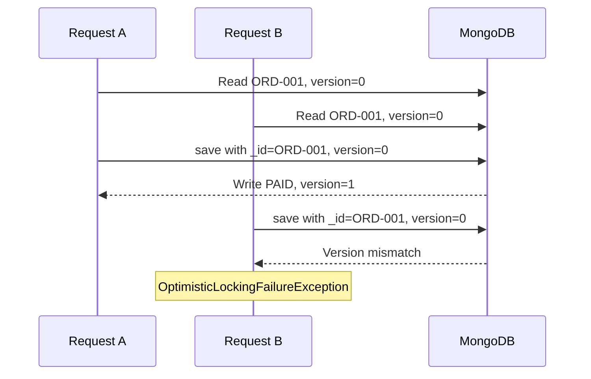
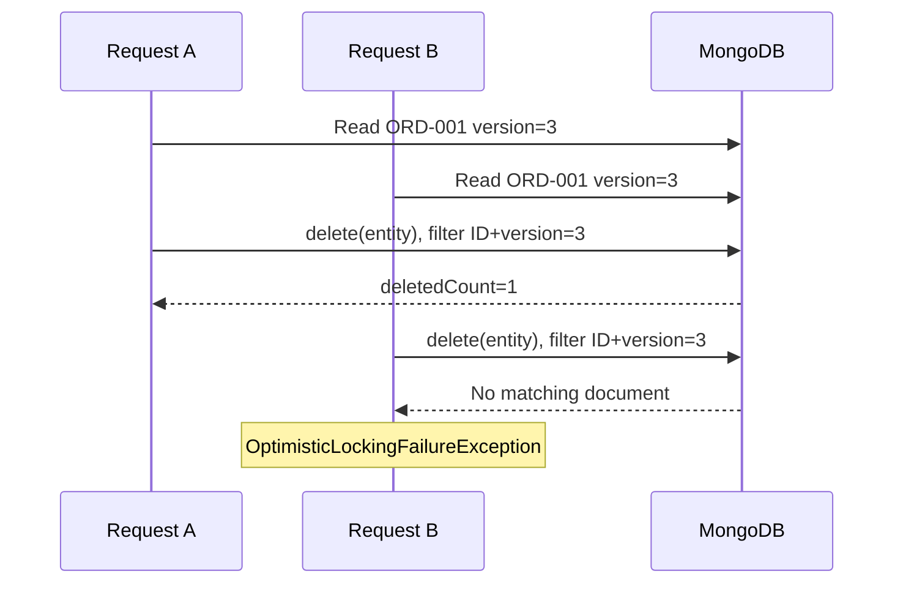
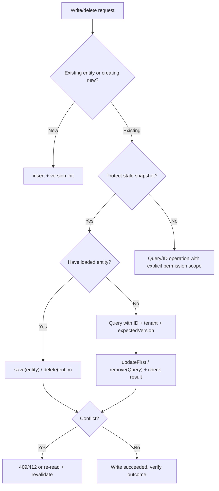

# Version on insert, update, and delete

> **Chapter:** Concurrency Control  
> **Module:** `SPRING_DATA_MONGODB` — connecting and mapping documents, working with MongoDB via `MongoTemplate` or repositories, practicing queries, aggregations, indexes, transactions, reactive access, testing, and performance diagnostics. This lesson focuses on the **`@Version` lifecycle across insert, save/update, and delete**, exceptions caused by stale records, and the limits of optimistic locking when using query-based updates/deletes.

## 1. Why is versioning needed in MongoDB?

Suppose an order `ORD-001` is in status `PENDING`. Two tasks read it almost simultaneously:

- **Request A** confirms payment, changing it to `PAID`.
- **Request B** cancels the order, changing it to `CANCELLED`, while still holding the previously loaded object.

If the application writes using only `_id`, the later operation can overwrite the status just saved by the earlier one. This is a **lost update**.

Spring Data MongoDB uses `@Version` to implement **optimistic locking**: each document carries a version. When modifying a loaded entity, the framework puts the **expected version** into the write filter and updates the version upon success. If someone else modified it first, the database's current version no longer matches, and the stale operation fails instead of silently overwriting.



**Do not confuse optimistic locking with exclusive locks:** the framework does not hold a lock from read time until write time. Two requests can read the same version; at most one write matching **the same old version condition** is accepted if they genuinely contend on the same document. MongoDB guarantees update atomicity at **the document level**, so comparing the version and writing the new version happen consistently at update time.

### 1.1. Three distinct moments

| Operation | Rule to understand | Consequence |
| --- | --- | --- |
| **Insert** via `insert` or saving an entity considered new | Spring Data **initializes an unassigned version** | Wrapper `Long` typically starts at `0`; primitive `long` starts at `1` |
| **Update** via `save` on an existing entity | Combines `_id + old version` in the write filter and increments version on success | Stale object is rejected with an exception |
| **Delete entity** via `repository.delete(entity)` or `mongoTemplate.remove(entity)` | For `@Version` entities, delete filters by **ID and version** | Repository delete checks result and can throw `OptimisticLockingFailureException`; template remove returns `DeleteResult` for the caller to inspect count |

**Scope:** the rules in this table apply to Spring Data MongoDB APIs **that support version control**. Do not assume every `updateFirst`, `@Query`, `@Update`, bulk write, raw Java Driver call, or delete-by-ID checks version like `save(entity)`.

## 2. Domain model: @Version alongside @Id

Define an entity with a wrapper `Long` version and an application-supplied `String` ID:

```java
package demo.orders;

import org.springframework.data.annotation.Id;
import org.springframework.data.annotation.Version;
import org.springframework.data.mongodb.core.mapping.Document;

@Document(collection = "purchase_orders")
public class PurchaseOrder {
    @Id
    private String id;

    private String tenantId;
    private String status;
    private long amountCents;

    @Version
    private Long version;

    protected PurchaseOrder() {}

    public PurchaseOrder(
        String id, String tenantId, String status, long amountCents
    ) {
        this.id = id;
        this.tenantId = tenantId;
        this.status = status;
        this.amountCents = amountCents;
    }

    public String getId() { return id; }
    public String getTenantId() { return tenantId; }
    public String getStatus() { return status; }
    public long getAmountCents() { return amountCents; }
    public Long getVersion() { return version; }

    public void setStatus(String status) { this.status = status; }
    public void setAmountCents(long amountCents) {
        this.amountCents = amountCents;
    }
}
```

`@Version` here is `org.springframework.data.annotation.Version`, **not** the JPA annotation. MongoDB stores version as a BSON field corresponding to the `version` property (unless customized via mapping). `Long` allows representing **no version yet** as `null` on a new entity.

Repository:

```java
package demo.orders;

import org.springframework.data.mongodb.repository.MongoRepository;

public interface PurchaseOrderRepository
    extends MongoRepository<PurchaseOrder, String> {
}
```

When using `MongoTemplate`, pass `PurchaseOrder.class` so the framework knows domain metadata such as `@Id`, `@Version`, `@Field`, and collection name. Inspecting raw `db.purchase_orders` via `mongosh` reveals the actual BSON, not Java annotations.

### 2.1. What data type should @Version use?

The example chooses `Long`. Other common examples use `Integer`/`int`/`long`. Use an **appropriate numeric type** and a consistent BSON schema, rather than treating an arbitrary client-chosen version value as truth.

Do not use `version` as a business ID: each document has its own version, not a system-wide clock. Do not infer total writes across the collection by taking the maximum version.

### 2.2. Immutable entities and records

If the domain uses immutable classes/records, Spring Data needs a way to construct a new entity instance and update `@Version` through a persistence constructor, wither, or compatible mapping mechanism. Do not assume calling `save` mutates an immutable object in place the same way as the mutable class in this example. This lesson uses a mutable class with setters to make **old and new snapshots** easy to follow.

## 3. Version value on insert: wrapper 0, primitive 1

Spring Data MongoDB documents the rule for initializing an **unassigned** `@Version` during insert:

| Field declaration | Value when created in Java | Typical version after insert |
| --- | --- | --- |
| `@Version Long version` | `null` | **0** |
| `@Version Integer version` | `null` | **0** |
| `@Version long version` | `0` default | **1** |
| `@Version int version` | `0` default | **1** |

This distinction matters because Spring Data Commons can use version to detect a **new entity**: wrapper `null` is treated as unsaved, whereas primitive `0` serves as the "no valid version yet" sentinel in newness detection rules.

### 3.1. Insert with Long wrapper

```java
PurchaseOrder candidate = new PurchaseOrder(
    "ORD-001", "TENANT-A", "PENDING", 10000L
);

assert candidate.getVersion() == null;

PurchaseOrder inserted = mongoTemplate.insert(candidate);

System.out.println(inserted.getVersion()); // 0
```

Semantically corresponding BSON:

```javascript
{
  _id: "ORD-001",
  tenantId: "TENANT-A",
  status: "PENDING",
  amountCents: NumberLong(10000),
  version: NumberLong(0)
}
```

**Do not manually assign `version=1` on a creation request** assuming the framework will always treat it as a new entity. For entities using version-based is-new detection, setting a non-default initial version can make `save` treat it as an existing entity, resulting in non-insert behavior.

### 3.2. Insert with primitive long

Another entity:

```java
import org.springframework.data.annotation.Id;
import org.springframework.data.annotation.Version;
import org.springframework.data.mongodb.core.mapping.Document;

@Document(collection = "primitive_version_orders")
public class PrimitiveVersionOrder {
    @Id String id;
    @Version long version;

    public PrimitiveVersionOrder(String id) {
        this.id = id;
    }
}
```

```java
PrimitiveVersionOrder order = new PrimitiveVersionOrder("P-001");
System.out.println(order.version); // 0 (Java default)

mongoTemplate.insert(order);
System.out.println(order.version); // 1 after insert per standard mapping
```

**Why does a primitive start at 1?** Because the primitive value `0` is also used to represent **a new entity** under version-based newness detection; version starts at `1` once inserted. With a wrapper, `null` represents unsaved, so the first version can be `0`.

### 3.3. Is-new check when calling repository.save

```java
PurchaseOrder order = new PurchaseOrder(
    "ORD-NEW", "TENANT-A", "PENDING", 25000L
);
PurchaseOrder saved = purchaseOrderRepository.save(order);

System.out.println(saved.getVersion()); // usually 0 for a new Long
```

`save` on a new entity can take the **insert** branch, while `save` on an entity with an existing ID/version takes the **update** branch. **ID is not the sole factor deciding new vs. existing when an entity has a version**. Creating a new object with an ID matching an existing record but `version=null` can cause an insert that reports **duplicate key**—not necessarily an optimistic-lock exception.

Recommendations:

- Create new entities with an unassigned version.
- Let Spring Data manage version.
- After `save`/`insert`, use the returned entity and/or reload to obtain the current version.
- For REST APIs, hold version server-side or pass version as a validated concurrency token; never let clients arbitrarily bump version to bypass conditions.

## 4. Update save: matching ID and version in one write operation

Suppose `ORD-001` already exists with `version=0`. When running:

```java
PurchaseOrder order = purchaseOrderRepository.findById("ORD-001")
    .orElseThrow();

order.setStatus("PAID");
PurchaseOrder updated = purchaseOrderRepository.save(order);

System.out.println(updated.getVersion()); // 1 after successful update
```

Spring Data includes the old version in the write filter. The logic can be conceptually expressed as:

```javascript
db.purchase_orders.updateOne(
  { _id: "ORD-001", version: NumberLong(0) },
  {
    // In practice the framework may use replacement or a different update shape.
    $set: { status: "PAID", amountCents: NumberLong(10000) },
    $inc: { version: NumberLong(1) }
  }
);
```

This is a **mental model of compare-and-set**, not a byte-for-byte guarantee of the command emitted by Spring Data (`save` may execute a different shape depending on version). The invariant to uphold is **modifying only when ID and old version match**, and **incrementing version** on a successful write.

### 4.1. Two separate snapshots and lost update

```java
PurchaseOrder snapshotA =
    purchaseOrderRepository.findById("ORD-001").orElseThrow();
PurchaseOrder snapshotB =
    purchaseOrderRepository.findById("ORD-001").orElseThrow();

System.out.println(snapshotA.getVersion()); // 0
System.out.println(snapshotB.getVersion()); // 0

snapshotA.setStatus("PAID");
purchaseOrderRepository.save(snapshotA); // new version: 1

snapshotB.setStatus("CANCELLED");
purchaseOrderRepository.save(snapshotB);
// OptimisticLockingFailureException
```

By the time snapshot B tries to write, MongoDB already has version `1`. Filtering for version `0` finds no document to update, so Spring Data raises an error **instead of overwriting with CANCELLED**.

### 4.2. Which exception is thrown?

In Spring Data applications, a stale write error typically surfaces as:

```java
import org.springframework.dao.OptimisticLockingFailureException;

try {
    purchaseOrderRepository.save(snapshotB);
} catch (OptimisticLockingFailureException conflict) {
    // Record changed version or was deleted;
    // do not overwrite with the stale snapshot.
}
```

`OptimisticLockingFailureException` belongs to the Spring DAO exception hierarchy. Do not rely on `NullPointerException`, `DuplicateKeyException`, or `IllegalStateException` as the primary indicator of a version mismatch. A request can fail for many other reasons (timeout, network, validation) that the service must distinguish.

### 4.3. @Version only protects documents with matching metadata

If an update occurs via **raw driver**:

```javascript
db.purchase_orders.updateOne(
  { _id: "ORD-001" },
  { $set: { status: "CANCELLED" } }
);
```

This command **neither checks version** nor **auto-increments version** per Java's `@Version`, because MongoDB does not know about Spring annotations. It can change data while leaving version unchanged, causing subsequent `save` requests to **miss** that modifications occurred.

To achieve optimistic locking across the entire system, all significant writers (repositories, templates, jobs, scripts, other services) must **follow the same concurrency protocol** or use appropriate atomically guarded updates.

## 5. @Version differs from business state, and optimistic locking does not include transactions

Version is a **change-detection token**, not a replacement for business conditions like `status="PENDING"`, sufficient balance, available inventory, or matching `tenantId`.

For example, an order may have the latest version yet already be `CANCELLED`. A "markPaid" operation must block based on state rules, not just check version and allow transitioning to `PAID`.

**Do not assume `@Version` automatically guarantees valid state transitions.** For strongly conditional operations, combine:

- State/permission checks in the service.
- Server-side filters containing **prior status/tenant/version** when business compare-and-set is needed.
- Consistent version rules across other writers.
- Transactions/outbox if the workflow spans multiple documents or external events.

### 5.1. Optimistic locking is not a multi-document transaction

A single update command on one document is atomic at the document level. Yet if after updating the order, the application must **deduct inventory and write a payment receipt** in two other collections, the order's version does not automatically ensure the other two steps commit or roll back together.

MongoDB transactions on a supported replica set/sharded topology can handle atomicity across participating operations; they carry their own cost and limits. **Transactions and versioning solve different problems** and can be combined when needed.

### 5.2. Do not use version as an idempotency key

Version increments on successful updates, yet does not recognize "these two requests are the same payment event resent". To avoid paying or incrementing twice, use an **idempotency key** or an independent data rule (event ledger, unique constraint, conditional state transition).

`@Version` detects stale snapshots; it **does not replace idempotency** for business requests.

## 6. insert, save, and upsert: similar names, different semantics

| API | Typical use case | Version behavior |
| --- | --- | --- |
| `MongoTemplate.insert(entity)` | Insert a new document; error if ID collides | Initializes unassigned `@Version` |
| `MongoRepository.save(entity)` | Insert entity treated as new or update existing entity | New-state detection; checks version when updating a versioned entity |
| `MongoTemplate.save(entity)` | Save domain entity with similar version support via its own API/path | When updating an existing entity, filters by expected version |
| `MongoTemplate.upsert(query, update, Entity.class)` | Update if matched, or insert new document if unmatched | Supports initializing/incrementing version **if Update does not specify version**, yet **does not match expected version by default** |
| `MongoTemplate.upsert(query, update, "collectionName")` | Upsert by collection name (lacking domain type metadata) | Lacks full mapping/version support from entity class |
| Java Driver `updateOne(..., upsert=true)` | Direct MongoDB operation | Unaware of `@Version`; requires manual version management |

### 6.1. Upsert may create a new record if the query version misses

This is an important trap. Suppose:

```javascript
db.purchase_orders.findOne({ _id: "ORD-001" });
// { _id: "ORD-001", version: 3, status: "PAID", ... }
```

If calling upsert with filter `{_id:"ORD-001",version:2}`, **no document matches**. MongoDB may attempt to **insert** a new document from the query/update instead of reporting "stale version". When `_id` is the same `ORD-001`, the common outcome is a **duplicate key** error (because `_id` already exists), rather than an optimistic locking exception like `save(entity)`.

**Do not use upsert as a simple compare-and-set tool.** For update-if-version-matches semantics, use `save(entity)` or `updateFirst`/`findAndModify` with the old version in the filter and **upsert disabled**, then inspect `matchedCount`/result.

### 6.2. Upsert auto-adding version does not automatically prevent races

Spring Data documentation notes that certain `MongoTemplate` upsert/update operations can **auto-initialize or increment `@Version`** if you **omit the version field from Update**. However, merely incrementing version **does not automatically inject the old version condition into the query**. If the filter only specifies `_id`, two requests can still update and overwrite each other even though version increments twice.

This is why we distinguish:

1. **Checking version in the filter** — prevents stale writes.
2. **Incrementing version in the update** — invalidates old snapshots.

Good concurrency control requires both parts working consistently, not just one.

## 7. MongoTemplate.updateFirst: write the version condition yourself

### 7.1. Why isn't query-based update like save(entity)?

`save(entity)` holds the **entity snapshot** with its old version, allowing Spring Data to construct the corresponding version filter. In contrast, a call like:

```java
mongoTemplate.updateFirst(
    Query.query(Criteria.where("id").is("ORD-001")),
    new Update().set("status", "PAID"),
    PurchaseOrder.class
);
```

**does not automatically know which version the caller previously read**. For typed update operations, Spring Data MongoDB may automatically **increment version when `Update` omits the version field**, yet that does not add **the old version to the filter**. Two requests using an ID-only query can both overwrite, breaking compare-and-set assumptions.

### 7.2. Putting expectedVersion into Criteria

```java
package demo.orders;

import com.mongodb.client.result.UpdateResult;
import org.springframework.dao.OptimisticLockingFailureException;
import org.springframework.data.mongodb.core.MongoTemplate;
import org.springframework.data.mongodb.core.query.Criteria;
import org.springframework.data.mongodb.core.query.Query;
import org.springframework.data.mongodb.core.query.Update;
import org.springframework.stereotype.Service;

@Service
public class OrderTransitionService {
    private final MongoTemplate mongoTemplate;

    public OrderTransitionService(MongoTemplate mongoTemplate) {
        this.mongoTemplate = mongoTemplate;
    }

    public void markPaid(
        String id, String tenantId, long expectedVersion
    ) {
        Query filter = Query.query(
            Criteria.where("id").is(id)
                .and("tenantId").is(tenantId)
                .and("version").is(expectedVersion)
                .and("status").is("PENDING")
        );

        Update update = new Update().set("status", "PAID");
        // With typed MongoTemplate update, Spring Data can auto-increment
        // @Version if Update does not specify the version field.

        UpdateResult result = mongoTemplate.updateFirst(
            filter, update, PurchaseOrder.class
        );

        if (!result.wasAcknowledged()) {
            throw new IllegalStateException(
                "Write acknowledgement is required"
            );
        }
        if (result.getMatchedCount() != 1L) {
            throw new OptimisticLockingFailureException(
                "Order not found, stale, or transition not allowed"
            );
        }
    }
}
```

**Note:** when calling `Criteria.where("id")` with `PurchaseOrder.class`, Spring Data MongoDB uses entity metadata to map the ID property to BSON `_id`. With raw `Document` or `mongosh`, you must use the actual BSON field name.

In this method, the filter includes:

- Order ID;
- Tenant from authenticated context;
- Expected version (e.g., `3`);
- Pre-transition status (`PENDING`).

If `matchedCount=0`, the cause could be missing ID, wrong tenant, changed version, or status no longer `PENDING`. The example uses a general exception to block the write; in a production API, classify per contract **without leaking the existence of another tenant's resource**.

### 7.3. Automatic vs. explicit version increment

Typed `MongoOperations` updates support **auto-incrementing version when the update does not mention version** per documentation. However, details can depend on operation type and Spring Data version.

If you need **explicit full control over compare-and-set**, include version in the update payload:

```java
Query filter = Query.query(
    Criteria.where("id").is("ORD-001")
        .and("tenantId").is("TENANT-A")
        .and("version").is(3L)
);

Update update = new Update()
    .set("status", "PAID")
    .inc("version", 1L);

UpdateResult result = mongoTemplate.updateFirst(
    filter, update, PurchaseOrder.class
);
```

Because version **already appears in Update**, Spring Data does not need to add a second increment. **Do not manually `$inc version` without verifying whether the active update path already auto-increments version**; an update rule could lead to double increments or conflicts if done improperly.

### 7.4. Matched count and modified count

The Java Driver returns `UpdateResult`:

```java
long matched = result.getMatchedCount();
long modified = result.getModifiedCount();
```

`matchedCount=1` means a document satisfied the filter; `modifiedCount=1` means a document actually changed. With an update that only `$set`s the same value, `matched=1` while `modified=0` is possible. If a typed update simultaneously increments version, the record may still count as modified because version changed.

For compare-and-set, **matched count** usually indicates cleanly whether the filter condition matched. Do not assume modified count 0 is always a version error if a write command can be a no-op by design.

## 8. Repository @Query + @Update and expected version

A repository update method uses `@Query` to select documents and `@Update` to describe the modification. It **does not run a load–modify–save entity lifecycle** for each document.

```java
package demo.orders;

import org.springframework.data.mongodb.repository.MongoRepository;
import org.springframework.data.mongodb.repository.Query;
import org.springframework.data.mongodb.repository.Update;

public interface OrderUpdateRepository
        extends MongoRepository<PurchaseOrder, String> {

    @Query("{ '_id': ?0, 'tenantId': ?1, " +
           "'version': ?2, 'status': 'PENDING' }")
    @Update("{ '$set': { 'status': 'PAID' }, " +
            "'$inc': { 'version': 1 } }")
    long findAndMarkPaidIfVersionMatches(
        String id, String tenantId, long expectedVersion
    );
}
```

Here:

- `?0` is ID, `?1` is tenant, `?2` is the version expected by the caller.
- `@Query` protects **ID + tenant + version + prior status**.
- `@Update` sets the new status and **explicitly increments version**.
- `long` reports the number of modified documents per the repository update API.

When ID is unique and the filter matches, at most **one** document is modified. Without an ID/unique key, a repository update can modify **all matching documents**, not automatically limiting to one.

**Do not conclude that adding `@Version` to an entity makes every `@Update` method check version automatically.** A filter with only `_id` can still modify an already-changed object. If annotation updates are used in production, integration-test the exact MongoDB command and version auto-increment policy on your **active dependencies**.

### 8.1. Does not emit lifecycle events like save

Repository update methods **do not emit persistence/mapping lifecycle events** like the standard `save` path. If the application relies on audit rules or domain validation in save callbacks, do not assume they run for each document modified by `@Update`. Explicitly set `updatedAt`, actor, and validation in the update path if the contract requires them.

### 8.2. Connecting expectedVersion to APIs

A REST endpoint can accept `expectedVersion` in the body or `If-Match`/ETag:

```text
PATCH /orders/ORD-001/status
If-Match: "v3"
Content-Type: application/json

{"status":"PAID"}
```

The API server parses token `v3` into expected version, verifies tenant and valid action, then invokes the conditional update. `If-Match` is an HTTP design technique; **Spring Data does not automatically implement ETag handling for controllers** just because an entity has `@Version`.

If the client-supplied version is stale, HTTP `409 Conflict` or `412 Precondition Failed` may fit depending on contract; with `If-Match`, `412` is usually clearer. **Do not automatically return 404** from a count of 0 without handling ID/tenant/status and privacy policies.

## 9. Deleting a versioned entity: delete(entity) is guarded

### 9.1. MongoRepository.delete(entity)

Since **Spring Data MongoDB 2.2**, repositories inspect the result of an **acknowledged delete** when deleting a versioned entity. If the entity is stale, `CrudRepository.delete(Object)` throws `OptimisticLockingFailureException` instead of silently deleting a newer document.

Example:

```java
PurchaseOrder stale =
    purchaseOrderRepository.findById("ORD-001").orElseThrow();

PurchaseOrder current =
    purchaseOrderRepository.findById("ORD-001").orElseThrow();

current.setStatus("PAID");
purchaseOrderRepository.save(current); // version 0 -> 1

purchaseOrderRepository.delete(stale);
// OptimisticLockingFailureException: stale.version = 0
```

In MongoDB terms, the framework deletes by the entity's **ID and version**:

```javascript
db.purchase_orders.deleteOne({
  _id: "ORD-001",
  version: NumberLong(0)
});
// deletedCount = 0 if DB currently has version=1
```

This is the logical flow: Spring Data builds the appropriate filter from metadata, and when deleting a versioned entity matches nothing, it handles the mismatch as an optimistic locking error per API contract.

### 9.2. MongoTemplate.remove(entity): includes version filter, returns DeleteResult

Since **2.2**, Spring Data MongoDB also includes `@Version` in the query of `MongoOperations.remove(entity)`. However, the JavaDoc of `MongoOperations.remove(Object)` describes returning **`DeleteResult`** to inspect deleted count, **without promising to throw `OptimisticLockingFailureException` automatically** like repository `delete(entity)`:

```java
PurchaseOrder snapshot = mongoTemplate.findById(
    "ORD-001", PurchaseOrder.class
);

// Assume snapshot is non-null, and another writer incremented version.
com.mongodb.client.result.DeleteResult result =
    mongoTemplate.remove(snapshot);

if (!result.wasAcknowledged()) {
    throw new IllegalStateException("Delete not acknowledged");
}
if (result.getDeletedCount() != 1L) {
    throw new org.springframework.dao.OptimisticLockingFailureException(
        "Entity absent or version changed"
    );
}
```

In this example, `snapshot` must be non-null, and `remove` executes **after another operation updated the version**. The filter with the old version fails to match, giving `deletedCount=0`. **The service explicitly decides to throw an optimistic exception based on count**; a template `remove` returning 0 does not automatically throw. On older Spring Data versions or other API paths, verify exact behavior with integration tests.

### 9.3. A deleted entity also makes old snapshots stale

Two threads read the same document at version=3:



This matches the optimistic locking contract for deleting versioned entities. If an API wants repeated deletes to be idempotent and return success when the document is already gone, the service needs **an explicit result-handling policy**, rather than letting every optimistic exception leak to clients.

## 10. Deleting by ID and by Query: can bypass version checks

### 10.1. CrudRepository.deleteById(ID)

Per Spring Data MongoDB documentation, `CrudRepository.deleteById(ID)` **bypasses the optimistic locking check** of `@Version`:

```java
purchaseOrderRepository.deleteById("ORD-001");
```

This operation has no **expectedVersion** from a specific snapshot to match against. Consequently, a user holding stale state can call `deleteById` and delete a document already updated by another request unless the application enforces extra constraints.

**Multi-tenant risk:** the method accepts only an ID with no tenant criteria. For predictable IDs or IDs shared across tenants, verify authorization before calling or use a delete query containing tenant and expected version.

### 10.2. MongoTemplate.remove(Query,…)

`MongoOperations.remove(Query, Entity.class)` operates using the **Criteria supplied by the caller**, and does not automatically add a specific entity snapshot's version:

```java
import com.mongodb.client.result.DeleteResult;
import org.springframework.data.mongodb.core.query.Criteria;
import org.springframework.data.mongodb.core.query.Query;

Query byIdAndTenant = Query.query(
    Criteria.where("id").is("ORD-001")
        .and("tenantId").is("TENANT-A")
);

DeleteResult result = mongoTemplate.remove(
    byIdAndTenant, PurchaseOrder.class
);

long deleted = result.getDeletedCount();
```

The command above includes tenant yet **does not check version**, so it deletes the document even if another request bumped the version. To guard version:

```java
Query guarded = Query.query(
    Criteria.where("id").is("ORD-001")
        .and("tenantId").is("TENANT-A")
        .and("version").is(3L)
);

DeleteResult result = mongoTemplate.remove(
    guarded, PurchaseOrder.class
);

if (!result.wasAcknowledged()) {
    throw new IllegalStateException("Delete must be acknowledged");
}
if (result.getDeletedCount() != 1L) {
    throw new OptimisticLockingFailureException(
        "Order absent, stale or outside tenant"
    );
}
```

**Note:** query-based `remove(Query, …)` **does not automatically throw an optimistic exception** just because deleted count is 0. In the example, **the service proactively checks `deletedCount`** and raises the exception per contract. If the query lacks an ID/unique key, `remove(Query, Entity.class)` can delete **multiple documents** matching the filter.

### 10.3. Delete comparison table

| Method | Has entity's expectedVersion? | Auto-checks version? | When deletion fails to match |
| --- | :---: | :---: | --- |
| `repository.delete(entity)` | Yes | **Yes** for versioned entity (2.2+) | Optimistic lock failure with acknowledged delete |
| `mongoTemplate.remove(entity)` | Yes | **Includes version in filter** for versioned entity (2.2+) | Returns `DeleteResult`; when stale typically `deletedCount=0`, caller handles |
| `repository.deleteById(id)` | No | **No** | Deletes by ID, throws no version mismatch error |
| `mongoTemplate.remove(Query, Entity.class)` | Only if caller puts it in query | **Not automatic** | `DeleteResult`, caller decides how to handle count 0 |
| Raw Java Driver `deleteOne` | Only if filter includes version | **Unaware of `@Version`** | `DeleteResult`, caller checks count |

For business operations meaning "delete only if the document is still at the version the user sees", **do not use `deleteById` as the default**. For ID-based deletion without version checks (e.g., admin cleanup), restrict permissions and audit explicitly.

## 11. Write concern: without acknowledgement, conflicts cannot be reliably detected

Spring Data MongoDB emphasizes: **optimistic locking requires write acknowledgement from the server**. If `WriteConcern.UNACKNOWLEDGED` is used, update/delete outcomes are unconfirmed; the framework may **fail to detect** stale writes and throw `OptimisticLockingFailureException`.

### 11.1. ACKNOWLEDGED vs. UNACKNOWLEDGED

| Write concern | Basic meaning | Impact on optimistic locking |
| --- | --- | --- |
| `UNACKNOWLEDGED` / `w:0` | Client does not wait for server write result | **Unsuitable** when needing to know if update/delete matched version |
| `ACKNOWLEDGED` / `w:1` | Primary acknowledges operation per write concern | Allows framework to observe matched/deleted results and detect mismatches |
| `MAJORITY` | Matches majority acknowledgment guarantees in a replica set | Stronger durability across failovers; still requires a version filter |

`WriteConcern.ACKNOWLEDGED` is a necessary condition for conflict detection, **not a synonym for majority durability across failures**. If the business requires durability across failovers, design write concern and retry strategy to suit the topology.

### 11.2. Application-layer configuration example

Depending on stack and version, you can configure `MongoTemplate`/`MongoClient` to use a write concern meeting business needs:

```java
import com.mongodb.WriteConcern;

// Example during initialization of an existing MongoTemplate configuration:
mongoTemplate.setWriteConcern(WriteConcern.ACKNOWLEDGED);
```

The snippet merely illustrates **configuration intent**; it does not recommend switching write concern per request or overriding other driver/transaction/write concern resolver configurations. If using `@Transactional` with MongoDB, check the transaction/commit write concern in the real system.

### 11.3. Network errors and indeterminate write outcomes

If a client loses connection after sending `save`, the server **may have written successfully** before the client received the response. Do not assume "an exception means version did not increment" and retry endlessly:

- Re-read the document by ID + tenant, comparing status and version.
- If the business operation has an event ID, check idempotency.
- Distinguish version mismatch errors from network timeouts or write concern errors.
- Retry only within bounds according to error classification and operation characteristics.

## 12. Retrying after OptimisticLockingFailureException: reload, recompute, bound attempts

### 12.1. Dangerous retry pattern

```java
// ANTI-PATTERN: holding onto the stale object and saving again.
while (true) {
    try {
        purchaseOrderRepository.save(staleOrder);
        break;
    } catch (OptimisticLockingFailureException ex) {
        // Neither version nor state refreshed -> potential infinite loop.
    }
}
```

Once `staleOrder` holds an old version, saving the exact same object usually continues failing. **Setting the version to a guessed value is also unsafe**, as it can overwrite someone else's update.

### 12.2. Proper retry must recompute from fresh state

For example, "update amountCents per current rules" can retry on version mismatch **if business rules allow**:

```java
public PurchaseOrder changeAmountWithRetry(
    String id, String tenantId, long newAmountCents
) {
    final int maxAttempts = 3;
    for (int attempt = 1; attempt <= maxAttempts; attempt++) {
        PurchaseOrder latest = purchaseOrderRepository.findById(id)
            .filter(order -> tenantId.equals(order.getTenantId()))
            .orElseThrow(() -> new IllegalArgumentException(
                "Order not found or not accessible"
            ));

        if (!"PENDING".equals(latest.getStatus())) {
            throw new IllegalStateException(
                "Cannot change amount of a non-pending order"
            );
        }

        latest.setAmountCents(newAmountCents);
        try {
            return purchaseOrderRepository.save(latest);
        } catch (OptimisticLockingFailureException conflict) {
            if (attempt == maxAttempts) {
                throw conflict;
            }
            // Next iteration reloads the fresh entity and rechecks all business rules.
        }
    }
    throw new IllegalStateException("Unreachable");
}
```

`purchaseOrderRepository` is a service dependency injected via constructor. This method illustrates a **bounded retry**; delay/backoff is omitted to stay focused, though production often needs jitter and a sensible retry policy.

**Business warning:** never automatically retry by "reloading and re-applying the same request" for payments, deductions, or state transitions where repetition can cause external side effects. For financial transactions, you typically need an idempotency token, event ledger, or outbox. A version conflict may be **a signal to return 409/412 to the user**, not necessarily an error to retry.

### 12.3. Caution with transactions during retries

If `save` runs inside a MongoDB transaction and encounters a write conflict, the transaction may already be in a state requiring rollback/retry of **the entire transaction**, not just retrying one statement within the same transaction. Follow driver/Spring transaction manager guidance on retryable errors and design boundaries carefully.

Never catch and ignore arbitrary exceptions, and never continue using the same transactional context after an error has invalidated the transaction.

## 13. ReactiveMongoRepository and ReactiveMongoTemplate

### 13.1. Saving a versioned entity as a Mono

`ReactiveMongoRepository` implements optimistic locking semantics for corresponding operations on `@Version` entities:

```java
package demo.orders;

import org.springframework.data.mongodb.repository.ReactiveMongoRepository;

public interface ReactivePurchaseOrderRepository
    extends ReactiveMongoRepository<PurchaseOrder, String> {}
```

In a service:

```java
import reactor.core.publisher.Mono;

Mono<PurchaseOrder> updated = reactivePurchaseOrderRepository
    .findById("ORD-001")
    .switchIfEmpty(Mono.error(
        new IllegalArgumentException("Order not found")
    ))
    .map(order -> {
        order.setStatus("PAID");
        return order;
    })
    .flatMap(reactivePurchaseOrderRepository::save);
```

No `block()` on the event loop. When `Mono` is subscribed, the find and save execute; if another request incremented the version, `save` emits the corresponding error via the publisher's **onError** signal.

In multi-tenant applications, the snippet above should add **tenant checks** before changing status; do not use ID-only lookups on endpoints where callers are not authorized to access all tenants.

### 13.2. Catching conflicts specifically in reactive pipelines

```java
import org.springframework.dao.OptimisticLockingFailureException;

Mono<PurchaseOrder> result = updated.onErrorMap(
    OptimisticLockingFailureException.class,
    ex -> new OrderConflictException(
        "Order was modified by another request", ex
    )
);
```

`OrderConflictException` is an application-defined custom exception. `onErrorMap` **only transforms the error**; it does not retry or alter data. To retry, define a bounded retry policy that **reloads state** appropriately for the business logic.

### 13.3. Reactive delete also distinguishes entity vs. ID

```java
Mono<Void> guardedDelete = reactivePurchaseOrderRepository
    .findById("ORD-001")
    .switchIfEmpty(Mono.error(
        new IllegalArgumentException("Order not found")
    ))
    .flatMap(reactivePurchaseOrderRepository::delete);
```

`delete(entity)` uses the passed entity's version on supported repository paths. Still, finding by ID then deleting requires permission/tenant checks, and **a race window exists** between read and delete: the version guard is what prevents stale deletes at the document level.

`reactivePurchaseOrderRepository.deleteById("ORD-001")` carries no version snapshot, so do not use it in place of guarded delete if the endpoint requires compare-and-delete.

### 13.4. Conditional updates with ReactiveMongoTemplate

```java
import com.mongodb.client.result.UpdateResult;
import org.springframework.data.mongodb.core.query.Criteria;
import org.springframework.data.mongodb.core.query.Query;
import org.springframework.data.mongodb.core.query.Update;
import reactor.core.publisher.Mono;

Query query = Query.query(
    Criteria.where("id").is("ORD-001")
        .and("tenantId").is("TENANT-A")
        .and("version").is(3L)
        .and("status").is("PENDING")
);

Mono<UpdateResult> write = reactiveMongoTemplate.updateFirst(
    query,
    new Update().set("status", "PAID"),
    PurchaseOrder.class
);
```

Like imperative `MongoTemplate`, **the query must contain the expected version** for optimistic compare-and-set. The publisher emits `UpdateResult` to check `matchedCount` when subscribed. Auto-incrementing version (when Update omits version) **does not mean auto-matching version**.

## 14. Bulk operations, aggregation updates, and bypass paths

### 14.1. Bulk writes are not equivalent to per-entity versioned saves

`BulkOperations` optimizes round trips for many updates/inserts, yet you must not assume bulk updates share `save(entity)`'s per-item optimistic-lock exception semantics. For query-based bulk updates, explicitly put `version` in each filter and increment version when CAS is wanted.

```java
// Idea for version control on a bulk update item:
Query filter = Query.query(
    Criteria.where("id").is("ORD-001")
        .and("version").is(3L)
);
Update change = new Update()
    .set("status", "PAID")
    .inc("version", 1L);

// Add bulk operations for required items, then execute.
// Inspect BulkWriteResult and map per-item/exception outcomes as needed.
```

Per Spring Data documentation, **bulk operations do not fully support per-entity optimistic locking and lifecycle events**. Do not take an aggregate modified count from a bulk write and try to guess which exact items were stale without an explicit reconciliation design.

### 14.2. Aggregation pipeline updates

MongoDB allows update pipelines (such as `$set` with expressions) via appropriate Spring Data APIs. When an update is not `save(entity)`, the old snapshot version is not automatically used to build a filter. Explicitly verify:

1. Does the selection condition include `version` and prior status?
2. Does the update increment version once?
3. Is upsert enabled or disabled, and what happens on no-match?
4. Are mapping/converters for the version field applied on this API path?
5. How are exceptions and write concerns handled?

Run integration tests against your exact server/Spring Data version before relying on it in critical business flows.

### 14.3. Raw driver and external services must share the protocol

A worker outside Java might write:

```javascript
db.purchase_orders.updateOne(
  { _id: "ORD-001", version: NumberLong(3) },
  {
    $set: { status: "PAID" },
    $inc: { version: NumberLong(1) }
  }
);
```

If all writers use a consistent CAS mechanism, version protects data across components. However, if any writer omits the version filter or updates status without incrementing version, optimistic locking guarantees erode. This is a **system-wide convention**, not a global setting enforced automatically by a Java annotation in a Spring app.

## 15. Mapping, legacy documents, and handling anomalous versions

### 15.1. Documents missing the version field

A system may have written millions of documents before `@Version` was added:

```javascript
db.purchase_orders.findOne({ _id: "LEGACY-001" });
// { _id: "LEGACY-001", tenantId: "...", status: "...", ... }
// No version field.
```

When the entity maps this to `Long version`, the Java value can be `null`. That is also **the new-entity signal** for version-based detection. Do not assume `repository.save(legacyEntity)` will smoothly update an old document; it may be classified as new and attempt an insert, leading to a duplicate ID error.

Before enabling optimistic locking on legacy data:

- Audit documents missing version or having the wrong type.
- Define the initial version (typically 0 for wrappers) consistent with mapping.
- Run a controlled data migration without arbitrarily changing versions while writers are active.
- Ensure all writers have adopted the version-checking protocol.
- Test legacy records, new records, and concurrent updates/deletes.

### 15.2. Example migration on test MongoDB

```javascript
db.purchase_orders.updateMany(
  { version: { $exists: false } },
  { $set: { version: NumberLong(0) } }
);
```

This is a **test-database migration example**, not a recommendation to run directly against production. If the system continues writing, version migration can race; you need a rollout procedure, pause/dual-write, or a specifically evaluated compatibility strategy.

### 15.3. Never reset existing versions back to 0

```javascript
// ANTI-PATTERN: invalidates concurrency tokens currently held by clients.
db.purchase_orders.updateMany(
  {},
  { $set: { version: NumberLong(0) } }
);
```

Resetting versions of live documents can suddenly allow stale `version=0` snapshots to match again or turn newer snapshots stale. No versioning mechanism protects against an operator forcibly overwriting versions against the rules.

### 15.4. Field aliases and numeric types

If an entity declares:

```java
@Version
@org.springframework.data.mongodb.core.mapping.Field("revision")
private Long version;
```

the actual MongoDB field is `revision`. When using Spring Data typed queries, framework mapping translates the `version` property to the BSON field. When writing raw `mongosh` or Java Driver code, you must use `revision`, not `version`.

Standardize BSON types (e.g., `NumberLong`); do not let some documents store version as String `"3"` while others store numeric `3`. Equality filters on version can fail to match even when values "look identical" in logs.

### 15.5. Version overflow

Version is a finite integer. Theoretically, if a document is updated enough times to reach the representation limit of its Java/BSON type, it could overflow or cause numeric errors. For most workloads using `Long`, this is practically unreachable; still, it is a reason not to pick `byte` or `short` for version and not to bump version via uncontrolled expressions.

## 16. Integration tests: verifying insert, save, stale delete, and bypasses

Do not merely mock the repository and assert "method save was called once". Mocks do not verify whether real MongoDB matches version, increments version, or fails on mismatch.

### 16.1. Preparing an isolated test MongoDB

A Spring Boot 3.x test class can use `@DataMongoTest`, JUnit 5, and AssertJ. An **isolated test MongoDB server/database** (such as Testcontainers) is required; `@DataMongoTest` does not guarantee an isolated server on its own.

```java
package demo.orders;

import static org.assertj.core.api.Assertions.assertThat;
import static org.assertj.core.api.Assertions.assertThatThrownBy;

import org.bson.Document;
import org.junit.jupiter.api.BeforeEach;
import org.junit.jupiter.api.Test;
import org.springframework.beans.factory.annotation.Autowired;
import org.springframework.boot.test.autoconfigure.data.mongo.DataMongoTest;
import org.springframework.dao.OptimisticLockingFailureException;
import org.springframework.data.mongodb.core.MongoTemplate;

@DataMongoTest
class PurchaseOrderVersionTest {

    @Autowired PurchaseOrderRepository repository;
    @Autowired MongoTemplate template;

    @BeforeEach
    void clean() {
        // ONLY clear data on an isolated TEST MongoDB.
        template.dropCollection(PurchaseOrder.class);
    }

    @Test
    void wrapperVersionStartsAtZeroOnInsert() {
        PurchaseOrder inserted = repository.insert(
            new PurchaseOrder(
                "ORD-INSERT", "TENANT-A", "PENDING", 10000L
            )
        );

        assertThat(inserted.getVersion()).isEqualTo(0L);

        Document raw = template.getCollection("purchase_orders")
            .find(new Document("_id", "ORD-INSERT"))
            .first();

        assertThat(raw).isNotNull();
        assertThat(((Number) raw.get("version")).longValue())
            .isZero();
    }

    @Test
    void firstSaveSucceedsAndStaleSaveFails() {
        repository.insert(new PurchaseOrder(
            "ORD-SAVE", "TENANT-A", "PENDING", 10000L
        ));

        PurchaseOrder first = repository.findById("ORD-SAVE")
            .orElseThrow();
        PurchaseOrder stale = repository.findById("ORD-SAVE")
            .orElseThrow();

        assertThat(first.getVersion()).isEqualTo(0L);
        assertThat(stale.getVersion()).isEqualTo(0L);

        first.setStatus("PAID");
        PurchaseOrder saved = repository.save(first);
        assertThat(saved.getVersion()).isEqualTo(1L);

        stale.setStatus("CANCELLED");
        assertThatThrownBy(() -> repository.save(stale))
            .isInstanceOf(OptimisticLockingFailureException.class);

        PurchaseOrder latest = repository.findById("ORD-SAVE")
            .orElseThrow();
        assertThat(latest.getStatus()).isEqualTo("PAID");
        assertThat(latest.getVersion()).isEqualTo(1L);
    }

    @Test
    void staleEntityCannotDeleteNewerDocument() {
        repository.insert(new PurchaseOrder(
            "ORD-DELETE", "TENANT-A", "PENDING", 10000L
        ));

        PurchaseOrder stale = repository.findById("ORD-DELETE")
            .orElseThrow();
        PurchaseOrder latest = repository.findById("ORD-DELETE")
            .orElseThrow();

        latest.setStatus("PAID");
        repository.save(latest);

        assertThatThrownBy(() -> repository.delete(stale))
            .isInstanceOf(OptimisticLockingFailureException.class);

        assertThat(repository.findById("ORD-DELETE")
            .orElseThrow().getStatus())
            .isEqualTo("PAID");
    }

    @Test
    void templateRemoveStaleEntityReturnsZeroWithoutDeleting() {
        repository.insert(new PurchaseOrder(
            "ORD-TEMPLATE-DELETE", "TENANT-A", "PENDING", 10000L
        ));

        PurchaseOrder stale = repository.findById("ORD-TEMPLATE-DELETE")
            .orElseThrow();
        PurchaseOrder latest = repository.findById("ORD-TEMPLATE-DELETE")
            .orElseThrow();

        latest.setStatus("PAID");
        repository.save(latest); // version 0 -> 1

        com.mongodb.client.result.DeleteResult outcome =
            template.remove(stale);

        assertThat(outcome.wasAcknowledged()).isTrue();
        assertThat(outcome.getDeletedCount()).isZero();
        assertThat(repository.findById("ORD-TEMPLATE-DELETE")
            .orElseThrow().getStatus()).isEqualTo("PAID");
    }

    @Test
    void deleteByIdDoesNotCheckLoadedSnapshotVersion() {
        repository.insert(new PurchaseOrder(
            "ORD-ID-DELETE", "TENANT-A", "PENDING", 10000L
        ));

        PurchaseOrder old = repository.findById("ORD-ID-DELETE")
            .orElseThrow();
        PurchaseOrder latest = repository.findById("ORD-ID-DELETE")
            .orElseThrow();

        latest.setStatus("PAID");
        repository.save(latest); // DB version=1; old.version=0

        // Passing ID instead of old => does not use expectedVersion=0.
        repository.deleteById(old.getId());

        assertThat(repository.existsById("ORD-ID-DELETE"))
            .isFalse();
    }

    @Test
    void freshEntityDeleteSucceeds() {
        PurchaseOrder inserted = repository.insert(
            new PurchaseOrder(
                "ORD-FRESH", "TENANT-A", "PENDING", 10000L
            )
        );

        repository.delete(inserted);
        assertThat(repository.existsById("ORD-FRESH")).isFalse();
    }
}
```

**Test explanation:** two `findById` calls create **two separate snapshots** in the JVM. The test does not depend on two threads colliding within the exact same nanosecond; it deterministically reproduces the **stale version** condition. Multi-threaded/multi-node tests are still needed to exercise real races in controlled environments, but core logic should not rely on random JVM thread scheduling.

**Spring Boot scope:** the package of `@DataMongoTest` may change across major versions; this example illustrates a common Boot 3.x stack. Tests require Spring Data MongoDB, JUnit, AssertJ, and a dedicated MongoDB; **never run `dropCollection` against shared or production environments**.

### 16.2. Testing primitive long version

Additional example in a test class with a `MongoTemplate` bean:

```java
@Test
void primitiveVersionStartsAtOne() {
    PrimitiveVersionOrder fresh =
        new PrimitiveVersionOrder("P-INSERT");

    PrimitiveVersionOrder inserted = template.insert(fresh);
    assertThat(inserted.version).isEqualTo(1L);
}
```

Class `PrimitiveVersionOrder` was defined in section 3.2. The test requires a dedicated test collection `primitive_version_orders`, avoiding ID collisions across runs. The primitive `long` starts with Java's default `0` before insert, yet after insert version is initialized to `1`.

### 16.3. Testing MongoTemplate.updateFirst with a version guard

```java
import static org.assertj.core.api.Assertions.assertThat;
import com.mongodb.client.result.UpdateResult;
import org.springframework.data.mongodb.core.query.Criteria;
import org.springframework.data.mongodb.core.query.Query;
import org.springframework.data.mongodb.core.query.Update;

@Test
void typedUpdateWithVersionInQueryPerformsCompareAndSet() {
    repository.insert(new PurchaseOrder(
        "ORD-CAS", "TENANT-A", "PENDING", 10000L
    ));

    Query versionZero = Query.query(
        Criteria.where("id").is("ORD-CAS")
            .and("tenantId").is("TENANT-A")
            .and("version").is(0L)
    );

    UpdateResult first = template.updateFirst(
        versionZero,
        new Update().set("status", "PAID"),
        PurchaseOrder.class
    );
    assertThat(first.getMatchedCount()).isEqualTo(1L);

    PurchaseOrder latest = repository.findById("ORD-CAS")
        .orElseThrow();
    assertThat(latest.getVersion()).isEqualTo(1L);
    assertThat(latest.getStatus()).isEqualTo("PAID");

    UpdateResult stale = template.updateFirst(
        versionZero,
        new Update().set("status", "CANCELLED"),
        PurchaseOrder.class
    );
    assertThat(stale.getMatchedCount()).isZero();

    PurchaseOrder unchanged = repository.findById("ORD-CAS")
        .orElseThrow();
    assertThat(unchanged.getStatus()).isEqualTo("PAID");
}
```

This test is especially helpful to verify **auto-incrementing `@Version` on typed `MongoTemplate.updateFirst`** when `Update` omits version. If your dependency version behaves differently, adapt the code to the actual API/version before deploying rather than assuming version always increments across all update paths.

### 16.4. Testing query-based delete bypassing version

```java
@Test
void queryRemovalWithoutVersionCanDeleteAChangedDocument() {
    repository.insert(new PurchaseOrder(
        "ORD-QUERY-DEL", "TENANT-A", "PENDING", 10000L
    ));

    PurchaseOrder snapshot = repository.findById("ORD-QUERY-DEL")
        .orElseThrow();
    snapshot.setStatus("PAID");
    repository.save(snapshot); // new version = 1

    Query byId = Query.query(
        Criteria.where("id").is("ORD-QUERY-DEL")
    );

    long deleted = template.remove(
        byId, PurchaseOrder.class
    ).getDeletedCount();

    assertThat(deleted).isEqualTo(1L);
    assertThat(repository.existsById("ORD-QUERY-DEL")).isFalse();
}
```

Unlike `repository.delete(staleEntity)`, `remove(Query, …)` has no stale snapshot unless the caller puts `version` into Criteria. The test does not recommend queries lacking tenant/permission checks in production: `byId` here simply illustrates **the bypass path**.

### 16.5. Additional cases to verify

| Test | What to confirm |
| --- | --- |
| Wrapper `@Version Long`, new insert | Initial version is 0 |
| Primitive `@Version long`, new insert | Initial version is 1 |
| Save current snapshot | Write succeeds, version increments |
| Save stale snapshot | `OptimisticLockingFailureException`, newer document is not overwritten |
| Delete stale entity | `OptimisticLockingFailureException`, document remains present |
| Delete current entity | Deletes the exact document |
| `deleteById` after version increment | Does not check old snapshot |
| `remove(Query)` with version guard | Count 0 when version no longer matches |
| `remove(Query)` without version | Can delete a document whose version changed |
| Typed `updateFirst` with version filter | Matched 1 then matched 0, version auto-increments per API |
| Upsert with stale version | Do not confuse duplicate key with optimistic exception |
| Legacy data missing version | Save/new-state detection migrated and tested |
| Unacknowledged write concern | Never used as a reliable optimistic locking mechanism |
| Different tenant | ID/tenant/permission blocks out-of-scope changes |
| Reactive stale write | `Mono` emits error on subscribe, non-blocking |

## 17. Common errors

| Symptom | Common cause | Resolution |
| --- | --- | --- |
| Insert `Long version` sees 0 instead of 1 | Spring Data wrapper initialization rule. | Normal behavior; primitives start at 1. |
| Insert primitive sees 1 despite Java default 0 | Spring Data uses 0 to detect a new entity. | Let the framework initialize; do not manually increment on insert. |
| New save with existing ID reports duplicate key | Null version treats object as new and attempts insert. | Do not construct an "existing entity" with blank version; load or migrate properly. |
| Request B overwrites A's change | Missing `@Version` or a writer bypasses version filter. | All writers follow the same concurrency protocol. |
| Stale save throws `OptimisticLockingFailureException` | DB incremented version or document was deleted. | Return conflict or reload, revalidate, and bounded-retry. |
| Stale save does not throw as expected | Unacknowledged write concern or API path doesn't check version like save. | Use acknowledged writes, verify API and actual queries. |
| `updateFirst` bumps version yet still overwrites | Filter only by ID, no expectedVersion. | Add old version to Criteria; inspect matched count. |
| `@Update` does not protect version | Update annotation does not automatically inherit an entity snapshot. | Put expectedVersion in `@Query`, increment version once. |
| `delete(entity)` fails even though document exists | Entity is stale because another writer bumped version. | Reload and decide business action; do not fall back to `deleteById`. |
| `deleteById` deletes a document "modified by someone else" | No version guard in `deleteById`. | Use `delete(entity)` or versioned `remove(Query)` if required. |
| `remove(Query)` returns deletedCount 0 without throwing optimistic exception | Query-based remove does not auto-apply entity version checks. | Service checks `deletedCount` and handles per contract. |
| Upsert reports duplicate key when version is stale | Fails to match and tries to insert the same `_id`. | Use `updateFirst` without upsert for CAS. |
| REST returns 404 on version mismatch | Equating "filter did not match" with "does not exist". | Classify conflict properly while preserving tenant privacy. |
| Infinite retry | Retrying the exact same stale object without reloading. | Reload, revalidate, bounded retry if business permits. |
| Legacy data lacks version | Wrapper maps to null → treated as new. | Controlled version migration. |
| Transaction fails after version conflict | Write conflict may require rolling back the entire transaction. | Retry at the appropriate transaction boundary, not just the statement. |
| Same payment event processed twice | Version is not an idempotency token. | Use event ID/unique key/outbox. |
| Raw driver command modifies status without incrementing version | Driver does not know `@Version`. | Add explicit version guard and increment or switch API. |

**Debugging sequence:** (1) read actual BSON `_id` and `version`; (2) confirm wrapper vs. primitive; (3) compare loaded entity with DB state; (4) identify whether API is insert/save/update/query-delete; (5) check whether filter includes version; (6) check write concern/exceptions; (7) check if another writer changed data without version; (8) reproduce with a two-snapshot integration test.

## 18. Choosing the right operation for concurrency needs

### 18.1. Decision table

| Need | Typically suitable API | What must you handle yourself? |
| --- | --- | --- |
| Create a new, unversioned entity | `repository.insert` / `mongoTemplate.insert` | Ensure ID/unique key doesn't collide; let Spring Data initialize version |
| Save a loaded entity without overwriting newer snapshots | `repository.save(entity)` / `mongoTemplate.save(entity)` | Keep old version on object; handle optimistic exceptions |
| Transition status only if at old status and old version | `MongoTemplate.updateFirst` / `findAndModify` | Filter includes tenant + ID + old status + version; inspect result |
| Batch updates potentially touching many documents | `updateMulti` / repository `@Update` / bulk | Design version guards manually if needed; avoid assuming single-snapshot versioning |
| Delete an entity only if snapshot is still current | `repository.delete(entity)` | Handle `OptimisticLockingFailureException` |
| Delete an entity via MongoTemplate with version guard | `mongoTemplate.remove(entity)` | Check `DeleteResult.deletedCount` and acknowledgment |
| Delete by ID, **ignoring** version | `repository.deleteById(id)` | Authorize permissions; understand this is a contract bypass |
| Delete by ID + tenant + expectedVersion | `mongoTemplate.remove(Query, Entity.class)` | Include full filter, check `deletedCount`, and map conflicts manually |
| Upsert if absent | `mongoTemplate.upsert` | Ensure unique keys; understand upsert **differs from** CAS on stale version |
| Modify multiple collections atomically | MongoDB transaction | Design transaction boundary, write concern, retries, idempotency |

### 18.2. Mental checklist before every write command



The key decision point is not merely the method name, but **whether at write time you know the expected version from a snapshot**. Without it, an ID-based write can be technically valid yet cannot be called snapshot-based optimistic compare-and-set.

### 18.3. No separate index needed for every ID + version command

MongoDB already has a unique index on `_id`. With filter:

```javascript
{ _id: "ORD-001", version: NumberLong(3) }
```

the database can look up the document via `_id` and check `version` on that document. A separate `{_id:1,version:1}` index is not necessarily required just for single-ID updates. Evaluate additional indexes based on `explain`, query shape, shard key, and real workload—not simply because a filter has multiple fields.

### 18.4. What does writing version mean when no business field changed?

If `save` is called on an entity with unchanged fields yet the framework performs a write that increments version, another request holding the old version can still be treated as stale. This matches version representing "number of protocol writes/changes" rather than "number of business state changes".

If the business wants to avoid bumping version on no-ops, design an explicit no-op check or appropriate atomic update; never silently drop the version guard just to avoid a conflict.

## 19. Practice lab: coordinating updates and deletes on the same order

**Context:** a multi-tenant sales system has orders in `PENDING` status, amounts in cents, and authorized user accounts. The goal is to ensure a stale request cannot overwrite or mistakenly delete an order that was just modified.

1. Create entity `PurchaseOrder` with `@Id String id`, `@Version Long version`, `tenantId`, `status`, and `amountCents`.
2. Create repository `MongoRepository<PurchaseOrder,String>` and insert an entity with `version=null` via `insert`. Read raw BSON to confirm version **0**.
3. Create another entity with primitive `@Version long` in a separate test collection; confirm initial version is **1** after insert.
4. Load the same ID via `findById` twice into two objects `A`/`B`. Change `A` to `PAID` and `save`; verify version increments to 1.
5. Change `B` to `CANCELLED` and `save`; assert `OptimisticLockingFailureException`. Verify BSON remains `PAID`.
6. Write `MongoTemplate.updateFirst` filtering by `_id`, `tenantId`, `version`, and `status`. Verify `matchedCount=1` on the first run and `matchedCount=0` when repeated with the old expectedVersion.
7. Write a `@Query` + `@Update` example that increments version explicitly. Test that you **do not** omit version from the filter.
8. Load an entity at version=1 as a stale snapshot, then update the record to version=2. Try `repository.delete(stale)` and confirm the exception; the document still exists.
9. With the same snapshot, try `mongoTemplate.remove(stale)`; verify `DeleteResult.getDeletedCount()==0`, and have the service convert it to a conflict.
10. Try `repository.deleteById(id)` on a newer-version document and explain why it **does not check version**.
11. Write `mongoTemplate.remove(Query)` with `id+tenantId+version`. When stale, check `deletedCount` and do not assume an optimistic exception will be thrown automatically.
12. Try an upsert filtering by an old version when the ID already exists; distinguish duplicate-key error from optimistic exception and explain why upsert is inappropriate for simple CAS.
13. Create a legacy document missing version in test MongoDB, read it with a `@Version Long` entity, and observe new-state detection; propose a safe migration.
14. Write a service retrying at most three times, **reloading the entity and checking status on each attempt**. Explain why payments should not auto-retry.
15. Write a reactive variant using `ReactiveMongoRepository.save` and `ReactiveMongoTemplate.updateFirst`; verify version mismatches flow through publisher errors.
16. Run `explain` for an `_id` + version filter on representative data; explain why a compound index is not needed by default.
17. Design a REST `If-Match`/ETag or `expectedVersion` request format, specifying when to return 409 vs. 412 and how to protect tenant ID.
18. Audit whether all other writers like batch jobs/raw drivers follow the version protocol; add an idempotency key when workflows involve external events.

### Self-check questions

- Why does `@Version Long` usually start at **0** while `@Version long` starts at **1**?
- When calling `save`, why must the filter contain **the previously read version**, rather than a current version guessed by the client?
- Two requests both read version=0; request A writes successfully and increments version to 1. What will request B receive when writing with version=0?
- How does `OptimisticLockingFailureException` differ from `DuplicateKeyException` in stale-version scenarios?
- Does `@Version` automatically block a `CANCELLED → PAID` transition per business rules?
- If `updateFirst` auto-increments version, does that mean it automatically checked expectedVersion?
- Why can `matchedCount` and `modifiedCount` differ?
- Why can an upsert with a stale version filter lead to a duplicate ID error?
- How do `repository.delete(entity)` and `repository.deleteById(id)` differ in checking version?
- Does `mongoTemplate.remove(entity)` send version in the filter? What does it return and what must the caller inspect?
- Does `mongoTemplate.remove(Query)` automatically add an entity's version to Criteria?
- Why is optimistic locking unreliable under `UNACKNOWLEDGED` write concern?
- When catching a stale error, should you immediately retry the same old-version object or reload?
- Are reactive version conflicts observed via a direct synchronous exception or a `Mono` error signal?
- Why can a raw driver writer that fails to increment version break optimistic locking in a Spring application?
- When is a multi-document transaction required even if every document has `@Version`?

## 20. Summary: the three moments of version and guarantee boundaries

- **Inserting a new entity:** Spring Data MongoDB initializes unassigned `@Version`; e.g., **`Long → 0`**, **`long → 1`**.
- **Saving an existing entity:** optimistic locking compares `_id` and expected version, incrementing version on successful write; stale snapshots are rejected with `OptimisticLockingFailureException` when writes are acknowledged.
- **Repository delete(entity):** since Spring Data MongoDB 2.2, includes a version guard and inspects acknowledged delete results; stale entities cannot delete newer documents.
- **MongoTemplate remove(entity):** since 2.2, includes version in the filter yet returns **`DeleteResult`**; callers must inspect `deletedCount` to handle stale outcomes explicitly.
- **deleteById and remove(Query):** do not check snapshot version by default; for CAS, include expected version in the query and check results.
- **Typed update/upsert:** some APIs auto-increment/initialize version when `Update` omits that field; **auto-bump does not mean auto-matching expectedVersion**.
- **Do not use upsert as plain CAS**: stale version queries can cause upsert to attempt inserting a new document and hit duplicate key errors.
- **Write acknowledgement is a prerequisite:** `UNACKNOWLEDGED` can cause optimistic failures to go undetected.
- **Version does not replace state machines, authorization, idempotency, transactions, or snapshot consistency**; design those explicitly per business needs.
- **Integration tests must load two separate snapshots, perform stale save/stale delete, and inspect raw BSON** — mocks do not prove server-side concurrency protocols.

### Official documentation to verify per version

- [Spring Data MongoDB — Saving, Updating, and Removing Documents](https://docs.spring.io/spring-data/mongodb/reference/mongodb/template-crud-operations.html) — sections on Insert, Upsert, Update, Delete, and Optimistic Locking.
- [Spring Data MongoDB — MongoOperations JavaDoc](https://docs.spring.io/spring-data/mongodb/reference/api/java/org/springframework/data/mongodb/core/MongoOperations.html) — distinguishing `save`, `updateFirst`, `remove(Object)`, `remove(Query)`, `upsert`.
- [Spring Data MongoDB — Repository Query and Update Methods](https://docs.spring.io/spring-data/mongodb/reference/mongodb/repositories/query-methods.html).
- [Spring Data MongoDB — Repository Modifying Methods](https://docs.spring.io/spring-data/mongodb/reference/mongodb/repositories/modifying-methods.html).
- [Spring Data Commons — Entity State Detection Strategies](https://docs.spring.io/spring-data/commons/reference/repositories/core-concepts.html) — how version/id determine new entities.
- [Spring Data MongoDB — Mapping Fundamentals](https://docs.spring.io/spring-data/mongodb/reference/mongodb/mapping/mapping.html).
- [MongoDB — Atomicity and Transactions](https://www.mongodb.com/docs/manual/core/write-operations-atomicity/).
- [MongoDB — Transactions](https://www.mongodb.com/docs/manual/core/transactions/).
- [MongoDB — Write Concern](https://www.mongodb.com/docs/manual/reference/write-concern/).
- [MongoDB — UpdateResult matchedCount/modifiedCount](https://www.mongodb.com/docs/drivers/java/sync/current/crud/update-documents/).
