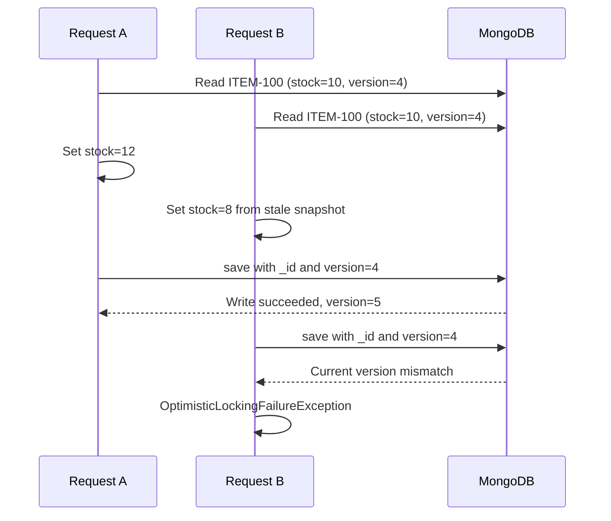

# Handling `OptimisticLockingFailureException` and reloading data

In applications using **Spring Data MongoDB**, two users or two workers can read the same document and update it concurrently. MongoDB guarantees atomicity for **a single write command on a single document**, yet a sequence of **read → modify Java object → `save`** does not automatically become atomic. If both write back a stale snapshot, the later writer can accidentally lose the earlier writer's changes.

**Optimistic locking** addresses an important part of this problem using a **`@Version`** field. Spring Data MongoDB uses the version on supported entity write paths to detect outdated snapshots; when a `save` cannot update the expected version, the application can receive **`OptimisticLockingFailureException`**. Proper handling is not merely `catch`ing the exception and calling `save` again—it requires **reloading the current data, evaluating the business intent, and deciding to reject, merge, or run a bounded retry**.

This lesson belongs to the **Concurrency Control** chapter of the `SPRING_DATA_MONGODB` module. The module practices connecting and mapping documents, operating via `MongoTemplate`/repositories, queries, aggregations, indexes, transactions, reactive access, testing, and data performance diagnostics. The focus of this lesson is **conflict handling after an optimistic lock failure**, including how to build APIs that explain conflicts to users and how to avoid harmful retry loops when multiple requests edit concurrently.

After this lesson, you will be able to:

1. Explain why Spring Data throws `OptimisticLockingFailureException`, and distinguish it from duplicate key, timeout, or transaction errors.
2. Use `@Version` and `MongoRepository.save` to detect **lost updates**.
3. Choose between **returning HTTP 409/412**, **reloading and manually merging**, or **automatic retrying** depending on command semantics.
4. Reload the latest document after a conflict without blindly overwriting someone else's changes.
5. Design bounded retries, backoff, idempotency, and safe business preconditions.
6. Know when to use `MongoTemplate.updateFirst` with version/stock conditions instead of the `save` path.
7. Test concurrency against real MongoDB and diagnose cases where `@Version` does not take effect.

## 1. How does a lost update happen?

Suppose the `inventoryItems` collection stores stock quantities:

```javascript
{
  _id: "ITEM-100",
  tenantId: "T-A",
  sku: "BK-100",
  stock: 10,
  note: "Counted",
  version: NumberLong("4")
}
```

Two requests both read `version = 4`:



Without versioning, B could write `stock=8` over the document A just updated, losing `stock=12`. Optimistic locking **does not pick the right value for the application**; it reports that **the data copy B is modifying is stale**. The application must decide the next business step.

### 1.1. Document-level atomicity differs from optimistic locking

| Capability | MongoDB Server | Spring Data `@Version` |
| --- | --- | --- |
| A single document update is never half-written | Yes, for single-document operations | Not its primary job |
| Two concurrent `$inc` calls do not lose each other when used properly | Yes, via atomic updates | May not need read–modify–save |
| Detecting that a previously loaded Java entity is stale | Does not inherently know intent from a Java snapshot | Yes, with supported write paths and version conditions |
| Deciding how to merge two users' changes | No | **No**, the application must handle it |
| Committing/rolling back multiple documents together | Requires transactions if business requires | `@Version` alone does not guarantee this |

A helpful design question: **"Is this a request to set an absolute value, or a request to change a quantity by an operation?"** For "set price to 100,000" from a long-open form, you need conflict detection; for "deduct 2 units if sufficient stock remains", a conditional atomic `$inc` is usually preferable to loading and saving the entity.

## 2. `@Version` and the expected write condition

In Spring Data MongoDB, the `@Version` annotation marks the field used to manage optimistic locking. An example entity:

```java
import java.time.Instant;
import org.springframework.data.annotation.Version;
import org.springframework.data.mongodb.core.mapping.Document;
import org.springframework.data.mongodb.core.mapping.MongoId;

@Document(collection = "inventoryItems")
public class InventoryItem {

    @MongoId
    private String id;

    private String tenantId;
    private String sku;
    private int stock;
    private String note;
    private Instant updatedAt;

    @Version
    private Long version;

    protected InventoryItem() {}

    public InventoryItem(
            String id, String tenantId, String sku,
            int stock, String note
    ) {
        this.id = id;
        this.tenantId = tenantId;
        this.sku = sku;
        this.stock = stock;
        this.note = note;
    }

    public String getId() { return id; }
    public String getTenantId() { return tenantId; }
    public String getSku() { return sku; }
    public int getStock() { return stock; }
    public String getNote() { return note; }
    public Instant getUpdatedAt() { return updatedAt; }
    public Long getVersion() { return version; }

    public void setStock(int stock) { this.stock = stock; }
    public void setNote(String note) { this.note = note; }
    public void setUpdatedAt(Instant updatedAt) { this.updatedAt = updatedAt; }
}
```

Repository:

```java
import java.util.Optional;
import org.springframework.data.mongodb.repository.MongoRepository;

public interface InventoryItemRepository
        extends MongoRepository<InventoryItem, String> {

    Optional<InventoryItem> findByIdAndTenantId(
            String id, String tenantId);
}
```

When a new entity is inserted through a supported mapping path, Spring Data initializes/increments version per the field type's rules and framework version. With nullable `Long`, the initial version is typically `0`. Do not hard-code that every entity across all library versions starts at 1: primitive vs. wrapper types, legacy data, and `isNew` rules can affect this.

When an existing versioned entity is saved via `repository.save(entity)`, the update carries **compare-and-set (CAS)** semantics, roughly:

```javascript
// ILLUSTRATING logic, not necessarily the exact BSON command emitted by Spring Data.
db.inventoryItems.updateOne(
  { _id: "ITEM-100", version: NumberLong("4") },
  {
    $set: { stock: 12, note: "Counted" },
    $inc: { version: NumberLong("1") }
  }
);
```

The actual `save` path may use a **replacement write** rather than field-by-field `$set`, and mapping policies for other fields depend on the entity/configuration. The `mongosh` snippet only illustrates **checking the old version and incrementing version in the same atomic operation**.

### 2.1. Conditions for the exception to be meaningful

- The document is managed with `@Version` and **an API path supporting optimistic locking**.
- The entity has a valid identifier and version identifying the read revision.
- The write command has **write acknowledgement**. If `WriteConcern.UNACKNOWLEDGED` is used, the app may not know the update matched 0 documents; do not assume optimistic locking works under it.
- Other writers also respect version. Raw drivers, migration jobs, or bulk updates that do not check the old version can modify the document **without triggering a conflict on their own operation**.
- The application does not arbitrarily clear or reassign version before calling `save`.

### 2.2. Version is not a timestamp

`updatedAt` helps track time, yet is not a default substitute for `@Version`. Clocks can skew, multiple updates can share the same timestamp within resolution limits, and data conversion can round values. For optimistic locking, **a version counter incremented on change** is far easier to verify reliably.

Enabling auditing with `@LastModifiedDate` serves time-tracking metadata; it **does not mean** the framework uses it as a CAS version.

## 3. Observing the exception when two snapshots are saved

Example with two reads from the repository:

```java
import org.springframework.dao.OptimisticLockingFailureException;

InventoryItem first = repository
        .findByIdAndTenantId("ITEM-100", "T-A")
        .orElseThrow();
InventoryItem second = repository
        .findByIdAndTenantId("ITEM-100", "T-A")
        .orElseThrow();

long expected = first.getVersion();

first.setStock(12);
repository.save(first);

second.setStock(8);
try {
    repository.save(second);
    throw new AssertionError("Should have detected stale version");
} catch (OptimisticLockingFailureException conflict) {
    // At this point second holds stale data.
    // Do not save second again immediately.
}
```

The variables `first` and `second` are two separately loaded Java objects representing **the same initial snapshot**. Once `first` is saved successfully, the database version increments. For `second`, the exception indicates **the update did not satisfy the version condition**—not that the second request deserves to "win" or how to merge.

### 3.1. `OptimisticLockingFailureException` is a signal, not a fix

Inside the catch block there are three choices:

1. **Reject the change and return conflict:** suitable for user forms setting absolute values, critical business actions, or when the user must decide.
2. **Reload and merge intent:** suitable when clear merge rules exist, e.g., user A edited `note` while user B edited an independent field and non-conflict can be verified.
3. **Bounded retry:** suitable for operations whose **intent** can be re-applied on fresh state, such as "increment counter by 1", with idempotency and safety constraints.

What you **must not do** is:

```java
catch (OptimisticLockingFailureException ex) {
    repository.save(staleEntity); // WRONG: retrying the exact outdated object.
}
```

Some entity instances might have had their in-memory version updated when a write failed or callbacks had side effects. **Never infer from a failed object that it automatically represents the latest state.** Reload from the database and decide based on the fresh snapshot.

## 4. Business decision: conflict, merge, or retry?

| Command intent | Suggested handling | Why |
| --- | --- | --- |
| "Set product price to 100,000 VND" from a stale form | Return conflict, reload for user review | The changed price may carry new business meaning |
| "Edit note" when someone else also edited note | Conflict or show diff comparison | Same field; auto-merge risks losing data |
| "Edit note" when someone else only changed stock | Can merge with field and permission checks | The two changes may be independent |
| "Add 3 more views" | Atomic `$inc` or bounded intent retry | Addition can be re-applied to the new value |
| "Deduct 2 units if enough stock remains" | Atomic filter + `$inc` + idempotency | Must preserve invariant `stock >= 0` |
| "Complete payment" | Do not blindly retry; use state machine/idempotency | External side effects; easy to double-execute |
| "Transfer document ownership" | Conflict and re-verify permissions | Cannot blindly accept a stale snapshot |

**Core rule:** retry the **business intent**, not the **stale entity copy**. Every retry must re-verify that business preconditions still hold against the latest data.

## 5. Reloading the latest document after a conflict

When a stale version is detected, the application should separate **what the user saw** from **what is currently on the server**. A good conflict response tells the client the operation was not accepted and how to proceed, instead of silently replacing values.

### 5.1. DTO representing the current snapshot

```java
import java.time.Instant;

public record ItemSnapshot(
        String id,
        String sku,
        int stock,
        String note,
        long version,
        Instant updatedAt
) {
    public static ItemSnapshot from(InventoryItem item) {
        return new ItemSnapshot(
                item.getId(),
                item.getSku(),
                item.getStock(),
                item.getNote(),
                item.getVersion(),
                item.getUpdatedAt()
        );
    }
}
```

This is a **read-only DTO** containing only fields the user is authorized to view; real applications may restrict certain roles from viewing stock, notes, or internal metadata. Never dump the entire MongoDB document with sensitive fields just to explain an exception.

### 5.2. Defining a domain exception for conflicts

```java
public class ConcurrentEditException extends RuntimeException {
    private final long expectedVersion;
    private final ItemSnapshot current;

    public ConcurrentEditException(
            long expectedVersion,
            ItemSnapshot current
    ) {
        super("Document was modified by another operation");
        this.expectedVersion = expectedVersion;
        this.current = current;
    }

    public long getExpectedVersion() {
        return expectedVersion;
    }

    public ItemSnapshot getCurrent() {
        return current;
    }
}
```

Why separate Spring Data's exception from the domain exception: controllers do not need to know whether a conflict came from `MongoRepository.save`, `MongoTemplate`, or an early version check. APIs need **stable** messages that never expose collection names or stack traces.

### 5.3. Service that refuses to overwrite on stale version

Command for editing the note:

```java
public record SetNoteCommand(
        String itemId,
        long expectedVersion,
        String newNote
) {}
```

Service:

```java
import java.time.Instant;
import java.util.NoSuchElementException;
import org.springframework.dao.OptimisticLockingFailureException;
import org.springframework.stereotype.Service;

@Service
public class ItemNoteService {
    private final InventoryItemRepository repository;

    public ItemNoteService(InventoryItemRepository repository) {
        this.repository = repository;
    }

    public ItemSnapshot setNote(
            String authorizedTenantId,
            SetNoteCommand command
    ) {
        if (authorizedTenantId == null
                || authorizedTenantId.isBlank()
                || command == null
                || command.itemId() == null
                || command.itemId().isBlank()
                || command.expectedVersion() < 0
                || command.newNote() == null
                || command.newNote().length() > 200) {
            throw new IllegalArgumentException("Invalid command");
        }

        InventoryItem current = findAuthorized(
                authorizedTenantId, command.itemId());

        // Detect forms sending an old version even before the service's read.
        if (current.getVersion() != command.expectedVersion()) {
            throw new ConcurrentEditException(
                    command.expectedVersion(),
                    ItemSnapshot.from(current));
        }

        current.setNote(command.newNote());
        current.setUpdatedAt(Instant.now());

        try {
            // Can still conflict if another writer changes version
            // AFTER findAuthorized and BEFORE save.
            InventoryItem saved = repository.save(current);
            return ItemSnapshot.from(saved);
        } catch (OptimisticLockingFailureException ex) {
            // Load a NEW object instead of reusing the failed 'current'.
            InventoryItem latest = findAuthorized(
                    authorizedTenantId, command.itemId());
            throw new ConcurrentEditException(
                    command.expectedVersion(),
                    ItemSnapshot.from(latest));
        }
    }

    private InventoryItem findAuthorized(
            String authorizedTenantId, String itemId
    ) {
        return repository.findByIdAndTenantId(
                        itemId, authorizedTenantId)
                .orElseThrow(() -> new NoSuchElementException(
                        "Authorized item not found"));
    }
}
```

**Both check layers are worthwhile, not redundant:**

1. Comparing `current.version` with `expectedVersion` catches clients submitting stale forms **before updating**.
2. `repository.save(current)` protects the **race window** between the service's read and write; if another writer updates the version in between, Spring Data throws an optimistic locking exception.

**Never pass `authorizedTenantId` straight from an untrusted request body.** It must come from the security context or an authenticated source, and post-conflict reloads must remain scoped to the same tenant. If the document was deleted or moved to another tenant after `save` failed, `findAuthorized` may return empty; the API should apply appropriate not-found/forbidden rules without leaking out-of-scope data.

### 5.4. Why not reuse the object after an exception?

Write paths can run mapping, callbacks, or partially mutate object state before the driver reports failure. Never treat the failed entity as **the latest database record**. Doing:

```java
catch (OptimisticLockingFailureException ex) {
    current.setNote(command.newNote());
    repository.save(current);
}
```

does not resolve the stale version conflict. Worse, if a developer manually sets `current.version = latest.version` without reconciling changed fields, the application is simply **forcing an overwrite** using a valid version.

## 6. Returning HTTP 409 or 412 so the user can decide

If the frontend sends version in the JSON payload, **409 Conflict** is usually clear: "Data changed since you opened the form". If the API uses HTTP conditional requests with `ETag`/`If-Match`, **412 Precondition Failed** carries the proper semantics when the `If-Match` condition fails.

| API design | Example request | Response on stale version |
| --- | --- | --- |
| Version in JSON | `PATCH /items/ITEM-100` with `expectedVersion:4` | `409 Conflict`, including authorized conflict details |
| HTTP conditional | `PATCH` with `If-Match: "v4"` | `412 Precondition Failed` if precondition fails |
| User executes atomic command like "deduct 2" | Command with idempotency key | Depends on conditions: success/insufficient stock/conflict; no default retry |

Example body sent by frontend:

```json
{
  "itemId": "ITEM-100",
  "expectedVersion": 4,
  "newNote": "Inventory recounted"
}
```

If server version is currently 5, illustrative response:

```json
{
  "code": "CONCURRENT_EDIT",
  "message": "Data has changed. Please review the latest version before saving again.",
  "expectedVersion": 4,
  "current": {
    "id": "ITEM-100",
    "sku": "BK-100",
    "stock": 12,
    "note": "Counted",
    "version": 5,
    "updatedAt": "2026-11-20T02:00:00Z"
  }
}
```

`updatedAt` here is an **illustrative value**, not the actual timestamp of any live operation. The API contract must define when `current` is returned: if user permissions changed or the document was deleted, it may be necessary to return only the error code without a snapshot.

### 6.1. Controller advice translating domain conflict to response

```java
import org.springframework.http.HttpStatus;
import org.springframework.http.ResponseEntity;
import org.springframework.web.bind.annotation.ExceptionHandler;
import org.springframework.web.bind.annotation.RestControllerAdvice;

record ConcurrentEditResponse(
        String code,
        String message,
        long expectedVersion,
        ItemSnapshot current
) {}

@RestControllerAdvice
public class ConcurrencyExceptionHandler {
    @ExceptionHandler(ConcurrentEditException.class)
    public ResponseEntity<ConcurrentEditResponse> handle(
            ConcurrentEditException ex
    ) {
        return ResponseEntity.status(HttpStatus.CONFLICT).body(
                new ConcurrentEditResponse(
                        "CONCURRENT_EDIT",
                        ex.getMessage(),
                        ex.getExpectedVersion(),
                        ex.getCurrent()));
    }
}
```

Standard exceptions need separate handlers: `IllegalArgumentException` for invalid commands, missing ID/tenant, authorization errors, duplicate keys, etc. Never catch all `RuntimeException`s and return 409, as that disguises database/network outages as "someone else edited the record".

### 6.2. Do not force clients to auto-overwrite with the new version

A buggy frontend might do:

```text
PATCH expectedVersion=4 → 409 current.version=5
PATCH expectedVersion=5 with the old form values → "success"
```

This turns optimistic locking into **last-write-wins with an extra round trip**. Display what changed, ask the user to confirm, or only merge fields explicitly verified as independent.

If the user explicitly chooses "overwrite despite changes", that is **a separate business action** requiring authorization, auditing, and the newest version to guard against the next race—not a "Retry" button that silently overwrites.

### 6.3. ETag and `If-Match`

An HTTP-level concurrency-aware API can return:

```http
HTTP/1.1 200 OK
ETag: "item-100-v5"
Content-Type: application/json

{"id":"ITEM-100","version":5,"note":"Counted"}
```

Client sends:

```http
PATCH /items/ITEM-100 HTTP/1.1
If-Match: "item-100-v5"
Content-Type: application/json

{"note":"Inventory recounted"}
```

The server must **parse/validate the ETag** and use the corresponding version as the CAS condition; merely comparing the header string after a GET without binding it in the update still leaves a race. This illustrates a strong ETag format; production designs should use opaque tags tied to the resource representation rather than assuming all cached representations match a single entity version.

If `If-Match` fails, return **412** instead of overwriting. If an endpoint requires the precondition and the client omits it, consider **428 Precondition Required** per API contract.

## 7. Reload and merge: three versions of the data

A meaningful merge workflow must distinguish **three copies**:

- **Base**: values the user saw when opening the form.
- **Proposed**: changes the user wants to save on top of base.
- **Latest**: newest document on the server after the conflict.

Example:

| Field | Base (v4) | Proposed from user B | Latest (v5) written by user A |
| --- | --- | --- | --- |
| `stock` | 10 | 10 (unchanged) | 12 |
| `note` | "Counted" | "Inventory recounted" | "Counted" |

If B **only edited note**, B's intent can be rebased onto Latest, yielding `stock=12, note="Inventory recounted"`; yet it must still save against version **5**, rather than writing back the full snapshot with `stock=10`.

Another case:

| Field | Base (v4) | Proposed from B | Latest (v5) written by A |
| --- | --- | --- | --- |
| `note` | "Counted" | "Inventory recounted" | "Urgent recount needed" |

This is a **same-field conflict**; auto-merging via "whoever saves last" drops one person's intent. Return a conflict or ask the user how to resolve it.

### 7.1. Minimal three-way merge algorithm

For a field `note`:

```text
if Proposed.note == Base.note:
    User did not change this field → keep Latest.note.
else if Latest.note == Base.note:
    Only this user changed note → can use Proposed.note.
else if Latest.note == Proposed.note:
    Both sides ended with the same value → no note change needed.
else:
    Same field changed differently → CONFLICT, ask the user.
```

This is purely an illustrative algorithm for an independent field. Coupled fields such as `price` + `currency`, `status` + `paidAt`, or `stock` + `reserved` require **evaluating invariants across the whole entity**, not mechanical per-field merging.

### 7.2. You still need CAS on the fresh data

Even after a successful merge upon loading Latest, another worker can update **between the reload and the save**. Therefore:

```text
Read Latest(v5)
    ↓
Compare Base and Proposed; decide merge
    ↓
Save against v5 (CAS)
    ↓
If stale again → conflict or bounded retry from newer data
```

There is no rule saying "one reload prevents further concurrent updates". **Reloading only provides a fresher snapshot as of the read instant**, without locking the document.

## 8. Merging an independent field while keeping others' valid changes

In some systems, user B edits the note while user A updates stock, and business rules allow both changes to coexist. **Field-level merging** can be implemented if the request supplies enough context to identify the original value:

```java
public record MergeNoteCommand(
        String itemId,
        long baseVersion,
        String baseNote,
        String desiredNote
) {}
```

In this example, `baseNote` is the value the client read at `baseVersion`. The server **cannot verify solely from this pair** that the client is telling the truth about the old value: for sensitive workflows, store historical snapshots/ETags or restrict merge permissions. This strategy works for ordinary note forms when that risk trade-off is accepted.

### 8.1. Read–merge–CAS loop up to three attempts

```java
import java.time.Instant;
import java.util.Objects;
import java.util.NoSuchElementException;
import org.springframework.dao.OptimisticLockingFailureException;
import org.springframework.stereotype.Service;

@Service
public class MergeNoteService {
    private static final int MAX_ATTEMPTS = 3;
    private final InventoryItemRepository repository;

    public MergeNoteService(InventoryItemRepository repository) {
        this.repository = repository;
    }

    public ItemSnapshot mergeNote(
            String authorizedTenantId,
            MergeNoteCommand command
    ) {
        if (authorizedTenantId == null || authorizedTenantId.isBlank()
                || command == null
                || command.itemId() == null || command.itemId().isBlank()
                || command.baseVersion() < 0
                || command.desiredNote() == null
                || command.desiredNote().length() > 200) {
            throw new IllegalArgumentException("Invalid command");
        }

        for (int attempt = 1; attempt <= MAX_ATTEMPTS; attempt++) {
            InventoryItem latest = repository.findByIdAndTenantId(
                            command.itemId(), authorizedTenantId)
                    .orElseThrow(NoSuchElementException::new);

            // If someone else already wrote the intended note, no write needed.
            if (Objects.equals(latest.getNote(), command.desiredNote())) {
                return ItemSnapshot.from(latest);
            }

            // When note already changed compared to base, do not overwrite with old intent.
            if (!Objects.equals(latest.getNote(), command.baseNote())) {
                throw new ConcurrentEditException(
                        command.baseVersion(),
                        ItemSnapshot.from(latest));
            }

            // Only update note on the NEWLY loaded entity, keeping latest stock.
            latest.setNote(command.desiredNote());
            latest.setUpdatedAt(Instant.now());

            try {
                InventoryItem saved = repository.save(latest);
                return ItemSnapshot.from(saved);
            } catch (OptimisticLockingFailureException conflict) {
                if (attempt == MAX_ATTEMPTS) {
                    InventoryItem current = repository
                            .findByIdAndTenantId(
                                    command.itemId(), authorizedTenantId)
                            .orElseThrow(NoSuchElementException::new);
                    throw new ConcurrentEditException(
                            command.baseVersion(),
                            ItemSnapshot.from(current));
                }
                // Another writer updated between read and save.
                // Continue to next iteration and reload; do not reuse latest.
            }
        }

        throw new IllegalStateException("Unable to complete merge");
    }
}
```

This logic only makes sense when **the note value is sufficiently independent** of stock/status, the app trusts/verifies `baseNote`, and no other business precondition is skipped. The service **preserves Latest's stock**, because it loads the current entity before changing `note`; `@Version` still blocks any writer appearing between the reload and `save`.

### 8.2. Why not compare only `baseVersion`?

If `baseVersion = 4` and Latest has version 5, we only know **something changed**—not whether `note` changed. For an independent change, comparing `Latest.note == Base.note` allows merging. Conversely, without a trusted baseline, looking at the new version alone **does not tell you** what changed. Stricter systems store change history or require the user to reload and decide manually.

### 8.3. When multiple fields depend on each other

Never apply per-field checks blindly to coupled aggregates:

```text
status = "PAID"
paidAt = timestamp
paymentTransactionId = id
```

If one request updates `status` while another updates `paidAt`, a "disjoint fields" merge can yield an invalid state. **Domain invariants** must be validated across the combined state within the same update/transaction.

## 9. Automatic retry: re-applying intent onto a fresh snapshot

For a command like "increase stock by 3 units", the addition can be re-executed against the latest data after an optimistic conflict, provided these conditions hold:

- **Bound** the number of attempts and consider backoff under high contention.
- On every attempt, **re-read** the document and **recompute** the value from the fresh snapshot.
- Only retry **the exception type known** to represent a stale version; do not lump network timeouts, duplicate keys, and business errors into the same catch.
- Avoid performing external side effects inside the loop.
- For requests that might be **resent in full** by clients, add a separate idempotency key so stock is not added twice.

### 9.1. Retry example with repository

```java
import java.time.Instant;
import java.util.NoSuchElementException;
import org.springframework.dao.OptimisticLockingFailureException;
import org.springframework.stereotype.Service;

@Service
public class IncreaseStockService {
    private static final int MAX_ATTEMPTS = 3;
    private final InventoryItemRepository repository;

    public IncreaseStockService(InventoryItemRepository repository) {
        this.repository = repository;
    }

    public ItemSnapshot addStock(
            String authorizedTenantId,
            String itemId,
            int quantity
    ) {
        if (authorizedTenantId == null || authorizedTenantId.isBlank()
                || itemId == null || itemId.isBlank()
                || quantity < 1 || quantity > 10_000) {
            throw new IllegalArgumentException("Invalid input");
        }

        for (int attempt = 1; attempt <= MAX_ATTEMPTS; attempt++) {
            InventoryItem current = repository
                    .findByIdAndTenantId(itemId, authorizedTenantId)
                    .orElseThrow(NoSuchElementException::new);

            long expected = current.getVersion();
            int newStock = Math.addExact(current.getStock(), quantity);
            current.setStock(newStock);
            current.setUpdatedAt(Instant.now());

            try {
                return ItemSnapshot.from(repository.save(current));
            } catch (OptimisticLockingFailureException conflict) {
                if (attempt == MAX_ATTEMPTS) {
                    InventoryItem latest = repository
                            .findByIdAndTenantId(
                                    itemId, authorizedTenantId)
                            .orElseThrow(NoSuchElementException::new);
                    throw new ConcurrentEditException(
                            expected, ItemSnapshot.from(latest));
                }
                // Retry only after a confirmed CAS failure:
                // fetch new version/stock on the next pass.
            }
        }
        throw new IllegalStateException("Unable to increase stock");
    }
}
```

If two workers simultaneously want to add 3 and 4 starting from stock 10, one attempt hits a stale version; after reloading the new stock of 13, the second worker computes `13+4=17` and saves with the new version. The right answer here is 17, **not 14** from applying intent to a stale copy.

**Important limitation of this example:** it shows retrying **within a single service call upon a confirmed CAS failure**. If the server wrote successfully yet the client lost the response and resent the HTTP request, another `addStock(+3)` call can add 3 again. That is **command-level idempotency**, which `@Version` does not solve.

### 9.2. Retry does not mean sleeping blindly forever

An operational pattern uses **exponential backoff + jitter** between retries:

```text
attempt 1 → CAS fails
attempt 2 → after a short jittered delay, reload and retry
attempt 3 → if still failing, return CONCURRENT_EDIT
```

Never put `Thread.sleep(...)` on a reactive event loop. In reactive pipelines, use asynchronous scheduling/retry operators. Backoff only eases simultaneous contention; it **never makes an invalid merge valid** and does not prevent the document from changing again.

When retry counts stay high, evaluate whether `read → mutate → save` fits at all or should be replaced by an **atomic update operator** to shrink the race window.

### 9.3. `@Retryable` can be used, but is not safe by default

Spring Retry supports `@Retryable` in some applications; however, it requires proper dependencies/configuration, invocation through a Spring proxy, and exact exception and attempt settings. In particular:

- Calling a method internally within the same class (**self-invocation**) bypasses the retry proxy.
- If a transaction wraps all retries, exceptions can leave the session/transaction in an invalid state for further attempts inside the same transaction.
- If the code calls external APIs or writes audits before `save`, retrying the whole method repeats side effects.

For simple problems, an explicit loop makes it obvious **when reload happens, when CAS happens, and when to stop**. For larger systems, a centralized retry policy works provided transaction ordering, idempotency, and metrics are verified.

## 10. Using `MongoTemplate` and atomic updates when the problem is an arithmetic operation

For commands like "deduct stock if sufficient", updating one document via **filter + `$inc`** can be cleaner and cheaper than loading and saving an entity:

```javascript
db.inventoryItems.updateOne(
  {
    _id: "ITEM-100",
    tenantId: "T-A",
    version: NumberLong("4"),
    stock: { $gte: 2 }
  },
  {
    $inc: { stock: -2, version: NumberLong("1") },
    $set: { updatedAt: ISODate("2026-11-20T02:00:00Z") }
  }
);
```

The `stock >= 2` filter guarantees a single deduction of 2 cannot drive stock negative, provided all other writers obey the same domain invariant. Adding `version = 4` gives the command **both a stock check and an optimistic precondition**.

In Spring Data MongoDB:

```java
import com.mongodb.client.result.UpdateResult;
import java.time.Instant;
import org.springframework.data.mongodb.core.MongoTemplate;
import org.springframework.data.mongodb.core.query.Criteria;
import org.springframework.data.mongodb.core.query.Query;
import org.springframework.data.mongodb.core.query.Update;

public UpdateResult reserveStockOnce(
        MongoTemplate template,
        String authorizedTenantId,
        String itemId,
        long expectedVersion,
        int quantity
) {
    if (authorizedTenantId == null || authorizedTenantId.isBlank()
            || itemId == null || itemId.isBlank()
            || expectedVersion < 0 || quantity <= 0) {
        throw new IllegalArgumentException("Invalid input");
    }

    Query filter = Query.query(
            Criteria.where("_id").is(itemId)
                    .and("tenantId").is(authorizedTenantId)
                    .and("version").is(expectedVersion)
                    .and("stock").gte(quantity));

    Update update = new Update()
            .inc("stock", -quantity)
            .inc("version", 1)
            .set("updatedAt", Instant.now());

    return template.updateFirst(
            filter, update, InventoryItem.class);
}
```

Here `InventoryItem` has `@Version`, yet **we explicitly include the version predicate and `$inc` in the update** to express CAS clearly. Spring Data has a rule that auto-increments version on certain template updates when the update does not specify version; do not infer from that mechanism that every update automatically **checks the old version**. With this snippet, test BSON/`getMatchedCount()` on your exact framework version to ensure version does not increment twice.

### 10.1. `matchedCount == 0` is not always an optimistic conflict

If `UpdateResult.getMatchedCount() == 0`, there are at least three possibilities:

1. The item does not exist or the user lacks access to that tenant.
2. Current version differs from `expectedVersion`.
3. Current stock is less than `quantity`.

**Do not blindly throw `OptimisticLockingFailureException` for every `matchedCount == 0`**. You can reload the item **scoped to the authenticated tenant** to classify `404/403`, `409/412`, or "insufficient stock", keeping in mind state may continue changing between update and reload.

### 10.2. Version is not always needed when using atomic `$inc`

For counter increments without a snapshot precondition, simply using:

```javascript
db.inventoryItems.updateOne(
  { _id: "ITEM-100", tenantId: "T-A" },
  { $inc: { stock: 3, version: 1 } }
);
```

ensures independent additions do not lose updates at the document level. However, if business logic requires **the exact version the user saw**, or needs state machine enforcement, add the appropriate precondition.

**The lost-response retry issue still remains:** `$inc` is not idempotent. If a request is resent after the server already applied it once, the value can increment a second time. An **end-to-end request** idempotency mechanism is needed.

### 10.3. Distinguishing save results from update results

| Write path | Failure detection | Obtaining new state |
| --- | --- | --- |
| `repository.save(entity @Version)` | Can throw `OptimisticLockingFailureException` when stale | Use returned entity on success; reload on conflict |
| `template.updateFirst(query, update, Entity.class)` | Inspect `UpdateResult.getMatchedCount()` and write errors | Re-read by ID/tenant, or use another API if post-update result is needed atomically |
| `template.findAndModify(...)` | Conditional query; result may be null on no match | Can request returning the post-update document, ideal for atomic read-modify-return |
| `template.bulkOps(...).execute()` | Aggregated `BulkWriteResult`; 0 matches usually do not throw optimistic locking exceptions | Reconcile per command/ID; do not assume version/callbacks behave like `save` |

After a successful `updateFirst`, if you **reload** to return a DTO, another writer can still update again before your reload; the newly read DTO might reflect a version **after both operations**, not necessarily the snapshot immediately following your command. When you need the document right at the write boundary, consider `findAndModify` with return-new and appropriate CAS predicates.

## 11. `findAndModify`: CAS and retrieving the new result in one operation

In some endpoints, the client needs **the state immediately following this request's change**, rather than state that someone else might modify before a separate reload. MongoDB provides `findAndModify` to perform a conditional update and return a document per options.

```java
import java.time.Instant;
import java.util.NoSuchElementException;
import org.springframework.data.mongodb.core.FindAndModifyOptions;
import org.springframework.data.mongodb.core.MongoTemplate;
import org.springframework.data.mongodb.core.query.Criteria;
import org.springframework.data.mongodb.core.query.Query;
import org.springframework.data.mongodb.core.query.Update;

public ItemSnapshot changeNoteAtomically(
        MongoTemplate template,
        String authorizedTenantId,
        String itemId,
        long expectedVersion,
        String newNote
) {
    if (authorizedTenantId == null || authorizedTenantId.isBlank()
            || itemId == null || itemId.isBlank()
            || expectedVersion < 0
            || newNote == null || newNote.length() > 200) {
        throw new IllegalArgumentException("Invalid input");
    }

    Query query = Query.query(
            Criteria.where("_id").is(itemId)
                    .and("tenantId").is(authorizedTenantId)
                    .and("version").is(expectedVersion));

    Update update = new Update()
            .set("note", newNote)
            .set("updatedAt", Instant.now())
            .inc("version", 1);

    InventoryItem updated = template.findAndModify(
            query,
            update,
            FindAndModifyOptions.options()
                    .returnNew(true)
                    .upsert(false),
            InventoryItem.class);

    if (updated == null) {
        // Could be missing, wrong tenant, or stale version.
        // Reload scoped to tenant to classify before responding.
        throw new NoSuchElementException(
                "No document matched CAS conditions");
    }

    return ItemSnapshot.from(updated);
}
```

**In production**, the `updated == null` branch must properly classify missing/permission/stale version, as in section 10.1; the example uses `NoSuchElementException` to illustrate a no-match result without confusing it with a repository-generated optimistic exception. Never expose raw Java exception messages directly to users.

`returnNew(true)` requests **the post-update document**, while `upsert(false)` prevents inserting a new document when the version does not match. Because the query specifies `_id + tenantId + version`, another writer bumping version first causes the operation to return null.

### 11.1. Why not use `upsert` for stale versions?

A query whose version condition fails to match **does not prove the document is absent**. If upsert is enabled, MongoDB may attempt to create a new document from the filter/update, causing a duplicate key error or inserting an unintended record if no matching unique key exists. For "update only if version is still right", keep `upsert(false)`.

### 11.2. Note on `@Version` mapping in template updates

In Spring Data MongoDB versions supporting version-aware updates, the framework can auto-increment the version field when the update omits it. In the example, `.inc("version", 1)` is **declared explicitly** alongside the query predicate, so verify via integration tests that it increments **exactly once** on your current framework version.

Do not confuse **auto-incrementing version** with **auto-checking expected version**. If the query omits the old version condition, an update can still overwrite a changed document even though the version increments.

## 12. Idempotency: retrying after conflict differs from retrying after timeout

Two very different failure modes are often mixed up:

| Scenario | What does the system know? | How to handle |
| --- | --- | --- |
| `OptimisticLockingFailureException` from confirmed CAS | The update with old version **was not applied** on the acknowledged write path | Can reload/merge/retry **if intent permits** |
| Network timeout / lost response after sending command | Update may or may not have succeeded | **Do not blindly retry** `$inc`; require idempotency/reconciliation |
| `DuplicateKeyException` when creating an item | Violated unique constraint or duplicate entity exists | Determine idempotent create vs. business error; do not treat as stale version |
| `TransientTransactionError` / unknown commit state | Transaction needs retry per driver/server rules | Retry with proper transaction boundary and idempotency |

The retry loop in section 9 only handles **confirmed CAS failures**. It cannot deduce from a timeout that the server definitely wrote nothing.

The MongoDB Java Driver includes **retryable writes** for supported operations and deployment configurations. That does not mean the server recognizes two separate **business HTTP requests** carrying the same intent as the same operation. Never rely on `retryWrites=true` as an excuse to drop idempotency keys from APIs that can be resent.

### 12.1. Example of a request resent after already succeeding

```text
POST /items/ITEM-100/stock-adjustments
operationId = "op-789"
delta = +3

Attempt 1:
  Server added stock +3 and committed.
  HTTP response was lost in transit.

Attempt 2:
  Client retries the exact request.
  If server does not remember operationId,
  stock can be incremented by +3 a second time.
```

**`@Version` does not stop this** if Attempt 2 reads the new version and re-applies the intent. Incrementing version only protects **snapshot contention**, not **duplication of a business command**.

### 12.2. Designing an operation ID and result record

One approach:

1. Client generates a unique **operationId** per business action and keeps that exact ID across retries.
2. Server maintains a unique index `{tenantId:1,operationId:1}` on an `operations` collection.
3. Check whether the operation already completed; if a result exists, return the appropriate prior result.
4. Ensure the stock update and operation record **commit consistently** (e.g., within a MongoDB transaction across two documents/collections, assuming deployment supports it).
5. If commit outcome is unknown, query operation state before deciding to retry.

```javascript
db.operations.createIndex(
  { tenantId: 1, operationId: 1 },
  { unique: true, name: "ux_tenant_operation" }
);
```

A unique index alone **does not make two collections commit atomically**: if updating stock succeeds yet inserting into `operations` fails, a resent request can still add twice. You must establish a transaction, state machine, or single-document atomic update storing an operation marker while respecting document size limits.

### 12.3. Atomic marker in the same document: benefits and limits

An illustrative single-document approach:

```javascript
db.inventoryItems.updateOne(
  {
    _id: "ITEM-100",
    tenantId: "T-A",
    appliedOperationIds: { $ne: "op-789" }
  },
  {
    $inc: { stock: 3, version: 1 },
    $addToSet: { appliedOperationIds: "op-789" }
  }
);
```

This is **one atomic operation on the same document**, so if the marker condition and update apply, a retry with the same `operationId` will not add twice. However, the `appliedOperationIds` array can **grow unboundedly**, bloating the document, raising read/write cost, and eventually hitting the BSON limit. For high workloads, a separate ledger with transactions or an idempotency model with proper retention is much more sustainable.

Do not use `$addToSet` on a large array and consider it a complete exactly-once system; you still need operation ID lifecycle management, return-value storage, uncertain-error handling, and auditing.

### 12.4. External side effects outside MongoDB require outbox/compensation

If a command also sends emails, publishes Kafka messages, or calls payment gateways, never place side effects **before or inside** an optimistic-lock retry loop:

```java
for (...) {
    sendPaymentRequest();   // WRONG: can be called multiple times.
    repository.save(item);  // May be stale → repeats.
}
```

Even sending a message **after `save`** has a gap if the process crashes between DB commit and publish. For reliability requirements, use a **transactional outbox**, idempotent consumers, or workflows with explicit compensation. Optimistic locking does not turn external systems into a distributed transaction.

## 13. Conflicts inside transactions and reloading

MongoDB transactions are useful when an operation must update **multiple documents** to succeed or roll back together. Yet optimistic locking and transactions solve **two different classes of problems**:

- `@Version` detects that an entity is being saved from a stale snapshot.
- A transaction establishes a commit/rollback boundary for a group of operations on a supported deployment.

A transaction can encounter a write conflict or transient error when writers contend. **Never catch the exception inside the transaction and keep using the same transaction/session as if nothing happened** once the server/driver has aborted or invalidated it.

### 13.1. Retrying the entire transaction from outside

```text
Orchestrator (not holding the old transaction)
    |
    +-- attempt 1: start a new transaction
    |      - read documents
    |      - check state/version/invariants
    |      - update documents A and B
    |      - commit
    |      - if transient/write conflict is retryable:
    |             roll back/end current transaction
    |
    +-- attempt 2: NEW transaction + read FRESH data
    |
    +-- after max attempts: return conflict/unavailable
```

In Spring:

```java
import org.springframework.transaction.annotation.Transactional;

@Transactional
public void transferStock(...) {
    // Load and validate source/destination stock.
    // Write both documents inside the same MongoDB transaction.
    // On conflict or unmet business condition,
    // throw exception so the transaction rolls back per policy.
}
```

This is a **pseudo-method** illustrating the transaction boundary, not a complete implementation. `@Transactional` only takes effect when a transaction manager is configured, MongoDB topology supports it, and calls route through the Spring proxy. External retry orchestration must start a fresh transaction for each attempt.

### 13.2. When is a transaction unnecessary?

For **one document**, a filtered update + atomic operators like `$inc`, `$set`, and version CAS usually suffice to protect invariants. Wrapping a simple update in a transaction does not replace writing the right filter and can add unnecessary contention/latency.

### 13.3. Reload inside or outside the transaction?

When handling an exception from a failed transaction, **exit/roll back that transaction** first before loading a fresh snapshot in an appropriate unit of work. Re-reading inside the old transaction snapshot or an invalidated session may not reflect the fresh state needed for retry.

In systems with caches or secondary read preferences, post-conflict reloads must also target a **consistent read source** so you do not load an **even older** snapshot from replica lag. For immediate CAS decisions, read from primary or use appropriately designed session consistency, tested under real deployment settings.

## 14. Reactive optimistic locking: retries must recreate the read operation

Spring Data MongoDB offers `ReactiveMongoRepository` and `ReactiveMongoTemplate` for reactive applications. Entity optimistic locking still relies on version and server write acknowledgements, yet retry construction must respect **subscriptions** and **cold publishers**.

### 14.1. Reactive repository

```java
import reactor.core.publisher.Mono;
import org.springframework.data.mongodb.repository.ReactiveMongoRepository;

public interface ReactiveInventoryItemRepository
        extends ReactiveMongoRepository<InventoryItem, String> {

    Mono<InventoryItem> findByIdAndTenantId(
            String id, String tenantId);
}
```

### 14.2. `Mono.defer` so every retry loads a fresh snapshot

```java
import java.time.Duration;
import java.time.Instant;
import java.util.NoSuchElementException;
import org.springframework.dao.OptimisticLockingFailureException;
import reactor.core.publisher.Mono;
import reactor.util.retry.Retry;

public class ReactiveIncreaseStockService {
    private final ReactiveInventoryItemRepository repository;

    public ReactiveIncreaseStockService(
            ReactiveInventoryItemRepository repository
    ) {
        this.repository = repository;
    }

    public Mono<ItemSnapshot> addStock(
            String authorizedTenantId, String itemId, int quantity
    ) {
        if (authorizedTenantId == null || authorizedTenantId.isBlank()
                || itemId == null || itemId.isBlank()
                || quantity <= 0 || quantity > 10_000) {
            return Mono.error(new IllegalArgumentException(
                    "Invalid input"));
        }

        Mono<ItemSnapshot> attempt = Mono.defer(() ->
                repository.findByIdAndTenantId(
                                itemId, authorizedTenantId)
                        .switchIfEmpty(Mono.error(
                                new NoSuchElementException()))
                        .map(item -> {
                            item.setStock(Math.addExact(
                                    item.getStock(), quantity));
                            item.setUpdatedAt(Instant.now());
                            return item;
                        })
                        .flatMap(repository::save)
                        .map(ItemSnapshot::from));

        return attempt.retryWhen(
                Retry.backoff(2, Duration.ofMillis(25))
                        .maxBackoff(Duration.ofMillis(200))
                        .jitter(0.3)
                        .filter(error ->
                                error instanceof
                                        OptimisticLockingFailureException));
    }
}
```

`retryWhen(Retry.backoff(2, ...))` allows **at most two retries after the initial attempt**, meaning up to three attempts total. `Mono.defer` makes sure every attempt **restarts at `repository.find...`** instead of reusing the failed object. In real applications, add logging/metrics and map retry-exhausted failures into an appropriate **conflict response**; Reactor may wrap exhausted errors in a retry-exhausted exception, so HTTP handlers must extract/distinguish the root cause carefully.

**Never call `block()` on the event loop** to wait for a reload. Never use `Thread.sleep` inside `map`, `flatMap`, or retry callbacks; Reactor's backoff operates non-blockingly under normal usage.

### 14.3. Side effects do not belong inside the retry pipeline

```java
return attempt
        .doOnNext(row -> publishExternalEvent(row)) // PRONE TO DUPLICATES / NON-ATOMIC.
        .retryWhen(retrySpec);
```

Even in reactive code, side-effect placement matters. If a callback emits an event and a downstream step fails, retries can re-emit or drift out of sync with MongoDB state. For critical events, use an **outbox/idempotent consumer** or a workflow with explicit guarantees.

### 14.4. Reactive transactions have their own context

When using `ReactiveMongoTransactionManager`, transactions bind to the **Reactor context**, not standard ThreadLocal variables. Full-transaction retries must be designed at the proper subscription/transaction boundary, reading fresh data inside the new transaction. Do not port a blocking `@Transactional` example to reactive simply by wrapping with `Mono.just(...)`.

## 15. Integration testing optimistic locking against real MongoDB

Mocking `MongoRepository` verifies a method was called, yet never proves **MongoDB's update used a version condition**, the server reported 0 matches, or Spring Data threw the right exception. For this topic, integration tests against a **dedicated test MongoDB instance** are mandatory to trust optimistic locking works.

Examples use Spring Boot 3.x, JUnit 5, AssertJ, and a real test MongoDB instance (such as Testcontainers). Never run these fixtures against production.

### 15.1. Setting up fixtures and two snapshots

```java
import static org.assertj.core.api.Assertions.assertThat;
import static org.assertj.core.api.Assertions.assertThatThrownBy;

import org.junit.jupiter.api.BeforeEach;
import org.junit.jupiter.api.Test;
import org.springframework.beans.factory.annotation.Autowired;
import org.springframework.boot.test.autoconfigure.data.mongo.DataMongoTest;
import org.springframework.dao.OptimisticLockingFailureException;
import org.springframework.data.mongodb.core.MongoTemplate;
import org.springframework.data.mongodb.core.query.Query;

@DataMongoTest
class InventoryOptimisticLockingIntegrationTest {

    @Autowired
    InventoryItemRepository repository;

    @Autowired
    MongoTemplate template;

    @BeforeEach
    void prepare() {
        // Run ONLY against an isolated test database.
        template.remove(new Query(), InventoryItem.class);
        repository.insert(new InventoryItem(
                "TEST-ITEM-1", "T-A", "SKU-T-1",
                10, "Counted"));
    }

    @Test
    void secondStaleSnapshotMustFail() {
        InventoryItem first = repository.findById("TEST-ITEM-1")
                .orElseThrow();
        InventoryItem second = repository.findById("TEST-ITEM-1")
                .orElseThrow();

        long initialVersion = first.getVersion();
        assertThat(second.getVersion()).isEqualTo(initialVersion);

        first.setStock(12);
        InventoryItem saved = repository.save(first);
        assertThat(saved.getVersion()).isEqualTo(initialVersion + 1);

        second.setStock(8);
        assertThatThrownBy(() -> repository.save(second))
                .isInstanceOf(
                        OptimisticLockingFailureException.class);

        InventoryItem latest = repository.findById("TEST-ITEM-1")
                .orElseThrow();
        assertThat(latest.getStock()).isEqualTo(12);
        assertThat(latest.getVersion())
                .isEqualTo(initialVersion + 1);
    }
}
```

This test proves **all three points**: the first save increments version, the second save on a stale snapshot is rejected, and MongoDB preserves data from the first save. A test that only asserts the exception without re-reading the document could miss half-written bugs or broken mapping.

`@DataMongoTest` does not spin up a MongoDB Server automatically for every setup. You need an isolated test URI/database, appropriate MongoDB driver/framework dependencies, and an acknowledged write concern configuration.

### 15.2. Testing reload when a client submits a stale form

Add the following test **in the same class**:

```java
import static org.assertj.core.api.Assertions.assertThat;
import static org.assertj.core.api.Assertions.fail;

@Test
void serviceReturnsFreshSnapshotWhenVersionIsStale() {
    ItemNoteService service = new ItemNoteService(repository);

    InventoryItem opened = repository
            .findById("TEST-ITEM-1").orElseThrow();
    long clientVersion = opened.getVersion();

    // Request A updates stock first.
    opened.setStock(12);
    repository.save(opened);

    // Request B still submits the form seen at the old version.
    try {
        service.setNote("T-A", new SetNoteCommand(
                "TEST-ITEM-1", clientVersion,
                "Note from stale form"));
        fail("Must return conflict when client version is stale");
    } catch (ConcurrentEditException conflict) {
        assertThat(conflict.getExpectedVersion())
                .isEqualTo(clientVersion);
        assertThat(conflict.getCurrent().stock())
                .isEqualTo(12);
        assertThat(conflict.getCurrent().version())
                .isEqualTo(clientVersion + 1);
    }

    InventoryItem saved = repository.findById("TEST-ITEM-1")
            .orElseThrow();
    assertThat(saved.getNote()).isEqualTo("Counted");
}
```

This tests a **conflict detected prior to save** because the service compares expected version against current version. To exercise the `catch (OptimisticLockingFailureException)` branch inside the service, trigger a **real race** between read and save or extract the write step into a coordinatable/testable collaborator. Do not claim this stale-form test covers every catch branch.

### 15.3. Testing independent-field merge

```java
@Test
void mergingNotePreservesOtherWritersStockChange() {
    MergeNoteService service = new MergeNoteService(repository);
    InventoryItem base = repository.findById("TEST-ITEM-1")
            .orElseThrow();

    long baseVersion = base.getVersion();
    String baseNote = base.getNote();

    // User A only edits stock.
    base.setStock(12);
    repository.save(base);

    // User B edits note on a stale base.
    ItemSnapshot merged = service.mergeNote(
            "T-A",
            new MergeNoteCommand(
                    "TEST-ITEM-1",
                    baseVersion,
                    baseNote,
                    "Count completed"));

    assertThat(merged.stock()).isEqualTo(12);
    assertThat(merged.note()).isEqualTo("Count completed");
    assertThat(merged.version()).isEqualTo(baseVersion + 2);
}

@Test
void mergingTheSameFieldDifferentlyMustConflict() {
    MergeNoteService service = new MergeNoteService(repository);
    InventoryItem base = repository.findById("TEST-ITEM-1")
            .orElseThrow();
    long baseVersion = base.getVersion();

    base.setNote("User A edited");
    repository.save(base);

    assertThatThrownBy(() -> service.mergeNote(
            "T-A", new MergeNoteCommand(
                    "TEST-ITEM-1",
                    baseVersion,
                    "Counted",
                    "User B wants a different edit")))
            .isInstanceOf(ConcurrentEditException.class);
}
```

In both tests, merge succeeds only when `note` on Latest **has not changed relative to Base**. The second test **captures `baseVersion` before saving** so it does not rely on whether Spring Data mutates version on the passed Java object or only on the returned entity.

### 15.4. Testing atomic `updateFirst` returning 0 matches

```java
import com.mongodb.client.result.UpdateResult;
import org.springframework.data.mongodb.core.query.Criteria;
import org.springframework.data.mongodb.core.query.Query;
import org.springframework.data.mongodb.core.query.Update;

@Test
void atomicUpdateCanRejectWrongVersion() {
    InventoryItem stored = repository.findById("TEST-ITEM-1")
            .orElseThrow();

    Query wrongVersion = Query.query(
            Criteria.where("_id").is("TEST-ITEM-1")
                    .and("tenantId").is("T-A")
                    .and("version").is(stored.getVersion() + 10));

    UpdateResult result = template.updateFirst(
            wrongVersion,
            new Update().inc("stock", 1)
                    .inc("version", 1),
            InventoryItem.class);

    assertThat(result.getMatchedCount()).isZero();

    InventoryItem latest = repository.findById("TEST-ITEM-1")
            .orElseThrow();
    assertThat(latest.getStock()).isEqualTo(10);
    assertThat(latest.getVersion())
            .isEqualTo(stored.getVersion());
}
```

This test shows that CAS queries via `MongoTemplate` typically return 0 matched without throwing `OptimisticLockingFailureException` like `repository.save`. Service code must interpret the result itself.

### 15.5. Real test with two concurrent workers

A test can use `CountDownLatch` to **ensure both workers read before either writes**, instead of hoping `Thread.sleep` induces a race:

```java
import static org.assertj.core.api.Assertions.assertThat;
import java.util.concurrent.Callable;
import java.util.concurrent.CountDownLatch;
import java.util.concurrent.ExecutorService;
import java.util.concurrent.Executors;
import java.util.concurrent.Future;
import java.util.concurrent.TimeUnit;
import org.springframework.dao.OptimisticLockingFailureException;

@Test
void exactlyOneOfTwoStaleWritersCanSave() throws Exception {
    CountDownLatch bothRead = new CountDownLatch(2);
    CountDownLatch startWriting = new CountDownLatch(1);
    ExecutorService pool = Executors.newFixedThreadPool(2);

    Callable<Boolean> writer = () -> {
        InventoryItem snapshot = repository
                .findById("TEST-ITEM-1").orElseThrow();
        bothRead.countDown();
        if (!startWriting.await(5, TimeUnit.SECONDS)) {
            throw new IllegalStateException("Timed out waiting to write");
        }
        snapshot.setStock(snapshot.getStock() + 1);
        try {
            repository.save(snapshot);
            return true;
        } catch (OptimisticLockingFailureException stale) {
            return false;
        }
    };

    try {
        Future<Boolean> a = pool.submit(writer);
        Future<Boolean> b = pool.submit(writer);
        assertThat(bothRead.await(5, TimeUnit.SECONDS)).isTrue();
        startWriting.countDown();

        int successful = (a.get(5, TimeUnit.SECONDS) ? 1 : 0)
                + (b.get(5, TimeUnit.SECONDS) ? 1 : 0);

        assertThat(successful).isEqualTo(1);
        assertThat(repository.findById("TEST-ITEM-1")
                .orElseThrow().getStock()).isEqualTo(11);
    } finally {
        startWriting.countDown();
        pool.shutdownNow();
    }
}
```

This test verifies locking on **a shared snapshot**, yet running other tests in parallel against the same collection will interfere. Use a dedicated test database, avoid running test classes whose `@BeforeEach` wipes a collection in parallel with tests sharing that collection, and enforce timeouts so threads never hang forever.

### 15.6. Scenarios to add

| Test | Expectation |
| --- | --- |
| Save entity without `@Version` | Lacks the same optimistic locking guarantee |
| Save stale `@Version` snapshot | Throws exception and does not overwrite |
| Form submits stale expected version | Returns 409/412 prior to save, sends controlled fresh snapshot |
| Worker updates document after service's read | CAS in `save` still catches the race |
| Merge note when only stock changed | Preserves new stock, applies valid note |
| Merge when note already changed from base | Returns conflict, does not overwrite |
| Still conflicts after three retries | Stops and returns conflict; no infinite loop |
| Command increments stock via `$inc` | Correct total under concurrent updates |
| Condition with insufficient stock | Matched 0, never goes negative |
| Request resent with same operation ID | Does not add twice |
| Document deleted or tenant changed | Reload does not leak out-of-scope data |
| `WriteConcern.UNACKNOWLEDGED` | Never treat unacknowledged results as CAS proof |
| Raw driver updates without bumping version | Recognizes writers breaking version convention |
| Reactor retry | Each retry recreates the read query rather than reusing old entity |
| Network/timeout error | Does not auto-retry non-idempotent commands |

## 16. Diagnosing when optimistic locking fails to behave as expected

A system with `@Version` can still suffer lost updates if a write path **bypasses version CAS**, or if legacy data/BSON version types are inconsistent.

### 16.1. Inspecting actual documents and version types

In a test database or authorized environment:

```javascript
db.inventoryItems.findOne({
  _id: "ITEM-100",
  tenantId: "T-A"
});

db.inventoryItems.aggregate([
  { $match: { _id: "ITEM-100", tenantId: "T-A" } },
  {
    $project: {
      _id: 1,
      version: 1,
      versionType: { $type: "$version" },
      stockType: { $type: "$stock" },
      updatedAtType: { $type: "$updatedAt" }
    }
  }
]);
```

Verify that the `version` field actually exists and its BSON type is `long`, `int`, or as expected. Data imported via raw driver or an older unversioned application may contain documents missing `version`. **Never assume adding `@Version Long` to a Java class automatically migrates all existing documents.**

If the field is missing, aggregation `$type` returns `"missing"`. Define how data will be upgraded, how missing-version documents are handled, and when writers cut over so two parallel update mechanisms do not coexist.

### 16.2. Checking write paths outside the repository

Example dangerous raw update:

```javascript
// Writer outside Spring Data modifies stock without changing version:
db.inventoryItems.updateOne(
  { _id: "ITEM-100" },
  { $set: { stock: 999 } }
);
```

If a Java entity was loaded at `version=4`, the raw update changes stock yet **leaves version=4**. Later, `repository.save(staleEntity)` can still match `version=4`, and a replacement-style save can overwrite `stock=999` with the old stock. Optimistic locking only helps when **every writer capable of modifying the same entity obeys consistent version-increment and version-check conventions**.

For template update paths, design consistent version increments and expected-version checks. For `BulkOperations`, do not assume updates wrap `@Version` logic like `repository.save`; put CAS explicitly in filters/updates or use another suitable design.

### 16.3. Write acknowledgement

Spring Data MongoDB optimistic locking relies on the driver/server confirming an update matched 0 documents. If `WriteConcern` is unacknowledged, the application cannot trust that an error-free write actually matched the expected version. Configure a write concern suited to data requirements and test against **the exact configured environment**.

**Write concern and read concern are two different mechanisms:** write acknowledgment answers to what durability level a write is confirmed; read concern/read preference shapes which snapshot reads observe. Do not confuse them with version checks or Java locks.

### 16.4. `findByIdAndTenantId` returning stale data after reload?

Possibilities to investigate:

- The application reads from a lagging secondary replica instead of primary during post-conflict decision paths.
- A service/repository-level cache or un-invalidated DTO snapshot is serving old state.
- Reusing the old Java object instead of actually invoking a fresh repository query.
- A long transaction is holding an old snapshot or has already aborted.
- Another writer updated the record again right after your reload, so `latest` moved on again.

Never slap a `sleep + find` loop in to "wait for the new version" before understanding your read source and configured consistency. CAS decisions requiring consistency need appropriate read/write policies and sessions, not arbitrary delays.

### 16.5. Do not overlook document deletion policies

An item may be **deleted** between the client's read and update. On entity-delete APIs supporting version checks, stale versions can surface as optimistic conflicts; however, **deletes by ID or query do not always share the same mechanism**.

When reloading after an error finds no document matching `id+tenant`, return not-found/forbidden per contract instead of constructing a new entity from stale payload. **Never use upsert** to "fix" a missing document inside a workflow meant to edit an existing record.

### 16.6. Distinguishing technical conflicts from business errors

| Symptom | Recommended handling | Avoid |
| --- | --- | --- |
| `OptimisticLockingFailureException` | Reload, conflict/merge/bounded retry per command | Retrying stale entity forever |
| `DuplicateKeyException` | Check unique key, idempotent create if appropriate | Treating as a version error |
| `DataAccessResourceFailureException` or connection failure | Dedicated circuit breaker/retry policy; consider unknown commit | Blindly retrying `$inc` |
| `UpdateResult.getMatchedCount() == 0` | Classify not found, forbidden, stale version, business predicate | Assuming it is always a conflict |
| Transaction write conflict | Roll back and retry **a fresh transaction** per policy | Catching inside old transaction and continuing |
| Negative version input, missing ID/tenant | Input validation error | Sending a MongoDB query "just to see if it matches" |
| Client version is stale yet data already matches intent | Per policy: return already-applied or informative conflict | Forcing a write just to bump version |

### 16.7. Useful logs and metrics

Track indicators such as:

```text
mongo.optimistic_conflicts_total{entity="InventoryItem"}
mongo.optimistic_retries_total{operation="addStock"}
mongo.optimistic_retry_exhausted_total{operation="addStock"}
mongo.concurrent_edit_http_conflicts_total{status="409"}
mongo.stock_update_zero_match_total{reason="version|stock|missing|unknown"}
```

These are **suggested metric names**, not metrics auto-emitted by Spring Data. Never place item ID, full tenant ID, note, or user input into high-cardinality **metric labels**. Log sufficient `operationId`/trace ID and conflict categories per security policy, avoiding printing full documents or PII.

A sudden spike in conflict rate can stem from UIs holding forms open too long, batch jobs updating too frequently, contention on a "hot document", or a new writer violating version rules. **The goal is not eliminating all exceptions**, but eliminating unnecessary contention and handling remaining conflicts properly.

## 17. Case study: two clerks counting the same inventory item

Suppose a warehouse stores:

```javascript
{
  _id: "ITEM-200",
  tenantId: "T-A",
  sku: "PEN-200",
  stock: 20,
  note: "Uncounted",
  version: NumberLong("7")
}
```

Two clerks A and B both open the form at version 7.

**Clerk A:** records `stock=18` and saves; MongoDB bumps version to 8.

**Clerk B:** only edits note to "Supplementary count" based on the old form. B sends `expectedVersion=7`.

### 17.1. Option 1 — Conflict and let the user decide

The service reads `latest = {stock:18, note:"Uncounted", version:8}`. It rejects B's request with 409 and the current snapshot (permission-filtered). The frontend displays:

```text
Data has changed since you opened this form.

Values you saw:      stock=20, note="Uncounted", version=7
Current values:      stock=18, note="Uncounted", version=8
Your proposed edit:  note="Supplementary count"

[Load Latest]    [View Diff]
```

The user can choose to proceed with updating `note` on top of the current version, yet the frontend must submit version **8** and revalidate on save—never silently resend the original payload and overwrite `stock=18`.

### 17.2. Option 2 — Automatic merge for independent fields

If business rules permit merging `note` and `stock` independently, use `MergeNoteCommand`:

```java
new MergeNoteCommand(
    "ITEM-200",
    7,
    "Uncounted",
    "Supplementary count"
);
```

`Latest.note` still equals `Base.note`, so the service merges: **stock=18, note="Supplementary count"**, then calls `save` at version 8; on success, version becomes 9. If another writer modified `note` right before `save`, CAS fails again, and the service must reload/re-merge within bounds.

### 17.3. Different case: B also sets stock to 17

Now B wants to **set the absolute value stock=17** from the old form, while A already set `stock=18`. This is a same-field conflict; do not auto-adjust by deltas or arbitrarily let B win.

If instead B requests **"ship 3 items if enough stock remains"**, the intent is a decrement, not an assignment. You can use:

```javascript
db.inventoryItems.updateOne(
  {
    _id: "ITEM-200",
    tenantId: "T-A",
    stock: { $gte: 3 }
  },
  { $inc: { stock: -3, version: 1 } }
);
```

With current stock 18, one valid update brings stock to **15**, though if the request can be resent after a timeout you still need an idempotency key so it does not deduct down to 12. If shipping also requires writing a separate `stockMovement`, design a matching transaction/outbox.

### 17.4. Review questions

1. **Why did B receive a conflict even though B only edited note?** `@Version` protects the **whole-entity** snapshot; it does not inherently know which fields B changed.
2. **Can B preserve A's change?** Yes, if merging is permitted, by comparing Base/Latest/Proposed and saving onto the `latest` entity.
3. **Does reloading once prevent subsequent conflicts?** No; CAS is still required on the new write command.
4. **Are setting stock to 17 and deducting stock by 3 equivalent?** No. One is an absolute value assignment; the other is a delta intent.
5. **How do HTTP 409 and 412 differ?** 409 expresses a business conflict; 412 is typically used when an `If-Match`/HTTP precondition fails.
6. **Should you retry infinitely while a user is editing a form?** No; contention can persist and blind retries can cause overwrites.
7. **Is `$inc` always idempotent?** No; retrying an entire command can add/deduct twice.
8. **After `save` succeeds but the HTTP response is lost, should you auto-resend?** Only if the command has proper idempotency/reconciliation.
9. **If a raw driver edits stock without incrementing version, will `@Version` detect it?** Not guaranteed; all writers must obey the convention.
10. **Should a 409 error return another tenant's current snapshot?** No; reloads and responses must enforce authorization.

## 18. Checklist for handling `OptimisticLockingFailureException` in production

1. **Does the entity have a proper `@Version`?** Check `Long` type, mapping metadata, and BSON version data.
2. **Are you using a write path supporting optimistic locking?** Repositories/templates, bulk, and raw drivers have different semantics.
3. **Is write concern acknowledged?** Without it, CAS failures cannot be confirmed reliably.
4. **Do all writers follow the version protocol?** Especially migrations, batches, reactive paths, templates, and raw drivers.
5. **Is the expected version from the user's read preserved?** The server must check the true precondition rather than swapping in `latest`.
6. **Are partial/stale entity overwrites avoided?** Save only freshly loaded, validated entities.
7. **After conflict, do you reload from an appropriate source?** Same tenant/permissions, avoiding stale caches or aborted transactions.
8. **Do you distinguish missing documents from stale versions?** Do not leak out-of-scope data when handling missing records.
9. **Is the handling strategy clear per command?** Conflict, merge, and retry should not share one blanket rule across all operations.
10. **For merges, do you verify Base/Proposed/Latest and invariants?** Never just swap in the new version and save the old payload.
11. **For retries, are there attempt limits/backoff and a fresh reload each pass?** No infinite loops or stale entity reuse.
12. **Are side effects isolated from retry loops?** Use outbox/idempotent consumers where needed.
13. **Are requests resent after timeouts idempotent?** `@Version` and `$inc` do not solve this on their own.
14. **If using `MongoTemplate.updateFirst`, do you inspect `matchedCount`?** 0 matches are not always a conflict.
15. **If you need the post-write record, do you use `findAndModify(returnNew=true)` or equivalent?** Separate reloads can see intervening updates.
16. **If inside a transaction, does retry start a new transaction?** Never continue on a failed session.
17. **If reactive, does each retry re-subscribe from the read step without blocking the event loop?** Use `Mono.defer` and a fitting retry policy.
18. **Have you tested against real MongoDB?** Stale snapshots, two concurrent writers at the same version, reload, merge, CAS 0 matches, idempotency, and tenant scoping.
19. **Do API 409/412 responses help the client safely?** Clear messages, permission-checked current snapshot, no stack traces.
20. **Are conflict and retry-exhaustion rates monitored?** Use metrics and tracing with sensible label cardinality.

**Rule to remember:** `OptimisticLockingFailureException` means **the entity being saved is no longer valid at the version that was read**. After catching it, **do not reuse the stale entity to save**; instead, **reload the latest document within proper authorization scope**, then choose **conflict, verified merge, or bounded intent retry**. For arithmetic on one document, consider atomic updates/CAS; for requests that may repeat after timeouts, add **idempotency** beyond `@Version`.

### Official references

- [Spring Data MongoDB — Optimistic Locking](https://docs.spring.io/spring-data/mongodb/reference/mongodb/template-crud-operations.html#mongo-template.optimistic-locking): `@Version`, `OptimisticLockingFailureException`, and write acknowledgment requirements.
- [Spring Data MongoDB — Repository CRUD](https://docs.spring.io/spring-data/mongodb/reference/mongodb/repositories/repositories.html): entity saving, repositories, and update operations.
- [Spring Data MongoDB — Template CRUD Operations](https://docs.spring.io/spring-data/mongodb/reference/mongodb/template-crud-operations.html): `updateFirst`, `findAndModify`, version handling, and write results.
- [Spring Data MongoDB — Reactive MongoDB](https://docs.spring.io/spring-data/mongodb/reference/mongodb/reactive-mongodb.html): reactive repositories/templates and non-blocking execution model.
- [MongoDB Manual — Atomicity and Transactions](https://www.mongodb.com/docs/manual/core/write-operations-atomicity/): document-level atomicity, conditional updates, and transactions.
- [MongoDB Manual — Retryable Writes](https://www.mongodb.com/docs/manual/core/retryable-writes/): driver/server retries and boundaries to understand when designing business idempotency.
- [MongoDB Manual — Read Concern](https://www.mongodb.com/docs/manual/reference/read-concern/): consistency scope of read operations.
- [Spring Framework — Transaction Management](https://docs.spring.io/spring-framework/reference/data-access/transaction.html): transaction boundaries and proxy invocation.
