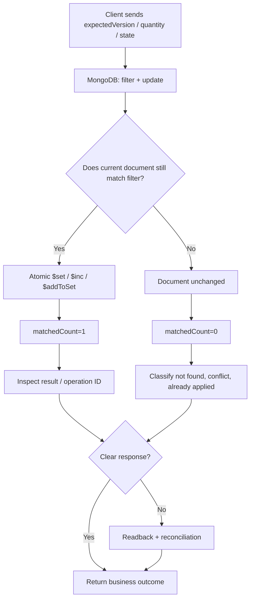

# Compare-and-set with query conditions and update operators

## 1. Problem: reading first, checking, then writing can lose updates

In **Spring Data MongoDB**, a business request may read a `Product` via a repository, check `stock`, and then use `save` or `$set` to write the new quantity. Under concurrent requests, the condition verified in the JVM may **no longer hold** by the time MongoDB executes the write command.

For example, in Mini Commerce, product `KBD-001` has 5 units left:

```text
T0: stock=5
T1: Request A reads stock=5, wants to buy 4 -> enough
T2: Request B reads stock=5, wants to buy 4 -> enough
T3: Request A writes stock=1
T4: Request B writes stock=1
```

If both are told "bought 4 units successfully", the system accepted 8 units in total while stock only dropped by 4. MongoDB still guarantees each single-document write is **atomic**; the bug is that **read and write did not evaluate the condition atomically on the server**.

**Compare-and-set (CAS)** sends a single command with two parts:

- **Compare**: a filter describing the state that must still hold, such as `version = 7`, `status = "PAID"`, or `stock >= 4`.
- **Set/change**: update operators (`$set`, `$inc`, `$addToSet`, `$currentDate`…) executed only if the filter still matches.

MongoDB evaluates the update condition as competing operations execute. Two updates specifying **the same expected value** on one document result in one succeeding and the other no longer matching. CAS is not a separate lock command, and requires no prior round trip to enforce the condition.

This lesson belongs to the **Concurrency Control** chapter of `SPRING_DATA_MONGODB`. It connects with `MongoTemplate`/repositories, BSON mapping, indexes, transactions, reactive access, testing, and Mini Commerce data performance troubleshooting.

### Learning objectives

After this lesson, you will be able to:

1. Express CAS using **filter + atomic update + inspecting the result**.
2. Use `Query`/`Criteria` and `Update` to guard version, stock, and status.
3. Distinguish `UpdateResult.getMatchedCount()` from `getModifiedCount()`.
4. Combine `stock >= quantity` with `$inc(-quantity)` to prevent overselling.
5. Distinguish optimistic locking with `@Version` during `save(entity)` from **explicit CAS** in direct updates.
6. Use `findAndModify` to retrieve the post-update document in a single command.
7. Recognize **lost updates, ABA, duplicate retries, and unknown outcomes**.
8. Design operation IDs/idempotency and know when multi-document transactions are required.
9. Integrate repository `@Query` + `@Update`, reactive `Mono<UpdateResult>`, auditing, and concurrency integration tests.
10. Understand why unique indexes, tenant isolation, write concerns, and application rules remain necessary.

**Prerequisites:** Java 17+, Spring Boot with `spring-boot-starter-data-mongodb`, running MongoDB, familiarity with `@Document`, `MongoRepository`, `MongoTemplate`, `Query`, `Criteria`, and BSON.

## 2. How does CAS on a single document work?



A single-document update is atomic even when modifying multiple fields. However, **`updateMany` is not a transaction over the whole document set**: each document updates atomically, while other documents can still be affected by interleaved commands.

### 2.1. Stock CAS example in mongosh

```javascript
db.products.updateOne(
  {
    _id: "product-KBD-001",
    tenant_id: "shop-a",
    active: true,
    stock: { $gte: 4 }
  },
  {
    $inc: { stock: -4 },
    $currentDate: { updatedAt: true }
  }
);
```

With stock=5, the first request reduces it to 1. Another request also asking for 4 no longer matches `stock >= 4`, so it cannot deduct further. That enforces a **business invariant on a single document**.

### 2.2. Choosing filters by invariant

| Goal | CAS Filter | Update |
| --- | --- | --- |
| Rename when client holds version 7 | `_id`, `tenant_id`, `version: 7` | `$set name` + `$inc version` |
| Deduct stock if sufficient | `_id`, `active:true`, `stock >= quantity` | `$inc stock: -quantity` |
| Transition Order from PAID to PACKING | `_id`, `status: "PAID"`, optionally version | `$set status`, `$inc version` |
| Ignore stale incoming events | `sourceVersion < incomingVersion` | `$set payload/sourceVersion` |
| Deduct stock once per operation ID | `stock >= q` and `processedIds != operationId` | `$inc` and `$addToSet` in the same update |

Do not write a filter with only `{active:true}` to modify one specific Product. For single-document operations, use `_id` or a **uniquely indexed business key**, paired with tenant and required preconditions.

## 3. Product–Customer–Order model

### 3.1. Product with version and stock

```java
package com.example.minicommerce.domain;

import java.math.BigDecimal;
import java.time.Instant;
import java.util.List;

import org.springframework.data.annotation.Id;
import org.springframework.data.annotation.Version;
import org.springframework.data.annotation.LastModifiedDate;
import org.springframework.data.mongodb.core.mapping.Document;
import org.springframework.data.mongodb.core.mapping.Field;
import org.springframework.data.mongodb.core.mapping.FieldType;

@Document(collection = "products")
public class Product {
    @Id
    private String id;

    @Field("tenant_id")
    private String tenantId;

    private String sku;
    private String name;
    private boolean active;
    private int stock;

    @Field(name = "unit_price", targetType = FieldType.DECIMAL128)
    private BigDecimal price;

    @Version
    private Long version;

    @LastModifiedDate
    private Instant updatedAt;

    private List<String> processedReservationIds;

    public Product() {}

    public String getId() { return id; }
    public void setId(String v) { id = v; }
    public String getTenantId() { return tenantId; }
    public void setTenantId(String v) { tenantId = v; }
    public String getSku() { return sku; }
    public void setSku(String v) { sku = v; }
    public String getName() { return name; }
    public void setName(String v) { name = v; }
    public boolean isActive() { return active; }
    public void setActive(boolean v) { active = v; }
    public int getStock() { return stock; }
    public void setStock(int v) { stock = v; }
    public BigDecimal getPrice() { return price; }
    public void setPrice(BigDecimal v) { price = v; }
    public Long getVersion() { return version; }
    public Instant getUpdatedAt() { return updatedAt; }
    public List<String> getProcessedReservationIds() {
        return processedReservationIds;
    }
}
```

Key points to remember:

- `id` maps to BSON `_id`.
- `tenantId` maps to BSON `tenant_id`; `Criteria` paired with `Product.class` uses **Java property names**.
- `price` maps to `unit_price` as BSON Decimal128.
- `@Version` enables optimistic locking on **Spring Data APIs with a version-checking contract**.
- `@LastModifiedDate` does not automatically update on every direct update; set timestamps explicitly in updates when needed.
- `processedReservationIds` is solely for demonstrating **single-document** idempotency, not an unbounded ledger.

### 3.2. Order and Customer

```java
package com.example.minicommerce.domain;

import java.time.Instant;
import org.springframework.data.annotation.Id;
import org.springframework.data.annotation.Version;
import org.springframework.data.mongodb.core.mapping.Document;
import org.springframework.data.mongodb.core.mapping.Field;

@Document(collection = "orders")
public class Order {
    @Id private String id;
    @Field("tenant_id") private String tenantId;
    private String customerId;
    private String status;
    @Version private Long version;
    private Instant updatedAt;

    public Order() {}
    public String getId() { return id; }
    public String getTenantId() { return tenantId; }
    public String getCustomerId() { return customerId; }
    public String getStatus() { return status; }
    public Long getVersion() { return version; }
    public Instant getUpdatedAt() { return updatedAt; }
}
```

In a complete system, Order also includes `OrderLine`s and snapshot pricing; `Customer` holds contact details and tenant permissions. CAS exercises focus on Order status and Product stock without redefining aggregate boundaries.

## 4. Test data

Use an **isolated test database**, never run against production:

```javascript
use mini_commerce

db.products.insertOne({
  _id: "product-KBD-001",
  tenant_id: "shop-a",
  sku: "KBD-001",
  name: "Mini Keyboard",
  active: true,
  stock: 5,
  unit_price: NumberDecimal("129900.00"),
  version: NumberLong(7),
  updatedAt: ISODate("2026-11-20T02:00:00Z"),
  processedReservationIds: []
});

db.orders.insertOne({
  _id: "order-001",
  tenant_id: "shop-a",
  customerId: "customer-001",
  status: "PAID",
  version: NumberLong(3),
  updatedAt: ISODate("2026-11-20T02:00:00Z")
});
```

Re-running `insertOne` with the same `_id` causes a duplicate key error; use fresh fixture IDs or properly scoped cleanup. Java `@Id String` values resembling ObjectIds can be converted to BSON ObjectId by Spring Data; the example uses text-prefixed IDs to make real BSON verification easy.

## 5. CAS by prior status value

Not every CAS needs `@Version`. For a simple `PAID → SHIPPED` transition:

```javascript
db.orders.updateOne(
  {
    _id: "order-001",
    tenant_id: "shop-a",
    status: "PAID"
  },
  {
    $set: { status: "SHIPPED" },
    $inc: { version: 1 },
    $currentDate: { updatedAt: true }
  }
);
```

If the first command succeeds, re-running with the same filter no longer matches because status is no longer PAID. This is a **conditional update**, not "read status then update". A non-matching result can have several causes: the order already shipped, was cancelled, does not exist, belongs to another tenant, or lacks authorization.

When a workflow permits reverting `SHIPPED → PAID`, comparing status alone risks the **ABA** problem: the observed status looks identical even though the document changed in the meantime. When stale clients must be rejected, include expected version or a generation token.

## 6. CAS with version and MongoTemplate.updateFirst

A client read Product at version 7 and wants to rename it. Send the update:

```javascript
db.products.updateOne(
  {
    _id: "product-KBD-001",
    tenant_id: "shop-a",
    version: NumberLong(7)
  },
  {
    $set: { name: "Mini Keyboard V2" },
    $inc: { version: 1 },
    $currentDate: { updatedAt: true }
  }
);
```

If two writers both send `expectedVersion=7`, one writer renames the product and bumps version to 8. The other writer fails to match `version=7` and cannot overwrite.

### 6.1. Complete Spring Data service

```java
package com.example.minicommerce.service;

import com.mongodb.client.result.UpdateResult;
import org.springframework.data.mongodb.core.MongoTemplate;
import org.springframework.data.mongodb.core.query.Criteria;
import org.springframework.data.mongodb.core.query.Query;
import org.springframework.data.mongodb.core.query.Update;
import org.springframework.stereotype.Service;

import com.example.minicommerce.domain.Product;

@Service
public class ProductCasService {
    private final MongoTemplate template;

    public ProductCasService(MongoTemplate template) {
        this.template = template;
    }

    public boolean renameIfVersion(
            String tenantId, String productId,
            long expectedVersion, String rawName) {

        if (tenantId == null || tenantId.isBlank()) {
            throw new IllegalArgumentException("Tenant required");
        }
        if (rawName == null || rawName.isBlank()) {
            throw new IllegalArgumentException("Name required");
        }
        if (expectedVersion < 0) {
            throw new IllegalArgumentException("Invalid version");
        }

        Query filter = Query.query(
            Criteria.where("id").is(productId)
                .and("tenantId").is(tenantId)
                .and("version").is(expectedVersion));

        Update change = new Update()
            .set("name", rawName.trim())
            .inc("version", 1L)
            .currentDate("updatedAt");

        UpdateResult result =
            template.updateFirst(filter, change, Product.class);

        if (!result.wasAcknowledged()) {
            throw new IllegalStateException(
                "Acknowledged write required for CAS");
        }
        return result.getMatchedCount() == 1;
    }
}
```

Explanation:

- `Criteria.where("id")` maps to `_id`; `tenantId` maps to `tenant_id` via `Product.class` metadata.
- `version` in the **filter** is the expected version from the client's snapshot.
- `.inc("version", 1L)` updates version **inside the same atomic update**; because version is explicit in `Update`, we do not rely on mapper auto-increment.
- `.currentDate("updatedAt")` uses a server-assigned timestamp; direct updates do not run an entity-save auditing pass.
- `updateFirst` does not insert on no-match; never enable `upsert` for CAS.
- Filtering on unique `_id` ensures `matchedCount` can only be 0 or 1.

### 6.2. UpdateResult: matched differs from modified

```java
UpdateResult result = template.updateFirst(
    filter, change, Product.class);

if (!result.wasAcknowledged()) {
    throw new IllegalStateException("Write unacknowledged");
}

long matched = result.getMatchedCount();
long modified = result.getModifiedCount();
```

| Result | Meaning |
| --- | --- |
| `matched=1`, `modified=1` | Document matched and actually changed |
| `matched=1`, `modified=0` | Document matched yet update made no change, e.g., `$set` to identical value |
| `matched=0`, `modified=0` | No document matched filter; **not a MongoDB write error** |
| Network / write-concern exception | Client may not know full outcome | Must reconcile, do not blindly retry |

The CAS rename above includes `$inc version`, so a match is expected to yield `modified=1`. Still, **never use `modifiedCount` as the universal definition of CAS success**: a `$set` with an identical value is a valid match yielding `matched=1`, `modified=0`.

### 6.3. Business failure path

When `matchedCount=0`, the cause could be missing Product, wrong tenant, changed version, or another unmet condition. Do not assume all cases are 409; to classify 404/403/409/412, re-read **within authorized scope**. The document can continue changing between CAS and readback, so do not treat readback as an immutable snapshot of the conflict moment.

## 7. @Version optimistic locking vs. direct CAS

For entities with `@Version`, Spring Data's `save(entity)` path checks the version of the loaded instance:

```java
Product first = repository.findById(productId)
    .orElseThrow();
Product stale = repository.findById(productId)
    .orElseThrow();

first.setName("Name A");
repository.save(first);

stale.setName("Name B");
repository.save(stale);
// OptimisticLockingFailureException when version changed
// and write acknowledgement is enabled.
```

However, Spring Data also documents that some `MongoTemplate` updates **auto-increment `@Version` when Update does not mention that property**:

```java
// May increment version, yet has NO expectedVersion:
template.updateFirst(
    Query.query(Criteria.where("id").is(productId)),
    new Update().set("name", "New Name"),
    Product.class);

// Explicit CAS: filter expectedVersion and $inc version.
template.updateFirst(
    Query.query(Criteria.where("id").is(productId)
        .and("version").is(7L)),
    new Update().set("name", "New Name")
        .inc("version", 1L),
    Product.class);
```

**Incrementing version is not the same as checking expected version**. The first update has no idea which version the client read. The second explicitly enforces the version condition and increments version simultaneously.

### 7.1. Every writer must respect the protocol

If the raw Java driver, `mongosh`, or a bulk job modifies `name` **without incrementing version**, a stale entity can still match the old version. An aggregate therefore needs one shared rule across all write paths: repository save, template, raw driver, bulk, migrations, and reactive.

### 7.2. Never save an entity loaded via projection

If `Product` was read without `stock`/`unit_price` using a projection, replacement-style `save` can wipe out unloaded fields. Direct CAS with `$set` preserves untouched fields, though you must handle validation, timestamps, and expected version manually. Pick the tool based on field ownership and invariants.

## 8. CAS for stock: $inc with $gte condition

An atomic stock deduction method:

```java
public boolean reserveStock(
        String tenantId, String productId, int quantity) {

    if (quantity <= 0) {
        throw new IllegalArgumentException(
            "Quantity must be positive");
    }

    Query filter = Query.query(
        Criteria.where("id").is(productId)
            .and("tenantId").is(tenantId)
            .and("active").is(true)
            .and("stock").gte(quantity));

    Update change = new Update()
        .inc("stock", -quantity)
        .currentDate("updatedAt");

    UpdateResult result =
        template.updateFirst(filter, change, Product.class);

    if (!result.wasAcknowledged()) {
        throw new IllegalStateException("Write unacknowledged");
    }
    return result.getMatchedCount() == 1;
}
```

This method lives in a service with injected `MongoTemplate template` and imports for `Product`/`UpdateResult`/`Query`/`Criteria`/`Update`. If `Product` has `@Version` and the update omits version, Spring Data may auto-increment version; **never confuse that auto-bump with checking an expected version**.

With stock=5, two requests asking for 4 units: only one request can match after stock drops to 1. `$inc` modifies the current server value directly, unlike `$set(stock=1)` computed from an earlier read.

### 8.1. Stock CAS alone does not prevent duplicate retries

```text
Attempt 1: stock=5, reserve 2 -> stock=3, server wrote
Client drops connection before response
Attempt 2: retries $inc(-2), stock>=2 still matches
Result: stock=1, the same reservation deducted twice
```

`$inc` is not idempotent per request. `stock>=q` prevents overselling, **not** a client resending the same operation. You also need an operation ID and reconciliation mechanism.

## 9. Idempotency with an operation ID inside the same Product

An atomic single-**Product** example:

```javascript
db.products.updateOne(
  {
    _id: "product-KBD-001",
    tenant_id: "shop-a",
    stock: { $gte: 2 },
    active: true,
    processedReservationIds: { $ne: "reserve-order-001" }
  },
  {
    $inc: { stock: -2, version: 1 },
    $addToSet: {
      processedReservationIds: "reserve-order-001"
    },
    $currentDate: { updatedAt: true }
  }
);
```

### 9.1. Corresponding service

```java
public boolean reserveOnce(
        String tenantId, String productId,
        String reservationId, int quantity) {

    if (reservationId == null || reservationId.isBlank()) {
        throw new IllegalArgumentException(
            "Reservation ID required");
    }
    if (quantity <= 0) {
        throw new IllegalArgumentException(
            "Quantity must be positive");
    }

    Query filter = Query.query(
        Criteria.where("id").is(productId)
            .and("tenantId").is(tenantId)
            .and("active").is(true)
            .and("stock").gte(quantity)
            .and("processedReservationIds").ne(reservationId));

    Update update = new Update()
        .inc("stock", -quantity)
        .inc("version", 1L)
        .addToSet("processedReservationIds", reservationId)
        .currentDate("updatedAt");

    UpdateResult result =
        template.updateFirst(filter, update, Product.class);

    if (!result.wasAcknowledged()) {
        throw new IllegalStateException("Write unacknowledged");
    }
    return result.getMatchedCount() == 1;
}
```

Because `$inc stock` and `$addToSet operationId` run in **the same update on the same document**, after the first attempt succeeds, a retry with that operation ID no longer matches `$ne`. Missing fields also match `$ne`, and `$addToSet` initializes the array if needed.

**Limits you must not ignore:**

- Operation ID must remain **stable** across all attempts; never generate a new UUID on each retry.
- `matched=0` can mean either "already processed" **or** "insufficient stock"/wrong tenant; read back to classify.
- The `processedReservationIds` array can grow toward the BSON document size limit (16 MiB); never use it as a permanent ledger for popular SKUs.
- An operation ID inside Product A does not protect changes to Product B or writing an `Order`. Multi-document workflows need a ledger/unique index and potentially transactions.
- For production, consider an `inventory_reservations` collection with a unique `(tenantId, operationId)` key, checkpoints, and controlled replay.

## 10. CAS along Order's state machine

```text
PLACED -> PAID -> PACKING -> SHIPPED -> DELIVERED
                 \-> CANCELLED (when rules allow)
```

One worker must not move an order `PAID → PACKING` if another worker already shipped or cancelled it:

```java
public boolean beginPacking(
        String tenantId, String orderId,
        long expectedVersion) {

    Query filter = Query.query(
        Criteria.where("id").is(orderId)
            .and("tenantId").is(tenantId)
            .and("status").is("PAID")
            .and("version").is(expectedVersion));

    Update update = new Update()
        .set("status", "PACKING")
        .inc("version", 1L)
        .currentDate("updatedAt");

    UpdateResult result = template.updateFirst(
        filter, update, Order.class);

    return result.wasAcknowledged()
        && result.getMatchedCount() == 1;
}
```

This method lives in a service with `MongoTemplate template` and imports for `Order`/`Query`/`Criteria`/`Update`/`UpdateResult`. State + expected version predicates should pair with a unique `_id` so only one order can be affected.

If a workflow never reverts to an earlier status, filtering by status alone can sometimes block duplicate transitions. If states can cycle back, filtering by version catches **ABA** and stale clients.

## 11. Repository @Query + @Update

CAS can be expressed as a repository method:

```java
package com.example.minicommerce.repository;

import org.springframework.data.mongodb.repository.MongoRepository;
import org.springframework.data.mongodb.repository.Query;
import org.springframework.data.mongodb.repository.Update;
import com.example.minicommerce.domain.Product;

public interface ProductRepository
        extends MongoRepository<Product, String> {

    @Query("""
        { '_id': ?0, 'tenant_id': ?1, 'version': ?2 }
        """)
    @Update("""
        {
          '$set': { 'name': ?3 },
          '$inc': { 'version': 1 },
          '$currentDate': { 'updatedAt': true }
        }
        """)
    long compareAndSetName(
        String productId, String tenantId,
        long expectedVersion, String name);

    @Query("""
        {
          '_id': ?0, 'tenant_id': ?1,
          'active': true, 'stock': { '$gte': ?2 }
        }
        """)
    @Update("""
        {
          '$inc': { 'stock': ?3 },
          '$currentDate': { 'updatedAt': true }
        }
        """)
    long subtractIfEnough(
        String productId, String tenantId,
        int requiredQuantity, int negativeQuantity);
}
```

Notes:

- `@Query` selects documents, `@Update` defines the write; `?0`...`?3` bind parameters.
- Clients must never supply `negativeQuantity` directly: the service must validate `requiredQuantity>0` and pass `-requiredQuantity`.
- Repository update methods affect **all matching documents**, unrestrained by `Top`/`Pageable`. With unique `_id`, at most one Product is modified.
- The returned `long` is the modified document count per repository update contract—**lacking the full matched/modified breakdown of `UpdateResult`**.
- Repository `@Update` does not trigger persistence/mapping lifecycle events like entity `save`; set timestamps/actors explicitly if needed.
- Integration-test `tenant_id`/`version` mapping on your exact Spring Data version.

Do not paper over a CAS miss with `upsert=true`; mismatches must **not insert**.

## 12. findAndModify: returning the document after CAS

`MongoTemplate.updateFirst` returns counts; `findAndModify` can return the old or new document directly:

```java
import org.springframework.data.mongodb.core.FindAndModifyOptions;

public Product renameAndReturn(
        String tenantId, String productId,
        long expectedVersion, String newName) {

    Query query = Query.query(
        Criteria.where("id").is(productId)
            .and("tenantId").is(tenantId)
            .and("version").is(expectedVersion));

    Update update = new Update()
        .set("name", newName)
        .inc("version", 1L)
        .currentDate("updatedAt");

    return template.findAndModify(
        query, update,
        FindAndModifyOptions.options()
            .returnNew(true)
            .upsert(false),
        Product.class);
}
```

`returnNew(true)` returns the **post-update** document; on no match with upsert disabled, the method returns `null`. Filter and update remain atomic on one document. `findAndModify` does not guarantee idempotency on its own and has its own performance characteristics, so use it when you genuinely need the post-write document.

Equivalent raw MongoDB command:

```javascript
db.products.findAndModify({
  query: {
    _id: "product-KBD-001",
    tenant_id: "shop-a",
    version: NumberLong(7)
  },
  update: {
    $set: { name: "Mini Keyboard V2" },
    $inc: { version: 1 },
    $currentDate: { updatedAt: true }
  },
  new: true,
  upsert: false
});
```

When using `mongosh`/raw driver, you must specify **BSON field names**. Spring Data mapping does not apply outside entity-aware APIs.

## 13. The ABA problem and limits of comparing only old values

CAS checks the **current value**, not proof that the document **never changed** since the client read it.

```text
T0: Order.status=PAID, version=3
T1: Worker A reads status=PAID
T2: Worker B changes status=PACKING, version=4
T3: Admin reverts status to PAID, version=5
T4: Worker A filters status=PAID -> matches again
```

That is **ABA**: the same `PAID` value reappears after intermediate changes. If Worker A requires "only edit the Order at the exact revision I reviewed", include `version=3` or a stable **generation token**. With version now at 5, the stale command at T4 fails to match.

Also consider deleting and recreating a document with the same `_id` and reset version: a version number is not unique across lifetimes if IDs or generations are reused. Use unique identifiers or new generation tokens when the business must detect recreation cycles.

## 14. Why not use upsert for CAS?

**CAS** means "modify only if current state is right", whereas **upsert** means "if no match, try inserting".

```javascript
// Do not use this pattern for CAS on an existing document:
db.products.updateOne(
  { _id: "product-KBD-001", version: NumberLong(7) },
  { $set: { name: "New Name" }, $inc: { version: 1 } },
  { upsert: true }
);
```

If Product is currently at version 8, filtering `version: 7` does not match. With `upsert:true`, MongoDB may try creating a new document and throw a duplicate-key error on `_id`, or insert a duplicate record if the business key is not unique. That is **not** the desired conflict behavior.

**Rule:** CAS on existing records uses `upsert=false`. Creating new records by unique key is a **separate initialization flow** that may use `$setOnInsert` and a unique index, while handling concurrent creation races.

## 15. Choosing the right update operator

| Operator | Purpose | Limitation in CAS |
| --- | --- | --- |
| `$set` | Write absolute value | If filter is too broad, can overwrite newer values |
| `$inc` | Server-side add/subtract | Not idempotent on duplicate retries |
| `$min` | Replace only if new value is smaller | Does not protect the whole entity from stale writes |
| `$max` | Replace only if new value is larger | High watermark does not prove all events processed |
| `$addToSet` | Append unique element | Array growth and does not create cross-doc ledger |
| `$setOnInsert` | Initialize fields on upsert insert | Do not use to "work around" version conflicts |
| `$currentDate` | Server-assigned BSON Date/timestamp | Does not replace a full audit trail |
| `$unset` | Remove field | May violate validation/schema rules |

### 15.1. Example of $max for sequences

```javascript
db.product_sync_state.updateOne(
  { _id: "shop-a/catalog-feed" },
  { $max: { lastSeenSequence: NumberLong(42) } }
);
```

This command prevents the watermark from regressing from 42 back to 41. Yet **a high watermark does not prove every Product in event 42 was written**. If updating state and Products across multiple documents, use proper checkpoints/ledgers or transactions.

### 15.2. Aggregation pipeline updates still need CAS filters

MongoDB also supports pipeline updates:

```javascript
db.products.updateOne(
  { _id: "product-KBD-001", version: NumberLong(7) },
  [
    {
      $set: {
        name: "Mini Keyboard V2",
        version: { $add: ["$version", 1] }
      }
    }
  ]
);
```

Pipeline updates let you compute values from the current document, yet **do not automatically perform expected-version checks**. The filter must still guard state. Note that `$inc` is an update modifier, not an aggregation stage in an update pipeline; pipeline syntax requires expressions like `$add`.

## 16. Single-document atomicity vs. multi-document transactions

```javascript
db.products.updateMany(
  { tenant_id: "shop-a", active: true },
  { $inc: { stock: 1 } }
);
```

With `updateMany`, each Product updates atomically, yet **the batch as a whole is not all-or-nothing**, and other writers can interleave on remaining documents.

### 16.1. BulkOperations is not a transaction

`BulkOperations.BulkMode.ORDERED`/`UNORDERED` groups commands and defines ordering/error handling, **not** an atomic batch transaction. `BulkWriteResult` provides aggregate counters like matched/modified, without always telling you which SKU failed CAS due to conflict.

For an import updating 1,000 Products:

- Each operation should carry a business ID and expected version.
- Track operation ID ↔ input for post-error reconciliation.
- Never retry a full `$inc` batch when outcomes are uncertain.
- If per-Product status is strictly required, consider individual commands with results or a ledger.

### 16.2. When is a transaction needed?

An order placement flow might need to:

1. CAS-deduct stock on Product A.
2. CAS-deduct stock on Product B.
3. Create the Order.
4. Write an outbox/operation ledger record.

If the invariant demands **all commit or all roll back together**, use a MongoDB transaction on a supported replica set/sharded topology with `MongoTransactionManager` or its reactive counterpart.

```java
import org.springframework.transaction.annotation.Transactional;

@Transactional
public void placeOrder(PlaceOrderCommand command) {
    // 1. Check operation ID; CAS stock for each Product.
    // 2. If any CAS matched=0, abort transaction.
    // 3. Insert Order with unique business key.
    // 4. Save outbox/event ledger inside transaction.
    // 5. Record checkpoint only after confirmed commit.
}
```

This is a **conceptual skeleton**: `PlaceOrderCommand` and individual operations must be defined separately. Transactions do not roll back emails, payment gateways, or HTTP requests outside MongoDB. For lost commit responses, the application still needs idempotency/readback.

## 17. CAS no-match: identifying the business error

`matchedCount=0` is a valid result, not an exception. It can point to any of several causes:

| Cause | Example | Handling |
| --- | --- | --- |
| Entity missing | Wrong ID or deleted | 404 if contract/permissions allow |
| Wrong tenant | Product has a different `tenant_id` | Never expose cross-tenant resources |
| Version conflict | Client sent 7, DB is at 8 | 409 or 412 per API contract |
| Invalid business transition | Order already SHIPPED, no longer PAID | Conflict or domain error |
| Insufficient stock | Stock is 1, quantity=4 | Out-of-stock/precondition failed |
| Operation ID already processed | Array/ledger already holds ID | Read back and return idempotent result |

A service can re-read by **ID + tenant** after `matched=0` to classify:

```java
UpdateResult result =
    template.updateFirst(filter, change, Product.class);

if (result.wasAcknowledged()
        && result.getMatchedCount() == 0) {
    // Scoped readback:
    // - Product missing: not found / scope.
    // - Different version: stale.
    // - Low stock: insufficient stock.
    // - Operation ID present: maybe already applied.
}
```

The readback is a separate operation, and data can still change in between. Do not treat it as an immutable snapshot of the exact instant CAS failed.

## 18. Timeouts, unknown outcomes, and safe retries

### 18.1. Missing a response does not mean MongoDB did not write

```text
Client sends CAS expectedVersion=7
MongoDB writes successfully, version=8
Connection drops before response
Client retries expectedVersion=7
Retry returns matched=0
```

A retry result of 0 **does not prove the first attempt failed**. If Product was subsequently updated by another writer, inspecting the final `name`/`version` alone may not prove whether the original operation applied.

When business effects require strong confirmation, use an operation ID, ledger/outbox, or queryable status record to **reconcile**. Distinguish:

- `CONFIRMED_APPLIED`: evidence exists that the operation reached the desired state.
- `CONFIRMED_NOT_APPLIED`: update received acknowledged `matched=0`, assuming no earlier conflicting outcome.
- `UNKNOWN_OUTCOME`: lost response, write concern failure, or insufficient evidence.

### 18.2. Driver retryable writes are not business-level exactly-once

The MongoDB Java driver provides retryable writes for supported cases/topologies. Still, user-level retries of a multi-command Order flow, retrying `$inc` without an operation guard, or lost responses after commit still require application protocols.

With direct version CAS, retrying the same `expectedVersion` generally will not apply twice, yet the client must still determine why retry returned 0. With stock CAS (`stock >= quantity`), a retry **can** deduct stock a second time if enough stock remains.

### 18.3. Acknowledged write concern

CAS and optimistic locking require reliable write results. `WriteConcern.UNACKNOWLEDGED` is unsuitable when the service must decide based on `matchedCount`. Consider `w: "majority"` and durability per requirements, yet **majority does not create exactly-once semantics** or cross-document atomicity.

## 19. Auditing, validation, and authorization

Repository `save(entity)` can trigger `BeforeConvertCallback`, `BeforeSaveCallback`, and Spring auditing when enabled. `MongoTemplate.updateFirst` or repository `@Update` **is not an entity-save lifecycle**, so never assume `@LastModifiedDate` or validation callbacks ran.

For direct CAS, set metadata explicitly:

```java
Update change = new Update()
    .set("name", newName)
    .set("lastModifiedBy", verifiedActorId)
    .inc("version", 1L)
    .currentDate("updatedAt");
```

`verifiedActorId` must come from a trusted security context/service account. `updatedAt`/`lastModifiedBy` track only the last modification, **not an append-only audit trail**. If full history or operation ID proof is needed, use an audit ledger/outbox with proper retention.

Protect invariants across multiple layers:

1. Input validation (`quantity > 0`, valid names, non-negative expectedVersion).
2. Tenant/authorization verified in the service and `tenantId` filter.
3. Critical preconditions in the **server filter** (`version`, `status`, `stock`).
4. Unique indexes, schema validation, and BSON mapping.
5. Idempotency on retries, transactions if multi-document.

Never take `tenantId` solely from the request body and trust it as authorization.

## 20. Unique indexes, explain, and sharded clusters

### 20.1. By _id

`_id` has a default unique index, so CAS by ID locates at most one Product and then checks tenant/version:

```javascript
db.products.find({
  _id: "product-KBD-001",
  tenant_id: "shop-a",
  version: NumberLong(7)
}).explain("executionStats");
```

You do not need a `{_id:1, version:1}` compound index for every CAS when the plan is already optimal. Optimize based on real workloads and `totalKeysExamined`/`totalDocsExamined`.

### 20.2. By business key

If using `(tenantId, sku)`:

```javascript
db.products.createIndex(
  { tenant_id: 1, sku: 1 },
  { unique: true }
);
```

Without unique SKU, `updateOne` can hit an unintended document and `updateMulti` can hit multiple documents. Unique indexes must reflect exact business scope.

### 20.3. Sharding

In a sharded cluster, verify shard keys, routing, unique index scope, and MongoDB version support. A CAS query by `_id` does not automatically target a single shard efficiently under every shard-key schema. A local replica-set test does not prove routing or performance on a sharded cluster.

`explain("executionStats")` inspects the query planner, **not** timeout handling, conflicts, or ABA. Parallel integration tests are required.

## 21. ReactiveMongoTemplate: Mono<UpdateResult>

Filters and updates share the same BSON semantics in reactive APIs:

```java
import com.mongodb.client.result.UpdateResult;
import reactor.core.publisher.Mono;

import org.springframework.data.mongodb.core.query.Criteria;
import org.springframework.data.mongodb.core.query.Query;
import org.springframework.data.mongodb.core.query.Update;

Mono<UpdateResult> updated =
    reactiveMongoTemplate.updateFirst(
        Query.query(Criteria.where("id").is(productId)
            .and("tenantId").is(tenantId)
            .and("version").is(expectedVersion)),
        new Update()
            .set("name", newName)
            .inc("version", 1L)
            .currentDate("updatedAt"),
        Product.class);

Mono<Boolean> applied = updated.map(result -> {
    if (!result.wasAcknowledged()) {
        throw new IllegalStateException(
            "Acknowledged write required");
    }
    return result.getMatchedCount() == 1;
});
```

`reactiveMongoTemplate` is an injected bean and the variables are validated inputs. The publisher executes on **subscribe**. Subscribing twice to a publisher carrying `$inc` can execute two writes without CAS/idempotency. Never call `block()` on the WebFlux event loop.

Reactor test:

```java
import reactor.test.StepVerifier;

StepVerifier.create(applied)
    .expectNext(true)
    .verifyComplete();
```

In a real integration test, seed Product at the expected version, then run a stale attempt and verify `false`. Never re-subscribe to a non-idempotent write command just for logging.

## 22. Integration test: concurrent CAS against real MongoDB

Mocking `MongoTemplate` only checks that the expected call was constructed; it does not prove atomic updates, BSON aliases, versioning, or concurrency. Use real MongoDB or Testcontainers and a dedicated test database.

### 22.1. Two writers with the same expected version

```java
package com.example.minicommerce;

import static org.junit.jupiter.api.Assertions.*;

import java.util.concurrent.CountDownLatch;
import java.util.concurrent.ExecutorService;
import java.util.concurrent.Executors;
import java.util.concurrent.Future;
import java.util.concurrent.TimeUnit;

import org.bson.Document;
import org.junit.jupiter.api.Test;
import org.springframework.beans.factory.annotation.Autowired;
import org.springframework.boot.test.context.SpringBootTest;
import org.springframework.data.mongodb.core.MongoTemplate;

import com.example.minicommerce.service.ProductCasService;

@SpringBootTest
class CompareAndSetIntegrationTest {

    @Autowired MongoTemplate template;
    @Autowired ProductCasService service;

    @Test
    void onlyOneWriterWinsSameExpectedVersion() throws Exception {
        String id = "cas-test-product-1";
        var products = template.getCollection("products");

        products.deleteOne(new Document("_id", id));
        try {
            products.insertOne(
                new Document("_id", id)
                    .append("tenant_id", "cas-test-tenant")
                    .append("sku", "CAS-TEST-001")
                    .append("name", "Original")
                    .append("active", true)
                    .append("stock", 5)
                    .append("version", 7L));

            ExecutorService pool =
                Executors.newFixedThreadPool(2);
            CountDownLatch start = new CountDownLatch(1);

            try {
                Future<Boolean> a = pool.submit(() -> {
                    start.await();
                    return service.renameIfVersion(
                        "cas-test-tenant", id, 7L, "Name A");
                });
                Future<Boolean> b = pool.submit(() -> {
                    start.await();
                    return service.renameIfVersion(
                        "cas-test-tenant", id, 7L, "Name B");
                });

                start.countDown();

                boolean resultA = a.get(10, TimeUnit.SECONDS);
                boolean resultB = b.get(10, TimeUnit.SECONDS);

                assertNotEquals(resultA, resultB);

                Document stored =
                    products.find(new Document("_id", id)).first();
                assertNotNull(stored);
                assertEquals(8L,
                    stored.get("version", Number.class).longValue());
                assertTrue(
                    "Name A".equals(stored.getString("name")) ||
                    "Name B".equals(stored.getString("name")));
            } finally {
                pool.shutdownNow();
            }
        } finally {
            products.deleteOne(new Document("_id", id));
        }
    }
}
```

Both tasks release on the same latch, yet the test **does not predict which thread wins**. It asserts that exactly one returned true, version incremented once, and the final name is one of the two submitted values.

**Fixture:** if the test `products` collection has a JSON Schema requiring `unit_price` or other fields, the seed must satisfy that schema. Use an isolated test database; never weaken production validators to make tests pass.

### 22.2. Testing operation ID against retries

In a dedicated test with `stock=5`, `processedReservationIds=[]`:

```java
boolean first = stockService.reserveOnce(
    tenantId, productId, "reservation-001", 3);

boolean retry = stockService.reserveOnce(
    tenantId, productId, "reservation-001", 3);

assertTrue(first);
assertFalse(retry);

Document actual = template.getCollection("products")
    .find(new Document("_id", productId)).first();

assertNotNull(actual);
assertEquals(2, actual.getInteger("stock"));
assertTrue(actual.getList(
    "processedReservationIds", String.class)
    .contains("reservation-001"));
```

This is a **test body**; `stockService` needs the `reserveOnce` method from section 9, `tenantId/productId` need fixtures, and JUnit imports are required. If a retry request generates a new operation ID, the guard will fail to recognize the duplicate request.

### 22.3. Additional tests

| Scenario | Expectation |
| --- | --- |
| Two concurrent version CAS | One writer applied |
| Stale version | Does not overwrite Product |
| `$set` identical value | matched=1, modified may be 0 |
| Stock=5, two requests qty=4 | Only one request accepted |
| Two attempts same reservation ID | Stock decreases only once |
| Retry after lost response | Readback/ledger; do not assume matched=0 means definite failure |
| Wrong tenant | Does not modify another tenant's document |
| Order no longer PAID | Transition does not execute |
| ABA status returns | Stale expectedVersion fails to match |
| `findAndModify.returnNew(true)` | Returns new-version document or null |
| CAS with upsert disabled | Creates no new document on mismatch |
| Repository `@Update` | Filter aliases and count match contract |
| `@Version` stale save | OptimisticLockingFailureException with acknowledged write |
| Reactive CAS | Mono emits result without unintended re-execution |

Do not run build/Gradle/tests during this STEP 4 authoring phase; test snippets will be executed/reviewed by SMEs in STEP 6 NEW.

## 23. Common mistakes

| Symptom | Cause | Resolution |
| --- | --- | --- |
| Two purchases both succeed while stock dropped only once | Read then `$set` in JVM | `stock >= q` + `$inc(-q)` on server |
| Name overwritten by stale request | Filter missing expected version | CAS by `_id + version` |
| Version increments yet updates still lost | Auto-bump without compare | Include expectedVersion in filter |
| Matched=0 with no exception | Unmatched condition is normal outcome | Classify conflict/not-found/insufficient |
| Matched=1, modified=0 | Setting already-existing value | Do not treat as an error |
| Stock decreases twice after retry | `$inc` is not idempotent | Operation ID/ledger |
| Version retry returns 0 after timeout | First attempt may have committed | Reconcile before returning failure |
| Old status reappears | ABA problem | Version or generation token |
| Version CAS mismatch reports duplicate key | Upsert was enabled | CAS uses `upsert=false` |
| Raw writer breaks `@Version` | Fails to increment version across all write paths | Unify protocol |
| Repository `@Update` skips auditing | No save callback | Explicit `$currentDate` and actor |
| CAS by SKU modifies wrong Product | Missing unique index on tenant/SKU | Create properly scoped unique key |
| `updateMany` partially fails | Atomicity is per document only | Reconcile/transaction per invariant |
| Ordered bulk treated as transaction | Bulk is not all-or-nothing | Transaction/ledger if needed |
| `findAndModify` returns old version | `returnNew` not enabled | `returnNew(true)` |
| Tenant not filtered | Missing permission/invariant | Derive trusted tenant, add filter |
| Sequential tests pass yet races remain | Concurrent writers not tested | Integration tests with latches |

## 24. Exercises and self-assessment questions

**Exercise 1 — Stock CAS.** Create a Product with `stock=5`; issue two commands with `stock>=4`, `$inc stock=-4`. Predict matched/modified and final stock.

**Exercise 2 — Lost update.** Write a method that reads Product then runs `$set(stock=calculated)`, and compare it to server-side CAS. Have two tasks read the same value to observe the discrepancy.

**Exercise 3 — Version CAS.** Seed version 7, send two updates both with `expectedVersion=7`, `$set name` + `$inc version`. Only one command should modify.

**Exercise 4 — @Version.** Load two Product instances at the same version, `save` A then `save` B; handle the optimistic locking exception and compare with direct updates lacking compare.

**Exercise 5 — @Update.** Declare `@Query` + `@Update` on a repository using `_id`, `tenant_id`, and `version`. Verify raw BSON and count via integration test.

**Exercise 6 — findAndModify.** Use `returnNew(true)` to get the new version; call again with the old expected version and verify null.

**Exercise 7 — State transition.** Allow `PAID → PACKING` only if status and version still match. Send two workers with the same command—one wins and one conflicts.

**Exercise 8 — ABA.** Produce `PAID → PACKING → PAID`; compare filtering by status alone vs. filtering with version.

**Exercise 9 — Idempotency.** Add `reservationId`, using `$inc + $addToSet` in one update. Retry the same ID and verify stock drops only once; discuss unbounded array growth limits.

**Exercise 10 — Multi-document.** Design an Order spanning two Products, identifying when transactions, unique indexes, ledger/outbox, and unknown-commit handling are needed.

**Exercise 11 — Reactive.** Use `ReactiveMongoTemplate.updateFirst`, `StepVerifier`, and a stale request while avoiding double-subscribing an `$inc` command.

**Exercise 12 — Index.** Compare CAS by `_id` vs. CAS by `(tenant_id,sku)`, create the right unique index, and inspect `explain("executionStats")`.

### Questions

1. How does CAS differ from `find → if → save`?
2. Why does single-document atomicity not automatically prevent lost updates?
3. When does `matchedCount` differ from `modifiedCount`?
4. How does `@Version` during `save` differ from explicit CAS via Query/Update?
5. Why does auto-incrementing version not prove expected version was checked?
6. Why does `stock>=q` prevent overselling without preventing duplicate retries?
7. Why must `$addToSet` and `$inc` execute in the same update to record a reservation?
8. What limitation does a processed IDs array have?
9. When does the ABA problem occur?
10. Why is upsert dangerous for version CAS?
11. When is `findAndModify` better than `updateFirst`?
12. How many business meanings can `matched=0` carry?
13. Why does a timeout after sending an update not prove the server failed to write?
14. When is a transaction required instead of single-Product CAS?
15. How do repeated reactive subscriptions affect `$inc`?
16. What roles do unique indexes and tenant filters play in CAS?

**Expected outcome:** learners can use **query conditions as the compare step** and **update operators as the set step** of CAS, verify via `UpdateResult`/`findAndModify`, handle versions and business statuses concurrently, and recognize the limits of single-document CAS regarding idempotency, multi-document operations, transactions, and unknown outcomes.

## References

- [MongoDB Manual — Atomicity and Transactions](https://www.mongodb.com/docs/manual/core/write-operations-atomicity/): per-document atomicity, expected value checks, and concurrent updates.
- [MongoDB Manual — Update Documents](https://www.mongodb.com/docs/manual/tutorial/update-documents/): `updateOne`, `updateMany`, filters, and updates.
- [MongoDB Manual — $inc](https://www.mongodb.com/docs/manual/reference/operator/update/inc/): server-side numeric updates.
- [MongoDB Manual — $addToSet](https://www.mongodb.com/docs/manual/reference/operator/update/addToSet/): adding unique elements to an array.
- [MongoDB Manual — findAndModify](https://www.mongodb.com/docs/manual/reference/method/db.collection.findAndModify/): updating and returning a document in one operation.
- [MongoDB Manual — Retryable Writes](https://www.mongodb.com/docs/manual/core/retryable-writes/): retry support and boundaries.
- [Spring Data MongoDB — Saving, Updating and Removing Documents](https://docs.spring.io/spring-data/mongodb/reference/mongodb/template-crud-operations.html): `MongoTemplate.updateFirst`, `findAndModify`, `@Version`, and write acknowledgment.
- [Spring Data MongoDB — Repository Update Methods](https://docs.spring.io/spring-data/mongodb/reference/mongodb/repositories/modifying-methods.html): `@Query`, `@Update`, counters, and lifecycle limits.
- [Spring Data MongoDB — Lifecycle Events](https://docs.spring.io/spring-data/mongodb/reference/mongodb/lifecycle-events.html): entity callbacks and direct writes.
- [Spring Data MongoDB — Client Sessions and Transactions](https://docs.spring.io/spring-data/mongodb/reference/mongodb/client-session-transactions.html): multi-document transactions.
- [MongoDB Manual — Explain Results](https://www.mongodb.com/docs/manual/reference/explain-results/): indexes and execution statistics.
