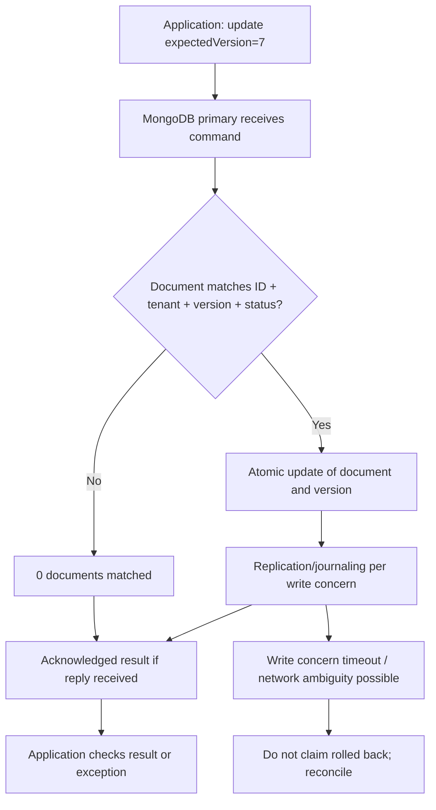

# Appropriate write concerns to detect write failures or version conflicts

## 1. Practical problem and learning objectives

Suppose two staff members both open an order currently at `status = READY_TO_SHIP` and `version = 7`. Staff member A confirms shipment, while staff member B wants to cancel. If both read the old version and write back the entire document, one change can **overwrite** the other. Another problem arises when MongoDB receives a write command yet the application loses its connection before getting a reply: did that operation succeed or fail, and should it be resent?

Two mechanisms are frequently confused:

1. **Write concern**: specifies the level of **write acknowledgment** from MongoDB, such as `w: 1` or `w: "majority"`, along with journaling and timeout options.
2. **Concurrency control via version/write conditions**: specifies that an operation applies only when the document still has the expected state and version, then inspects outcomes like `matchedCount` or optimistic locking exceptions.

They **complement each other rather than replace each other**. A strong enough write concern tells the client how far the write was acknowledged; it **does not compare versions itself**. A `version = 7` predicate prevents overwrites, yet if the application sends writes without waiting for acknowledgment, it may **fail to observe** whether the command matched or was rejected by the server.

This lesson belongs to the **Concurrency Control** chapter of the **SPRING_DATA_MONGODB** module. The module covers using Spring Data MongoDB to connect, map documents, and operate via `MongoTemplate` or repositories; practicing queries, aggregations, indexes, transactions, reactive access, testing, and data performance diagnostics.

After this lesson, you will be able to:

- Distinguish `w: 0`, `w: 1`, `w: "majority"`, `j`, and `wtimeout` in terms of observability and write durability.
- Explain why **acknowledged writes are a prerequisite for observing optimistic locking conflicts**.
- Use `@Version` with `MongoTemplate.save(...)` and handle `OptimisticLockingFailureException`.
- Write compare-and-set commands with `MongoOperations.updateFirst(...)`, version filters, `UpdateResult`, and version increments.
- Distinguish duplicate keys, unmatched documents, write concern timeouts, network timeouts, and transaction conflicts.
- Design proper retries/idempotency when it is uncertain whether a command applied.
- Configure write concerns in Spring Data/driver, measure latency, and write meaningful integration tests.

> **Principle:** Choose write concern based on SLA, durability, and topology; choose write conditions based on business invariants; report "success" only with **evidence matching the contract**. Never equate `w: "majority"` with "conflicts can never occur".

## 2. Three independent questions for any write operation

Every write command must answer:

| Question | Primary mechanism | Evidence |
| --- | --- | --- |
| **Did the server receive/process the command and report any error?** | Acknowledged write concern and driver results/exceptions | `UpdateResult`, `MongoWriteException`, or Spring-translated exception |
| **On how many replicas was the change confirmed?** | `w`, journaling `j`, `wtimeout`, topology | Write acknowledgment or write concern error |
| **Were state/version still valid at write time?** | Filter predicates, `@Version`, atomic update | Matched count, optimistic-locking failure, or CAS result |

In a single command, a network error can occur alongside uncertainty over whether the write applied. Therefore, an essential part of concurrency control is **never guessing outcomes** from an exception name alone.



**Reading the diagram accurately:** A failed condition does not necessarily produce a server error. On an acknowledged update, **match = 0** is a valid command outcome; the business layer decides whether that means conflict, not found, or invalid state condition.

## 3. Sample data and domain model

### 3.1. BSON documents

In the practice `orders` collection:

```javascript
db.orders.insertMany([
  {
    _id: "ord-101",
    tenantId: "tenant-a",
    externalKey: "partner-evt-101",
    status: "READY_TO_SHIP",
    version: NumberLong("7"),
    updatedAt: ISODate("2026-11-19T08:00:00Z")
  },
  {
    _id: "ord-102",
    tenantId: "tenant-a",
    externalKey: "partner-evt-102",
    status: "READY_TO_SHIP",
    version: NumberLong("3"),
    updatedAt: ISODate("2026-11-19T09:00:00Z")
  },
  {
    _id: "ord-201",
    tenantId: "tenant-b",
    externalKey: "partner-evt-201",
    status: "READY_TO_SHIP",
    version: NumberLong("1"),
    updatedAt: ISODate("2026-11-19T10:00:00Z")
  }
]);
```

Seed commands are solely for **empty/pre-reset test databases**; never run them as-is on real data. Update examples below mutate status or version; reset fixtures when comparing independent runs.

### 3.2. Spring Data entity

```java
package com.example.orders.persistence;

import java.time.Instant;
import org.springframework.data.annotation.Version;
import org.springframework.data.mongodb.core.mapping.Document;
import org.springframework.data.mongodb.core.mapping.FieldType;
import org.springframework.data.mongodb.core.mapping.MongoId;

@Document(collection = "orders")
public record OrderDocument(
    @MongoId(FieldType.STRING) String id,
    String tenantId,
    String externalKey,
    String status,
    @Version Long version,
    Instant updatedAt
) {
    public OrderDocument withStatus(String newStatus, Instant now) {
        return new OrderDocument(
            id, tenantId, externalKey, newStatus, version, now
        );
    }
}
```

`@Version` marks the property used for **optimistic locking** in supported Spring Data operations. `Long` is a wrapper so it can be null before a new entity is inserted; the framework manages version values on insert/save per the active version's rules. `@MongoId(FieldType.STRING)` stores BSON `_id` as a String, matching the fixture.

Never insert a new document with `version = 7` assuming MongoDB automatically enforces optimistic locking merely because the field exists. **Write operations must include a version filter or use an appropriate version-aware API.**

### 3.3. Unique index for business keys

If each partner event may create at most one order per tenant:

```javascript
db.orders.createIndex(
  { tenantId: 1, externalKey: 1 },
  { unique: true, name: "uk_orders_tenant_external" }
);
```

This index **prevents duplicate records** when two creation requests race; it solves a **different** race than optimistic version conflicts. Never treat `DuplicateKeyException` and `OptimisticLockingFailureException` as two names for the same scenario.

## 4. What is write concern and where does it live?

Write concern defines the acknowledgment level MongoDB must reach for a write operation. In a replica set, `w` specifies how many or which members must acknowledge; `j` controls journaling; `wtimeout` sets a time limit waiting for write concern.

```javascript
db.orders.updateOne(
  {
    _id: "ord-101",
    tenantId: "tenant-a",
    version: NumberLong("7")
  },
  { $set: { status: "SHIPPED" }, $inc: { version: NumberLong("1") } },
  {
    writeConcern: {
      w: "majority",
      j: true,
      wtimeout: 10000
    }
  }
);
```

In this example, `wtimeout: 10000` is **10,000 ms**. The command combines:

- **CAS filter** `version: 7`, preventing overwrites if version changed.
- **Write concern** `w: "majority"` and `j: true`, requesting the chosen acknowledgment level.

The two parts are independent: omitting the version filter can still yield majority acknowledgment for a business-wrong overwrite; omitting sufficient acknowledgment can keep the app from seeing the CAS result.

## 5. w: 0 — unacknowledged writes and the risk of losing failure signals

`w: 0` instructs the client not to wait for the server's normal write acknowledgment.

```javascript
db.orders.updateOne(
  { _id: "ord-101", version: NumberLong("7") },
  { $set: { status: "SHIPPED" } },
  { writeConcern: { w: 0 } }
);
```

**Never use `w: 0` for business operations that must know whether writes succeeded, conflicted on version, or hit duplicate keys.**

With unacknowledged writes:

- The client cannot trust matched/modified counts as with acknowledged writes.
- Errors during server processing, including many validation/write errors, may not reach the application as reliable results.
- Do not expect Spring Data to reliably throw `OptimisticLockingFailureException`.
- The fact that the client "sent the command without immediate error" **does not prove** the database updated the document.
- The name `UNACKNOWLEDGED` does not mean network errors can never surface; it means **no reliable write acknowledgment is returned**.

Spring Data MongoDB's optimistic locking documentation explicitly notes using an **acknowledged write concern**, otherwise optimistic locking failures may be silently skipped.

### 5.1. Java driver: never read counts when unacknowledged

```java
UpdateResult result = collection.updateOne(
    Filters.eq("_id", "ord-101"),
    Updates.set("status", "SHIPPED")
);

if (!result.wasAcknowledged()) {
    throw new IllegalStateException(
        "Cannot decide business success from unacknowledged write"
    );
}

long matched = result.getMatchedCount();
long modified = result.getModifiedCount();
```

This snippet assumes `collection` is a configured `MongoCollection<Document>`. When a write result is **unacknowledged**, never call count getters and treat them as valid results; getters can throw exceptions on unacknowledged results.

## 6. w: 1 — primary acknowledgment

`w: 1` in a replica set requests primary acknowledgment for the write. This is an **acknowledged** level, so the application receives matched/modified counts or server-side write errors when the command completes normally.

```javascript
db.orders.updateOne(
  { _id: "ord-101", version: NumberLong("7") },
  { $set: { status: "SHIPPED" }, $inc: { version: 1 } },
  { writeConcern: { w: 1 } }
);
```

A response with `matchedCount: 1` confirms the filter matched one document in that command. Yet `w: 1` **does not guarantee the write was replicated to a majority of replicas**, so data can risk rollback during primary failover in certain scenarios.

### 6.1. When is w: 1 suitable?

- Workloads accepting primary-only acknowledgment and its failover/durability trade-offs.
- Operations recoverable or reproducible after evaluating write-loss risks.
- Applications that still require validation errors and result counts when commands return normally.

Do not assume `w: 1` fits every order, payment, or inventory system. The choice depends on business risk and topology.

### 6.2. w: 1 does not imply j: true

`w: 1` requests primary acknowledgment, while `j: true` adds a journaling requirement. Whether journaling is awaited depends on write concern and server settings. Never infer "durably flushed to journal" solely from `w: 1`.

## 7. w: "majority" — requiring acknowledgment from a majority

`w: "majority"` requests acknowledgment from a **configured majority of voting replica set members** per MongoDB rules; details involving arbiters, special members, or custom topologies must be verified against your server version.

```javascript
db.orders.updateOne(
  { _id: "ord-101", version: NumberLong("7") },
  { $set: { status: "SHIPPED" }, $inc: { version: 1 } },
  { writeConcern: { w: "majority" } }
);
```

This is often worth considering for critical state transitions where the app wants to reduce rollback risk across failovers.

### 7.1. Majority does not eliminate business conflicts

If two requests simultaneously write:

```javascript
// Request A
{ $set: { status: "SHIPPED" } }

// Request B
{ $set: { status: "CANCELLED" } }
```

and both filter solely by `_id`, both can receive majority acknowledgment in execution order. The final value belongs to whichever wrote last. **Majority protects replication acknowledgment, not lost-update detection**.

To prevent lost updates, place expected state or version right in the write filter.

### 7.2. Latency and availability costs

Compared to primary acknowledgment, majority waits for additional replication, impacting:

- Write latency, especially with slow secondaries or distant networks.
- Write availability when a majority cannot be reached.
- Backpressure during replica lag.
- Overall throughput under write-heavy workloads.

There is no universal "majority adds X ms" rule. Measure p95/p99 under realistic topology and write patterns.

### 7.3. Journaling alongside majority

Whether majority acknowledgment waits for the journal depends on server configuration, such as `writeConcernMajorityJournalDefault`. If strict journal durability is required, configure/verify `j: true` and actual storage engine/cluster settings rather than assuming "majority always fsyncs every disk".

## 8. j: true and wtimeout: never confuse durability with wait timeouts

### 8.1. j: true

`j: true` requires waiting for journal persistence per MongoDB semantics before acknowledging. It strengthens journal durability guarantees compared to not waiting for the journal, at the cost of potential extra latency.

```javascript
{
  writeConcern: {
    w: "majority",
    j: true
  }
}
```

On environments without journaling or invalid write-concern combinations, commands can be rejected. Check configuration, storage engine, and server version. Journal acknowledgment does not replace backups, disaster recovery, or proper replication.

### 8.2. wtimeout

`wtimeout` caps how long the server waits to satisfy the requested write concern:

```javascript
{
  writeConcern: {
    w: "majority",
    wtimeout: 5000
  }
}
```

On timeout:

- A **write concern error** may be returned.
- Primary **may have already applied the update** before the replication wait expired.
- Failing to satisfy write concern in time **does not automatically roll back an already-applied change**.
- The application **must not unconditionally retry an `$inc` or debit**.

### 8.3. Distinction from connection timeouts

| Signal | What to understand |
| --- | --- |
| Write concern timeout | Command may have modified data yet failed to reach requested acknowledgment in time |
| Network/socket timeout | Unclear whether command reached server, server processed it, or response was lost |
| Server selection timeout | Client may not have selected a server to send the command to |
| Application HTTP timeout | HTTP client stopped waiting; backend/database may still be running |

Never lump all of these into `WRITE_FAILED_AND_NOT_APPLIED`. Some cases only allow a safe conclusion of **UNKNOWN/NEEDS_RECONCILIATION**.

## 9. Write concern selection table by goal

| Level | Can observe normal write results? | Primary purpose / trade-off |
| --- | --- | --- |
| `w: 0` | **Unreliable for checking matched/modified** | Does not wait for acknowledgment; unsuitable for optimistic locking needing conflict detection |
| `w: 1` | Yes, if response received | Primary confirms; failover rollback risk remains |
| `w: "majority"` | Yes, if response received | Higher replication acknowledgment; latency/availability trade-off |
| `w: "majority", j: true` | Yes, if response received | Adds journal wait; verify config and workload |
| `w: 2` or custom count | Yes under confirmed conditions | Must ensure topology has enough members and understand membership |

This is a **decision framework**, not a mandatory config table. Applications may use server defaults, client defaults, or per-operation overrides. MongoDB version, arbiters, and cluster settings can alter implicit default write concern. **Inspect effective configuration** rather than assuming every environment defaults to `w: 1` or `majority`.

A pragmatic strategy:

1. For every command needing version conflict detection, **never use unacknowledged writes**.
2. For data needing failover rollback protection, evaluate `majority` and journaling requirements.
3. Measure write latency and availability under replica lag and network faults.
4. Design timeouts/retries/idempotency alongside write concern, not as an afterthought.
5. Verify effective write concern across MongoClient/URI/template/transaction settings.

## 10. Optimistic locking with @Version in Spring Data MongoDB

### 10.1. Mechanism

When an entity carries a version and `save(...)` executes on an optimistic-locking-capable path, Spring Data adds the **current version** to the update predicate and increments version on save. If another request already changed the version, a stale save can be rejected with `OptimisticLockingFailureException`.

```text
Initial:
  ord-101   status=READY_TO_SHIP   version=7

Worker A reads version 7
Worker B reads version 7

A saves with expected version 7
  → matches → status=SHIPPED, version=8

B saves with expected version 7
  → mismatch → optimistic locking failure
```

**Prerequisite:** Writes must be acknowledged so the framework receives enough result info to detect unmatched updates. This requirement is central to configuring optimistic locking properly.

### 10.2. MongoTemplate.save(...) example

```java
import java.time.Instant;
import org.springframework.data.mongodb.core.MongoOperations;
import org.springframework.dao.OptimisticLockingFailureException;

public final class OrderVersionedWriter {
    private final MongoOperations mongo;

    public OrderVersionedWriter(MongoOperations mongo) {
        this.mongo = mongo;
    }

    public OrderDocument changeStatus(
        OrderDocument snapshot, String newStatus
    ) {
        OrderDocument proposed = snapshot.withStatus(
            newStatus, Instant.now()
        );
        try {
            return mongo.save(proposed);
        } catch (OptimisticLockingFailureException ex) {
            throw new OrderConflictException(
                "Order has changed; reload before retrying", ex
            );
        }
    }
}

class OrderConflictException extends RuntimeException {
    OrderConflictException(String message, Throwable cause) {
        super(message, cause);
    }
}
```

Here `OrderDocument` is the record with `@Version Long version` from section 3. Because it is immutable, use **the entity returned by save** if the app continues working with that snapshot. Never keep reusing the old-version object.

### 10.3. Version conflict is not always purely a version mismatch

A failed stale save can happen because the document was deleted, mapping/ID differed, or version changed. In multi-tenant APIs, never infer caller permissions solely from the exception. When distinguishing "does not exist" from "stale version", perform a permission-controlled read scoped by tenant/authorization.

### 10.4. What if @Version is null?

**New** vs. **existing** entities are distinguished by Spring Data's new-entity detection rules. Wrapper `Long` can be null before insert; primitive vs. wrapper types have different version initialization rules. Always test against the actual entity; never hard-code expectations of a fixed starting number without checking mapping behavior.

## 11. Explicit CAS with MongoOperations.updateFirst

A domain-named update like "transition READY_TO_SHIP to SHIPPED" often does not need to load an entity, mutate in Java, and save. You can use **compare-and-set** (CAS) in a single MongoDB update.

### 11.1. Query must include ID + tenant + expected state/version

```java
import java.time.Instant;
import com.mongodb.client.result.UpdateResult;
import org.springframework.data.mongodb.core.MongoOperations;
import org.springframework.data.mongodb.core.query.Criteria;
import org.springframework.data.mongodb.core.query.Query;
import org.springframework.data.mongodb.core.query.Update;

public final class ShippingCommandGateway {
    private final MongoOperations mongo;

    public ShippingCommandGateway(MongoOperations mongo) {
        this.mongo = mongo;
    }

    public boolean markShipped(
        String authenticatedTenantId,
        String orderId,
        long expectedVersion,
        Instant shippedAt
    ) {
        if (authenticatedTenantId == null
                || authenticatedTenantId.isBlank()
                || orderId == null || orderId.isBlank()
                || expectedVersion < 0
                || shippedAt == null) {
            throw new IllegalArgumentException("Invalid command");
        }

        Query filter = Query.query(
            Criteria.where("id").is(orderId)
                .and("tenantId").is(authenticatedTenantId)
                .and("status").is("READY_TO_SHIP")
                .and("version").is(expectedVersion)
        );

        Update update = new Update()
            .set("status", "SHIPPED")
            .set("updatedAt", shippedAt)
            .inc("version", 1L);

        UpdateResult result = mongo.updateFirst(
            filter, update, OrderDocument.class
        );

        if (!result.wasAcknowledged()) {
            throw new IllegalStateException(
                "Write was not acknowledged"
            );
        }
        return result.getMatchedCount() == 1;
    }
}
```

**Business meaning:** Only one command matching the expected version filter can win. Here, updating status, timestamp, and version on **one document** is atomic. There is no separate read-check-write race window across requests.

### 11.2. Avoid incrementing version twice

Spring Data handles `@Version` automatically on certain update paths (such as when version is omitted from the update). In the code above, `.inc("version", 1L)` is **explicit** and must be tested on your exact Spring Data version to guarantee version increments **exactly once**, without extra mapper interference. Never mix manual increments with untested auto-versioning increments.

### 11.3. MongoDB equivalent

```javascript
const result = db.orders.updateOne(
  {
    _id: "ord-101",
    tenantId: "tenant-a",
    status: "READY_TO_SHIP",
    version: NumberLong("7")
  },
  {
    $set: {
      status: "SHIPPED",
      updatedAt: new Date()
    },
    $inc: { version: NumberLong("1") }
  },
  {
    writeConcern: { w: "majority", j: true, wtimeout: 10000 }
  }
);

printjson(result);
```

Once another request increments version to 8, a command filtering `version: 7` **does not match**. When the client receives a normal acknowledgment, `matchedCount = 0` signals the write precondition no longer held; majority write concern is not what performs that comparison.

## 12. matchedCount, modifiedCount, and upsertedId

From an acknowledged `UpdateResult`, inspect:

```java
UpdateResult result = mongo.updateFirst(
    filter, update, OrderDocument.class
);

if (!result.wasAcknowledged()) {
    throw new IllegalStateException("No reliable result");
}

long matched = result.getMatchedCount();
long modified = result.getModifiedCount();
Object upsertedId = result.getUpsertedId();
```

| Field | Interpretation |
| --- | --- |
| `wasAcknowledged()` | Whether a write acknowledgment was received so result counts are reliable per contract |
| `matchedCount` | Number of documents matching the filter |
| `modifiedCount` | Number of documents actually modified |
| `upsertedId` | ID created when an upsert command inserted a document per API |

### 12.1. Interpreting CAS results

| Result | Safe interpretation |
| --- | --- |
| `matchedCount=1, modifiedCount=1` | Modified one document matching the filter |
| `matchedCount=0` | No document satisfied **all** filter clauses; could be version/status/tenant/ID |
| `matchedCount=1, modifiedCount=0` | Document matched yet update changed nothing; could be a no-op |
| `upsertedId != null` | Insert branch ran via upsert, if enabled |
| Unacknowledged | Do not infer business success from counts |

In `markShipped`, `$set status` paired with `$inc version` ensures a matched document changes (barring error); hence `matchedCount=1` signals success. With an update that only `$set`s an already-identical field value, `matchedCount=1` can pair with `modifiedCount=0`.

### 12.2. Version CAS must not enable upsert

```javascript
// DO NOT upsert a transition requiring an existing document.
db.orders.updateOne(
  { _id: "ord-101", version: NumberLong("7") },
  { $set: { status: "SHIPPED" } },
  { upsert: true }
);
```

If version changed, the filter misses; with `upsert:true`, the server may try inserting a new document and hit duplicate keys or create unwanted records. **Use non-upsert updates for state transitions**.

## 13. Distinguishing write errors from version conflicts

Not every abnormal write outcome should become HTTP 409 "version conflict".

### 13.1. Typical classification

| Scenario | Nature | Suggested response |
| --- | --- | --- |
| CAS `matchedCount=0` | Business precondition no longer matched | Return appropriate conflict/invalid state; optionally permission-scoped readback |
| `OptimisticLockingFailureException` | Framework detected optimistic lock failure on supported path | Prompt reload/controlled retry |
| Duplicate-key (11000) | Violated unique index | Handle idempotency/duplicate per business key |
| Schema validation / write error | Server rejected write content | Fix input/contract or return data validation error |
| Write concern timeout | Failed to reach replication acknowledgment in time | State may be indeterminate; reconcile |
| Network timeout mid-write | Uncertain whether server applied command | Reconcile; avoid blind side-effect retries |
| Transaction write conflict | Contention inside transaction | Retry entire transaction if policy allows |
| Authorization/permission error | Account lacks write privileges | Check permissions/config; never report version conflict |

### 13.2. Duplicate key is not optimistic locking

For example, two requests submit the same `externalKey`, and unique index `{tenantId,externalKey}` blocks duplicates. A request hitting duplicate key may mean the event was already processed or another request inserted first.

For idempotency, read the record using the **trusted key and tenant**, verify payload/operation identity, and return the matching result. Never catch every duplicate-key exception and return "success" without confirming the duplicate record matches the same request logic.

### 13.3. Spring exception translation

In Spring Data, driver errors can be translated into exceptions like `DuplicateKeyException`, `DataAccessException`, or optimistic locking exceptions. Still, **never assume all write concern errors always translate to a single class across all versions**.

Distinguish cases yielding a valid `UpdateResult` from cases throwing exceptions. For diagnostics, inspect causes, driver error labels, or error codes via supported APIs.

## 14. Retryable writes and unknown outcomes

The MongoDB Java driver provides **retryable writes** for supported operations when configuration and topology qualify. While helpful against transient network glitches, it does not allow the application to conclude that arbitrary retries have zero side effects.

### 14.1. Three situations to distinguish

1. **Acknowledged result received:** evaluate counts/exceptions per contract.
2. **Error clearly occurred before write was sent/processed:** can retry per policy, only when safely classifiable.
3. **Outcome unknown after network/write concern timeout:** never assume the write failed; read/reconcile by operation identity.

### 14.2. Why is $inc especially dangerous on manual retries?

```javascript
db.orders.updateOne(
  { _id: "ord-101" },
  { $inc: { retryCount: 1 } }
);
```

If the server incremented `retryCount` yet the response was lost, re-running the same **unconditional** update from the application can increment it again. Driver-level retryable write idempotency within its supported scope **differs** from an application manually submitting a fresh command multiple times.

### 14.3. CAS makes retries safer to control, yet is not enough in every case

```javascript
db.orders.updateOne(
  {
    _id: "ord-101",
    tenantId: "tenant-a",
    version: NumberLong("7")
  },
  {
    $inc: { version: 1, retryCount: 1 }
  }
);
```

If the first run succeeded, version became 8; resending with `expectedVersion=7` typically fails to match. Still, if the app **lost the response**, a `matchedCount=0` result on retry **does not prove** the first attempt succeeded: another writer could have changed the version instead.

When an exact conclusion is required, use an operation ID/idempotency key backed by a unique constraint or action-state record updated atomically/transactionally, then query to reconcile by trusted key.

### 14.4. Never retry an entire request blindly

If a request also sends emails, creates shipping labels, deducts money, or publishes messages, retrying only or all around the database write can create inconsistent effects. Design **outbox, idempotency, or state machines** across the whole workflow.

## 15. Configuring write concern in the MongoDB Java driver

### 15.1. Configuring on MongoClient

```java
import java.util.concurrent.TimeUnit;
import com.mongodb.ConnectionString;
import com.mongodb.MongoClientSettings;
import com.mongodb.WriteConcern;
import com.mongodb.client.MongoClient;
import com.mongodb.client.MongoClients;

String mongoUri = System.getenv("MONGODB_URI");
if (mongoUri == null || mongoUri.isBlank()) {
    throw new IllegalStateException("Missing MongoDB URI");
}

WriteConcern chosen = WriteConcern.MAJORITY
    .withJournal(true)
    .withWTimeout(10, TimeUnit.SECONDS);

MongoClientSettings settings = MongoClientSettings.builder()
    .applyConnectionString(new ConnectionString(mongoUri))
    .writeConcern(chosen)
    .build();

MongoClient client = MongoClients.create(settings);
```

This illustrates configuring **a single application-level MongoClient**, not creating a new client per request. In Spring Boot, use auto-configuration/customizers or an appropriate client factory; avoid creating two independent `MongoClient`s unnecessarily.

`WriteConcern.MAJORITY` is a Java driver constant. `withJournal(true)` and `withWTimeout(...)` specify desired acknowledgment guarantees. Choose `majority+journal` only when topology and SLAs support it; test connection and replica availability.

### 15.2. Overriding per collection

```java
MongoCollection<org.bson.Document> orders =
    client.getDatabase("commerce")
        .getCollection("orders")
        .withWriteConcern(WriteConcern.MAJORITY);

// Writes executed through this orders handle use the chosen WriteConcern.
```

`"commerce"` is just an example database name. Never take database/collection names from untrusted user input.

### 15.3. Defaults are not always identical

`MongoClient`, URI `w`/`journal` options, and server implicit defaults can interact differently across deployments. Therefore:

- Inspect actual `MongoClient`/Spring Boot settings.
- Read URI options if `w`/`journal` are present.
- Check server default write concern and MongoDB/FCV version.
- Never diagnose solely from a single code constant when multiple config sources exist.

## 16. Configuring Spring Data MongoTemplate

### 16.1. Explicit configuration on MongoTemplate

In supported Spring Data MongoDB versions:

```java
import java.util.concurrent.TimeUnit;
import com.mongodb.WriteConcern;
import org.springframework.data.mongodb.core.MongoTemplate;

MongoTemplate mongoTemplate = /* configured bean */;

mongoTemplate.setWriteConcern(
    WriteConcern.MAJORITY
        .withJournal(true)
        .withWTimeout(10, TimeUnit.SECONDS)
);
```

This demonstrates configuration **at startup/setup**, not calling `setWriteConcern(...)` on a singleton template mid-traffic. When multiple services share the template, mutating global write concern affects other use cases.

### 16.2. Configuring per operation type

Some Spring Data versions offer `WriteConcernResolver` to pick write concern from `MongoAction` context:

```java
mongoTemplate.setWriteConcernResolver(action -> {
    // Illustrative policy; select based on actual data/operation.
    return WriteConcern.MAJORITY;
});
```

Check the **actual API and precedence** of your project's Spring Data version, plus how actions are categorized. Never accept arbitrary tenant or operation types from clients to downgrade write concern unchecked.

### 16.3. Is simply enabling acknowledged writes enough for optimistic locking?

**Enough to observe normal write outcomes**, yet insufficient for other goals:

- `w: 1` can detect CAS conflicts yet carries different failover risks than majority.
- `w: "majority"` sets replication acknowledgment without preventing lost updates on its own.
- `j: true` adds journaling without fixing query logic.
- Timeouts/network errors can still produce uncertain outcomes.
- An update lacking a version filter will not become optimistic locking even if the template has strong write concern.

## 17. Spring Data Repositories: save, update, and consequences of broad APIs

### 17.1. Repository.save with @Version

```java
import org.springframework.data.mongodb.repository.MongoRepository;

public interface OrderRepository
    extends MongoRepository<OrderDocument, String> {}
```

`repository.save(entity)` on Spring Data's optimistic-locking path enforces `@Version`. In services, still check tenant/authorization **before saving**; `save` does not automatically inject a tenant filter just because the entity has a `tenantId` field.

### 17.2. Repository @Update is not equivalent to save

An annotated update method or `MongoTemplate.updateFirst(...)` writes directly to the database and **does not traverse the full entity lifecycle** like `save(entity)`. Do not assume every update path automatically injects **the user's expected version** into the filter.

When a use case needs CAS, express the version predicate and result clearly:

```java
@org.springframework.data.mongodb.repository.Query(
    "{ 'tenantId': ?0, '_id': ?1, 'version': ?2, 'status': 'READY_TO_SHIP' }"
)
@org.springframework.data.mongodb.repository.Update(
    "{ '$set': { 'status': 'SHIPPED', 'updatedAt': ?3 }, '$inc': { 'version': 1 } }"
)
long markShippedIfVersion(
    String tenantId, String orderId, long expectedVersion,
    java.time.Instant now
);
```

This illustrates an annotated repository update on **supported Spring Data versions** and requires integration testing. When you need to distinguish `matchedCount`/`modifiedCount`/write errors, `MongoTemplate` provides richer `UpdateResult` details.

### 17.3. Narrowing the public API

If the domain only permits `markShippedIfVersion`, consider extending the marker `Repository<T, ID>` rather than exposing all `saveAll/deleteAll` methods:

```java
interface OrderWriteRepository
    extends org.springframework.data.repository.Repository<
        OrderDocument, String> {
    // Only approved commands.
}
```

Narrow API design reduces paths that bypass policies, yet **does not replace** server-side authorization, unique indexes, schema validation, and integration tests.

## 18. Separating business conflicts from ambiguity with result types

An application service should not flatten all failures into `boolean false` when callers must take different actions.

### 18.1. Distinguishing outcomes

```java
public enum WriteOutcome {
    APPLIED,
    PRECONDITION_NOT_MET,
    RETRYABLE_ERROR,
    UNKNOWN_NEEDS_RECONCILIATION
}
```

Meaning:

- `APPLIED`: received sufficient confirmation of the write per contract.
- `PRECONDITION_NOT_MET`: received an **acknowledged result with matched=0**; ID/tenant/status/version conditions failed.
- `RETRYABLE_ERROR`: a classified error safe to retry under policy/operation idempotency.
- `UNKNOWN_NEEDS_RECONCILIATION`: network/write-concern timeout unable to prove whether the write applied.

**Never return `PRECONDITION_NOT_MET` on a network timeout.** It requires an acknowledged result with `matchedCount=0`.

### 18.2. HTTP mapping is an API policy

One suggestion:

| Outcome | API behavior |
| --- | --- |
| `APPLIED` | 200/204 or business response |
| `PRECONDITION_NOT_MET` | 409 Conflict or 412 Precondition Failed per contract |
| `RETRYABLE_ERROR` | 503/Retry-After if appropriate, without duplicating side effects |
| `UNKNOWN_NEEDS_RECONCILIATION` | Response instructing state lookup by operation ID; do not claim guaranteed rollback |

In multi-tenant APIs, never casually reveal that an order ID belongs to another tenant; status codes and messages must obey security policies.

## 19. Find-and-modify can help return post-CAS state

When you need the modified document without issuing a second query, consider `findAndModify`:

```java
import org.springframework.data.mongodb.core.FindAndModifyOptions;

OrderDocument updated = mongo.findAndModify(
    Query.query(
        Criteria.where("id").is(orderId)
            .and("tenantId").is(authenticatedTenantId)
            .and("version").is(expectedVersion)
            .and("status").is("READY_TO_SHIP")
    ),
    new Update()
        .set("status", "SHIPPED")
        .set("updatedAt", Instant.now())
        .inc("version", 1),
    FindAndModifyOptions.options()
        .returnNew(true)
        .upsert(false),
    OrderDocument.class
);

if (updated == null) {
    throw new OrderConflictException(
        "Order did not match expected conditions",
        null
    );
}
```

This snippet assumes imports for `MongoOperations`, `Query`, `Criteria`, `Update`, `Instant`, and validated variables as above. `returnNew(true)` requests the post-update document on match; on no-match it normally returns `null`. You still need acknowledged writes and exception/ambiguous-outcome handling; returning `null` does not by itself prove "version was definitely stale".

For consistent business-level responses, design result types and mappings per contract rather than letting clients infer permissions or state from MongoDB internals.

## 20. Transactions, read concern, and write concern

### 20.1. Does an already-atomic single document need a transaction?

Updating **one document** in MongoDB is inherently atomic. When a business invariant involves only state/version within the same document, single-command CAS is usually simpler than a multi-command transaction.

### 20.2. When modifying multiple collections

For example, updating order status and deducting stock in another collection. If both must commit or roll back together, evaluate a multi-document transaction with a compatible topology and transaction manager.

In the driver, you can declare transaction options:

```java
import com.mongodb.ReadConcern;
import com.mongodb.TransactionOptions;
import com.mongodb.WriteConcern;

TransactionOptions options = TransactionOptions.builder()
    .readConcern(ReadConcern.SNAPSHOT)
    .writeConcern(WriteConcern.MAJORITY)
    .build();
```

This is **transaction configuration**, not an active transaction. Inside a transaction, write concern is normally configured at the **transaction/commit level**, rather than overriding write concern on individual inner commands. Spring `MongoTransactionManager`/`ReactiveMongoTransactionManager`, sessions, and topology must align.

### 20.3. Read concern differs from write concern

| Concept | What it determines |
| --- | --- |
| **Write concern** | Level of acknowledgment on writes |
| **Read concern** | Consistency/freshness/isolation view on reads |
| **Read preference** | Which node/node role is chosen for reads |
| **Causal consistency** | Ordering guarantees across related reads/writes in a properly used session |
| **Transaction** | Commit/rollback boundary across eligible operations |

`w: "majority"` **does not automatically force every subsequent secondary read to see the new write** unless read concern/sessions and node selection are configured accordingly.

### 20.4. Commit errors differ from transaction conflicts

A transaction can report labels like `TransientTransactionError` or `UnknownTransactionCommitResult` from the driver. On an unknown commit outcome, never assume rollback; follow commit-retry or reconciliation procedures per driver guidance and idempotency policies.

## 21. ReactiveMongoOperations and result verification

Reactive stacks must use `ReactiveMongoOperations`/`ReactiveMongoTemplate` rather than wrapping a blocking command in `Mono.just(...)`.

### 21.1. Reactive CAS example

```java
import com.mongodb.client.result.UpdateResult;
import org.springframework.data.mongodb.core.ReactiveMongoOperations;
import org.springframework.data.mongodb.core.query.Criteria;
import org.springframework.data.mongodb.core.query.Query;
import org.springframework.data.mongodb.core.query.Update;
import reactor.core.publisher.Mono;

public final class ReactiveShippingGateway {
    private final ReactiveMongoOperations mongo;

    public ReactiveShippingGateway(ReactiveMongoOperations mongo) {
        this.mongo = mongo;
    }

    public Mono<Boolean> markShipped(
        String tenantId, String orderId, long expectedVersion
    ) {
        Query query = Query.query(
            Criteria.where("id").is(orderId)
                .and("tenantId").is(tenantId)
                .and("status").is("READY_TO_SHIP")
                .and("version").is(expectedVersion)
        );

        Update update = new Update()
            .set("status", "SHIPPED")
            .inc("version", 1);

        return mongo.updateFirst(
            query, update, OrderDocument.class
        ).map(result -> {
            if (!result.wasAcknowledged()) {
                throw new IllegalStateException(
                    "Write not acknowledged"
                );
            }
            return result.getMatchedCount() == 1;
        });
    }
}
```

This is a technical skeleton; production code needs tenant/ID/version validation, audit timestamps, security context, and exception mapping. `Mono<Boolean>` executes only when subscribed inside the reactive chain; never call `block()` on the non-blocking event loop.

### 21.2. Reactive retries also require classification

Never attach `.retry(3)` to every network error on a write with side effects. Retry only when policy confirms the operation is eligible (idempotent/CAS/retryable command), and for **UNKNOWN outcomes**, reconcile before re-issuing another command.

## 22. Monitoring: measuring reliability and latency

When raising write concern from primary acknowledgment to majority or adding journaling, monitor:

| Metric | Why it matters |
| --- | --- |
| Write p50/p95/p99 latency | Trade-off from waiting on replication/journal |
| Error count by category | Duplicates, optimistic conflicts, write concern timeouts, network |
| CAS `matched=0` rate | Precondition miss rate; do not default to blaming infrastructure |
| Replication lag | Are secondaries keeping up with workload? |
| Primary elections/failovers | Impact on acknowledged writes |
| Journal/disk latency | Storage bottlenecks? |
| Retry count and idempotency hits | Are retries issuing extra commands? |
| Reconciliation queue | How many requests have unresolved outcomes |
| Insert/update throughput | Compare performance at matching workload distributions |

### 22.1. Do not report every CAS conflict as a system outage

A `matchedCount=0` can be **normal valid contention** from two concurrent users editing. It is a business signal suitable for returning 409/412 with reload instructions. If the rate spikes unexpectedly, investigate: UI holding snapshots too long, contending workflows, missing idempotency, or poor work partitioning.

### 22.2. Safe error classification for logs

Log correlation/operation ID, policy-normalized tenant ID, expected version, command type, result counts, and error category. Never log entire documents containing customer PII, access tokens, or sensitive financial details.

### 22.3. Measure on realistic topology

Testing write concern on standalone MongoDB never verifies replica-set failover or replication behavior. If targeting majority availability and rollback safety, run replica-set tests with controlled lag or network fault injection and observe real driver behavior.

## 23. Integration test: detecting optimistic locking

### 23.1. Testing two stale snapshots

The JUnit 5 skeleton below needs a MongoDB test context, dedicated database, and reset collection. Testcontainers with a matching MongoDB version works well:

```java
import static org.junit.jupiter.api.Assertions.*;
import java.time.Instant;
import org.junit.jupiter.api.Test;
import org.springframework.beans.factory.annotation.Autowired;
import org.springframework.dao.OptimisticLockingFailureException;
import org.springframework.data.mongodb.core.MongoOperations;

class OptimisticVersionIntegrationTest {
    @Autowired MongoOperations mongo;

    @Test
    void staleSnapshotCannotOverwriteNewStatus() {
        Instant created = Instant.parse("2026-11-20T00:00:00Z");

        mongo.insert(new OrderDocument(
            "test-101", "tenant-a", "event-test-101",
            "READY_TO_SHIP", null, created
        ));

        OrderDocument a = mongo.findById(
            "test-101", OrderDocument.class
        );
        OrderDocument b = mongo.findById(
            "test-101", OrderDocument.class
        );
        assertNotNull(a);
        assertNotNull(b);

        OrderDocument saved = mongo.save(
            a.withStatus("SHIPPED", created.plusSeconds(60))
        );
        assertEquals("SHIPPED", saved.status());

        assertThrows(
            OptimisticLockingFailureException.class,
            () -> mongo.save(
                b.withStatus("CANCELLED", created.plusSeconds(120))
            )
        );

        OrderDocument actual = mongo.findById(
            "test-101", OrderDocument.class
        );
        assertNotNull(actual);
        assertEquals("SHIPPED", actual.status());
    }
}
```

This test requires **acknowledged write concern** and a properly configured test environment. Never assume a specific initial version value without verifying mapping behavior. Clear/reset fixtures between runs to avoid duplicate IDs.

### 23.2. Testing CAS returning matched=0

```java
@Test
void conditionalUpdateRejectsStaleVersion() {
    // Assumes test-102 is seeded with version 3 and READY_TO_SHIP.
    ShippingCommandGateway gateway =
        new ShippingCommandGateway(mongo);

    boolean first = gateway.markShipped(
        "tenant-a", "test-102", 3L,
        Instant.parse("2026-11-20T01:00:00Z")
    );
    boolean second = gateway.markShipped(
        "tenant-a", "test-102", 3L,
        Instant.parse("2026-11-20T01:01:00Z")
    );

    assertTrue(first);
    assertFalse(second);
}
```

This is an additional method for a test class with injected `mongo` and requires its own seed setup. It tests **the conditional `updateFirst` path**, whereas section 23.1 tests **the `@Version save` path**. Never treat passing one as proof of the other.

### 23.3. Testing tenant isolation

With the same ID yet a different tenant in the request, CAS must not match. Still, an API should not leak which tenant owns an ID; tests simply verify the document stayed unchanged and the response follows policy.

## 24. Integration test: write concern and unknown outcomes

### 24.1. Testing acknowledged vs. unacknowledged

On a dedicated test database, obtain a collection handle with a custom write concern:

```java
import com.mongodb.WriteConcern;
import com.mongodb.client.MongoCollection;
import org.bson.Document;

MongoCollection<Document> unack = mongoTemplate
    .getCollection("orders")
    .withWriteConcern(WriteConcern.UNACKNOWLEDGED);

var result = unack.updateOne(
    new Document("_id", "test-101"),
    new Document("$set", new Document("status", "SHIPPED"))
);

assertFalse(result.wasAcknowledged());
```

This is a technical test on a **test collection**, not a recommended setting for business writes. Never read matched/modified counts on unacknowledged results, and never turn this snippet into a production pattern.

### 24.2. Majority tests require a replica set

Assumptions to verify:

- Replica set has enough voting members/compatible topology.
- Client and transaction options use the desired write concern.
- Secondary lag or primary failover can be simulated in a controlled manner.
- Write concern timeout outcomes classify as **unknown/reconcile**, never assumed "not written".
- Never break production data to test; use test topologies, chaos harnesses, or isolated environments.

### 24.3. What can a single test not prove?

| Test | What it verifies | What it **does not** prove |
| --- | --- | --- |
| Two-snapshot stale save | `@Version`/acknowledgment logic on test MongoDB | Durability across real failovers |
| CAS `matched=0` | Atomic precondition update | External unique keys won't collide |
| Unique index test | Database rejects duplicates | Application retries won't cause external side effects |
| Majority write on single node | Write concern API accepted in test topology | Behavior under multi-node replica lag/failover |
| Simulated network timeout | App error/unknown-policy mapping | Whether the server definitely applied or skipped |
| Readback from primary | Current state visible after write | Snapshot consistency across every secondary |

## 25. Common errors and anti-patterns

| Symptom | Mistake / cause | Resolution |
| --- | --- | --- |
| Stale save reports no conflict | Using `w:0` or write path omitting version check | Acknowledged write and proper `@Version`/CAS |
| Thinking `w:majority` prevents lost updates | Write concern lacks version predicate | Include expected version/status in filter |
| Treating `matchedCount=0` as a network error | Failing to distinguish business preconditions | Return appropriate conflict/invalid state |
| Treating `matchedCount=1, modified=0` as conflict | No-op `$set` | Understand operation semantics and matched count |
| Reporting write concern timeout as "rolled back" | Timeout only means ack level wasn't met in time | Reconcile by operation ID |
| Manually retrying `$inc` twice | Non-idempotent manual retry | CAS/idempotency key/driver behavior |
| `save(entity)` overwrites another tenant | Saving by ID/version without tenant scope | Authorize before write; narrow API commands |
| Using upsert for state transitions | Version mismatch can enter insert branch | Non-upsert updates |
| Catching every exception into 409 | Mixing duplicate, network, write concern, version | Classify by actual evidence |
| Not catching duplicate key on event insert | Checking `exists` only in Java | Unique index and race handling |
| Version bumps other than once | Mixing manual increment with auto-versioning | Test BSON/version on exact API |
| Using `w:1` while expecting majority durability | Misunderstanding replication ack levels | Choose and test suitable write concern |
| Using `j:true` as backup | Journal does not replace DR/backups | Design backups and replication |
| Setting `w` too high for member count | Unable to satisfy ack conditions | Check topology, availability, and timeouts |
| Testing majority on standalone | No real failover or replication | Replica-set integration/chaos tests |
| Secondary read misses fresh write | Different read preference/concern/session | Configure appropriate consistency |
| Using `@Transactional` to fix a bad filter | Transactions do not fix update logic | Add tenant/status/version predicates |
| Logging whole documents on conflict | Sensitive data exposure | Structured logs with redaction |

### 25.1. Quick diagnostic flow

```text
1. Does the command have an acknowledged write concern?
                       ↓
2. Any exception? (write error / concern / network)
                       ↓
3. Is there a valid UpdateResult? wasAcknowledged?
                       ↓
4. Is matchedCount = 0 or 1? What is modifiedCount?
                       ↓
5. Does the filter contain _id + tenant + expected status/version?
                       ↓
6. Did version increment exactly once? Was upsert off?
                       ↓
7. On timeout: outcome may be UNKNOWN → reconcile.
                       ↓
8. Check topology, latency, retry policy, replica lag.
```

## 26. Practice exercises with solutions

### Exercise 1 — Does w:0 detect optimistic conflicts?

**Problem:** A repository uses `@Version`, yet `MongoClient` is configured with `UNACKNOWLEDGED`. Two workers save stale entities. Can you rely on the loser always receiving `OptimisticLockingFailureException`?

**Solution:** No. Optimistic locking requires write acknowledgment to inspect server match/update results. `w:0` can let failures pass silently; configure an acknowledged write concern and run integration tests.

### Exercise 2 — Does majority prevent overwrites automatically?

**Problem:** Two requests both use `w: "majority"` and update by ID without version/status filters. Does that prevent lost updates?

**Solution:** No. Majority governs replication acknowledgment, not business preconditions. Add expected version/status to the filter and check the result.

### Exercise 3 — CAS filter and matchedCount

**Problem:** An order is at version 7, status `READY_TO_SHIP`. Write a filter to change status to `SHIPPED` only if version has not changed.

**Solution:**

```javascript
db.orders.updateOne(
  {
    _id: "ord-101",
    tenantId: "tenant-a",
    status: "READY_TO_SHIP",
    version: NumberLong("7")
  },
  {
    $set: { status: "SHIPPED" },
    $inc: { version: 1 }
  },
  { writeConcern: { w: "majority" } }
);
```

Receiving acknowledged `matchedCount=0` proves **the combined precondition failed**, without telling you which of ID/tenant/status/version differed.

### Exercise 4 — Matched yet unmodified

**Problem:** An update `$set: {status:"PAID"}` on an already-PAID document returns `matchedCount=1, modifiedCount=0`. Is this a version conflict?

**Solution:** No. The document matched without changing values. To detect CAS conflicts, use `matchedCount`; to verify data changed, inspect `modifiedCount` alongside the update's semantics.

### Exercise 5 — Write concern timeout

**Problem:** An `$inc` command with `w:"majority",wtimeout:5000` throws a write concern error. Can you conclude the counter did not increment and resend it?

**Solution:** No. Primary may have applied the update while failing to hit majority acknowledgment in time. Reconcile by request/operation ID or use CAS/idempotency before retrying.

### Exercise 6 — Duplicate key vs. version conflict

**Problem:** Two requests simultaneously create a record with the same `tenantId,externalKey`, and one receives duplicate key. Should it report a stale version error?

**Solution:** No. That is a unique constraint violation, not an optimistic version mismatch. Inspect the existing operation by key/idempotency and handle per business contract.

### Exercise 7 — Configuring Java write concern

**Problem:** Select majority write concern, journaling, and a 10-second timeout in the Java driver.

**Solution:**

```java
WriteConcern concern = WriteConcern.MAJORITY
    .withJournal(true)
    .withWTimeout(10, TimeUnit.SECONDS);
```

Apply it to the actual configured `MongoClient`/`Template` and verify topology support. This is a durability policy choice, not a replacement for version predicates.

### Exercise 8 — Why retry after timeout leaves ambiguity

**Problem:** A CAS command with `expectedVersion=7` lost its response, and resending returns `match=0`. Does that prove the first attempt succeeded?

**Solution:** No. The first attempt might have succeeded and bumped version to 8, **or** another writer changed the version. Use an operation ID and read/reconcile state tied to that operation rather than inferring from CAS retry alone.

### Exercise 9 — @Version or updateFirst?

**Problem:** A UI edits a loaded entity and must catch stale snapshots. Another command simply transitions status if version matches, without loading the entity. What do you choose?

**Solution:** For entity saves, use `@Version` with acknowledged writes; for status commands, use `updateFirst` with tenant/status/version predicates and `UpdateResult`. Test both real write paths rather than assuming one mechanism covers the other.

### Exercise 10 — Read concern and write concern

**Problem:** You write with majority and then read from a secondary; can you guarantee seeing the write immediately without an appropriate session/read concern?

**Solution:** No guarantee. Write concern and read concern/read preference are separate settings. Design causal consistency/read semantics when read-your-writes is required on an eligible topology.

### Exercise 11 — Failover testing

**Problem:** Unit tests on embedded/standalone MongoDB pass versioned saves. Have you proven majority writes survive primary failover?

**Solution:** Not yet. That test proves one code path. Testing majority/failover requires replica-set tests with controlled secondary lag or fault injection, verifying write concern errors, recovery, and retry policies.

### Exercise 12 — Outcome classification

**Problem:** An API encounters three situations: (A) acknowledged `matched=0`; (B) acknowledged `matched=1`; (C) network timeout with unknown response. Assign outcomes.

**Solution:** (A) `PRECONDITION_NOT_MET`; (B) `APPLIED` if the update made the expected change per contract (such as incrementing version); (C) `UNKNOWN_NEEDS_RECONCILIATION`. Never turn C into A, and never claim C rolled back.

## 27. Pre-deployment checklist

| Review question | Pass criteria |
| --- | --- |
| Are writes acknowledged? | Never use `w:0` when needing conflict/write-error detection |
| Is durability chosen per SLA? | `w:1` vs. `majority` justified |
| Does the contract need journaling? | `j` setting and topology verified |
| Is there a `wtimeout` handling policy? | UNKNOWN/reconcile, never assumed rolled back |
| Are server selection/network/write concern separated? | Distinct exception categories and tests |
| Is there a duplicate-key index for idempotency? | Unique constraint and race tests |
| Are expected version/status in commands? | Explicit CAS filters |
| Is tenant scope from auth context? | Never trust arbitrary client tenant |
| Is `@Version` used on supported API paths? | Stale save tests pass |
| Do MongoTemplate updates check counts? | `wasAcknowledged()`, `matchedCount`/`modifiedCount` |
| Does version increment once? | Verified via BSON readback after update |
| Are state transition upserts avoided? | `upsert:false` or `updateFirst` |
| Can not-found vs. conflict be safely distinguished? | Business contract and authorization enforced |
| Are unknown outcomes clearly surfaced? | Operation ID and reconciliation plan |
| Are uncontrolled `$inc` retries prevented? | CAS/idempotency or bounded retry policy |
| Are external DB side effects handled? | Appropriate outbox/transaction workflow |
| Where is effective write concern configured? | URI, driver, template, transaction config checked |
| Is there a read-your-writes requirement? | Read concern/read preference/session aligned |
| Are replica-set tests run for majority? | Not tested solely on standalone |
| Are p95/p99 and replica lag benchmarked? | Representative workload and error taxonomy |
| Are logs safe and metrics outcome-based? | No sensitive data leaked |
| Are Spring Data/server versions verified? | Checked against actual APIs and dependencies |

## 28. Summary and references

To verify exact syntax and boundaries for your deployed versions, consult the official documentation:

- MongoDB — [Write concern](https://www.mongodb.com/docs/manual/reference/write-concern/).
- MongoDB — [Write concern acknowledgement and timeout](https://www.mongodb.com/docs/manual/core/write-concern/).
- MongoDB — [Retryable writes](https://www.mongodb.com/docs/manual/core/retryable-writes/).
- MongoDB Java driver — [Write concern](https://www.mongodb.com/docs/drivers/java/sync/current/connection/specify-connection-options/write-concern/).
- Spring Data MongoDB — [Optimistic locking with @Version](https://docs.spring.io/spring-data/mongodb/reference/mongodb/template-crud-operations.html#mongo-template.optimistic-locking).
- Spring Data MongoDB — [Transactions](https://docs.spring.io/spring-data/mongodb/reference/mongodb/client-session-transactions.html).

### Key takeaways

1. **Write concern answers "how far was it acknowledged?"; version/CAS answers "is this write still permitted?"** These are two separate mechanisms.
2. **Optimistic locking requires acknowledged writes** to detect unmatched updates and throw exceptions properly on supported paths. Avoid `w:0` for business commands.
3. **`w:1`** returns primary confirmation yet lacks the replication guarantee of **`w:"majority"`**; **`j:true`** adds journaling per configuration.
4. **`wtimeout` or network timeouts do not prove a write rolled back**; reconcile before retrying operations with side effects.
5. **`@Version` on `save`** and **`updateFirst` with a version filter** are both valid optimistic concurrency patterns when designed properly; never assume one automatically protects the other.
6. **`matchedCount=0`** proves the combined filter failed to match when acknowledged; it does not by itself identify whether version, tenant, ID, or status differed.
7. **Unique indexes, idempotency, transactions, read concern, and retry policies** solve distinct problems; select them based on business invariants and topology.
8. Consider a solution complete only after **reading back data, testing stale writes, measuring majority latency, and verifying unknown-outcome scenarios**. In-depth technical accuracy will be reviewed in the next QA step of the workflow.
