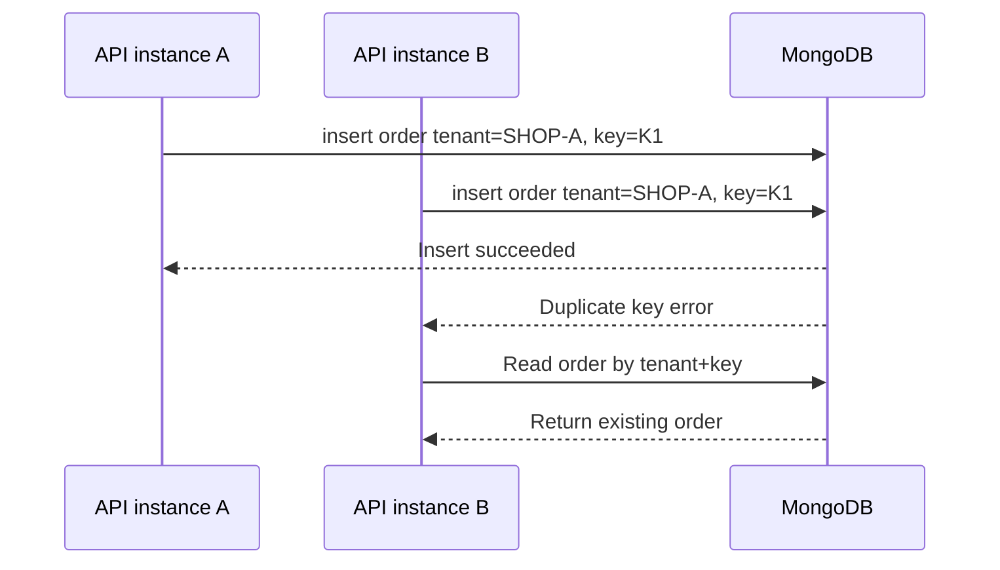
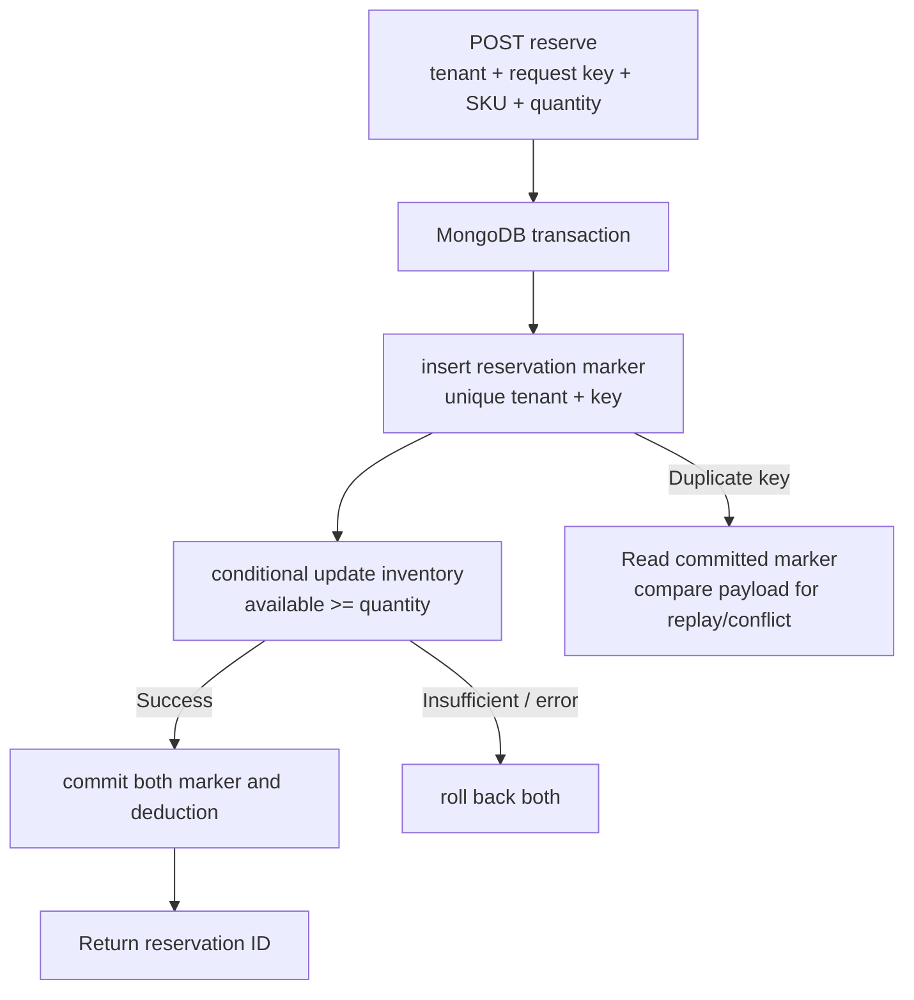
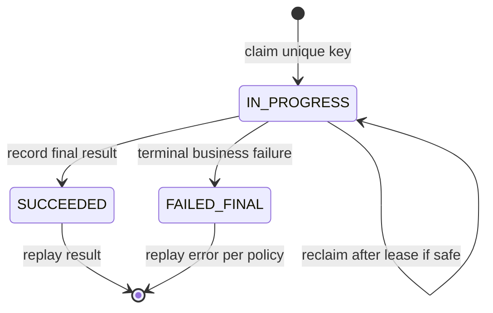
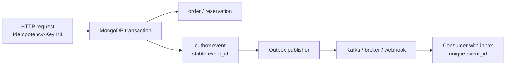

# Idempotency, unique indexes, and duplicate write requests

## 1. Why can a write request reach MongoDB multiple times?

In **Spring Data MongoDB**, an order-creation API can be invoked multiple times even when the user clicks the button once. A client can lose network connectivity after the server wrote successfully, a load balancer can retry, a message-processing job can re-run after a crash, or a payment provider can resend a webhook when it has not yet received an acknowledgment.

Example:

```text
Client                   Spring Boot API             MongoDB
  | POST /orders, key=K1       |                           |
  |--------------------------->| insert order ORD-101      |
  |                            |-------------------------->|
  |                            |       insert succeeded    |
  |                            |<--------------------------|
  |      connection lost       X
  |                                                       |
  | POST /orders, key=K1                                  |
  |--------------------------->| ? Create second order or  |
  |                            |   return previous order?  |
```

If the application generates a fresh random `_id` on each `insert` call without a mechanism to recognize duplicate requests, **two orders, two inventory deductions, or two charges** can occur.

**Idempotency** is the property where resending the same business request with the same identifier produces no **new business side effects** after the first application. Subsequent calls do not necessarily have to return the exact same HTTP status or timestamp; the API contract must specify which result is replayed or returned.

### Concepts that must not be equated

| Concept | Guarantee / meaning | Does not guarantee |
| --- | --- | --- |
| **Single-document atomicity** | One MongoDB operation on one document never exposes partial updates | Does not prevent *two* separate `$inc` calls from both succeeding |
| **Unique index** | Prevents storing two documents violating the same unique key | Does not compare two requests' payloads; does not prevent an API from calling external systems twice |
| **Idempotency key** | Identifies a single *business request instance* | Only meaningful when stored and guarded by proper constraints/logic |
| **Optimistic locking / CAS** | Updates only when expected version/state still holds | Does not automatically recognize two requests with the same intent and payload |
| **Driver retryable writes** | Retries eligible write commands per driver/session mechanism | Does not guarantee an entire HTTP request or multi-day job replay runs once |
| **Transaction** | Groups multiple DB operations into one commit/rollback under supported conditions | Does not transact atomically with external payment gateways, emails, or Kafka |
| **Outbox + idempotent consumer** | Supports reliable event emission across DB/message boundaries | Does not automatically make every external system strictly once-only |

In distributed systems, it is usually more realistic to design **at-least-once delivery + idempotent effects** rather than claiming "exactly once". Always state **within what scope** a business effect is proven to apply only once.

### Lesson objectives

After this lesson, you will be able to:

1. Define idempotency keys scoped by tenant and operation type.
2. Use a MongoDB unique index as the concurrency arbiter between two requests sharing a key.
3. Distinguish `insert`, `save`, `upsert`, and `$setOnInsert` when receiving duplicate requests.
4. Use `MongoTemplate`/repositories and handle `DuplicateKeyException` with proper semantics.
5. Protect non-idempotent operations such as `$inc` or stock reservations.
6. Understand transaction boundaries, outbox, retries, TTL, and concurrency testing.

## 2. Correctly identifying "the same request"

Not every pair of requests with identical bodies is the same request. A user may **intentionally buy the same product twice**. Conversely, a retry request may carry different HTTP headers or hit a different server instance, yet must still count as the same operation.

A common contract:

```http
POST /api/orders
Idempotency-Key: 9c3c4dc2-5b11-4c4c-9d21-4141e579f881
Content-Type: application/json

{
  "sku": "BOOK-101",
  "quantity": 2,
  "amountMinor": 300000,
  "currency": "VND"
}
```

In this example, the client **generates a new key for each new order it intends to place** and **reuses that key** when retrying that same order placement.

### Scope of identity

A request is identified by a tuple matching the contract:

\[
\text{requestIdentity}
=
(\text{tenantId},\ \text{operationType},\ \text{idempotencyKey})
\]

- `tenantId`: derived from the authenticated context; **never trust** an arbitrary tenant in the request body.
- `operationType`: e.g., `CREATE_ORDER`, `RESERVE_STOCK`, `REFUND_PAYMENT`. Can be implicit from the collection/endpoint if each operation type has its own key store.
- `idempotencyKey`: a sufficiently unguessable, length-bounded string kept stable by the client across retries.

A user placing **an intentional second order** must supply a new key. Two tenants can share the same key string while remaining two independent requests if scoped by tenant.

### Same key with a different payload

| Call | Tenant | Key | SKU/quantity | Desired result |
| --- | --- | --- | --- | --- |
| First call | SHOP-A | K1 | BOOK-101 × 2 | Create one order |
| Retry | SHOP-A | K1 | BOOK-101 × 2 | Do not create another; return existing order |
| Invalid request | SHOP-A | K1 | BOOK-101 × 3 | **Conflict**: same key with different payload |
| New purchase | SHOP-A | K2 | BOOK-101 × 2 | Can create a new order |
| Different tenant | SHOP-B | K1 | BOOK-101 × 2 | Unaffected by SHOP-A's key |

Thus a **unique index on the key alone** does not complete the API contract. Upon detecting an existing key, the application must **compare immutable business fields** or a normalized payload fingerprint. Never return "success" for a quantity-3 request just because a quantity-2 order already used that key.

### Fingerprints and input canonicalization

For large payloads, you can store a `request_hash` (e.g., SHA-256) of *canonicalized* data. The hashed field set must be explicitly defined: tenant/scope, operation, SKU, quantity, amount, currency, schema version, and any properties affecting business outcomes.

These two JSON objects differ in key order yet carry identical meaning:

```json
{"sku":"BOOK-101","quantity":2,"currency":"VND"}
{"currency":"VND","quantity":2,"sku":"BOOK-101"}
```

Hashing the raw incoming JSON string directly can yield different hashes for equivalent business content. Canonicalize typed representations, field ordering, number formatting, and strings; or store and compare business fields explicitly.

**Never treat a hash as proof that two callers are authorized to access the same record.** Authorization and tenant scoping still apply when reading a record by idempotency key. Never log raw tokens, payment credentials, or confidential payloads solely to debug key collisions.

## 3. A unique index is the concurrency arbiter

Suppose two Spring Boot instances simultaneously receive `(SHOP-A, K1)`:



In MongoDB, uniqueness is enforced **at write time**, without application-level in-memory locks or "find before insert". On collection `orders`:

```javascript
db.orders.createIndex(
  { tenant_id: 1, client_request_id: 1 },
  {
    unique: true,
    name: "orders_tenant_client_request_unique"
  }
)
```

This index prevents **two documents with the same pair** `(tenant_id, client_request_id)`. `(SHOP-A,K1)` and `(SHOP-B,K1)` remain distinct.

### Why is `find` then `insert` broken under contention?

```java
// WRONG if used as the sole deduplication mechanism:
if (!orderRepository.existsByTenantIdAndClientRequestId(
        tenantId, key)) {
    orderRepository.save(newOrder);
}
```

Both A and B can observe "not found" and both insert. Here `save(...)` does not make the **read** and **write** atomic together either. **Without a unique index**, both can succeed.

The unique index is what forces one write to be rejected. The application must handle that rejection per the idempotency contract.

### Things to check before creating the index

- Does the collection already contain **duplicate keys**? If so, creating the unique index fails until cleaned up.
- Are `tenant_id`/`client_request_id` always present and properly typed? Unique indexes have specific semantics for null/missing values; a compound unique index permits at most one document with a given tuple of null/missing values, **not** two documents with the exact same indexed tuple.
- Is `client_request_id` normalized? `"K1"` and `"k1"` differ under the default collation; do not assume they match.
- Is sharding enabled? Unique indexes on sharded collections have **constraints tied to the shard key**, usually requiring the shard key as a prefix of the unique index. Never claim cluster-wide uniqueness from an index violating your version/shard design constraints.
- Could the document have another unique index? `DuplicateKeyException` can come from **any unique constraint**, not necessarily the idempotency key.

### Can `_id` act as the idempotency key?

Yes. If the business already assigns a stable ID prior to retries that **never changes** across attempts, using `_id` directly is clean because MongoDB creates a unique index on `_id` by default.

However, many APIs need server-generated order IDs alongside client-supplied idempotency keys. In that case, store **both**: the technical order `_id` and the unique business key `(tenant_id, client_request_id)`.

## 4. Hands-on problem: create order once, retries create no extras

We use an `orders` collection with schema:

```javascript
{
  _id: "ORD-2026-0001",
  tenant_id: "SHOP-A",
  client_request_id: "K1",
  sku: "BOOK-101",
  quantity: NumberLong("2"),
  amount_minor: NumberLong("300000"),
  currency: "VND",
  status: "CREATED",
  created_at: ISODate("2026-11-20T07:00:00Z")
}
```

In this demo, an order has a single SKU so duplicate behavior is easy to observe. Real systems have multiple line items, prices, discounts, taxes, and payment states; when scaling up, define which fields form the **immutable creation payload** to verify on key reuse.

Create the unique index on the demo collection:

```javascript
use idempotency_demo

db.orders.createIndex(
  { tenant_id: 1, client_request_id: 1 },
  {
    unique: true,
    name: "orders_tenant_client_request_unique"
  }
)
```

Practice only in an isolated demo or test database. Indexing existing data requires a migration plan and duplicate detection; never run ad-hoc index creation/deletion directly in production.

### Expected outcomes for duplicate requests

| Scenario | Write effect | Suggested API outcome |
| --- | --- | --- |
| Key K1 not yet present | Inserts one new order | `201 Created` |
| Retry K1, same payload | No extra insert | `200 OK` (or replay response per contract) |
| Retry K1, different payload | No extra insert | `409 Conflict` |
| Two instances race with K1 | **One insert wins** via unique index | One creation response, one replay response |
| MongoDB commit uncertain due to timeout | Do not conclude it failed | Look up / reconcile by key |

These HTTP statuses are an **illustrative contract**, not something MongoDB returns automatically. With Spring MVC/WebFlux, the controller layer decides status codes and error bodies.

## 5. Spring Data MongoDB: entity, unique index, and idempotent service

Examples use Java 17+, Spring Boot 3.x, `spring-boot-starter-data-mongodb`, and `MongoTemplate`. Data is mapped via entities with explicit BSON field names.

### 5.1. `OrderDocument` entity

```java
package com.example.orders;

import java.time.Instant;
import org.springframework.data.mongodb.core.mapping.Document;
import org.springframework.data.mongodb.core.mapping.Field;
import org.springframework.data.mongodb.core.mapping.FieldType;
import org.springframework.data.mongodb.core.mapping.MongoId;

@Document(collection = "orders")
public class OrderDocument {

    @MongoId(FieldType.STRING)
    private String id;

    @Field("tenant_id")
    private String tenantId;

    @Field("client_request_id")
    private String clientRequestId;

    private String sku;
    private long quantity;

    @Field("amount_minor")
    private long amountMinor;

    private String currency;
    private String status;

    @Field("created_at")
    private Instant createdAt;

    protected OrderDocument() {}

    public OrderDocument(
            String id, String tenantId, String clientRequestId,
            String sku, long quantity, long amountMinor,
            String currency, String status, Instant createdAt) {
        this.id = id;
        this.tenantId = tenantId;
        this.clientRequestId = clientRequestId;
        this.sku = sku;
        this.quantity = quantity;
        this.amountMinor = amountMinor;
        this.currency = currency;
        this.status = status;
        this.createdAt = createdAt;
    }

    public String getId() { return id; }
    public String getTenantId() { return tenantId; }
    public String getClientRequestId() { return clientRequestId; }
    public String getSku() { return sku; }
    public long getQuantity() { return quantity; }
    public long getAmountMinor() { return amountMinor; }
    public String getCurrency() { return currency; }
    public String getStatus() { return status; }
    public Instant getCreatedAt() { return createdAt; }
}
```

For currency, storing integer `long` in **minor units** avoids `double` rounding errors. Real applications must still verify prices, currencies, bounds, and discounts/taxes **server-side**, rather than trusting client-submitted prices.

### 5.2. Creating a unique index via `IndexOperations`

`@Indexed`/`@CompoundIndex` can declare indexes, yet Spring Data MongoDB does not guarantee automatic index creation in every production setup. The example below explicitly uses `MongoTemplate.indexOps` during **migration or startup**, never inside each HTTP request:

```java
import org.springframework.data.domain.Sort;
import org.springframework.data.mongodb.core.index.Index;

Index requestKeyIndex = new Index()
    .on("tenantId", Sort.Direction.ASC)
    .on("clientRequestId", Sort.Direction.ASC)
    .unique()
    .named("orders_tenant_client_request_unique");

mongoTemplate.indexOps(OrderDocument.class)
    .ensureIndex(requestKeyIndex);
```

When `indexOps(OrderDocument.class)` has entity metadata, `tenantId` and `clientRequestId` map to `tenant_id` and `client_request_id`. Verify real metadata in `mongosh`:

```javascript
db.orders.getIndexes()
```

Confirm you see `key: {tenant_id: 1, client_request_id: 1}` and `unique: true`. `ensureIndex` works across many Spring Data MongoDB versions; newer lines offer `createIndex`. Pick the API matching your version and manage schema through controlled migrations.

**This step must complete before the application accepts concurrent writes.** Without the unique index in place, catching `DuplicateKeyException` will not stop two inserts from succeeding.

### 5.3. Input and result types

```java
package com.example.orders;

public record CreateOrderCommand(
    String sku,
    long quantity,
    long amountMinor,
    String currency
) {}
```

```java
package com.example.orders;

public record CreateOrderResult(
    OrderDocument order,
    boolean replayed
) {}
```

In this demo, `replayed = true` means MongoDB already held the order for that key; do not interpret it as proving an **external payment operation** was also executed or safely reconciled.

### 5.4. Service: letting the unique index arbitrate competing inserts

```java
package com.example.orders;

import java.time.Clock;
import java.util.Objects;
import java.util.UUID;
import org.springframework.dao.DuplicateKeyException;
import org.springframework.data.mongodb.core.MongoTemplate;
import org.springframework.data.mongodb.core.query.Criteria;
import org.springframework.data.mongodb.core.query.Query;
import org.springframework.stereotype.Service;

@Service
public class IdempotentOrderCreationService {

    private final MongoTemplate template;
    private final Clock clock;

    public IdempotentOrderCreationService(
            MongoTemplate template, Clock clock) {
        this.template = template;
        this.clock = clock;
    }

    public CreateOrderResult create(
            String authorizedTenantId,
            String idempotencyKey,
            CreateOrderCommand request) {

        validate(authorizedTenantId, idempotencyKey, request);

        OrderDocument candidate = new OrderDocument(
            UUID.randomUUID().toString(),
            authorizedTenantId,
            idempotencyKey,
            request.sku(),
            request.quantity(),
            request.amountMinor(),
            request.currency(),
            "CREATED",
            clock.instant()
        );

        try {
            OrderDocument inserted = template.insert(candidate);
            return new CreateOrderResult(inserted, false);
        } catch (DuplicateKeyException duplicate) {
            // The unique index decides which insert wins.
            Query byRequest = Query.query(
                Criteria.where("tenantId").is(authorizedTenantId)
                    .and("clientRequestId").is(idempotencyKey)
            );

            OrderDocument existing = template.findOne(
                byRequest, OrderDocument.class);

            // Duplicate may come from a DIFFERENT unique index
            // or outcome is not readable at this moment.
            if (existing == null) {
                throw duplicate;
            }

            if (!sameImmutableRequest(existing, request)) {
                throw new IdempotencyConflictException(
                    "Idempotency-Key already used with different payload");
            }

            return new CreateOrderResult(existing, true);
        }
    }

    private static boolean sameImmutableRequest(
            OrderDocument existing, CreateOrderCommand request) {
        return Objects.equals(existing.getSku(), request.sku())
            && existing.getQuantity() == request.quantity()
            && existing.getAmountMinor() == request.amountMinor()
            && Objects.equals(
                existing.getCurrency(), request.currency());
    }

    private static void validate(
            String tenantId, String key, CreateOrderCommand request) {
        if (tenantId == null || tenantId.isBlank()
                || key == null || key.isBlank()
                || key.length() > 128
                || request == null
                || request.sku() == null
                || request.sku().isBlank()
                || request.quantity() <= 0
                || request.amountMinor() < 0
                || !Objects.equals(request.currency(), "VND")) {
            throw new IllegalArgumentException(
                "Invalid order creation request");
        }
    }
}
```

Domain exception:

```java
package com.example.orders;

public class IdempotencyConflictException
        extends RuntimeException {
    public IdempotencyConflictException(String message) {
        super(message);
    }
}
```

At the controller layer, map `IdempotencyConflictException` to `409 Conflict`, and distinguish unknown-outcome errors from validation failures. **Never convert every `DuplicateKeyException` into 200 OK**; another unique constraint (such as a system-assigned order number) can trigger a duplicate error even when no record exists for the current idempotency key.

### 5.5. Why call `insert` instead of `save`?

`insert` expresses the intent to **create a new document only**. `save` can replace/update an existing document sharing `_id`; if a duplicate request reused an ID with a different payload, `save` could overwrite existing data. Using a unique key with `insert` and a unique constraint forces the application to **handle conflicts explicitly**.

In the sample service, `UUID.randomUUID()` generates a fresh technical ID, yet request uniqueness **does not depend** on that ID—it depends on the unique index over `(tenant_id, client_request_id)`. Two instances with different UUIDs but the same key cannot both save if the unique index exists and is active.

### 5.6. Limitations of this order-creation service

This service executes **one single-document business effect**: creating an order carrying all immutable request fields. It has not yet deducted inventory, charged payment, sent emails, or published events.

If a call succeeds on `insert` and code then **calls a payment gateway** before returning the HTTP response, a retry can skip the insert yet still risk sending a duplicate charge if designed improperly. To keep multiple documents consistent or emit external events, use transactions/outbox or compensating workflows with idempotent consumers—do not rely solely on the order's unique index.

Additionally, when a retry reads the current order, `status` may have progressed from `CREATED` to `PAID`. If the API must replay **the exact original response** instead of current state, store a response snapshot per idempotency contract; this service only guarantees **no extra order is created**.

## 6. Upsert with `$setOnInsert`: avoids overwriting, yet is not enough

In some "create if absent" flows, MongoDB supports **upsert**: if the filter finds a document, update it; otherwise insert. For duplicate requests, `$setOnInsert` is useful because it sets fields only when **a new document is created**, leaving them untouched when matching an existing document.

Example via Spring Data MongoDB:

```java
import java.util.UUID;
import java.time.Instant;
import com.mongodb.client.result.UpdateResult;
import org.springframework.data.mongodb.core.query.Criteria;
import org.springframework.data.mongodb.core.query.Query;
import org.springframework.data.mongodb.core.query.Update;

Query byKey = Query.query(
    Criteria.where("tenantId").is(authorizedTenantId)
        .and("clientRequestId").is(idempotencyKey)
);

Update onCreate = new Update()
    .setOnInsert("id", UUID.randomUUID().toString())
    .setOnInsert("sku", request.sku())
    .setOnInsert("quantity", request.quantity())
    .setOnInsert("amountMinor", request.amountMinor())
    .setOnInsert("currency", request.currency())
    .setOnInsert("status", "CREATED")
    .setOnInsert("createdAt", Instant.now());

UpdateResult result =
    mongoTemplate.upsert(byKey, onCreate, OrderDocument.class);
```

This snippet assumes a component with `authorizedTenantId`, `idempotencyKey`, `request`, and `mongoTemplate` provided. The equality filter on tenant/key and the unique index from section 3 are essential.

If a matching document already exists, `$setOnInsert` fields are not modified. On creation, MongoDB initializes equality fields from the filter alongside `$setOnInsert`. `getUpsertedId()` and `getMatchedCount()` distinguish an insert-creating upsert from matching an existing document in an acknowledged result.

**However, upsert does not finish the idempotency contract by itself:**

- Two concurrent upserts can still produce `DuplicateKeyException` unless MongoDB's concurrent-upsert requirements are met.
- A request with the same key yet different `quantity` matches the old document **without being rejected**. The app must read back and verify payload/fingerprint.
- If the filter includes conditions beyond the identity key that no longer hold, upsert may **attempt to insert another document**, possibly hitting a duplicate key error.
- Any `$set` or `$inc` inside the same update still runs when the document already exists; never accidentally use them for write-once creation fields.

### Never upsert on state transitions

```javascript
// WRONG for "pay only if order is CREATED":
db.orders.updateOne(
  {
    _id: "ORD-001",
    status: "CREATED"
  },
  { $set: { status: "PAID" } },
  { upsert: true }
)
```

If the order is already `PAID` or `CANCELLED`, the filter misses and upsert tries inserting a new document or hits a duplicate key error—**not** the intended state transition. For transitions, use a **non-upsert update** and handle no-match as a business branch.

## 7. CAS for state transitions: idempotent per applied event

**Compare-and-set (CAS)** means: write the new value only if the old value still matches expectations. Suppose an order may transition `CREATED → PAID` exactly once, tied to a `payment_event_id` from the payment system.

```javascript
db.orders.updateOne(
  {
    _id: "ORD-001",
    tenant_id: "SHOP-A",
    status: "CREATED"
  },
  {
    $set: {
      status: "PAID",
      payment_event_id: "PAY-EVENT-5001",
      paid_at: ISODate("2026-11-20T09:00:00Z")
    }
  }
)
```

If two requests race to move the order from `CREATED` to `PAID`, only one satisfies `status = CREATED` on that document. These updates are **atomic per document**.

With `MongoTemplate`:

```java
import java.time.Instant;
import com.mongodb.client.result.UpdateResult;
import org.springframework.data.mongodb.core.query.Criteria;
import org.springframework.data.mongodb.core.query.Query;
import org.springframework.data.mongodb.core.query.Update;

Query expected = Query.query(
    Criteria.where("id").is(orderId)
        .and("tenantId").is(authorizedTenantId)
        .and("status").is("CREATED")
);

Update paymentChange = new Update()
    .set("status", "PAID")
    // Explicit BSON names when entity hasn't declared these properties.
    .set("payment_event_id", paymentEventId)
    .set("paid_at", Instant.now());

UpdateResult changed = mongoTemplate.updateFirst(
    expected, paymentChange, OrderDocument.class);

boolean changedThisTime = changed.getModifiedCount() == 1;
```

This example deliberately uses BSON names `payment_event_id`/`paid_at` because `OrderDocument` in section 5 did not declare mappings for them. In a complete application, add Java properties with proper `@Field` annotations, reference property names, and verify the actual BSON.

### `matchedCount = 0` has no single meaning

A retry seeing `modifiedCount = 0` or `matchedCount = 0` **is not enough** to conclude the previous attempt succeeded. It could mean:

- The prior call **already** moved to `PAID` with **the same payment event**.
- A different payment event already moved the order to `PAID`.
- The order was moved to `CANCELLED` by a competing request.
- The order does not exist or the caller lacks tenant permission.

To be idempotent **per event**, after a non-matching update read current state **and the recorded event ID**. Treat it as "already processed this exact request" only if the event ID matches and business invariants also hold. If another event won or status forbids it, apply conflict/reconciliation policy.

### CAS with version

For `@Version` entities, Spring Data MongoDB supports optimistic locking on suitable APIs like repository `save`. Yet **do not infer** that all raw updates or bulk updates apply `@Version` like `save`. If using `MongoTemplate.updateFirst` and version checks are needed, include expected version in the filter, manage version increments, and test against your exact Spring Data version.

```javascript
// Explicit CAS example in mongosh:
db.orders.updateOne(
  { _id: "ORD-001", version: NumberLong("7") },
  {
    $set: { status: "PAID" },
    $inc: { version: NumberLong("1") }
  }
)
```

If version changed, the update fails to match. Never retry a version-failed update by silently dropping the version filter; that defeats protection against concurrent overwrites.

## 8. Stock reservation: `$inc` is atomic yet must guard against duplicate requests

Suppose an inventory document:

```javascript
{
  _id: "SHOP-A:BOOK-101",
  tenant_id: "SHOP-A",
  sku: "BOOK-101",
  available: NumberLong("10"),
  reserved: NumberLong("0"),
  applied_request_ids: []
}
```

Command to reserve 2 units when stock suffices:

```javascript
db.inventory.updateOne(
  {
    _id: "SHOP-A:BOOK-101",
    tenant_id: "SHOP-A",
    available: { $gte: NumberLong("2") }
  },
  {
    $inc: {
      available: NumberLong("-2"),
      reserved: NumberLong("2")
    }
  }
)
```

Each call succeeds only while `available >= 2`, so inventory never goes negative. **However, two retries can still reserve twice** as long as stock remains sufficient:

```text
Before request:  available=10, reserved=0
First attempt:   available=8,  reserved=2
Retry same key:  available=6,  reserved=4
```

### 8.1. Recording the request marker in the same document

If only a **small, bounded** number of requests must be tracked, an `applied_request_ids` array can work. MongoDB evaluates "key absent" and executes stock deduction + marker insertion in **one atomic document command**:

```javascript
db.inventory.updateOne(
  {
    _id: "SHOP-A:BOOK-101",
    tenant_id: "SHOP-A",
    available: { $gte: NumberLong("2") },
    applied_request_ids: { $ne: "RESERVATION-K1" }
  },
  {
    $inc: {
      available: NumberLong("-2"),
      reserved: NumberLong("2")
    },
    $addToSet: {
      applied_request_ids: "RESERVATION-K1"
    }
  }
)
```

The first success deducts stock and records `RESERVATION-K1`. A retry with that key fails `$ne`, so it **does not deduct again**.

Via Spring Data MongoDB:

```java
import com.mongodb.client.result.UpdateResult;
import org.springframework.data.mongodb.core.query.Criteria;
import org.springframework.data.mongodb.core.query.Query;
import org.springframework.data.mongodb.core.query.Update;

// Validate quantity > 0 and requestId before building query.
Query eligible = Query.query(
    Criteria.where("id").is(inventoryId)
        .and("tenantId").is(authorizedTenantId)
        .and("available").gte(quantity)
        .and("appliedRequestIds").ne(requestId)
);

Update reserve = new Update()
    .inc("available", -quantity)
    .inc("reserved", quantity)
    .addToSet("appliedRequestIds", requestId);

UpdateResult result = mongoTemplate.updateFirst(
    eligible, reserve, InventoryDocument.class);
```

`InventoryDocument` maps to the `inventory` collection with `@Field("applied_request_ids")` on `appliedRequestIds`. This snippet illustrates query/update expressions rather than a standalone class; `quantity` must be a positive `long` within business bounds.

**Critical limitation:** the request-marker array grows with every reservation; MongoDB documents have a BSON size limit (typically 16 MiB). For SKUs with millions of reservations, this array pattern is **unsuitable**. Pruning markers too early lets a late retry deduct again. Production systems usually need a **separate ledger collection with a unique index** plus transactions or another consistency mechanism.

### 8.2. Distinguishing duplicate requests from out-of-stock

If `matchedCount = 0`, causes include:

1. Request ID was already applied.
2. Insufficient stock.
3. SKU does not exist.
4. Tenant mismatch or unauthorized request.

Never immediately return "out of stock" for every miss. When the API needs an accurate business response, read current state within authorized scope and check the idempotency marker—keeping in mind a subsequent read may observe **state modified later** by another request.

### 8.3. When two documents are involved

An order may reserve **multiple SKUs across multiple documents** and create a separate reservation record. Updating each SKU atomically does not make **the entire order** atomic. To ensure "either all SKUs are reserved or none are", use a multi-document transaction where infrastructure supports it, or an explicitly designed saga/compensation.

## 9. Idempotency ledger + multi-document transaction

When thousands of request IDs cannot live on each inventory document, create a `stock_reservations` collection as a **ledger of applied requests**. Each reservation has a unique key `(tenant_id, client_request_id)`.

Desired flow:



The unique index blocks two markers sharing a request key. The transaction prevents **a committed marker with a failed deduction** or a committed deduction missing its marker, provided **both operations participate in the same transaction**.

### 9.1. Creating collections and indexes

```javascript
db.stock_reservations.createIndex(
  { tenant_id: 1, client_request_id: 1 },
  {
    unique: true,
    name: "reservations_tenant_request_unique"
  }
)

db.inventory.insertOne({
  _id: "SHOP-A:BOOK-101",
  tenant_id: "SHOP-A",
  sku: "BOOK-101",
  available: NumberLong("10"),
  reserved: NumberLong("0")
})
```

`insertOne` is only for seeding an **empty** demo database; re-running with the same `_id` throws duplicate key. In production, use controlled migrations/seeds with restricted permissions.

### 9.2. Entities for ledger and inventory

```java
package com.example.inventory;

import java.time.Instant;
import org.springframework.data.mongodb.core.mapping.Document;
import org.springframework.data.mongodb.core.mapping.Field;
import org.springframework.data.mongodb.core.mapping.FieldType;
import org.springframework.data.mongodb.core.mapping.MongoId;

@Document(collection = "stock_reservations")
public class StockReservation {
    @MongoId(FieldType.STRING)
    private String id;

    @Field("tenant_id")
    private String tenantId;

    @Field("client_request_id")
    private String clientRequestId;

    private String sku;
    private long quantity;

    @Field("created_at")
    private Instant createdAt;

    protected StockReservation() {}

    public StockReservation(
            String id, String tenantId, String clientRequestId,
            String sku, long quantity, Instant createdAt) {
        this.id = id;
        this.tenantId = tenantId;
        this.clientRequestId = clientRequestId;
        this.sku = sku;
        this.quantity = quantity;
        this.createdAt = createdAt;
    }

    public String getId() { return id; }
    public String getTenantId() { return tenantId; }
    public String getClientRequestId() { return clientRequestId; }
    public String getSku() { return sku; }
    public long getQuantity() { return quantity; }
    public Instant getCreatedAt() { return createdAt; }
}
```

```java
package com.example.inventory;

import org.springframework.data.mongodb.core.mapping.Document;
import org.springframework.data.mongodb.core.mapping.Field;
import org.springframework.data.mongodb.core.mapping.FieldType;
import org.springframework.data.mongodb.core.mapping.MongoId;

@Document(collection = "inventory")
public class InventoryDocument {
    @MongoId(FieldType.STRING)
    private String id;

    @Field("tenant_id")
    private String tenantId;

    private String sku;
    private long available;
    private long reserved;

    protected InventoryDocument() {}

    public String getId() { return id; }
    public String getTenantId() { return tenantId; }
    public String getSku() { return sku; }
    public long getAvailable() { return available; }
    public long getReserved() { return reserved; }
}
```

In real code, add SKU normalization, tenant validation, quantity limits, initial stock validation, and total-stock invariants. The demo builds IDs as `tenantId + ":" + sku`; client values must be validated/canonicalized so **delimiter collisions cannot occur**.

### 9.3. Configuring the transaction manager

MongoDB multi-document transactions require compatible infrastructure—typically a **replica set or sharded cluster**. A default standalone MongoDB cannot run this transaction test.

```java
package com.example.inventory;

import org.springframework.context.annotation.Bean;
import org.springframework.context.annotation.Configuration;
import org.springframework.data.mongodb.MongoDatabaseFactory;
import org.springframework.data.mongodb.MongoTransactionManager;

@Configuration
public class MongoTransactionConfiguration {

    @Bean
    MongoTransactionManager transactionManager(
            MongoDatabaseFactory factory) {
        return new MongoTransactionManager(factory);
    }
}
```

This Spring transaction manager applies to **synchronous** MongoDB operations sharing the transaction context. For reactive MongoDB, use the matching reactive transaction manager rather than trying to apply `MongoTransactionManager` to `ReactiveMongoTemplate`.

### 9.4. Service performing both operations in one transaction

```java
package com.example.inventory;

import java.time.Clock;
import java.util.UUID;
import com.mongodb.client.result.UpdateResult;
import org.springframework.data.mongodb.core.MongoTemplate;
import org.springframework.data.mongodb.core.query.Criteria;
import org.springframework.data.mongodb.core.query.Query;
import org.springframework.data.mongodb.core.query.Update;
import org.springframework.stereotype.Service;
import org.springframework.transaction.annotation.Transactional;

@Service
public class ReservationTransactionService {

    private final MongoTemplate template;
    private final Clock clock;

    public ReservationTransactionService(
            MongoTemplate template, Clock clock) {
        this.template = template;
        this.clock = clock;
    }

    @Transactional
    public StockReservation reserveInTransaction(
            String authorizedTenantId,
            String idempotencyKey,
            String sku,
            long quantity) {

        if (authorizedTenantId == null
                || authorizedTenantId.isBlank()
                || idempotencyKey == null
                || idempotencyKey.isBlank()
                || sku == null || sku.isBlank()
                || sku.contains(":")
                || quantity <= 0) {
            throw new IllegalArgumentException(
                "Invalid stock reservation request");
        }

        StockReservation marker = new StockReservation(
            UUID.randomUUID().toString(),
            authorizedTenantId,
            idempotencyKey,
            sku,
            quantity,
            clock.instant()
        );

        // Record request marker; unique index forbids duplicate keys.
        template.insert(marker);

        Query eligibleStock = Query.query(
            Criteria.where("id").is(
                    authorizedTenantId + ":" + sku)
                .and("tenantId").is(authorizedTenantId)
                .and("available").gte(quantity)
        );

        Update takeStock = new Update()
            .inc("available", -quantity)
            .inc("reserved", quantity);

        UpdateResult result = template.updateFirst(
            eligibleStock, takeStock, InventoryDocument.class);

        if (result.getModifiedCount() != 1) {
            // Runtime exception => transaction rolls back.
            throw new StockUnavailableException(
                "Insufficient stock or SKU does not exist");
        }

        return marker;
    }
}
```

```java
package com.example.inventory;

public class StockUnavailableException
        extends RuntimeException {
    public StockUnavailableException(String message) {
        super(message);
    }
}
```

**Condition for correctness:** both `template.insert(marker)` and `template.updateFirst(...)` must participate in the active transaction. If the update finds insufficient stock, the runtime exception rolls back the transaction, leaving **no committed marker behind**. For single-SKU reservations, this transaction provides a stronger consistency boundary than two uncoordinated commands.

### 9.5. Catching duplicates **outside** the transaction boundary

Never catch `DuplicateKeyException` inside the `@Transactional` method and continue issuing MongoDB commands as if the transaction were still healthy. A write error can require the transaction to abort; rollback/commit boundaries must be managed cleanly.

Place a separate facade calling the transactional method through the **Spring proxy**, catching the error after the transactional method ends and reading the existing marker:

```java
package com.example.inventory;

import java.util.Objects;
import org.springframework.dao.DuplicateKeyException;
import org.springframework.data.mongodb.core.MongoTemplate;
import org.springframework.data.mongodb.core.query.Criteria;
import org.springframework.data.mongodb.core.query.Query;
import org.springframework.stereotype.Service;

@Service
public class ReservationFacade {

    private final ReservationTransactionService transactions;
    private final MongoTemplate template;

    public ReservationFacade(
            ReservationTransactionService transactions,
            MongoTemplate template) {
        this.transactions = transactions;
        this.template = template;
    }

    public StockReservation reserveOnce(
            String authorizedTenantId,
            String key, String sku, long quantity) {

        try {
            return transactions.reserveInTransaction(
                authorizedTenantId, key, sku, quantity);
        } catch (DuplicateKeyException duplicate) {
            StockReservation prior = template.findOne(
                Query.query(
                    Criteria.where("tenantId")
                        .is(authorizedTenantId)
                        .and("clientRequestId").is(key)),
                StockReservation.class
            );

            if (prior == null) {
                // Duplicate could be from another unique index or
                // outcome is not yet readable.
                throw duplicate;
            }

            if (!Objects.equals(prior.getSku(), sku)
                    || prior.getQuantity() != quantity) {
                throw new IllegalArgumentException(
                    "Idempotency key reused with different payload");
            }

            return prior;
        }
    }
}
```

This pattern **does not automatically handle all transient transaction errors**. Under contention, MongoDB can return write conflicts or `TransientTransactionError` labels; the application needs bounded retries with backoff around **the entire transaction**, and idempotency-key lookups when commit outcomes are uncertain. Never catch arbitrary exceptions as "request already processed" or treat `DuplicateKeyException` as success if the marker/payload fails to match.

### 9.6. Meaning of requests that failed due to out-of-stock

In the design above, when stock is insufficient, the transaction rolls back **the reservation marker too**. A retry after stock is replenished can **succeed**, even with the same key. If the API requires "the same request must always replay its initial failure forever", design a ledger persisting failure outcomes **durably** with matching retry/TTL rules; you cannot both roll back the marker and promise permanent error replay.

Another design stores `PENDING`, `SUCCEEDED`, `FAILED` in the idempotency record, which requires explicitly defining **when final outcomes are recorded**, crash recovery claiming rules, and side-effect boundaries while `PENDING`. Adding status fields does not automatically grant consistency.

## 10. Detecting requests currently in progress

Multi-step requests (calling external providers, creating external resources, preparing invoices...) often cannot commit entirely inside one database transaction. A dedicated `idempotency_requests` collection can track state:

```javascript
{
  _id: "SHOP-A:CREATE_ORDER:K1",
  tenant_id: "SHOP-A",
  operation: "CREATE_ORDER",
  client_request_id: "K1",
  request_hash: "HASH_OF_CANONICAL_PAYLOAD",
  status: "IN_PROGRESS",
  response_ref: null,
  lease_expires_at: ISODate("2026-11-20T09:05:00Z"),
  created_at: ISODate("2026-11-20T09:00:00Z")
}
```

State machine:



**Caution:** an `IN_PROGRESS` record abandoned after a crash must not automatically be treated as failed before reconciliation. If the prior job called the provider successfully and crashed before saving `SUCCEEDED`, a new job could call the provider a second time. Reclaiming requires lease CAS **and a fencing token/owner generation** so an old worker cannot overwrite results after a new worker takes over.

### Suggested HTTP responses

| State found by key | Sensible action |
| --- | --- |
| Key absent | Attempt to claim/create under unique index |
| `IN_PROGRESS`, same payload | Return `202 Accepted`/`409 Conflict` or retry-later guidance per contract; **do not** start a second execution |
| `SUCCEEDED`, same payload | Return stored result or resource reference |
| `FAILED_FINAL`, same payload | Replay terminal error if policy dictates |
| Any state, different payload | `409 Conflict`; do not run further business effects |
| Outcome uncertain due to timeout | Look up / reconcile; never infer failure |

When storing full HTTP responses for replay, specify **retention duration, sensitive data handling, tenant access, replayable headers**, and response-schema evolution across deploys. Some APIs store only `resourceId` and return the current resource; others store a snapshot of the initial response. Either works as long as it is documented consistently.

## 11. Transactional outbox: avoiding "wrote DB, forgot to emit event"

MongoDB idempotency does not automatically make sending emails, calling webhooks, or publishing to Kafka part of the transaction. Example:

```text
1. Order insert succeeds.
2. Application crashes.
3. OrderCreated event was never published.
4. Client retries with the same Idempotency-Key.
5. Order already exists, so insert is skipped.
6. No event is ever emitted.
```

Conversely, publishing the event before writing the order can emit an event **with no matching order** if the DB write fails.

**Transactional outbox** separates those two responsibilities:

1. Inside the **same MongoDB transaction**, save the business document and an `outbox_events` document describing the event to emit.
2. A separate worker reads committed outbox events, publishes them to the message broker, and marks progress.
3. If the worker crashes before marking complete, the event may be sent again. Consumers must have an **idempotency/inbox unique key** so business effects are not applied twice.



Sample outbox schema:

```javascript
{
  _id: "ORDER:ORD-001:CREATED",
  tenant_id: "SHOP-A",
  event_id: "ORDER:ORD-001:CREATED",
  aggregate_id: "ORD-001",
  type: "OrderCreated",
  status: "PENDING",
  created_at: ISODate("2026-11-20T09:00:00Z"),
  payload: {
    order_id: "ORD-001"
  }
}
```

With a unique index on `_id` or a stable `event_id`, duplicate inserts of the same event are blocked at the database. Yet that **does not** mean the publisher delivers strictly once to the broker. After the broker receives the event, the publisher can lose the ACK and resend. That is why consumers deduplicate using a **producer-supplied** key, never a fresh UUID generated on each redelivery.

### Never call external APIs inside a MongoDB transaction expecting rollback

`@Transactional` manages MongoDB operations enlisted in the session/transaction; it **does not roll back money charged over HTTP** if the MongoDB transaction subsequently aborts. Never put slow or uncertain payment-gateway calls inside a transaction assuming cross-system ACID.

With providers supporting idempotency keys, pass a **stable identifier** (such as `paymentAttemptId`) across retries while storing local state and reconciling callbacks. If a provider lacks an idempotency API, design explicit reconciliation and double-charge safeguards. **Outbox alone does not make an external provider idempotent**.

## 12. Retries: errors may mean "wrote, but missed ACK"

One of the trickiest cases is **unknown outcome**:

```text
API sends write command ----> MongoDB commits
         X network drops before ACK

API only sees timeout; cannot conclude MongoDB did not write.
```

For `$inc` operations lacking an idempotency guard, re-running the raw command can **apply it a second time**. For inserts protected by a unique request key, retrying and reading back the document is far easier to verify.

### 12.1. Classifying errors before retrying

| Result category | Example | Recommended action |
| --- | --- | --- |
| Confirmed success | `insert` returns success | Record outcome; do not create new effects on retry |
| Duplicate key on business key | Two requests share the key | Read existing record, verify scope/payload, replay or conflict |
| Validation failure | Negative quantity, unsupported currency | Never keep retrying same payload; return input error |
| Insufficient stock | Conditional update missed | Return business outcome or configured retry policy |
| Network timeout / connection reset | Lost ACK | **Uncertain** if committed; reconcile by key |
| Write concern error | Did not receive requested ack level | Do not assume operations went unapplied |
| Transient transaction error | Write conflict inside transaction | Safely retry **whole transaction**, bounded with backoff |
| Unknown transaction commit result | Uncertain whether commit succeeded | Use commit-retry strategy / check marker; do not launch fresh side effects |

In Spring Data, `DuplicateKeyException` is typically a `DataAccessException` translated from MongoDB errors. Never write `catch (Exception e) { retry(); }` for all errors: some errors are permanent, some are data conflicts, and some mean the previous attempt **already succeeded**.

### 12.2. Driver retryable writes do not replace business idempotency

The MongoDB Java Driver supports **retryable writes** on eligible commands and topologies. The driver attaches session/transaction numbers to handle retries of that exact command per MongoDB's protocol, typically tied to `retryWrites=true` where supported.

Yet when an HTTP client **sends a fresh request**, or a Kafka worker restarts minutes later with a new session, that is a separate **business retry**. Never assume the driver feature recognizes the old business request. Store an idempotency key in the data or ledger.

Likewise, a bulk write containing multiple operations is not a batch-wide transaction. If some `$inc` commands in a bulk batch succeeded before an error, retrying the entire batch unguarded can double-apply them. Make each operation idempotent or add safe reconciliation/replay.

### 12.3. Backoff, retry limits, and one stable identifier source

A production retry loop should:

- Classify transient vs. permanent errors; retry only eligible ones.
- Cap attempt counts and total elapsed time.
- Use exponential backoff with jitter to avoid thundering herds.
- Keep `Idempotency-Key` and canonicalized business payload unchanged.
- Never mint fresh payment IDs, reservation IDs, or event IDs for **the same effect** if that breaks deduplication.
- Record timeouts/unknown outcomes for investigation, dead-letter queues, or reconciliation when retries exhaust.

**Do not blindly return 500 telling the client to use a new key.** For an uncertain outcome, the old key is precisely what enables looking up or syncing with the prior attempt. A new key risks creating an unintended second effect.

### 12.4. Durability and read concern

Idempotency is only as trustworthy as the durability of its markers and business effects. MongoDB separates **write concern** and **read concern**; for critical payments or orders, evaluate `w: "majority"`, transaction commits, and post-failure/failover read strategies.

A write acknowledged under a low write concern can risk rollback upon primary step-down depending on topology and scenario. Never promise "once the unique key is written it can never repeat" without confirming durability and retention. Reading from lagging secondaries can also miss a newly committed marker; reconciliation flows must handle read consistency appropriately.

## 13. How long should idempotency keys be kept? TTL and late replay requests

Keys do not necessarily stay forever. An API may document "keys remain valid for 24 hours" or "until reconciliation completes". Regardless, retention must be at least as long as **the retry/redelivery window** and any related business audit needs.

A dedicated idempotency collection can hold a BSON Date `expires_at` field with a TTL index:

```javascript
db.idempotency_requests.createIndex(
  { tenant_id: 1, operation: 1, client_request_id: 1 },
  {
    unique: true,
    name: "idempotency_identity_unique"
  }
)

db.idempotency_requests.createIndex(
  { expires_at: 1 },
  {
    expireAfterSeconds: 0,
    name: "idempotency_expiry_ttl"
  }
)
```

These are **two separate indexes** because a TTL index is a **single-field index** on a BSON Date. You cannot build a compound TTL index over tenant and timestamp expecting it to do both jobs.

### TTL deleting a dedup record also deletes its protection

Suppose:

```text
Day 1:  request K1 creates order and deducts stock; marker K1 stored.
Day 2:  marker K1 passes TTL eligibility and is deleted.
Day 3:  an old queue message replays with key K1.
```

If the TTL-deleted marker was the sole guard, Day 3's request can execute **like a brand new request**. That is a consequence of retention policy, not a TTL bug. Options include:

1. Retaining markers longer than **every possible retry source**.
2. Keeping a durable unique business identity on the order/reservation itself to protect effects long-term even after temporary markers expire.
3. Defining a strict contract that expired replays are rejected or routed to reconciliation—**never creating new effects** once old evidence is gone.
4. For payments/refunds or effects that must never repeat indefinitely, keeping durable evidence with proper access controls rather than short TTLs.

MongoDB TTL deletes **asynchronously** with background delay. Never assume a key disappears at the exact second of `expires_at`. If an API enforces an exact expiration cutoff, the service must check expiration timestamps itself and handle "expired key" per contract. **TTL lag is not an extension of the idempotency contract.**

### Unique indexes and missing/null fields

Standard unique indexes enforce specific semantics for missing or null fields. If a collection holds legacy documents without `client_request_id`, creating the unique index can fail due to duplicate null/missing tuples. Options:

- Migrate and backfill legacy records before creating the full unique index.
- Use a separate idempotency records collection with schema validation requiring `tenant_id`/`operation`/`client_request_id`.
- Use a **partial unique index** covering matching documents when suitable.

Partial example:

```javascript
db.orders.createIndex(
  { tenant_id: 1, client_request_id: 1 },
  {
    unique: true,
    name: "orders_with_request_id_unique",
    partialFilterExpression: {
      client_request_id: { $exists: true }
    }
  }
)
```

This index **does not protect** documents excluded by the partial filter. Fields present with value `null` still get indexed; to accept only valid String keys, combine schema validation with service validation. Never use a partial index to "skip validation" while assuming uniqueness covers all requests.

### Collation and key normalization

A unique index with a collation can treat different-case Strings as equal depending on settings. Conversely, under case-sensitive collation, `"AbC"` and `"abc"` are two distinct keys. **Never change key normalization rules after production data exists** without assessing collision risks or duplicate-effect exposure.

If tokens/keys are random strings, prefer enforcing **a canonical format**, such as normalized lowercase UUIDs. Do not let formatting variants act as separate requests if the contract defines them as the same identifier.

## 14. Design flaws commonly hidden behind "duplicate key"

### Duplicate key does not mean the request succeeded

An `E11000 duplicate key` error reports a unique constraint violation—it does not immediately tell you:

- Which tenant owns the existing document and whether the caller may read it.
- Whether this request's payload matches the original payload.
- Whether external side effects completed or reconciled.
- Whether the event is `IN_PROGRESS` or `SUCCEEDED`.

Handlers must therefore identify **which index/key triggered**, look up the record within **authenticated scope**, and compare payload before deciding replay, conflict, or investigation.

### Storing payload hash without status is not enough either

A document holding `(key, hash)` only proves the key was claimed for a given payload. If the process crashes **after claiming and before the business write**, the record can linger forever while the business effect never finished. Store state, results or references, conditional claim leases, and recovery logic. Within MongoDB, transactions prevent "claim committed without business effect committed".

### Checking only at the API gateway leaves workers unprotected

A gateway can block duplicate POSTs, yet message queue consumers, payment callbacks, and reconciliation batches can still write directly to MongoDB. **Correctness guards must live where effects are persisted**, via unique indexes + conditional updates/transactions. Caches or distributed locks help reduce load, yet should not be the sole safeguard for critical data.

### Unique indexes do not eliminate every lost update

A unique index prevents two records with the same key; it does not stop two separate updates from overwriting fields on an existing document. If two users edit an order's price concurrently, add CAS, `@Version`, or matching concurrency controls. **Uniqueness, concurrency control, and idempotency are three complementary layers.**

## 15. Reactive MongoDB: same invariants, asynchronous API

With `ReactiveMongoTemplate` and Spring WebFlux, you still use unique indexes, payload comparison, and duplicate handling with identical business semantics. Reactive changes the asynchronous programming model; it **does not make MongoDB automatically idempotent**.

```java
package com.example.orders;

import java.time.Clock;
import java.util.Objects;
import java.util.UUID;
import org.springframework.dao.DuplicateKeyException;
import org.springframework.data.mongodb.core.ReactiveMongoTemplate;
import org.springframework.data.mongodb.core.query.Criteria;
import org.springframework.data.mongodb.core.query.Query;
import org.springframework.stereotype.Service;
import reactor.core.publisher.Mono;

@Service
public class ReactiveIdempotentOrderService {

    private final ReactiveMongoTemplate template;
    private final Clock clock;

    public ReactiveIdempotentOrderService(
            ReactiveMongoTemplate template, Clock clock) {
        this.template = template;
        this.clock = clock;
    }

    public Mono<CreateOrderResult> create(
            String authorizedTenantId,
            String idempotencyKey,
            CreateOrderCommand request) {

        if (authorizedTenantId == null
                || authorizedTenantId.isBlank()
                || idempotencyKey == null
                || idempotencyKey.isBlank()
                || idempotencyKey.length() > 128
                || request == null
                || request.sku() == null
                || request.sku().isBlank()
                || request.quantity() <= 0
                || request.amountMinor() < 0
                || !Objects.equals(request.currency(), "VND")) {
            return Mono.error(new IllegalArgumentException(
                "Invalid request"));
        }

        return Mono.defer(() -> {
            OrderDocument candidate = new OrderDocument(
                UUID.randomUUID().toString(),
                authorizedTenantId,
                idempotencyKey,
                request.sku(),
                request.quantity(),
                request.amountMinor(),
                request.currency(),
                "CREATED",
                clock.instant()
            );

            Query byKey = Query.query(
                Criteria.where("tenantId").is(authorizedTenantId)
                    .and("clientRequestId").is(idempotencyKey)
            );

            return template.insert(candidate)
                .map(inserted ->
                    new CreateOrderResult(inserted, false))
                .onErrorResume(DuplicateKeyException.class,
                    duplicate ->
                        template.findOne(byKey, OrderDocument.class)
                            .switchIfEmpty(Mono.error(duplicate))
                            .flatMap(prior -> {
                                if (!sameRequest(prior, request)) {
                                    return Mono.error(
                                        new IdempotencyConflictException(
                                            "Key reused with different payload"));
                                }
                                return Mono.just(
                                    new CreateOrderResult(prior, true));
                            })
                );
        });
    }

    private static boolean sameRequest(
            OrderDocument prior, CreateOrderCommand command) {
        return Objects.equals(prior.getSku(), command.sku())
            && prior.getQuantity() == command.quantity()
            && prior.getAmountMinor() == command.amountMinor()
            && Objects.equals(
                prior.getCurrency(), command.currency());
    }
}
```

`Mono.defer` builds the candidate per subscription. Still remember each subscription executes the write pipeline; if the same `Mono` is subscribed twice, the unique index blocks duplicate inserts when reusing the key. Reactive services must never handle duplicates via `block()` or unconditional `save`.

### Transactions in reactive pipelines

When writing an idempotency ledger alongside inventory/outbox in a reactive transaction, configure **`ReactiveMongoTransactionManager`** and use reactive transaction context properly. Blocking `MongoTransactionManager` does not manage `ReactiveMongoTemplate` sessions automatically.

**Never call `retryWhen(...)` unconditionally** on a pipeline containing `$inc`, external provider calls, or non-idempotent effects. Know the error category, commit certainty, and which key guards the effect.

## 16. Integration test: two requests racing on a unique key

Concurrency guarantees must be proven against **real MongoDB** in an isolated test database. Mocking a repository to fake `DuplicateKeyException` never proves the real database has the right unique index or prevents two instances from creating two documents.

Examples use Spring Boot 3.x and `@DataMongoTest`. Configure an isolated test MongoDB (e.g., Testcontainers); this annotation alone does not guarantee full test isolation in every project.

### 16.1. Ensuring the unique index exists on the test database

In `@BeforeEach`, create the index before running competing requests. **Never** skip index creation and only assert service logic; without the real index, tests can let both inserts succeed.

```java
package com.example.orders;

import java.time.Clock;
import java.time.Instant;
import java.time.ZoneOffset;
import java.util.List;
import java.util.concurrent.Callable;
import java.util.concurrent.CountDownLatch;
import java.util.concurrent.ExecutorService;
import java.util.concurrent.Executors;
import java.util.concurrent.Future;
import java.util.concurrent.TimeUnit;
import org.bson.Document;
import org.junit.jupiter.api.BeforeEach;
import org.junit.jupiter.api.Test;
import org.springframework.beans.factory.annotation.Autowired;
import org.springframework.boot.test.autoconfigure.data.mongo.DataMongoTest;
import org.springframework.data.domain.Sort;
import org.springframework.data.mongodb.core.MongoTemplate;
import org.springframework.data.mongodb.core.index.Index;
import org.springframework.data.mongodb.core.query.Query;

import static org.assertj.core.api.Assertions.assertThat;
import static org.assertj.core.api.Assertions.assertThatThrownBy;

@DataMongoTest
class IdempotentOrderCreationTest {

    @Autowired
    MongoTemplate template;

    IdempotentOrderCreationService service;

    private static final CreateOrderCommand REQUEST =
        new CreateOrderCommand(
            "BOOK-101", 2, 300_000L, "VND");

    @BeforeEach
    void setUpIsolatedDatabase() {
        // DANGER: run ONLY on a dedicated test database!
        template.getCollection("orders")
            .deleteMany(new Document());

        template.indexOps(OrderDocument.class).ensureIndex(
            new Index()
                .on("tenantId", Sort.Direction.ASC)
                .on("clientRequestId", Sort.Direction.ASC)
                .unique()
                .named("orders_tenant_client_request_unique")
        );

        service = new IdempotentOrderCreationService(
            template,
            Clock.fixed(
                Instant.parse("2026-11-20T08:00:00Z"),
                ZoneOffset.UTC));
    }

    @Test
    void sameKeyAndPayloadCreatesOneDocument() {
        CreateOrderResult first =
            service.create("SHOP-A", "K1", REQUEST);

        CreateOrderResult replay =
            service.create("SHOP-A", "K1", REQUEST);

        assertThat(first.replayed()).isFalse();
        assertThat(replay.replayed()).isTrue();
        assertThat(replay.order().getId())
            .isEqualTo(first.order().getId());
        assertThat(template.count(
            new Query(), OrderDocument.class)).isEqualTo(1L);
    }

    @Test
    void reusedKeyWithDifferentPayloadIsConflict() {
        service.create("SHOP-A", "K1", REQUEST);

        CreateOrderCommand changed = new CreateOrderCommand(
            "BOOK-101", 3, 450_000L, "VND");

        assertThatThrownBy(() ->
            service.create("SHOP-A", "K1", changed))
            .isInstanceOf(IdempotencyConflictException.class);

        assertThat(template.count(
            new Query(), OrderDocument.class)).isEqualTo(1L);
    }

    @Test
    void sameKeyFromDifferentTenantsIsIndependent() {
        service.create("SHOP-A", "K1", REQUEST);
        service.create("SHOP-B", "K1", REQUEST);

        assertThat(template.count(
            new Query(), OrderDocument.class)).isEqualTo(2L);
    }

    @Test
    void twoConcurrentRequestsCannotCreateTwoOrders()
            throws Exception {

        ExecutorService pool = Executors.newFixedThreadPool(2);
        CountDownLatch gate = new CountDownLatch(1);

        try {
            Callable<CreateOrderResult> operation = () -> {
                gate.await();
                return service.create("SHOP-A", "K1", REQUEST);
            };

            Future<CreateOrderResult> one =
                pool.submit(operation);
            Future<CreateOrderResult> two =
                pool.submit(operation);

            gate.countDown();
            CreateOrderResult a = one.get(10, TimeUnit.SECONDS);
            CreateOrderResult b = two.get(10, TimeUnit.SECONDS);

            assertThat(a.order().getId())
                .isEqualTo(b.order().getId());
            assertThat(List.of(a.replayed(), b.replayed()))
                .containsExactlyInAnyOrder(false, true);

            assertThat(template.count(
                new Query(), OrderDocument.class)).isEqualTo(1L);
        } finally {
            pool.shutdownNow();
        }
    }
}
```

**Warning:** `deleteMany(new Document())` deletes **all documents** in the connected collection. Run only on a dedicated test MongoDB; never run on production or shared databases. If tests run in parallel, each suite needs an isolated database/collection instead of deleting each other's fixtures.

The concurrency test uses a `CountDownLatch` so two threads start close together, yet **does not guarantee they hit MongoDB in the exact same nanosecond**. What matters is that the unique index exists and, across all outcomes, two documents with the same business key can never exist. Under varying topologies/latencies, tests may need retry/reconciliation logic when testing more complex flows than this demo service.

### 16.2. Testing transaction + separate ledger

For `ReservationTransactionService`, keep another suite running on a **transaction-compatible test replica set**, verifying:

| Scenario | Result to prove |
| --- | --- |
| Reserve 2 when available = 10 | One ledger marker, available = 8, reserved = 2 |
| Resend same key and quantity 2 | Still one ledger, available = 8, reserved = 2 |
| Resend same key with quantity 3 | Conflict; no extra deduction |
| Two requests with different keys each reserving 7 from 10 | At most one wins; stock non-negative |
| Reserve 20 when available = 10 | Transaction rolls back marker and stock |
| Failure after marker insert before inventory update | Transaction rolls back both on exception |
| MongoDB returns transient write conflict | Bounded transaction retry without duplicate effects |
| Timeout during commit | Reconcile by ledger key; never assume rollback |

Never use standalone MongoDB and claim transactions are verified. If injecting faults, do so in an isolated test environment, monitor commit/abort, and assert zero half-written state.

### 16.3. Testing unknown outcomes, outbox, and expired keys

Critical production cases go beyond duplicate keys:

- **Lost ACK after commit:** retrying with the same key must find the committed order/reservation without creating duplicate effects.
- **Process crash before transaction commit:** neither committed marker nor deducted stock remains.
- **Process crash after commit before event publish:** outbox retains unpublished event so workers can recover.
- **Consumer receives the same event twice:** unique inbox/event ID protects business effects.
- **Idempotency marker removed by TTL:** expired requests must obey late-replay rules without accidentally charging or deducting twice.
- **Two tenants using the same key:** only each tenant's scope is affected; never return another tenant's data.
- **Same key with different payload:** must conflict on both HTTP and message consumer paths.

Never test TTL by sleeping one second and expecting the marker to vanish; TTL runs in the background with no per-second SLA. Use a fixed `Clock` to test key validity boundaries separately from asynchronous TTL deletion tests.

## 17. Observability: knowing when the system receives duplicate requests

A proper idempotent system does more than "not create extra orders"; it distinguishes **new requests**, **valid replays**, **same key with different payload**, **in-progress requests**, and **uncertain outcomes**. These signals help support, SREs, and risk control.

| Metric | What to learn |
| --- | --- |
| `idempotency_claim_created_total` | How many new business keys were accepted |
| `idempotency_replayed_total` | How often clients/workers resent an existing key |
| `idempotency_conflict_total` | How often an old key arrived with a different payload |
| `idempotency_in_progress_total` | Requests arriving while the prior effect is still running |
| `idempotency_unknown_outcome_total` | Count of timeouts/write-concern/unknown-commit ambiguities |
| `mongodb_duplicate_key_total` | Duplicate keys per collection/index type |
| `transaction_retry_total` | Transaction retries due to transient errors |
| `outbox_pending_events` | Events written to DB not yet published/confirmed |
| `consumer_duplicate_event_total` | Already-processed events redelivered to consumers |
| `idempotency_expired_key_retry_total` | Retries arriving past key retention window |
| `business_effect_applied_total` | Committed business effects, distinct from HTTP request count |

**Never place raw idempotency keys, account IDs, order IDs, or tokens into metric labels** when cardinality is high. That causes cardinality explosion and risks data exposure. Keep correlation IDs in access-controlled logs, and use low-cardinality labels like `operationType`, `outcome`, and `errorCategory` in metrics.

### Alert on consequences, not duplicate counts alone

Rising `DuplicateKeyException` counts do not always indicate an outage: legitimate retries can raise duplicate exceptions without causing extra side effects. Correlate with `409 Conflict` rates, `unknown_outcome`, outbox backlogs, actual orders created, and recovery times for `IN_PROGRESS` requests.

Conversely, if `business_effect_applied_total` grows faster than accepted unique request keys, a write path may be bypassing idempotency or external side effects may be duplicating. That warrants immediate investigation.

### Diagnosing MongoDB with the right indicators

Inspect:

- `db.orders.getIndexes()`: does the unique index have the exact key and options?
- `explain("executionStats")` on tenant/key lookup queries: does it use the expected index?
- Write latency differences when many requests hit the same key (contention).
- Transaction aborts, write conflicts, unknown commit results, and write concern errors.
- Synchronization between business data and outbox/consumer event IDs.

`explain` only evaluates the data-access path; it **does not prove** system-wide exactly-once execution. Correctness requires concurrency tests and inspecting committed business effects where persisted.

## 18. Common errors and troubleshooting table

| Symptom | Common cause | Resolution |
| --- | --- | --- |
| Two orders created with same request key | Missing actual unique index or wrong key/scope | Verify `getIndexes()`, migrate duplicates, create right unique constraint |
| `existsBy...` before `insert` still duplicates | TOCTOU race between read and write | Let unique index arbitrate inserts and handle duplicates |
| Retry with same key, different quantity returns success | Immutable payload not verified | Compare canonical payload/fingerprint, return `409 Conflict` |
| Catching `DuplicateKeyException` returns 200 for everything | Failed to check which index/record errored | Read exact key scoped by tenant, verify payload and outcome |
| Retry with same key returns another tenant's order | Replay query missing authenticated scope | Put tenant in unique key **and** in readback query |
| `save` overwrites existing order | Used save/upsert instead of insert without checking state | Use `insert` for create-only; CAS for updates |
| `upsert` tries inserting an existing order | Filter added non-matching `status` with upsert enabled | Use non-upsert updates for transitions |
| Two stock reservations reduce `available` twice | `$inc` is not idempotent per request | Atomic guard + request marker, or ledger/transaction |
| Marker exists yet stock was not deducted | Claim and effect ran as two non-transactional commands | Use transaction or stateful/saga recovery with reconciliation |
| Same payment charged twice | External provider lacked/ignored stable key | Provider-side idempotency, payment attempt ID, reconciliation |
| `OrderCreated` emitted twice | Publisher lost ACK and resent | Outbox + unique event ID + consumer inbox/dedup |
| `OrderCreated` never sent despite order created | Crash between order insert and publish | Transactional outbox or recovery workflow |
| `IN_PROGRESS` key stuck forever | Worker crashed without lease/recovery | Lease + CAS/fencing, reconcile before reclaiming |
| Retry after timeout creates new effect | Assumed timeout meant write did not happen | Keep same key, inspect unknown outcome and readback |
| Unique index fails to build on legacy data | Duplicate/null/missing invalid keys | Audit and migrate data beforehand |
| Unique index does not protect whole sharded cluster | Key violates shard-key/unique-index rules | Align index and shard key per version/topology |
| Key expires and late retry deducts twice | TTL deleted marker | Longer retention, durable business identity, or reject late replay |
| `@Version` present yet raw bulk overwrites | Assumed all APIs auto-apply optimistic locking | Explicit CAS/API testing, or compatible repository save |
| Infinite retries overload MongoDB | Unclassified errors, no backoff/jitter | Bounded retries, transient classification, circuit breakers |
| Concurrency tests pass yet production duplicates | Tests skipped unique index/real DB/shard topology | Test real MongoDB, inspect metadata and end-to-end races |
| Index creation fails yet app keeps running | Startup/migration did not fail when unique index missing | Block sensitive writes until schema is verified |

An effective investigation starts from **business identity**, not just request timestamps: identify tenant, operation type, idempotency key, payload version, resource ID, ledger/outbox state, and actual committed effects. Never log secrets or emit personal payloads to monitoring channels outside policy.

## 19. Practice exercises and answers

### Exercise 1. Are two identical POSTs always a replay?

**Question:** A user purchases the same SKU, quantity, and amount twice using two distinct keys. Should the second purchase be blocked?

**Answer:** No, if those are two **intentional** purchases. Idempotency identifies the same **request identity**, not merely identical request bodies. New intent requires a new key.

### Exercise 2. Unique index for multiple tenants

**Question:** Which index allows `SHOP-A/K1` and `SHOP-B/K1` to coexist while preventing two `SHOP-A/K1` orders?

**Answer:**

```javascript
db.orders.createIndex(
  { tenant_id: 1, client_request_id: 1 },
  { unique: true }
)
```

### Exercise 3. Two instances creating the same order

**Question:** A and B both observe `find` sees no key K1, then insert nearly simultaneously. Why is `find` insufficient?

**Answer:** Separate read and write commands do not create an atomic boundary over the "absent" condition. A unique index prevents two inserts with the same business key from committing; the service handles the duplicate error and reads back.

### Exercise 4. Same key, different payload

**Question:** Previously K1 ordered 2 items; now K1 orders 3 items. Should the old order be returned with `200 OK`?

**Answer:** No. Reusing a key with a payload altering business obligations must return a **conflict** (e.g., HTTP 409), neither creating a new order nor pretending the quantity-3 request succeeded.

### Exercise 5. CAS on retry

**Question:** `updateFirst` filters `status=CREATED` and sets `PAID`. A retry gets `matchedCount=0`. Is that enough evidence the prior call succeeded?

**Answer:** No. The order might have been cancelled or transitioned by a different payment event. Read current status and recorded **payment event ID**, scoped by tenant, to distinguish replay from conflict.

### Exercise 6. Deducting stock twice

**Question:** `available = 10`, reserving 2 with conditional `$inc` (`available >= 2`). The same request is sent twice. Can `available` drop to 6?

**Answer:** Yes. Each call is atomic and non-negative, yet not idempotent by key. You need a request marker on the same document or a unique ledger + transaction.

### Exercise 7. Ledger and inventory without a transaction

**Question:** Marker insert succeeds, then inventory update fails. Does the marker's unique key alone ensure the request was handled correctly?

**Answer:** No. The marker could claim "received" while the effect never happened. You need a transaction or reconcilable state/recovery. A unique index alone does not make two documents commit atomically.

### Exercise 8. Uncertain outcome

**Question:** An API gets a network timeout after sending a write command. Should it generate a fresh key and retry right away?

**Answer:** No. The previous command may have committed. Keep the same key and run proper retry/reconciliation per policy to avoid creating an unintended second effect.

### Exercise 9. Outbox

**Question:** Why does writing the order and outbox inside a MongoDB transaction still not guarantee consumers process only once?

**Answer:** The worker can publish the event, lose the ACK, and publish again. Consumers must recognize the stable `event_id` and deduplicate effects.

### Exercise 10. TTL for idempotency records

**Question:** Marker K1 is TTL-deleted after 24 hours; the queue can redeliver after 72 hours. What is the risk?

**Answer:** A late replay can be treated as a new request, causing duplicate effects. Extend retention, keep a durable business unique identity, or reject/reconcile expired retries.

### Exercise 11. Reactive

**Question:** Does switching `MongoTemplate.insert` to `ReactiveMongoTemplate.insert` make two POSTs with the same key automatically idempotent?

**Answer:** No. You still need the unique index, scoping, duplicate handling, payload comparison, and bounded retries just like synchronous code.

### Exercise 12. Distinguishing correctness from performance

**Question:** Can you rely on a Redis distributed lock without creating a unique index in MongoDB?

**Answer:** Locks help reduce contention, yet leases can expire or suffer partitions/crashes. For critical data, enforce correctness constraints **where effects are written** (unique indexes/CAS/transactions) so data stays valid even if the lock layer fails.

## 20. Idempotency implementation checklist for data writes

1. **Identify business effects to deduplicate.** Order creation, stock reservation, state transition, refund, event emission, or provider calls?
2. **Define key scope.** Authenticated tenant + operation type + key; never use a single unscoped global string without clear design.
3. **Separate new intent from retry.** Same intent reuses key; new intent mints a new key.
4. **Verify immutable payload.** Canonicalize fields/formats before comparing; same key with different payload must conflict.
5. **Create proper unique indexes and verify metadata.** Never rely on `find` before `insert` or unverified annotations.
6. **Pick write APIs intentionally.** `insert` for create-only; controlled `upsert + $setOnInsert` for create-if-absent; CAS for transitions.
7. **Handle `DuplicateKeyException` within scope.** Never swallow all duplicates as "success".
8. **Interpret matched/modified/upserted properly.** `modifiedCount=0` does not inherently prove the prior attempt succeeded.
9. **Protect non-idempotent operators.** `$inc`, `$push`, and external DB side effects need request markers/deduplication.
10. **Define transaction boundaries.** For ledger + inventory/outbox across multiple documents, configure transactions and rollback/retry cleanly.
11. **Never call external systems assuming Mongo transactions roll them back.** Use outbox and provider-side idempotency/reconciliation where appropriate.
12. **Define `IN_PROGRESS` states and recovery.** Leases, owner/fencing tokens, terminal states, and retry responses must be explicit.
13. **Classify unknown outcomes.** Timeouts do not prove non-commit; keep the same key, reconcile, and bound retries.
14. **Evaluate write concern / read concern.** Marker durability must fit risk, topology, and failovers.
15. **Design key retention.** TTL must never erase evidence before the replay window closes; expired keys need defined behavior.
16. **Protect secrets and permissions.** Never query another tenant's markers or put sensitive keys/payloads into metric labels.
17. **Test against real MongoDB.** Racing requests, duplicate payloads, same key with different payload, failure rollbacks, unknown commits, and event replays.
18. **Monitor outcomes and side effects.** Created/replayed/conflict/in-progress/unknown alongside committed business effects.

## 21. References

Official sources to verify against your exact running MongoDB and Spring Data versions:

1. **MongoDB — Unique Indexes:** https://www.mongodb.com/docs/manual/core/index-unique/
2. **MongoDB — Atomicity and Transactions:** https://www.mongodb.com/docs/manual/core/write-operations-atomicity/
3. **MongoDB — Retryable Writes:** https://www.mongodb.com/docs/manual/core/retryable-writes/
4. **MongoDB — Transactions:** https://www.mongodb.com/docs/manual/core/transactions/
5. **MongoDB — `$setOnInsert`:** https://www.mongodb.com/docs/manual/reference/operator/update/setOnInsert/
6. **Spring Data MongoDB — Template CRUD Operations:** https://docs.spring.io/spring-data/mongodb/reference/mongodb/template-crud-operations.html
7. **Spring Data MongoDB — Client Sessions and Transactions:** https://docs.spring.io/spring-data/mongodb/reference/mongodb/client-session-transactions.html

APIs for `ensureIndex`/`createIndex`, transactions, and optimistic locking evolve across library branches. Verify Javadoc/documentation for your project's release before taking examples to production. This document is a **knowledge-authoring step**, not a substitute for specialist QA or repository build verification.

## 22. Conclusion

**Idempotency** is more than adding a header or catching `E11000`. It is a contract for **recognizing the same request**, guaranteeing duplicate calls cause no extra **business side effects**, and defining clear responses while requests are in progress, completed, or uncertain. In MongoDB, a **unique index** is the vital barrier against two inserts sharing a business key, yet it must pair with **payload validation, tenant scoping, CAS, and semantically accurate duplicate handling**.

For non-idempotent operations like `$inc`, use atomic same-document request markers or a ledger + transaction to prevent deducting twice. Across multiple collections and external systems, apply **transactions, outbox, provider-side idempotency, and reconciliation** along controllable boundaries. Driver retryable writes and TTL cleanup are helpful tools, yet **never replace business idempotency**. Finally, test concurrency on real MongoDB, track actual committed effects, and retain keys long enough that duplicate requests never become unintended new writes.
