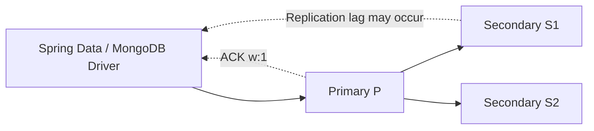
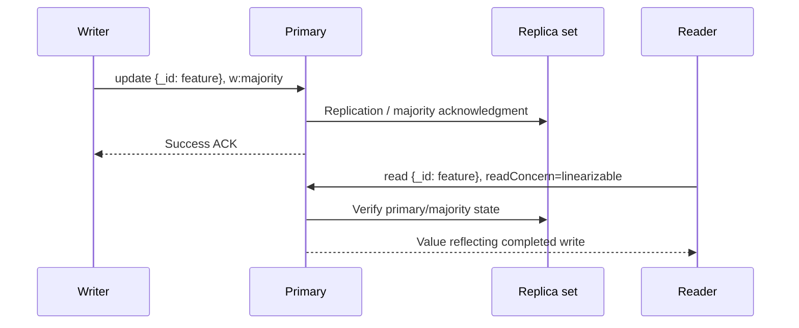
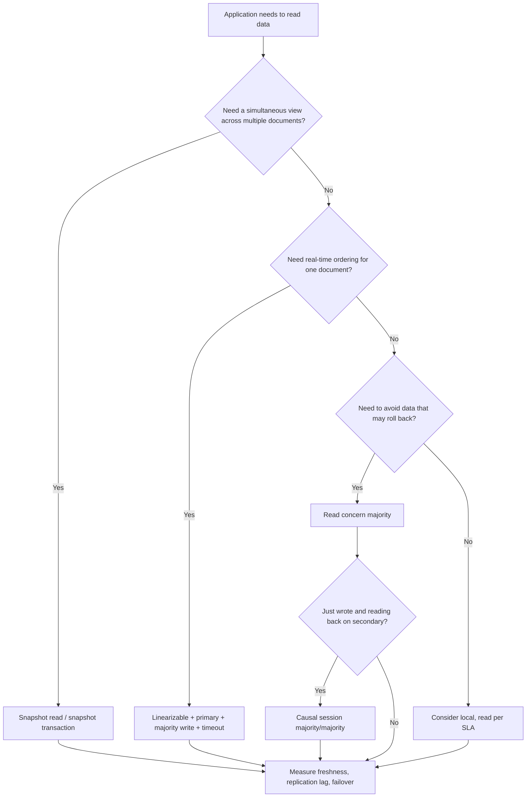

# Read concern and read data guarantees in Spring Data MongoDB

## 1. The problem: reading a document does not mean reading durable data

In **Spring Data MongoDB**, a repository method like `findById` or a `MongoTemplate.findOne(...)` call looks simple: send a query and receive a Java object. Yet on a MongoDB replica set or sharded cluster, the more important questions are: **which version of the data was returned, could that version still be rolled back, and do multiple operations see the same snapshot of data?**

Suppose an e-commerce application has an `orders` collection. A user pays for order `O-101`, the service updates `status = PAID` on primary P1, and then another request reads the order back:

```text
T0  P1 receives write: status=PAID
T1  P1 returns acknowledgment per configured write concern
T2  A read runs on P1 or secondary S1
T3  An election or network failure may occur

Questions:
- How many nodes acknowledged the write at T1?
- Which node did the read at T2 go to?
- Does that node have the latest update yet?
- Does the returned data belong to the majority-committed state?
- Does the read need to reflect writes that completed before it?
```

**Read concern** is a MongoDB option controlling the consistency and isolation guarantees of **data being read**, especially on replica sets and sharded clusters. Common levels include `local`, `available`, `majority`, `linearizable`, and `snapshot`. Each level has a **different contract**; they are not a simple linear scale from "slow" to "fast."

Within the **SPRING_DATA_MONGODB** module, this lesson connects read concern with repository operations, `MongoTemplate`, the Java Driver, sessions, and transactions, while clearly distinguishing read concern from read preference and write concern.

### 1.1. Learning objectives

After this lesson in the **Data Consistency** chapter, learners should be able to:

1. Explain each read concern level, including what is and **is not** guaranteed.
2. Distinguish **rollback safety**, **freshness**, **read-your-own-writes**, **causal consistency**, **linearizability**, and **snapshot isolation**.
3. Choose the right combination of read concern, write concern, and read preference for a business requirement.
4. Configure read concern through the MongoDB Java Driver and recognize how it affects `MongoTemplate`/repositories.
5. Use transactions with `snapshot`, `majority` write concern, and sessions with accurate semantics.
6. Verify behavior under failover, replication lag, and network partitions instead of relying solely on a single run against standalone MongoDB.

### 1.2. Easily confused concepts

| Option | Question answered | Examples |
|---|---|---|
| **Read concern** | What consistency/isolation guarantee must the read data satisfy? | `majority`, `snapshot` |
| **Write concern** | At what level must a write be acknowledged before being considered successful? | `w: 1`, `w: "majority"` |
| **Read preference** | Which replica set member is the read routed to? | `primary`, `secondary` |
| **Client session** | Are operations tracked together for causal relationships or transactions? | Causally consistent session |
| **Transaction** | Does a multi-document sequence share a commit/isolation boundary? | `startTransaction`, `commitTransaction` |

Read concern **does not choose which node is read**; read preference handles that. Read concern also **does not determine write durability**; it must be paired with write concern.

## 2. Replica sets, replication, and rollback possibility

### 2.1. Three-member model

Suppose a replica set has:

- `P`: current primary, accepts writes.
- `S1`: secondary replicating data.
- `S2`: remaining secondary.



Writes do not always appear on all three nodes simultaneously. A secondary may not yet have applied changes the primary already received. When an election occurs, a write that was not majority-committed may not be part of the new primary's accepted history and risks being rolled back.

### 2.2. Example with write concern w: 1

```text
P : status=NEW ── write PAID ── ACK w:1 ── loses primary role
S1: status=NEW ──────────────────────────── becomes new primary
S2: status=NEW ────────────────────────────

The PAID write was not majority-committed.
It may be rolled back; earlier local reads could still have seen PAID.
```

Key takeaway: **`readConcern=local` can return data present on a node that is later rolled back**. This is not necessarily an application bug or broken connection; it is part of that read level's consistency contract.

### 2.3. Majority commit point

MongoDB tracks a **majority-commit point**: the point in replication progress acknowledged by a majority of relevant members under the replica set model. `readConcern: "majority"` reads data from the node's majority-committed view.

This avoids reading writes that still risk rollback because they are not majority-committed. However:

- A very recent write may **not yet** have reached the majority commit point.
- A secondary may **not yet have applied** the latest write.
- A query on a given node may return an **older version** than the newest version known elsewhere.

Thus, **"majority" does not mean "latest,"** and **"reading from primary" does not automatically mean "linearizable."**

## 3. Overview of the five read concern levels

### 3.1. Quick selection table

| Level | Primary guarantee | Can read data that gets rolled back? | Notable limitations |
|---|---|---|---|
| `local` | Reads data currently on the selected node; does not require majority commit | **Yes** | Often the default read concern if not configured otherwise |
| `available` | Prioritizes availability/latency with majority guarantees similar to local | **Yes** | On sharded collections, risks seeing orphaned documents; not usable in causal sessions/transactions |
| `majority` | Returns only majority-committed data, avoiding writes at risk of rollback per guarantee | **No**, under majority-committed guarantees | Can be stale; not linearizable or a snapshot across multiple queries |
| `linearizable` | For an eligible single-document read on primary, sees all majority-acknowledged writes completed **before the read started** | No for data meeting the guarantee | Higher cost/wait, primary only; use `maxTimeMS` |
| `snapshot` | Reads from a data snapshot at a consistent point in time | Depends on mode and transaction commit majority guarantee | Distinguish snapshot inside a transaction from outside-transaction snapshot reads |

Which level is "stronger" depends on **the property the application needs**: no rollbacks, real-time ordering, or a consistent snapshot across multiple documents. `snapshot` can provide a consistent report at an earlier point in time, which is **not** a way to read the very latest updated value.

### 3.2. Relative semantics of each level

```text
local        → data currently on the node, possibly not majority-committed
available    → availability-oriented, orphan risk in sharding
majority     → majority-committed data, may not be the latest
linearizable → real-time ordering for an eligible single-document read
snapshot     → consistent point-in-time snapshot, may be older
```

Do not arrange all five levels into a linear hierarchy `local < majority < snapshot < linearizable` for every case. `snapshot` and `linearizable` solve **different problems**.

### 3.3. General MongoDB syntax

```javascript
{
  readConcern: {
    level: "majority"
  }
}
```

This is the option structure in commands. The Java Driver API commonly uses `ReadConcern.MAJORITY`, while `mongosh` provides a helper:

```javascript
db.orders.find({ _id: "O-101" })
  .readConcern("majority");
```

To run reliably and maintain control, verify support for each operation, topology, MongoDB Server version, and driver API.

## 4. Read concern local: current data, but subject to rollback

### 4.1. Meaning

`local` lets MongoDB return data currently present on the node serving the query without **requiring that data to be majority-committed**. This is the common default read concern for reads on primary/secondaries when no other global/client setting is specified.

Example:

```javascript
db.orders.find({ _id: "O-101" })
  .readConcern("local");
```

Its advantage is simple semantics without requiring majority confirmation on the read path. Its drawback: if just-read data is not majority-committed and the primary fails over, that version can be rolled back.

### 4.2. local + primary does not eliminate risk

The call:

```text
readPreference = primary
readConcern    = local
```

routes reads to the primary, but **does not** turn non-majority-committed data into durable data. The primary may have applied a `w:1`-acknowledged write that secondaries have not replicated yet.

### 4.3. local + secondary adds replication lag

`readPreference = secondary` can return stale documents because the secondary has not applied writes already executed by the primary. `local` makes no promise on maximum staleness in seconds.

Acceptable scenarios:

- Operational dashboards not requiring strict real-time freshness.
- Reference data that can be refreshed.
- Workloads prioritizing latency/availability that accept eventual consistency.

Do not use it simply because "reads are usually faster" without verifying the product contract.

### 4.4. local does not automatically provide a consistent snapshot across queries

Two queries:

```text
read A at T1
read B at T2
```

with `local` can observe data versions from different points in time. If business logic requires a consistent snapshot across multiple collections, consider a `snapshot` transaction or suitable data modeling; do not assume two consecutive repository calls form an automatic transaction.

## 5. Read concern available: special caveats for sharded clusters

### 5.1. Characteristics

`available` can also return data that is not majority-committed and risks rollback. It is designed for cases prioritizing availability/latency, yet **the most critical difference lies in sharded collections**.

During chunk migrations between shards, **orphaned** documents can exist on the old shard during cleanup. Read concern `available` can allow reading these orphaned documents, producing unexpected query results.

```text
Sharded collection "orders"
        |
     mongos
    /     \
 Shard A  Shard B
  (chunk moved A→B, A temporarily holds orphan)

Read concern "available" may observe orphaned documents.
```

`local` on a sharded collection avoids this orphaned-document risk under MongoDB's documented contract. Never use `available` as a default just because its name sounds "safer."

### 5.2. Not usable in transactions or causally consistent sessions

MongoDB does not support read concern `available` in multi-document transactions or causally consistent sessions. If a service uses transactions and attempts to apply `ReadConcern.AVAILABLE`, do not expect the server to silently upgrade it to a stronger level.

Reserve `available` for use cases whose trade-offs on the current topology are clearly evaluated, with proper integration tests and monitoring.

## 6. Read concern majority: no rollback, but not guaranteed latest

### 6.1. Core guarantee

`majority` returns data versions that are **majority-committed**. According to MongoDB documentation, data read with `majority` is guaranteed not to be rolled back within the scope of this read concern's guarantee.

```javascript
db.orders.find({ _id: "O-101" })
  .readConcern("majority");
```

This is a suitable choice when the application must not feed values that could vanish after failover into reports, business history, or long-lived records.

### 6.2. Majority does not mean read-your-own-writes across every node

Suppose a client just received a successful `writeConcern: {w:"majority"}` for an order, then executes a read on a secondary. Especially starting in MongoDB 8.0, majority acknowledgment can arrive before the secondary applies the change to its collection. An immediate query on a secondary **may not yet see the newly acknowledged write**.

Therefore, when the product needs to read its own writes across primary/secondaries, **use a causally consistent session** with read concern `majority` and write concern `majority`, or a routing/sync strategy verified for your server version.

### 6.3. Majority is not linearizable

Even when reading from the primary, `majority` does not promise that results reflect **every majority-acknowledged write completed before the read began**, especially during elections or unsynchronized primary role visibility.

If real-time ordering under a strong contract is needed for **a single document**, see `linearizable` in Section 7.

### 6.4. Majority does not create a snapshot across multiple documents

An aggregation reading majority-committed data **does not mean** an entire sequence of independent Java reads sees a fixed snapshot.

Example:

```text
T1: find customer balance
T2: another writer updates orders and customer
T3: aggregate customer orders
```

The two operations can reflect different points in time. When a consistent report across multiple documents/collections is needed, consider a `snapshot` transaction or supported snapshot read.

### 6.5. Client-side majority config cannot fix a weak writer

If the writer uses `w:1`, a write may be reported to the user as "successful" and later roll back. A `majority` reader will **not necessarily see** that write because it was never majority-committed. For an end-to-end design requiring durability, coordinate **majority write concern** as well—not just the read level.

## 7. Read concern linearizable: reading in real-time order

### 7.1. What guarantee is linearizability?

In MongoDB's context, read concern `linearizable` guarantees that a qualifying read **reflects all writes that succeeded with majority acknowledgment and completed before the read began**. When paired with write concern `majority`, operations on a single document can be viewed as having a single execution order consistent with real-time order.

Example document holding a feature toggle:

```javascript
{
  _id: "feature:checkout",
  enabled: false,
  version: NumberLong(17)
}
```

An admin flips `enabled` to `true` and receives a result from majority write concern. A linearizable read request issued **after that write completes** must see the update under this guarantee if the read succeeds and satisfies supported conditions.



### 7.2. Important conditions

- **Primary reads only**: do not set `readPreference=secondary` expecting linearizable reads to work.
- **The guarantee applies to reads with a filter uniquely identifying a single document**, typically `_id`.
- For the read to use a consistent snapshot per server rules, query by an immutable search key such as `_id`, a key not updated concurrently, or a matching unique index used by the query.
- **Do not use `linearizable` inside multi-document transactions or causally consistent sessions.**
- Aggregations with `linearizable` do not support write stages `$out` or `$merge`.
- Attach **`maxTimeMS`** so the read does not wait indefinitely when too few members are available to confirm majority state.

Note on `writeConcernMajorityJournalDefault`: MongoDB documents durability exceptions related to journaling and simultaneous multi-node crashes/restarts. The strongest guarantees assume proper durability configuration; do not interpret "linearizable" as immunity to every kind of data loss or hardware failure.

### 7.3. mongosh command

```javascript
db.feature_flags.find({ _id: "feature:checkout" })
  .readConcern("linearizable")
  .maxTimeMS(10000);
```

Per MongoDB documentation, if the cluster cannot satisfy linearizable conditions, the query may block waiting; `maxTimeMS(10000)` sets a time budget for the operation so it returns a timeout error rather than waiting indefinitely.

**A timeout does not mean the data is false or nonexistent.** It means the read with the chosen guarantee **could not complete within the time limit**. Business logic must report an error or defer, never turning a timeout into a fabricated business result.

### 7.4. When is linearizable needed?

Consider it for:

- Reading a flag controlling a sensitive action immediately after a majority-confirmed change.
- Reading a single state/version management document where real-time ordering is critical.
- Decision points centered on one document with tightly designed and tested read/write semantics.

**Do not use `linearizable` by default for order lists, pagination, or huge aggregations.** It can be significantly slower than `local`/`majority` and does not create a transaction snapshot across multiple documents.

### 7.5. Linearizable reads do not replace atomic updates

Suppose two requests concurrently execute:

```text
read balance=10
if balance >= 8:
    update balance=balance-8
```

Even with a strong read guarantee, **two separate read–modify–write steps** can still race without a predicate/version guard on the write step. You still need **single-document atomic updates**, compare-and-set/`@Version`, or an appropriate transaction.

Combine read freshness with write atomicity rather than treating read concern as a write lock.

## 8. Read concern snapshot: point-in-time consistent snapshot

### 8.1. Snapshot solves a different problem from linearizable

`snapshot` requests that reads observe data from a **consistent point-in-time snapshot**. Especially for multi-document transactions on a sharded cluster, `snapshot` allows data to be read from a synchronized view across shards.

Month-end report example involving two collections:

```text
accounts: customer balances
orders: paid orders

T1: start snapshot transaction
T2: read accounts
T3: another writer updates accounts and orders
T4: read orders within the same transaction

Reads in the transaction need a consistent snapshot,
not each read fetching whatever was newest at the moment it was called.
```

Values read may be **older than the current moment**, yet operations within the snapshot scope are designed not to see an inexplicable mix of multiple points in time.

### 8.2. Snapshot in multi-document transactions

MongoDB allows transactions to use `local`, `majority`, or `snapshot` read concern. With transaction read concern `snapshot`:

- The transaction reads from a consistent snapshot.
- On a sharded cluster, the snapshot view is synchronized across shards.
- **MongoDB documents the majority-committed data snapshot guarantee for transactions committed with write concern `majority`.** Do not commit with `w:1` and claim the same guarantee.
- Read concern is set **at the transaction level**, not per individual query inside.
- Transactions containing read operations must use read preference `primary`.

To atomically write multi-document business results, writes must genuinely belong to the same transaction and commit successfully. Merely declaring `@Transactional` without proper Mongo transaction manager/session wiring will not magically deliver snapshot consistency.

### 8.3. Snapshot outside transactions

Starting in MongoDB 5.0, certain read operations **outside transactions** support read concern `snapshot`, such as `find`, `aggregate`, and `distinct` on unsharded collections. Support varies by operation/topology/version; do not apply `snapshot` arbitrarily to every command.

For non-transaction snapshot reads, MongoDB can use the **`atClusterTime`** parameter:

```javascript
db.runCommand({
  find: "orders",
  filter: { tenant_id: "T-A" },
  readConcern: {
    level: "snapshot",
    atClusterTime: Timestamp(1767225600, 1)
  },
  maxTimeMS: 10000
});
```

The `Timestamp(...)` value above **is purely for syntax illustration**. Do not invent a wall-clock timestamp and treat it as a valid MongoDB cluster time. `atClusterTime` must correspond to a valid logical cluster time whose snapshot history is still retained.

If the requested point in time is too old and historical snapshots have been pruned, the server may return an error. If the node has not yet reached the requested time, the read may wait or time out. If no point in time is specified, the server selects a suitable majority-committed snapshot per capability/topology.

### 8.4. Snapshot is not "unlimited time travel"

MongoDB retains snapshot history within a **bounded window**. `atClusterTime` does not turn the database into an event-sourcing system or historical archive capable of reading any past date.

If the application needs reports exact to a settlement date from months ago, build **business snapshots/materialized reports**, event logs, or a dedicated archival strategy. Read concern `snapshot` does not guarantee retrieval of arbitrary historical data versions.

### 8.5. Snapshot isolation does not automatically resolve every concurrency constraint

A transaction reading a fixed snapshot still requires designing for write conflicts and cross-document invariants. It can encounter transaction aborts, transient errors, snapshot-too-old errors, or uncertain commit results. Handle retries using driver/Spring transaction mechanisms and **idempotency** in business logic.

Do not treat snapshot transactions as magic that automatically prevents all forms of write skew; critical invariants must be expressed via atomic predicates, unique indexes, or data models protecting against conflicting writes.

## 9. Read concern, write concern, and read preference: assembling the right contract

### 9.1. Three independent variables

An application may configure:

```text
readPreference = secondaryPreferred
readConcern    = majority
writeConcern   = majority
```

This means:

- The driver **prefers** routing reads to secondaries, with fallback per read preference rules.
- Reads only return data meeting **majority commit**.
- Writes wait for majority acknowledgment.

However, this combination **does not automatically guarantee** that a subsequent read on a secondary immediately sees a just-completed write. A causal session is needed if the business requires temporal ordering across operations.

### 9.2. Scenario table

| Read preference | Read concern | Write concern | What can happen |
|---|---|---|---|
| primary | local | w:1 | Reads recent data on primary, but risks rollback if write is not majority-committed |
| secondary | local | w:1 | Both replication lag and rollback risk |
| primary | majority | majority | Only majority-committed data, not linearizable by default |
| secondary | majority | majority | Majority-committed data, may still be stale; use causal session if read-after-write is needed |
| primary | linearizable | majority | Real-time ordering guarantee for an eligible single-document read |
| primary in transaction | snapshot | majority at commit | Consistent snapshot, with majority guarantee at commit |

This table lists primary traits only; specific cluster versions, elections, operations, transactions, and journal configurations carry additional conditions.

### 9.3. "Read from primary" is routing, not a consistency level

Read preference `primary` asks the driver to route reads to the node currently believed to be primary. During elections or network partitions, an old node might briefly not know it has been demoted. Read preference does not add a majority confirmation step to provide linearizable semantics.

Do not write API docs claiming "always reads primary so it definitely sees the latest" without accounting for failover, acknowledgment, and cross-request relationships.

### 9.4. "Write successful" must be defined by write concern

Write concern `w:1` acknowledges from the primary without the same replication guarantee as `w:"majority"`. When an API returns 200 after a `w:1` write, callers should understand the actual acknowledgment level; do not equate it with a write durable across a majority.

When using majority write concern with `wtimeout`, a timeout indicates **not receiving enough acknowledgments within the limit**—not that the write definitely was not applied by the primary. Retry workflows must be idempotent or use unique keys/retryable writes properly; do not blindly insert a second time just because the network was slow.

### 9.5. Never crank every level to "highest" needlessly

Making every report query `linearizable` can hurt availability without providing cross-document snapshots. Putting every read inside a `snapshot` transaction can increase resource usage and complexity. Pick the right **invariant**:

- Avoid reading data that can roll back → `majority`.
- Read a single document in real-time order → `linearizable` with majority writes.
- Read a group of documents from the same snapshot → `snapshot` with proper transaction/options.
- Read reference data allowed to be stale → consider `local`/secondary.

## 10. Causal consistency: read-your-writes across a session

### 10.1. The read-your-own-writes problem

A user just placed an order, and the details page immediately calls another API reading from a secondary. If the secondary has not applied the write yet, the user may see `status = NEW` even though the `PAID` write received majority acknowledgment.

When causally related operations execute within the same **client session**, MongoDB can enforce **causal consistency** by tracking logical operation time/cluster time across operations.

### 10.2. Guarantees to interpret accurately

A causally consistent session with:

- `majority` read concern;
- `majority` write concern;
- operations in the session executed sequentially, without unsafe concurrent use of one session;

is documented by MongoDB as providing these guarantees:

| Property | Meaning |
|---|---|
| **Read your own writes** | A read following a write in a causal chain does not "forget" the session's own write |
| **Monotonic reads** | Later reads do not see an older history than what was previously observed causally |
| **Monotonic writes** | Write order within the session is respected |
| **Writes follow reads** | A write following a prior read respects causal ordering relative to the read state |

MongoDB distinguishes **durability-backed** causal guarantees from weaker read/write concern combinations. Do not claim the four durability-backed guarantees in the table above if writes are using `w:1`.

### 10.3. Causal is not a transaction

A causal session **does not** turn a sequence of two updates into an atomic commit. Two writes can still partially succeed without a transaction. Sessions primarily help MongoDB understand **causal ordering** when routing operations/reads across different members.

If you need "create order + decrement inventory either both succeed or both fail," use a transaction or a single-document atomic design; do not just enable `causallyConsistent(true)`.

### 10.4. Causal does not mean globally latest data

If an independent writer performs a write after your session's last operation, causal reads do not automatically guarantee immediately seeing that writer's update. It protects **causal relationships tracked by the session**, rather than replacing linearizable reads in all cases.

### 10.5. Managing session scope and lifecycle

Do not share a mutable `ClientSession` across multiple concurrent requests. A session holds stateful progress over time, must be closed properly at the end of its lifecycle, and must be passed explicitly to each operation when using the MongoDB Java Driver.

In Spring Data, a session can be bound to template/transaction context via supported APIs; ensure related operations actually run within **the same session**, not merely the same `MongoClient`. A request arriving at a different server instance does not automatically inherit causal context without explicitly propagating or maintaining the corresponding session context.

## 11. Configuring read concern in the MongoDB Java Driver

### 11.1. ReadConcern constants

The MongoDB Java Sync Driver provides constants in `com.mongodb.ReadConcern`:

```java
import com.mongodb.ReadConcern;

ReadConcern local = ReadConcern.LOCAL;
ReadConcern available = ReadConcern.AVAILABLE;
ReadConcern majority = ReadConcern.MAJORITY;
ReadConcern linearizable = ReadConcern.LINEARIZABLE;
ReadConcern snapshot = ReadConcern.SNAPSHOT;
```

Selecting a constant does not itself open a connection or alter the server. Read concern takes effect only when applied to a client/database/collection/session/transaction and supported by the corresponding operation.

### 11.2. Configuring at MongoClient level

Example of a dedicated client for majority reporting reads:

```java
import com.mongodb.ConnectionString;
import com.mongodb.MongoClientSettings;
import com.mongodb.ReadConcern;
import com.mongodb.ReadPreference;
import com.mongodb.WriteConcern;
import com.mongodb.client.MongoClient;
import com.mongodb.client.MongoClients;

MongoClientSettings settings = MongoClientSettings.builder()
    .applyConnectionString(
        new ConnectionString(
            "mongodb://localhost:27017/?replicaSet=rs0"))
    .readConcern(ReadConcern.MAJORITY)
    .readPreference(ReadPreference.primary())
    .writeConcern(WriteConcern.MAJORITY)
    .build();

MongoClient client = MongoClients.create(settings);
```

`rs0` is an **illustrative replica set name**; use hostnames, authentication, TLS, replica set name, and timeouts from your real system's secure configuration. Never hardcode credentials or create a `MongoClient` per request.

From this configuration, databases/collections obtained from the client **inherit** read concern, read preference, and write concern unless overridden at an appropriate lower level.

### 11.3. Configuring on database and collection

```java
import com.mongodb.ReadConcern;
import com.mongodb.ReadPreference;
import com.mongodb.client.MongoCollection;
import com.mongodb.client.MongoDatabase;
import org.bson.Document;

MongoDatabase database = client.getDatabase("shop")
    .withReadConcern(ReadConcern.MAJORITY)
    .withReadPreference(ReadPreference.primary());

MongoCollection<Document> orders =
    database.getCollection("orders")
        .withReadConcern(ReadConcern.MAJORITY);

Document order = orders.find(
    new Document("_id", "O-101")
).first();
```

`withReadConcern(...)` and `withReadPreference(...)` return a **new database/collection handle** with the requested options; they do not issue a global read concern change across the cluster or mutate existing handles.

Typical inheritance order: **client → database → collection**, with explicit overrides at lower levels. Inside a transaction, transaction-level options determine read concern instead of collection-level settings.

### 11.4. Combining with read preference to read secondaries

```java
MongoCollection<Document> reportingOrders =
    database.getCollection("orders")
        .withReadPreference(
            ReadPreference.secondaryPreferred())
        .withReadConcern(ReadConcern.MAJORITY);

Document reportInput = reportingOrders.find(
    new Document("_id", "O-101")
).first();
```

This combination suits certain reporting workloads that tolerate secondary lag, yet **does not guarantee observing a write just completed by another client in real time**. When read-your-own-writes is needed, use a causally consistent session with majority writes (Section 12).

### 11.5. URI readConcernLevel

The MongoDB Java Driver can accept options via connection string:

```text
mongodb://localhost:27017/shop?replicaSet=rs0&readConcernLevel=majority&readPreference=primary&w=majority
```

Avoid configuring conflicting values in both the URI and `MongoClientSettings.builder()` without knowing precedence. Standardize on a single configuration source and test actual commands. Use your application's secret management, TLS, and connection pooling rather than putting production URIs into source code or logs.

### 11.6. Linearizable read with timeout in the raw driver

```java
import java.util.concurrent.TimeUnit;
import com.mongodb.ReadConcern;
import com.mongodb.ReadPreference;
import org.bson.Document;
import com.mongodb.client.MongoCollection;

MongoCollection<Document> flags =
    database.getCollection("feature_flags")
        .withReadPreference(ReadPreference.primary())
        .withReadConcern(ReadConcern.LINEARIZABLE);

Document state = flags.find(
        new Document("_id", "feature:checkout"))
    .maxTime(10, TimeUnit.SECONDS)
    .first();
```

Here, filtering by `_id` uniquely identifies the document and `maxTime` bounds the server-side wait. If the operation times out, do not default to returning `enabled=false`; surface the consistency/read availability failure per the API contract.

### 11.7. Do not swap MongoClientSettings between requests

`MongoClientSettings` describes a client's configuration. Do not use a singleton service to rebuild or close/reopen `MongoClient` whenever an endpoint needs a different read concern.

Instead:

1. Choose an application-wide default.
2. Use collection/database handles with a different read concern for specialized workloads.
3. Or create a separate configured client/template when architecture warrants it, with managed connection pools.
4. For transactions, set options when creating the transaction.

Improper client lifecycle management can exhaust connection pools or break in-flight requests; that is a Java resource issue, not read concern semantics.

## 12. Causally consistent session with the Java Driver

### 12.1. Session setup

This flow illustrates a client writing and then reading back on a secondary within **the same session**:

```java
import com.mongodb.ClientSessionOptions;
import com.mongodb.ReadConcern;
import com.mongodb.ReadPreference;
import com.mongodb.WriteConcern;
import com.mongodb.client.ClientSession;
import com.mongodb.client.MongoCollection;
import com.mongodb.client.MongoDatabase;
import com.mongodb.client.model.Filters;
import com.mongodb.client.model.Updates;
import org.bson.Document;

MongoDatabase db = client.getDatabase("shop");

MongoCollection<Document> writing =
    db.getCollection("orders")
        .withWriteConcern(WriteConcern.MAJORITY);

MongoCollection<Document> reading =
    db.getCollection("orders")
        .withReadConcern(ReadConcern.MAJORITY)
        .withReadPreference(
            ReadPreference.secondaryPreferred());

ClientSessionOptions sessionOptions =
    ClientSessionOptions.builder()
        .causallyConsistent(true)
        .build();

try (ClientSession session =
        client.startSession(sessionOptions)) {

    writing.updateOne(
        session,
        Filters.eq("_id", "O-101"),
        Updates.set("status", "PAID"));

    Document afterWrite = reading.find(
        session,
        Filters.eq("_id", "O-101")
    ).first();

    System.out.println(
        afterWrite == null
            ? "Not found"
            : afterWrite.getString("status"));
}
```

In this example, `client` is a previously created, lifecycle-managed Java Driver client. `WriteConcern.MAJORITY` and `ReadConcern.MAJORITY` are explicitly attached, and the session allows the server/driver to maintain causal ordering between the update and the read.

**Do not copy this example into production without checking `UpdateResult.getMatchedCount()`, timeouts, network errors, and retries.** If the ID does not exist, the write modifies nothing and the read may return `null`; that is not a violation of causal consistency.

### 12.2. Requirements for the guarantee to truly hold

- Operations must use **the exact same `ClientSession`**.
- The combination of majority read concern + majority write concern must be applied per the causal durability contract.
- Dependent operations should execute sequentially per session rules; never issue parallel calls on the same session.
- A secondary may have to **wait** until reaching the required logical time, or time out if unable to serve.
- If HTTP requests are handled by separate processes, do not assume a Java session object transfers across those processes.

### 12.3. Causal context does not replace idempotency

Suppose an update executes, the client loses connection before receiving the response, and retries using:

```java
Updates.inc("rewardPoints", 10);
```

An independent retry could add points twice if the operation lacks an idempotency key, retryable write behavior, or appropriate transaction semantics. A causal session protects observation order, **not duplicate execution across arbitrary operations**.

For crediting money/points, design a unique transaction ID, conditional update, or unique index to enforce idempotency.

### 12.4. What about reading from another API?

An update API and a read API running on two different service instances do not automatically share a session. Design options:

- Read back immediately in the same workflow/session and return the confirmed result.
- Pass a reliable version/operation marker so the reading service can wait or ensure a minimum version by design.
- Use causal context propagation genuinely supported by the driver and architecture.
- For a single document needing real-time ordering, consider a `linearizable` read on primary when conditions and latency budget allow.

Do not present `ReadConcern.MAJORITY` alone as a cure-all for "I just wrote it, why doesn't another page show it yet?"

## 13. Configuring Spring Data MongoDB: MongoTemplate and repositories

### 13.1. Read concern in Spring Data depends on client/driver

Spring Data MongoDB uses the MongoDB Java Driver at the connection layer. A `MongoTemplate` typically operates atop the application-configured `MongoDatabaseFactory`/`MongoClient`. Reads through a repository ultimately go through that corresponding MongoDB infrastructure.

When you create a client with default read concern `MAJORITY` and pass that client to `MongoTemplate`, ordinary operations **inherit** the driver's setting unless overridden.

Illustrative Spring configuration creating a template with a configured client:

```java
import com.mongodb.ConnectionString;
import com.mongodb.MongoClientSettings;
import com.mongodb.ReadConcern;
import com.mongodb.ReadPreference;
import com.mongodb.WriteConcern;
import com.mongodb.client.MongoClient;
import com.mongodb.client.MongoClients;
import org.springframework.context.annotation.Bean;
import org.springframework.context.annotation.Configuration;
import org.springframework.data.mongodb.core.MongoTemplate;

@Configuration
class MongoConsistencyConfiguration {

    @Bean
    MongoClient mongoClient() {
        MongoClientSettings settings =
            MongoClientSettings.builder()
                .applyConnectionString(
                    new ConnectionString(
                        "mongodb://localhost:27017/?replicaSet=rs0"))
                .readConcern(ReadConcern.MAJORITY)
                .readPreference(ReadPreference.primary())
                .writeConcern(WriteConcern.MAJORITY)
                .build();

        return MongoClients.create(settings);
    }

    @Bean
    MongoTemplate mongoTemplate(MongoClient mongoClient) {
        return new MongoTemplate(mongoClient, "shop");
    }
}
```

This snippet is for **applications configuring MongoDB beans manually**; when Spring Boot auto-configuration already creates `MongoClient`/`MongoTemplate`, avoid declaring duplicate beans or losing Boot-managed TLS, credentials, metrics, and pooling settings. Pick one consistent configuration approach matching your project's Spring Boot/Spring Data version.

### 13.2. Repositories inherit the semantics of underlying infrastructure

Repository example:

```java
import org.springframework.data.mongodb.repository.MongoRepository;

public interface OrderRepository
        extends MongoRepository<OrderDocument, String> {
}
```

And entity:

```java
import org.springframework.data.annotation.Id;
import org.springframework.data.mongodb.core.mapping.Document;

@Document(collection = "orders")
public class OrderDocument {
    @Id
    private String id;
    private String status;

    protected OrderDocument() {}

    public String getId() { return id; }
    public String getStatus() { return status; }
}
```

A call like:

```java
var order = orderRepository.findById("O-101");
```

has no `ReadConcern` parameter in its signature, yet the operation runs with the repository's template/driver settings. **Do not assume** every repository in the same process uses one consistency policy when the application defines multiple templates/clients/transaction managers.

### 13.3. Overriding on raw MongoCollection from MongoTemplate

When a specific code path needs a different policy under explicit control, you can use a raw driver handle:

```java
import com.mongodb.ReadConcern;
import com.mongodb.ReadPreference;
import org.bson.Document;

Document value = mongoTemplate.getCollection("orders")
    .withReadConcern(ReadConcern.MAJORITY)
    .withReadPreference(ReadPreference.primary())
    .find(new Document("_id", "O-101"))
    .first();
```

`getCollection(...)` returns a driver collection handle. It **does not automatically apply domain mapping** like `MongoTemplate.findOne(Query, OrderDocument.class)`. For entities with `@Field("tenant_id")`, raw queries must use physical BSON field names rather than relying on automatic `tenantId` translation.

**Specifically:** inside a Spring-managed transaction/session, a raw driver call not properly bound by Spring to the active session may execute **outside the transaction**. Do not use this raw-driver override to "upgrade read concern" for an already started transaction.

### 13.4. Do not mutate singleton template settings between requests

Do not toggle a shared property on `MongoTemplate` or the connection factory while handling request A and then "restore it" afterward: concurrent request B can observe the wrong policy.

Determine consistency scope at bean/client configuration time, or choose immutable collection handles/transaction options. Also document clearly which business endpoints require `majority`, `linearizable`, or `snapshot`.

### 13.5. Spring Data does not turn an annotation into automatic server guarantees

`@Document`, `@Version`, repository method names, or `@Transactional` without a Mongo transaction manager do not by themselves solve all consistency problems. Durable reads, routing levels, and session contexts must be configured and tested against a **real MongoDB topology**.

In tests running against standalone MongoDB, many replication lag and rollback scenarios never occur, so "reads returned the right data" is insufficient to prove a consistency policy works.

## 14. Transactions: setting read concern at the transaction level

### 14.1. Why collection-level read concern is insufficient

When the MongoDB Java Driver or Spring Data starts a **multi-document transaction**, operations inside the transaction use the **transaction-level read concern**. Collection- or database-level read concerns cannot override the read concern established by the transaction.

Configuration example:

```text
MongoClient default:    readConcern=MAJORITY
MongoCollection handle: readConcern=LOCAL
TransactionOptions:     readConcern=SNAPSHOT

Query inside the transaction:
  uses transaction read concern SNAPSHOT;
  does not switch to LOCAL just because the collection has LOCAL.
```

**Do not configure read concern per individual operation inside a transaction.** Choose `LOCAL`, `MAJORITY`, or `SNAPSHOT` when starting the transaction. `LINEARIZABLE` and `AVAILABLE` are not valid MongoDB transaction read concern levels, even though some mapping/enum APIs list their names.

### 14.2. TransactionOptions in the Java Driver

```java
import com.mongodb.ReadConcern;
import com.mongodb.ReadPreference;
import com.mongodb.TransactionOptions;
import com.mongodb.WriteConcern;
import com.mongodb.client.ClientSession;
import com.mongodb.client.MongoCollection;
import org.bson.Document;

TransactionOptions options = TransactionOptions.builder()
    .readConcern(ReadConcern.SNAPSHOT)
    .readPreference(ReadPreference.primary())
    .writeConcern(WriteConcern.MAJORITY)
    .build();

MongoCollection<Document> orders =
    client.getDatabase("shop")
        .getCollection("orders");
MongoCollection<Document> payments =
    client.getDatabase("shop")
        .getCollection("payments");

try (ClientSession session = client.startSession()) {
    Long count = session.withTransaction(() -> {
        long orderCount = orders.countDocuments(
            session,
            new Document("tenant_id", "T-A"));

        long paymentCount = payments.countDocuments(
            session,
            new Document("tenant_id", "T-A"));

        // Both reads execute within the same transaction snapshot.
        // Example returns a check number; does not by itself prove
        // correctness of all business invariants.
        return orderCount + paymentCount;
    }, options);

    System.out.println(count);
}
```

`withTransaction(...)` manages start/commit/abort via the driver API and can retry based on error labels. **The callback can be re-executed**, so never call external payment APIs, send emails, or trigger non-idempotent side effects inside the callback without protection.

Collections must be prepared, and the topology and server/driver versions must support transactions. Do not use ordinary standalone MongoDB to "prove" multi-document transactions behave like a replica set.

### 14.3. Spring Data MongoTransactionManager

Spring Data MongoDB supports `MongoTransactionManager`. Configuration with explicit transaction options:

```java
import com.mongodb.ReadConcern;
import com.mongodb.ReadPreference;
import com.mongodb.TransactionOptions;
import com.mongodb.WriteConcern;
import org.springframework.context.annotation.Bean;
import org.springframework.context.annotation.Configuration;
import org.springframework.data.mongodb.MongoDatabaseFactory;
import org.springframework.data.mongodb.MongoTransactionManager;

@Configuration
class MongoTransactionConfiguration {

    @Bean
    MongoTransactionManager mongoTransactionManager(
            MongoDatabaseFactory factory) {
        TransactionOptions options = TransactionOptions.builder()
            .readConcern(ReadConcern.SNAPSHOT)
            .readPreference(ReadPreference.primary())
            .writeConcern(WriteConcern.MAJORITY)
            .build();

        return new MongoTransactionManager(factory, options);
    }
}
```

You must use **the same `MongoDatabaseFactory`/transaction infrastructure** that `MongoTemplate` and repositories participate in; if they use different factories/clients, you cannot assume the transaction context is shared.

### 14.4. @Transactional on a service

Suppose an application has two MongoDB repositories:

```java
import org.springframework.transaction.annotation.Transactional;
import org.springframework.stereotype.Service;

@Service
class ReconciliationService {
    private final OrderRepository orders;
    private final PaymentRepository payments;

    ReconciliationService(
            OrderRepository orders,
            PaymentRepository payments) {
        this.orders = orders;
        this.payments = payments;
    }

    @Transactional(
        transactionManager = "mongoTransactionManager",
        readOnly = true)
    public ReconciliationView inspect(
            String trustedTenantId) {
        long orderCount = orders.countByTenantId(trustedTenantId);
        long paymentCount =
            payments.countByTenantId(trustedTenantId);

        return new ReconciliationView(
            orderCount, paymentCount);
    }
}

record ReconciliationView(
    long orders,
    long payments
) {}
```

This snippet assumes `countByTenantId` methods are declared on the respective repositories and entity mappings contain `tenantId`. `readOnly = true` expresses read intent within the transaction; in Spring Data, the MongoDB transaction manager still binds a session/transaction according to its semantics. Do not assume from this `count` example that all analytical operations inside transactions are uniformly supported across every MongoDB version: choose compatible counting queries/aggregations and write integration tests.

**AOP caveats:** `@Transactional` methods must be invoked through the Spring proxy or matching transaction boundary. An internal self-call `this.inspect(...)` within the same class does not pass through a standard proxy.

### 14.5. Transaction labels for per-method options

In Spring Data MongoDB versions that support Mongo-specific transaction labels, you can specify:

```java
@Transactional(
    transactionManager = "mongoTransactionManager",
    readOnly = true,
    label = {
        "mongo:readConcern=SNAPSHOT",
        "mongo:writeConcern=MAJORITY",
        "mongo:readPreference=PRIMARY"
    }
)
public ReconciliationView inspectSnapshot(
        String trustedTenantId) {
    // Repository/template calls within the transaction.
    // ... return result;
    throw new UnsupportedOperationException(
        "Replace with business implementation");
}
```

The snippet above only illustrates **annotation options syntax**, not a complete service implementation, since the body must be replaced with real logic. When using labels, verify how your current dependency release, transaction manager type, and option precedence handle them relative to manager defaults.

Some docs show enum values that can be parsed such as `LINEARIZABLE` or `AVAILABLE`, yet MongoDB **does not support** them as transaction read concerns; choose `LOCAL`, `MAJORITY`, or `SNAPSHOT` per the server contract.

### 14.6. Reactive transactions differ from imperative transactions

With `ReactiveMongoTemplate`, the reactive transaction manager is `ReactiveMongoTransactionManager`, and sessions are propagated via **Reactor Context** instead of imperative thread-locals.

```java
import com.mongodb.ReadConcern;
import com.mongodb.TransactionOptions;
import com.mongodb.WriteConcern;
import org.springframework.context.annotation.Bean;
import org.springframework.data.mongodb.ReactiveMongoDatabaseFactory;
import org.springframework.data.mongodb.ReactiveMongoTransactionManager;

@Bean
ReactiveMongoTransactionManager reactiveMongoTransactionManager(
        ReactiveMongoDatabaseFactory factory) {
    TransactionOptions options = TransactionOptions.builder()
        .readConcern(ReadConcern.SNAPSHOT)
        .writeConcern(WriteConcern.MAJORITY)
        .build();

    return new ReactiveMongoTransactionManager(factory, options);
}
```

Use `TransactionalOperator` or `@Transactional` on methods returning `Mono`/`Flux` with the matching transaction manager. **Never call `block()` mid-reactive pipeline** to "get the result easily" and expect the transaction context to hop across threads.

### 14.7. Snapshot transactions and read-only reports

A report reading two collections may still need a transaction/snapshot if it requires a **consistent cross-document view**. However, transactions add overhead and pin snapshot/history resources; for long reports over large datasets, consider outside-transaction `snapshot` reads where supported or a materialized report architecture.

Do not open a multi-minute transaction just to export a huge CSV without checking memory/history windows, timeouts, and cluster impact.

## 15. Sharded clusters, secondary lag, and guarantee limits

### 15.1. Majority on a sharded cluster is not automatically a global snapshot

A sharded cluster distributes data across multiple shards. A `majority` read can observe majority-committed values on each shard yet **does not automatically create a synchronized cross-shard snapshot for a transaction**.

MongoDB explicitly notes that transactions on a sharded cluster with read concern `majority` **do not guarantee** data is read from the same snapshot view across shards. When a unified snapshot is required, choose transaction read concern `snapshot` and commit write concern `majority`.

### 15.2. Avoid available when orphaned documents must be avoided

On sharded collections, chunk migrations can create temporary orphans. `available` may return orphaned documents, corrupting counts, groupings, or business decisions. Consider `local`/`majority` or another suitable level for your topology when correctness requires avoiding orphans.

### 15.3. Secondary lag does not disappear when raising read concern

A secondary receives the replication stream but may apply it slowly. `readConcern=majority` ensures read data is majority-committed, yet does not force a secondary to **immediately apply** a specific write.

When you need the primary's latest state for a just-occurred event, options include:

- Reading from the primary under an appropriate contract.
- Using a causally consistent session so the secondary waits for the minimum causal version.
- For a single document needing linearizability, using `linearizable` on primary with a timeout.
- Designing a "written, syncing" UX pattern if eventual consistency is acceptable.

### 15.4. No single setting is optimal for every report

An order-count summary dashboard can tolerate a few seconds of staleness, whereas a credit-approval check requires real-time state. Using one default read policy for both forces a trade-off between excessive latency/unavailability or insufficient guarantees.

Decide according to business invariants, not configuration habits.

### 15.5. Read preference and causal sessions must be tested on real topologies

A single-node replica set is handy for checking basic transaction APIs, yet **cannot simulate secondary replication lag** and cannot reproduce most election scenarios. To verify read consistency:

- Use a replica set with at least three data-bearing members in test/chaos environments when feasible.
- Configure distinct primary/secondary read preferences in tests.
- Observe replication lag and majority commit points.
- Run controlled failovers and verify error/timeout semantics.
- Never degrade production replication/quorum just to demonstrate a concept.

## 16. Choosing read concern by business requirement

### 16.1. Decision matrix

| Use case | Required consistency | Direction to consider | Additional checks required |
|---|---|---|---|
| Reference product listing page | Slight staleness allowed | `local` or `majority` + suitable read preference | Cache TTL, secondary lag, UX |
| Report of finalized orders | Do not include writes that might roll back | `majority` | Indexes, time range, snapshot if consistency across multiple reads is needed |
| Reading order status right after user updates it | Read-your-own-writes | Causal session with majority read/write | Shared session/causal context, secondary lag |
| Checking a security flag in real-time order | Real-time ordering, single document | `linearizable` + majority write, primary | Unique lookup key, `maxTimeMS`, safe fallback |
| Aggregating multiple collections at one point in time | Consistent snapshot | `snapshot` transaction or supported snapshot read | Commit `w: majority`, duration, retries |
| Near-real-time dashboard | Freshness is a dedicated goal | Secondary or primary per SLA; majority if rollback-safe needed | Measure actual lag, do not rely solely on read concern |
| Notification page immediately after sending | Sees the session's own event | Causal session majority/majority or return data from write flow | Context propagation across services |
| Initializing balances and generating audit report | Atomicity + snapshot + durability | Snapshot/majority transaction, unique/atomic invariants | Commit retries, timeouts, snapshot retention |
| Data analytics on a sharded cluster | Avoid orphans + explicit snapshot needs | Avoid `available`; use `snapshot` when same point-in-time is needed | Topology, sharding, query plans |

Not every audit report requires a giant transaction: sometimes a business-level materialized snapshot is a better fit. The goal is to **define the contract first**, then pick read concern and data modeling.

### 16.2. Example: "never display uncommitted orders"

If the sole goal is avoiding writes that could roll back, `readConcern=majority` is a starting point. However, for a single user's write and read APIs to behave consistently together:

1. Writer uses `WriteConcern.MAJORITY`.
2. Reader uses `ReadConcern.MAJORITY`.
3. Dependent sequences use a **causally consistent session** or suitable version-constraining policy.
4. Do not equate "HTTP 200 response" with "majority-committed" unless write concern has been verified.

### 16.3. Example: "read the latest value of a flag"

If a single-document feature flag must be read in real-time order:

1. Majority-acknowledged writer.
2. Primary + linearizable reader.
3. Query by immutable/unique `_id`.
4. Attach `maxTimeMS`.
5. On timeout, return an "unable to verify state" error or apply a specific safe policy; **never fabricate a default state**.

If the flag spans multiple documents or decisions span multiple collections, a single linearizable read cannot replace a transaction/atomic model.

### 16.4. Example: "report figures at point in time T"

If a report pulls from `orders`, `payments`, and `refunds`:

- Define the required snapshot point, acceptable lag, and document volume.
- Use a `snapshot`/majority-commit transaction if a unified multi-operation view is needed.
- For outside-transaction snapshots, only use server-supported read operations and `atClusterTime` values still within the history window.
- For very large or long-retention reports, consider materialized snapshots recorded per settlement period.

Do not set `linearizable` on individual reads and assume **three reads at three points in time** automatically form one snapshot.

### 16.5. Why an SLA is needed instead of the buzzword "real-time"

A requirement asking for "real-time data" can imply very different criteria:

```text
Freshness:       Is up to 2 seconds of staleness acceptable?
Rollback safety: Can data appear briefly and then disappear?
Causality:       Must the writer immediately see their own write?
Atomicity:       Do multiple documents require all-or-nothing?
Snapshot:        Must all rows in one report come from the same point in time?
Availability:    When majority is lost, fail or serve potentially stale data?
Latency:         What are the P95/P99 ceilings?
```

Answer these questions before selecting read/write concerns. Never use one option to satisfy requirements it does not guarantee.

## 17. How to test read concern meaningfully

### 17.1. Three testing tiers

**Tier 1 — Configuration unit tests.** Verify `MongoClientSettings`, beans, and transaction options are constructed properly. This tier **does not prove** actual rollback or lag behavior.

**Tier 2 — Replica set integration tests.** Verify reads/writes against a real MongoDB instance, confirming configured concerns, sessions, and transactions. Can use a local replica set or Testcontainers.

**Tier 3 — Multi-node fault-injection tests.** Deliberately introduce replication lag, elections, or network failures in an isolated environment to verify timeouts, rollbacks, and application handling. Requires multiple members, quorum control, and test data.

### 17.2. Java Driver configuration unit test

A unit test can verify settings before creating a client:

```java
import com.mongodb.MongoClientSettings;
import com.mongodb.ReadConcern;
import com.mongodb.ReadPreference;
import com.mongodb.WriteConcern;
import org.junit.jupiter.api.Test;

import static org.assertj.core.api.Assertions.assertThat;

class MongoReadConcernConfigTest {
    @Test
    void clientSettingsDeclareExpectedPolicy() {
        MongoClientSettings settings =
            MongoClientSettings.builder()
                .readConcern(ReadConcern.MAJORITY)
                .readPreference(ReadPreference.primary())
                .writeConcern(WriteConcern.MAJORITY)
                .build();

        assertThat(settings.getReadConcern())
            .isEqualTo(ReadConcern.MAJORITY);
        assertThat(settings.getReadPreference())
            .isEqualTo(ReadPreference.primary());
        assertThat(settings.getWriteConcern())
            .isEqualTo(WriteConcern.MAJORITY);
    }
}
```

This test only proves builder configuration, not that MongoDB actually runs with that read concern. In Spring Boot production, the app might use a URI or client bean **different** from the unit test's settings; integration tests must inspect the actual bean from the application context.

### 17.3. Integration test with shared ClientSession

Test sketch:

```java
import com.mongodb.ClientSessionOptions;
import com.mongodb.ReadConcern;
import com.mongodb.WriteConcern;
import com.mongodb.ReadPreference;
import com.mongodb.client.ClientSession;
import com.mongodb.client.MongoCollection;
import org.bson.Document;
import org.junit.jupiter.api.Test;

import static org.assertj.core.api.Assertions.assertThat;

class CausalReadIntegrationTest {
    // client is a MongoClient connected to a test replica set
    // managed by the test fixture.

    @Test
    void readsOwnMajorityWriteInCausalSession() {
        MongoCollection<Document> collection =
            client.getDatabase("consistency_test")
                .getCollection("orders");

        var writer = collection
            .withWriteConcern(WriteConcern.MAJORITY);
        var reader = collection
            .withReadConcern(ReadConcern.MAJORITY)
            .withReadPreference(
                ReadPreference.secondaryPreferred());

        try (ClientSession session = client.startSession(
                ClientSessionOptions.builder()
                    .causallyConsistent(true)
                    .build())) {

            String id = "test-order-101";
            writer.replaceOne(
                session,
                new Document("_id", id),
                new Document("_id", id)
                    .append("status", "PAID"),
                new com.mongodb.client.model.ReplaceOptions()
                    .upsert(true));

            Document read = reader.find(
                session,
                new Document("_id", id)).first();

            assertThat(read).isNotNull();
            assertThat(read.getString("status"))
                .isEqualTo("PAID");
        }
    }
}
```

This illustrates **a class body** with `client` supplied by a test fixture; declare/inject it in your test project. Tests should use isolated IDs/collections per case and clean up inside an isolated database. Never drop or wipe entire collections on development/production.

**Note:** if the driver chooses primary because no secondary is ready, the test may pass without **testing** secondary waiting. To genuinely test secondary lag, add instrumentation verifying which node served the read and under what replication conditions.

### 17.4. Transaction snapshot integration test

A snapshot test should:

1. Run against a MongoDB replica set/sharded test deployment supporting transactions.
2. Have at least two collections/documents created before the transaction starts.
3. Start a transaction with `ReadConcern.SNAPSHOT`, `WriteConcern.MAJORITY`, and `ReadPreference.primary()`.
4. Read document A, let an independent writer update B, then read B inside the transaction.
5. Verify B still reflects the transaction's snapshot per actual synchronization/snapshot point.
6. Commit/abort and issue a new read outside the transaction to compare.

Do not use `Thread.sleep(10)` as proof that an election or replication finished. Use coordination primitives, latches, and test harness event hooks while accounting for server scheduling.

### 17.5. Testing linearizable reads

Tests should:

- Create a document with a unique `_id`.
- Update it with `w:majority`.
- Once acknowledged, run `find({_id:...})` with `linearizable` on primary.
- Verify the new version/status and timeout policy.
- In a fault-injection test, safely make majority unreachable and verify the read returns an error/timeout rather than a fabricated business value.

Never use a successful read on a healthy cluster as proof that election/failure cases are handled properly.

### 17.6. Testing read preference independently

To demonstrate secondary lag, observe state on a secondary before/after applying a write. Never **induce replication lag by arbitrarily locking/shutting down secondaries in a cluster holding real data**.

In a test cluster, you can control failpoints/network proxies or test harnesses and use command monitoring to verify which node actually received the read. Restore topology/quorum before drawing conclusions.

### 17.7. Essential pre-production test suite

| Case | Outcome to confirm |
|---|---|
| `local` read after `w:1` write on primary | Can observe write even before majority commit |
| Failover while write is not majority-committed | Understand rollback risk; do not assume it happens deterministically every time |
| `majority` read | Does not read uncommitted non-majority state per guarantee |
| Secondary read right after majority-acknowledged write | Can be stale without causal ordering |
| Causal session majority/majority | Read-your-own-writes across the session |
| `linearizable` on primary by `_id` | Sees majority writes completed before read starts if read succeeds |
| `linearizable` when majority unavailable | Timeout/error per `maxTimeMS`, no fake values |
| `linearizable` targeting secondary | Rejected/unsupported |
| Snapshot transaction across two collections | Stable snapshot view |
| Snapshot transaction committed with `w:1` | Do not claim majority snapshot guarantees |
| Snapshot outside transaction | Only for supported read operations |
| `atClusterTime` too old | Appropriate snapshot history/timeout error |
| `available` on sharded collection | Risk of orphaned documents |
| Read/write concern only in URI while bean uses another client | Integration test must detect policy mismatch |
| Transaction without `MongoTransactionManager` | Do not assume `@Transactional` creates a Mongo transaction |

### 17.8. Measuring latency in proper context

Measure P50/P95/P99 and error rates for each policy:

- `local` vs. `majority` on the same read workload.
- `linearizable` when healthy vs. when nodes are slow or majority is lost.
- `secondaryPreferred` with causal session during secondary lag.
- Short snapshot transaction vs. multiple independent reads.

Always record server version, replica set size, quorum, pool settings, read/write concerns, query indexes, sample counts, and concurrency. **Never conclude `linearizable` is always N times slower** from a local single-machine benchmark on a few documents.

## 18. Diagnosing consistency issues when reading data

### 18.1. Symptom, cause, and action table

| Symptom | Possible cause | Remediation |
|---|---|---|
| Details page misses order just updated to PAID | Secondary lag, secondary readPreference, missing causal session | Check write concern and routing; use majority/majority causal session when needed |
| Local read saw data that "vanished" after failover | Write was only `w:1`, not majority-committed, rolled back | Set writer to majority; choose majority reader if rollbackable data cannot be exposed |
| Majority read returns old version | Majority does not require latest, or secondary has not applied write | Check node, logical ordering, causal session |
| Primary read returns old version during election | Read preference primary does not equal linearizable | Evaluate `linearizable` for single-document real-time use cases |
| Linearizable read times out | Insufficient majority or unable to verify state in time | Use `maxTimeMS` and handle availability errors |
| Linearizable read with secondary errors | Supported on primary only | Use `ReadPreference.primary()` |
| Linearizable read expected to make 100 docs consistent | Linearizability applies only to qualifying single-document reads | Use a snapshot transaction for multiple documents |
| Snapshot transaction reads unexpected data | Transaction manager/session misconfigured, operation outside tx, weak commit w | Check factory, session, and `TransactionOptions` |
| `@Transactional` does not start a MongoDB transaction | Missing `MongoTransactionManager`/proxy or wrong manager | Configure manager properly and test commands/sessions |
| Standalone query with `ReadConcern.SNAPSHOT` rejected | Operation/topology/version does not support outside-tx snapshot | Check supported operations list and server version |
| `atClusterTime` errors or blocks | Snapshot too old, node has not caught up to timestamp | Check history window; use `maxTimeMS`; never fabricate cluster timestamps |
| Sharded report using `available` sees anomalies | Orphaned documents during chunk migration | Avoid `available` for sharded data needing accuracy |
| `w:majority` used yet secondary still misses write | From MongoDB 8.0, ACK may not wait for secondary data apply | Use causal session when read-your-own-writes is needed |
| Changing collection read concern had no effect in tx | Transaction-level read concern takes precedence | Set options when starting the transaction |
| Single-node replica set test always passes | No real replication lag or majority failover | Use multi-node test cluster and fault injection |
| Retried transaction callback triggers side effect twice | Driver may re-run callback on transient errors | Move side effects outside callback; use outbox/idempotency |
| Server returns "not primary" or "not writable primary" | Election/network split; driver must rediscover topology | Handle retries/timeouts per driver and idempotency |

### 18.2. Six-layer investigation workflow

1. **Business contract:** do you need rollback safety, fresh data, read-your-own-writes, linearizable, or consistent snapshot?
2. **Actual topology:** replica set or sharded, current primary/secondaries, members capable of majority, lag, and election events?
3. **Driver configuration:** `readConcern`, `readPreference`, `writeConcern` at client/database/collection, URI, and global defaults—are any overridden?
4. **Session/transaction:** is the same `ClientSession` used, did the transaction actually start, does `MongoTransactionManager` share the template's `MongoDatabaseFactory`?
5. **Specific operation:** single-document read by `_id` or multi-document; `$lookup`, `aggregate`, `atClusterTime`, `maxTimeMS`, or an operation not supporting that level?
6. **Evidence and replay:** inspect server error codes/labels, command monitoring, operation timings, and reproduce with controlled integration tests.

Do not fix issues by blindly switching all read concerns to `linearizable`. Identify whether the **missing guarantee** lies in read, write, routing, session, or atomicity modeling.

### 18.3. Logging properly without leaking data

Fields worth logging:

- Validated/sanitized request/correlation ID.
- Chosen read concern, write concern, and read preference (from config or safe-to-log metadata).
- Operation type, collection, and execution duration.
- Error codes/labels, timeouts, and root-cause category.
- Replication lag, election events, and pool metrics from monitoring.

Never log full documents containing personal data, tokens, secrets, payment details, or full URIs with credentials. Data from other tenants must never appear in a request's logs.

### 18.4. Timeout is distinct from "not found"

For reads needing strong guarantees:

```text
Read succeeds, returns null:
    Document may genuinely not exist under the chosen snapshot/level.

Read timeout:
    Operation did not complete within the allowed time.
    Value unknown; MUST NOT conclude the document does not exist.

Network error / election:
    Operation may not have run, may be running, or may have run.
    Handle retries/ambiguity according to operation type.
```

Especially on payment confirmation screens, never show "payment failed" merely because a linearizable read timed out. Distinguish **missing data**, **insufficient guarantee to read**, and **confirmed business failure**.

### 18.5. Monitoring freshness vs. monitoring majority

A metric showing `readConcern=majority` only reports configuration, **not the freshness** observed by users. To monitor freshness:

- Measure lag from update event to when the read endpoint sees that version.
- Track replication lag and the majority commit point.
- Include a reliable version/timestamp inside documents if SLA requires it.
- Run isolated synthetic "write → read back" journeys without touching real data.
- Analyze primary, secondaries, and regions separately in multi-region deployments.

Never use unsynchronized client clocks across servers/regions as an absolute timing metric without accounting for clock skew.

## 19. Lab exercise: designing read consistency for an order system

### 19.1. Context

A Spring Data MongoDB system has:

- `orders`: each order contains `_id`, `tenantId`, `status`, `version`.
- `payments`: payment events/records for orders.
- `accounts`: account balances or credit limits.
- A three-member replica set: one primary and two secondaries.
- APIs for updating payment status, reading order details, exporting reports, and checking a feature flag.

Requirements:

1. A user who just paid must see the new status for that exact transaction.
2. Business reports must never rely on writes that can roll back.
3. Cross-collection reconciliation reports must observe a consistent snapshot.
4. A sensitive single-document feature flag must reflect every majority-acknowledged update completed before the read.
5. When majority is unavailable, the system must handle it safely without returning fabricated values.

### 19.2. Part A — Define the contract

1. Clearly define **rollback safety**, **freshness**, **read-your-own-writes**, **linearizability**, and **snapshot**.
2. For each endpoint, record which guarantees are **mandatory** and which are merely desirable.
3. Specify whether on majority loss the endpoint should **error**, **wait**, or **return labeled stale data**.
4. Distinguish UI requirements from reporting/audit requirements.
5. Explain why a single concern level is suboptimal for all APIs.

### 19.3. Part B — Create clients and read with different read concerns

1. Set up a test MongoDB replica set with at least one primary and one secondary (ideally three data-bearing members).
2. Configure `MongoClientSettings` with `ReadConcern.LOCAL` + `ReadPreference.primary()`; run `find`.
3. Create database/collection handles with `withReadConcern(ReadConcern.MAJORITY)`; run the same `find`.
4. Try `ReadPreference.secondaryPreferred()`; verify the serving node via monitoring when testing routing.
5. State the difference between **eligible data** and **selected node**.
6. Observe `readConcernLevel` via URI or client settings; verify the app actually uses the right bean/client, not just a builder in a unit test.

### 19.4. Part C — Causal session for write-then-read APIs

1. Write status `PAID` with `WriteConcern.MAJORITY`.
2. Create a `ClientSession` with `causallyConsistent(true)`.
3. Run write then read sequentially in the same session, reading with `ReadConcern.MAJORITY` and `secondaryPreferred`.
4. Verify the read never returns an older version than the session's own write when operations succeed.
5. Try the same read **without a causal session** and explain why you cannot claim it always sees fresh data.
6. Design error messaging when the secondary lags or read times out; never confuse this with a nonexistent order.
7. Add versioning/idempotency so retried updates do not produce duplicate effects.

### 19.5. Part D — Linearizable read for a single document

1. Create `feature_flags` with `_id = "feature:checkout"`.
2. Update the flag with majority write concern and wait for acknowledgment.
3. Read by `_id` with `linearizable` read concern, `primary` read preference, and `maxTimeMS`.
4. Try configuring `secondary` + `linearizable` in test; record the error/restriction.
5. In an isolated fault-injection test, break majority; verify the read times out/errors rather than returning a fake value.
6. Explain why a linearizable read does not make a two-step read–modify–write atomic.

### 19.6. Part E — Snapshot transaction for reconciliation

1. Create two collections `orders` and `payments` with valid documents.
2. Configure `MongoTransactionManager` or raw `TransactionOptions` with `ReadConcern.SNAPSHOT`, `WriteConcern.MAJORITY`, `ReadPreference.primary()`.
3. Read both collections inside the same transaction while an independent writer updates one document between reads.
4. Verify the transaction does not read an inconsistent mix of states from two different points in time.
5. Test a transaction committed with a weak write concern and explain the majority guarantee limitation.
6. Contrast snapshot transactions with causal sessions and linearizable single-document reads.
7. Design retries for transient errors and unknown commit results; never fire external side effects inside a retryable callback.

### 19.7. Part F — Optimization and operations

1. Measure latency across read policies on the same indexed query and a suitably sized test dataset.
2. Measure replication lag; verify freshness is not implied by a read concern's name.
3. Distinguish server-selection timeouts, `maxTimeMS` timeouts, and application timeouts.
4. Verify connection pools/client settings are never mutated between requests.
5. Add alerts for transaction errors, secondary lag, and linearizable read timeouts.
6. Write a runbook for losing majority: never return "guessed" data, and never retry non-idempotent writes endlessly.

### 19.8. Completion criteria

Learners pass when they demonstrate:

- `local` can read data subject to rollback; `majority` reads only majority-committed data.
- `majority` does not mean latest, read-your-own-writes everywhere, or linearizable.
- `available` has clear caveats on sharded collections.
- `linearizable` applies only to eligible primary/single-document reads and requires a timeout.
- `snapshot` gives a consistent point-in-time view, not necessarily the latest.
- Transactions must configure read concern at the **transaction level** and commit with majority for majority snapshot guarantees.
- Causal sessions with majority/majority support read-your-own-writes and monotonic reads.
- Read preference, read concern, and write concern are configured independently.
- Spring Data repositories/`MongoTemplate` use properly configured drivers/sessions/transactions.
- Failover/lag behavior can be tested and timeouts distinguished from business outcomes.

## 20. Summary and implementation checklist

| Question before writing a read | Recommended action |
|---|---|
| Can read data be rolled back? | If not, use `majority` or an appropriate stronger guarantee |
| Must it reflect all majority writes completed before the read? | `linearizable` single-document on primary, with `maxTimeMS` |
| Must multiple documents share one snapshot? | `snapshot`/majority transaction or supported snapshot read |
| Need only whatever data is currently on the node? | Consider `local` and accept the risk |
| Reading a sharded collection? | Avoid `available` when orphaned documents are unacceptable |
| Reading a secondary immediately after writing? | Causal session majority/majority when read-your-own-writes is needed |
| Writer uses only `w:1`? | Do not claim majority-durable writes; revisit write concern |
| Setting `readConcern` on a collection inside a transaction? | Drop the override assumption; set proper `TransactionOptions` |
| Are repositories using the right client? | Check `MongoDatabaseFactory`/Spring Boot auto-configuration |
| Multiple independent readers/writers? | Design business versions, idempotency, and a consistency contract |
| Retrying on timeout/network error? | Distinguish ambiguous results; use retry-safe logic |
| Need history by month/year? | Use business snapshots/event sourcing, not infinite snapshot history |
| Runbook for losing majority? | Choose explicit error/timeout/fallback; never invent data |

### 20.1. Decision flowchart



### 20.2. Five quick rules to remember

1. **`local` is not a durable read:** data may not be majority-committed yet and can be rolled back.
2. **`majority` is not a latest read:** majority-committed data may not reflect the very latest write or secondary lag.
3. **`linearizable` is not a reporting snapshot:** it serves real-time ordering for an eligible single-document read.
4. **`snapshot` is not automatic read-your-own-writes across requests:** it solves a consistent point-in-time view.
5. **Consistency is a property of the whole workflow:** account for write concern, read preference, client sessions, transactions, retries, failover, and business invariants.

**Conclusion:** In Spring Data MongoDB, `ReadConcern` governs **the consistency guarantee of the returned data version**—it does not choose nodes, elevate write durability, or turn multiple repository calls into a transaction. To build applications that behave correctly under replication lag and failover, start from the business contract, align read/write concerns, use causal sessions or snapshot transactions when needed, and verify on a real replica set under controlled failure tests.

**Official references (verify against your deployed version):**

- [MongoDB — Read Concern](https://www.mongodb.com/docs/manual/reference/read-concern/): read levels, requirements, operation support, and transaction behavior.
- [MongoDB — Read Concern majority](https://www.mongodb.com/docs/manual/reference/read-concern-majority/): majority commit and rollback safety.
- [MongoDB — Read Concern linearizable](https://www.mongodb.com/docs/manual/reference/read-concern-linearizable/): single-document/primary requirements and `maxTimeMS`.
- [MongoDB — Read Concern snapshot](https://www.mongodb.com/docs/manual/reference/read-concern-snapshot/): transactions, outside-transaction snapshots, and `atClusterTime`.
- [MongoDB — Causal Consistency and Read/Write Concerns](https://www.mongodb.com/docs/manual/core/causal-consistency-read-write-concerns/): conditions for read-your-own-writes and monotonic reads.
- [MongoDB — Write Concern](https://www.mongodb.com/docs/manual/reference/write-concern/): acknowledgments and secondary read differences after majority writes.
- [MongoDB — Transactions](https://www.mongodb.com/docs/manual/core/transactions/): read/write concerns at the transaction level.
- [MongoDB Java Sync Driver — Configure Operations on Replica Sets](https://www.mongodb.com/docs/drivers/java/sync/current/crud/read-write-config/): `MongoClientSettings` and `withReadConcern`/`withReadPreference`.
- [MongoDB Java Sync Driver — Transactions](https://www.mongodb.com/docs/drivers/java/sync/current/crud/transactions/): `ClientSession` and `TransactionOptions`.
- [Spring Data MongoDB — Sessions & Transactions](https://docs.spring.io/spring-data/mongodb/reference/mongodb/client-session-transactions.html): `MongoTemplate`, `MongoTransactionManager`, reactive transactions, and labels.

**Version note:** operations supporting `snapshot` outside transactions, acknowledgment/apply behavior on secondary reads, Spring Data transaction options, and journal/read defaults can vary across MongoDB Server, Java Driver, and Spring Data MongoDB versions. Always test your actual topology and dependencies; never treat an illustrative snippet as a substitute for operational verification.
