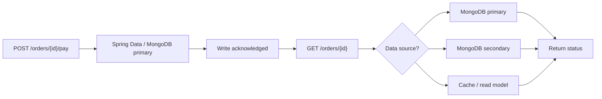
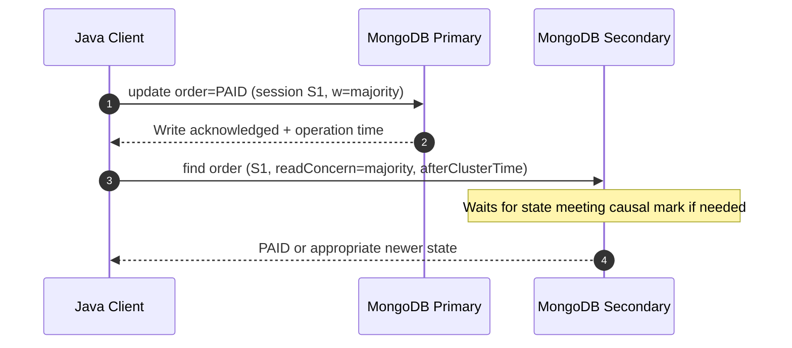
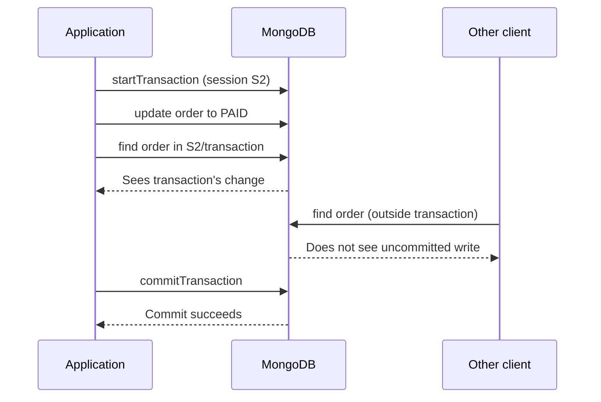

# Read-after-write and causal consistency

## 1. Scenario: write succeeds, yet the immediate read still sees the old value

An API in an order system updates an order's status from `PENDING` to `PAID`. MongoDB acknowledges the write command as successful. Immediately afterward, the application redirects to the order details page, yet the page still displays `PENDING` for a short time.

This can occur when **reading from a replica that has not yet applied the change**, rather than necessarily because `MongoTemplate.save(...)` or the repository write failed.

Suppose MongoDB is deployed as a replica set with one primary and two secondaries:

```text
Time          Primary            Secondary A          Secondary B
---------     ----------------   -------------------  -------------------
T0            order= PENDING     order= PENDING       order= PENDING
T1 write      order= PAID        order= PENDING       order= PENDING
T2 read       (update present)   (not yet applied)    (not yet applied)
T3            order= PAID        order= PAID          order= PENDING
T4            order= PAID        order= PAID          order= PAID
```

If the read at `T2` is routed to Secondary B, the client may receive `PENDING`. Switching to `secondaryPreferred` to reduce primary load **does not** automatically guarantee the data read is the latest.

The **read-after-write** (*read your writes*) business requirement states that after a write operation completes under the chosen acknowledgment conditions, subsequent reads in **the same causal chain of operations** must observe the effect of that write, or a newer state compatible with other changes.

This lesson belongs to the **Data Consistency** chapter of the **SPRING_DATA_MONGODB** module. We will work with Spring Data MongoDB, `MongoTemplate`, repositories, the MongoDB Java driver, session concepts, read/write concerns, read preferences, transactions, reactive access, testing, and performance diagnostics. The goal is to distinguish what is **guaranteed** from what merely **usually happens**, and to design a write–read flow that meets requirements.

## 2. Separating issues commonly lumped together as "consistency"

A complaint of "not seeing new data" can stem from several mechanisms:

| Question | Related mechanism | Scenario |
| --- | --- | --- |
| At what level did the server acknowledge the write? | **Write concern** | `w:1`, `w:"majority"` |
| On which node did the read execute? | **Read preference** | Primary, secondary, secondaryPreferred |
| What acknowledgment level must readable records satisfy? | **Read concern** | `local`, `majority`, `snapshot` |
| Are operations causally linked to one another? | **Client session** | Same session, sequential operations |
| Are other users making concurrent modifications? | **Concurrency control** | Optimistic locking, compare-and-set |
| Must multiple documents commit or roll back together? | **Transaction** | Money transfer between two accounts |
| Where is data being read outside MongoDB? | **Cache/search/read model** | Redis, Elasticsearch, CDN, analytics replica |

**Read-after-write is not synonymous with transactions; causal consistency is not synonymous with linearizability; read concern majority does not mean always reading the real-time latest value.** Each requirement must be expressed distinctly.

### 2.1. Two different kinds of freshness

- **Read-your-writes:** a client reading after its own write must not revert to a state prior to that write along the same causal relationship.
- **Read the latest globally:** a read must observe the most recently completed operation from **every client** in real-time order. This is a stronger requirement and generally relates to *linearizable reads* within an appropriate scope of operations.

A session ensuring reads observe data at least as recent as a required causal point **does not automatically promise** returning the final value across all clients system-wide.

### 2.2. A stale cache can mislead

If MongoDB reads correctly while a REST endpoint reads from Redis or an unrefreshed materialized view, adding a MongoDB session will **not synchronize the cache**.

Before tuning read concern, verify the read path:



If the actual read target is a cache or search index, design refresh/invalidation or consistency mechanisms for that layer itself.

## 3. Read preference: is the app reading primary or secondary?

MongoDB lets you select a suitable node for read operations, depending on topology and configuration:

| Read preference | General meaning | Freshness risk |
| --- | --- | --- |
| `primary` | Prefer reading from the primary | Reduces risk of secondary lag; still consider concern/failover |
| `primaryPreferred` | Primary when available, may read secondary when needed | Read source may switch when topology changes |
| `secondary` | Read only from an eligible secondary | Can encounter replication lag or timeouts |
| `secondaryPreferred` | Prefer secondary, fall back to primary | May read an older version right after a write |
| `nearest` | Select node by latency/suitable criteria | Lowest network latency node does not necessarily hold the newest data |

Reading from the primary right after a `w:1` write usually sees the just-completed write **provided the primary does not change and no rollback occurs**, yet this is not a durable guarantee across failovers or if reads route to another node.

### 3.1. readPreference example via the MongoDB Java driver

```java
import com.mongodb.ReadPreference;
import com.mongodb.client.MongoCollection;
import com.mongodb.client.MongoDatabase;
import org.bson.Document;

MongoDatabase database = mongoClient.getDatabase("app");

MongoCollection<Document> fromPrimary =
    database.getCollection("orders")
        .withReadPreference(ReadPreference.primary());

MongoCollection<Document> fromSecondary =
    database.getCollection("orders")
        .withReadPreference(ReadPreference.secondaryPreferred());
```

Both collection handles here point to the same logical collection with different read preferences. Neither configures read/write concerns or sessions, so **never treat calling `fromSecondary.find(...)` as guaranteeing read-after-write**.

### 3.2. Reading from secondaries is not a design flaw

Reading from secondaries can suit:

- Reports that tolerate lag.
- Content lookups with relaxed freshness needs.
- Heavy read workloads willing to trade freshness for load distribution.

If a business flow both writes and reads and requires **read your writes**, use a **causally consistent session + majority concerns**, or another strategy with verified guarantees.

## 4. Write concern: what does success mean?

**Write concern** determines the conditions MongoDB must satisfy before acknowledging a write command.

| Write concern | Meaning | Notes |
| --- | --- | --- |
| `w: 0` | Do not wait for server write acknowledgment | Unsuitable for confirming a write exists |
| `w: 1` | Primary acknowledges per operation rules | Risk of rollback if primary changes before majority durability |
| `w: "majority"` | Wait for acknowledgment from a majority of applicable data-bearing members | Increases durability; pair with read concern and session for causal guarantees |
| `j: true` | Request journaling per server capability/configuration | Relationship to majority journaling depends on deployment |
| `wtimeout` | Time limit for waiting on write concern condition | Timeout does not prove the operation rolled back |

Example:

```javascript
db.orders.updateOne(
  { _id: "order-101" },
  { $set: { state: "PAID" } },
  { writeConcern: { w: "majority", wtimeout: 5000 } }
);
```

This requests majority-level acknowledgment from MongoDB. However, **waiting for a majority does not force the specific secondary used by the next read to have applied the document yet**.

### 4.1. An important change starting in MongoDB 8.0

Starting in **MongoDB 8.0**, a majority write can be acknowledged once a majority of data-bearing members **durably write the oplog entry**, while **applying** the change to a secondary's local data copy can still proceed asynchronously.

Therefore, an acknowledged `w:"majority"` write **does not mean** a non-causal read from a secondary will immediately return the new document. MongoDB recommends using a **causally consistent session** when reading from a secondary and needing to see your own changes immediately.

This is another reason not to design read-after-write based solely on "we already wrote with majority."

### 4.2. Write concern timeout does not mean the document definitely does not exist

If a write hits `wtimeout`, the primary may already have applied the change while failing to meet the requested acknowledgment condition in time. The application must inspect the specific error, retryable writes eligibility, idempotency key, and business impact; **never blindly retry** balance deductions or duplicate event emissions.

A "write then read" flow should only proceed to read based on **write outcomes confirmed per policy**, not assumptions drawn from a timeout error.

## 5. Read concern: what level of data is visible?

Read concern controls **the consistency/durability level of returned data** per MongoDB mechanics.

| Read concern | Core meaning | Relation to read-after-write |
| --- | --- | --- |
| `local` | Reads from the node's local state, potentially including non-majority-committed changes | May be recent yet risks rollback; secondaries may lag |
| `majority` | Reads data acknowledged at the majority level | Key component of causal guarantees when combined with session + majority writes |
| `snapshot` | Reads from a consistent snapshot in supported operation contexts | Fits certain snapshot/transaction needs; does not inherently replace causal sessions |
| `linearizable` | Stronger read level for supported scope, in real-time order | Has specific conditions/topology/cost; does not replace all transactions |
| `available` | Prioritizes availability with weaker constraints | Not the choice for ensuring causal consistency |

Read concern **majority** on a secondary only guarantees returned data is part of the majority-committed state already applied by that node; it **does not automatically require** reaching a specific mark from a write just performed by another client.

### 5.1. Matching read/write concerns is insufficient without a session

Suppose:

```text
Write: w = "majority" -> succeeds
Read:  readConcern = "majority", secondaryPreferred
Yet write and read belong to two unrelated sessions
```

The read can return a majority-committed snapshot **older than the write mark**, because there is no causal constraint forcing the driver/server to wait. To establish "this read happens after my own write," use a causal session or deliberate propagation of causal markers.

### 5.2. Do not confuse readConcern with readPreference

These two lines govern two separate concerns:

```java
ReadConcern.MAJORITY          // Acknowledgment level of read data.
ReadPreference.secondary()    // Node selected for the read.
```

Neither setting **on its own** suffices for full causal guarantees.

## 6. What is causal consistency?

**Causal consistency** constrains the observed ordering between operations that have a cause-and-effect relationship. If operation B depends on the outcome of operation A, participants in that causal chain must not observe an ordering contradicting that relationship.

MongoDB documents four guarantees when using **causally consistent client sessions** with appropriate read/write concerns:

| Guarantee | Explanation | Example |
| --- | --- | --- |
| **Read your writes** | A read after a write sees the effect of that prior write | Pay and immediately read order status |
| **Monotonic reads** | Later reads never revert to an older version than earlier reads in the chain | Details page never jumps back from PAID to PENDING |
| **Monotonic writes** | Causally ordered writes are applied in that order | Write `CREATED` event before `CONFIRMED` |
| **Writes follow reads** | A write after a read is ordered after the read state causally | Read configuration then record a decision based on it |

To obtain **all four guarantees with data durability**, MongoDB requires:

1. Operations are issued within a **causally consistent session**.
2. **Read concern `"majority"`** for reads.
3. **Write concern `"majority"`** for writes.
4. Operations within the session execute **sequentially in the desired order**, never concurrently on the same session.

Do not treat `causallyConsistent(true)` as a magic switch that lets you ignore read/write concerns.

### 6.1. Diagram of an operation sequence



`afterClusterTime` is a logical time constraint used by the driver/server in causal session read operations. It **does not** mean client wall-clock time or a document's BSON Date `updatedAt`.

### 6.2. "Causal" does not mean "all operations depend on each other"

Two users editing two unrelated orders simultaneously have no automatic causal ordering between their operations. Causal consistency does not impose a **global real-time total order** across every object like a linearizable system.

Moreover, if another client overwrites the status after your write, a valid read can return that **newer** state. Causal consistency does not freeze a document so it forever returns the exact value you once wrote.

## 7. ClientSession and MongoDB logical timestamps

### 7.1. A session scopes a sequence of operations

MongoDB drivers support **client sessions**, binding read/write commands to one logical context. With causal consistency enabled, the driver exchanges cluster/operation time metadata so reads do not fall behind prior causally related writes or reads.

Java driver:

```java
import com.mongodb.ClientSessionOptions;
import com.mongodb.client.ClientSession;

try (ClientSession session = mongoClient.startSession(
        ClientSessionOptions.builder()
            .causallyConsistent(true)
            .build())) {
    // MongoDB operations must all use 'session'.
}
```

**Creating a session alone is not enough.** If a write uses an overload without passing `session`, or a Spring Data repository executes outside the session, those commands are not part of the causal chain being protected.

### 7.2. Operation time, cluster time, and afterClusterTime

- **Operation time** represents a logical timestamp associated with an observed operation.
- **Cluster time** tracks logical time progression exchanged between driver and server.
- **afterClusterTime** on read concern specifies that the read may proceed only once the node reaches the required causal point.

Logical time **cannot be replaced by `Instant.now()`** or a document's `createdAt`. Application instance clocks can drift, and `updatedAt` is mutable business data.

The driver normally handles propagating logical timestamps **within the same session**. Never hand-roll Java code adding `$gte: {updatedAt:...}` and claim it equals MongoDB causal consistency.

### 7.3. A session is not a transaction

A session can span multiple independent operations without **starting a multi-document transaction**.

```text
Session S1:
  update order-101
  read order-101
  read customer-201

Without a transaction:
  each command is processed individually;
  there is no shared commit/rollback across the chain.
```

A session protects **observation ordering**, not atomic all-or-nothing execution across the whole sequence like a transaction.

### 7.4. Do not use a session concurrently from multiple threads

The MongoDB Java driver `ClientSession` is not designed to be thread-safe for concurrent operations from two threads on one session. For deterministic causal ordering, **wait for the prior operation to complete** before starting the next.

In reactive applications, chain publishers sequentially using `then`/`flatMap` when dependencies exist; never fire two parallel operations on the same session expecting the driver to guess causal order.

## 8. Java driver example: majority write then majority read in one session

### 8.1. Environment setup

The example below assumes a MongoDB **replica set or deployment supporting sessions/majority concerns**, the synchronous Java driver, and MongoDB database `store`. Every read/write operation requiring causal consistency uses the same `ClientSession`.

```java
package example.consistency;

import com.mongodb.ClientSessionOptions;
import com.mongodb.ReadConcern;
import com.mongodb.ReadPreference;
import com.mongodb.WriteConcern;
import com.mongodb.client.ClientSession;
import com.mongodb.client.MongoClient;
import com.mongodb.client.MongoCollection;
import com.mongodb.client.MongoDatabase;
import com.mongodb.client.model.Filters;
import com.mongodb.client.model.Updates;
import org.bson.Document;

public final class ReadYourWritesExample {

    private ReadYourWritesExample() {}

    public static String payThenRead(
            MongoClient client,
            String orderId) {

        MongoDatabase db = client.getDatabase("store")
            .withReadConcern(ReadConcern.MAJORITY)
            .withWriteConcern(WriteConcern.MAJORITY)
            .withReadPreference(
                ReadPreference.secondaryPreferred()
            );

        MongoCollection<Document> orders =
            db.getCollection("orders");

        try (ClientSession session = client.startSession(
                ClientSessionOptions.builder()
                    .causallyConsistent(true)
                    .build())) {

            orders.updateOne(
                session,
                Filters.eq("_id", orderId),
                Updates.set("state", "PAID")
            );

            Document observed = orders.find(
                    session, Filters.eq("_id", orderId)
                ).first();

            if (observed == null) {
                throw new IllegalStateException(
                    "Order not found"
                );
            }
            return observed.getString("state");
        }
    }
}
```

Key takeaways:

1. `withWriteConcern(WriteConcern.MAJORITY)` applies to the write operation.
2. `withReadConcern(ReadConcern.MAJORITY)` applies to the read.
3. `secondaryPreferred` permits secondary reads while not forcing them; if no eligible secondary exists, it may fall back to primary.
4. `startSession(...causallyConsistent(true))` creates the causal context.
5. **Both `updateOne(session,...)` and `find(session,...)` pass the same session.**
6. `try-with-resources` closes the session once the sequence finishes.

**Additions needed in a production service:** check `UpdateResult.getMatchedCount()` and `getModifiedCount()`, validate update authorization, enforce valid state predicates, and handle concurrency. If the update query matches no document, read-after-write cannot make an unexecuted write "appear."

### 8.2. A version that handles write results more carefully

```java
var result = orders.updateOne(
    session,
    Filters.and(
        Filters.eq("_id", orderId),
        Filters.eq("tenantId", authorizedTenantId),
        Filters.eq("state", "PENDING")
    ),
    Updates.set("state", "PAID")
);

if (result.getMatchedCount() != 1) {
    throw new IllegalStateException(
        "Order missing, wrong tenant, or state already changed"
    );
}

Document observed = orders.find(
    session,
    Filters.and(
        Filters.eq("_id", orderId),
        Filters.eq("tenantId", authorizedTenantId)
    )
).first();
```

This snippet belongs **inside the try-with-resources block of Section 8.1**, with an already-authenticated `authorizedTenantId`. It adds a tenant predicate and `PENDING → PAID` transition guard to prevent modifying an unauthorized document.

A `matchedCount` of 1 does not guarantee the final state remains `PAID` forever: another client could update it to `CANCELLED` right afterward. To prevent lost updates, consider **optimistic locking**, conditional updates, or transactions depending on business invariants.

## 9. Java driver: why identical read/write concerns without a session can still fail

Compare two versions:

### 9.1. No causal relationship guaranteed

```java
orders.updateOne(
    Filters.eq("_id", orderId),
    Updates.set("state", "PAID")
);

// ClientSession not passed to find:
Document read = orders.find(
    Filters.eq("_id", orderId)
).first();
```

Even when the collection handle has `ReadConcern.MAJORITY` and `WriteConcern.MAJORITY`, a sessionless read on a secondary **has no causal context forcing it to observe the write above**. It may happen to succeed when the secondary catches up quickly, yet that is observed happenstance, not a causal guarantee.

### 9.2. Sharing a session with insufficient concerns

```java
try (ClientSession session = client.startSession(
        ClientSessionOptions.builder()
            .causallyConsistent(true)
            .build())) {
    // If operations actually use w:1 and readConcern local,
    // all four durable causal guarantees cannot be claimed.
}
```

A `causallyConsistent(true)` session is only **part of the requirement**. Particularly during failover, a `w:1` write can roll back, making durable "read your writes" impossible to guarantee.

### 9.3. Concerns + session, yet reading through a cache

```text
MongoDB majority write in session S1 -> succeeds
MongoDB majority read in S1 -> correct
GET /orders via un-invalidated Redis cache -> may be stale
```

MongoDB cannot constrain a Redis cache with `afterClusterTime`. You need an explicit cache policy.

## 10. Read-after-write via Spring Data MongoTemplate

### 10.1. Entity used in examples

```java
package example.consistency;

import org.springframework.data.mongodb.core.mapping.Document;
import org.springframework.data.mongodb.core.mapping.FieldType;
import org.springframework.data.mongodb.core.mapping.MongoId;

@Document(collection = "orders")
public record Order(
    @MongoId(FieldType.STRING) String id,
    String tenantId,
    String state,
    long totalCents
) {}
```

This record shows a minimal schema. In production, payment flows may involve events, idempotency, state checks, ledgers, and multiple documents; causal consistency does not replace that entire workflow.

### 10.2. MongoTemplate.withSession(session)

Spring Data MongoDB provides **`MongoOperations.withSession(ClientSession)`** returning an operations handle bound to an existing session.

```java
package example.consistency;

import com.mongodb.ClientSessionOptions;
import com.mongodb.client.ClientSession;
import com.mongodb.client.MongoClient;
import org.springframework.data.mongodb.core.MongoOperations;
import org.springframework.data.mongodb.core.MongoTemplate;
import org.springframework.data.mongodb.core.query.Criteria;
import org.springframework.data.mongodb.core.query.Query;
import org.springframework.data.mongodb.core.query.Update;
import org.springframework.stereotype.Service;

@Service
public class OrderConsistencyService {

    private final MongoClient client;
    private final MongoTemplate template;

    public OrderConsistencyService(
            MongoClient client,
            MongoTemplate template) {
        this.client = client;
        this.template = template;
    }

    public Order payAndRead(
            String authorizedTenantId,
            String orderId) {

        if (authorizedTenantId == null
                || authorizedTenantId.isBlank()) {
            throw new IllegalArgumentException(
                "Invalid tenantId"
            );
        }

        try (ClientSession session = client.startSession(
                ClientSessionOptions.builder()
                    .causallyConsistent(true)
                    .build())) {

            MongoOperations ops = template.withSession(session);

            var updateResult = ops.updateFirst(
                Query.query(
                    Criteria.where("id").is(orderId)
                        .and("tenantId").is(authorizedTenantId)
                        .and("state").is("PENDING")
                ),
                new Update().set("state", "PAID"),
                Order.class
            );

            if (updateResult.getMatchedCount() != 1) {
                throw new IllegalStateException(
                    "Unable to transition order state"
                );
            }

            return ops.findOne(
                Query.query(
                    Criteria.where("id").is(orderId)
                        .and("tenantId").is(authorizedTenantId)
                ),
                Order.class
            );
        }
    }
}
```

**Mandatory condition for claiming full causal guarantees:** `MongoClient`/`MongoTemplate` in this code must be configured with **majority write concern and majority read concern** for the actual operations. `withSession` only binds the session to commands; it **does not automatically elevate** the application's concerns to majority. If Spring Data uses a custom write concern resolver or per-operation read concern, verify the actual effective values.

### 10.3. One way to configure default majority on MongoClient

When the application constructs its own MongoDB Java client (instead of relying entirely on auto-configuration), you can configure:

```java
import com.mongodb.ConnectionString;
import com.mongodb.MongoClientSettings;
import com.mongodb.ReadConcern;
import com.mongodb.ReadPreference;
import com.mongodb.WriteConcern;
import com.mongodb.client.MongoClient;
import com.mongodb.client.MongoClients;

ConnectionString uri = new ConnectionString(
    "mongodb://host1:27017,host2:27017,host3:27017/"
        + "?replicaSet=rs0"
);

MongoClientSettings settings = MongoClientSettings.builder()
    .applyConnectionString(uri)
    .readConcern(ReadConcern.MAJORITY)
    .writeConcern(WriteConcern.MAJORITY)
    .readPreference(ReadPreference.secondaryPreferred())
    .build();

MongoClient client = MongoClients.create(settings);
```

Addresses `host1/host2/host3` are placeholders, **not** a real MongoDB deployment to copy verbatim. In Spring Boot production, the client should be managed as a **bean**, connection details/credentials belong in secure configuration, and services must use the exact client backing `MongoTemplate`.

Never create a new client per HTTP request. Clients are long-lived and reused, whereas **`ClientSession`** instances are created and closed per scope requiring causal ordering.

### 10.4. Do ordinary repositories automatically share the same session?

```java
repository.save(order);
Order reread = repository.findById(order.id()).orElseThrow();
```

These two method calls **do not implicitly** belong to an explicit causally consistent session with majority read/write concerns merely by sharing a repository object or request thread.

Repositories can participate in a Spring-managed session inside a configured **transaction**, yet a transaction is a different model; never assume two ordinary repository calls automatically achieve full causal guarantees when reading from a secondary.

When an explicit non-transactional causal session is needed, `MongoTemplate.withSession(session)` expresses that clearly. When multiple service layers access MongoDB, explicitly define **session scope** and prevent queries from escaping the session.

## 11. Same session, but what about different HTTP requests?

A real-world flow often looks like:

```text
POST /orders/101/pay  -> instance A, MongoDB write
HTTP 200/303           -> returned to browser
GET  /orders/101      -> instance B, MongoDB read
```

The two requests may run on different pods using **different `MongoClient`/`ClientSession` instances**. Simply enabling causal consistency on each pod's Java client **does not establish cross-request causal ordering** unless the causal mark is intentionally propagated or coordinated in a supported way.

### 11.1. Design alternatives

| Option | Best suited when | Limitations |
| --- | --- | --- |
| Return the updated entity/state directly in the write response | UI needs immediate display of just-updated results | Subsequent GETs via cache/secondary still need a policy |
| Read immediately in the same backend session with majority concerns | One use case performs write-then-read in one request | Session scope ends when the request finishes |
| Route the follow-up GET to primary with appropriate concerns | High freshness needed, avoiding secondary lag | Increases primary load; must still account for failover and guarantees |
| Propagate causal context/operation time across a dedicated application layer | System needs a causal chain across services/requests | Complex; requires security validation and strict driver semantics |
| Wait for read model/cache to reach expected version | Asynchronous CQRS/search/cache | Introduces latency, timeouts, versioning, and error contracts |

An advanced distributed-systems technique passes **`operationTime`/`clusterTime`** across causally linked sessions via driver methods like `advanceOperationTime`/`advanceClusterTime`. However, never accept raw timestamps from untrusted clients unconditionally: they represent cluster metadata requiring authentication/trust boundaries and deadlines. Use this only when you thoroughly understand driver/cluster behavior and test the internal protocol.

### 11.2. Protocol based on business version

When displayed data comes from a read model outside MongoDB directly:

```text
Write response:
  { "orderId": "101", "version": 12, "state": "PAID" }

Follow-up read:
  wait for or accept only records with version >= 12
  on timeout -> return "syncing" state or bounded retry
```

This is an **application-level strategy**, not built-in MongoDB causal consistency. It works especially well in event-driven systems, provided version increments, apply criteria, and timeout handling are clearly defined.

## 12. Read-your-writes is not synonymous with linearizable

### 12.1. Four levels to distinguish

| Requirement | What it actually states |
| --- | --- |
| Eventual consistency | If new updates stop and replication finishes, replicas may converge |
| Read-your-writes | A writer never observes an older version than its own completed write in a causal chain |
| Causal consistency | Preserves causal dependencies across reads/writes, including read-your-writes |
| Linearizability | Operations within guaranteed scope appear in a single order consistent with real-time order |

Read-your-writes does not stop another user from modifying state after you. If you write `state=PAID`, a refund process may update `state=REFUNDED` right afterward; a subsequent read returning `REFUNDED` **does not violate read-your-writes**.

### 12.2. When to consider linearizable reads?

Some decisions need the latest state of **a single document** at real-time boundaries, such as checking a concurrent decision flag. MongoDB offers `readConcern: "linearizable"` within its supported scope and conditions, typically reading from primary paired with matching write concerns.

However:

- Linearizable reads do not automatically create **multi-document transactions**.
- They can add latency and do not fit every workload.
- Under failover/network issues, proper timeouts/deadlines are essential.
- When the requirement is **lossless updates**, even a linearizable read does not replace compare-and-set or locking.

Avoid raising concern levels system-wide just to mask a concurrent-update bug.

## 13. Lost updates and optimistic locking are a different problem

Suppose two services both read `quantity=5`, compute new values locally, and `save` the entire document:

```text
Client A reads quantity=5
Client B reads quantity=5
Client A saves quantity=6
Client B saves quantity=6
Business expectation: 7; actual persisted value may be 6.
```

Even if A and B each read inside a causal session, **a lost update can still occur**. Causal consistency protects each session's observation ordering; it does not resolve write-write conflicts between two writers.

### 13.1. Using single-document atomic operations

```java
template.updateFirst(
    Query.query(
        Criteria.where("id").is(orderId)
            .and("tenantId").is(authorizedTenantId)
    ),
    new Update().inc("quantity", 1),
    Order.class
);
```

`$inc` executes atomically on a single document when the filter matches, avoiding the naive `read → quantity + 1 → save` pattern that causes simple lost updates. Note that the `Order` record above did not declare `quantity`; this is an **update pattern** meant for an entity containing a `quantity` field or matching schema, not code to run directly on the earlier `Order` example.

### 13.2. Using @Version to detect conflicts

```java
import org.springframework.data.annotation.Id;
import org.springframework.data.annotation.Version;
import org.springframework.data.mongodb.core.mapping.Document;

@Document("inventory")
public class InventoryItem {
    @Id
    private String id;
    private long quantity;
    @Version
    private Long version;

    // Application constructors/getters/setters.
}
```

With `@Version` and Spring Data MongoDB optimistic locking, saving an entity with a stale version can be rejected with `OptimisticLockingFailureException` instead of silently overwriting. To reliably detect write conflicts, use an **acknowledged write concern**, never unacknowledged writes.

**Comparison:** causal consistency governs *observation order*, `@Version` guards against *concurrent overwrites*, and transactions govern *multiple operations sharing commit/abort*.

## 14. Read-after-write and transactions

A MongoDB multi-document transaction establishes a **shared commit/abort boundary** across supported operations. Inside a transaction, reads on that session observe changes made by the transaction before commit, whereas external clients are prevented from seeing uncommitted changes under isolation rules.



### 14.1. When is a transaction needed?

Example transferring money between two accounts:

1. Debit balance A.
2. Credit balance B.
3. Insert transfer event.

If all three must succeed or roll back together, a causal session is insufficient; you need a **transaction** or a rigorously designed workflow/saga. After commit, read-after-write on other nodes still requires evaluating read preference and concerns.

### 14.2. Spring Data MongoTransactionManager

In synchronous Spring Data MongoDB, you can use `MongoTransactionManager` and `@Transactional` when the topology supports transactions:

```java
import org.springframework.context.annotation.Bean;
import org.springframework.context.annotation.Configuration;
import org.springframework.data.mongodb.MongoDatabaseFactory;
import org.springframework.data.mongodb.MongoTransactionManager;

@Configuration
public class MongoTransactionConfig {

    @Bean
    MongoTransactionManager transactionManager(
            MongoDatabaseFactory databaseFactory) {
        return new MongoTransactionManager(databaseFactory);
    }
}
```

Service:

```java
import org.springframework.stereotype.Service;
import org.springframework.transaction.annotation.Transactional;

@Service
public class PaymentWorkflow {

    private final MongoOperations mongo;

    public PaymentWorkflow(MongoOperations mongo) {
        this.mongo = mongo;
    }

    @Transactional
    public void applyPayment(/* validated input */) {
        // Multiple MongoOperations share the Spring-managed
        // transaction session within one transaction boundary.
        // Handle errors/retries per transaction rules.
    }
}
```

The snippet above illustrates **transaction configuration**, not a real payment implementation. Transactions require a supporting replica set/sharded deployment and appropriate error retries, session lifecycle management, commit semantics, execution duration limits, and resource bounds.

**Do not assume** every `@Transactional` automatically provides majority read concern for reads outside transactions; transactions define their own read/write concerns and commit policies.

## 15. Reactive: correct subscribe ordering is required for causal ordering

Reactive Spring Data MongoDB uses `ReactiveMongoTemplate` and `Flux`/`Mono`. A fundamental difference is that **operations do not run when constructing a Publisher**; they run upon subscription. Thus, **code declaration order** does not automatically equal **MongoDB command completion order**.

### 15.1. Wrong example: creating two independent publishers and running them concurrently

```java
Mono<UpdateResult> write = reactiveTemplate.updateFirst(
    query,
    update,
    Order.class
);

Mono<Order> read = reactiveTemplate.findOne(
    query,
    Order.class
);

// If combined in a way that subscribes to both concurrently:
// there is no guarantee the read runs after the write completes.
```

`Mono.zip(write, read)` typically creates two subscriptions that can overlap; it **does not** express "wait for write to finish, then read."

### 15.2. Expressing dependency with then

```java
Mono<Order> writeThenRead = reactiveTemplate
    .updateFirst(query, update, Order.class)
    .flatMap(result -> {
        if (result.getMatchedCount() != 1) {
            return Mono.error(new IllegalStateException(
                "Unable to update order"
            ));
        }
        return Mono.just(result);
    })
    .then(reactiveTemplate.findOne(query, Order.class));
```

This snippet ensures **Publisher ordering**: the read is subscribed after the update finishes successfully. Yet it **is not sufficient to claim causal consistency** unless both operations also share a causally consistent reactive session and majority concerns.

### 15.3. Reactive sessions and resource management

Spring Data supports session-aware operations in the reactive API. You must:

- Create a reactive `ClientSession` using the right driver/version API.
- Bind that session to **all operations** in the causal chain.
- Ensure commands sharing one session execute sequentially, never concurrently.
- Use `readConcern: majority` and `writeConcern: majority` for full guarantees.
- Close the session on completion, error, or cancellation; `usingWhen` is a suitable Reactor pattern when resource acquisition and cleanup APIs are available.

**Never reuse synchronous driver `com.mongodb.client.ClientSession` code with the reactive driver**, as the two session APIs are not interchangeable. Check your Spring Data / Reactive Streams driver version before implementing.

### 15.4. Reactive timeout does not replace server maxTimeMS

```java
Mono<Order> bounded =
    writeThenRead.timeout(Duration.ofSeconds(5));
```

This is an application-side Publisher timeout. It is not automatically equivalent to server `maxTimeMS`, nor does it roll back an already acknowledged write. When a client times out after write but before read, retry/idempotency handling must rely on persisted business state and known results.

## 16. Integration testing: test positive guarantees, not lucky timing

### 16.1. Test objectives

A reliable read-after-write test should:

1. Use a MongoDB replica set/sharded deployment supporting sessions.
2. Use one `ClientSession` with `causallyConsistent(true)`.
3. Configure majority read concern and majority write concern **explicitly**.
4. Write and then read **sequentially**.
5. Verify the write matched and assert the read value.
6. Isolate data using unique IDs/collections to avoid colliding with other tests.

Never write a test asserting "writing and immediately reading a secondary must return the old value"—replication lag is non-deterministic, and differences in MongoDB versions or server load will make such a test flaky.

### 16.2. JUnit 5 + MongoDB driver in @DataMongoTest

```java
package example.consistency;

import static com.mongodb.client.model.Filters.eq;
import static org.junit.jupiter.api.Assertions.*;

import com.mongodb.ClientSessionOptions;
import com.mongodb.ReadConcern;
import com.mongodb.ReadPreference;
import com.mongodb.WriteConcern;
import com.mongodb.client.ClientSession;
import com.mongodb.client.MongoClient;
import com.mongodb.client.MongoCollection;
import com.mongodb.client.MongoDatabase;
import java.util.UUID;
import org.bson.Document;
import org.junit.jupiter.api.Test;
import org.springframework.beans.factory.annotation.Autowired;
import org.springframework.boot.test.autoconfigure.data.mongo.DataMongoTest;
import org.springframework.data.mongodb.core.MongoTemplate;

@DataMongoTest
class CausalConsistencyIntegrationTest {

    @Autowired
    MongoClient client;

    @Autowired
    MongoTemplate template;

    @Test
    void majoritySessionReadsItsOwnNewlyInsertedDocument() {
        String collectionName = "causal_test_" +
            UUID.randomUUID().toString().replace("-", "");

        MongoDatabase adminDb = client
            .getDatabase(template.getDb().getName());
        adminDb.createCollection(collectionName);

        MongoCollection<Document> collection = adminDb
            .getCollection(collectionName)
            .withReadConcern(ReadConcern.MAJORITY)
            .withWriteConcern(WriteConcern.MAJORITY)
            .withReadPreference(
                ReadPreference.secondaryPreferred()
            );

        String id = "order-" + UUID.randomUUID();

        try {
            try (ClientSession session = client.startSession(
                    ClientSessionOptions.builder()
                        .causallyConsistent(true)
                        .build())) {

                collection.insertOne(
                    session,
                    new Document("_id", id)
                        .append("state", "PAID")
                        .append("tenantId", "test-tenant")
                );

                Document found = collection.find(
                    session, eq("_id", id)
                ).first();

                assertNotNull(found);
                assertEquals(
                    "PAID", found.getString("state")
                );
            }
        } finally {
            adminDb.getCollection(collectionName).drop();
        }
    }
}
```

**Test prerequisites:** `@DataMongoTest` does not automatically launch a MongoDB replica set. Testcontainers or a configured test replica set must actually support sessions and majority concerns. The test account needs privileges to create/drop collections.

This test verifies a **positive sequence** with the required concerns/session. It does not prove every sessionless secondary read will be stale; staleness is a phenomenon that can occur under lag, not an outcome you can reliably force with naive timing.

### 16.3. Testing update after insert stays ordered

Within the same session and the same majority-configured collection handle:

```java
collection.insertOne(
    session,
    new Document("_id", "test-101")
        .append("state", "PENDING")
);

collection.updateOne(
    session,
    eq("_id", "test-101"),
    new Document("$set",
        new Document("state", "PAID"))
);

Document observed = collection.find(
    session, eq("_id", "test-101")
).first();

assertNotNull(observed);
assertEquals("PAID", observed.getString("state"));
```

This snippet is **intended to sit inside a test that already created the session/collection**, not as a standalone test method. It verifies the insert → update → read sequence when each command awaits completion of the previous one.

### 16.4. Observing failover and secondary lag in an isolated environment

An advanced experiment:

1. Provision a multi-node replica set in an isolated environment.
2. Perform a majority write and a sessionless secondary read, recording results without requiring staleness.
3. Perform a majority write and a secondary read **within a causal session**, verifying read-your-writes.
4. Induce replication lag/failover using appropriate safe test tooling.
5. Measure latency and timeouts when the secondary has not yet reached the causal mark.
6. Ensure tests never run topology-disrupting actions on production.

The key distinction to observe: causal consistency may **wait** for the secondary to catch up or throw a timeout error, rather than returning stale data violating causal order.

## 17. Testing the Spring Data path, not only the raw driver

Driver tests verify server/driver semantics, yet an application using `MongoTemplate` must also prove **every call flows through session-bound operations**.

### 17.1. Service test example

```java
@DataMongoTest
@Import(OrderConsistencyService.class)
class OrderConsistencyServiceTest {

    @Autowired MongoTemplate template;
    @Autowired OrderConsistencyService service;

    @Test
    void writeThenReadWithinServiceSession() {
        String id = "order-" + UUID.randomUUID();
        String tenant = "tenant-" + UUID.randomUUID();

        template.insert(new Order(
            id, tenant, "PENDING", 1000L
        ));

        Order observed = service.payAndRead(tenant, id);

        assertNotNull(observed);
        assertEquals("PAID", observed.state());
    }
}
```

This assumes the Java imports (JUnit 5, `@DataMongoTest`, `@Import`, `MongoTemplate`, `UUID`) are added and **the test `MongoClient` has matching majority read/write concerns**, as in Section 10.3. Without controlling concerns, the test only verifies service ordering in one setup—it **does not prove full causal guarantees across every failover**.

### 17.2. Auditing queries that "escape" the session

An easy bug to introduce:

```java
try (ClientSession session = client.startSession(...)) {
    MongoOperations inSession = template.withSession(session);

    inSession.updateFirst(query, update, Order.class);

    // Wrong context: uses original template instead of inSession.
    Order result = template.findOne(query, Order.class);
}
```

This is a **diagnostic anti-pattern example** with session creation abbreviated as `...`, not copy-paste-runnable code. The final query **is not guaranteed to use the created session**, even inside the same Java method.

When code splits across repositories/services, audit how sessions are passed/bound and inspect actual commands to confirm the driver emits the same `lsid` and causal metadata. Never log full pipelines containing sensitive data in production.

## 18. Diagnosing broken read-after-write in production

### 18.1. Layered checklist

| Layer | Question to answer |
| --- | --- |
| API | Did the write truly complete successfully? Were there any timeouts? |
| Business | Did the update have `matchedCount=1`? Were tenant/transition predicates met? |
| Mongo write | What is the effective write concern? Any `wtimeout`/write concern error? |
| Mongo read | Which primary/secondary did read preference route to? |
| Read concern | Is it `local` or `majority`? |
| Session | Do the write and read share the same causally consistent session? |
| Ordering | Was the read subscribed/called after write completion, or run concurrently? |
| Topology | Is there replication lag, an election, a network partition, or a lagging node? |
| Concurrency | Did another client modify the document immediately afterward? |
| Cache | Did the response come from a cache/search index/read model? |
| Monitoring | Do actual commands include matching `lsid`/concerns? Are there driver errors? |

### 18.2. Distinguishing "did not match" from "not visible"

```java
UpdateResult result = collection.updateOne(
    session,
    Filters.and(
        Filters.eq("_id", id),
        Filters.eq("state", "PENDING")
    ),
    Updates.set("state", "PAID")
);

if (result.getMatchedCount() == 0) {
    // No document matched the update criteria:
    // do not blame replication lag.
}
```

When a conditional update matches nothing, there is no corresponding write for read-after-write to observe. The document may have changed status, belong to a different tenant, or have the wrong ID.

### 18.3. Never use Thread.sleep as a consistency mechanism

```java
repository.save(order);
Thread.sleep(500);
return repository.findById(order.id()).orElseThrow();
```

Since secondary lag varies under load, 500 ms might suffice on one day and fail during an election. `sleep` inflates latency and relies on **guessing replication progress**, not a causal constraint.

Use proper read/write concerns, sessions, or version mechanisms, and handle timeouts explicitly when requirements cannot be met within the time budget.

## 19. Four design scenarios and sound decisions

### 19.1. Payment API needing immediate readback

Requirement: a client just confirmed an order; the API returns the new status.

Technical recommendations:

1. Write with idempotency/conditional transition and check the result.
2. If re-reading MongoDB is needed, use the same causal session + majority concerns.
3. Alternatively, return the new state/version directly from the update outcome when the business contract permits.
4. If a subsequent GET hits a cache, implement invalidation or version-aware reads.

### 19.2. Daily reports tolerating brief lag

Requirement: end-of-day analytics, not strictly needing every order within the same second.

Use secondaries or read models with defined freshness targets and lag monitoring. There is no need to force majority causal sessions on every query when the business does not require it.

### 19.3. Concurrent inventory management

Requirement: two users placing orders must never over-deduct stock.

Read-your-writes is only **a small piece**. Use an atomic conditional update such as:

```java
Query query = Query.query(
    Criteria.where("sku").is(sku)
        .and("available").gte(requested)
);

Update update = new Update().inc(
    "available", -requested
);

UpdateResult result = template.updateFirst(
    query, update, Inventory.class
);
if (result.getModifiedCount() != 1) {
    // Insufficient stock or document no longer matches predicate.
}
```

`Inventory` is an illustrative entity with `sku` and `available`, distinct from `Order` in Section 10. MongoDB evaluates the predicate and applies the update atomically on **a single document**, protecting the invariant far better than reading quantity into Java and calling `save`.

### 19.4. Workflow requiring consistency across two collections

Requirement: inserting an order and inserting a payment ledger entry must **both succeed or both fail**.

This calls for a transaction or an event/outbox consistency workflow depending on system scope. A causal session does not automatically turn two separate inserts into an atomic commit.

## 20. Latency, availability, and throughput trade-offs

Stronger consistency is not free:

- `w:"majority"` may have to wait for replica set acknowledgments.
- `readConcern:"majority"` can incur different overhead than `local` depending on topology/commit state.
- Causal reads on secondaries may have to **wait for the secondary to catch up to the operation time**.
- During elections or network issues, operations may wait and time out rather than returning stale data.
- Routing many requests through sessions/strong concerns can increase latency and cluster load.

Conversely, weakening concerns purely to lower latency can break business contracts. Design explicit budgets:

| Data category | Typical requirement | Strategy to evaluate |
| --- | --- | --- |
| Payment confirmation | Must not show stale state after client's own write | Majority writes + causal reads, idempotency, and ledger |
| Just-edited profile page | UI must reflect user's own change | Return updated entity, causal read, or version-aware cache |
| View counter | Short lag acceptable | Eventual consistency / async aggregation |
| Quota/limit management | No lost updates, never exceed cap | Atomic conditional updates / optimistic locking |
| Large analytical reports | Prioritize throughput; accept delayed updates | Secondaries / read models with lag budget |

Benchmark every strategy on a realistic topology. Never apply one fixed read preference/concern across all screens without reviewing freshness requirements.

### 20.1. Timeouts and "uncertain whether the write succeeded"

A client may time out while waiting for majority acknowledgment. Afterward:

- The write may not have reached full acknowledgment.
- The write may have applied while the response was lost.
- Retrying may succeed, fail, or encounter an already-updated state.

For payment commands, use idempotency keys, transaction/ledger outcomes, and reconciliation. **Never treat a timeout as definite failure, nor treat it as definite success.**

## 21. Practice exercises

### Exercise 1 — Identify the read source

In a replica set with one primary and two secondaries, explain why `write w:1` followed by `read secondaryPreferred/local` can observe stale state. Propose three improvements and state the risks of each.

### Exercise 2 — Read/write concern and causal session

Run an integration test with `ClientSessionOptions.causallyConsistent(true)`, `WriteConcern.MAJORITY`, and `ReadConcern.MAJORITY`. Verify an insert followed by a read in the same session returns the newly written document. Remove the session and explain why you **must not** assert "must be stale" for the sessionless read.

### Exercise 3 — Observe operation time

Use command monitoring in a test environment to inspect `lsid` and read concern on MongoDB commands. Contrast `operationTime`/`clusterTime`/`afterClusterTime` with an application-set BSON Date `createdAt` field.

### Exercise 4 — Reactive ordering

Write a `ReactiveMongoTemplate` update followed by a find. Compare `Mono.zip(write, read)` with `write.then(read)`. Then bind a reactive session matching your driver version and majority concerns. Explain why reactive pipeline order alone **is insufficient** if concerns/sessions are missing.

### Exercise 5 — Two HTTP requests

Design `POST /orders/pay` and `GET /orders/{id}` running across two pods, reading from secondaries and a cache. Describe returning the new version in the response, waiting for a read model to reach that version, timeouts, and handling an unrefreshed cache.

### Exercise 6 — Concurrent updates

Have two clients both read `quantity=5` and both `save quantity=6`. Prove a causal session does not prevent lost updates. Rewrite using `$inc` or `@Version` and verify the invariant holds.

### Exercise 7 — Transactions and causal consistency

Describe transferring money across two account documents. Identify which part requires a multi-document transaction and which part needs read-after-write after commit when reading from secondaries. Compare rollback handling, write concern, and response timeouts.

### Exercise 8 — Secondary lag and non-flaky testing

In a controlled test replica set, introduce lag and compare sessionless reads vs. causal reads. Never hardcode `Thread.sleep` to "ensure the secondary caught up." Measure timing, bound wait budgets, and explain timeout behavior vs. reading stale data.

### Self-check questions

- How does read-after-write differ from read-latest-globally?
- Does `ReadPreference.secondaryPreferred()` guarantee reading the latest value?
- Why does `w:"majority"` not mean secondaries have immediately applied the document at acknowledgment time, especially from MongoDB 8.0 onward?
- Does `readConcern:"majority"` alone know about a prior client's write mark?
- What are the four causal consistency guarantees?
- Which read/write concerns are required for full durability-backed causal guarantees?
- Why must the same `ClientSession` be passed to both write and read?
- Is `afterClusterTime` an application-assigned `updatedAt` timestamp?
- Does a causal session create a multi-document transaction?
- Why can a GET through a cache still be stale even when MongoDB causal reads are correct?
- Why doesn't `MongoTemplate.withSession(session)` automatically raise concerns to majority?
- When should `@Version`/`$inc` be used instead of relying on read-your-writes?
- Why is `Mono.zip(write, read)` wrong for ensuring write-then-read order?
- Why is a write timeout insufficient to prove the write failed?
- When do you need a transaction instead of causal consistency?

## Key takeaways

**Read-after-write** ensures a causally linked sequence of operations observes the effects of its own completed writes, though not necessarily the latest global value from every client. In a **MongoDB replica set**, secondary reads can return stale data due to replication lag; even an acknowledged majority write does not create causality for a sessionless read. For **full durability-backed causal guarantees**, use a **causally consistent `ClientSession`**, **`WriteConcern.MAJORITY`**, **`ReadConcern.MAJORITY`**, and **sequential commands in the same session**. With **Spring Data MongoDB**, `MongoTemplate.withSession(session)` attaches a session, yet the application must still ensure effective concerns and audit every read/write path. Causal consistency is distinct from transactions, optimistic locking, linearizable reads, and cache invalidation; pick the right tool for **observation order, atomicity, concurrent-update protection, and read-model freshness**. Test against a real replica set and monitor runtime behavior instead of relying on `Thread.sleep` or lucky runs with zero replication lag.

## References

- [MongoDB Manual — Causal Consistency and Read/Write Concerns](https://www.mongodb.com/docs/manual/core/causal-consistency-read-write-concerns/)
- [MongoDB Manual — Read Isolation, Consistency, and Recency](https://www.mongodb.com/docs/manual/core/read-isolation-consistency-recency/)
- [MongoDB Manual — Write Concern](https://www.mongodb.com/docs/manual/reference/write-concern/)
- [MongoDB Manual — Read Concern](https://www.mongodb.com/docs/manual/reference/read-concern/)
- [MongoDB Manual — Read Preference](https://www.mongodb.com/docs/manual/core/read-preference/)
- [MongoDB Manual — Client Sessions](https://www.mongodb.com/docs/manual/reference/method/Session/)
- [MongoDB Java Sync Driver — Causal Consistency](https://www.mongodb.com/docs/drivers/java/sync/current/crud/transactions/causal-consistency/)
- [Spring Data MongoDB Reference — Client Sessions](https://docs.spring.io/spring-data/mongodb/reference/mongodb/client-session-transactions.html)
- [Spring Data MongoDB API — MongoOperations.withSession](https://docs.spring.io/spring-data/mongodb/reference/api/java/org/springframework/data/mongodb/core/MongoOperations.html)
- [Spring Data MongoDB Reference — Optimistic Locking](https://docs.spring.io/spring-data/mongodb/reference/mongodb/template-crud-operations.html)
