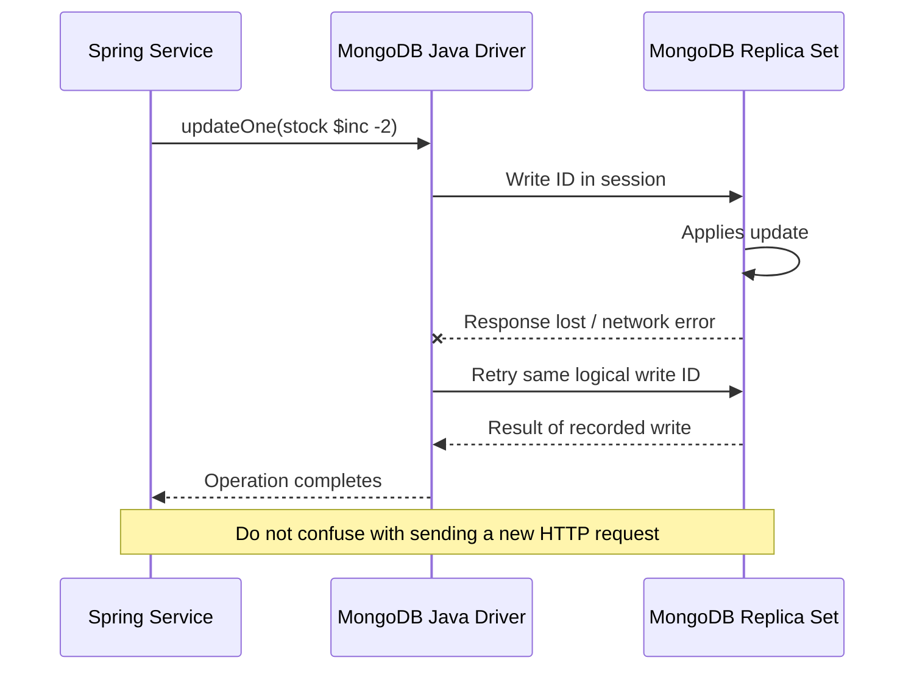
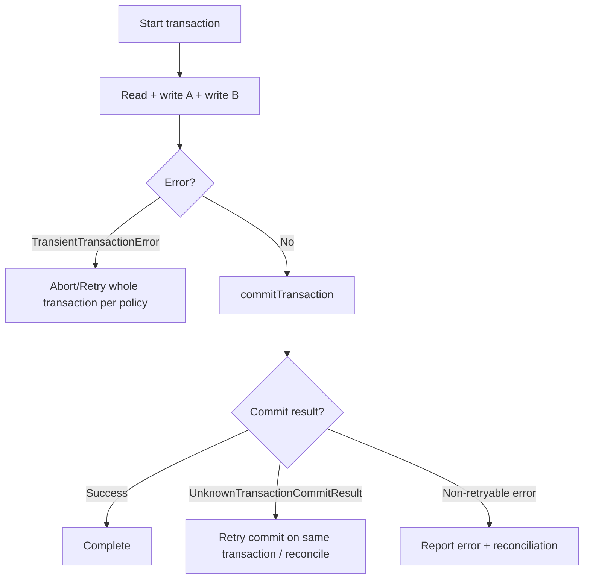

# Retryable reads, retryable writes, and support conditions

In **Spring Data MongoDB**, a request can send a command successfully to MongoDB and then lose connectivity before receiving the response. At that moment, the application typically cannot immediately tell **whether the server executed the command or not**. The MongoDB Java Driver offers two mechanisms to recover from certain transient failures:

- **Retryable reads**: the driver retries **certain read commands** upon eligible network or server errors.
- **Retryable writes**: the driver retries **certain write commands** carrying operation identity metadata so the server can avoid re-applying a write already recorded within that retryable session.
- These are **driver/command-level retries**, **not** retries of the entire HTTP request, the whole service method, or individual operations inside a MongoDB transaction.

This lesson belongs to the **Data Consistency** chapter of the **SPRING_DATA_MONGODB** module. The module uses Spring Data MongoDB to connect, map documents, and operate via `MongoTemplate` or repositories; it also practices queries, aggregations, indexes, transactions, reactive access, testing, and data diagnostics. The focus here is on **supported retry conditions, practical configuration, consistency limits, and handling uncertain write outcomes**.

One overarching principle: **retryable does not mean business-level exactly-once**. A database command retried by the driver has its own deduplication protocol, yet having an API or message consumer **re-run the whole processing flow** still requires idempotency, guards, and reconciliation.

## 1. Scenario: connection drops right after a write

Suppose the system has an `inventory_items` collection:

```javascript
{
  _id: ObjectId("674000000000000000005001"),
  tenant_id: "T1",
  sku: "KB-001",
  stock: 10,
  updated_at: ISODate("2026-11-20T02:00:00Z")
}
```

The application sends a command to allocate two items:

```javascript
db.inventory_items.updateOne(
  {
    _id: ObjectId("674000000000000000005001"),
    tenant_id: "T1",
    stock: { $gte: 2 }
  },
  { $inc: { stock: -2 } }
);
```

Three scenarios can look identical from the client side: **timeout/connection loss**.

1. The command never reached the server: `stock` is still 10.
2. The command reached the server and succeeded, but the response was lost: `stock` is 8.
3. The server received the command and hit an error before completion: state depends on failure timing and write mechanics.

If the client **sends a brand-new command** merely because "no response arrived," scenario 2 can drop `stock` from 8 to 6. When the MongoDB driver executes an **eligible retryable write**, it preserves the logical write identity, helping the server recognize a previously recorded execution and avoid applying it again.



This diagram illustrates **an eligible retryable write**, not a promise that every error is recoverable or every server/version supports it.

## 2. Three retry tiers to distinguish

| Tier | Who performs it? | Unit retried | Conditions for correctness |
| --- | --- | --- | --- |
| **Driver retry** | MongoDB Java Driver | A single supported MongoDB read/write command | `retryReads`/`retryWrites`, topology, driver/server, eligible error |
| **Transaction retry** | Transaction helper or designed service layer | Entire transaction or commit only when appropriate | Error labels, transaction API, handling side effects |
| **Business retry** | HTTP client, queue consumer, scheduler, service | Entire request/business workflow | Idempotency key, unique constraints, business state |

`retryWrites=true` only means the driver may retry **eligible write commands**. It **does not** stop a webhook from firing twice, a job from re-running, or a controller from being called twice with a new `requestId`.

Similarly, `retryReads=true` does not guarantee that a retried read returns **the exact same snapshot as the first attempt**: underlying data can change between attempts, especially with secondary read preferences.

## 3. Conceptual mechanism for identifying retryable writes

For eligible retryable writes, the driver and server exchange metadata tied to a **logical session** and a **transaction number**; within batches, **statement** identity is also tracked:

```text
Logical Session ID (lsid)
      +
Transaction Number (txnNumber)
      +
Statement identity (when needed)
      |
      v
Server recognizes a retry of the same logical write
```

When a prior attempt **was already recorded**, the server can return the operation result without applying `$inc` a second time. This creates a sharp distinction between:

- **Driver retrying the same logical write**: uses session/transaction metadata per the MongoDB retryable-write protocol.
- **Application calling `updateOne(...)` again as a new operation**: the driver assigns a different logical write identity; MongoDB has no way to know it represents the same already-processed business action.

Never manually assign `txnNumber` or simulate retries by constructing raw commands lacking the session protocol. Let the MongoDB driver manage that, and reserve **`requestId`/idempotency keys** for the business layer.

**Limitation:** server-retained session/statement history does not last forever. If a client disconnects for a very long time or the session expires, deduplication assumptions for a logical retry may change. Never turn retryable writes into a claim of "every command is lifetime exactly-once."

## 4. How retryable reads and retryable writes differ

| Aspect | Retryable reads | Retryable writes |
| --- | --- | --- |
| Operations | `find`, `countDocuments`, `distinct`, **non-writing** aggregations, … | `insertOne`, `updateOne`, `replaceOne`, `deleteOne`, certain bulk ops, … |
| Connection flag | `retryReads=true` | `retryWrites=true` |
| Goal | Retry reads on transient network/election errors | Retry writes with metadata preventing duplicate execution in the session |
| Effect on retry | May observe newer/different data if source changed | Must re-identify **the same statement** when eligible |
| Excluded | `getMore`, generic `runCommand`, aggregations with write stages, … | `updateMany`, `deleteMany`, multi-write bulk ops, `$merge`/`$out` |
| Needs acknowledged write concern | Not applicable | **Yes**, `w:0` is ineligible |
| Transactions | Follow applicable read/transaction rules | Writes **inside a transaction are not retried individually** |
| Prolonged failures | Retrying does not replace durable error handling | Retrying does not replace idempotency and reconciliation |

This table covers **the primary cases**, not a promise that every overload/API variant is supported. Newer driver/server releases may introduce rules, so check docs for your exact running version.

## 5. Support conditions for retryable writes

According to the MongoDB Manual, retryable writes require:

1. **Deployment topology**: replica set or sharded cluster; **standalone `mongod` is not supported**.
2. **Storage engine** with document-level locking, such as WiredTiger.
3. **Server** supporting retryable writes (MongoDB **3.6+**, plus matching `featureCompatibilityVersion` in legacy deployments).
4. **Driver** supporting retryable writes.
5. **Acknowledged write concern**: `{w:0}` has no acknowledgment result and is not retryable.
6. **Operation on the eligible list**, not `updateMany` or arbitrary database commands.
7. **Eligible error** for retry; validation, duplicate key, or authorization errors are generally not cured by network retries.
8. **Appropriate session and driver settings**, without calling driver APIs in ways that omit required metadata.

Setting `retryWrites=true` against standalone MongoDB **does not turn standalone into a replica set**. Thus, tests running on standalone MongoDB can behave differently from production replica sets; never assume "config enabled with no error" means retry paths were actually exercised.

### Summary compatibility matrix

| Environment | Retryable writes | Notes |
| --- | --- | --- |
| Standalone `mongod` | **Not supported** | CRUD works, but without retryable-write protocol guarantees |
| Single-node replica set | **Supported** | Often suitable for retry/transaction integration tests |
| Multi-node replica set | **Yes**, if other conditions hold | Failovers can trigger transient errors |
| Sharded cluster | **Yes**, if other conditions hold | Routing, shard keys, and server version still matter |
| Write concern `w:0` | **No** | Unacknowledged |
| Active MongoDB transaction | Does not retry **individual writes** | Commit/abort follow separate retry rules |
| Multi-document update/delete | Not part of default retryable writes | Use dedicated idempotency or transaction strategies |

## 6. Support conditions for retryable reads

Modern MongoDB drivers support retryable reads for designated operations and enable `retryReads` by default. Current MongoDB Manual **9.0** documentation lists **server 6.0+** as required for retryable reads; on older server/driver stacks, consult **the matching version branch documentation** rather than inferring from the retryable writes matrix.

General conditions:

- Driver supports `retryReads` and the flag is enabled.
- Operation is in the eligible retry list.
- Error is transient and retryable, not an application or malformed-query error.
- A server matching the original **read preference** is found after server selection; otherwise, the driver may error.
- Timeouts, topology, and resources permit re-execution.
- Some commands/cursors do not support retries during subsequent batch reads.

**Never equate retryable reads with read concern `majority`.** Retrying addresses interrupted execution transport; read concern governs what data state is readable. For "latest data," "read your own writes," or "consistent snapshot," design read preference, read concern, and sessions properly.

## 7. What does the Java Driver enable by default?

In current MongoDB Java Driver releases, both `retryReads` and `retryWrites` **default to `true`**. The MongoDB Manual notes that drivers compatible with MongoDB 4.2+ enable retryable writes by default; older drivers may require opting in.

You do not have to declare both flags in every URI if you rely on driver defaults, yet **explicit configuration** can keep environments clear:

```text
mongodb://mongo1:27017,mongo2:27017,mongo3:27017/shop
    ?replicaSet=rs0
    &retryReads=true
    &retryWrites=true
    &w=majority
```

The URI above is **wrapped across multiple lines for readability**. Real URIs must be on **one line**, using real hostnames, authentication, and TLS. `w=majority` is a separate write concern choice for durability, **not a prerequisite** for retryable writes (acknowledged `w:1` can also qualify).

In production, never hardcode passwords or tokens in source code or URI logs. Use a secret manager or environment configuration.

## 8. Spring Boot configuration: share the Spring-managed MongoClient

In Spring Boot versions supporting `spring.data.mongodb.uri`, configure:

```yaml
spring:
  data:
    mongodb:
      uri: "mongodb://mongo1:27017,mongo2:27017/shop?replicaSet=rs0&retryReads=true&retryWrites=true&w=majority"
```

Property names and auto-configuration can change across Spring Boot releases (especially major upgrades), so verify against **your actual version** and the running `MongoClient` bean.

**Correct practice:** configure a **Spring-managed `MongoClient`** shared across `MongoTemplate`, repositories, and `MongoTransactionManager` if present. Never spin up an ad-hoc `MongoClient` inside a repository fragment assuming it shares the same sessions, timeouts, and retry settings.

To disable retries for testing or working around a deployment constraint:

```text
mongodb://mongo1:27017/shop?retryReads=false&retryWrites=false
```

Disabling retries is an intentional operational decision: it does not fix data errors, abnormal timeouts, or missing idempotency. It usually exposes transient network failures **to the application sooner**.

## 9. Direct configuration with MongoClientSettings

Without Spring Boot auto-config, the MongoDB Java Sync Driver provides:

```java
import com.mongodb.ConnectionString;
import com.mongodb.MongoClientSettings;
import com.mongodb.client.MongoClient;
import com.mongodb.client.MongoClients;

ConnectionString connectionString = new ConnectionString(
    "mongodb://localhost:27017/shop?replicaSet=rs0"
);

MongoClientSettings settings = MongoClientSettings.builder()
    .applyConnectionString(connectionString)
    .retryReads(true)
    .retryWrites(true)
    .build();

try (MongoClient client = MongoClients.create(settings)) {
    // Use client to invoke driver APIs.
}
```

This is a **standalone driver** example, not guidance to build a fresh `MongoClient` inside every Spring service method. Under Spring Data, keep a single configured `MongoClient` bean managed by Spring and shared across repository/template infrastructure.

If your app customizes `MongoClientSettings` via a Spring Boot customizer, verify bean registration for your Boot version. What matters is the **effective settings on the `MongoClient` Spring actually uses**, not an unused builder sitting somewhere uninvoked.

## 10. Retryable read operations: common APIs

Per the MongoDB Manual, eligible read operations include:

| Driver-level operation | Spring Data equivalent example | Notes |
| --- | --- | --- |
| `Collection.find` | `repository.findById`, `MongoTemplate.find` | Retries the initial read command on eligible errors |
| `Collection.countDocuments` | `MongoTemplate.count` | May use internal aggregation depending on driver |
| `Collection.distinct` | `MongoTemplate.query(...).distinct(...)` where supported | Verify the underlying driver method emitted |
| `Collection.aggregate` | `MongoTemplate.aggregate` with **non-writing** pipeline | `$merge` and `$out` do not count as retryable reads |
| `Database.aggregate` | Certain database-level aggregations | Non-writing pipelines only |
| `listCollections` / `listIndexes` | Metadata operations | Eligible on supported driver helpers |
| `watch` | Change streams | Has its own change-stream retry/resume mechanism |
| `find` backing GridFS downloads | Portion of GridFS APIs | Stream reads must still handle mid-stream disconnects |

**Distinction:** a single `MongoTemplate` API call may emit **multiple MongoDB commands** or paginate via cursors. Never claim "the entire service call is retried cleanly once" simply because an underlying initial read supports retries.

## 11. Why `getMore` is not retried like `find`

A cursor may receive data across multiple batches:

```text
find() -> first batch -> cursorId
       -> getMore() batch 2
       -> getMore() batch 3
       -> ...
```

The MongoDB Manual lists **`getMore` as an operation that does not support retryable reads**. If the first batch succeeded and a subsequent `getMore` loses connection, the driver does not simply resend `getMore` as an ordinary retryable read.

Consequences when streaming many documents:

- A mid-stream network error can cause **iteration to fail** after the app already processed earlier batches.
- Never blindly restart `findAll()` and append to the previous file/batch without deduplication.
- When resuming is needed, design around a stable key such as `_id` plus matching sort order, saving checkpoints and filtering `_id > lastSeen` when business semantics permit.
- For queries with complex filters or sorts, a single `_id` checkpoint may be **insufficient**; include the full sort keys and tie-breakers.
- For **change streams**, the driver supports change-stream **resume tokens**, which differ from standard `getMore` retries.

### Example: keyset-paginated read with an application checkpoint

```java
// Concept only, not a universal cursor-resume solution:
Query next = Query.query(
    Criteria.where("tenantId").is(tenant)
        .and("id").gt(lastSeenId)
);
next.with(Sort.by(Sort.Direction.ASC, "id"));
next.limit(500);

List<InventoryItem> items =
    mongoTemplate.find(next, InventoryItem.class);
```

This works only when processing sequentially by `_id` and filters do not disturb the intended ordering. Against a live dataset with concurrent inserts/deletes, it does not provide an immutable snapshot; if a fixed snapshot is required, use an appropriate consistency mechanism.

## 12. Read commands lacking retryable-read protection

Remember specifically:

- `getMore` (reading subsequent cursor batches).
- Generic `Database.runCommand`/driver helpers not recognized as standard read operations.
- `mapReduce` under cases listed in the MongoDB Manual.
- Aggregations containing write stages such as `$out` or `$merge`.
- Custom/native commands executed outside standard read helpers.

`retryReads=true` does not mean every `db.runCommand(...)` is retried by the driver. If a service executes a native command via `MongoTemplate.executeCommand(...)`, do not assume it shares `find`'s retry semantics.

## 13. Retryable write operations: baseline list

With an acknowledged write concern and a supporting topology, the MongoDB Manual lists:

| Operation | Retryable write? | Notes |
| --- | --- | --- |
| `insertOne` | **Yes** | Uses write identity; does not resolve business duplicate keys |
| `insertMany` | **Yes**, per eligible batch | Partial writes may exist upon failure |
| `updateOne` | **Yes** | Includes single-document `$set`, `$inc` |
| `replaceOne` | **Yes** | Can still cause lost updates if replacing from a stale entity |
| `deleteOne` | **Yes** | Deletes a single document only |
| `findOneAndUpdate` | **Yes** | Updates one document; can return before/after image |
| `findOneAndReplace` | **Yes** | Similar retryable write behavior |
| `findOneAndDelete` | **Yes** | Deletes one document |
| `findAndModify` | **Yes** | Single-document family |
| `updateMany` | **No** | Multi-document updates are not auto-retried under this protocol |
| `deleteMany` | **No** | Same |
| `$merge`/`$out` in aggregate | **No** | Aggregations with write stages are not retryable-write commands |

Being **eligible** does not mean every invocation is retried in all circumstances. The driver also checks error type, acknowledged write concern, topology, session, and transaction context.

`MongoRepository.save(entity)` typically delegates to an underlying insert/replace, yet if application-level callbacks or services re-run, callbacks and external side effects **do not automatically gain exactly-once guarantees** from retryable writes.

## 14. Bulk writes: only batches free of multi-document operations

A bulk operation can mix multiple write models:

```java
import java.util.List;
import static com.mongodb.client.model.Filters.eq;
import static com.mongodb.client.model.Updates.inc;

import com.mongodb.client.model.InsertOneModel;
import com.mongodb.client.model.UpdateOneModel;
import com.mongodb.client.model.DeleteOneModel;
import com.mongodb.client.model.WriteModel;
import org.bson.Document;

List<WriteModel<Document>> operations = List.of(
    new InsertOneModel<>(new Document(
        "_id", "movement-1001"
    ).append("tenant_id", "T1")),
    new UpdateOneModel<>(
        eq("_id", "inventory-1"), inc("stock", -2)
    ),
    new DeleteOneModel<>(
        eq("_id", "expired-temp-1")
    )
);

collection.bulkWrite(operations);
```

`collection` is a `MongoCollection<Document>` from a configured `MongoClient`. This snippet only demonstrates **operation types**: do not ship it to production as an inventory allocation workflow, because the three writes **do not automatically share a transaction**, and purging old audit records needs its own policy.

If a bulk batch contains only `insertOne`, `updateOne`, `replaceOne`, and `deleteOne`, its underlying **write commands** can qualify for retry. If a batch/command includes `updateMany` or `deleteMany`, that command **loses retryable-write protection**. Because the driver may split a large bulk request into multiple commands, evaluate **each command** rather than assuming from the `bulkWrite` method name.

**Ordered/unordered does not replace retryability** and **does not make the bulk call atomic**. A batch can persist a subset of records before failing.

## 15. Spring Data example: updateFirst qualifies, updateMulti does not

Entity:

```java
import org.bson.types.ObjectId;
import org.springframework.data.annotation.Id;
import org.springframework.data.mongodb.core.mapping.Document;
import org.springframework.data.mongodb.core.mapping.Field;

@Document(collection = "inventory_items")
public class InventoryItem {
    @Id
    private ObjectId id;

    @Field("tenant_id")
    private String tenantId;

    private String sku;

    private long stock;

    public InventoryItem() {}

    public InventoryItem(
            ObjectId id, String tenantId, String sku, long stock) {
        this.id = id;
        this.tenantId = tenantId;
        this.sku = sku;
        this.stock = stock;
    }

    public ObjectId getId() { return id; }
    public String getTenantId() { return tenantId; }
    public String getSku() { return sku; }
    public long getStock() { return stock; }
}
```

Updating one document:

```java
import com.mongodb.client.result.UpdateResult;
import org.springframework.data.mongodb.core.MongoOperations;
import org.springframework.data.mongodb.core.query.Criteria;
import org.springframework.data.mongodb.core.query.Query;
import org.springframework.data.mongodb.core.query.Update;

public boolean allocateTwo(
        MongoOperations operations,
        ObjectId id,
        String authorizedTenant) {

    Query filter = Query.query(
        Criteria.where("id").is(id)
            .and("tenantId").is(authorizedTenant)
            .and("stock").gte(2)
    );

    Update decrement = new Update().inc("stock", -2);

    UpdateResult result = operations.updateFirst(
        filter, decrement, InventoryItem.class
    );
    return result.getMatchedCount() == 1;
}
```

`MongoOperations.updateFirst(...)` maps to a single-document update, so **the underlying operation can qualify as a retryable write** when client/server/write-concern requirements are met.

By contrast:

```java
// May update multiple documents:
operations.updateMulti(
    Query.query(Criteria.where("tenantId").is(authorizedTenant)),
    new Update().set("status", "REVIEW"),
    InventoryItem.class
);
```

This is a **multi-document update**, excluded from the default retryable-write protocol even when `retryWrites=true`. This snippet illustrates API category; the sample entity has no `status` property and must not be run as a real migration without adding the field and mapping.

**Neither is a transaction.** `updateFirst` is atomic only on the matched document; other commands in the same service method do not commit or roll back with it.

## 16. Driver retries do not make an HTTP request idempotent

A single request often performs several actions:

```text
HTTP POST /stock/allocate
   |
   +-- validate request
   +-- read inventory
   +-- updateOne(stock -2)
   +-- insert audit movement
   +-- publish Kafka event / send email
   +-- return HTTP response
```

Suppose `updateOne` alone is safely retried by the driver. That **does not mean**:

- `insert audit` definitely commits alongside the stock update.
- The Kafka event is published strictly once.
- A client re-sending `POST` will not deduct stock again.
- Re-running the service method with `@Retryable` is safe.
- A redelivered queue message will skip an already-processed event.

Driver retry is a technical mechanism **within a single database operation**. Business idempotency is a contract **across multiple business invocations**, usually requiring a stable request ID, unique constraints, persisted state receipts, and sometimes transactions/outbox patterns.

## 17. Why retryable `$inc` does not mean you can retry manually

MongoDB `$inc` is atomic, yet addition/subtraction itself is **not idempotent**:

```javascript
// Starting from stock = 10:
db.inventory_items.updateOne(
  { _id: itemId },
  { $inc: { stock: -2 } }
); // stock 8

// This is a NEW command, NOT a driver retry of the same statement:
db.inventory_items.updateOne(
  { _id: itemId },
  { $inc: { stock: -2 } }
); // stock 6
```

When the retryable-write protocol is active and the driver retries **the exact same command**, the server uses logical session/transaction metadata to prevent unintended re-application under supported conditions. Yet if the service or user **executes a fresh command**, deducting again is the exact expected behavior of `$inc`.

Thus, designing **"allocate 2 items for requestId X"** requires a **recorded receipt proving X was processed**, not merely `retryWrites=true`.

## 18. Designing an idempotency key for stock allocation

A practical design includes:

- Collection `inventory_items` holding `stock`.
- Collection `stock_movements` storing `tenant_id`, `request_id`, `item_id`, `quantity`.
- Unique index `{tenant_id:1,request_id:1}`.
- A MongoDB transaction wrapping **insert movement + decrement stock** whenever both documents/collections must succeed together.

Index:

```javascript
db.stock_movements.createIndex(
  { tenant_id: 1, request_id: 1 },
  {
    unique: true,
    name: "ux_stock_movement_tenant_request"
  }
);
```

Movement document:

```javascript
{
  _id: ObjectId("674000000000000000005101"),
  tenant_id: "T1",
  request_id: "allocate-2026-001",
  item_id: ObjectId("674000000000000000005001"),
  quantity: NumberLong("2")
}
```

Additional Java DTO/entity example:

```java
import org.bson.types.ObjectId;
import org.springframework.data.annotation.Id;
import org.springframework.data.mongodb.core.index.CompoundIndex;
import org.springframework.data.mongodb.core.mapping.Document;
import org.springframework.data.mongodb.core.mapping.Field;

@Document("stock_movements")
@CompoundIndex(
    name = "ux_stock_movement_tenant_request",
    def = "{'tenant_id': 1, 'request_id': 1}",
    unique = true
)
public class StockMovement {
    @Id
    private ObjectId id;

    @Field("tenant_id")
    private String tenantId;

    @Field("request_id")
    private String requestId;

    @Field("item_id")
    private ObjectId itemId;

    private long quantity;

    public StockMovement() {}

    public StockMovement(
            String tenantId, String requestId,
            ObjectId itemId, long quantity) {
        this.tenantId = tenantId;
        this.requestId = requestId;
        this.itemId = itemId;
        this.quantity = quantity;
    }

    public String getTenantId() { return tenantId; }
    public String getRequestId() { return requestId; }
    public ObjectId getItemId() { return itemId; }
    public long getQuantity() { return quantity; }
}
```

**Note:** a unique annotation **does not ensure the index exists** if auto-index creation is disabled. Production deployments must create and verify the unique index before accepting `requestId` traffic.

## 19. Transaction for movement + stock, without retrying individual writes inside

Illustrative service (MongoDB replica set/sharded cluster supporting transactions):

```java
import com.mongodb.client.result.UpdateResult;
import org.bson.types.ObjectId;
import org.springframework.data.mongodb.core.MongoOperations;
import org.springframework.data.mongodb.core.query.Criteria;
import org.springframework.data.mongodb.core.query.Query;
import org.springframework.data.mongodb.core.query.Update;
import org.springframework.stereotype.Service;
import org.springframework.transaction.annotation.Transactional;

@Service
public class AllocationTransactionService {
    private final MongoOperations operations;

    public AllocationTransactionService(MongoOperations operations) {
        this.operations = operations;
    }

    @Transactional(transactionManager = "mongoTransactionManager")
    public void allocateOnce(
            String tenantId, String requestId,
            ObjectId itemId, long quantity) {

        if (tenantId == null || tenantId.isBlank()
                || requestId == null || requestId.isBlank()
                || itemId == null || quantity <= 0) {
            throw new IllegalArgumentException("Invalid request");
        }

        // Insert first: duplicate requestId must be rejected by the unique index.
        operations.insert(new StockMovement(
            tenantId, requestId, itemId, quantity
        ));

        Query target = Query.query(
            Criteria.where("id").is(itemId)
                .and("tenantId").is(tenantId)
                .and("stock").gte(quantity)
        );

        UpdateResult updated = operations.updateFirst(
            target,
            new Update().inc("stock", -quantity),
            InventoryItem.class
        );

        if (updated.getMatchedCount() != 1) {
            throw new IllegalStateException(
                "Product missing or insufficient stock"
            );
        }
    }
}
```

Inside the MongoDB transaction, if inserting the movement fails with a duplicate key or updating stock matches nothing and the service throws a runtime exception, the transaction rolls back; no movement is left behind without deducting stock.

**Do not confuse this:** `retryWrites=true` **does not individually retry writes inside a transaction**. Transactions have dedicated handling for `TransientTransactionError` and `UnknownTransactionCommitResult`. Also, never catch a duplicate key error inside a failed transaction and keep writing as though the transaction remained healthy; exit, let it roll back, and then **reconcile `requestId` outside the transaction**.

If the same `requestId` arrives again, a facade layer can read the committed movement, compare tenant/item/quantity, and return an idempotent result; if the same key carries a different payload, report a conflict. Never return success blindly for any duplicate key error, since it could stem from a different unique constraint.

## 20. Uncertain write outcomes: NoWritesPerformed

A command can return an error after the server already executed **part or all** of it. Therefore, merely seeing a network error **does not prove** no writes succeeded.

MongoDB Server **6.1+** provides the **`NoWritesPerformed`** error label in cases where both the initial attempt and retry failed with **no writes performed**.

| Signal | Safe conclusion | Must not assume |
| --- | --- | --- |
| Operation succeeds with acknowledgment | Command completed per configured write concern | External business events also completed |
| Error carries `NoWritesPerformed` per server semantics | No writes occurred in that command | Prior commands in the service also did not run |
| Error **lacks** `NoWritesPerformed` | State may be uncertain | Definitely wrote or definitely did not write |
| `DuplicateKeyException` | A unique constraint was violated | This is definitely a retry of an already-succeeded request |
| Timeout after update | Write state uncertain without further evidence | Safe to send a fresh command unconditionally |

For `insertMany`/batches, the label distinguishes **zero writes happened** from **partial work may have occurred** in supported scenarios/versions. Absence of the label **is not proof of a partial write**; it merely means you cannot assert nothing was written.

### Reading error labels from the Java Driver

```java
import com.mongodb.MongoException;

public static boolean hasMongoErrorLabel(
        Throwable failure, String label) {

    for (Throwable t = failure; t != null; t = t.getCause()) {
        if (t instanceof MongoException mongo
                && mongo.hasErrorLabel(label)) {
            return true;
        }
    }
    return false;
}

// During error handling, once the specific operation is understood:
public static boolean definitelyNoWrites(Throwable error) {
    return hasMongoErrorLabel(error, "NoWritesPerformed");
}
```

This is only a helper to **inspect labels**, not an automatic retry policy. Spring Data may translate driver exceptions into `DataAccessException`; some nested causes or metadata might differ, so build diagnostics around the exception structure delivered by your actual driver/framework version.

## 21. RetryableWriteError is not a license to retry the whole service

Some MongoDB driver errors carry the `RetryableWriteError` label. The driver uses this along with topology, protocol, request state, and retry policy to decide whether to retry eligible operations.

Never do this:

```java
// WRONG pseudocode: never retry an entire service method unconditionally.
try {
    decrementStock();
    insertAudit();
    sendEmail();
} catch (RuntimeException ex) {
    decrementStock();
    insertAudit();
    sendEmail();
}
```

If `decrementStock()` succeeded and `sendEmail()` failed, the code above could deduct stock a second time. `RetryableWriteError` is a **database error label**, not a guarantee that other side effects have not run.

The right approach gives each layer a clear contract:

- The MongoDB driver handles eligible command retries.
- MongoDB transactions handle commit/abort and DB-scoped recovery.
- Idempotency receipts mark processed business commands.
- Outbox/idempotent consumers handle external events.
- Application retries are bounded and read/reconcile state before repeating side-effecting steps.

## 22. Retryable writes and transactions: very different rules

**Outside a transaction**, an eligible `updateOne` can be retried by the driver under retryable writes.

**Inside a multi-document transaction**:

- The driver **does not individually retry writes** inside the transaction using `retryWrites`.
- Upon a transient transaction error, **retry the entire transaction** via an appropriate helper/API, because the transaction may have aborted.
- `commitTransaction` and `abortTransaction` have separate retry semantics; the driver can retry eligible commits/aborts **even when `retryWrites=false`**.
- Upon `UnknownTransactionCommitResult`, commit outcome is uncertain; the right step is retrying **the commit of the same transaction** via supported driver flows, **not immediately re-running the business operation as a brand-new transaction**.
- Any side effects **outside the MongoDB transaction** are not rolled back if the transaction aborts.



Never wrap `@Transactional`, message publishing, and REST callbacks indiscriminately in `@Retryable` without understanding AOP proxy ordering, idempotency of every side effect, and transaction manager behavior.

## 23. Retries and readConcern/writeConcern are orthogonal dimensions

Three concepts are easily mixed up:

| Setting | Question it answers | Does not guarantee |
| --- | --- | --- |
| `retryReads` | Are eligible read commands retried on transient failures? | Always reading latest or a fixed snapshot |
| `retryWrites` | Are eligible write commands retried by the driver per protocol? | Business-command exactly-once |
| `readConcern` | What consistency conditions apply to readable data? | Network retries or idempotency |
| `writeConcern` | What acknowledgment/durability level must writes meet? | Immunity to failover or no need for retries |
| `readPreference` | Which primary/secondary does the driver prefer for reads? | Secondaries are always as fresh as primary |

For example, `writeConcern=MAJORITY` increases replication acknowledgment compared to `w:1` on a compatible replica set. Yet it **does not turn a two-write service method into a transaction**, nor prevent a queue event from being sent twice.

`readConcern=MAJORITY` helps restrict reads to majority-acknowledged data, yet **does not mean linearizable reads on every node**, and a retried read can still observe a newer version if the source changed.

When you need "read-your-writes" or causal ordering across multiple operations, evaluate **causally consistent `ClientSession`** with appropriate read/write concerns. Retryable reads alone do not solve every consistency requirement.

## 24. Server selection and timeouts: why retries cannot rescue every error

The driver must locate an eligible server. During a replica set primary election, a write can still fail if:

- No new primary is elected soon enough.
- `serverSelectionTimeoutMS` expires before finding a server.
- A network outage lasts too long.
- The selected server does not match topology/role requirements.
- The operation hits a non-retryable error (validation, duplicate key, insufficient privileges, …).
- The client's request timeout/deadline expires.

`serverSelectionTimeoutMS` bounds how long the driver searches for an eligible server—it **does not equal the maximum time for the entire HTTP request**. `socketTimeoutMS`, `connectTimeoutMS`, `timeoutMS` (in supported modern drivers), and API gateway/HTTP client timeouts are all distinct.

### One retry or multiple retries?

Traditional MongoDB docs describe **a single retry** for transient network errors on retryable reads/writes. However, newer driver/server versions support extended retry policies when configured with `timeoutMS` or encountering **overload-specific error labels** (such as `SystemOverloadedError`). Therefore:

- Never hardcode an assumption that "the driver always sends at most two attempts" into alerts or business logic.
- Verify your exact driver version, timeout flags, and actual behavior.
- For requests with strict deadlines, budget server selection and retry time so you do not exceed latency budgets.
- Never crank retries up infinitely to mask resource exhaustion or a prolonged outage.

## 25. `findAndModify` retries, but can be expensive

`findOneAndUpdate`/`findAndModify` is a single-document write and belongs to eligible retryable writes.

Example:

```java
import org.springframework.data.mongodb.core.FindAndModifyOptions;
import org.springframework.data.mongodb.core.query.Criteria;
import org.springframework.data.mongodb.core.query.Query;
import org.springframework.data.mongodb.core.query.Update;

InventoryItem updated = mongoTemplate.findAndModify(
    Query.query(
        Criteria.where("id").is(itemId)
            .and("tenantId").is(tenant)
            .and("stock").gte(2)
    ),
    new Update().inc("stock", -2),
    FindAndModifyOptions.options().returnNew(true),
    InventoryItem.class
);
```

This is an atomic **filter + update returning the document**. However, the MongoDB Manual notes that under retryable writes, `findAndModify` may **copy the entire document to a side collection** on each replica set member before updating, adding substantial overhead for large documents and multi-node replica sets.

MongoDB **8.0** added `sort` support to `updateOne` to pick documents in order at potentially lower cost in corresponding scenarios. Specific API `sort` support depends on driver/Spring Data version; do not switch to `updateOne` if business logic still needs **the updated document returned** without designing a proper read strategy.

**Pick the API that fits real needs:** if you only need `matchedCount` and not the pre/post image, `updateFirst` is simpler and can save resources.

## 26. Reactive MongoDB: driver retries vs. Reactor `retryWhen`

With `ReactiveMongoTemplate`, the driver applies corresponding retry settings, yet a Reactor chain:

```java
import reactor.core.publisher.Mono;

Mono<InventoryItem> result =
    reactiveMongoTemplate.findById(itemId, InventoryItem.class);
```

executes only upon subscription. The MongoDB Driver **may retry a command inside the publisher** when eligible. That is completely different from:

```java
import java.time.Duration;
import reactor.util.retry.Retry;

// Do not add to a side-effecting workflow without idempotency.
Mono<Void> workflow = allocateAndSendEvent()
    .retryWhen(Retry.backoff(3, Duration.ofMillis(100)));
```

`retryWhen` can **resubscribe the entire publisher**, potentially **re-running update + insert + publish**. If an earlier step already succeeded before an error, the new subscription can trigger duplicate business operations.

Even for read-only publishers, resubscription creates a **new read** that may see modified data. For change streams, prefer resume tokens and built-in driver/change-stream recovery instead of restarting the stream arbitrarily and reprocessing from scratch.

To use reactive transactions, use `ReactiveMongoTransactionManager` and Reactor Context; writes inside a transaction do not get per-write `retryWrites` protection.

## 27. Observing retries without logging sensitive data

To investigate network/failover errors, you need to know which request, command, attempt, duration, and outcome occurred—without dumping full BSON payloads containing customer data.

Use a **MongoDB Java Driver `CommandListener`** with metrics/tracing:

```java
import com.mongodb.event.CommandEvent;
import com.mongodb.event.CommandFailedEvent;
import com.mongodb.event.CommandListener;
import com.mongodb.event.CommandStartedEvent;
import com.mongodb.event.CommandSucceededEvent;

public class MongoCommandMetricsListener implements CommandListener {

    @Override
    public void commandStarted(CommandStartedEvent event) {
        // Record command name, requestId, serverId, and timestamp safely.
        // Never log raw customer BSON commands.
    }

    @Override
    public void commandSucceeded(CommandSucceededEvent event) {
        // Record latency and command name; do not dump response payloads.
    }

    @Override
    public void commandFailed(CommandFailedEvent event) {
        // Record error class/timing; protect sensitive information.
    }
}
```

Attach via `MongoClientSettings.builder().addCommandListener(...)` inside the Spring-managed `MongoClient` configuration:

```java
MongoClientSettings.Builder builder = MongoClientSettings.builder()
    .applyConnectionString(connectionString)
    .addCommandListener(new MongoCommandMetricsListener())
    .retryReads(true)
    .retryWrites(true);
```

Note: command monitoring may observe multiple **driver commands** for one request without automatically indicating whether they are retries of one logical statement or fresh business calls; deep diagnostics require correlation IDs and server-side metrics per operational policy.

Per the MongoDB Manual, `serverStatus` reports retryable write statistics under the `transactions` section on supported servers/versions. Do not assume a specific metric field exists across every version or cloud deployment.

## 28. Investigating retry failures by layer instead of blindly increasing timeouts

A structured troubleshooting approach:

1. Record **MongoDB Server, Java Driver, and Spring Data/Boot versions** plus effective connection URI/settings.
2. Identify topology: standalone, replica set, or sharded; primary state and elections.
3. Identify the failing command: `find`, `getMore`, `updateOne`, `updateMany`, bulk, or `aggregate` with `$merge`/`$out`.
4. Verify `retryReads`/`retryWrites` are genuinely enabled on **the `MongoClient` Spring actually uses**.
5. Verify write concern: `w:0` does not support retryable writes.
6. Inspect driver error labels, codes, network failures, server selection timeouts, and command monitoring.
7. Reconcile data against the **business key** to determine whether the write succeeded.
8. Inside transactions, separate transient transaction errors from unknown commit results.
9. Audit business-level retries in controllers, API gateways, Kafka consumers, schedulers, and Reactor `retryWhen`.
10. Reduce load, improve indexes/topology, or cap concurrency if the root cause is overload; retries cannot make up for missing capacity.

Do not simply set `retryWrites=false` upon seeing duplicate business records. Most duplicates arise from **re-invoked APIs** rather than driver retry logic.

## 29. Integration test: verifying atomic updates and acknowledged results

Use a real MongoDB instance dedicated to testing (e.g., Testcontainers). A basic test proves `updateFirst` and predicate behavior—**never pretend it tests network failover**.

```java
import static org.assertj.core.api.Assertions.assertThat;

import org.bson.types.ObjectId;
import org.junit.jupiter.api.Test;
import org.springframework.beans.factory.annotation.Autowired;
import org.springframework.boot.test.autoconfigure.data.mongo.DataMongoTest;
import org.springframework.data.mongodb.core.MongoTemplate;
import org.springframework.data.mongodb.core.query.Criteria;
import org.springframework.data.mongodb.core.query.Query;
import org.springframework.data.mongodb.core.query.Update;

@DataMongoTest
class InventoryAtomicUpdateTest {
    @Autowired MongoTemplate template;

    @Test
    void twoGuardedDecrementsCannotMakeStockNegative() {
        ObjectId id = new ObjectId();
        String tenant = "test-" + new ObjectId().toHexString();

        template.insert(new InventoryItem(
            id, tenant, "KB-001", 2
        ));

        Query target = Query.query(
            Criteria.where("id").is(id)
                .and("tenantId").is(tenant)
                .and("stock").gte(2)
        );

        var first = template.updateFirst(
            target,
            new Update().inc("stock", -2),
            InventoryItem.class
        );

        var second = template.updateFirst(
            target,
            new Update().inc("stock", -2),
            InventoryItem.class
        );

        assertThat(first.getMatchedCount()).isEqualTo(1L);
        assertThat(second.getMatchedCount()).isZero();

        InventoryItem actual =
            template.findById(id, InventoryItem.class);

        assertThat(actual).isNotNull();
        assertThat(actual.getStock()).isZero();
    }
}
```

This test proves **atomic predicate + update**, not driver retry. Reusing the same `Query` object across two `updateFirst` calls still emits **two distinct logical write operations**; never call that retryable statement replay.

## 30. Testing idempotency keys with a unique index

To verify the unique constraint, use an isolated test collection:

```java
import static org.assertj.core.api.Assertions.assertThatThrownBy;

import org.bson.Document;
import org.bson.types.ObjectId;
import com.mongodb.client.model.IndexOptions;

void verifyRequestIdConstraint(MongoTemplate template) {
    String name = "stock_movements_test_" + new ObjectId().toHexString();

    var collection = template.getCollection(name);

    collection.createIndex(
        new Document("tenant_id", 1).append("request_id", 1),
        new IndexOptions().unique(true).name("ux_tenant_request")
    );

    collection.insertOne(
        new Document("_id", new ObjectId())
            .append("tenant_id", "T1")
            .append("request_id", "ALLOC-1")
    );

    assertThatThrownBy(() ->
        collection.insertOne(
            new Document("_id", new ObjectId())
                .append("tenant_id", "T1")
                .append("request_id", "ALLOC-1")
        )
    ).isInstanceOf(com.mongodb.MongoWriteException.class);

    // Same requestId under another tenant is allowed when unique is scoped per pair.
    collection.insertOne(
        new Document("_id", new ObjectId())
            .append("tenant_id", "T2")
            .append("request_id", "ALLOC-1")
    );
}
```

This is an **integration-test helper** for the unique index, not a full transaction test. When putting it into JUnit, run against a test `MongoTemplate` and clean up the collection per test lifecycle. Spring Data may translate exceptions if calling `template.insert`; this example intentionally calls native `MongoCollection` to illustrate `MongoWriteException`.

Production systems need dedicated tests for **movement insert and stock update inside the same transaction**, covering duplicate requests, insufficient stock, commit timeouts, and facade receipt lookups.

## 31. Safely testing network failures with failpoints/fault injection

To genuinely prove **the driver retries automatically**, you must inject an **eligible network failure** against a test MongoDB replica set, rather than merely calling an operation twice.

You can use MongoDB's **`failCommand` failpoint** on a test deployment where test commands are enabled, or a network proxy such as Toxiproxy to drop the connection between command and response. A useful scenario:

```text
1. Provision a completely isolated MongoDB replica set for testing.
2. Enable retryWrites=true and retryReads=true on the Java driver.
3. Insert a document with stock=10.
4. Configure fault injection for exactly one updateOne/driver update command.
5. Issue a single updateFirst(... $inc stock -2).
6. Trigger the network failure on the driver and observe command retry/terminal result.
7. Read stock over a healthy connection: expect stock=8, not 6.
8. Repeat with retryWrites=false to compare behavior, without treating error as no-write.
9. Clean up failpoint/proxy in a finally block.
```

**Crucial detail:** the failpoint must fire in the right **phase**. An error occurring **before the command executes** does not prove the server recognizes a retry after **the write executed but the response was lost**. Testing that guarantee requires fault injection capable of accurately reproducing a "lost response" or server failover, or using verified harness/driver conformance tests.

Never enable failpoints on production, and never kill a real primary just to test retries. In managed cloud environments, some failpoints are restricted; use a proxy/network simulator on a test deployment instead. Always verify cleanup before ending tests so other tests are not affected.

## 32. Common mistakes

| Mistake | Why it is wrong | Remediation |
| --- | --- | --- |
| Thinking `retryWrites=true` retries all Mongo writes | Only eligible operations qualify | Check exact command support |
| Using standalone MongoDB to test the retryable-write protocol | Standalone does not support it | Use a test replica set |
| Setting `w:0` and expecting retryable writes | Unacknowledged writes cannot retry | Use acknowledged write concern |
| Thinking `updateMany` gets retryable writes like `updateOne` | Multi-document operations are ineligible | Use idempotency/transactions/reconciliation |
| Seeing `bulkWrite` and assuming every element retries | Retries apply per command; multi-writes are ineligible | Inspect write models |
| `getMore` fails and expecting the driver to retry the cursor | `getMore` is not a retryable read | Checkpoint, resume, process deduplication |
| Adding `$out`/`$merge` and treating aggregation as a retryable read | Both stages perform write side effects | Dedicated job retry/consistency logic |
| Retrying the whole `POST` after timeout without a `requestId` | Can duplicate stock deductions | Idempotency key + unique index |
| Adding Reactor `retryWhen` on a side-effecting chain | Resubscribes the whole workflow | Narrow scope, add idempotency |
| Catching every `MongoException` and retrying infinitely | Many errors are non-retryable; worsens overload | Classify errors, bounded retries |
| Concluding write succeeded just because `NoWritesPerformed` is absent | Absence of the label does not prove writes occurred | Reconcile state/receipts |
| Assuming `retryWrites` retries individual writes inside a transaction | Driver does not retry them individually | Retry transaction/commit per error labels |
| Getting unknown commit result and immediately starting a new transaction | Can execute business logic twice | Retry commit or reconcile |
| Thinking a retried read sees unchanging data | Source can change between attempts | Use suitable read concern/session/snapshot |
| Using `majority` as a substitute for idempotency | Durability does not block duplicate requests | Business key and unique constraint |
| Configuring one `MongoClient` while Spring injects another | Retry settings never take effect | Verify effective beans/settings |
| Logging raw BSON commands to count retries | Leaks sensitive info and blurs attempts | Sanitized command monitoring + correlation |
| Testing by calling `updateOne` twice | Those are two new logical writes, not a retry of one statement | Controlled fault injection |

## 33. Selection table by business goal

| Goal | Primary mechanism | Still must handle |
| --- | --- | --- |
| Reduce transient `find` failures | `retryReads` where driver/server support it | Timeouts, freshness, cursor resume |
| Reduce transient `updateOne` failures | `retryWrites` + acknowledged concern | Business idempotency, state reconciliation |
| Deduct inventory without going negative | Atomic `$inc` with `stock>=quantity` filter | Duplicate requests, multi-doc auditing |
| Prevent the same allocation command from running twice | Unique `requestId` + receipt | Transactions/outbox if multiple writes |
| Commit/roll back multiple documents together | MongoDB transaction | Transaction retries and unknown commits |
| Reads must see prior writes | Session/causal consistency + concerns | Read preference/latency and topology |
| Recover large stream reads after disconnect | Checkpointing/keyset or change-stream resume | Duplicates, ordering, moving datasets |
| Aggregation jobs using `$merge`/`$out` | `runId`/staging, idempotency, reconciliation | Not covered by automatic CRUD retries |
| Reduce errors during failover | Driver retries + server selection tuning | Monitoring/capacity/latency budgets |
| Mitigate prolonged overload | Capacity, indexes, backpressure | Infinite retries only worsen overload |

## 34. Hands-on exercise and self-assessment

**Hands-on exercise:** stand up a dedicated test MongoDB replica set; configure the Java Driver with `retryReads=true`, `retryWrites=true`, and acknowledged write concern. Use Spring Data MongoDB to create an `inventory_items` collection and test `updateFirst` with a stock guard. Next, build an idempotency test with `stock_movements` and a unique `tenant+requestId` index, wrapping movement and stock updates inside a transaction. Once normal logic passes, use fault injection in a test environment to simulate network errors and observe actual command retries. Compare `updateOne` vs. `updateMany`, `find` vs. `getMore`, and build an aggregation pipeline with `$merge` to demonstrate why retryable reads do not apply.

**Question 1.** Does `retryWrites=true` automatically retry `updateMany`?  
**Answer:** no; multi-document updates are not supported retryable-write commands.

**Question 2.** Do retryable writes work on standalone MongoDB?  
**Answer:** no; a supporting replica set or sharded cluster is required.

**Question 3.** Is write concern `w:0` eligible?  
**Answer:** no; writes must be acknowledged.

**Question 4.** Is the driver retrying an `$inc` different from a controller re-invoking the entire API?  
**Answer:** yes. The driver preserves logical session/statement identity; a new API call creates a new logical write that can deduct again.

**Question 5.** Is `getMore` protected by retryable reads like `find`?  
**Answer:** no; applications must explicitly handle interrupted cursors.

**Question 6.** Is an aggregation containing `$merge` a retryable read?  
**Answer:** no, because the pipeline has a write stage; nor is it an ordinary retryable-write CRUD command.

**Question 7.** What does `NoWritesPerformed` on an error signify?  
**Answer:** under supported MongoDB 6.1+ semantics, no writes were performed by that command. It says nothing about other commands executed earlier.

**Question 8.** If `NoWritesPerformed` is absent, can you conclude the write definitely succeeded?  
**Answer:** no; the outcome may still be unknown and requires reconciliation.

**Question 9.** Inside a transaction, does `retryWrites` individually retry a failing insert?  
**Answer:** no; you must retry the transaction or commit per driver transaction semantics.

**Question 10.** Does `UnknownTransactionCommitResult` mean the transaction definitely rolled back?  
**Answer:** no; the commit outcome is uncertain, requiring commit retry or appropriate reconciliation.

**Question 11.** Does `retryReads` guarantee reading the latest value from a secondary?  
**Answer:** no; retries do not alter read preference, read concern, or causal consistency.

**Question 12.** Is `Reactor.retryWhen` equivalent to the driver retrying one command?  
**Answer:** no; it can resubscribe and re-execute the entire publisher along with side effects.

**Question 13.** What happens if you declare a unique idempotency index in code but forget to create it in production?  
**Answer:** annotations alone are insufficient; duplicate commands can slip through before any unique constraint exists.

**Question 14.** Why shouldn't you call `find` twice and claim "we tested retryable reads"?  
**Answer:** those are two separate read operations; testing retries requires inducing an eligible error and observing the driver retry the same operation.

## 35. Official documentation and summary

Verify MongoDB documentation against **your actual server and Java Driver versions**:

- [MongoDB Manual — Retryable Reads](https://www.mongodb.com/docs/manual/core/retryable-reads/).
- [MongoDB Manual — Retryable Writes](https://www.mongodb.com/docs/manual/core/retryable-writes/).
- [MongoDB Manual — Connection String Options](https://www.mongodb.com/docs/manual/reference/connection-string-options/).
- [MongoDB Java Sync Driver — Configure Client-level CRUD Settings](https://www.mongodb.com/docs/drivers/java/sync/current/connection/specify-connection-options/configure-crud/).
- [MongoDB Manual — Transactions](https://www.mongodb.com/docs/manual/core/transactions/).
- [MongoDB Manual — Read Concern](https://www.mongodb.com/docs/manual/reference/read-concern/).
- [MongoDB Manual — Write Concern](https://www.mongodb.com/docs/manual/reference/write-concern/).
- [MongoDB Manual — Atomicity and Transactions](https://www.mongodb.com/docs/manual/core/write-operations-atomicity/).
- [Spring Data MongoDB — Transactions](https://docs.spring.io/spring-data/mongodb/reference/mongodb/client-session-transactions.html).
- [Spring Data MongoDB — Template CRUD Operations](https://docs.spring.io/spring-data/mongodb/reference/mongodb/template-crud-operations.html).
- [MongoDB Specifications — Retryable Reads](https://specifications.readthedocs.io/en/latest/retryable-reads/retryable-reads/).
- [MongoDB Specifications — Retryable Writes](https://specifications.readthedocs.io/en/latest/retryable-writes/retryable-writes/).

**Conclusion:** `retryReads` and `retryWrites` help the MongoDB Java Driver recover **certain eligible commands** after transient errors; they do not replace read/write concerns, transactions, or business idempotency. Retryable writes require a **replica set/sharded deployment**, **acknowledged write concern**, a supported operation, and suitable session/driver settings; multi-document updates, aggregation write stages, and writes inside transactions are not retried like single-document CRUD. Retryable reads do not cover `getMore` and do not promise a consistent snapshot. When outcomes are uncertain, inspect error labels—especially `NoWritesPerformed` on supporting servers—and **reconcile by business key** rather than blindly replaying the entire workflow. In real systems, combine controlled driver retries, atomic updates, transactions when multiple documents must commit together, unique idempotency keys, observability, and integration tests with fault injection on dedicated MongoDB instances.
