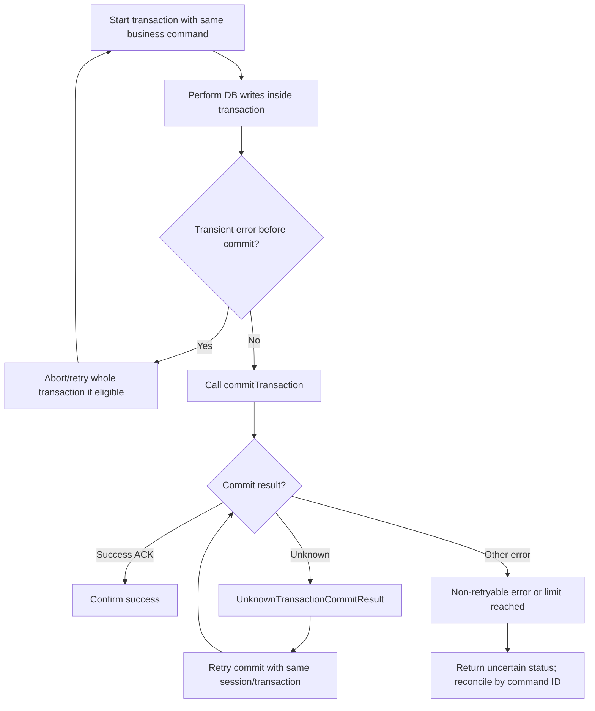
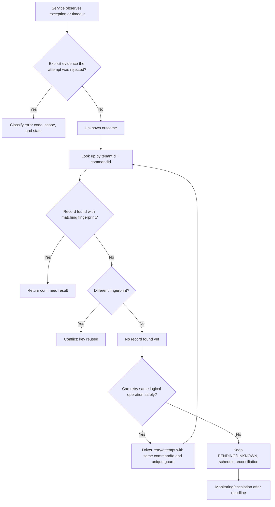

# Distinguishing definite write failures from uncertain final outcomes

An order request sends a write command to **MongoDB**. Then the application receives an exception due to a dropped connection. Was the order **not created**, or did MongoDB **already create the order while the success response never reached the application**?

This is one of the most critical distinctions when building reliable systems: **an error observed by the application does not always prove the write operation failed at the database**. Sometimes MongoDB clearly replies "unable to write"; other times the client cannot confirm the final outcome due to timeouts, network drops, primary failovers, or failing to reach the requested write acknowledgment level.

Example:

```text
Client / Service                    MongoDB
       │                               │
       │ ── insert order #123 ────────>│
       │                               │ saves order #123
       │                         ╲     │
       │                  network drop │
       │ <───── ACK lost ────────╱     │
       │                               │
  Receives timeout                   Saved?
       │                               │
       └── Cannot conclude from timeout alone.
```

If the application treats the timeout as "definitely not written" and issues a **brand-new business command**, the user may end up with two orders, double charges, a double-incremented counter, or duplicate events. Conversely, if the application treats the timeout as "definitely written," it may silently drop work the server never executed.

Within the **Data Consistency** chapter of the **SPRING_DATA_MONGODB** module, this lesson focuses on **distinguishing write errors with known outcomes from errors with uncertain final outcomes**, and choosing appropriate retries, reconciliation, and idempotency accordingly. Examples use **Spring Data MongoDB**, `MongoTemplate` or repositories, MongoDB write concerns, transactions, and tests. This knowledge directly underpins safe write design, distributed-system fault diagnosis, and workflows with side effects.

After this lesson, you will be able to:

1. Distinguish **definite failure**, **confirmed success**, and **unknown outcome** without guessing from exception names.
2. Explain why a **request timeout** does not equal a **MongoDB rollback**, and why a **write concern timeout** differs from validation or duplicate-key errors.
3. Identify the scope of **acknowledged writes**, `w:1`, `w:"majority"`, `wtimeout`, and the role of read concern.
4. Understand MongoDB driver **retryable writes** and their boundary relative to **business retries** from clients.
5. Distinguish the `RetryableWriteError`, `NoWritesPerformed`, `TransientTransactionError`, and `UnknownTransactionCommitResult` labels under supported conditions/versions.
6. Design **idempotency keys** and post-timeout reconciliation mechanisms, preventing double effects from `$inc`, `$push`, or transactions.
7. Know when to **retry transaction commit**, when to **retry the whole transaction**, and when to **wait/verify** rather than creating a new business command.
8. Write clear write-failure tests, simulated timeout tests, multi-tenant data tests, unique index tests, and retry state tests.

## 1. Three outcomes to distinguish before handling exceptions

A write operation can be observed by an application in three states of knowledge:

| State | What does the application actually know? | Examples | Should a new business command be issued immediately? |
| --- | --- | --- | --- |
| **Confirmed success** | The server returned success under the requested write concern level | `insertOne` acknowledged; result acknowledged | No retry needed due to error |
| **Definite failure** | Evidence shows the command **did not produce the requested effect**, within the exact scope of the operation examined | Validation error on a single insert, duplicate key on a specific insert | Fix the cause or handle per contract; do not retry blindly |
| **Unknown/ambiguous outcome** | The client lacks sufficient evidence whether the effect was applied or met durability requirements | Disconnect while waiting for ACK; write concern timeout; unclear commit result | Retry via the proper mechanism, reconcile, or return pending status |

The phrase "**definite failure**" must be understood precisely: a **single-document insert** rejected by MongoDB for missing a required field normally does not create that document. However, a **bulk write** may have partially succeeded before erroring; a **transaction commit** may have an unknown outcome despite the client seeing an error; and a fresh request hitting duplicate key **does not prove the prior request failed**.

### 1.1. Another axis: what the system did vs. what the client knows

```text
SERVER REALITY                     CLIENT KNOWLEDGE
──────────────────────             ───────────────────────────────
Write not applied         ──────── May know it failed, if evidence exists
Write applied             ──────── May know it succeeded, if ACK received
Write not applied         ──────── Or still unknown if connection dropped
Write applied             ──────── Or still unknown if ACK was lost
```

The last two rows are the **ambiguous outcome** problem. A client-side exception describes **what the client observed**, not necessarily the full execution history inside MongoDB.

### 1.2. "Command processed" and "durable per requirements" also differ

An operation may already be applied on the primary while the client has not received confirmation meeting `w:"majority"`. Even if you observe the document on one node or via a single read, do not automatically infer every durability condition was met. Guarantees depend on write concern, read concern, journaling, and replica set/sharded cluster configuration.

**Practical rule:** define clearly what "success" means in your API:

- Acknowledged by the primary?
- Acknowledged by a majority?
- Transaction committed?
- Completed **both** MongoDB writes and external side effects such as sending messages?

Never use a single boolean `success` for four distinct contracts.

## 2. Timeline points when a write command is sent

Suppose a service wants to create an order with `commandId = "checkout-42"`:

```text
T0  Client creates business command checkout-42
T1  Driver serializes and begins sending write to MongoDB
T2  MongoDB receives command and checks filter/validator/unique indexes
T3  MongoDB applies change on primary (if command qualifies)
T4  MongoDB waits for write concern condition, if any
T5  Server sends response/ACK
T6  Client receives response and returns result to caller
```

If the connection breaks **before T1 with proof the command was never sent**, the application can know that attempt performed no write. However, if it drops anywhere between T1 and T6, the client usually **does not know** whether the command reached T2, T3, T4, or T5.

Uncertainty can stem from:

- Network connection reset while the server is processing.
- Client-side timeout while awaiting response.
- Primary stepdown/failover right at the time of the write.
- Driver timeout after one or more retries.
- `wtimeout` when data did not meet the write concern acknowledgment within the limit.
- `commitTransaction` result failing to reach the client.

Do not classify solely by substring matching on messages like `"timeout"` or `"connection closed"`. An error can come from an explicit server rejection or from transport failing to deliver the outcome. Examine **error source, received response, error labels, operation type, and reconciliation capabilities**.

### 2.1. An insert actively rejected by MongoDB

```javascript
// Collection has a validator requiring status ∈ ["NEW", "PAID"].
db.orders_consistency_lab.insertOne({
  _id: ObjectId(),
  status: "INVALID"
});
```

If the server returns `DocumentValidationFailure` (typically code `121`) for **this single insert**, the document was rejected by the schema. Fix the payload/rule before resubmitting; raising timeouts will not cure a validation failure.

### 2.2. An insert hitting duplicate key

```javascript
// Suppose a unique index protects tenantId + commandId.
db.orders_consistency_lab.insertOne({
  tenantId: "T1",
  commandId: "checkout-42",
  status: "NEW"
});
```

If a **new** insert receives duplicate key (typically code `11000`), that new attempt failed to insert a duplicate document. However, ask the next question: **is the existing document the result of the very same `checkout-42` operation succeeding earlier before its ACK was lost?**

Hence, a duplicate key is **a definite failure of the current insert attempt**, yet **not automatically a failure of the overall business operation**. After an ambiguous timeout, it can be the signal to query by idempotency key and confirm the effect already exists.

### 2.3. An `$inc` losing its response

```javascript
db.counters_consistency_lab.updateOne(
  { _id: "views-2026-11-20" },
  { $inc: { views: 1 } }
);
```

If the write applied and the ACK was lost, sending a **new business write** increments from 1 to 2. `$inc` is **atomic on a single document**, yet not **idempotent when re-executed as a new business operation**.

Distinguish:

```text
Atomic     = no lost updates when multiple writes modify one document concurrently.
Idempotent = re-executing the same business operation does not multiply its effect.
```

An operation can be atomic without being idempotent.

## 3. Classification table for MongoDB write errors

| Scenario | Safe conclusion for **the attempt** | Conclusion for **the business operation** | Typically appropriate action |
| --- | --- | --- | --- |
| Server validator returns error 121 on a single insert | That insert was rejected | Document not created by that attempt | Fix payload/schema; do not retry identical payload |
| Duplicate key 11000 on a single insert | New attempt created no duplicate record | Prior business operation may have succeeded | Look up record by business key, verify payload |
| `writeResult` acknowledged successfully | Confirmed per requested write concern | MongoDB write portion complete per contract | Return result or proceed with workflow |
| `updateOne` returns `matchedCount=0` | No document matched this write's filter | May be already processed, stale version, wrong tenant, wrong state, or missing | Distinguish via read / predicate check |
| `modifiedCount=0` yet `matchedCount=1` | Document matched, value may have been unchanged | Do not assume business failure | Verify update semantics |
| Network timeout while waiting for ACK | **Insufficient evidence** of outcome | May have succeeded or not | Use safe retry/reconciliation; do not create a new business command |
| Write concern timeout | Not confirmed to meet write concern before deadline | Write may already be applied on primary | Reconcile per durability policy; do not treat as rollback |
| Driver exhausts retries and throws | Auto-retry did not yield confirmed result | Cannot assume no write occurred | Inspect labels, query state, use idempotency |
| `NoWritesPerformed` in supported cases/versions | Driver/server indicates zero writes across those attempts | Stronger evidence of non-execution | Still check scope/operation and specific error |
| `commitTransaction` error with `UnknownTransactionCommitResult` | Commit outcome unknown | Transaction may already have committed | **Retry commit** with the same session/transaction |
| Transaction error with `TransientTransactionError` under supported conditions | Transaction hit transient error before finishing commit | May need to re-run aborted transaction | Retry **whole transaction** via proper API, without repeating external side effects |
| Bulk write errors partway through | Subset of writes may have succeeded | Cannot assume whole batch failed | Inspect per-item results/errors; reconcile by key |

**One exception class does not necessarily map 1-to-1 to one state.** Spring Data can translate MongoDB Java Driver exceptions into `DataAccessException` subtypes. When inspecting retryable labels, write concerns, or command results, understand how causes/metadata are preserved or unwrapped in your driver/Spring Data version; never catch by class name alone to infer "no write occurred."

## 4. Write concern: what does "ACKed" mean?

MongoDB **write concern** determines the desired confirmation level when performing a write. Two common forms:

```javascript
// Wait for primary to acknowledge write per configuration.
{ w: 1 }

// Wait for majority of eligible data-bearing voting members to acknowledge.
{ w: "majority", wtimeout: 5000 }
```

Core points:

- `w: 1` acknowledges from the primary per deployment semantics; a primary-only acknowledged write can still roll back upon failover in some scenarios.
- `w: "majority"` requires majority acknowledgment. With suitable replica set/journal configuration, it offers stronger durability against failover than `w:1`.
- `wtimeout` bounds how long to wait for the write concern condition; **it is not a command to roll back** already applied changes.
- `w: 0` is unacknowledged write: the client receives no per-write confirmation like acknowledged mode, making it unsuitable when the business must know the outcome.

Never call a `w:1` write "committed like a majority-durable transaction" just because the driver threw no exception. Likewise, never claim majority guarantees external side effects outside the database or protects against every possible system failure.

### 4.1. Distinguishing write errors and write concern errors

| Category | Common meaning | Safe inference |
| --- | --- | --- |
| **Write error** | Server rejected or could not apply an operation due to duplicate key/validation/etc. | Check whether single or bulk and examine partial results |
| **Write concern error** | Server did not achieve the requested acknowledgment level or hit an acknowledgment issue | **Does not mean** the write's effect was undone |

Example scenario:

```text
Primary receives insert → applies insert successfully
      ↓
Secondaries lag / fail to acknowledge majority in time
      ↓
write concern returns timeout
      ↓
Client sees an error, yet the document may already exist on the primary.
```

Practical consequence: after `wtimeout`, never immediately issue a "create new order" command with a new ID; read back by idempotency key with matching consistency, or let a reconciliation process resolve it.

### 4.2. Configuring write concern in Java

The MongoDB Java Driver provides `WriteConcern`:

```java
import com.mongodb.WriteConcern;
import java.util.concurrent.TimeUnit;

WriteConcern concern = WriteConcern.MAJORITY
    .withWTimeout(5, TimeUnit.SECONDS);
```

With the raw driver:

```java
var collection = mongoTemplate.getCollection("orders_consistency_lab")
    .withWriteConcern(concern);

collection.insertOne(document);
```

Here `document` is a properly constructed and validated `org.bson.Document`. Write concern configuration at client/database/collection/template levels differs across APIs and versions; **never assume reconfiguring a raw collection automatically alters write concern for all other repository calls**. Standardize policy at the right application layer.

## 5. MongoDB driver retryable writes are not business retries

The MongoDB Java Driver supports **retryable writes** for eligible operations/deployments. With an appropriately configured connection (typically `retryWrites=true`), the driver can automatically retry **once** upon eligible transient errors in supported write operations.

URI example with option:

```text
mongodb://host1,host2,host3/orders?replicaSet=rs0&retryWrites=true
```

This is a **configuration example**, not a real URI to connect to. Use your environment's hostnames, auth, TLS, and replica set name, and avoid putting credentials into docs or logs.

### 5.1. How does a retryable write identify the same operation?

On infrastructure supporting retryable writes, the driver and server coordinate using the **logical session** and **transaction number** of the retryable write command. When retrying the exact same operation, this mechanism helps avoid re-applying a write already processed by the server, within the supported retryable-write history window.

```text
Driver sends write #1 with session S and txnNumber N
       │
       ├─ Server did not apply? Driver retries the same operation
       │
       └─ Server applied, ACK lost?
              │
              └─ Valid retry can recognize the already-executed write,
                 avoiding re-application under retryable-write protocol.
```

**Do not equate** this mechanism with:

```text
HTTP client receives timeout
    ↓
Creates a NEW HTTP request with a NEW commandId
    ↓
Server calls MongoTemplate.updateFirst(...) as a NEW write
```

A new business invocation normally gets a new operation/session/transaction number; it is not automatically recognized as a retry of the old write just because the payload looks identical. That is why applications still need **idempotency keys** and business-level semantics.

### 5.2. Not every write is retryable

Retry eligibility depends on:

- Supported server/driver versions and topology, typically a replica set or sharded cluster; do not treat standalone MongoDB as behaving identically.
- Write type. Eligible single-document writes and supported write commands qualify; certain bulk/multi-document operations do not share the same coverage.
- Session, transaction state, and connection configuration.
- Error labels or error types the driver/server permits retrying.
- Timing of failure and retryable-write history retention.

**Specifically:** an `updateMany` operation does not become idempotent merely because the URI enables `retryWrites=true`. Transactions also have separate retry rules that cannot be replaced by non-transactional retryable writes.

### 5.3. What if the driver retries automatically and still throws?

Do not conclude "nothing was written." The driver may have attempted the command multiple times without retrieving the final ACK. Server state may differ from what the client observed.

Recent MongoDB versions (from MongoDB 6.1 onward in supported cases) provide the **`NoWritesPerformed`** error label indicating **neither the initial attempt nor the associated retry performed any write**. However:

- This label does not exist on all servers/drivers and does not always appear.
- If the label is absent, you cannot infer the opposite—that a write definitely occurred.
- The label describes **the operation/attempts categorized by the server**, not external side effects across the workflow outside the DB.
- Verify exact documentation/behavior for your production version before building logic around the label.

### 5.4. Never wrap arbitrary exceptions in a manual retry loop

Dangerous code:

```java
// DO NOT DO THIS: treating any error as "not written".
for (int attempt = 0; attempt < 3; attempt++) {
    try {
        mongoTemplate.updateFirst(
            query,
            new Update().inc("balance", -100),
            Wallet.class
        );
        break;
    } catch (RuntimeException ex) {
        // Retry without classifying error type or operation.
    }
}
```

If an update already deducted 100 and the ACK was lost, the next loop iteration can deduct another 100. This is **not** a safe way to achieve at-least-once semantics for a debit. For money/inventory operations, define a **business command identity** and persist a processed-command record, or design appropriate transactions/conditional updates.

### 5.5. `RetryableWriteError` vs. `UnknownTransactionCommitResult`

| Label | Primary context | Operational implication |
| --- | --- | --- |
| `RetryableWriteError` | Retryable error on a write operation per driver/server rules | Let **the driver** retry eligible operations; do not treat as a new business command |
| `NoWritesPerformed` | Certain retryable-write errors in supported versions | Evidence that the associated write attempts performed no writes |
| `TransientTransactionError` | Transient error inside a transaction per support rules | Can retry **the whole transaction** after failure/abort |
| `UnknownTransactionCommitResult` | Transaction commit has an uncertain outcome | Retry **commit of the same transaction**, do not re-run business logic |

Error labels are typically exposed by the driver on `MongoException` via appropriate APIs, though Spring Data may translate/wrap exceptions. A label **does not replace** understanding context, failure point, and official retry guidance.

## 6. Transactions: pre-commit errors and commit errors are not the same

MongoDB transactions use sessions and commits to decide a batch of changes. With transactions, distinguishing **errors in the transaction body** from **errors when calling commit** is crucial.

### 6.1. Transient error inside the transaction body

Example of a money-transfer MongoDB transaction between two accounts (illustrative only):

```text
startTransaction
    ├─ Debit balance A provided sufficient funds
    ├─ Credit balance B
    └─ commitTransaction
```

If an error labeled `TransientTransactionError` occurs during an eligible phase, the driver/transaction API may abort and retry **the entire transaction callback**. Uncommitted DB work follows transaction semantics, yet the callback code itself may **execute multiple times**.

Therefore:

```java
// DO NOT place external side effects inside a callback
// that may be re-executed.
sendEmail("Money transferred");
chargeExternalPaymentGateway();
```

An email or external payment-gateway charge does not roll back along with a MongoDB transaction. Put those side effects into dedicated **outbox/inbox/idempotency** workflows.

### 6.2. Commit error with `UnknownTransactionCommitResult`

Timeline:

```text
Client                                 MongoDB
  │ startTransaction                      │
  │ write A, write B                      │
  │ ── commitTransaction ────────────────>│
  │                                      │ may have committed
  │                 ╲                    │
  │ <──── commit ACK lost ╲              │
  │                                      │
  │ Receives UnknownTransactionCommitResult
  └─ DO NOT re-run the whole transaction  │
     just because commit ACK was lost     │
```

MongoDB transaction APIs generally handle this by **retrying commit on the exact same session and transaction**, within supported mechanisms/timeouts. Never start a new session/transaction and re-execute the body as a fresh business command when the prior commit outcome is unknown.

### 6.3. Distinguishing the two retry branches



This diagram illustrates **the concept**, not an infinite retry loop. Drivers enforce timeout caps, and callback transaction APIs manage retries on the application's behalf. Every retry must have deadlines, controlled logging, and a reconciliation plan when outcomes remain unknown.

### 6.4. Java Driver: mindset when manually coordinating commit

The skeleton below highlights **which session is used to retry commit**:

```java
import com.mongodb.MongoException;
import com.mongodb.client.ClientSession;

// session is a ClientSession with an active transaction,
// whose transaction body writes already ran.
try {
    session.commitTransaction();
} catch (MongoException ex) {
    if (ex.hasErrorLabel("UnknownTransactionCommitResult")) {
        // Retry *commit* on the same session/transaction,
        // within timeout policy and API support.
        // Do not call save/debit/transfer from scratch here.
    } else {
        // Classify error per transaction context.
        throw ex;
    }
}
```

This is an **explanatory skeleton**, not a complete production retry loop. When using the driver's `withTransaction` callback API or Spring `MongoTransactionManager`/`@Transactional`, check which steps the framework already retries, which exceptions get wrapped, and how `commandId` is preserved across attempts. Never wrap a transaction manager in ad-hoc external retries by guesswork.

### 6.5. Successful commit does not mean external side effects finished

After MongoDB commits, the service might publish a message to a broker and time out at the broker, or publish the message and lose the HTTP ACK back to the client. These are **two independent outcomes**. The **transactional outbox** pattern writes the event to publish **within the same MongoDB transaction** (where applicable), and a worker dispatches it idempotently. Consumers must also handle duplicate messages; outbox alone does not magically create end-to-end exactly-once across external systems.

## 7. Idempotency: the key to safe business retries

A key solution is assigning **a stable identity** to every business request:

```text
tenantId       = T1
commandId      = checkout-42
payload        = create order 150.00 for C-100
```

A client retrying the same business action must send **the exact same `commandId`**, never generating a fresh UUID per retry. The server enforces:

1. No two distinct records exist for the same `(tenantId, commandId)`.
2. If `commandId` repeats with a **different payload**, return conflict—never treat it as a valid retry.
3. If `commandId` repeats with a semantically identical payload, return the known result or in-progress status.
4. If the outcome is uncertain, never guess "failed"; return **PENDING/UNKNOWN** and reconcile.

### 7.1. Unique index as the final boundary for a commandId

```javascript
db.order_commands_consistency_lab.createIndex(
  { tenantId: 1, commandId: 1 },
  {
    name: "uniq_tenant_command",
    unique: true
  }
);
```

A unique index is a **database constraint**, ensuring two documents with the same key pair cannot be inserted—provided the index exists/was built properly and null handling, collation, and sharding rules are designed accordingly.

A pre-check like "find missing record → insert" **is not enough** to stop races between two concurrent requests. You need a unique index or an equivalent atomic key-reservation mechanism.

### 7.2. Idempotency key vs. log request ID

| Value | Role | Changes when client retries? |
| --- | --- | --- |
| `traceId` | Tracks one HTTP request | May change |
| `correlationId` | Tracks an event chain | May stay or be generated per workflow |
| `commandId/idempotencyKey` | Identifies **one business effect** | **Must not change** across retries of the same effect |
| MongoDB `_id` | Identifies one document | Often server-generated; cannot substitute for `commandId` if the client does not know it |

If an HTTP client generates a new `commandId` on every retry, the database sees **completely different business commands**, even though the user clicked one button twice. Idempotency must be part of the API contract and validated on the server.

## 8. Spring Data MongoDB: creating an idempotent command

This example uses **a single document** to record an order-creation command with a unique `(tenantId, commandId)`. This keeps the design simple because **creating that document is the business effect to confirm**. If you must also deduct stock, debit a wallet, or insert an outbox entry in another collection, you need a transaction/workflow as in Section 10.

### 8.1. Entity with a unique business key

```java
package com.example.orders;

import java.math.BigDecimal;
import java.time.Instant;
import org.bson.types.ObjectId;
import org.springframework.data.annotation.Id;
import org.springframework.data.mongodb.core.index.CompoundIndex;
import org.springframework.data.mongodb.core.mapping.Document;
import org.springframework.data.mongodb.core.mapping.Field;
import org.springframework.data.mongodb.core.mapping.FieldType;

@Document(collection = "order_commands_consistency_lab")
@CompoundIndex(
    name = "uniq_tenant_command",
    def = "{ 'tenantId': 1, 'commandId': 1 }",
    unique = true
)
public class OrderCommand {

    @Id
    private ObjectId id;

    private String tenantId;
    private String commandId;
    private String payloadFingerprint;
    private String customerId;
    private String status;
    private Instant createdAt;

    @Field(targetType = FieldType.DECIMAL128)
    private BigDecimal totalAmount;

    protected OrderCommand() {}

    public OrderCommand(
            String tenantId, String commandId,
            String payloadFingerprint, String customerId,
            BigDecimal totalAmount, Instant createdAt) {
        this.tenantId = tenantId;
        this.commandId = commandId;
        this.payloadFingerprint = payloadFingerprint;
        this.customerId = customerId;
        this.totalAmount = totalAmount;
        this.status = "CREATED";
        this.createdAt = createdAt;
    }

    public ObjectId getId() { return id; }
    public String getTenantId() { return tenantId; }
    public String getCommandId() { return commandId; }
    public String getPayloadFingerprint() {
        return payloadFingerprint;
    }
    public String getCustomerId() { return customerId; }
    public String getStatus() { return status; }
    public BigDecimal getTotalAmount() { return totalAmount; }
    public Instant getCreatedAt() { return createdAt; }
}
```

Notes:

- `@CompoundIndex` is Spring Data metadata; **it does not guarantee the actual index exists** if auto-index creation is turned off. In production, deploy the unique index via migrations and verify `getIndexes()` before accepting command traffic.
- `payloadFingerprint` must be computed **server-side from canonicalized business payload** (field order, numeric types, rule version, currency). Never trust a client-supplied hash string.
- `tenantId` must be derived from authentication/authorization, never letting clients swap tenants via a JSON body field.
- `commandId` should have format/length bounds and reuse scoped strictly within its authorized tenant.
- `BigDecimal` is stored as `Decimal128` to avoid accidentally using `Double` for money.

### 8.2. Repository querying by command identity

```java
package com.example.orders;

import java.util.Optional;
import org.bson.types.ObjectId;
import org.springframework.data.mongodb.repository.MongoRepository;

public interface OrderCommandRepository
        extends MongoRepository<OrderCommand, ObjectId> {

    Optional<OrderCommand> findByTenantIdAndCommandId(
        String tenantId, String commandId);
}
```

Lookup methods always include tenant so one caller never inspects another tenant's command status.

### 8.3. Service creating and reading back known outcomes

```java
package com.example.orders;

import java.math.BigDecimal;
import java.time.Instant;
import java.util.Optional;
import org.bson.types.ObjectId;
import org.springframework.dao.DuplicateKeyException;

public class OrderCommandService {

    private final OrderCommandRepository repository;

    public OrderCommandService(OrderCommandRepository repository) {
        this.repository = repository;
    }

    public record Result(
        String state,
        ObjectId orderId,
        String commandId
    ) {}

    public Result create(
            String trustedTenantId,
            String commandId,
            String serverPayloadFingerprint,
            String customerId,
            BigDecimal totalAmount) {

        requireIdentity(
            trustedTenantId, commandId, serverPayloadFingerprint
        );
        if (customerId == null || customerId.isBlank()
                || totalAmount == null
                || totalAmount.signum() < 0) {
            throw new IllegalArgumentException("Invalid payload");
        }

        OrderCommand command = new OrderCommand(
            trustedTenantId, commandId,
            serverPayloadFingerprint, customerId,
            totalAmount, Instant.now()
        );

        try {
            OrderCommand created = repository.insert(command);
            return new Result("CREATED", created.getId(), commandId);
        } catch (DuplicateKeyException duplicate) {
            // Treat as successful retry only if the exact command
            // and semantically matching payload are found.
            OrderCommand existing = repository
                .findByTenantIdAndCommandId(
                    trustedTenantId, commandId
                )
                .orElseThrow(() -> duplicate);

            return verifiedResult(
                existing, serverPayloadFingerprint
            );
        }
        // Other errors are classified at the coordinator layer:
        // do not catch RuntimeException and default to FAILED.
    }

    public Result inspectAfterUnknownOutcome(
            String trustedTenantId,
            String commandId,
            String serverPayloadFingerprint) {

        requireIdentity(
            trustedTenantId, commandId, serverPayloadFingerprint
        );

        Optional<OrderCommand> found = repository
            .findByTenantIdAndCommandId(
                trustedTenantId, commandId
            );

        return found
            .map(command -> verifiedResult(
                command, serverPayloadFingerprint
            ))
            .orElse(new Result("UNKNOWN", null, commandId));
    }

    private Result verifiedResult(
            OrderCommand existing,
            String fingerprint) {
        if (!fingerprint.equals(existing.getPayloadFingerprint())) {
            throw new IllegalStateException(
                "Idempotency key reused with different payload"
            );
        }
        return new Result(
            "ALREADY_RECORDED", existing.getId(),
            existing.getCommandId()
        );
    }

    private void requireIdentity(
            String tenantId, String commandId, String fingerprint) {
        if (tenantId == null || tenantId.isBlank()
                || commandId == null || commandId.isBlank()
                || fingerprint == null || fingerprint.isBlank()) {
            throw new IllegalArgumentException(
                "Missing identity/fingerprint"
            );
        }
    }
}
```

**Key design points:**

1. The service uses `repository.insert(...)` for creation, **not `save(...)` as an unconditional upsert that might overwrite an older record**.
2. The unique index on `(tenantId,commandId)` prevents duplicates when two requests race.
3. `DuplicateKeyException` is interpreted as "command already recorded" **only if** the matching record and fingerprint are found. If the duplicate came from another constraint, failing to locate the command rethrows the error.
4. `inspectAfterUnknownOutcome` is called **after the caller classified a failure as ambiguous**. It neither swallows arbitrary exceptions nor fires another write.
5. Returning `"UNKNOWN"` when **no record is found yet** does not mean "the server definitely did not insert." The initial attempt might still be in flight or not yet visible at your read consistency level.
6. The service itself omits user authorization, canonical hashing, and HTTP response mapping; those belong in the orchestration/boundary layer of a real application.

### 8.4. Why "not found" does not prove failure

A read can return empty because:

- The stalled write is still being processed.
- The new record has not reached the secondary serving the read.
- A primary stepdown just occurred; effect/durability is still settling.
- The query filtered on the wrong tenant/commandId or mismatched BSON mapping.
- The write genuinely never happened.

All five cases share the same **symptom** yet require different actions. Thus, an empty read is merely **a point-in-time observation**, not proof of root cause.

If the API must assert "durably completed," choose appropriate **read concern/read preference/write concern** and verify real topology behavior. `ReadConcern.MAJORITY` helps confirm majority-committed records, yet **a majority read finding nothing still does not prove an in-flight write will not commit moments later**.

### 8.5. Duplicate key can be the signal of a prior success

Example with two HTTP requests for one command:

```text
Request A: tenant=T1, commandId=checkout-42
   └─ Insert succeeds in MongoDB; HTTP ACK is lost.

Request B (retry): tenant=T1, commandId=checkout-42
   └─ Insert fails with duplicate key.
       └─ Query tenantId + commandId.
           ├─ Same fingerprint: return the same orderId.
           └─ Different fingerprint: return conflict.
```

Never react to duplicate key by generating a new ID and re-inserting—that defeats the whole purpose of idempotency.

### 8.6. TTL and idempotency key lifecycle

Retaining command IDs forever can grow the collection indefinitely. If you expire idempotency records via TTL, explicitly define the **supported retry window**. Once a TTL purges a record, an old delayed request carrying that key could be treated as brand new unless another guard exists.

For financial, order, or actions that must never repeat indefinitely, consider keeping identity inside the business record itself, persisting durable history, or adding dedicated deduplication policies. **TTL must never silently erase completion proof** still needed for reconciliation.

## 9. The `$inc` case: protect the effect, not just request recognition

A simple counter:

```javascript
db.counter_consistency_lab.updateOne(
  { _id: "stock-A" },
  { $inc: { reserved: 1 } }
);
```

If the service hits a timeout and issues a new business operation, `reserved` can increment twice. Reading a counter of `2` also does not prove **which** attempt incremented it; concurrent users may exist.

### 9.1. Idempotency for updates as distinct from document creation

When you need to record **an event/command record** and update a counter as one logical effect, a supported MongoDB transaction can wrap them:

```text
Inside transaction:
  1. Write unique command marker (tenantId, commandId).
  2. Conditionally update counter/stock scoped by tenant and predicate.
  3. Write outbox record if external side effects are needed.
  4. Commit.
```

When a retry with the same `commandId` encounters the committed unique marker, the workflow returns the known result instead of incrementing twice. Proper execution still requires:

- A transaction manager and a MongoDB topology supporting transactions.
- The unique index actually deployed.
- Zero external non-DB side effects inside a retryable transaction callback.
- Handling for **`UnknownTransactionCommitResult`** and pending states.
- Handling when the conditional update matches nothing (e.g., insufficient stock) without leaving behind a bogus "success" marker.

### 9.2. Conditional updates and `@Version` are insufficient for deduplication

Spring Data `@Version` and compare-and-set filters stop two writers from overwriting the same version. Yet a client retrying with a **new version** can still execute a duplicate business action without a stable `commandId`.

Therefore:

```text
Optimistic locking  → protects a record from lost updates/races.
Idempotency key     → protects a command from duplicating its effect.
Transaction         → binds multiple DB writes into one commit/abort.
Outbox              → bridges DB commit with retryable side-effect publishing.
```

These mechanisms guard against distinct classes of failure and often must work together.

## 10. Reconciling after an uncertain outcome

After an ambiguous write, applications should not be limited to "retry forever" or "return error." A **reconciliation workflow** converts an unknown state into a verified outcome.

### 10.1. Command statuses in the API

A contract can distinguish:

| API status | Meaning | Transition condition |
| --- | --- | --- |
| `ACCEPTED/PENDING` | Server accepted or is still processing the command; final effect not yet confirmed | Needs further processing or reconciliation |
| `CONFIRMED` | Evidence proves the command met completion criteria per contract | Return the same result for all retries of this command |
| `REJECTED` | Evidence proves the command was rejected by business/input rules with no effect | Return stable reason; do not re-run |
| `UNKNOWN` | Outcome could not be determined within a time/attempt budget | Never treat as `REJECTED`; expose lookup and investigation path |

If the request never reached the service, the client may need to retry with **the same `commandId`**. If the service received and recorded a marker, it can return `PENDING`. However, **merely returning HTTP 202 Accepted does not guarantee the command was durably persisted**: the API must specify which endpoint reconciles it and what 202 guarantees.

Contract example:

```text
POST /orders
Idempotency-Key: checkout-42

201 Created:
  { status: "CONFIRMED", orderId: "..." }

202 Accepted:
  { status: "PENDING", commandId: "checkout-42" }

409 Conflict:
  { code: "IDEMPOTENCY_KEY_REUSED_WITH_DIFFERENT_PAYLOAD" }

GET /orders/commands/checkout-42
  → CONFIRMED / PENDING / UNKNOWN / REJECTED (based on evidence)
```

This is an illustrative contract, not a built-in Spring Data HTTP API. Status lookups must require authentication and be tenant-scoped, never allowing one user to probe another tenant's command status.

### 10.2. Bounded recovery workflow



In practice, a reconciliation read itself can fail ambiguously; never turn that into `FAILED`. Use backoff, retry budgets, circuit breakers, and deferred queues. Once budget expires, move to **pending verification** and alert deliberately—never delete the `commandId` and submit a new business operation.

### 10.3. What should reconciliation data store?

For critical commands, consider recording:

```text
tenantId
commandId
payloadFingerprint / canonical request version
businessRecordId
operationType
createdAt / updatedAt
finalStatus or processingStatus
lastObservedErrorClass / sanitizedErrorCode
attemptCount or generation
request correlation ID
```

Not every field must live in a separate document if derivable reliably from the business record, yet you need **queryable, stable data** to identify a specific command.

Never store raw exceptions containing secrets, personal info, or connection strings. Reconstructing outcomes must rely on **committed business data**, not logs alone which can arrive late or be dropped.

### 10.4. What if the record exists, yet side effects did not finish?

Suppose `OrderCommand` was created, yet the `"ORDER_CREATED"` message was not published:

- **MongoDB write portion:** confirmed once the record is observed under the appropriate read concern.
- **Messaging portion:** no proof yet of successful delivery.

Never report "entire workflow succeeded" if the contract requires message emission to succeed. With a transactional outbox:

```text
Order + Outbox event committed in the same transaction.
        ↓
Outbox publisher dispatches event.
        ↓
Broker receives event (ACK may be lost).
        ↓
Publisher retries; consumer deduplicates by eventId.
```

An outbox prevents losing the intent to publish on DB commit, yet **does not magically give end-to-end exactly-once delivery across all systems**. Consumers still need idempotency for message side effects.

## 11. Read concern and reading back results

### 11.1. Why not just call `findById` once?

A read can return empty even when:

1. The previous write is still in progress.
2. The new record has not reached the node serving the read.
3. A primary stepdown just happened; effect/durability has not stabilized.
4. The query filtered on the wrong tenant/`commandId` or unexpected BSON mapping.
5. The write truly was not performed.

All five share the same **symptom** yet have different remedies. Thus, an empty read is only a **point-in-time observation**, not proof of root cause.

### 11.2. Read concern can assist in confirming durability

MongoDB offers `ReadConcern` levels like `LOCAL` and `MAJORITY`, with topology/version-dependent semantics:

```java
import com.mongodb.ReadConcern;
import com.mongodb.ReadPreference;

var collection = mongoTemplate
    .getCollection("order_commands_consistency_lab")
    .withReadConcern(ReadConcern.MAJORITY)
    .withReadPreference(ReadPreference.primary());
```

Here `collection` is a raw driver collection handle configured for **this reconciliation read path**; it does not change other repositories. Observing a document with a majority read is useful evidence that it is majority-committed under MongoDB's semantics. However, a majority read not finding the document **is not proof** that an in-flight attempt cannot commit shortly afterward.

If the application needs read-your-writes or causal consistency across commands in one session, use a **causally consistent session** and matching read/write concerns. Never assume two independent HTTP requests share a causal session just because they share a user ID.

### 11.3. Seeing the document does not automatically end the workflow

After a timeout, reading back shows:

```javascript
{
  tenantId: "T1",
  commandId: "checkout-42",
  status: "CREATED"
}
```

Check:

- Does `payloadFingerprint` match the original command?
- With which read concern was the document observed?
- Which business invariants are guaranteed complete when status is `CREATED`?
- Are there follow-up steps such as payment settlement, stock reservation, or outbox dispatch?
- Is another transaction/workflow creating a non-final marker?

**Seeing a record exist does not mean every step in a saga completed.** Distinguish "command recorded" from "end-to-end business process completed."

## 12. Distinguishing MongoDB write outcomes at the API level

### 12.1. `acknowledged`, `matchedCount`, and `modifiedCount`

With the raw driver:

```java
import com.mongodb.client.result.UpdateResult;

UpdateResult result = collection.updateOne(
    filter,
    update
);

if (!result.wasAcknowledged()) {
    // No acknowledgment to interpret counts as ACKed.
}
long matched = result.getMatchedCount();
long modified = result.getModifiedCount();
```

| Condition | Basic meaning |
| --- | --- |
| Acknowledged and `matched=1, modified=1` | One document matched, one document modified |
| Acknowledged and `matched=1, modified=0` | Document matched, though resulting values did not change |
| Acknowledged and `matched=0` | No document matched the filter at execution time |
| No ACK/result due to network error | Actual server counts unknown from exception alone |

`matched=0` can happen because version changed, status transitioned, tenant mismatched, or the record does not exist. Do not lump all of those into one generic `"FAILED"` without checking the business contract.

### 12.2. Upserts and non-creating outcomes

An `updateOne(..., upsert=true)` can insert a new document or update an existing one. For an acknowledged result, `getUpsertedId()` indicates whether the upsert inserted a new record; however:

- Filter predicates and unique indexes must be designed to guard against races.
- If `$set` touches existing fields, retries can alter data even without inserting a new record.
- `$setOnInsert` helps apply fields only when a new document is created.
- Upserts with filters not backed by unique keys can produce duplicates under concurrent writers.

Conceptual example:

```javascript
db.order_commands_consistency_lab.updateOne(
  { tenantId: "T1", commandId: "checkout-42" },
  {
    $setOnInsert: {
      payloadFingerprint: "SHA256_OF_CANONICAL_REQUEST",
      status: "CREATED",
      createdAt: new Date()
    }
  },
  { upsert: true }
);
```

This **only sets defaults on insert**. If `commandId` already exists with a different payload, it **does not automatically detect the conflict**. You must still read back, verify the fingerprint, and maintain the unique index. If the workflow involves multiple side effects, a single upsert marker is not enough.

### 12.3. `@Version` and optimistic locking

Spring Data MongoDB provides `@Version` for optimistic locking on supported entity write paths. Updating an entity with a stale version can throw `OptimisticLockingFailureException` or match zero documents, depending on API and configuration.

An optimistic lock failure on the current attempt is evidence that **this attempt did not apply changes for the expected version**, yet it does not prove an earlier retry by the same command failed. Distinguish:

```text
Stale version     → reload current document state/version.
Duplicate command → read back outcome by idempotency key.
Unknown ACK       → reconcile instead of guessing.
```

For write paths requiring optimistic locking, use acknowledged write concerns and test exact API version behavior. Never assume raw `updateMany` or repository `@Update` enforces `@Version` identically to `save`.

### 12.4. Bulk writes: partial success is a distinct state

Suppose a bulk request contains 5 inserts, and the third hits duplicate key. With an **ordered bulk**, earlier operations may already be persisted while later ones do not run; with an **unordered bulk**, remaining operations may continue per semantics. Adding a network failure leaves the client lacking exact knowledge of which subset succeeded.

Therefore, never write:

```text
catch BulkWriteException
   → mark all 5 inserts FAILED
   → resend all 5 as 5 fresh business commands
```

Assign identities to **each individual item** if required by business rules, inspect per-operation successes/errors from the result when available, and reconcile uncertain items. A bulk API call does not magically become an atomic transaction.

## 13. `mongosh` lab: duplicates, validation, and "lost ACK"

The goal of this lab is **clearly observing the difference between a rejected failure** and **a recorded business operation whose result the client may not know**. We will not intentionally break the network or step down primary on a shared server. Instead, we simulate **a client failing to receive/retain the result** after a successful write, then reconcile by business key.

**Run only on test MongoDB.** These commands create a randomly named collection scoped to this session; never write to production collections or drop someone else's collections.

### 13.1. Create a dedicated collection with unique index and validator

In a `mongosh` session:

```javascript
use spring_data_training

const labName = "order_commands_consistency_lab_" +
  new ObjectId().toHexString();
const tenant = "T1-" + new ObjectId().toHexString();

db.createCollection(labName, {
  validator: {
    $jsonSchema: {
      bsonType: "object",
      required: [
        "tenantId",
        "commandId",
        "payloadFingerprint",
        "status",
        "totalAmount",
        "createdAt"
      ],
      properties: {
        _id: { bsonType: "objectId" },
        tenantId: {
          bsonType: "string", minLength: 1
        },
        commandId: {
          bsonType: "string", minLength: 1
        },
        payloadFingerprint: {
          bsonType: "string", minLength: 1
        },
        status: {
          enum: ["CREATED", "CANCELLED"]
        },
        totalAmount: {
          bsonType: "decimal",
          minimum: NumberDecimal("0.00")
        },
        createdAt: { bsonType: "date" }
      }
    }
  },
  validationLevel: "strict",
  validationAction: "error"
});

const lab = db.getCollection(labName);

lab.createIndex(
  { tenantId: 1, commandId: 1 },
  { name: "uniq_tenant_command", unique: true }
);

printjson({ labName: labName, tenant: tenant });
printjson(lab.getIndexes());
```

Keep variables `labName`, `tenant`, and `lab` in **the same `mongosh` session** for the steps below.

### 13.2. Insert a valid command and receive ACK

```javascript
const commandId = "checkout-42";
const fingerprint = "canonical-payload-v1-hash-abc";
const orderId = new ObjectId();

const commandDoc = {
  _id: orderId,
  tenantId: tenant,
  commandId: commandId,
  payloadFingerprint: fingerprint,
  customerId: "C-100",
  status: "CREATED",
  totalAmount: NumberDecimal("150.00"),
  createdAt: new Date()
};

const insertResult = lab.insertOne(commandDoc);

printjson({
  acknowledged: insertResult.acknowledged,
  insertedId: insertResult.insertedId
});
// Expected: acknowledged=true in a default environment
// with an appropriate acknowledged write concern.
```

Here `insertOne` succeeded, so **the MongoDB insert portion** is confirmed per the active write concern. Do not infer external side effects (like email sending) have finished.

### 13.3. Attempt a duplicate command insert and analyze duplicate key

```javascript
try {
  lab.insertOne({
    _id: new ObjectId(),
    tenantId: tenant,
    commandId: commandId,
    payloadFingerprint: fingerprint,
    customerId: "C-100",
    status: "CREATED",
    totalAmount: NumberDecimal("150.00"),
    createdAt: new Date()
  });

  print("UNEXPECTED: duplicate insert accepted");
} catch (error) {
  printjson({
    duplicateInsertErrorCode: error.code,
    message: String(error.message).slice(0, 180)
  });
  // Typically code 11000: duplicate key.
}

const stored = lab.findOne({
  tenantId: tenant,
  commandId: commandId
});

printjson({
  storedId: stored._id,
  samePayload: stored.payloadFingerprint === fingerprint
});
```

The new insert attempt was **rejected**, yet the business command record already exists. If the client previously lost ACK on the first insert, handling duplicate key by **generating a different `commandId` and inserting again** creates duplicate business effects; conversely, **looking up by key and comparing payloads** lets you safely return the recorded result.

### 13.4. Same commandId with a different payload

```javascript
const suspiciousFingerprint = "different-business-payload";
const previous = lab.findOne({
  tenantId: tenant,
  commandId: commandId
});

if (previous.payloadFingerprint !== suspiciousFingerprint) {
  printjson({
    outcome: "IDEMPOTENCY_KEY_CONFLICT",
    commandId: commandId
  });
}
```

Never allow a user to change amount/customer while reusing `commandId` to "bypass" checks. Production APIs should return a conflict with a stable error code and controlled logs, leaving the existing record untouched.

### 13.5. Validator error is a proven failure for that specific insert

```javascript
try {
  lab.insertOne({
    tenantId: tenant,
    commandId: "checkout-invalid",
    payloadFingerprint: "invalid-payload",
    status: "NOT_A_VALID_STATUS",
    totalAmount: NumberDecimal("20.00"),
    createdAt: new Date()
  });
  print("UNEXPECTED: invalid insert accepted");
} catch (error) {
  printjson({
    validationErrorCode: error.code,
    message: String(error.message).slice(0, 180)
  });
  // With this schema, typically code 121.
}

print(lab.countDocuments({
  tenantId: tenant,
  commandId: "checkout-invalid"
}));
// Expected: 0.
```

There is no point retrying an invalid payload with backoff hoping it passes: the error is **deterministic per the validator** in this example. Fix the input/schema properly before retrying.

### 13.6. Simulating an application that lost the insert outcome

We do **not simulate a real network outage**; instead we intentionally discard `insertResult` from Section 13.2, acting as an application that lost the ACK, and reconcile:

```javascript
// Suppose the service only retains values saved on the client side:
const unknownCommand = {
  tenantId: tenant,
  commandId: "checkout-42",
  payloadFingerprint: fingerprint
};

const recovered = lab.findOne({
  tenantId: unknownCommand.tenantId,
  commandId: unknownCommand.commandId
});

printjson({
  outcome: recovered === null
    ? "UNKNOWN"
    : (recovered.payloadFingerprint ===
        unknownCommand.payloadFingerprint
          ? "ALREADY_RECORDED"
          : "CONFLICT"),
  orderId: recovered === null ? null : recovered._id
});
```

Here the document exists, yielding `ALREADY_RECORDED`. In a **real timeout scenario**, a single read finding no record is still **insufficient** to prove no write is in flight; you may need to wait, retry with the same identity and unique index, or reconcile further.

### 13.7. Simulating `$inc` re-executed as a new request

Using the **same isolated lab session**, create a simple counter document. Because our lab validator requires multiple fields, create **a separate randomly named counter collection**:

```javascript
const counterName = "counter_consistency_lab_" +
  new ObjectId().toHexString();
db.createCollection(counterName);
const counters = db.getCollection(counterName);

counters.insertOne({
  _id: "view-count",
  value: NumberLong("0")
});

// First business write.
counters.updateOne(
  { _id: "view-count" },
  { $inc: { value: NumberLong("1") } }
);

// An HTTP retry mistakenly implemented as a NEW operation:
counters.updateOne(
  { _id: "view-count" },
  { $inc: { value: NumberLong("1") } }
);

printjson(counters.findOne({ _id: "view-count" }));
// Expected: value = 2, even though only one business event was intended.
```

This experiment demonstrates that **two independent executions** double the effect—it does not mean MongoDB driver retryable writes increment twice. Proper driver retries within one logical operation follow their own protocol; here we intentionally issued **two new operations** to demonstrate an application-level retry bug.

### 13.8. Cleanup both collections created by this session

```javascript
printjson({
  labName: labName,
  commandRecords: lab.countDocuments({}),
  counterName: counterName,
  counterRecords: counters.countDocuments({})
});

// Run ONLY after confirming these are the 2 randomly named
// collections created by this exact practice session.
lab.drop();
counters.drop();
```

`drop()` removes both collection and indexes, so it is **only appropriate** because this lab created fresh randomly named collections scoped to this session. Never substitute production collection names or shared databases into those variables.

### 13.9. Why not force a `wtimeout` in the lab?

Reproducing write concern timeouts or primary stepdowns authentically usually requires a replica set topology, network/failpoint control, and admin rights on a **dedicated test cluster**. Intentionally stepping down primaries or stalling replication on a shared server is inappropriate.

In basic hands-on labs, instead verify **observable outcomes** (duplicate key, validation reject, `$inc` replay, idempotency lookup). When dedicated integration infrastructure is available, controlled fault injection/failpoints can simulate lost ACKs to verify retry/reconciliation—always pinned to topology/driver version with guaranteed cleanup.

## 14. Testing Spring Data MongoDB: proving safe retry behavior

A unit test asserting only `catch (TimeoutException)` runs does not prove MongoDB might not already have applied the write. Separate **idempotency logic tests** from **driver/server fault-injection tests** so you know exactly what was verified.

### 14.1. Test case matrix

| Case | Setup | Critical assertion |
| --- | --- | --- |
| First command insert | No prior `(tenantId, commandId)` | Exactly one document created |
| Repeated `commandId` with same payload | Unique index present | Returns **same ID**, no second document created |
| Repeated `commandId` with different payload | Same tenant and `commandId` | Conflict, original payload untouched |
| Client "lost" success response | Discard initial `Result`, then inspect | Recovers exact record and fingerprint |
| Inspect nonexistent command | No record at read time | Returns `UNKNOWN`, **not FAILED** |
| Different tenant using same `commandId` | Compound unique index scoped by tenant | Permitted as independent command when authorized |
| Server schema violation | Invalid BSON status/amount | Insert rejected with proof |
| Duplicate key from fresh request | Second insert with same unique key | Second attempt creates no new record |
| `$inc` across two separate operations | Send two `updateOne` calls | Value increments twice; needs business deduplication |
| Real lost ACK | Fault injection on test cluster | Retry/recovery produces no duplicate commands |
| Uncertain transaction commit | Simulate timeout with `UnknownTransactionCommitResult` | Retry commit on same session; do not re-run body |
| Partial bulk write failure | One duplicate item | Do not mark entire batch unwritten |

### 14.2. JUnit 5 with `@DataMongoTest`

The example below uses `OrderCommand`, `OrderCommandRepository`, and `OrderCommandService` from Section 8, a dedicated test MongoDB, and matching Java/Spring Boot test slice dependencies.

```java
package com.example.orders;

import static org.junit.jupiter.api.Assertions.*;

import java.math.BigDecimal;
import java.util.List;
import java.util.UUID;
import org.bson.Document;
import org.bson.types.Decimal128;
import org.junit.jupiter.api.AfterEach;
import org.junit.jupiter.api.BeforeEach;
import org.junit.jupiter.api.Test;
import org.springframework.beans.factory.annotation.Autowired;
import org.springframework.boot.test.autoconfigure.data.mongo.DataMongoTest;
import org.springframework.data.domain.Sort;
import org.springframework.data.mongodb.core.MongoTemplate;
import org.springframework.data.mongodb.core.index.Index;
import org.springframework.data.mongodb.core.query.Criteria;
import org.springframework.data.mongodb.core.query.Query;

@DataMongoTest
class OrderCommandIdempotencyTest {

    @Autowired
    OrderCommandRepository repository;

    @Autowired
    MongoTemplate template;

    private String tenant;

    private OrderCommandService service() {
        return new OrderCommandService(repository);
    }

    @BeforeEach
    void setup() {
        tenant = "test-" + UUID.randomUUID();

        // Do not rely on auto-index-creation in tests.
        template.indexOps(OrderCommand.class).ensureIndex(
            new Index()
                .on("tenantId", Sort.Direction.ASC)
                .on("commandId", Sort.Direction.ASC)
                .unique()
                .named("uniq_tenant_command")
        );
    }

    @AfterEach
    void cleanup() {
        template.remove(
            Query.query(Criteria.where("tenantId")
                .in(List.of(tenant, tenant + "-OTHER"))),
            OrderCommand.class
        );
    }

    private long count(String tenantId, String commandId) {
        return template.count(
            Query.query(Criteria.where("tenantId").is(tenantId)
                .and("commandId").is(commandId)),
            OrderCommand.class
        );
    }

    @Test
    void duplicateCommandReturnsSameBusinessResult() {
        OrderCommandService svc = service();

        var first = svc.create(
            tenant, "checkout-42", "hash-A",
            "C-100", new BigDecimal("150.00")
        );

        var second = svc.create(
            tenant, "checkout-42", "hash-A",
            "C-100", new BigDecimal("150.00")
        );

        assertEquals("CREATED", first.state());
        assertEquals("ALREADY_RECORDED", second.state());
        assertEquals(first.orderId(), second.orderId());
        assertEquals(1L, count(tenant, "checkout-42"));

        // Simulate application losing the first insert's response.
        var recovered = svc.inspectAfterUnknownOutcome(
            tenant, "checkout-42", "hash-A"
        );
        assertEquals("ALREADY_RECORDED", recovered.state());
        assertEquals(first.orderId(), recovered.orderId());

        // Ensure monetary BSON field is stored with the right type.
        Document raw = template.getCollection(
                "order_commands_consistency_lab")
            .find(new Document("_id", first.orderId()))
            .first();

        assertNotNull(raw);
        assertInstanceOf(
            Decimal128.class, raw.get("totalAmount")
        );
    }

    @Test
    void sameCommandIdWithDifferentPayloadIsConflict() {
        OrderCommandService svc = service();
        svc.create(
            tenant, "checkout-99", "original-hash",
            "C-100", new BigDecimal("150.00")
        );

        assertThrows(IllegalStateException.class, () ->
            svc.create(
                tenant, "checkout-99", "different-hash",
                "C-200", new BigDecimal("900.00")
            )
        );

        assertEquals(1L, count(tenant, "checkout-99"));
    }

    @Test
    void absenceAtReadTimeIsUnknownNotConfirmedFailure() {
        OrderCommandService svc = service();
        var inspected = svc.inspectAfterUnknownOutcome(
            tenant, "new-command", "hash-B"
        );

        assertEquals("UNKNOWN", inspected.state());
        assertNull(inspected.orderId());
        assertEquals(0L, count(tenant, "new-command"));

        // This tests read logic; it does not prove whether the server
        // processed or did not process an in-flight write.
    }

    @Test
    void uniquenessIsScopedByTenant() {
        OrderCommandService svc = service();
        String secondTenant = tenant + "-OTHER";

        var a = svc.create(
            tenant, "checkout-7", "hash-T1",
            "C-1", new BigDecimal("10.00")
        );
        var b = svc.create(
            secondTenant, "checkout-7", "hash-T2",
            "C-2", new BigDecimal("20.00")
        );

        assertNotEquals(a.orderId(), b.orderId());
        assertEquals(1L, count(tenant, "checkout-7"));
        assertEquals(1L, count(secondTenant, "checkout-7"));
    }
}
```

**These tests were not executed while authoring this lesson.** They require a compatible JUnit 5 version, isolated test database, configured MongoDB, proper package scanning, and corresponding test slice dependencies. If using Spring Boot 2 or another JUnit version, adjust imports/annotations to match your dependencies.

Crucial point: the test creates the unique index **explicitly** via `indexOps(...).ensureIndex(...)`. If you rely solely on `@CompoundIndex` while auto-index creation is disabled, the duplicate case will fail because MongoDB has no unique constraint yet.

### 14.3. The test above **does not** reproduce a lost network ACK

In `duplicateCommandReturnsSameBusinessResult`, the service received `first` successfully and the test **deliberately ignored it** before calling `inspectAfterUnknownOutcome`. That tests **recovery logic**, not driver retryable writes handling socket resets.

To test fault injection:

1. Use an isolated test replica set configured to allow fault injection.
2. Send a write with a fixed `commandId` and intentionally inject a failure after the server can process it but before the client receives ACK.
3. Observe exceptions, labels, traces, and actual document state.
4. Retry using **the same `commandId`** per policy.
5. Assert record count by unique key is 1, payload intact, and reconciliation outcome correct.
6. For transactions, test `UnknownTransactionCommitResult` specifically and verify the transaction body does not re-run when commit is uncertain.
7. Clean up faultpoints, sessions, and test data, and record MongoDB/driver versions.

Never run fault injection on shared clusters, never trigger primary stepdowns outside approved test environments, and never generalize fault tests unconditionally to production if topologies differ.

### 14.4. Transaction tests must observe callback invocation counts

If code uses a retryable transaction callback, add an **in-memory test counter** or spy to count callback invocations and assert external side effects do not fire multiple times.

Never rely on the callback running only once in the "happy path." A valid retry can execute the callback several times. External side effects (payment gateways/emails) must be idempotent or emitted via outbox and deduplicated on consumers.

### 14.5. Test write concern according to contract

If a workflow requires majority acknowledgment, test against a supporting replica set with proper write concern configuration and verify `wtimeout` handling. Standalone MongoDB used in CRUD unit tests **does not represent** replica set majority semantics under failover.

Never assert "any timeout means MongoDB did not save" in tests; create both **applied/ACK lost** and **unapplied/connection lost** test cases to verify both recovery paths.

## 15. Real-world scenarios and interpreting errors

### 15.1. Order creation API: insert succeeds, response lost

A user clicks "Place Order." The service inserts:

```javascript
{
  tenantId: "T1",
  commandId: "checkout-42",
  status: "CREATED",
  totalAmount: NumberDecimal("150.00")
}
```

yet the HTTP response drops on its way back to the app. The client retries with **the same** `commandId`.

- If a record exists with a matching fingerprint, return `orderId` and confirmed status.
- If a record exists with a different fingerprint, return conflict.
- If no record is visible yet, do not conclude failure. Retry with the same command ID through a safe path or keep `UNKNOWN` for reconciliation.
- If the client sends a **new `commandId`** on each retry, the unique index cannot stop duplicate business orders.

### 15.2. Wallet debit API: timeout after `$inc`

Code:

```java
Update update = new Update().inc("balanceCents", -10000L);
mongoTemplate.updateFirst(query, update, Wallet.class);
```

`$inc` is atomic on **a single document**, yet a **new** operation will deduct again. Here `balanceCents` uses integer minor units for illustration; for fractional amounts or multi-currency wallets, use an appropriate monetary arithmetic model.

The solution is not "retry until no timeout." You typically need:

- A Command ID for the debit transaction.
- A conditional update ensuring sufficient balance.
- Writing a ledger/command marker **in the same transaction** as the balance change, or an equivalent consistency design.
- Reconciliation by ledger/command ID—never reading current balance to guess which transactions ran.
- Outbox/idempotency for downstream events.

**Never treat the one-line `$inc` snippet as a complete production debit implementation.** It only illustrates the risk.

### 15.3. Placing an order with inventory

A transaction needs to:

```text
1. Insert order command with unique (tenantId, commandId).
2. Decrement available stock if inventory suffices.
3. Write reservation/order in a deterministic state.
4. Commit.
```

If the transaction fails clearly before commit and aborts, it may be retried per policy. Upon `UnknownTransactionCommitResult`, **do not immediately re-run steps 1–3 in a new transaction**; retry commit on the same transaction while possible, or reconcile the command. Once committed, steps 1–3 must yield exactly one business effect.

### 15.4. Batch import of 10,000 records

A job sends 10,000 inserts via the bulk API. An error returns at record 4,000.

Distinguish:

- Records before the failure **already applied** unless the batch ran inside a transaction.
- With unordered operations, later items may also have executed.
- A connection drop makes per-item outcomes even more uncertain.

Assign **stable source record IDs**, an import batch ID, unique indexes, and checkpoints per confirmed batch. On retry, reconcile existing records by ID rather than inserting new duplicates with fresh ObjectIds.

### 15.5. Sending an email after a write

```text
Order insert succeeds.
Provider sends email successfully.
Email HTTP ACK is lost.
Service resends email.
Customer receives two emails.
```

MongoDB retryable writes cannot fix side effects at an email provider. If the provider supports an idempotency key, pass the same event/command ID; otherwise use an outbox, internal deduplication, and explicitly document the boundaries of delivery guarantees.

## 16. Diagnosing errors by evidence, not by exception name

### 16.1. Decision matrix

| Question | If **Yes** | If **No / unclear** |
| --- | --- | --- |
| Received specific server write error such as 121/11000 for this attempt? | Analyze attempt error; check whether business record already exists | Continue inspecting ACK/timeouts |
| Received acknowledged success matching required write concern? | Confirm DB write portion per contract | Do not assume failed |
| Is the error a write concern timeout? | Treat outcome as **unknown for requested confirmation level** | Inspect transport/driver labels |
| Has `UnknownTransactionCommitResult`? | Retry commit on same transaction within bounds | Inspect other labels/errors |
| Has `TransientTransactionError` in whole-tx retry context? | Use proper transaction retry API | Do not issue a brand-new business command |
| Has idempotency key and unique index? | Look up and verify fingerprint | Cannot safely infer identity from matching payload alone |
| Observed majority-committed result per contract? | Evidence DB record completed at that level | Keep `UNKNOWN` if still possibly in flight |
| All external side effects confirmed? | Return end-to-end completion status | Track outbox/saga separately |

### 16.2. Inspecting error labels in Java

The MongoDB Java Driver offers:

```java
import com.mongodb.MongoException;

void inspectMongoException(MongoException ex) {
    if (ex.hasErrorLabel("UnknownTransactionCommitResult")) {
        // Direct toward commit retry per transaction context.
    } else if (ex.hasErrorLabel("TransientTransactionError")) {
        // Can retry transaction per API/policy.
    } else if (ex.hasErrorLabel("RetryableWriteError")) {
        // Check whether driver already retried and operation qualifies.
    } else if (ex.hasErrorLabel("NoWritesPerformed")) {
        // Interpret strictly per supported version and scope.
    }
}
```

This is a **reference classification**, not a full recovery handler. In Spring Data, exceptions can be translated:

```java
try {
    repository.insert(command);
} catch (org.springframework.dao.DataAccessException ex) {
    // Inspect root cause and available metadata.
    // Do not blindly cast every DataAccessException to MongoException.
    throw ex;
}
```

If the framework retried or wrapped away labels at a higher layer, design another way to capture/access evidence. Never catch `Exception`, check `message.contains("timeout")`, and treat that as "not written."

### 16.3. What to measure and log

For workflows exposed to unknown outcomes, log carefully:

```text
commandId (validated/sanitized)
tenant scope identifier (per security policy)
operation name
driver/server versions and deployment topology (in telemetry)
write concern / read concern
exception type and MongoDB error code
error labels (if present)
known acknowledged result metadata
retry attempt count / deadline
reconciliation status
final businessRecordId and confirmation timestamp
```

Avoid logging full payloads with PII, card numbers, secrets, or raw documents. `commandId` should be designed without sensitive data; keep trace/correlation IDs separate so tracing never corrupts the idempotency contract.

### 16.4. Alerts worth watching

- Count of `UNKNOWN` commands failing to drain past deadlines.
- Spikes in `wtimeout`/network error rates.
- Transactions repeatedly hitting `UnknownTransactionCommitResult`.
- Rising duplicate-key conflicts with **differing fingerprints**.
- Undispatched outbox backlogs or consumer deduplication failures.
- Rising retries without a corresponding rise in `CONFIRMED`.
- Error skew tied to one tenant, shard, or primary.
- Growing replication lag and write latency.

A dashboard counting only "HTTP 500" cannot distinguish **rejected writes** from **writes that may have succeeded while the client never learned**.

### 16.5. Deadlines, backoff, and boundedness

Retries require:

1. **Attempt/time limits**, never infinite loops.
2. **Exponential backoff with jitter** to avoid thundering herds.
3. **Stable `commandId`** across every retry of the same business action.
4. **Error classification** to avoid retrying deterministic errors like schema invalidity.
5. **Status endpoints** so clients can poll once the server stops waiting.
6. **Reconciliation jobs** to resolve commands still pending past deadlines.
7. **Audit/monitoring** so operators detect duplicate effects or stuck states.

Once a command reaches `CONFIRMED`, every retry with the same ID/payload must return a compatible response without repeating side effects.

## 17. Common misconceptions

| Misconception | Why it is dangerous | Correct understanding |
| --- | --- | --- |
| "Client timeout = database did not write" | Server may have applied it and ACK was lost | Timeouts are usually **unknown outcomes** |
| "Caught an exception = rolled back" | Not every write is wrapped in a transaction | Check evidence, write concern, and operation scope |
| "`wtimeout` cancels the write" | Primary may already have applied the write | No automatic undo; reconcile |
| "Retryable writes make all HTTP retries safe" | A new HTTP call can be a separate operation | Need business command IDs/unique guards |
| "`$inc` is atomic so retry freely" | Atomic is not idempotent | Attach event/effect identity |
| "Duplicate key proves the whole business action failed" | Existing record may be the result of an ACK-lost attempt | Look up by identity and compare fingerprint |
| "Read misses the document = definitely unwritten" | Write may be in flight or read lagging | Keep `UNKNOWN`; read per consistency policy |
| "`matchedCount=0` is a network error" | It is an acknowledged non-match against the filter | Check state/version/tenant |
| "`modifiedCount=0` means command did not run" | May have matched with no field change | Inspect `matchedCount` and update semantics |
| "Transaction commit error means retry whole body" | Transaction may already have committed | On `UnknownTransactionCommitResult`, retry **commit** |
| "All transaction exceptions mean retry commit" | Pre-commit errors may require aborting/retrying whole transaction | Check error labels, phase, and API |
| "Transaction callbacks execute only once" | Driver/framework may retry callbacks | Keep external side effects out of callbacks |
| "Creating a command marker suffices for debits" | Marker and balance write could drift apart | Use a transaction or cohesive consistency design |
| "Unique index unnecessary because we pre-check" | Two concurrent requests can pass the pre-check | Enforce a database constraint |
| "Two payloads with same key always mean same command" | Caller may have sent a mutated payload | Canonical fingerprint + conflict |
| "Returning 202 means durably saved" | HTTP status codes do not create durability | Define states and reconciliation endpoints |
| "Outbox guarantees exactly-once everywhere" | Brokers/consumers can still receive duplicates | Consumer idempotency/deduplication |
| "Bulk exception means entire batch failed" | Subset of batch may have succeeded | Reconcile per item |
| "Record exists means whole workflow finished" | Payments/messages/fulfillment may still be pending | Separate DB write from end-to-end completion |
| "One catch for `DataAccessException` is enough" | Errors carry distinct semantics | Classify codes, labels, operations, and evidence |

## 18. Safe write API design checklist

Before shipping an API with business side effects, answer these questions:

1. **What defines a command?** On retry, what must be treated as the exact same effect?
2. **Where does `commandId` come from?** Does it stay identical across retries and have format/length validation?
3. **What is the uniqueness scope?** Per tenant, account, operation type, or system-wide?
4. **Does the unique index exist on the server?** Verified in index metadata, not just annotations?
5. **Is the payload canonicalized?** Is reusing a key with a different amount/customer rejected?
6. **Which write concern is used?** `w:1` or majority, and do journaling/topology match durability goals?
7. **Which read concern supports reconciliation?** Is there a policy when the record is not yet visible?
8. **Are there non-idempotent write paths?** `$inc`, `$push`, external charges/emails?
9. **Are there multi-document transactions?** Is `UnknownTransactionCommitResult` handled properly?
10. **What does the driver retry automatically?** Are operation and topology eligible for retryable writes?
11. **Does the framework already retry?** Avoid stacking retry loops that multiply effects.
12. **Do you separate definite write rejections, write concern errors, and ambiguous network errors?**
13. **Can status be queried by `commandId`/tenant?** Which endpoint/job owns reconciliation?
14. **Are empty reads mistakenly treated as confirmed failures?**
15. **Are deadlines and backoff configured?** When a deadline passes, how is the command tracked?
16. **Can identical results be returned for repeated identical commands?**
17. **Do outbox/consumers deduplicate?** Do cross-system workflows track independent states?
18. **Do tests cover lost ACKs/timeouts separately from server-rejected failures?**
19. **Are retry attempts, labels, unknown backlogs, and final statuses monitored?**
20. **Are tenant authorization and error sanitization enforced?**

## 19. Self-practice exercises

**Exercise 1 — Three outcome states.** Given: acknowledged insert success, validator-rejected insert, socket timeout after sending write—classify each as `CONFIRMED`/`DEFINITE_FAILURE`/`UNKNOWN`. State the evidence for each.

**Exercise 2 — Lost ACK timeline.** Diagram T0–T6 for an insert. Explain why a timeout after T3 cannot prove non-execution; describe two server worlds producing the exact same client exception with opposite MongoDB states.

**Exercise 3 — Write concern.** Compare `w:1` vs. `w:"majority"` in a replica set. Does `wtimeout` prove the document rolled back? Contrast "applied by primary" with "majority ACK reached."

**Exercise 4 — Duplicate key after timeout.** A client sends `commandId` `checkout-42`; the service inserts successfully, yet the response drops. A second request with the same key receives code 11000. Design the lookup, fingerprint check, and response so two orders are never created.

**Exercise 5 — Mutated payload.** Two requests share tenant/`commandId` with amounts 100 and 200. Why must the second request not return success merely because a record exists in the unique index? Design the fingerprint and conflict contract.

**Exercise 6 — Non-idempotent `$inc`.** Counter starts at 0; the application issues two independent `updateOne` calls with `$inc:1`. Predict the result. Contrast with driver retry using the same session/`txnNumber`.

**Exercise 7 — Retryable writes.** State the prerequisites for driver retryable writes and explain why `retryWrites=true` does not make `updateMany` or arbitrary HTTP retries safe.

**Exercise 8 — `NoWritesPerformed`.** On a supporting server/driver, an eligible operation fails across attempts with the server reporting no writes occurred. What can be inferred? What **cannot** be inferred about external side effects? What if the label is absent?

**Exercise 9 — Uncertain transaction commit.** A transaction calls `commitTransaction`, and the client receives `UnknownTransactionCommitResult`. Diagram retrying commit with the same session. Explain why you must not immediately re-run the entire body in a new transaction.

**Exercise 10 — Pre-commit transient error.** A transaction encounters `TransientTransactionError` during an eligible phase. When should the whole transaction be retried? Why is sending an email inside the transaction callback wrong?

**Exercise 11 — `matchedCount` and `modifiedCount`.** One `updateOne` returns `matched=1, modified=0`; another returns `matched=0`. Give at least two causes for each result and how business logic handles them differently.

**Exercise 12 — Idempotent insert.** Build `OrderCommand` with `tenantId`/`commandId`/`payloadFingerprint`, a unique compound index, and repository. Write a test calling `create` twice with the same key and asserting one document with the same `_id`.

**Exercise 13 — Ambiguous read.** After a network error, a majority read does not yet see `commandId`. Why can you not conclude the operation cannot still commit? Design `UNKNOWN` state and a bounded reconciliation job.

**Exercise 14 — Safe upsert.** Write an `updateOne` by `tenantId`/`commandId` using `$setOnInsert`. Explain the role of the unique index and why fingerprint verification is still needed even when upsert inserts nothing.

**Exercise 15 — Partial bulk failure.** An ordered bulk contains 5 inserts, and the third hits duplicate key. Analyze which states the earlier and later items can be in. If the connection also drops, why must each item be reconciled?

**Exercise 16 — Inventory and transactions.** A reservation must record a marker and deduct stock. Propose the marker schema, stock guard, transaction, `UnknownTransactionCommitResult` detection, and retry handling with the same `commandId`.

**Exercise 17 — Outbox.** An order committed, yet the email/message broker ACK dropped. Identify which step needs an outbox and which needs consumer deduplication. Contrast DB commit with end-to-end completion.

**Exercise 18 — Error mapping.** Design API handling for codes 121, 11000, network timeout, `wtimeout`, and `UnknownTransactionCommitResult`. For each, state the HTTP status/body contract and permitted client action. Never expose raw errors containing secrets.

**Exercise 19 — Integration test.** Use a test MongoDB with a unique index; assert insert, duplicate, fingerprint conflict, BSON Decimal128, and `UNKNOWN` lookup. Extend with fault injection on a dedicated replica set to test post-write lost ACKs.

**Exercise 20 — Observability.** Design a dashboard for overdue `UNKNOWN` commands, transaction commit retries, write concern timeouts, and outbox backlogs. Which fields are safe to log, and which must never be exposed?

**Exercise 21 — Critique a claim.** Evaluate: "A `MongoSocketReadTimeoutException` proves the DB did not write, so let's retry with a fresh UUID." Identify at least three flaws and write a safe algorithm using command IDs, unique guards, and reconciliation.

**Exercise 22 — Guarantee boundaries.** An API uses majority write concern for order inserts, then sends an email via HTTP that times out. Can you promise "workflow-wide exactly once"? State which guarantees are verifiable and which require additional design.

### Answer-check hints

- **Exercise 1:** connection-drop exceptions are typically **UNKNOWN**; explicit validator rejections on an insert are attempt failures; ACKs meeting write concern are contract-level write successes.
- **Exercise 4:** a duplicate key on retry can **coexist with a prior successful attempt**; read and compare fingerprints instead of inventing a new command.
- **Exercise 6:** two independent `$inc:1` calls move the counter from 0 to 2; atomic is not idempotent.
- **Exercise 9:** `UnknownTransactionCommitResult` leads to **retrying commit**, not automatically re-running the whole body.
- **Exercise 13:** `findBy...` returning empty is an **observation**, not proof that all prior and in-flight writes failed.
- **Exercise 17:** MongoDB outbox and consumer deduplication guard two separate boundaries; never claim exactly-once from a transaction alone.

## 20. Summary and key rules to remember

A MongoDB write error should never be classified solely into "succeeded" or "failed" based on whether Java returned a value or threw an exception. Distinguish **three states of knowledge**:

1. **Confirmed success:** response/result meets the contracted write concern and scope of work.
2. **Confirmed failure of a specific attempt:** such as explicit validation/duplicate-key rejection, noting that bulk or multi-step workflows may still have earlier partial effects.
3. **Unknown final outcome:** the client lacked sufficient evidence, as with timeouts, lost ACKs, `wtimeout`, or `UnknownTransactionCommitResult`.

**Driver retryable writes** identify the same logical write by session/transaction number when supported, yet never replace **business idempotency**. A fresh HTTP call with a new `commandId` can still produce a second effect. Atomic `$inc` does not mean idempotent; a duplicate key on a fresh attempt does not mean the prior command failed.

For **transactions**, separate **retrying the whole transaction upon pre-commit transient errors** from **retrying the same commit when commit outcome is unknown**. Keep non-idempotent external side effects out of retryable callbacks unless protected by deduplication/outbox. For record creation, design **stable `commandId`s, unique indexes, fingerprints, and reconciliation** so retries never duplicate business operations.

**Most important rule:** *"I did not receive confirmation" does not mean "MongoDB did nothing."* When lacking proof of final outcome, **hold `UNKNOWN` state, reconcile by business identity, and retry via the right mechanism**, rather than jumping to conclusions that lose or duplicate data.
