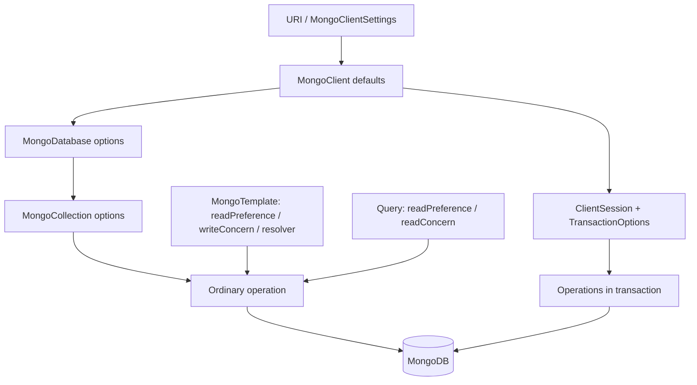

# Options at the client, template, operation, and transaction levels

In an application using **Spring Data MongoDB**, the exact same `find` or `save` call can behave differently depending on **where you configure consistency**. A `MongoClient` may set `ReadPreference.secondaryPreferred()` as its default, while a critical query picks `primary`. A `MongoTemplate` may use `WriteConcern.ACKNOWLEDGED`, while a collection handling critical operations demands `MAJORITY`. When two operations participate in the same **transaction**, the transaction's own concern options govern them under distinct rules—no longer simply "whichever is closest to the method wins."

This lesson belongs to the **Data Consistency** chapter of the `SPRING_DATA_MONGODB` module. You will connect to MongoDB, map documents, and operate through `MongoTemplate` or repositories, while applying query design, aggregations, indexes, transactions, reactive access, testing, and performance diagnostics. The specific topic here is **configuration scope** and **precedence rules** for `ReadPreference`, `ReadConcern`, and `WriteConcern` from the MongoDB Java Driver up into Spring Data MongoDB.

> **Decision point:** These three options answer **three different questions**: which node to read from (`ReadPreference`), what commitment level of data to read (`ReadConcern`), and how much write confirmation to wait for (`WriteConcern`). Outside transactions, settings can inherit across client/database/collection and be overridden at supported layers; inside transactions, **transaction concerns** govern operations. None of these settings replace authorization, optimistic locking, multi-document transactions, or idempotency.

## 1. Learning objectives

After this lesson, you can:

1. Distinguish `ReadPreference`, `ReadConcern`, `WriteConcern`, causal consistency, and transaction isolation.
2. Explain how **client, database, collection, template, query/operation, session, and transaction** differ in scope.
3. Configure defaults via MongoDB connection URI or `MongoClientSettings`.
4. Understand that `MongoDatabase.withReadConcern` and `MongoCollection.withWriteConcern` return **new handles**, without mutating the original handle.
5. Use `MongoTemplate.setWriteConcern`, `setReadPreference`, and `setWriteConcernResolver` properly.
6. Use `Query.withReadConcern` and `Query.withReadPreference` where query methods support them.
7. Avoid assuming every Spring Data operation accepts an arbitrary `WriteConcern` directly on `Query`.
8. Configure `MongoTransactionManager` and `TransactionOptions` for multi-document business workflows.
9. Use transaction labels `mongo:readConcern`, `mongo:writeConcern`, and `mongo:readPreference` in supported versions.
10. Understand how **transaction** options differ from **in-transaction operation** options, including the rule against setting separate write concerns on child commands.
11. Distinguish `majority` from reading latest, `primary` from write durability, and `snapshot` from `linearizable`.
12. Use `ClientSession` for causal consistency and understand why having a session **does not automatically mean** being in a transaction.
13. Contrast Spring imperative and reactive transaction contexts, subscription timing, and session closure.
14. Verify effective configurations with command monitoring, replica set integration tests, and appropriate failover scenarios.
15. Design business consistency policies, control latency, and avoid promising unbacked guarantees in API contracts.

## 2. Three non-interchangeable configuration axes

| Option | Question answered | Example values | **Does not** guarantee |
| --- | --- | --- | --- |
| `ReadPreference` | Read from which node? | `primary`, `secondaryPreferred`, `nearest` | That just-written records have reached that node |
| `ReadConcern` | What consistency/durability level does read data meet? | `local`, `majority`, `snapshot` | Always reading "system-wide latest" |
| `WriteConcern` | How many nodes acknowledge the write, and wait for journal? | `w:1`, `majority`, `j:true` | Subsequent requests will immediately read it on every secondary |
| `ClientSession` | Do operations share causal linkage and session metadata? | `causallyConsistent(true)` | Implicit multi-document transaction |
| `TransactionOptions` | What concerns/preference do operations in the transaction use? | `snapshot + majority + primary` | Automatic protection for external side effects |

Suppose there are 3 nodes:

```text
P : primary
S1: secondary (low replication lag)
S2: secondary (high replication lag)
```

A client writes a document to P. If a subsequent read uses `secondaryPreferred` and the server picks S2, the data may not have reached S2 yet. **`WriteConcern.MAJORITY` on the write does not force an arbitrary secondary read to immediately observe the change**, especially in modern MongoDB versions where applying oplog entries on secondaries can occur asynchronously after majority acknowledgment. For read-your-writes across nodes, see `ClientSession` with causal consistency and appropriate concerns.

## 3. Data model used throughout

An e-wallet application has two collections: `accounts` and `ledger_entries`. Accounts store balances, while the ledger records accepted changes.

```java
package dev.learning.consistency;

import org.springframework.data.annotation.Id;
import org.springframework.data.annotation.Version;
import org.springframework.data.mongodb.core.mapping.Document;
import org.springframework.data.mongodb.core.mapping.Field;

@Document("consistency_accounts")
public class Account {
    @Id
    private String id;

    @Field("tenant_id")
    private String tenantId;

    private long balanceCents;

    @Version
    private Long version;

    protected Account() {}

    public Account(String id, String tenantId, long balanceCents) {
        this.id = id;
        this.tenantId = tenantId;
        this.balanceCents = balanceCents;
    }

    public String getId() { return id; }
    public String getTenantId() { return tenantId; }
    public long getBalanceCents() { return balanceCents; }
    public Long getVersion() { return version; }

    public void setBalanceCents(long balanceCents) {
        this.balanceCents = balanceCents;
    }
}
```

```java
package dev.learning.consistency;

import org.springframework.data.annotation.Id;
import org.springframework.data.mongodb.core.mapping.Document;
import org.springframework.data.mongodb.core.mapping.Field;

@Document("consistency_ledger")
public record LedgerEntry(
    @Id String id,
    @Field("tenant_id") String tenantId,
    String accountId,
    long deltaCents,
    String requestId) {}
```

**Place the two classes in separate Java files** when practicing. Examples use alphanumeric prefixed IDs to avoid 24-hex `String @Id` values unexpectedly mapping to `ObjectId`.

Different business requirements call for different settings:

- A catalog page not needing instant updates can tolerate a slightly lagging secondary.
- A user who just transferred funds needs to see the updated state consistently in their session.
- A transfer modifying two accounts and writing a ledger entry requires a **transaction**, not merely a majority write.
- A duplicate debit request caused by retries requires **idempotency**, not `@Version` alone.

## 4. Big picture: where do settings flow?



The diagram has **two branches**, not a single linear priority arrow:

1. **Outside transactions:** client options inherit down to database/collection and can be overridden at the operation level where APIs support it. `MongoTemplate` acts as a **Spring Data policy layer** when preparing collections and commands.
2. **Inside transactions:** the driver/session/transaction manager determines the concerns applied **to the entire transaction**. Database, collection, or inner operation concern settings **do not override transaction concerns**.

A driver `MongoCollection` object and a `Query` mapped by `MongoTemplate` can travel **two different configuration paths**. Never conclude which option wins merely from variable names; look at how the operation is actually executed.

## 5. Scope and precedence: baseline table

| Layer | Scope | Typical configuration | Notes |
| --- | --- | --- | --- |
| **Client** | Default for operations on the client | URI, `MongoClientSettings` | Shared across multiple repositories/templates |
| **Database handle** | Operations via that handle | `withReadConcern`/`withWriteConcern`/`withReadPreference` | Returns a **new handle** |
| **Collection handle** | Operations via that collection handle | Same `with…` family | Overrides inherited settings outside transactions |
| **MongoTemplate** | Operations through that template instance | `setReadPreference`, `setWriteConcern`, `setWriteConcernResolver` | Not a new `MongoClientSettings` |
| **Query/operation** | Specific read/write commands | `Query.withReadConcern`, `withReadPreference`, driver options | Depends on API support |
| **ClientSession** | Group of operations sharing a session | `ClientSessionOptions` | Does not automatically start an atomic transaction |
| **Transaction** | All commands inside the transaction | `TransactionOptions`, `@Transactional(label=…)` | Transaction concerns govern child commands |

The main MongoDB Java Driver rule **outside transactions** is:

```text
client default
   < database setting
   < collection setting
   < per-operation override (if supported)
```

However, `MongoTemplate` can **actively reconfigure collection handles** according to template policy; therefore, do not treat template as a passive member of the raw Java Driver chain, nor assume "collection always beats template." Inside transactions, transaction-level rules take precedence.

### 5.1. Omitted config does not mean weak config

If the client omits `WriteConcern`, MongoDB applies an **implicit default write concern** based on topology and server configuration; on many modern replica sets this may be `w:"majority"`, whereas certain arbiter topologies default to `w:1`. Driver `WriteConcern.ACKNOWLEDGED` and server implicit defaults do not always display identically.

Never teach mechanically that "MongoDB always defaults to w:1" or "always majority." Inspect `getDefaultRWConcern`, replica-set topology, connection URI, and MongoDB version.

## 6. Setting defaults on MongoClient: connection URI

Illustrative URI for a test replica set:

```text
mongodb://node1.example.test:27017,node2.example.test:27017,node3.example.test:27017/learning?replicaSet=rs0&readPreference=primary&readConcernLevel=majority&w=majority&wtimeoutMS=5000&journal=true
```

Meanings:

| URI option | Effect |
| --- | --- |
| `replicaSet=rs0` | Identifies the replica set topology |
| `readPreference=primary` | Selects primary for default reads |
| `readConcernLevel=majority` | Reads only majority-committed data per read concern guarantees |
| `w=majority` | Waits for majority acknowledgment on writes |
| `wtimeoutMS=5000` | Caps wait time for **write concern**, not an overall deadline for every RPC |
| `journal=true` | Requests journal write concern per server/version |

These hostnames are examples only. Real systems must configure TLS, authentication, secret management, timeouts, and environment-specific URIs. Never embed real passwords in code or logs.

**Do not equate `wtimeoutMS` with `socketTimeoutMS`, `serverSelectionTimeoutMS`, `maxTimeMS`, or `maxCommitTimeMS`.** Each bounds a different phase. A write concern timeout can occur **after the change already applied on the primary**, making the outcome **uncertain at the requested level**, not definitely unwritten.

## 7. Setting defaults via MongoClientSettings

When building the client explicitly:

```java
package dev.learning.consistency;

import com.mongodb.ConnectionString;
import com.mongodb.MongoClientSettings;
import com.mongodb.ReadConcern;
import com.mongodb.ReadPreference;
import com.mongodb.WriteConcern;
import com.mongodb.client.MongoClient;
import com.mongodb.client.MongoClients;

public final class MongoClientsForExamples {
    private MongoClientsForExamples() {}

    public static MongoClient newClient(String uri) {
        MongoClientSettings settings = MongoClientSettings.builder()
            .applyConnectionString(new ConnectionString(uri))
            .readPreference(ReadPreference.primary())
            .readConcern(ReadConcern.MAJORITY)
            .writeConcern(WriteConcern.MAJORITY)
            .build();

        return MongoClients.create(settings);
    }
}
```

Here, setters are invoked **after** `applyConnectionString` to make the programmatic policy intentional; if the URI also sets the same options, **builder order** and Spring Boot autoconfiguration can affect precedence. In Spring Boot apps, favor one clear configuration source and inspect the active settings rather than spawning an off-band `MongoClient`.

### 7.1. Spring Boot does not directly imply raw MongoClientSettings

Depending on Spring Boot version, an application may use URI/properties and `MongoClientSettingsBuilderCustomizer` or a custom client/factory bean. Package names and autoconfiguration classes can change between Boot 3.x and 4.x, so **never copy package imports from a different Boot line without checking your dependency BOM**.

**Establish single ownership** for configuration:

- If Boot creates the `MongoClient`, use the customization hook supported by your Boot version.
- If you create `MongoClient` manually, ensure `MongoDatabaseFactory` and `MongoTemplate` actually use **that exact client**.
- With multiple clients/database factories, bind repositories, templates, and transaction managers explicitly by bean name and scope.

Never register a custom `MongoClient` assuming all repositories instantly switch to it when multiple `MongoDatabaseFactory` beans exist.

## 8. Database handles: withReadConcern / withWriteConcern / withReadPreference

At the MongoDB Java Driver layer:

```java
import com.mongodb.ReadConcern;
import com.mongodb.ReadPreference;
import com.mongodb.WriteConcern;
import com.mongodb.client.MongoDatabase;

MongoDatabase base = mongoClient.getDatabase("learning");

MongoDatabase strong = base
    .withReadPreference(ReadPreference.primary())
    .withReadConcern(ReadConcern.MAJORITY)
    .withWriteConcern(WriteConcern.MAJORITY);
```

`base` retains its prior settings; `strong` is a **new configured handle**. These `with…` methods do not issue `collMod` and **do not change long-lived server defaults** for other clients.

Example:

```java
System.out.println(base.getReadConcern());
System.out.println(strong.getReadConcern());
```

Other code holding `base` is unaffected when `strong` is created. While immutability reduces side effects, it also creates subtle bugs when developers call `base.withReadConcern(...)` and **discard the return value**.

### 8.1. The chosen handle determines effective settings

```java
MongoDatabase configured =
    mongoClient.getDatabase("learning")
        .withWriteConcern(WriteConcern.MAJORITY);

// Must use configured for subsequent operations.
configured.getCollection("consistency_accounts")
    .insertOne(new org.bson.Document(
        "_id", "CONFIG-EXAMPLE-1"));
```

This is a raw Driver example without Java entity mapping. Do not run this `insertOne` against production unless intending to insert real data.

## 9. Collection handles: overriding for one namespace

```java
import com.mongodb.ReadConcern;
import com.mongodb.ReadPreference;
import com.mongodb.WriteConcern;
import com.mongodb.client.MongoCollection;
import org.bson.Document;

MongoCollection<Document> defaultHandle =
    mongoClient.getDatabase("learning")
        .getCollection("consistency_accounts");

MongoCollection<Document> accountHandle = defaultHandle
    .withReadPreference(ReadPreference.primary())
    .withReadConcern(ReadConcern.MAJORITY)
    .withWriteConcern(WriteConcern.MAJORITY);
```

Just like database handles, `with…` returns a **different `MongoCollection`**, leaving `defaultHandle` unchanged. These settings apply only to operations **executed through `accountHandle`**.

A Spring Data `AccountRepository` **does not automatically use** `accountHandle` simply because both target the same collection name. Repositories go through template/driver handles created or managed by Spring Data.

### 9.1. "Client → database → collection" does not automatically include MongoTemplate

If you configure `accountHandle`, yet a service calls:

```java
repository.findById("ACCOUNT-1");
```

the service may still use a different client/database/template policy. For consistent repository policies, configure the client/template/factory used by that repository, or expose an explicit controlled access path.

### 9.2. Avoid raw driver operations inside a transaction without passing the session

Inside Spring Data `@Transactional`, a raw `MongoCollection` obtained directly from the client calling `insertOne(document)` **does not automatically join the Spring-bound `ClientSession`**. To make a raw driver call join the transaction, use a session-aware callback or pass the exact `ClientSession` to the corresponding driver overload.

This is a serious architectural bug: externally the method looks `@Transactional`, yet one write "escapes" the transaction.

## 10. MongoTemplate: setWriteConcern and setReadPreference

`MongoTemplate` is the abstraction backing repositories and typed operations. It exposes its own settings:

```java
import com.mongodb.ReadPreference;
import com.mongodb.WriteConcern;
import org.springframework.data.mongodb.core.MongoTemplate;

MongoTemplate template = new MongoTemplate(
    mongoClient, "learning");

template.setReadPreference(ReadPreference.primary());
template.setWriteConcern(WriteConcern.MAJORITY);
```

This snippet illustrates **template initialization**. Never mutate these settings on a singleton `MongoTemplate` serving concurrent requests; mutating runtime state causes concurrency/visibility hazards and unpredictable per-request concerns.

`setReadPreference` picks the default read preference when Spring Data prepares collections unless overridden on `Query`. `setWriteConcern` sets the policy for template write operations unless a resolver or other mechanism intervenes. When omitted on the template, it typically falls back to driver/database-factory/collection defaults along the execution path.

**Do not assume `MongoTemplate` has a `setReadConcern(ReadConcern)` symmetrical to `setWriteConcern`.** To customize read concern per query, use `Query.withReadConcern` or configure a matching client/driver handle. Verify against your version's Javadoc.

## 11. WriteConcernResolver: policy per operation or entity

Spring Data MongoDB lets `WriteConcernResolver` decide `WriteConcern` when the template executes **INSERT, SAVE, UPDATE, or REMOVE**.

```java
import com.mongodb.WriteConcern;
import org.springframework.data.mongodb.core.MongoAction;
import org.springframework.data.mongodb.core.WriteConcernResolver;

WriteConcernResolver resolver = (MongoAction action) -> {
    String collection = action.getCollectionName();

    if ("consistency_ledger".equals(collection)) {
        return WriteConcern.MAJORITY;
    }

    return action.getDefaultWriteConcern();
};

mongoTemplate.setWriteConcernResolver(resolver);
```

The resolver can inspect `action.getEntityType()`, operation type, collection name, and related metadata. In this example, **ledger** chooses majority while other collections inherit the template's default concern.

**Pitfall:** the resolver applies to **supported write paths through `MongoTemplate`**; if code pulls raw `mongoClient.getDatabase(...).getCollection(...)` and calls `updateOne`, it **bypasses the resolver**.

### 11.1. A resolver is not a security rule

Never let user input downgrade durability from majority to unacknowledged—especially for money, orders, or writes requiring `matchedCount`. `WriteConcernResolver` is an **internal policy**, not an API parameter allowing clients to pick `w` at will.

### 11.2. Write concern and @Version

Optimistic locking requires **acknowledged write results** to detect updates rejected due to stale versions. `WriteConcern.UNACKNOWLEDGED` prevents reliable detection of optimistic lock failures. Never configure a resolver to return `UNACKNOWLEDGED` for entities using `@Version` without evaluating this risk.

## 12. Per-Query configuration: readConcern and readPreference

Spring Data MongoDB `Query` provides:

```java
import com.mongodb.ReadConcern;
import com.mongodb.ReadPreference;
import org.springframework.data.mongodb.core.query.Criteria;
import org.springframework.data.mongodb.core.query.Query;

Query query = Query.query(
    Criteria.where("tenantId").is(authorizedTenant)
        .and("id").is(accountId)
);

query.withReadConcern(ReadConcern.MAJORITY);
query.withReadPreference(ReadPreference.primary());

Account account = mongoTemplate.findOne(query, Account.class);
```

Both methods configure **this single read operation**, leaving client/template defaults unchanged for other calls. With typed `Account.class`, Spring Data maps `tenantId` to `tenant_id` and `id` to `_id`.

### 12.1. Do not assume every Query option applies to every command

For overloads taking `Query`, Spring Data applies supported settings per operation type. However:

- `Query.withReadConcern` configures **read concern**, not write concern.
- `Query.withReadPreference` is meaningless on **write-only operations**.
- Aggregations, change streams, specialized commands, and derived repository methods follow different API paths; do not assume they read a `Query` constructed elsewhere.
- Inside a transaction, read concerns on queries/collections/databases **do not override the transaction read concern**.

Check the Javadoc of each specific method and inspect emitted BSON commands when exact guarantees matter.

### 12.2. Never use read preference instead of security predicates

`ReadPreference.primary()` only selects the server node. It does not make MongoDB filter tenants, user permissions, or soft-deleted records. Queries must still bind `tenantId` from an authenticated principal, never trusting client-supplied values.

## 13. Non-transaction comparison table

Suppose:

- Client defaults to `secondaryPreferred` + `ReadConcern.LOCAL` + `WriteConcern.ACKNOWLEDGED`.
- A collection handle is created with `ReadConcern.MAJORITY`.
- A template sets `setReadPreference(primary)` and `setWriteConcern(MAJORITY)`.
- A `Query` sets `ReadPreference.primary()` and `ReadConcern.MAJORITY`.

| Access path | Effective read preference | Effective read concern | Effective write concern |
| --- | --- | --- | --- |
| Raw client database/collection without overrides | Inherits client | Inherits client | Inherits client/server default |
| Raw `collection.withReadConcern(MAJORITY)` | Inherited on handle | MAJORITY | Inherited on handle |
| `MongoTemplate.find(Query)` with overrides | Per `Query` / template policy | Per `Query` | Not applicable |
| `MongoTemplate.save` | Not applicable for write routing | Not applicable | Template/resolver policy |
| Another raw driver handle | Per that exact handle | Per that exact handle | Per that exact handle |
| Command inside a transaction | Per transaction routing (must be valid) | Transaction read concern | Transaction write concern |

This is an **inference reference table**, not a snapshot of a live environment. To prove what concerns a deployment actually uses, trace the real configuration chain and command/callback/transaction metadata—especially when multiple clients/templates, URI/Boot customizers, or raw driver handles exist.

## 14. ReadConcern: local, majority, linearizable, and snapshot

`ReadConcern` controls which data versions are eligible to be read. It is not a simple replication-lag timer.

| Level | General meaning | Watch out for |
| --- | --- | --- |
| `LOCAL` | Reads current data on the selected node, possibly not majority-committed | Can read data that later rolls back |
| `AVAILABLE` | Prioritizes availability, may read non-majority-committed data | Special behavior on sharded clusters; invalid in causal sessions/transactions |
| `MAJORITY` | Reads only majority-committed data | Does not mean "cluster-wide latest" |
| `LINEARIZABLE` | Provides linearizability guarantees for supported primary reads paired with majority writes | Narrow applicability, may block; invalid in transactions |
| `SNAPSHOT` | Reads from a consistent snapshot per operation/transaction contract | Valid scope differs inside vs. outside transactions |

**Do not assume replacing `LOCAL` with `MAJORITY` solves read-your-writes between two clients lacking a shared session.** A secondary may sit at an older majority-committed point than what the primary just updated.

### 14.1. Majority ≠ linearizable

When a query reads with `ReadConcern.MAJORITY`, returned data meets majority-commit guarantees, yet the system does not promise the query reflects **every change completed before the query started** in the linearizable sense. `ReadConcern.LINEARIZABLE` offers stronger semantics for qualifying reads, with substantial availability/latency constraints and trade-offs. Never adopt it as a "safe default" for all queries or aggregations.

### 14.2. Snapshot is not a toggle for arbitrary Queries

`ReadConcern.SNAPSHOT` is primarily used in multi-document transactions; MongoDB also supports snapshot reads outside transactions for **certain** read commands and server versions, not every command. Never attach `Query.withReadConcern(SNAPSHOT)` to arbitrary repository methods expecting it to turn into a transaction or a "multi-call snapshot."

### 14.3. Majority inside transactions depends on commit concern

MongoDB emphasizes that `ReadConcern.MAJORITY`/`SNAPSHOT` guarantees **in multi-document transactions** depend on the transaction **committing with `WriteConcern.MAJORITY`**. A transaction committing with `w:1` lacks the same majority durability guarantee for snapshot reads across failovers.

## 15. WriteConcern: w, journal, timeout, and uncertain outcomes

Write concerns in Java:

```java
import com.mongodb.WriteConcern;

WriteConcern w1 = WriteConcern.W1;
WriteConcern acknowledged = WriteConcern.ACKNOWLEDGED;
WriteConcern majority = WriteConcern.MAJORITY;
WriteConcern journaled = WriteConcern.JOURNALED;
WriteConcern unsafe = WriteConcern.UNACKNOWLEDGED; // Do not use with OCC.
```

| Option | Behavior |
| --- | --- |
| `w:1` / `W1` | Waits for one node (typically primary) |
| `w:"majority"` | Waits for replica set majority condition |
| `j:true` | Requests journaling per driver/server rules |
| `wtimeoutMS` | Time limit for waiting on write concern; does not necessarily cancel applied changes |
| `w:0` / `UNACKNOWLEDGED` | No reliable write outcome returned; unsuitable for optimistic locking or commands needing `matchedCount` |

A majority write can raise latency when replication members lag or disconnect. Conversely, `w:1` can respond faster while exposing changes to rollback under failover. Choose based on RPO/durability and UX, not average-latency benchmarks alone.

### 15.1. Why does timeout not mean "failed without writing"?

```text
Client -> Primary: update balance
Primary: applies change
Primary -> Secondaries: replication slow
Client: writeConcern timeout
```

The request can receive a majority-wait error even though the server already applied the change on the primary. If the client immediately retries an arbitrary `$inc`, the change can apply twice. **You need idempotency keys, proper retryable-write semantics, and reconciliation.**

### 15.2. Default write concern depends on topology

MongoDB computes an implicit default write concern from system configuration and data-bearing/arbiter member counts. Never infer from Java's `WriteConcern.ACKNOWLEDGED` that the server always uses `w:1`, nor assume every replica set defaults to majority. Inspect `getDefaultRWConcern` and any declared overrides.

## 16. ReadPreference: primary and secondaries can observe different data

Typical modes:

```java
import com.mongodb.ReadPreference;

ReadPreference primary = ReadPreference.primary();
ReadPreference preferred = ReadPreference.primaryPreferred();
ReadPreference secondary = ReadPreference.secondary();
ReadPreference secondaryPreferred = ReadPreference.secondaryPreferred();
ReadPreference nearest = ReadPreference.nearest();
```

| Mode | Node selected for read | Risks or trade-offs |
| --- | --- | --- |
| `primary` | Primary | Read load hits primary; requires an available primary |
| `primaryPreferred` | Prefer primary, fall back to secondary if needed | Fallback may read lagging data |
| `secondary` | Secondary | Can be stale; errors if no eligible secondary exists |
| `secondaryPreferred` | Prefer secondary, fall back to primary | Behavior varies with topology state |
| `nearest` | Lowest-latency eligible node per driver criteria | Closest network node does not mean freshest data |

Read preferences other than `primary` can observe stale data due to asynchronous replication. `ReadPreference` **does not elevate read concern**, does not alter logical read **visibility**, and does not replace causal sessions.

### 16.1. "nearest" does not mean "freshest"

`nearest` governs node selection/network latency, not which node holds the newest data. The lowest-latency secondary can still lag many operations behind the primary.

### 16.2. Mixed read/write applications

Example policies:

- Statistics dashboards can use secondaries if staleness is acceptable.
- Immediately after a user updates their account and must see the result, prefer primary or a causal session with majority concerns.
- Secondary index queries must account for per-member index visibility.
- Inside transactions, read operations must obey **valid transaction read preferences** (typically `PRIMARY`), never silently reading from secondaries just because the client defaulted to `secondaryPreferred`.

## 17. ClientSession and causal consistency are not transactions

`ClientSession` creates a context binding operations to one session. Enable `causallyConsistent(true)` to instruct the driver/server to respect causal ordering across sequential operations in that session.

```java
import com.mongodb.ClientSessionOptions;
import com.mongodb.ReadConcern;
import com.mongodb.ReadPreference;
import com.mongodb.WriteConcern;
import com.mongodb.client.ClientSession;
import org.springframework.data.mongodb.core.query.Criteria;
import org.springframework.data.mongodb.core.query.Query;

ClientSessionOptions options = ClientSessionOptions.builder()
    .causallyConsistent(true)
    .build();

try (ClientSession session = mongoClient.startSession(options)) {
    mongoTemplate.withSession(() -> session).execute(operations -> {
        Account current = operations.findOne(
            Query.query(Criteria.where("id").is(accountId))
                .withReadConcern(ReadConcern.MAJORITY)
                .withReadPreference(ReadPreference.primary()),
            Account.class
        );

        // Operations execute within the same ClientSession.
        // If writes occur, effective write concern must match policy.
        return current;
    });
}
```

`mongoClient`, `mongoTemplate`, and `accountId` are created/provided earlier by the application. This snippet demonstrates **passing a session into a template callback**; because `startTransaction` was never called, it is **not a multi-document transaction**.

### 17.1. Conditions for full causal consistency guarantees

MongoDB documents **four** causal consistency guarantees when operations in a causally consistent session use **`ReadConcern.MAJORITY` and `WriteConcern.MAJORITY`**:

1. Read your writes.
2. Monotonic reads.
3. Monotonic writes.
4. Writes follow reads.

Other concern pairs may satisfy some behaviors in practice, yet **must not be claimed to provide all four durability-backed guarantees**. Execute operations sequentially and pass the session consistently to every operation.

### 17.2. A session does not automatically isolate from external clients

Operations inside a session **are not automatically isolated** from operations outside the session. For atomic multi-document commit/rollback, start a transaction on the session or use a Spring transaction manager.

### 17.3. Closing sessions on time

`ClientSession` is a closeable resource. Never share an active session arbitrarily across concurrent threads; MongoDB sessions enforce concurrency rules. When using lazy references/DBRefs, account for whether lazy loading still needs the session after the callback ends.

## 18. TransactionOptions: one concern level for the whole transaction

Using the Java Driver directly:

```java
import com.mongodb.ReadConcern;
import com.mongodb.ReadPreference;
import com.mongodb.TransactionOptions;
import com.mongodb.WriteConcern;
import java.util.concurrent.TimeUnit;

TransactionOptions options = TransactionOptions.builder()
    .readPreference(ReadPreference.primary())
    .readConcern(ReadConcern.SNAPSHOT)
    .writeConcern(WriteConcern.MAJORITY)
    .maxCommitTime(5, TimeUnit.SECONDS)
    .build();
```

Meanings:

- `ReadPreference.primary()`: transaction reads route properly.
- `ReadConcern.SNAPSHOT`: consistent read view for the transaction per MongoDB semantics.
- `WriteConcern.MAJORITY`: requests majority acknowledgment at commit for desired durability.
- `maxCommitTime`: caps server-side commit execution time, **not** total end-to-end duration of the entire transaction.

### 18.1. Why not override concerns per command inside a transaction?

MongoDB configures transaction read/write concerns at **transaction scope**. Database, collection, or per-command read/write concerns inside a transaction **cannot override** transaction settings. In fact, setting write concern directly on an in-transaction command is invalid in several contexts and rejected by the server/driver.

Do not do this:

```java
// Wrong expectation: inside a transaction, collection.withWriteConcern(W1)
// will NOT make a single child write use "w:1".
var collection = mongoClient.getDatabase("learning")
    .getCollection("consistency_accounts")
    .withWriteConcern(WriteConcern.W1);
```

That collection handle still exists; however, when a write **participates in a transaction**, the transaction's concern governs commit. Also never use a raw handle here to "bypass" the transaction—if you omit the session, the command **escapes the transaction**.

### 18.2. Only values valid on MongoDB Server can be used

Driver/API enums may list `ReadConcern.LINEARIZABLE` or `AVAILABLE`, yet **that does not make them valid in every transaction**. MongoDB imposes restrictions per operation/topology; standard transaction read concerns are `LOCAL`, `MAJORITY`, and `SNAPSHOT`—do not pass `LINEARIZABLE`/`AVAILABLE` to transactions arbitrarily.

## 19. Transactions with Spring Data: MongoTransactionManager

To use `@Transactional` with MongoDB, the app needs an appropriate transaction manager and a MongoDB topology supporting transactions (replica set or sharded cluster per server/version).

```java
package dev.learning.consistency;

import com.mongodb.ReadConcern;
import com.mongodb.ReadPreference;
import com.mongodb.TransactionOptions;
import com.mongodb.WriteConcern;
import org.springframework.context.annotation.Bean;
import org.springframework.context.annotation.Configuration;
import org.springframework.data.mongodb.MongoDatabaseFactory;
import org.springframework.data.mongodb.MongoTransactionManager;

@Configuration
class MongoConsistencyConfig {

    @Bean
    MongoTransactionManager mongoTransactionManager(
            MongoDatabaseFactory factory) {

        TransactionOptions options = TransactionOptions.builder()
            .readPreference(ReadPreference.primary())
            .readConcern(ReadConcern.SNAPSHOT)
            .writeConcern(WriteConcern.MAJORITY)
            .build();

        return new MongoTransactionManager(factory, options);
    }
}
```

**The same `MongoDatabaseFactory`** must be shared by the template and transaction manager so sessions attach properly to operations. With multiple databases/factories, never assume `@Transactional` applies to every `MongoTemplate`; specify the exact transaction manager bean.

### 19.1. @Transactional across two accounts + ledger

```java
package dev.learning.consistency;

import org.springframework.dao.OptimisticLockingFailureException;
import org.springframework.data.mongodb.core.MongoTemplate;
import org.springframework.data.mongodb.core.query.Criteria;
import org.springframework.data.mongodb.core.query.Query;
import org.springframework.data.mongodb.core.query.Update;
import org.springframework.stereotype.Service;
import org.springframework.transaction.annotation.Transactional;

@Service
public class TransferService {

    private final MongoTemplate mongoTemplate;

    public TransferService(MongoTemplate mongoTemplate) {
        this.mongoTemplate = mongoTemplate;
    }

    @Transactional
    public void transfer(
            String tenantId,
            String fromId,
            String toId,
            long cents,
            String requestId) {

        if (cents <= 0 || fromId.equals(toId)) {
            throw new IllegalArgumentException("Invalid transfer");
        }

        var debit = mongoTemplate.updateFirst(
            Query.query(Criteria.where("id").is(fromId)
                .and("tenantId").is(tenantId)
                .and("balanceCents").gte(cents)),
            new Update().inc("balanceCents", -cents),
            Account.class
        );

        if (debit.getMatchedCount() != 1) {
            throw new OptimisticLockingFailureException(
                "Invalid source account or insufficient balance");
        }

        var credit = mongoTemplate.updateFirst(
            Query.query(Criteria.where("id").is(toId)
                .and("tenantId").is(tenantId)),
            new Update().inc("balanceCents", cents),
            Account.class
        );

        if (credit.getMatchedCount() != 1) {
            throw new IllegalStateException(
                "Destination account missing or unauthorized");
        }

        mongoTemplate.insert(
            new LedgerEntry(
                "LEDGER-" + requestId,
                tenantId,
                fromId,
                -cents,
                requestId)
        );
    }
}
```

**This is a core transaction example, not a complete production payment system**: it omits double-entry credit ledger entries, principal authorization, duplicate `requestId` reconciliation, unique indexes/idempotency, transient-error retries, and `long` overflow checks. Still, it clearly illustrates three writes in one transaction; any exception before commit causes the transaction manager to roll back all three per contract.

### 19.2. @Transactional does not trigger everywhere automatically

With Spring AOP proxies, a self-invocation `this.transfer(...)` inside the same class **bypasses the proxy**, so the transaction annotation may have no effect. The method must be invoked through the Spring bean/proxy at a managed boundary.

`@Transactional(readOnly=true)` in Spring Data MongoDB **can still start a MongoDB transaction** to bind a `ClientSession`. Never treat it as a "zero-transaction-overhead read." Use it intentionally for snapshot/consistency needs and verify server capabilities.

### 19.3. Create collections before running transactions

Certain DDL/collection operations have restrictions inside transactions depending on server/topology. Do not rely on MongoDB **implicit collection creation on first insert** inside a multi-document transaction; it is safer to provision collections/indexes/validators ahead of business transactions, or check exact server version support.

## 20. Transaction labels in Spring Data MongoDB

In Spring Data releases supporting Mongo-specific transaction labels, you can configure each transactional method:

```java
import org.springframework.transaction.annotation.Transactional;

@Transactional(label = {
    "mongo:readConcern=SNAPSHOT",
    "mongo:readPreference=PRIMARY",
    "mongo:writeConcern=MAJORITY",
    "mongo:maxCommitTime=PT5S"
})
public void transferWithSnapshot(/* business parameters */) {
    // MongoTemplate operations participating in the transaction.
}
```

This is an **illustrative signature**, not a compilable Java method verbatim because `/* business parameters */` and the body are conceptual placeholders. In a real project, keep a service body like `transfer` in Section 19 and annotate the real method.

Labels `mongo:readConcern`, `mongo:readPreference`, `mongo:writeConcern`, and `mongo:maxCommitTime` are parsed by `MongoTransactionOptionsResolver` according to your Spring Data version's rules. Verify support in your release/BOM, uppercase enum names, and `Duration.parse` syntax such as `PT5S`.

### 20.1. Nested transactions do not override options of an already-joined transaction

Example:

```text
outer @Transactional: majority + snapshot
  -> inner @Transactional: local + w1
```

If the inner method uses default propagation `REQUIRED` and **joins the outer transaction**, it does not start a new transaction to swap concerns. The active concerns remain those chosen **when the outer transaction started**. Using distinct options requires an actually new transaction with appropriate propagation/manager semantics and corresponding overhead.

### 20.2. Why labels do not make every enum valid

Spring's parser may recognize an enum constant, yet **MongoDB Server** remains the authority on which read concerns/preferences are legal for a transaction type and topology. Stick to `SNAPSHOT + MAJORITY + PRIMARY` as a clear baseline rather than attempting `AVAILABLE`/`LINEARIZABLE` inside transactions.

## 21. Never break transactions with raw drivers or mismatched factories

A service annotated:

```java
@Transactional
public void placeOrder() {
    mongoTemplate.save(order);

    // Command below uses a raw collection from a different MongoClient.
    rawMongoClient.getDatabase("learning")
        .getCollection("audit")
        .insertOne(new org.bson.Document("type", "ORDER_PLACED"));
}
```

The code above is an **illustrative anti-pattern**; `order` and `rawMongoClient` represent application variables. The raw `insertOne` does not automatically pick up the Spring transaction manager's `ClientSession`. If saving the order rolls back, the audit insert can **still remain**.

For a raw driver operation to join the transaction, use `MongoOperations.withSession(...)`, an appropriate callback/proxy, or pass the exact `ClientSession` to the driver's `insertOne(session, document)` overload. Never rely on "same host/database" assuming they share a transaction.

### 21.1. Session synchronization is a startup configuration

`MongoTemplate.setSessionSynchronization(SessionSynchronization.ALWAYS)` lets the template participate in non-Mongo-native transactions per Spring docs, yet **never toggle it per request** on a singleton template. Configure session synchronization once at bean creation and know which transaction manager owns lifecycle.

## 22. Reactive: transaction context does not live in ThreadLocal

Reactive Spring Data MongoDB requires `ReactiveMongoTransactionManager` and `ReactiveMongoTemplate` to share **the same `ReactiveMongoDatabaseFactory`**.

```java
package dev.learning.consistency;

import org.springframework.context.annotation.Bean;
import org.springframework.context.annotation.Configuration;
import org.springframework.data.mongodb.ReactiveMongoDatabaseFactory;
import org.springframework.data.mongodb.ReactiveMongoTransactionManager;

@Configuration
class ReactiveMongoConsistencyConfig {

    @Bean
    ReactiveMongoTransactionManager reactiveMongoTransactionManager(
            ReactiveMongoDatabaseFactory factory) {
        return new ReactiveMongoTransactionManager(factory);
    }
}
```

Use **Reactor Context** to carry transaction state instead of expecting Java `ThreadLocal` propagation as in imperative stacks.

### 22.1. TransactionalOperator for a reactive chain

```java
import org.springframework.transaction.reactive.TransactionalOperator;
import reactor.core.publisher.Mono;

TransactionalOperator operator =
    TransactionalOperator.create(reactiveMongoTransactionManager);

Mono<Void> workflow = reactiveMongoTemplate
    .updateFirst(fromQuery, debitUpdate, Account.class)
    .flatMap(result -> {
        if (result.getMatchedCount() != 1) {
            return Mono.error(new IllegalStateException(
                "Unable to debit"));
        }
        return reactiveMongoTemplate.updateFirst(
            toQuery, creditUpdate, Account.class);
    })
    .flatMap(result -> {
        if (result.getMatchedCount() != 1) {
            return Mono.error(new IllegalStateException(
                "Unable to credit"));
        }
        return reactiveMongoTemplate.insert(ledgerEntry);
    })
    .then()
    .as(operator::transactional);
```

`fromQuery`, `debitUpdate`, `toQuery`, `creditUpdate`, and `ledgerEntry` are pre-validated values constructed by the application. The publisher must **be subscribed** for operations and the transaction to run. Where `.as(operator::transactional)` is placed determines which publishers belong to the transaction.

### 22.2. Do not confuse reactive @Transactional with imperative

- Imperative transaction managers bind `ClientSession` to a thread.
- Reactive transaction managers bind state in Reactor Context.
- Calling `block()` on an event loop breaks the reactive model and can cause deadlocks/starvation.
- Calling synchronous driver APIs inside a reactive flow does not make them join a reactive transaction.
- A `retryWhen` operator can re-run the whole chain, requiring duplicate side-effect/idempotency handling.
- To adjust reactive transaction concerns/defaults, use manager options or transaction labels—never mutate a singleton template between subscriptions.

## 23. Integration testing: must use a MongoDB replica set

To test **transactions, majority, sessions, and failover**, plain standalone MongoDB **is not enough** to verify all guarantees. Use a test replica set (such as MongoDB Testcontainers configured as a replica set) or a dedicated managed test cluster.

### 23.1. Two-document rollback test

Spring Boot test example assuming `MongoTemplate`, `MongoTransactionManager`, and pre-provisioned collections in a test database:

```java
package dev.learning.consistency;

import static org.assertj.core.api.Assertions.assertThat;
import static org.assertj.core.api.Assertions.assertThatThrownBy;

import java.util.UUID;

import org.junit.jupiter.api.Test;
import org.springframework.beans.factory.annotation.Autowired;
import org.springframework.boot.test.context.SpringBootTest;
import org.springframework.data.mongodb.MongoTransactionManager;
import org.springframework.data.mongodb.core.MongoTemplate;
import org.springframework.data.mongodb.core.query.Criteria;
import org.springframework.data.mongodb.core.query.Query;
import org.springframework.transaction.support.TransactionTemplate;

@SpringBootTest
class MongoConsistencyTransactionIntegrationTest {

    @Autowired MongoTemplate mongoTemplate;
    @Autowired MongoTransactionManager transactionManager;

    @Test
    void failedTransactionDoesNotKeepPartialWrites() {
        String suffix = UUID.randomUUID().toString();
        String tenant = "tenant-test-" + suffix;
        String id = "ACCOUNT-" + suffix;

        var tx = new TransactionTemplate(transactionManager);

        assertThatThrownBy(() ->
            tx.executeWithoutResult(status -> {
                mongoTemplate.insert(
                    new Account(id, tenant, 1_000L));

                mongoTemplate.insert(
                    new LedgerEntry(
                        "LEDGER-" + suffix,
                        tenant, id, -100L, "REQ-" + suffix));

                throw new IllegalStateException("rollback-test");
            })
        ).isInstanceOf(IllegalStateException.class);

        Query accountQuery = Query.query(
            Criteria.where("id").is(id)
                .and("tenantId").is(tenant));

        Query ledgerQuery = Query.query(
            Criteria.where("id").is("LEDGER-" + suffix)
                .and("tenantId").is(tenant));

        assertThat(mongoTemplate.exists(
            accountQuery, Account.class)).isFalse();

        assertThat(mongoTemplate.exists(
            ledgerQuery, LedgerEntry.class)).isFalse();
    }
}
```

The test uses unique IDs and avoids `deleteAll()`. **Important:** the MongoDB replica set and collections `consistency_accounts`/`consistency_ledger` must be **created outside the transaction**; when the server/version requires pre-existing collections, inserting for the first time inside a transaction while a namespace is missing can fail with unexpected DDL errors. Never run tests against production.

### 23.2. Testing overrides outside transactions

Another test creates a `Query` with:

```java
Query query = Query.query(Criteria.where("id").is(accountId))
    .withReadConcern(ReadConcern.MAJORITY)
    .withReadPreference(ReadPreference.primary());

Account found = mongoTemplate.findOne(query, Account.class);
```

Ensure the test runs with a valid account; **never just assert `found != null` and conclude read concern was actually sent**. Use command monitoring or API/driver instrumentation to verify the settings attached to the operation.

### 23.3. Topology test scenarios

| Scenario | What to confirm |
| --- | --- |
| Read from lagging secondary | Data can be stale without a causal session |
| Write `w:1` then failover | Rollback risk depending on topology |
| Majority write and causal majority read in same session | Read-your-writes per contract |
| Write concern timeout | Never assume write did not occur |
| Transaction commit majority | Writes become atomic per transaction |
| Transaction fails between two writes | Rolls back entire transaction |
| Two different clients | Do not automatically share sessions |
| Raw driver write inside `@Transactional` | Does not participate without explicit session |
| `MongoTemplate` with a different `MongoDatabaseFactory` | Does not join the other transaction manager |
| `Query.withReadConcern` inside a transaction | Does not override transaction concern |
| Multi-document transaction with secondary preference | Must obey server restrictions |
| Reactive publisher unsubscribed | Zero DB operations executed |
| Duplicate `requestId` after retry | Requires unique index/idempotency |
| Two writers updating the same account | OCC/CAS/state must be handled explicitly |

Never run chaos/failover experiments on shared clusters; test topology scenarios deliberately in an isolated test environment.

## 24. Observing effective settings: do not look only at properties

To diagnose "why did we read stale data?":

1. Identify **which `MongoClient` bean** the repository/template uses.
2. Inspect URI configuration and programmatic customizers in startup diagnostics.
3. Identify `MongoDatabaseFactory` and actual database/collection names.
4. Check whether `MongoTemplate` sets `setReadPreference`, `setWriteConcern`, or `WriteConcernResolver`.
5. Check whether `Query` sets `withReadConcern`/`withReadPreference`.
6. Check whether the operation belongs to a `ClientSession`/`@Transactional`.
7. If inside a transaction, inspect `TransactionOptions`/labels on **the outermost transaction actually started**.
8. Inspect server topology, replica lag, implicit defaults, and default RW concern.
9. Capture `find`/`aggregate`/`update`/`commitTransaction` commands with a driver listener/profiler.
10. Classify the symptom: stale read, rollback risk, timeout, conflict, or business data race.

### 24.1. CommandListener in the Java Driver

A `CommandListener` in tests can print **command names and non-sensitive metadata**:

```java
import com.mongodb.event.CommandListener;
import com.mongodb.event.CommandStartedEvent;

CommandListener listener = new CommandListener() {
    @Override
    public void commandStarted(CommandStartedEvent event) {
        String name = event.getCommandName();
        if ("find".equals(name)
                || "aggregate".equals(name)
                || "commitTransaction".equals(name)) {
            System.out.println("Mongo command: " + name);
            // In isolated tests: inspect readConcern/lsid/txnNumber fields.
            // Never log raw production BSON containing PII/credentials.
        }
    }
};
```

This listener is **not registered on a client yet**; attach it via `MongoClientSettings.builder().addCommandListener(listener)` in test config. To prove **read preference** routing, reading the JSON body of a `find` alone is insufficient: routing/connection metadata and `$readPreference` may live outside the command document depending on topology/driver. Evaluate the actual endpoint/node selected or topology-aware command monitoring.

### 24.2. Server-side commands

In the appropriate environment, inspect server defaults with MongoDB commands:

```javascript
db.adminCommand({ getDefaultRWConcern: 1 })
```

This shows **server defaults**, not client/template/query/session overrides. On replica sets, inspect member states and replication lag with proper operational tools; never invoke privileged admin commands from application service accounts during normal request handling.

## 25. Common mistakes

| Symptom | Common cause | Remediation |
| --- | --- | --- |
| Set majority in URI, yet operations use `w:1` | Different client, template resolver, override, or tooling | Trace client/factory/template and emitted commands |
| Reading from secondary misses just-written data | Replication lag, missing causal session | Use primary or appropriate majority/causal session |
| Assuming `readPreference=primary` means durable | Node routing does not govern write durability | Configure write concern |
| Assuming `readConcern=majority` is always latest | Majority view can lag | Understand read concern vs. linearizability |
| `wtimeout` occurs, then retry `$inc` twice | Failure to distinguish uncertain writes | Idempotency/retry policy |
| Calling `withReadConcern` and ignoring return value | Driver handles are immutable | Capture and use the returned handle |
| Calling `Template.setReadPreference` mid-request | Shared mutable singleton policy | Configure once at startup |
| Expecting `Template` to have `setReadConcern` | API misconception | Use `Query.withReadConcern`/driver handles |
| `Query.withReadConcern` does not affect transaction | Transaction concern governs | Configure `TransactionOptions`/labels |
| `@Transactional` does not actually roll back | Missing `MongoTransactionManager`, self-invocation, wrong topology | Configure manager/proxy/test replica set |
| Raw driver write survives transaction rollback | `ClientSession` not passed | Use session-aware callbacks |
| `TransactionOptions` with secondary read fails | Transaction read preference must be valid | Use `primary` |
| Nested `@Transactional` label has no effect | Inner joined outer transaction | Set options when starting the outer transaction |
| `@Transactional(readOnly=true)` still incurs cost | A real Mongo transaction is opened | Re-evaluate read-only use case |
| Enabling majority increases latency | Secondary lag / unmet quorum | Inspect topology, SLOs, and `WriteConcern` |
| Picking `w:0` for throughput | No write result for OCC | Keep acknowledged writes |
| Session lacks atomicity | Transaction was never started | Use transaction manager when needed |
| Reactive flow runs outside transaction | Lost Reactor Context or wrong composition | Wrap the entire publisher chain with operator |
| Calling `block()` inside reactive HTTP handlers | Blocks event loop, risks deadlocks | Compose purely reactive publishers |
| Testing transactions on standalone MongoDB | Lacks matching transaction semantics | Use a test replica set |
| Read model misses records | Query filter/index/latency, not just concerns | Verify data shape and execution plan |

### 25.1. When data looks "inconsistent," classify the issue

- **Stale read:** reading an older version from the selected node.
- **Rollback risk:** non-majority-committed writes lost during failover.
- **Lost update:** concurrent requests saving from stale snapshots; needs `@Version`/CAS.
- **Partial multi-document write:** operation A succeeds while B fails; needs transaction/outbox.
- **Duplicate command:** retrying after timeout; needs idempotency.
- **Dirty/inconsistent read view:** needs appropriate read concern or transaction/snapshot.
- **Authorization leak:** reading another tenant's data; concerns **never fix this**.

Name the exact bug before cranking up consistency levels; picking the wrong tool increases latency while leaving the bug intact.

## 26. Hands-on exercises

**Exercise 1 — Three concerns.** Distinguish `ReadPreference.primary`, `ReadConcern.MAJORITY`, and `WriteConcern.MAJORITY` in one business sentence each. Why can none replace the others?

**Exercise 2 — Client overrides.** Client is configured with `secondaryPreferred/local/w1`; create a driver collection handle with `majority/primary` and check whether the original handle changes. *Answer:* no.

**Exercise 3 — Template.** Set `setReadPreference(primary)` and `setWriteConcern(MAJORITY)` at startup; add a `WriteConcernResolver` specifically for the ledger. Do raw driver commands go through that resolver?

**Exercise 4 — Query.** Write a `Query` finding `Account` by tenant+ID, call `withReadConcern(MAJORITY)`/`withReadPreference(primary)`, and explain the override's scope.

**Exercise 5 — Transactions.** Configure `MongoTransactionManager` with `SNAPSHOT + MAJORITY + PRIMARY`. Why don't child commands switch to `LOCAL` when passed a `Query` override?

**Exercise 6 — Transaction labels.** Annotate a business method with `@Transactional(label={"mongo:readConcern=SNAPSHOT","mongo:writeConcern=MAJORITY"})`; add an inner method with different labels. What happens if the inner method joins the outer transaction?

**Exercise 7 — Causal consistency.** Construct `ClientSessionOptions.causallyConsistent(true)`; list the concern requirements needed for durable read-your-writes when reading from secondaries.

**Exercise 8 — Timeouts.** A majority write throws `wtimeoutMS`, yet the primary already applied the update. Why is immediately retrying `$inc` unsafe?

**Exercise 9 — `@Transactional` + raw handle.** Inside a transaction, call `MongoTemplate.save` and then `MongoClient.getCollection().insertOne` without passing the session. What danger arises upon rollback?

**Exercise 10 — Reactive.** Use `TransactionalOperator` around two reactive updates and one insert. Where must `.as(operator::transactional)` be placed?

**Exercise 11 — Testing failover.** On a test replica set, compare secondary visibility after a majority write with and without a causal session; avoid drawing rigid conclusions from a single run.

**Exercise 12 — Incident classification.** A customer is charged twice after a timeout. Is that a read concern issue, a lost update, or an idempotency issue? Design the proper fix.

**Exercise 13 — Default concerns.** Run `getDefaultRWConcern`, inspect a topology containing an arbiter, and compare with the application's configured write concern.

**Exercise 14 — Health/observability.** Design checks verifying there is a `MongoTransactionManager`, the right factory, valid `TransactionOptions`, and a command listener logging only safe metadata.

## 27. Implementation checklist

- [ ] Correctly classify the problem: stale read, rollback, lost update, multi-write atomicity, or retry duplicate.
- [ ] Distinguish `ReadPreference`, `ReadConcern`, and `WriteConcern`.
- [ ] Recognize client-level settings are only defaults that can be overridden.
- [ ] For driver handles, retain the returned instance from `withReadConcern/withWriteConcern/withReadPreference`.
- [ ] Verify `MongoTemplate` is configured once at startup, never mutated between requests.
- [ ] Use `WriteConcernResolver` strictly as internal policy for template writes.
- [ ] Do not assume `Query` has per-write concern; check exact APIs.
- [ ] When per-query read overrides are needed, use `Query.withReadConcern/withReadPreference` on supported methods.
- [ ] Never allow users to override concerns or supply arbitrary tenant IDs.
- [ ] Understand implicit default write concern varies with topology and arbiters.
- [ ] Never use `UNACKNOWLEDGED` with optimistic locking/CAS needing `matchedCount`.
- [ ] Understand timeouts do not prove writes were not applied.
- [ ] Use causal sessions with majority/majority when full durable causal guarantees are needed.
- [ ] Configure `MongoTransactionManager`/`ReactiveMongoTransactionManager` whenever using `@Transactional` with MongoDB.
- [ ] Share the exact same database factory between template and transaction manager.
- [ ] Set `TransactionOptions` at transaction start; inner operation concerns do not override them.
- [ ] Keep transaction read preferences compliant with server restrictions, typically `PRIMARY`.
- [ ] Remember nested transactions joining an outer one do not change the outer transaction's options.
- [ ] Pass sessions explicitly to raw driver commands participating in transactions.
- [ ] Never assume `@Transactional(readOnly=true)` has zero transaction overhead.
- [ ] Preserve Reactor Context and ensure subscription on reactive flows.
- [ ] Pre-create collections/indexes ahead of business transactions per server limits.
- [ ] Write integration tests against a test MongoDB replica set using UUID-isolated resources.
- [ ] Monitor latency, replication lag, write concern failures, and transaction aborts.
- [ ] Maintain dedicated retry/idempotency logic for network timeouts and uncertain commits.
- [ ] Do not treat lesson status `WRITTEN` as completed Content QA.

## 28. Official references

1. [MongoDB Java Sync Driver — Configure Operations on Replica Sets](https://www.mongodb.com/docs/drivers/java/sync/current/crud/read-write-config/): client, database, collection, transaction settings, and inheritance order.
2. [MongoDB Java Sync Driver — Client-level CRUD Settings](https://www.mongodb.com/docs/drivers/java/sync/current/connection/specify-connection-options/configure-crud/): URI and `MongoClientSettings`.
3. [MongoDB Java Sync Driver — Custom CRUD Settings](https://www.mongodb.com/docs/drivers/java/sync/current/crud/crud-settings/): `with…` returning new handles.
4. [MongoDB Manual — Default Read/Write Concerns](https://www.mongodb.com/docs/manual/reference/mongodb-defaults/): client/operation vs. transaction concerns, implicit defaults.
5. [MongoDB Manual — Read Concern](https://www.mongodb.com/docs/manual/reference/read-concern/): `local`/`majority`/`snapshot`/`linearizable` and limitations.
6. [MongoDB Manual — Read Preference](https://www.mongodb.com/docs/manual/core/read-preference/): node selection and secondary stale reads.
7. [MongoDB Manual — Write Concern](https://www.mongodb.com/docs/manual/reference/write-concern/): majority, journaling, `wtimeout`, and replication.
8. [MongoDB Manual — Causal Consistency and Read/Write Concerns](https://www.mongodb.com/docs/manual/core/causal-consistency-read-write-concerns/): four guarantees with majority/majority.
9. [MongoDB Java Sync Driver — Transactions](https://www.mongodb.com/docs/drivers/java/sync/current/crud/transactions/): `ClientSession`, `TransactionOptions`, and commit/abort.
10. [Spring Data MongoDB — Template Configuration](https://docs.spring.io/spring-data/mongodb/reference/mongodb/template-config.html): `setReadPreference`, `setWriteConcern`, `WriteConcernResolver`.
11. [Spring Data MongoDB — Query API](https://docs.spring.io/spring-data/mongodb/reference/api/java/org/springframework/data/mongodb/core/query/Query.html): `withReadConcern` and `withReadPreference`.
12. [Spring Data MongoDB — MongoTemplate API](https://docs.spring.io/spring-data/mongodb/reference/api/java/org/springframework/data/mongodb/core/MongoTemplate.html): template settings and write operations.
13. [Spring Data MongoDB — Sessions and Transactions](https://docs.spring.io/spring-data/mongodb/reference/mongodb/client-session-transactions.html): session callbacks, manager configuration, labels, reactive.
14. [Spring Data MongoDB — MongoTransactionManager API](https://docs.spring.io/spring-data/mongodb/reference/api/java/org/springframework/data/mongodb/MongoTransactionManager.html): manager with `TransactionOptions`.
15. [MongoDB Manual — Transactions](https://www.mongodb.com/docs/manual/core/transactions/): limitations, isolation, retries, and commits.
16. [MongoDB Manual — Retryable Writes](https://www.mongodb.com/docs/manual/core/retryable-writes/): distinguishing driver retries from business idempotency.

**Conclusion:** Consistency options in Spring Data MongoDB are not a single master switch. `MongoClientSettings`/URI establish defaults; database and collection handles override by scope; `MongoTemplate` supplies read/write policies and `WriteConcernResolver`; `Query` can specify read concern/preference per query. **Once inside a transaction, `TransactionOptions`/transaction labels become the consistency boundary for all participating operations**, overriding arbitrary settings on individual child commands. Choose configurations per business requirements, use causal sessions for read-your-writes across nodes, transactions for multi-document atomicity, and idempotency/OCC for retries and lost updates. Always verify against a real replica set using command monitoring and appropriate tests.
