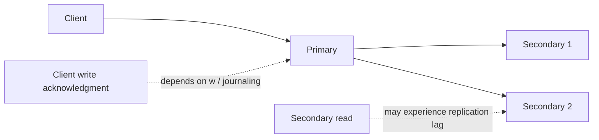
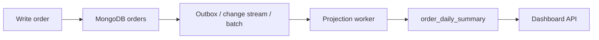
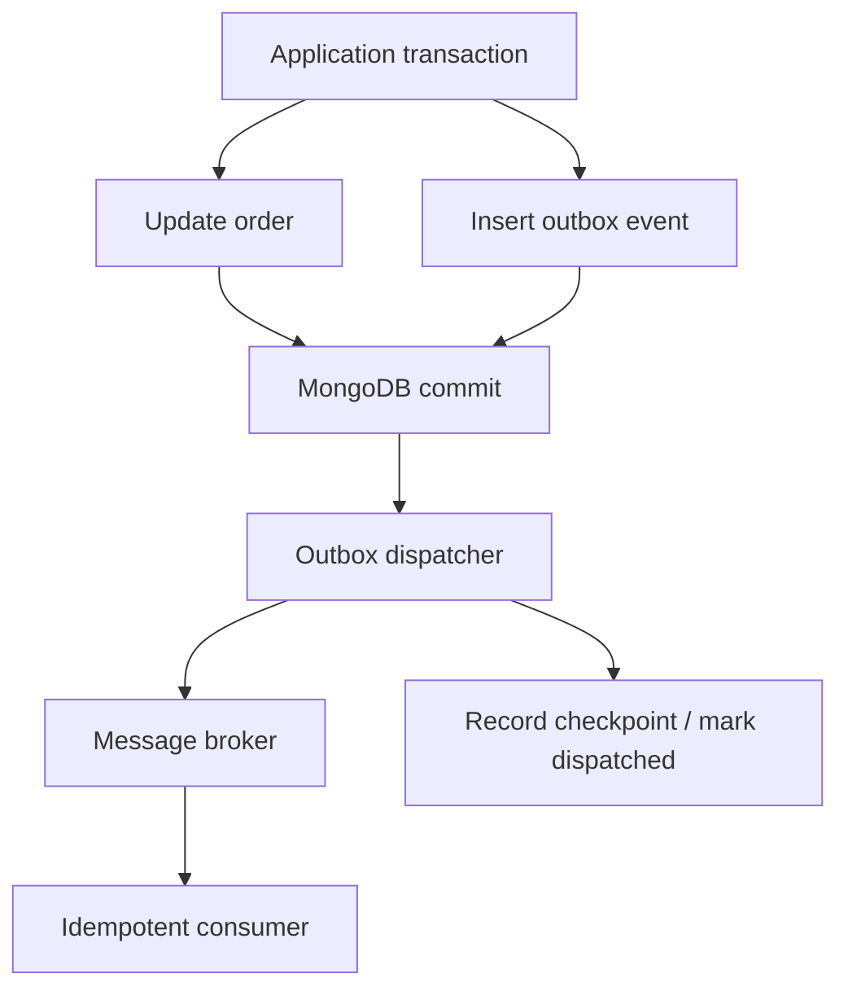

# Trading off latency, availability, and business consistency requirements

## 1. A system does not have just one level of "consistency"

An e-commerce website stores orders, inventory, payments, and shipping status in MongoDB. Buyers who just placed an order want to see the new order immediately. Warehouse staff need certainty that two requests cannot reserve the very last unit simultaneously. Executives want an order-count dashboard, accepting a delay of a few seconds. Meanwhile, accounting demands that every reconcilable transaction be recorded durably and remain traceable.

If every feature is forced to read from a single primary, wait for majority+journal, open multi-document transactions, and run heavy aggregations, latency and availability suffer without adding value to screens that tolerate slight staleness. Conversely, if everything reads from arbitrary secondaries and writes with weak acknowledgments, critical operations may confirm success before meeting durability requirements, or make wrong decisions based on stale state.

Therefore, start with the question:

> **What must the business guarantee, within what time bounds and system failure tolerances, before selecting read concern, write concern, read preference, update predicates, and transactions?**

This lesson belongs to the **Data Consistency** chapter of the **SPRING_DATA_MONGODB** module. The module covers connecting with Spring Data MongoDB, mapping documents, and operating on MongoDB via `MongoTemplate` or repositories; practicing query design, aggregations, indexes, transactions, reactive access, testing, and data performance diagnostics.

After this lesson, you can:

1. Write a **consistency contract** per business scenario rather than picking one global level by intuition.
2. Distinguish **freshness, atomicity, isolation, durability, causal consistency**, and consistency of derived data.
3. Analyze trade-offs across `readPreference`, `readConcern`, `writeConcern`, and replication lag.
4. Use single-document atomic updates, `@Version`, CAS, and unique indexes for local invariants.
5. Determine when multi-document transactions, outboxes, or eventual consistency are needed.
6. Recognize ambiguous responses after timeouts and organize safe retries/idempotency.
7. Design metrics, failover experiments, and integration tests to verify promised guarantees.

> Examples use Java 17+, Spring Data MongoDB, and a MongoDB replica set in versions supporting the respective features. Exact semantics, default write concerns, transaction behavior, and APIs can vary across server/driver/Spring Data versions. Never treat illustrative code snippets as a verified production configuration.

## 2. Separating guarantee dimensions before picking settings

The word "consistency" is often applied to several distinct requirements:

| Dimension | Question | Example |
| --- | --- | --- |
| **Freshness** | Does a read see just-written changes? | Buyer places an order and refreshes |
| **Atomicity** | Are all targeted fields applied together or none at all? | Order status and version |
| **Isolation** | Can other operations observe intermediate state? | Transferring funds between two accounts |
| **Durability** | What failures can an acknowledged write survive? | Primary failover |
| **Ordering** | Under what rule do two competing updates win? | `READY_TO_SHIP → SHIPPED` |
| **Causal ordering** | Do later reads/writes respect prior events in an operation chain? | Writing order then reading status |
| **Derived-data lag** | How far behind the source is a dashboard/search index? | Revenue report updates within 5 seconds |
| **Business invariants** | What must absolutely never go wrong? | Never allocate more stock than available |

An API can receive a majority acknowledgment and still display a **lagging** dashboard. A primary read can see very fresh state yet **does not** prevent two writers from overwriting the same entity. A transaction can commit two documents together yet **cannot** pull an HTTP call to an external payment gateway into the MongoDB transaction.

### 2.1. A key fact to remember

**Read concern**, **write concern**, and **read preference** answer three separate questions:

- `readConcern`: what commitment level of data a read may observe.
- `writeConcern`: what acknowledgment level a write must reach.
- `readPreference`: which primary/secondary serves reads, where APIs allow.

None of them automatically replace **CAS filters**, **unique indexes**, **transaction boundaries**, **idempotency**, or **authorization**.

## 3. Latency, availability, and consistency: the points of tension

### 3.1. Why do trade-offs exist?

In a replica set, the primary handles ordinary writes; secondaries replicate and apply changes. When secondaries lag or network links degrade:

- Waiting for more members to acknowledge can **increase write response time**.
- Reading from secondaries helps distribute load, yet **risks observing stale data** without an appropriate consistency mechanism.
- Requiring primary and majority during a network partition can prevent some operations from **completing on time**.
- Relying on local/primary reads solely to cut latency may fail to deliver durability or consistency demanded by the contract.



This diagram illustrates only a simple replica set. Geographic placement, voting members, arbiters, topology, server version, and networking all shape real-world choices.

### 3.2. Do not oversimplify the CAP theorem to "pick two"

CAP describes bounds on distributed systems **during a network partition**, not a static menu where you check two boxes and deduce overall latency and availability. In normal operation, latency also stems from read/write concerns, replication, caches, query plans, transactions, networking, and application code.

More accurate statements:

- When too few members can form a majority, majority write concern may **fail to acknowledge in time**.
- Allowing reads from secondaries can raise availability for certain requests, yet **does not guarantee latest data**.
- Stronger guarantees generally require more **synchronization/waiting**, so measure latency and availability against your topology.
- A single service can apply different policies to different use cases instead of forcing one policy onto every query.

### 3.3. Distinguish read availability from write availability

If the primary cannot accept writes, a live secondary does not mean the system can still accept valid writes. Conversely, reads can sometimes proceed on a node while writes are degraded, provided freshness/read concern expectations are interpreted accurately.

**An API returning HTTP 200** does not guarantee the **business consistency contract** was satisfied if read data was overly stale or write acknowledgment fell below required standards.

## 4. Sample domain: orders, inventory, and reports

### 4.1. Documents in MongoDB

Collection `orders`:

```javascript
db.orders.insertMany([
  {
    _id: "ord-101",
    tenantId: "tenant-a",
    status: "READY_TO_SHIP",
    version: NumberLong("7"),
    productId: "sku-001",
    quantity: 1,
    operationId: "op-create-101",
    createdAt: ISODate("2026-11-19T08:00:00Z"),
    updatedAt: ISODate("2026-11-19T08:00:00Z")
  },
  {
    _id: "ord-102",
    tenantId: "tenant-a",
    status: "PAID",
    version: NumberLong("2"),
    productId: "sku-002",
    quantity: 2,
    operationId: "op-create-102",
    createdAt: ISODate("2026-11-20T01:00:00Z"),
    updatedAt: ISODate("2026-11-20T01:00:00Z")
  },
  {
    _id: "ord-201",
    tenantId: "tenant-b",
    status: "PAID",
    version: NumberLong("1"),
    productId: "sku-001",
    quantity: 3,
    operationId: "op-create-201",
    createdAt: ISODate("2026-11-20T02:00:00Z"),
    updatedAt: ISODate("2026-11-20T02:00:00Z")
  }
]);
```

Collection `inventory`:

```javascript
db.inventory.insertMany([
  {
    _id: "tenant-a:sku-001",
    tenantId: "tenant-a",
    productId: "sku-001",
    available: 1,
    reserved: 0,
    version: NumberLong("4")
  },
  {
    _id: "tenant-a:sku-002",
    tenantId: "tenant-a",
    productId: "sku-002",
    available: 10,
    reserved: 0,
    version: NumberLong("6")
  }
]);
```

Run scripts only in an **isolated test database** with fixture cleanup; never use these IDs in production. `tenant-b` is included intentionally to test tenant isolation.

### 4.2. Read model for dashboards

An `order_daily_summary` collection might store:

```javascript
{
  _id: "tenant-a:2026-11-20",
  tenantId: "tenant-a",
  day: "2026-11-20",
  orderCount: 150,
  totalAmountVnd: NumberLong("75000000"),
  lastRebuiltAt: ISODate("2026-11-20T03:00:00Z")
}
```

This is a **derived read model**, updated via events, change streams, or batch jobs. If policy only requires the dashboard to update within 30 seconds, there is no need to run synchronous aggregations across all orders on every write.

### 4.3. Java entity

```java
package com.example.orders.persistence;

import java.time.Instant;
import org.springframework.data.annotation.Version;
import org.springframework.data.mongodb.core.mapping.Document;
import org.springframework.data.mongodb.core.mapping.FieldType;
import org.springframework.data.mongodb.core.mapping.MongoId;

@Document(collection = "orders")
public record OrderDocument(
    @MongoId(FieldType.STRING) String id,
    String tenantId,
    String status,
    String productId,
    int quantity,
    String operationId,
    Instant createdAt,
    Instant updatedAt,
    @Version Long version
) {
    public OrderDocument withStatus(
        String newStatus, Instant now
    ) {
        return new OrderDocument(
            id, tenantId, newStatus, productId, quantity,
            operationId, createdAt, now, version
        );
    }
}
```

This code uses `@Version` to demonstrate optimistic concurrency. Existing documents store a matching numeric `version`; in tests inserting fresh entities, Spring Data follows wrapper/primitive version initialization rules on insert.

## 5. From business requirements to a consistency contract

Before writing a repository method, specify the contract per use case:

| Use case | Mandatory invariant | Required freshness | Initial suggestion |
| --- | --- | --- | --- |
| Transitioning order state | No two conflicting transitions both win | Must verify current state at write time | Single-document CAS on status/version |
| Reserving the last unit | `available >= 0` and never over-reserve | Condition must hold at **write time** | Atomic conditional `$inc` on inventory |
| Creating order with external operation ID | Never create duplicates for one logical request | Outcome must be reconcilable | Unique index + idempotency |
| Updating order and inventory | Both documents stay consistent if use case demands | Commit together or roll back together | Multi-document transaction or designed compensation workflow |
| Reading immediately after creating order | User must see their own write | Read-your-writes | Primary or causal session per contract |
| Order count dashboard | Discrepancy allowed within published bounds | Max lag per policy, e.g. 30-second target | Eventual read model + lag monitor |
| Product catalog | Values can be seconds stale if not used for billing decisions | Clear staleness budget | Cache/secondary where appropriate |
| Payment confirmation | Never confirm without valid commit proof | Prioritize correctness/durability | Appropriate write concern + idempotency + reconciliation |

Policies like "30 seconds" are **illustrative product assumptions**, not default MongoDB guarantees.

### 5.1. What should a solid contract contain?

Example for `POST /orders/{id}/ship`:

```text
Input:
  authenticatedTenantId
  orderId
  expectedVersion
  operationId

Precondition:
  status = READY_TO_SHIP
  version = expectedVersion

Invariant:
  Transition applies at most once per logical operationId
  Never modify documents belonging to another tenant

Acknowledgment:
  Return applied only with matching commit/ACK evidence

Conflict:
  Return 409/412 per HTTP contract when precondition fails

Unknown outcome:
  Never claim definite rollback; query by operationId
```

These components can be implemented with several MongoDB techniques. What matters is a **testable contract**, not vague claims of "consistent reads and writes."

## 6. Read preference: which node to read from?

The MongoDB Java driver supports read preference modes:

| Read preference | General meaning | Primary trade-off |
| --- | --- | --- |
| `primary` | Read from primary; requires selecting primary | Fits near-latest data needs; concentrates read load |
| `primaryPreferred` | Prefer primary; can fall back under eligible conditions | Fallback may return stale data |
| `secondary` | Read from eligible secondary | Replication lag risk; depends on secondary availability |
| `secondaryPreferred` | Prefer secondary; falls back under eligible conditions | Distributes read load, yet freshness is not fixed |
| `nearest` | Prefer node meeting latency selector | Lowest network latency node does not guarantee freshest data |

### 6.1. Primary reads do not become linearizable automatically

Reading from primary with the default read concern still requires evaluating write concern and distinct read/write boundaries. Never state in API docs that "reading primary guarantees linearizability" without configuring matching semantics and testing failover conditions.

### 6.2. Secondary reads are not always "cheap"

Secondaries can offload reads from the primary, yet:

- Replication lag can cause decisions based on stale records.
- A slow or unavailable secondary increases latency.
- Queries still need good indexes/sorts; changing nodes never fixes bad query shapes.
- Strong read concerns or causal sessions can **wait for the secondary to catch up**.
- Availability depends on eligible nodes and server selection, not raw replica count.

### 6.3. Driver configuration example

```java
import com.mongodb.ReadPreference;
import com.mongodb.client.MongoCollection;
import org.bson.Document;

MongoCollection<Document> dashboards = client
    .getDatabase("commerce")
    .getCollection("order_daily_summary")
    .withReadPreference(ReadPreference.secondaryPreferred());

Document latest = dashboards.find(
    new Document("tenantId", "tenant-a")
).first();
```

`client` is assumed to be a configured, shared `MongoClient`; the collection name is illustrative. Only use `secondaryPreferred` for workloads with explicit **staleness tolerance**. Never switch pre-reservation inventory reads to `secondaryPreferred` assuming it still prevents overselling.

### 6.4. maxStalenessSeconds is not an absolute SLA

The driver supports filtering secondaries by **estimated replication lag** using `maxStalenessSeconds` in supported modes. This is a **server-selection heuristic** with specific rules and version limits, not a promise that every returned document is at most N seconds old.

If an API advertises read-model lag under 30 seconds, measure actual lag using event/commit timestamps and implement fallbacks/policies rather than treating `maxStalenessSeconds` as a hard SLA.

## 7. Read concern: what commitment level are we reading?

### 7.1. Common levels

| Read concern | Summary meaning | Caution |
| --- | --- | --- |
| `local` | Reads data currently on the serving node | Can see non-majority-committed writes depending on topology |
| `available` | Permits reading available data per its own semantics | Does not replace strong consistency; watch sharded/orphaned docs |
| `majority` | Reads data majority-committed under MongoDB rules | **Does not mean globally latest or linearizable** |
| `linearizable` | Linearizability guarantee for qualifying reads on primary | May block/fail during partitions; attach `maxTimeMS` |
| `snapshot` | Consistent snapshot in the right context, especially transactions | Verify overhead, support conditions, and snapshot boundaries |

Read concern specifies which data versions are observable, not which node serves the read; coordinate it with read preference.

### 7.2. Majority read is not automatic read-your-writes

Suppose you just received majority write concern and then send an independent read request to a secondary. Never assume every secondary has caught up to that write at that instant. To enforce causal read-your-writes across related operations, use a **causally consistent session** with appropriate settings or choose a read path satisfying the contract.

### 7.3. Linearizable reads have a cost

`linearizable` is meant for qualifying reads needing stronger observation ordering after completed majority writes. It can wait or fail when the primary cannot verify state with the required members.

A linearizable read is not a dashboard optimization tool. Use it only when invariants truly demand it, and set a timeout to prevent unbounded waiting. Applicability is also constrained by query shape, context, and server version.

### 7.4. Snapshot reads are not magic snapshots across separate requests

Read concern `snapshot` inside a transaction gives operations in that transaction a coherent snapshot per MongoDB semantics. It **does not preserve one snapshot** across two separate HTTP requests using separate sessions/transactions.

## 8. Write concern: how much confirmation to wait for?

| Write concern | General meaning | Impact |
| --- | --- | --- |
| `w: 0` | Does not wait for reliable acknowledgment | Cannot inspect matched/modified counts or many server errors |
| `w: 1` | Primary acknowledges command per semantics | Returns result; failover rollback risk differs from majority |
| `w: "majority"` | Waits for majority replication acknowledgment | Better durability/failover protection for matching goals; can increase latency/lower availability if majority is lost |
| `j: true` | Requests journal acknowledgment per server semantics | Journal overhead and config must be evaluated |
| `wtimeout` | Bounds wait time for write concern | Timeout **does not prove rollback** |

### 8.1. Acknowledged writes to detect version conflicts

With `@Version` or compare-and-set updates, the application must receive server outcomes:

```javascript
db.orders.updateOne(
  {
    _id: "ord-101",
    tenantId: "tenant-a",
    version: NumberLong("7")
  },
  {
    $set: { status: "SHIPPED" },
    $inc: { version: 1 }
  },
  {
    writeConcern: {
      w: "majority",
      j: true,
      wtimeout: 10000
    }
  }
);
```

An acknowledged response with `matchedCount=0` means **the combined filter did not match**—due to version, status, tenant, or ID. Majority write concern does not enforce the version predicate; the filter does.

### 8.2. Timeouts can leave an ambiguous outcome

If the primary applied a write yet could not obtain a majority in time, the client receives a write concern error. Never conclude the write rolled back, and never blindly resend an `$inc` or balance debit.

Likewise, a network timeout when the response drops leaves the client unsure whether the server ran the command. These cases require **operation IDs and reconciliation**.

### 8.3. Defaults depend on deployment

MongoDB has default write concerns, and drivers/URIs/templates/transactions can override them. Never guess whether the default is `w:1` or `majority` across all versions/topologies. Check the effective configuration and version, and declare explicit policies for critical writes where appropriate.

## 9. Read/write combination matrix by goal

| Goal | Read preference | Read concern | Write concern | Notes |
| --- | --- | --- | --- | --- |
| Queue needing current state to **decide a write** | Primary | Depends on contract | Acknowledged; consider majority | **CAS at write time** stops races, not the prior read |
| Lag-tolerant dashboard | SecondaryPreferred or read model | Suited to reporting data | Write source per policy | Requires lag monitoring |
| Read-your-writes across replicas | Appropriate session | Majority | Majority | Causal session and operation order |
| Decision read needing linearizability | Primary | Linearizable where eligible | Majority on related writes | Has timeout/availability trade-offs |
| Multi-document report needing one snapshot | Node/session per transaction | Snapshot | Majority at commit for durability | Multi-document tx or version-supported snapshot read |
| Creating records with unique business ID | Primary for writes | Not the primary factor | Acknowledged; consider majority | Unique index + idempotency |

**This is a starting matrix**, not a substitute for analysis. For example:

- A screen merely viewing status before the user clicks cancel can display slightly stale data, **provided the cancel command checks status/version at write time**.
- A majority read does not let you drop version predicates when two write requests race.
- An eventually consistent read model can still be the right design as long as that data **is never used to enforce critical invariants**.

## 10. Budgeting latency at the use-case level

An API has an end-to-end latency budget, not just MongoDB command execution time.

```text
Total request latency:
  HTTP / gateway
  + authentication/authorization
  + validation/business logic
  + server selection / network
  + MongoDB queue / query / write
  + replication/journal wait if write concern requires
  + mapping/result serialization
  + downstream calls / retries
```

### 10.1. Never use average latency as an SLA

If targets are p95 under 300 ms and p99 under 700 ms (purely **illustrative assumptions**), a majority configuration adding 10 ms to the average might look fine—yet during secondary lag, tail latency can spike dramatically. Therefore:

- Measure **p50/p95/p99** separately for reads and writes.
- Break down by endpoint, tenant size, query shape, and node.
- Benchmark separately under normal load, peak load, replica lag, and failover.
- Track counts of **failed/incomplete** requests alongside successful request latency.
- Verify correctness with business assertions, not latency charts alone.

### 10.2. Setting appropriate deadlines

Deadlines can exist at HTTP, driver server selection, command `maxTimeMS`, transaction timeout, and write concern `wtimeout`. Different timeouts mean different things.

| Timeout | What you still cannot infer |
| --- | --- |
| HTTP client timeout | That the backend stopped running |
| Server selection timeout | That the write reached primary |
| Socket/network timeout after sending | That the server definitely did not apply the write |
| `wtimeout` | That MongoDB rolled back the write |
| Query `maxTimeMS` | That downstream side effects in other systems stopped |

When a deadline expires, the API protocol must clearly choose **retry, reconcile, or return pending status**.

## 11. Read-your-writes and causal consistency

### 11.1. The problem

A user creates an order, receives `201 Created`, and immediately opens the details page. If the details page hits a lagging secondary, the response could be `404` or an old status despite the write being majority-acknowledged.

One approach favors reading primary immediately after writing. When multiple causally linked operations span replicas, a **causally consistent session** can be used under driver/server support conditions.

### 11.2. Driver session example

```java
import com.mongodb.ReadConcern;
import com.mongodb.ReadPreference;
import com.mongodb.WriteConcern;
import com.mongodb.ClientSessionOptions;
import com.mongodb.client.ClientSession;
import com.mongodb.client.MongoClient;
import com.mongodb.client.MongoCollection;
import org.bson.Document;
import static com.mongodb.client.model.Filters.*;
import static com.mongodb.client.model.Updates.*;

MongoClient client = /* shared bean */;

try (ClientSession session = client.startSession(
    ClientSessionOptions.builder()
        .causallyConsistent(true)
        .build()
)) {
    MongoCollection<Document> orders = client
        .getDatabase("commerce")
        .getCollection("orders")
        .withReadPreference(ReadPreference.secondaryPreferred())
        .withReadConcern(ReadConcern.MAJORITY)
        .withWriteConcern(WriteConcern.MAJORITY);

    orders.updateOne(
        session,
        and(eq("_id", "ord-101"), eq("tenantId", "tenant-a")),
        set("status", "SHIPPED")
    );

    Document after = orders.find(
        session,
        and(eq("_id", "ord-101"), eq("tenantId", "tenant-a"))
    ).first();
}
```

This is a **driver-level** example; standard Spring repository calls do not automatically share a session. To get proper causal consistency guarantees, operations must share **the same session sequentially**, with **majority read concern and majority write concern** where driver/server docs specify.

### 11.3. Availability trade-off

If the chosen secondary has not yet applied writes enough to satisfy a causal read, the read may **have to wait or fail within its deadline**. Read-your-writes is not free if you want both distant secondary reads and instant visibility.

### 11.4. Sessions must not be used concurrently arbitrarily

Never share a mutable `ClientSession` concurrently across asynchronous requests. Session lifecycle and ordering must be explicit; Spring Data provides session-binding APIs depending on imperative vs. reactive stacks. When using transactions, configure the Spring transaction manager/session rather than opening an isolated session in a repository method expecting `@Transactional` to adopt it automatically.

## 12. Linearizable reads: when stronger guarantees are required

For qualifying **single-document read** operations, `readConcern("linearizable")` on an appropriate primary ensures the read reflects ordering relative to previously completed majority-acknowledged writes.

Driver example:

```java
import com.mongodb.ReadConcern;
import com.mongodb.ReadPreference;
import com.mongodb.client.MongoCollection;
import org.bson.Document;
import java.util.concurrent.TimeUnit;
import static com.mongodb.client.model.Filters.eq;

MongoCollection<Document> strongOrders = client
    .getDatabase("commerce")
    .getCollection("orders")
    .withReadPreference(ReadPreference.primary())
    .withReadConcern(ReadConcern.LINEARIZABLE);

Document current = strongOrders
    .find(eq("_id", "ord-101"))
    .maxTime(3, TimeUnit.SECONDS)
    .first();
```

When the primary cannot contact enough members to confirm required state, the read may block or time out. Reserve it for use cases genuinely needing that guarantee. Check **query shape limits, server version, and read concern semantics**; never slap it onto multi-document aggregations or reporting.

### 12.1. Linearizable reads still do not replace CAS

Suppose two callers both read status `READY_TO_SHIP` via linearizable reads, and both send unconditional updates by ID. A lost update can still happen because **the decision and the write are two separate operations**.

To ensure a transition runs at most once, use an atomic conditional update and inspect matched count.

## 13. Single-document atomic updates and business invariants

### 13.1. Example: reserving the last item

Inventory contains:

```javascript
{
  _id: "tenant-a:sku-001",
  tenantId: "tenant-a",
  productId: "sku-001",
  available: 1,
  reserved: 0
}
```

Two requests want to reserve the same item. If each reads `available=1` and issues an unconditional `$inc: {available:-1}`, stock can go negative.

**The right command verifies the predicate on the server atomically with the update:**

```javascript
const result = db.inventory.updateOne(
  {
    _id: "tenant-a:sku-001",
    tenantId: "tenant-a",
    available: { $gte: 1 }
  },
  {
    $inc: {
      available: -1,
      reserved: 1
    }
  },
  { writeConcern: { w: "majority" } }
);

printjson(result);
```

Modifying **a single document** is atomic. If request A wins and drops `available` from 1 to 0, request B's `available >= 1` filter no longer matches. This guarantee comes from **filter + atomic update**, not the strength of any earlier read.

### 13.2. Spring Data MongoOperations

```java
import com.mongodb.client.result.UpdateResult;
import org.springframework.data.mongodb.core.MongoOperations;
import org.springframework.data.mongodb.core.query.Criteria;
import org.springframework.data.mongodb.core.query.Query;
import org.springframework.data.mongodb.core.query.Update;

public final class InventoryReservationGateway {
    private final MongoOperations mongo;

    public InventoryReservationGateway(MongoOperations mongo) {
        this.mongo = mongo;
    }

    public boolean reserveOne(
        String tenantId, String productId
    ) {
        if (tenantId == null || tenantId.isBlank()
                || productId == null || productId.isBlank()) {
            throw new IllegalArgumentException("Missing identity");
        }

        String id = tenantId + ":" + productId;
        Query query = Query.query(
            Criteria.where("_id").is(id)
                .and("tenantId").is(tenantId)
                .and("available").gte(1)
        );
        Update update = new Update()
            .inc("available", -1)
            .inc("reserved", 1);

        UpdateResult result =
            mongo.updateFirst(query, update, "inventory");

        if (!result.wasAcknowledged()) {
            throw new IllegalStateException(
                "No reliable write acknowledgment"
            );
        }
        return result.getMatchedCount() == 1;
    }
}
```

`updateFirst(Query, Update, String collectionName)` is a collection-name template API in supported versions; if the project defines a mapped `InventoryDocument` entity, prefer the class overload for cleaner mapping. Because this code uses raw BSON field names, verify collection schema alignment.

### 13.3. Does this guarantee "each order reserves only once"?

Not yet. The command above prevents **negative `available`**, yet a client retrying the exact same request could reserve twice while stock remains. Achieving **exactly-once business effect** for a given operation ID requires an idempotency record, unique constraint, or embedding a set of applied operation IDs inside the document (where size/cardinality fits). That is a **separate requirement** from nonnegative stock.

### 13.4. Do not open a transaction if the invariant lives inside one document

For enforcing `available >= quantity` and incrementing `reserved` on **the same inventory document**, an atomic update usually suffices. Multi-document transactions add coordination overhead and higher conflict potential; use them only when invariants genuinely span multiple documents or collections.

## 14. Optimistic locking with @Version

### 14.1. Two competing snapshots

When an application modifies an entity via `find → modify → save`, lost updates threaten. `@Version` lets Spring Data check stale versions along persistence paths supporting optimistic locking.

```text
Initial: status=READY_TO_SHIP, version=7

A reads version 7      B reads version 7
A updates SHIPPED      B updates CANCELLED

A save(expected=7) → succeeds, version=8
B save(expected=7) → mismatch, optimistic-lock failure
```

### 14.2. MongoTemplate.save

```java
import java.time.Instant;
import org.springframework.data.mongodb.core.MongoOperations;
import org.springframework.dao.OptimisticLockingFailureException;

public final class OrderStateWriter {
    private final MongoOperations mongo;

    public OrderStateWriter(MongoOperations mongo) {
        this.mongo = mongo;
    }

    public OrderDocument ship(OrderDocument snapshot) {
        OrderDocument proposed = snapshot.withStatus(
            "SHIPPED", Instant.now()
        );
        try {
            return mongo.save(proposed);
        } catch (OptimisticLockingFailureException ex) {
            throw new IllegalStateException(
                "Order changed; reload before deciding", ex
            );
        }
    }
}
```

**Essential condition:** Write concern must be **acknowledged** so Spring Data observes optimistic locking failures. With `w: 0`, failures may go undetected.

### 14.3. @Version does not automatically check tenants

`mongo.save(entity)` does not inject your intended tenant predicate. Application services must authenticate and authorize document access before saving. For state transitions, an explicit custom update filtering by tenant, ID, and version can be clearer with fewer bypass paths.

### 14.4. Do not assume every operation is version-aware

Do not assume `@Version` automatically injects a caller's expected version into `updateMulti`, repository `@Update`, or aggregation pipelines. Verify the **exact API path and version**. When business rules demand CAS, explicitly include version in the update filter.

## 15. Compare-and-set (CAS) for state transitions

### 15.1. MongoDB command

```javascript
db.orders.updateOne(
  {
    _id: "ord-101",
    tenantId: "tenant-a",
    status: "READY_TO_SHIP",
    version: NumberLong("7")
  },
  {
    $set: {
      status: "SHIPPED",
      updatedAt: new Date()
    },
    $inc: { version: 1 }
  },
  {
    writeConcern: { w: "majority" }
  }
);
```

An acknowledged result with `matchedCount = 1` confirms the document satisfied every precondition. If `matchedCount = 0`, you cannot automatically tell which predicate failed—ID, tenant, status, or version. Never enable `upsert` for state transitions requiring an existing document.

### 15.2. Spring Data example

```java
import java.time.Instant;
import com.mongodb.client.result.UpdateResult;
import org.springframework.data.mongodb.core.MongoOperations;
import org.springframework.data.mongodb.core.query.Criteria;
import org.springframework.data.mongodb.core.query.Query;
import org.springframework.data.mongodb.core.query.Update;

public final class OrderTransitionGateway {
    private final MongoOperations mongo;

    public OrderTransitionGateway(MongoOperations mongo) {
        this.mongo = mongo;
    }

    public boolean markShipped(
        String tenantId,
        String orderId,
        long expectedVersion,
        Instant when
    ) {
        if (tenantId == null || tenantId.isBlank()
                || orderId == null || orderId.isBlank()
                || when == null || expectedVersion < 0) {
            throw new IllegalArgumentException("Invalid command");
        }
        Query query = Query.query(
            Criteria.where("id").is(orderId)
                .and("tenantId").is(tenantId)
                .and("status").is("READY_TO_SHIP")
                .and("version").is(expectedVersion)
        );
        Update change = new Update()
            .set("status", "SHIPPED")
            .set("updatedAt", when)
            .inc("version", 1);

        UpdateResult result =
            mongo.updateFirst(query, change, OrderDocument.class);

        if (!result.wasAcknowledged()) {
            throw new IllegalStateException(
                "Cannot determine CAS result"
            );
        }
        return result.getMatchedCount() == 1;
    }
}
```

Passing the entity class gives `MongoTemplate` ID and field type mapping metadata. Because `version` is incremented explicitly, run an **integration test against your real version** to verify it does not increment twice due to any Spring Data version augmentation behavior.

### 15.3. Results must carry clear semantics

| Result | Safe conclusion |
| --- | --- |
| Acknowledged, `matchedCount=1` | Filter matched; command applied per semantics and acknowledgment level received |
| Acknowledged, `matchedCount=0` | **Combined precondition** was not satisfied |
| `modifiedCount=0` with `match=1` | Possible no-op; do not blindly label as version conflict |
| Write concern timeout | Uncertain whether commit/ACK met policy; write may already be applied |
| Network timeout | Outcome may be unknown; do not equate with `match=0` |

### 15.4. Business invariants belong in the filter, not just the read

Even if the UI just read from primary, between reading and clicking "Ship," another request can change status. Never transition `status` using a filter containing only `_id`. Only CAS checks at write time protect invariants.

## 16. Multi-document consistency and transactions

### 16.1. When one document is not enough

An order placement request needs to:

1. Decrement `inventory.available` and increment `inventory.reserved`.
2. Insert a document in `orders`.
3. Record that the operation ID was processed.

If all steps must commit or roll back together within MongoDB, a **multi-document transaction** is an option. If step 3 writes to an external system outside MongoDB, MongoDB transactions **do not** cover it.

### 16.2. Transaction boundary in Spring Data

Imperative configuration skeleton:

```java
import org.springframework.context.annotation.Bean;
import org.springframework.context.annotation.Configuration;
import org.springframework.data.mongodb.MongoDatabaseFactory;
import org.springframework.data.mongodb.MongoTransactionManager;

@Configuration
class MongoTxConfig {
    @Bean
    MongoTransactionManager mongoTransactionManager(
        MongoDatabaseFactory factory
    ) {
        return new MongoTransactionManager(factory);
    }
}
```

Service:

```java
import org.springframework.stereotype.Service;
import org.springframework.transaction.annotation.Transactional;

@Service
public class OrderPlacementService {
    private final InventoryReservationGateway inventory;
    private final OrderInsertGateway orders;

    public OrderPlacementService(
        InventoryReservationGateway inventory,
        OrderInsertGateway orders
    ) {
        this.inventory = inventory;
        this.orders = orders;
    }

    @Transactional
    public String placeOne(
        String tenantId, String productId, String operationId
    ) {
        if (!inventory.reserveOne(tenantId, productId)) {
            throw new IllegalStateException("Out of stock");
        }
        return orders.insertIfNew(
            tenantId, productId, operationId
        );
    }
}
```

`OrderInsertGateway` is an **illustrative persistence contract** that must be defined/implemented with unique operation ID handling in your project. This service will not compile standalone until that class and transaction config exist. If any step fails, an exception must trigger transaction rollback per policy; never swallow exceptions and return success.

### 16.3. Do not conflate "transaction" with "stronger write concern"

Transactions define a **multi-operation boundary**. Transaction/commit write concern defines **commit acknowledgment durability**. Snapshot read concern inside a transaction defines the **read view**. Choosing one does not automatically supply the other two.

Transactions add latency from sessions, coordination, conflicts, commits, and retries. Use them only when business invariants require multi-document atomicity.

### 16.4. A transaction is not an HTTP distributed transaction

If `orders.insertIfNew(...)` succeeds and the service then calls an external HTTP payment gateway, MongoDB cannot roll back that external charge when the MongoDB transaction aborts. Design workflows with explicit states, outboxes, idempotency, and compensation.

## 17. Snapshots, write skew, and transaction limits

### 17.1. Snapshots do not replace write-time validation

Suppose two transactions both read `inventory.available=1`. A design that checks the value in Java and writes to **two different documents** can let both act on the stale snapshot without conflicting on a shared document. This is the **write skew** anomaly in snapshot isolation systems.

To enforce "only one last unit," both flows must contend on **the inventory document** via conditional updates or a suitable serializing/constraint mechanism—never relying solely on "we read inside a transaction."

### 17.2. Transaction conflicts are not a reason for infinite retries

The driver/Spring Data can raise write-conflict or transient transaction errors. Transaction retries require:

- Accurate classification of error types and driver labels.
- Finite retry count and time bounds.
- Ensuring the transactional function triggers zero external side effects on re-execution.
- Idempotency checks when commit succeeded yet the response became ambiguous.
- Metrics tracking conflict rates and rollback/commit latency.

### 17.3. Snapshots across separate requests

Page 1 and page 2 of an order list across two HTTP requests **do not automatically share one snapshot** just because each request uses a transaction. If exports demand a long-lived snapshot, design cursor/snapshot reads or materialized export jobs within version and resource limits.

### 17.4. Transaction availability

Transactions depend on topology, session/transaction support, and commit quorum. Under failover or network partitions, latency and availability suffer more than single-document atomic updates. Never force a single-document two-field change into a multi-command transaction without reason.

## 18. Unique indexes and idempotency: another consistency dimension

### 18.1. Preventing duplicates via database constraints

If a client retries `POST /orders` after losing a response, the system must not create two orders for the same logical operation. Use an operation ID:

```javascript
db.orders.createIndex(
  { tenantId: 1, operationId: 1 },
  {
    unique: true,
    name: "uk_orders_tenant_operation"
  }
);
```

A unique index enforces uniqueness at the database, blocking two concurrent requests even if both saw `existsBy... == false` in Java.

### 18.2. Duplicate key does not automatically mean "return success"

When an insert hits duplicate key:

1. Look up the record matching **the same tenant** and operation ID.
2. Compare payload/operation type per contract.
3. If it is truly the same logical request, return the confirmed outcome.
4. If the payload differs, return an explicit conflict.

Merely catching `DuplicateKeyException` and returning 200 masks clients attempting to reuse an operation ID with altered payload data.

### 18.3. Idempotency inside transactions

Unique constraints and transactions work well together: record operation ID + business documents in one transaction to prevent duplicate effects. Still, a post-commit timeout can create an **unknown outcome**; clients and servers must inspect state by operation ID rather than retrying unconditionally.

### 18.4. Never confuse exactly-once delivery with exactly-once effect

Networks, queues, and retries can deliver a message multiple times. Instead of assuming single delivery, design **at-least-once delivery + idempotent processing** where suitable to achieve non-duplicated business effects.

## 19. Read models and intentional eventual consistency

### 19.1. Why not recompute dashboards synchronously on every write?

When creating orders, the system should prioritize persisting source data accurately and responding promptly. If the same request also aggregates 10 million orders, the API pays unnecessary heavy aggregation costs.

Write to the source and update `order_daily_summary` via outbox, change stream, or batch job:



The dashboard becomes an **eventually consistent view**, so publish expected lag and monitor projection delays.

### 19.2. Eventual does not mean "whenever"

A well-defined contract:

```text
Source of truth: orders
Dashboard: order_daily_summary
Lag target: p95 <= 30 seconds (illustrative)
Behavior when projection lag exceeds threshold:
  - display "Data updated as of ..."
  - alert / degrade per policy
  - allow refresh/reconciliation from source when needed
Source for stock-allocation decisions:
  - inventory + atomic write, NEVER the dashboard
```

A dashboard lagging by a few seconds is reasonable; overselling inventory based on a stale dashboard is not.

### 19.3. Event ordering and duplicate processing

Projection workers can receive events late, twice, or out of order. To stop an old event from overwriting newer state:

- Attach `eventId` and deduplicate within business scope.
- Include aggregate sequence/version numbers when needed.
- Apply events only when version/sequence advances validly.
- Support rebuilding from the source of truth and reconciling drift.

### 19.4. Change streams do not replace all guarantees

MongoDB change streams are great for observing mutations, yet consumers must still manage resume tokens, checkpoints, retries, lag, permissions, and idempotency. Never assume a change stream callback **automatically forms a transaction** with external systems.

## 20. Transactional outbox for MongoDB changes and external systems

An order transitioning to `SHIPPED` needs to emit an event to the shipping service. Updating the order and publishing directly in one service leaves a failure window:

```text
Case A:
  Order commits → service crashes before publishing
  → lost event

Case B:
  Publish first → order commit fails
  → external system receives event for nonexistent order state
```

### 20.1. Outbox pattern



Within one MongoDB transaction (when two documents are required), update the order and insert the outbox event. The dispatcher publishes after commit and marks completion. If it crashes after publishing before checkpointing, the event may be redelivered; consumers must handle duplicates.

### 20.2. Trade-offs

| Benefit | Cost / requirement |
| --- | --- |
| Prevents losing events between DB commit and publish | Extra outbox collection and dispatcher |
| Supports retries/reconciliation | Requires idempotency and checkpoints |
| Order API does not block waiting on broker | Eventual propagation lag |
| Backlog is observable | Proper TTL/retention—never purge before delivery |

When use cases tolerate a few seconds of propagation lag, an outbox is far better than trying to force external HTTP calls into a nonexistent distributed MongoDB transaction.

## 21. Caches, search indexes, and the source of truth

Applications often keep more copies of data than just the replica set:

- Redis cache for product detail pages.
- Search engine for full-text search.
- Aggregated MongoDB collection for dashboards.
- CDN or browser caching.
- Client/mobile local state.

Even with strong MongoDB read/write concerns, these external layers can **lag or drift** from the source of truth. Your design must document each **consistency boundary**.

### 21.1. Cache-aside does not guarantee read-after-write

```text
Request A:
  update order in MongoDB → commit
  invalidate Redis cache

Request B:
  reads Redis before invalidation finishes
  → observes stale state
```

Majority write concern affects only MongoDB persistence; it **does not invalidate Redis/CDNs**. When users must see new state right away, bypass cache in the read-after-write flow, embed versions in cache keys, use version-aware invalidation, or return the committed snapshot directly from the write API.

### 21.2. Cache invalidation races

```text
T1: Reader fetches stale value from MongoDB
T2: Writer commits new value, invalidates cache
T3: Reader T1 writes stale value into cache
```

Simply doing "delete cache after write" does not eliminate every race. Combine versioned/conditional cache writes with bounded TTLs and freshness rules. For strict invariants, never make stock-reservation or balance-debit decisions from a cache.

### 21.3. Search indexes are projections

External search indexes usually update asynchronously. A newly created document can exist in MongoDB before appearing in search. Interfaces must distinguish:

| Function | Source to use |
| --- | --- |
| Search results listing | Search projection if lag is acceptable |
| Authorizing order ID/tenant ownership | MongoDB source of truth |
| Reserving inventory | Conditional write on `inventory` |
| Near-real-time statistics | Projection with watermark/`lastUpdated` |

Never treat "absent from search index" as proof a document does not exist.

## 22. Retries, write concern timeouts, and unknown states

### 22.1. Three outcome classes

```text
APPLIED:
  Acknowledged result meeting the business contract.

PRECONDITION_NOT_MET:
  Acknowledged matchedCount=0 from CAS.

UNKNOWN_NEEDS_RECONCILIATION:
  Unclear whether command applied due to timeout/network/commit ambiguity.
```

A write command may succeed on the primary before its response drops. Thus, network timeouts **never prove rollback**. Write concern timeouts mean the requested confirmation level was not met before the deadline, not necessarily that the write did not occur.

### 22.2. Why retrying an increment can go wrong

```javascript
// Missing expectedVersion or operation ID:
db.inventory.updateOne(
  { _id: "tenant-a:sku-001" },
  { $inc: { reserved: 1, available: -1 } }
);
```

If the response drops after execution, an independent application retry deducts inventory **a second time**. Driver-level retryable writes have their own deduplication protocol for eligible operations and topologies, which **differs** from the application submitting a brand-new command later.

### 22.3. CAS alone still does not prove the prior request succeeded

After a CAS with `expectedVersion=7` produces an ambiguous response, retrying with `version=7` returns `matchedCount=0`. That could mean the first request bumped version to 8, **or** another writer bumped it. Current version alone does not prove **which `operationId`** won.

For strict certainty:

1. Client generates a stable `operationId` for the logical action.
2. Server records the operation ID within the appropriate atomic/transactional boundary.
3. A unique index blocks misuse of the key.
4. On timeout, server queries prior outcome by `operationId` and tenant.
5. Never re-emit external side effects if the operation already processed.

### 22.4. HTTP responses should reflect certainty

| Scenario | Response direction |
| --- | --- |
| CAS succeeds and acknowledged per policy | Success; return ID/new version |
| CAS `matched=0` | Conflict / Precondition Failed or Not Found per security contract |
| `operationId` already processed with same payload | Return prior / idempotent response |
| `operationId` reused with different payload | Return conflict |
| Commit/write outcome uncertain | Return pending/unknown status or lookup endpoint |
| Majority unreachable within deadline | Never claim write rolled back |

**Never return `200 OK` merely because the command was dispatched.** Likewise, never blindly tell callers "failed, try again" on arbitrary network timeouts.

## 23. Disconnection and failover scenarios

### 23.1. Secondary lags while primary is healthy

**Symptom:** Customer updates shipping address; detail page reads from a secondary and still displays the old address.

**Analysis:** Replication lag or cache/projection lag. Switch reads to primary or use a causal session with matching concerns when read-your-writes is required; measure latency cost.

**Do not conclude:** "MongoDB dropped the write" just because a secondary has not applied it yet.

### 23.2. Primary acknowledges `w:1` then fails over

**Symptom:** A write received primary acknowledgment yet did not replicate sufficiently before failover. In some scenarios, that write can roll back under replica set mechanics.

**Design direction:** For data needing lower rollback risk on acknowledged writes, evaluate majority write concern and check journaling/server version. Also implement idempotency for cases where the application misses the response.

### 23.3. Majority unavailable

**Symptom:** Primary accepts certain requests, yet majority-acknowledged writes cannot complete before timeout.

**Design direction:** Policy can choose **not to confirm success** for critical actions, record an uncertain outcome, and reconcile after cluster recovery. Never quietly downgrade payment writes to `w:1` just to hit latency SLAs if the business demanded strong durability.

### 23.4. Slow external service

**Symptom:** Order commits, yet the payment/shipping API is slow.

**Design direction:** Outbox/saga or `PENDING_EXTERNAL_CONFIRMATION` state, idempotent retries, and reconciliation. MongoDB transactions do not span external networks.

### 23.5. Dashboard stays stale after cluster recovery

**Symptom:** MongoDB source of truth updated, yet projection workers lost their resume token or stalled checkpoints.

**Design direction:** Monitor event lag and consumer checkpoints, rebuild/repair read models, and surface `lastUpdatedAt` to users when permitted by contract.

## 24. Configuring the MongoDB Java driver across policy layers

### 24.1. A MongoClient with a default policy

```java
import java.util.concurrent.TimeUnit;
import com.mongodb.ConnectionString;
import com.mongodb.MongoClientSettings;
import com.mongodb.ReadConcern;
import com.mongodb.ReadPreference;
import com.mongodb.WriteConcern;
import com.mongodb.client.MongoClient;
import com.mongodb.client.MongoClients;

String uri = System.getenv("MONGODB_URI");
if (uri == null || uri.isBlank()) {
    throw new IllegalStateException("Missing MongoDB URI");
}

MongoClientSettings settings = MongoClientSettings.builder()
    .applyConnectionString(new ConnectionString(uri))
    .readPreference(ReadPreference.primary())
    .readConcern(ReadConcern.MAJORITY)
    .writeConcern(
        WriteConcern.MAJORITY
            .withJournal(true)
            .withWTimeout(10, TimeUnit.SECONDS)
    )
    .build();

MongoClient client = MongoClients.create(settings);
```

This is **an intentional policy example**, not a universal configuration optimal for every API. In Spring Boot apps, prefer Boot auto-configuration and matching customizers rather than spawning redundant parallel clients. Track config precedence: URI, builders, `MongoTemplate`, and transaction options all affect actual write concern.

### 24.2. Overriding on specialized collection handles

```java
import org.bson.Document;
import com.mongodb.ReadConcern;
import com.mongodb.ReadPreference;
import com.mongodb.WriteConcern;
import com.mongodb.client.MongoCollection;

MongoCollection<Document> dashboards = client
    .getDatabase("commerce")
    .getCollection("order_daily_summary")
    .withReadPreference(ReadPreference.secondaryPreferred())
    .withReadConcern(ReadConcern.MAJORITY);

MongoCollection<Document> criticalOrders = client
    .getDatabase("commerce")
    .getCollection("orders")
    .withReadPreference(ReadPreference.primary())
    .withWriteConcern(WriteConcern.MAJORITY);
```

Each collection handle applies its settings to commands invoked through it. **Never** reuse a dashboard-tuned `MongoClient` and blindly assume critical writes inherit strong settings. Every operation tier needs an explicit contract.

### 24.3. Never mutate singleton templates per request

```java
// Do NOT write this inside an HTTP handler:
// mongoTemplate.setWriteConcern(userRequestedConcern);
// mongoTemplate.save(order);
```

`MongoTemplate` is typically shared across concurrent requests. Mutating global concern on a singleton per request introduces races and corrupts other requests' policies. Configure upfront before serving traffic, or use dedicated APIs/sessions/handles per operation group.

## 25. Spring Data MongoDB: transactions and configuration

### 25.1. Spring transaction manager

```java
import org.springframework.context.annotation.Bean;
import org.springframework.context.annotation.Configuration;
import org.springframework.data.mongodb.MongoDatabaseFactory;
import org.springframework.data.mongodb.MongoTransactionManager;

@Configuration
public class PersistenceTransactionConfiguration {
    @Bean
    MongoTransactionManager mongoTransactionManager(
        MongoDatabaseFactory factory
    ) {
        return new MongoTransactionManager(factory);
    }
}
```

When using `@Transactional`, verify the selected transaction manager, transaction-capable MongoDB deployment, read/write concerns, and proper session binding. Never assume Spring creates a valid multi-document transaction solely from the annotation in an unconfigured project.

### 25.2. Read/write concern inside transactions

The MongoDB driver provides `TransactionOptions`:

```java
import com.mongodb.ReadConcern;
import com.mongodb.TransactionOptions;
import com.mongodb.WriteConcern;

TransactionOptions options = TransactionOptions.builder()
    .readConcern(ReadConcern.SNAPSHOT)
    .writeConcern(WriteConcern.MAJORITY)
    .build();
```

Inside a transaction, write concern is set at the **commit/transaction level**, not per individual operation. Spring `TransactionManager`/templates/drivers expose different ways to set options across versions; verify configuration precedence.

### 25.3. @Transactional does not fix bad queries

```java
// Even inside a transaction, this remains dangerous
// if tenant/status predicates are missing:
// updateFirst({ _id: ? }, { $set: { status: "SHIPPED" } })
```

Transactions make multiple writes commit together, yet cannot stop a write from **hitting the wrong tenant** or violating state transitions if predicates are incomplete. Authorization and business predicates remain mandatory.

### 25.4. Spring Data mapping and write predicates

With entity mapping:

```java
@Document("orders")
public record OrderDocument(
    @MongoId(FieldType.STRING) String id,
    String tenantId,
    String status,
    // ...
    @Version Long version
) {}
```

`Criteria.where("id")` on an entity class maps to BSON `_id`. In raw `mongosh`/driver calls, use BSON field names directly. Test carefully when using `@Field` aliases, custom converters, UUID representations, or legacy data with mismatched types.

### 25.5. Choosing repository vs. template

| Requirement | Appropriate API |
| --- | --- |
| Simple CRUD, version-aware entity | Repository `save` / `MongoTemplate.save` |
| Conditional state transition | `MongoOperations.updateFirst` or repository command with filter/version |
| Need matched and modified counts | `MongoOperations` returning `UpdateResult` |
| Need updated document returned | `findAndModify` with matching options |
| Multi-document invariant | Transaction + atomic predicates / unique constraints |
| Dynamic/reporting queries | Repository fragments + `MongoOperations.aggregate` |
| Cross-service workflows | Application service + outbox/saga/idempotency |

## 26. Reactive stack: consistency semantics do not disappear

`ReactiveMongoOperations`/`ReactiveMongoTemplate` use the reactive driver and publishers, yet **MongoDB semantics for write/read concerns, CAS, and transactions stay the same**.

### 26.1. Reactive conditional update

```java
import com.mongodb.client.result.UpdateResult;
import org.springframework.data.mongodb.core.ReactiveMongoOperations;
import org.springframework.data.mongodb.core.query.Criteria;
import org.springframework.data.mongodb.core.query.Query;
import org.springframework.data.mongodb.core.query.Update;
import reactor.core.publisher.Mono;

public final class ReactiveOrderGateway {
    private final ReactiveMongoOperations mongo;

    public ReactiveOrderGateway(ReactiveMongoOperations mongo) {
        this.mongo = mongo;
    }

    public Mono<Boolean> markShipped(
        String tenantId, String orderId, long expectedVersion
    ) {
        if (tenantId == null || tenantId.isBlank()
                || orderId == null || orderId.isBlank()) {
            return Mono.error(
                new IllegalArgumentException("Missing identity")
            );
        }
        Query query = Query.query(
            Criteria.where("id").is(orderId)
                .and("tenantId").is(tenantId)
                .and("version").is(expectedVersion)
                .and("status").is("READY_TO_SHIP")
        );
        Update update = new Update()
            .set("status", "SHIPPED")
            .inc("version", 1);

        return mongo.updateFirst(
            query, update, OrderDocument.class
        ).map(result -> {
            if (!result.wasAcknowledged()) {
                throw new IllegalStateException(
                    "Unknown write result"
                );
            }
            return result.getMatchedCount() == 1;
        });
    }
}
```

`Mono<Boolean>` executes only once subscribed. In reactive systems, **never call `block()`** on an event loop and never store session/transaction state in a mutable singleton field.

### 26.2. Reactive transactions

When multi-document transactions are needed in reactive stacks, use `ReactiveMongoTransactionManager` and proper Reactor Context/session propagation. An imperative transaction does not protect reactive operations merely because they live in the same service class.

### 26.3. Reactive retries can multiply effects

```java
// Never attach unconditional retries to every error of a
// side-effecting quantity increment/decrement command:
// reserveStock(...).retry(3)
```

Retry only after classifying errors and ensuring idempotency/CAS plus **unknown outcome** handling. Coordinate operator-chain retries with HTTP client/queue retries so execution counts do not multiply unexpectedly.

## 27. Indexes, query plans, and latency trade-offs

Strong consistency cannot rescue an unindexed query. Even with primary reads and strong read concerns, scanning millions of documents breaks SLAs.

### 27.1. Candidate index for a queue

```javascript
db.orders.createIndex(
  {
    tenantId: 1,
    status: 1,
    createdAt: -1,
    _id: -1
  },
  {
    name: "ix_orders_tenant_status_recent"
  }
);
```

Query:

```javascript
db.orders.find({
  tenantId: "tenant-a",
  status: "READY_TO_SHIP"
})
  .sort({ createdAt: -1, _id: -1 })
  .limit(20)
  .explain("executionStats");
```

This is a **candidate index for that query shape**. Verify `IXSCAN` vs. `COLLSCAN`, `totalKeysExamined`, `totalDocsExamined`, blocking sorts, and real key distribution.

### 27.2. Strong writes and many indexes can contend

Indexes speed up reads while adding work to inserts, updates, and deletes. With majority write acknowledgments, secondaries must apply those index updates too; index maintenance and replication lag can raise tail latency. Not all majority latency comes from indexes, so analyze together:

- Write throughput and p95/p99.
- Index count/size and updated fields.
- Disk I/O, CPU, cache evictions.
- Replication lag, elections, storage contention.
- Transaction durations and conflict rates.

### 27.3. Counts and aggregations on dashboards

Instead of running `$group` across millions of orders on every write, consider projections with watermarks/lag. Still, when reports require settlement snapshots, build a dedicated snapshot/reconciliation workflow rather than using eventual dashboards as official accounting numbers.

## 28. Observability: measure both freshness and correctness

A dashboard showing only MongoDB CPU and request latency is blind to consistency contracts.

| Metric | Question answered |
| --- | --- |
| Write p50/p95/p99 | Do writes meet latency SLAs? |
| Majority acknowledgment latency/timeouts | Are confirmations slowing down or timing out? |
| Read latency by read preference | How do primary and secondaries differ? |
| Replication lag | How far behind are secondaries, per chosen measurement? |
| CAS `matched=0` rate | Is there business contention or stale snapshots? |
| Optimistic locking exceptions | How many stale saves are caught? |
| Duplicate-key rate | Duplicate requests or idempotency misuse? |
| Unknown outcome count | How many requests await reconciliation? |
| Transaction abort/conflict rate | Are multi-doc transactions contending? |
| Outbox backlog age | How old is the oldest undispatched event? |
| Projection freshness/watermark | How far does the read model lag behind source? |
| Reconciliation mismatches | Is there actual drift between source and derived data? |

### 28.1. Staleness SLOs are business metrics

Illustrative definitions:

```text
Dashboard projection freshness:
  p95(event commit time → projection visible time) <= 30 seconds
  and zero backlogs > 5 minutes during business hours

API transition:
  No two conflicting transitions both accepted
  CAS conflicts tracked separately, not counted as 5xx

Checkout:
  Inventory available never negative
  Each operationId creates at most one logical order
```

These numbers are **policy examples**, not mandatory MongoDB limits.

### 28.2. Never judge correctness by conflict counters alone

A low version-conflict rate does not prove zero lost updates, because a code path that **forgot the version predicate** also generates zero conflict exceptions. Audit and test all write paths.

### 28.3. Slice metrics by tenant and use case

One large tenant with massive order volume and concurrency can dwarf small tenants. Global averages mask high p99 latency or huge backlogs on that tenant. Group metrics by workload tier and service without exposing personal data.

## 29. Integration test strategy by guarantee layer

### 29.1. Coverage matrix

| Test | Invariant to prove |
| --- | --- |
| Two workers reserving last unit | Only one CAS succeeds; `available` stays nonnegative |
| Two stale snapshot saves | One succeeds; stale save throws optimistic-lock failure |
| Another tenant attempts order update | Zero documents modified |
| Same `operationId` submitted twice | Never creates two logical orders |
| Same `operationId` with different payload | Rejected per contract |
| Transaction with order + inventory | Commits together or rolls back when one step fails |
| Consumer processes duplicate event | Read model does not double-count |
| Out-of-order event arrival | Projection never regresses version |
| Lagging secondary | UI/fallback handles stale reads per policy |
| Majority timeout | App never falsely assumes rollback or retries side effects |
| Failover | Reconnect, idempotency, and read/write semantics match expectations |
| Outbox dispatcher crash | Zero lost events; duplicates handled safely |
| Tenant-scoped queries | Never return another tenant's data |

Unit tests mocking repositories cannot prove MongoDB atomicity, write concerns, or session semantics. Use **a real MongoDB test environment**, ideally a replica set for transaction and failover cases.

### 29.2. JUnit 5 optimistic version test skeleton

```java
import static org.junit.jupiter.api.Assertions.*;
import java.time.Instant;
import org.junit.jupiter.api.Test;
import org.springframework.beans.factory.annotation.Autowired;
import org.springframework.dao.OptimisticLockingFailureException;
import org.springframework.data.mongodb.core.MongoOperations;

class OrderVersionIntegrationTest {
    @Autowired MongoOperations mongo;

    @Test
    void staleSaveMustNotOverwriteWinner() {
        Instant now = Instant.parse("2026-11-20T00:00:00Z");

        mongo.insert(new OrderDocument(
            "test-order-001",
            "tenant-a",
            "READY_TO_SHIP",
            "sku-test",
            1,
            "op-test-001",
            now, now, null
        ));

        OrderDocument a = mongo.findById(
            "test-order-001", OrderDocument.class
        );
        OrderDocument b = mongo.findById(
            "test-order-001", OrderDocument.class
        );
        assertNotNull(a);
        assertNotNull(b);

        mongo.save(a.withStatus(
            "SHIPPED", now.plusSeconds(10)
        ));

        assertThrows(
            OptimisticLockingFailureException.class,
            () -> mongo.save(
                b.withStatus("CANCELLED", now.plusSeconds(20))
            )
        );

        OrderDocument current = mongo.findById(
            "test-order-001", OrderDocument.class
        );
        assertNotNull(current);
        assertEquals("SHIPPED", current.status());
    }
}
```

This is a **test skeleton**, not a self-contained runnable class: it needs a Spring/MongoDB test context, Spring Data dependencies, clean seed data, and per-test cleanup. An **acknowledged** write concern is required to properly verify optimistic locking. Never run tests against production collections.

### 29.3. CAS test skeleton preventing negative stock

```java
@Test
void onlyOneReservationWinsLastItem() {
    // Assumes test inventory seeded:
    // _id=tenant-a:sku-001, available=1, reserved=0
    InventoryReservationGateway gateway =
        new InventoryReservationGateway(mongo);

    boolean first = gateway.reserveOne(
        "tenant-a", "sku-001"
    );
    boolean second = gateway.reserveOne(
        "tenant-a", "sku-001"
    );

    assertTrue(first);
    assertFalse(second);
}
```

Sequential testing checks only that the **precondition** rejects once stock is exhausted. To test races, fire two concurrent calls using a barrier/latch in a test environment and assert **exactly one succeeds** and total quantity is conserved without demanding which thread wins.

### 29.4. Transaction tests require a replica set

To prove order insert and inventory reservation commit or roll back together:

1. Start an appropriate test MongoDB replica set.
2. Configure Spring `MongoTransactionManager`.
3. Force order insert failure (e.g., unique key conflict) **after** reservation.
4. Verify inventory rolled back with zero lost `available`.
5. Repeat with transient transaction errors and confirm retries emit no external side effects.

A test on standalone MongoDB cannot verify real replica set transaction behavior.

### 29.5. Failover/lag tests require controlled fault injection

Use test topologies and harnesses to delay secondaries, restart primaries, or sever connections in a controlled way. Verify application **outcome classes** and metrics. Never run chaos tests on production without change approval and runbooks.

## 30. Common anti-patterns

| Anti-pattern | Why it is dangerous | Better alternative |
| --- | --- | --- |
| "Just use majority everywhere" | Does not prevent lost updates, stale caches, or duplicate effects | Business contract + CAS/idempotency |
| "Primary read is always linearizable" | Read concern/operation semantics still depend on configuration | Pick the matching read concern |
| "`secondaryPreferred` keeps data within N seconds" | Lag fluctuates; `maxStaleness` is only a selector heuristic | Staleness SLO with real measurements |
| Checking `available` in Java then issuing unconditional `$inc` | Race between read and write | Atomic filter `available >= qty` |
| Saving by ID without version checks | Lost updates | `@Version` or CAS |
| Setting `w:0` to boost checkout throughput | Loses visibility into execution/errors | Appropriate acknowledged concern |
| Treating write concern timeout as rollback | Write may already be applied | Reconcile by operation ID |
| Unconditionally retrying `$inc` | Duplicates side effects | Idempotency/CAS |
| Treating DB transactions as wrapping REST calls | MongoDB cannot commit external systems | Outbox/saga/compensation |
| Using `@Transactional` to omit tenant filters | Transactions do not fix authorization | Tenant-scoped queries |
| Using eventual dashboard as official stock source | Projections can lag | Source of truth + conditional writes |
| Deleting cache after write and assuming safety | Cache repopulation races | Version-aware caching/TTLs |
| Benchmarking average latency only | Hides tail latency and failover impacts | p95/p99, availability, and correctness |
| Relying solely on mocked unit tests | Misses MongoDB races and replication | Integration + replica set tests |
| Mapping all errors to 409 | Masks network/majority/permission failures | Clear error taxonomy |
| Returning another tenant's data during reconciliation | Authorization leak | Tenant-scoped operation lookups |

### 30.1. Diagnostic workflow

```text
1. Identify business invariants and freshness SLAs.
                     ↓
2. Map sources of truth, replicas, caches, and projections.
                     ↓
3. Inspect effective readPreference/readConcern/writeConcern.
                     ↓
4. Verify every write path has CAS/unique/transactions as needed.
                     ↓
5. Classify timeouts, matchedCount, duplicates, and conflicts.
                     ↓
6. Measure replica lag, projection lag, p95/p99, and availability.
                     ↓
7. Test concurrency, failover, and idempotency in test topology.
                     ↓
8. Tune policies per workload—never default blindly to "strongest."
```

## 31. Three sample architectures and consistency decisions

### 31.1. Internal order-management app

**Goal:** Staff see reasonably recent status; no conflicting state transitions succeed on the same order.

**Viable design:**

- UI lists orders with suitable sort/indexes, tolerating light refreshes.
- Status updates send `orderId + expectedVersion`.
- Server runs `updateFirst` with tenant/status/version predicates.
- Acknowledged write concern matching durability requirements; evaluate majority.
- On `matched=0`, return conflict prompting reload.

No multi-document transaction is needed when updating only the order.

### 31.2. Checkout with finite inventory

**Goal:** Never oversell stock, never create duplicate orders on retry.

**Viable design:**

- Conditional update on inventory requiring `available >= requestedQuantity`.
- Unique index for operation ID and required business keys.
- If order + inventory must commit atomically, use a MongoDB transaction on a supporting topology.
- If payment sits outside MongoDB, use outbox/saga and `pending`/`confirmed` states.
- On commit timeout, inspect outcome by operation ID.
- Never use eventual dashboards to decide stock availability.

### 31.3. System-wide revenue dashboard

**Goal:** Fast dashboard tolerating a published lag window.

**Viable design:**

- `orders` remains source of truth.
- Projection worker computes the read model via events/batches.
- Dashboard queries indexed read model, optionally routed to secondaries per policy.
- Display watermark/`lastRebuiltAt`, monitor projection lag, and run reconciliation.
- Critical period-close accounting reports use a dedicated official snapshot/reconciliation job.

Key takeaway: a single MongoDB database can back **three use cases with three distinct consistency contracts**.

## 32. Practice exercises with solutions

### Exercise 1 — Confusing majority with optimistic locking

**Prompt:** Two requests both read `version=7` and write status via `updateOne({_id}, {$set:{status}})` with `w:"majority"`. Can both be acknowledged?

**Solution:** Yes. Majority governs acknowledgment durability, not version preconditions. Add `version:7` and expected status to the filter, increment version in the same atomic update, and check `matchedCount`.

### Exercise 2 — User creates order and immediately gets 404

**Prompt:** An order creation API returns success with majority write, then the details page uses `secondaryPreferred` and gets 404 immediately. Why might this happen?

**Solution:** The secondary has not applied the write yet, or a cache/projection is lagging; majority acknowledgment does not mean every secondary currently holds the update. For read-your-writes, read from primary or use a causally consistent session with matching concerns, measuring latency/availability trade-offs.

### Exercise 3 — Last unit in stock

**Prompt:** `available=1`, two requests both want to reserve 1. Write the command preventing negative stock.

**Solution:**

```javascript
db.inventory.updateOne(
  {
    _id: "tenant-a:sku-001",
    available: { $gte: 1 }
  },
  {
    $inc: { available: -1, reserved: 1 }
  }
);
```

One request wins; the other matches nothing once `available` drops to 0. Use acknowledged writes and verify `matchedCount`. If the command can be retried, add idempotency so the same request cannot reserve twice.

### Exercise 4 — Is causal consistency free?

**Prompt:** After a majority write, a service reads from a secondary in the same causal session while the secondary is lagging. Is the read guaranteed to return instantly?

**Solution:** No. The read may have to wait to satisfy causal ordering, or fail before its deadline. That is the trade-off between read-your-writes and secondary latency/availability.

### Exercise 5 — When is a transaction needed?

**Prompt:** One command edits `status` and `version` on the same order document. Another simultaneously updates inventory and inserts a new order. Which requires considering a multi-document transaction?

**Solution:** The second case, when invariants require order and inventory to commit/roll back together. The first only needs a single-document atomic conditional update. Transactions are unnecessary just because two fields change on one document.

### Exercise 6 — Timeout while deducting inventory

**Prompt:** An `$inc: {available:-1}` command returns a network timeout. Should the application resend it right away?

**Solution:** No, unless guarded by strong idempotency/operation identity. The first attempt may already have applied. Reconcile via operation ID and recorded state, or use an appropriate CAS/idempotent command protocol.

### Exercise 7 — Snapshots and write skew

**Prompt:** Two transactions each read "1 slot left" from a snapshot and insert separate booking documents. Does using `snapshot` automatically ensure at most one booking?

**Solution:** Not automatically. Unless both contend on a shared quota document or unique constraint, total-quota invariants can still be violated. Use atomic quota updates or suitable constraints/serialization.

### Exercise 8 — Dashboard lagging by 20 seconds

**Prompt:** A dashboard lags by 20 seconds, yet only displays trends and the contract allows up to 30 seconds at p95. Should it switch to snapshot transactions on every view?

**Solution:** No. An eventually consistent read model with lag monitoring and matching SLOs fits well. Just never use that dashboard to verify official accounting settlements or live stock checks.

### Exercise 9 — Unique index vs. checkExists

**Prompt:** A client retries with the same `operationId`, and Java checks `existsByOperationId(...)` before inserting. Is that enough to prevent duplicates?

**Solution:** No, because two concurrent requests can both see `false`. Enforce a unique index on tenant+operation ID, and handle duplicate keys by checking payload fingerprints and returning idempotent responses.

### Exercise 10 — Majority write concern worsens p99

**Prompt:** After enabling majority, write p99 climbs during secondary lag. Should you switch all writes back to `w:1`?

**Solution:** Never decide from p99 alone. Review durability SLAs, classify use cases, and measure replica lag, CPU/I/O, index overhead, and availability. Keep durability contracts on critical writes (or negotiate business requirements), and tune non-critical data separately with approval.

### Exercise 11 — Cache still stale after strong write

**Prompt:** A MongoDB write is majority-acknowledged, yet Redis still holds the old value. Is MongoDB's read/write concern misconfigured?

**Solution:** Not necessarily. The cache is a separate consistency boundary. Implement invalidation/versioned caches, read bypasses, or TTLs, measure lag, and guard against cache repopulation races.

### Exercise 12 — Choosing contracts for three features

**Prompt:** Select consistency approaches for: (A) updating order status, (B) reserving the last item, (C) trend dashboard.

**Solution:** (A) CAS by tenant/status/version + acknowledged concern; (B) atomic conditional inventory update, idempotency, and transaction with order if multi-document invariant applies; (C) eventual projection with staleness SLO and watermark. Never treat one "strongest" setting as a universal solution.

## 33. Pre-deployment checklist

| Review question | How to verify |
| --- | --- |
| What is the source of truth? | Clear data flow and ownership |
| Can invariants break under concurrency? | Two-writer concurrency tests on shared data |
| What is the max freshness allowed by contract? | Quantified staleness SLO |
| How is availability handled when majority is lost? | Failover/partition policy |
| Is read preference selected per use case? | Documented rationale for primary/secondary |
| Is read concern appropriate? | `local`/`majority`/`linearizable`/`snapshot` clearly understood |
| Does write concern meet durability? | `w`/`j`/timeout and topology tests |
| Are write results inspected? | Acknowledged counts and exceptions checked |
| Are version/status predicates enforced at **write time**? | CAS tests |
| Does operation ID have a unique constraint? | Concurrent duplicate race tests |
| Are timeouts and uncertain commit outcomes handled? | Reconciliation runbook |
| Can retries run without duplicating side effects? | Idempotency keys and tests |
| Are multi-doc invariants wrapped in transactions when needed? | Replica set commit/rollback tests |
| Are external side effects kept out of transactions? | Outbox/saga workflows |
| Is read-your-writes guaranteed where needed? | Causal session / primary read tests |
| Are session lifecycles and threading managed properly? | Never share sessions concurrently |
| Do projections track checkpoints/idempotency? | Replay/rebuild tests |
| Do caches have a consistency strategy? | Invalidation/TTL/version tests |
| Are indexes and query plans fast enough? | `explain` and p95/p99 on representative data |
| Are replica lag and projection lag measured? | Monitoring dashboards and alerts |
| Is tenant authorization enforced on every read/write path? | Cross-tenant isolation tests |
| Are Spring Data/driver/server versions verified? | Dependency audit and integration tests |
| Are HTTP responses defined for conflicts and unknown states? | API contract |
| Are failover, rollback, and incident plans ready? | Test environments and runbooks |

## 34. Summary and reference materials

### 34.1. Seven critical decisions

1. **Start from business invariants**, not by blindly picking `readConcern("majority")` or `writeConcern("majority")`.
2. **Freshness, atomicity, durability, and projection consistency are separate dimensions**; design each explicitly and coordinate them.
3. **Read preference** chooses where to read; **read concern** defines readable commitment level; **write concern** defines write confirmation level. None provide optimistic locking on their own.
4. For single documents, **atomic conditional updates/CAS** are fast and strong for local invariants; `@Version` helps when saving previously read snapshots.
5. For multiple documents needing shared commit/rollback, properly configured **transactions** fit; for external systems, use **outbox/saga/idempotency**.
6. **Timeouts never prove failure or rollback**. Operation IDs and reconciliation are mandatory whenever side effects could duplicate.
7. **The right consistency level is the one satisfying the contract with measured latency/availability**, not necessarily the strongest level everywhere.

### 34.2. Official versioned references

- MongoDB — [Read concern](https://www.mongodb.com/docs/manual/reference/read-concern/).
- MongoDB — [Write concern](https://www.mongodb.com/docs/manual/reference/write-concern/).
- MongoDB — [Read preference](https://www.mongodb.com/docs/manual/core/read-preference/).
- MongoDB — [Causal consistency](https://www.mongodb.com/docs/manual/core/causal-consistency-read-write-concerns/).
- MongoDB — [Transactions](https://www.mongodb.com/docs/manual/core/transactions/).
- MongoDB — [Retryable writes](https://www.mongodb.com/docs/manual/core/retryable-writes/).
- Spring Data MongoDB — [Transactions and sessions](https://docs.spring.io/spring-data/mongodb/reference/mongodb/client-session-transactions.html).
- Spring Data MongoDB — [Template CRUD and optimistic locking](https://docs.spring.io/spring-data/mongodb/reference/mongodb/template-crud-operations.html).
- Spring Data MongoDB — [Reactive MongoDB support](https://docs.spring.io/spring-data/mongodb/reference/mongodb/reactive-mongodb.html).

**Conclusion:** Data consistency in Spring Data MongoDB is not a single toggle. It is a deliberate set of contracts and mechanisms chosen per business workflow—spanning single-document atomic updates, transactions, causal reads, idempotency, and eventually consistent derived views. Only with concurrency, failover, latency, and reconciliation test evidence can a system genuinely claim to meet its consistency promises.
