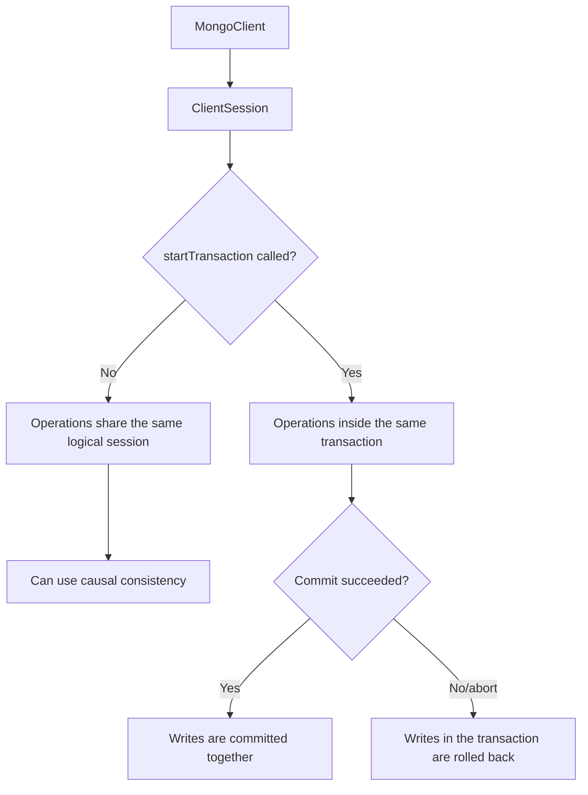
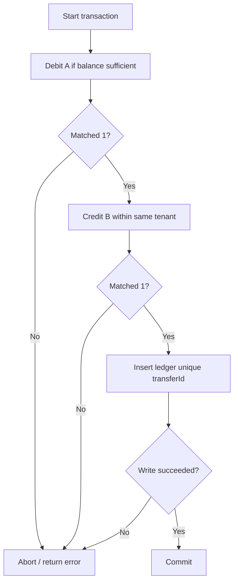
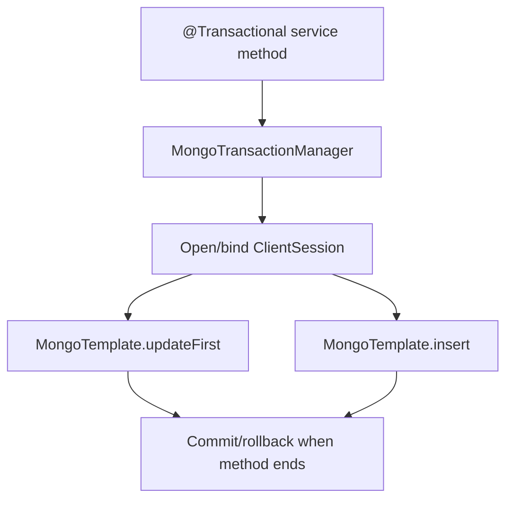
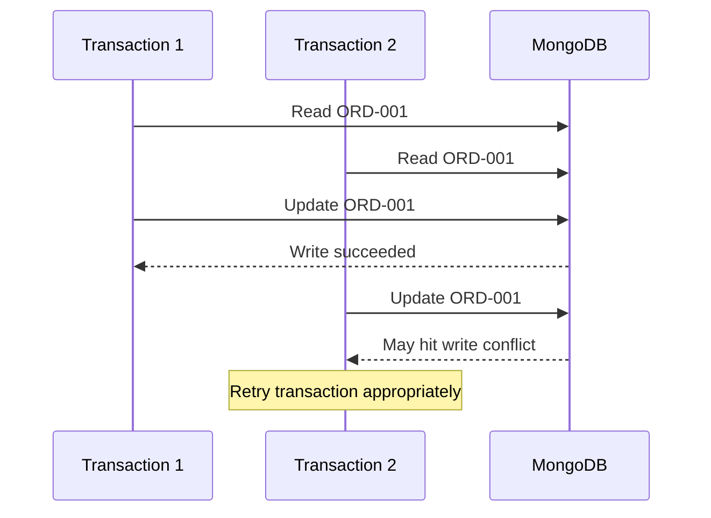

# ClientSession, Causal Consistency, and Multi-Document Transactions

> **Chapter:** Sessions and Transactions  
> **Module:** `SPRING_DATA_MONGODB` — using Spring Data MongoDB to connect, map documents, and work via `MongoTemplate` or repositories; practicing query design, aggregation, indexes, transactions, reactive access, testing, and performance diagnostics. This lesson focuses on the lifecycle of **`ClientSession`**, the meaning of **causal consistency**, and how to execute **multi-document transactions** in MongoDB, including both synchronous and reactive programming.

## 1. Why Do We Need ClientSession and Transactions?

Consider the feature to **transfer 3,000 cents** between two wallets within the same tenant:

1. Deduct 3,000 cents from the source wallet.
2. Add 3,000 cents to the destination wallet.
3. Write a transfer log entry to the `wallet_ledger` collection.

If the three operations are written independently and step 2 fails after step 1, the overall system balance can become incorrect. If another request reads in between, it may observe an inconsistent intermediate state. **MongoDB guarantees atomicity at the single-document level**, but **does not automatically combine multiple operations across multiple documents into one transaction** unless we explicitly open a transaction.

Two related but distinct tools:

- **`ClientSession`** is the MongoDB Java Driver context for attaching operations to the same **logical session**. It can support **causal consistency** and is the required context when explicitly starting a transaction.
- **Transaction** is a sequence of read/write operations belonging to the same transaction, **committed** or **aborted** as an atomic unit within the scope supported by MongoDB. A transaction is bound to a session, but **a session is not automatically a transaction**.



**Lesson objectives:** distinguish sessions from connections, recognize causal guarantees, write transactions with the Java Driver and Spring Data, design error handling/retries, understand transaction/reactive boundaries, and test real rollbacks on a replica set.

## 2. Session, Connection, Transaction: Three Separate Concepts

| Concept | Nature | What Must Not Be Inferred |
| --- | --- | --- |
| **Connection** | Network connection to a MongoDB server, typically managed by the driver in a pool | A logical session is not necessarily a fixed connection outside of a transaction |
| **`ClientSession`** | Logical session created by `MongoClient.startSession`, holding a session ID and causal metadata | Creating a session alone does **not** start a transaction |
| **Causally consistent session** | A session requesting that causal relationships between operations be preserved under supported conditions | Does not guarantee "always reading the latest data across the entire cluster" |
| **Transaction** | A group of operations committed/aborted as a single unit | Does not automatically include HTTP calls, emails, or message brokers outside MongoDB |
| **Snapshot** | A way of observing a consistent image according to the appropriate read concern/snapshot mechanism | Not identical to the causal ordering of operations across multiple points in time |
| **Write concern** | Acknowledgment level for write operations | Not a locking mechanism or a business invariant check |

The MongoDB Java Driver can use **implicit sessions** for supported operations. However, when business logic needs to manage causal chaining or explicit transactions, we typically use an **explicit `ClientSession`** or let the **Spring transaction manager** manage the session.

### 2.1. MongoClient Is Not ClientSession

`MongoClient` is typically created **once** and reused, and is thread-safe per the driver contract. In contrast, `ClientSession` is a short-lived object tied to a single unit of work; do **not** store a session in a singleton service to be shared across multiple requests.

### 2.2. Session ID Is Not a Business Transaction ID

The session ID is used for the logical session and the driver/server protocol. A business identifier such as `transferId = "XFER-001"` must be a **separate** identifier for idempotency/auditing. Do not use the session ID to replace the ledger's unique key or to detect two duplicate payment requests.

### 2.3. One Transaction Uses One Consistent Session

Once a transaction is started with the Java Driver, **every operation intended to participate in the transaction must receive that exact `ClientSession`**:

```java
collectionA.updateOne(session, filterA, updateA);
collectionB.updateOne(session, filterB, updateB);
collectionLedger.insertOne(session, ledgerDocument);
```

If you accidentally call `collectionB.updateOne(filterB, updateB)` **without the session parameter**, that operation runs **outside the transaction**. If the transaction later aborts, the out-of-transaction update is not rolled back with it.

## 3. Dataset: Two Wallets and One Ledger

Run on a **dedicated test database**, never production. The `drop()` commands delete existing collections:

```javascript
db.wallets.drop();
db.wallet_ledger.drop();

db.wallets.insertMany([
  {
    _id: "WALLET-A",
    tenantId: "TENANT-01",
    ownerId: "USER-A",
    balanceCents: NumberLong(10000),
    currency: "USD"
  },
  {
    _id: "WALLET-B",
    tenantId: "TENANT-01",
    ownerId: "USER-B",
    balanceCents: NumberLong(2000),
    currency: "USD"
  }
]);

db.wallet_ledger.createIndex(
  { tenantId: 1, transferId: 1 },
  { name: "ux_ledger_tenant_transfer", unique: true }
);
```

Initially:

| Wallet | Tenant | Balance (cents) |
| --- | --- | ---: |
| WALLET-A | TENANT-01 | 10,000 |
| WALLET-B | TENANT-01 | 2,000 |
| **Total** | | **12,000** |

Transferring 3,000 cents from A to B means the valid post-commit state must be:

| Wallet | Post-Commit Balance |
| --- | ---: |
| WALLET-A | 7,000 |
| WALLET-B | 5,000 |
| **Total** | **12,000** |

In addition to the two balance values, the `wallet_ledger` collection must have exactly one record for `(tenantId, transferId)`. There is no valid case where only one wallet is updated and the other is skipped, or where two ledger rows are written for the same transfer ID.

**Why use cents as `NumberLong`?** So the example avoids floating-point representation errors. Real monetary systems need full design for precision, currency, amount limits, validation, and auditing; a transaction only handles **atomicity**, not all accounting rules.

### 3.1. Same Tenant and Same Currency

In this example, transfers are only allowed between two wallets with the same `tenantId` and the same `currency`. If a multi-tenant system lets clients send only source/destination IDs, the service must obtain the tenant ID from the security context and include the tenant predicate in **both updates**. Do not rely solely on opening a session/transaction to enforce authorization.

## 4. Creating and Closing ClientSession with the MongoDB Java Driver

The Synchronous Java Driver provides `com.mongodb.client.MongoClient` and `com.mongodb.client.ClientSession`. Example:

```java
import com.mongodb.ClientSessionOptions;
import com.mongodb.client.ClientSession;
import com.mongodb.client.MongoClient;
import com.mongodb.client.MongoCollection;
import org.bson.Document;

// mongoClient is injected/pre-created and reused across the application.
MongoCollection<Document> wallets = mongoClient
    .getDatabase("wallet_demo")
    .getCollection("wallets");

try (ClientSession session = mongoClient.startSession(
        ClientSessionOptions.builder()
            .causallyConsistent(true)
            .build())) {

    Document wallet = wallets
        .find(session, new Document("_id", "WALLET-A"))
        .first();

    System.out.println(wallet);
}
// Session is closed at the end of try-with-resources.
```

`mongoClient` is a bean/object from application configuration; the snippet only shows usage. `MongoClient` and the session must belong to the **same driver client** as the collections using the session. Do not create a session from client A and use it with a collection obtained via client B.

### 4.1. Why Must We Close It?

Closing `ClientSession` releases driver/server context resources according to the session lifecycle. If you open an explicit session and fail to close it, resources may linger, making management harder and increasing the risk of hitting resource limits. Use `try-with-resources` for synchronous code; reactive code requires cleanup mechanisms on complete, error, and cancel.

### 4.2. Do Not Use One ClientSession Concurrently Across Multiple Threads

`ClientSession` is **not thread-safe** according to MongoDB Java Driver guidelines. Do not:

```java
// ANTI-PATTERN: do not run two operations on the same session in parallel.
CompletableFuture.runAsync(
    () -> wallets.find(session, filterA).first()
);
CompletableFuture.runAsync(
    () -> wallets.find(session, filterB).first()
);
```

The snippet above only illustrates an antipattern; `session` and the filters are assumed to exist. If you need parallel tasks, design separate sessions per workflow or coordinate sequential ordering. **Inside a MongoDB transaction, parallel execution of multiple operations on the same session is not supported** as a way to speed things up.

### 4.3. A Session Does Not Automatically Open a Transaction

```java
try (ClientSession session = mongoClient.startSession()) {
    wallets.updateOne(session, filter, update);
    // This is still a normal write if startTransaction() has not been called.
}
```

If there are multiple write commands, all using the same session without calling `startTransaction`, there is no "all-or-nothing" constraint across multiple documents. Causal consistency and atomic multi-document transactions are **two separate mechanisms**.

## 5. What Is Causal Consistency?

**Causal consistency** ensures that **causally** related operations within a session are observed in an appropriate order, which is especially important in a replica set when reading from a secondary or when data is written and immediately read on another node.

For example:

1. A request writes order `status=PAID`.
2. After the write is properly acknowledged, the request reads the order back under the same causal session.
3. The read must not "go backward" to an older state prior to the just-committed write, within MongoDB's documented consistency guarantees and conditions.

The causal guarantees commonly described by MongoDB include:

| Property | Business-Level Meaning |
| --- | --- |
| **Read your writes** | After a session writes successfully, subsequent causal reads in the session see the effect of that write |
| **Monotonic reads** | Successive reads in the session do not observe data "moving backward" to a state earlier than a previously observed read |
| **Monotonic writes** | Writes are ordered causally without inverting dependent write order |
| **Writes follow reads** | A write performed based on a read is causally ordered after that read |

**Important guarantee:** MongoDB requires **`readConcern:"majority"` and `writeConcern:"majority"`** to achieve the full causal consistency guarantees in the documented models. Enabling `causallyConsistent(true)` alone while using other concerns **is not sufficient to assert all four guarantees**.

### 5.1. Causal Consistency Is Not a "Linearizable Read"

`read-your-writes` does not mean every read across the entire system always sees **the latest write of every other client**. Causal consistency preserves trackable causal relationships; independent operations from other clients may not have that relationship.

If the business requires stronger **linearizable** guarantees for a single-document operation on the primary, you must evaluate read concern, write concern, and specific support limits separately. Do not rename a causal session as "global strong consistency."

### 5.2. Causal Consistency Is Not a Snapshot Transaction

In a causally consistent session **without an open transaction**, two reads of `walletA` and `walletB` can see data at **two different points in time**. Causal reads can advance forward, but they do not automatically merge into a simultaneous, consistent snapshot across multiple documents.

If you need to verify a total-balance invariant based on a consistent snapshot, you must design a transaction/snapshot read concern appropriately or use a different data model, not just a session.

## 6. Configuring Majority Concerns for a Causal Session

Synchronous Java Driver example with a causal session and a database handle configured with concerns:

```java
import com.mongodb.ClientSessionOptions;
import com.mongodb.ReadConcern;
import com.mongodb.WriteConcern;
import com.mongodb.ReadPreference;
import com.mongodb.client.ClientSession;
import com.mongodb.client.MongoCollection;
import org.bson.Document;

MongoCollection<Document> walletCollection = mongoClient
    .getDatabase("wallet_demo")
    .getCollection("wallets")
    .withReadConcern(ReadConcern.MAJORITY)
    .withWriteConcern(WriteConcern.MAJORITY)
    .withReadPreference(ReadPreference.primary());

try (ClientSession session = mongoClient.startSession(
        ClientSessionOptions.builder()
            .causallyConsistent(true)
            .build())) {

    walletCollection.updateOne(
        session,
        new Document("_id", "WALLET-A"),
        new Document("$set", new Document("lastActivity", "2026-11-20"))
    );

    Document observed = walletCollection
        .find(session, new Document("_id", "WALLET-A"))
        .first();

    System.out.println(observed.getString("lastActivity"));
}
```

**This is not a transaction:** if you add another write command and the second command fails, the previously succeeded command does not automatically roll back. What this example achieves is using **the same causal session** and majority concerns for a write-then-read sequence.

### 6.1. Primary vs Secondary

Causal consistency is particularly useful when an application has a **secondary read preference** and wants to avoid reading stale data relative to prior causal operations. However, using a secondary must comply with topology and actual read concern choices. Do not assume switching read preference to secondary is always valid in every transaction; **transactions that perform writes must follow MongoDB's read preference restrictions, typically `primary`**.

### 6.2. Operation Time and Cluster Time

The driver maintains metadata such as **operation time** and **cluster time** on the session, helping attach causal requirements to related commands. In the Java Driver, there are operations such as:

```java
// Used when an appropriate session already exists:
var operationTime = session.getOperationTime();
var clusterTime = session.getClusterTime();

// With another session and valid metadata:
// otherSession.advanceOperationTime(operationTime);
// otherSession.advanceClusterTime(clusterTime);
```

The snippet above illustrates the idea of **passing causal context** across session/service boundaries; it is not runnable as-is because `session`/`otherSession` must be declared, metadata may be null, and a safe propagation flow is needed. Do not fabricate fake timestamps, and do not conclude that an arbitrary log timestamp is equivalent to a MongoDB causal token.

In most simple APIs, **keeping the same session for a sequential chain of operations** is easier to reason about than manually passing operation time/cluster time between services.

## 7. When Do You Need a Multi-Document Transaction?

MongoDB guarantees that each single-document update is atomic. For example:

```javascript
db.wallets.updateOne(
  { _id: "WALLET-A", tenantId: "TENANT-01",
    balanceCents: { $gte: NumberLong(3000) } },
  { $inc: { balanceCents: NumberLong(-3000) } }
);
```

This command can **atomically** deduct wallet A's balance if the sufficient-funds predicate still matches at the moment of the write. It does not need a transaction just to protect a single document.

However, to **deduct A + credit B + write ledger** as one unit, a transaction is a suitable choice:



**Do not reflexively use transactions for every operation.** Changing a status in **one** document usually only needs an atomic conditional update, `@Version`, or a unique constraint. Multi-document transactions incur coordination overhead, hold snapshots/resources, and have lifetime limits.

### 7.1. Not a Distributed Transaction Between MongoDB and External Systems

A MongoDB transaction **does not automatically roll back** a sent email, an HTTP call to a payment gateway, or a Kafka message published outside the transaction. For business logic that needs to emit events after commit, consider a **transactional outbox** that stores the event inside the MongoDB transaction and then a worker publishes it to the broker, combined with an idempotent consumer.

### 7.2. Multiple Documents in One Collection Also Need a Transaction When They Must Commit Together

It is not only **multi-collection** operations that need a transaction. Transferring funds between two `wallets` documents in the same collection modifies **two documents**; if the business requires all-or-nothing, you still need a multi-document transaction or a different data design that preserves the invariant.

## 8. Prerequisites Before Using MongoDB Transactions

### 8.1. Topology and Version

Multi-document transaction support varies by server version:

| MongoDB Topology | Multi-Document Transactions |
| --- | --- |
| **Standalone server** | Does **not** support multi-document transactions |
| **Replica set** | Supported starting in **MongoDB 4.0** |
| **Sharded cluster** | Distributed transactions supported starting in **MongoDB 4.2** |
| **Suitable MongoDB Atlas cluster** | May support depending on topology/tier and deployed version |

**Do not use a standalone mongod as evidence that transaction tests succeed.** With Testcontainers, you need a container initialized as a replica set or a properly configured MongoDB test replica set. Production must have suitable topology/durability/monitoring, not just a changed connection string.

### 8.2. The Connection String Must Point to the Right Topology

An illustrative URI:

```properties
spring.data.mongodb.uri=mongodb://localhost:27017/wallet_demo?replicaSet=rs0
```

The value `rs0` is the replica set name **only when the real test server is configured that way**. Do not arbitrarily append `replicaSet=rs0` to the URI when the server is not running as a replica set. For a sharded cluster, use the mongos URI or the configuration specified by your provider.

When configuring via Spring Boot properties, avoid setting conflicting URI and host/port/database properties simultaneously. In production, use a secret store/managed configuration; do not hardcode credentials in documentation or source code.

### 8.3. Prepare Collections and Indexes Before the Transaction

This example needs the `wallets` and `wallet_ledger` collections and a unique index on `(tenantId, transferId)`. Create them **before serving transactions** via migrations. MongoDB has DDL support/restrictions inside transactions depending on version and topology; creating collections/indexes outside transactions keeps behavior predictable.

```javascript
db.wallets.createIndex(
  { tenantId: 1, _id: 1 },
  { name: "ix_wallet_tenant_id" }
);

db.wallet_ledger.createIndex(
  { tenantId: 1, transferId: 1 },
  { name: "ux_ledger_tenant_transfer", unique: true }
);
```

The index on `_id` already exists by default; the compound index `{tenantId:1,_id:1}` is only a **workload-dependent candidate**, not a mandatory prerequisite for transactions. For queries always filtering by unique `_id`, the default unique index may suffice; measure with `explain` before increasing write amplification with unnecessary indexes.

### 8.4. Transactions Have Limits and Costs

- Long transactions hold snapshots/resources and increase the risk of write conflicts, cache pressure, and commit overhead.
- MongoDB has `transactionLifetimeLimitSeconds` (typically defaulting to **60 seconds**, depending on configuration) and limits on size/cache/oplog/version.
- Distributed transactions on a sharded cluster have higher overhead.
- Do not use a transaction to call an external API and wait tens of seconds.
- Review write concern, read concern, read preference, and commit retry policy for your topology.

**A successful transaction does not make systems outside MongoDB part of the transaction.**

## 9. Java Driver: startTransaction, commitTransaction, and abortTransaction

### 9.1. TransactionOptions

The Java Driver lets you build transaction options:

```java
import com.mongodb.ReadConcern;
import com.mongodb.ReadPreference;
import com.mongodb.TransactionOptions;
import com.mongodb.WriteConcern;

TransactionOptions options = TransactionOptions.builder()
    .readConcern(ReadConcern.SNAPSHOT)
    .writeConcern(WriteConcern.MAJORITY)
    .readPreference(ReadPreference.primary())
    .build();
```

- `ReadConcern.SNAPSHOT` provides reads from a transaction snapshot under supported conditions.
- `WriteConcern.MAJORITY` sets the **commit** acknowledgment policy; combined with an appropriate read concern, it helps provide stronger durability/consistency guarantees.
- `ReadPreference.primary()` avoids using a read preference disallowed for write transactions.

Choose concerns based on your data contract and topology. Do not assume a single demo configuration suits every workload. In particular, do not claim "majority always equals linearizable" or "snapshot transactions replace authorization."

### 9.2. Transferring Funds Using the Same ClientSession

In the synchronous Java Driver, use collection handles from the **same `MongoClient`** and pass `session` to every command:

```java
import com.mongodb.client.ClientSession;
import com.mongodb.client.MongoCollection;
import com.mongodb.client.result.UpdateResult;
import com.mongodb.client.model.Filters;
import com.mongodb.client.model.Updates;
import org.bson.Document;

MongoCollection<Document> wallets = mongoClient
    .getDatabase("wallet_demo")
    .getCollection("wallets");

MongoCollection<Document> ledger = mongoClient
    .getDatabase("wallet_demo")
    .getCollection("wallet_ledger");

long cents = 3000L;

try (ClientSession session = mongoClient.startSession()) {
    session.startTransaction(options);
    try {
        UpdateResult debit = wallets.updateOne(
            session,
            Filters.and(
                Filters.eq("_id", "WALLET-A"),
                Filters.eq("tenantId", "TENANT-01"),
                Filters.eq("currency", "USD"),
                Filters.gte("balanceCents", cents)
            ),
            Updates.inc("balanceCents", -cents)
        );
        if (debit.getMatchedCount() != 1L) {
            throw new IllegalStateException(
                "Wallet source missing or insufficient balance"
            );
        }

        UpdateResult credit = wallets.updateOne(
            session,
            Filters.and(
                Filters.eq("_id", "WALLET-B"),
                Filters.eq("tenantId", "TENANT-01"),
                Filters.eq("currency", "USD")
            ),
            Updates.inc("balanceCents", cents)
        );
        if (credit.getMatchedCount() != 1L) {
            throw new IllegalStateException("Destination wallet not found");
        }

        ledger.insertOne(session,
            new Document("_id", "LEDGER-XFER-001")
                .append("tenantId", "TENANT-01")
                .append("transferId", "XFER-001")
                .append("fromWalletId", "WALLET-A")
                .append("toWalletId", "WALLET-B")
                .append("amountCents", cents)
        );

        session.commitTransaction();
    } catch (RuntimeException error) {
        if (session.hasActiveTransaction()) {
            session.abortTransaction();
        }
        throw error;
    }
}
```

The snippet above assumes `options` from section 9.1 is declared, `mongoClient` is properly configured, and a MongoDB replica set/sharded cluster supporting transactions is used. The code is a **single happy-path example without advanced retries**, and needs transaction error classification and commit-uncertainty handling before production use.

All three operations (`debit`, `credit`, `insert ledger`) receive the same `session`, so they can **commit or abort together**. If the destination wallet does not exist and an exception is thrown before commit, the code calls abort; the preceding debit command is **not committed**.

### 9.3. Why Must We Check matchedCount?

`updateOne` does not throw an exception by default when the filter matches nothing. If wallet A has insufficient funds, `matchedCount=0`; if the code proceeds to credit B and insert the ledger entry, the transaction could commit a **business-invalid** result even though it is completely atomic.

A transaction only guarantees that the given operations commit/abort together; **it does not inherently understand that "money cannot be created out of thin air."** The service must inspect the outcome of each operation and throw an exception to abort when a business condition is not met.

### 9.4. When commitTransaction Encounters an Error

An error on an operation inside the transaction and an error at the **commit step** do not have the same meaning. If the network disconnects immediately after the commit request, the client may not know whether the commit succeeded (**unknown commit result**). Do not:

```java
// ANTI-PATTERN: seeing an exception and repeating the whole transfer
// with a new transferId -> risk of transferring money twice.
transfer("XFER-002"); // after XFER-001 commit result is unknown
```

The MongoDB Driver provides error labels such as `TransientTransactionError` and `UnknownTransactionCommitResult` to guide retries. The typical strategy is to retry the **whole transaction** for eligible transient errors, and retry **commit** when the commit outcome is unknown. Never blindly retry every `RuntimeException`, and always preserve an **idempotent transferId** across retries.

The Java Driver provides the `ClientSession.withTransaction(callback, options)` helper that handles retries for defined cases. When using the helper, the callback may execute multiple times, so **do not perform external side effects outside MongoDB** inside the callback, such as sending emails or charging a payment gateway.

### 9.5. Commit and Abort Do Not Replace finally/close

`commitTransaction` completes the transaction successfully if acknowledged; `abortTransaction` cancels an active transaction; `session.close` ends the client session's resource lifecycle. You need both **transaction outcome handling** and **session cleanup**, never substituting one for the other.

## 10. Spring Data MongoDB: MongoTransactionManager

`MongoTransactionManager` bridges Spring transactions with MongoDB `ClientSession`. Instead of manually passing `ClientSession` into every `MongoTemplate` call, the Spring transaction manager **binds the session to the transaction execution flow**, and `MongoTemplate` operations going through the same database factory participate.

### 10.1. Declaring the Transaction Manager Bean

```java
package demo.wallets;

import org.springframework.context.annotation.Bean;
import org.springframework.context.annotation.Configuration;
import org.springframework.data.mongodb.MongoDatabaseFactory;
import org.springframework.data.mongodb.MongoTransactionManager;

@Configuration
public class MongoTransactionConfig {

    @Bean
    MongoTransactionManager mongoTransactionManager(
        MongoDatabaseFactory databaseFactory
    ) {
        return new MongoTransactionManager(databaseFactory);
    }
}
```

With a properly configured `MongoTransactionManager` bean, Spring `@Transactional` can coordinate start/commit/rollback. In applications with **multiple transaction managers** (such as JPA and MongoDB), select the right manager:

```java
import org.springframework.transaction.annotation.Transactional;

@Transactional(transactionManager = "mongoTransactionManager")
public void doMongoWork() {
    // ...
}
```

If Spring Boot has already configured an equivalent transaction manager, avoid duplicate declarations and verify bean names. Do not assume JPA transaction annotations will automatically put MongoDB into the same transaction as an RDBMS.

### 10.2. How Does MongoTemplate "Automatically" Join a Transaction?

In an imperative transaction, `MongoTransactionManager` binds a `ClientSession` to Spring's transaction synchronization mechanism. `MongoTemplate` retrieves the session from this context when using the same `MongoDatabaseFactory`.



**Do not use the raw Java Driver without passing a session and assume it automatically inherits `@Transactional`.** If you call `MongoClient.getDatabase(...).getCollection(...).updateOne(...)` directly without a session, the operation may run **outside** the Spring-managed transaction.

### 10.3. @Transactional Only Works When Invoked Through a Proxy

A public service method called from **another bean** typically goes through a Spring AOP proxy:

```java
@Service
public class WalletService {
    @Transactional(transactionManager = "mongoTransactionManager")
    public void transfer() {
        // MongoTemplate operations
    }
}
```

If `transfer()` is called via `this.transfer()` within the same object (self-invocation), the proxy-mode transaction interceptor may not run. A private method annotated with `@Transactional` also typically fails to create the expected boundary. Design clear service transaction boundaries and test actual rollbacks.

### 10.4. Spring Default Rollback Behavior

In Spring declarative transactions, default rollback applies to **unchecked exceptions** (`RuntimeException`/`Error`). For checked exceptions, configure `rollbackFor` if rollback is desired:

```java
@Transactional(
    transactionManager = "mongoTransactionManager",
    rollbackFor = Exception.class
)
public void executeBusinessRule() throws Exception {
    // ...
}
```

Do not catch and swallow every exception inside a transactional method, because Spring may see the method **return normally** and commit even though business logic failed. If you need to catch errors to build a response, handle them **outside** the transaction boundary or explicitly mark rollback-only via the Spring API.

## 11. Spring Service Example: Debit Wallet, Credit Wallet, Write Ledger Atomically

### 11.1. Using MongoTemplate on the Same Transaction Manager

The following example uses collection names to operate directly on BSON via `MongoTemplate`, making it easy to compare with `mongosh` in section 3:

```java
package demo.wallets;

import com.mongodb.client.result.UpdateResult;
import org.bson.Document;
import org.springframework.data.mongodb.core.MongoTemplate;
import org.springframework.data.mongodb.core.query.Criteria;
import org.springframework.data.mongodb.core.query.Query;
import org.springframework.data.mongodb.core.query.Update;
import org.springframework.stereotype.Service;
import org.springframework.transaction.annotation.Transactional;

@Service
public class WalletTransferService {

    private final MongoTemplate mongoTemplate;

    public WalletTransferService(MongoTemplate mongoTemplate) {
        this.mongoTemplate = mongoTemplate;
    }

    @Transactional(transactionManager = "mongoTransactionManager")
    public void transfer(
        String tenantId, String fromId, String toId,
        long amountCents, String transferId
    ) {
        if (tenantId == null || tenantId.isBlank()
            || fromId == null || toId == null
            || fromId.equals(toId)
            || amountCents <= 0
            || transferId == null || transferId.isBlank()) {
            throw new IllegalArgumentException("Invalid transfer request");
        }

        Query source = Query.query(
            Criteria.where("_id").is(fromId)
                .and("tenantId").is(tenantId)
                .and("currency").is("USD")
                .and("balanceCents").gte(amountCents)
        );

        UpdateResult debit = mongoTemplate.updateFirst(
            source,
            new Update().inc("balanceCents", -amountCents),
            "wallets"
        );

        if (debit.getMatchedCount() != 1L) {
            throw new IllegalStateException(
                "Source missing or balance insufficient"
            );
        }

        Query destination = Query.query(
            Criteria.where("_id").is(toId)
                .and("tenantId").is(tenantId)
                .and("currency").is("USD")
        );

        UpdateResult credit = mongoTemplate.updateFirst(
            destination,
            new Update().inc("balanceCents", amountCents),
            "wallets"
        );

        if (credit.getMatchedCount() != 1L) {
            throw new IllegalStateException("Destination not found");
        }

        Document ledger = new Document("_id", tenantId + ":" + transferId)
            .append("tenantId", tenantId)
            .append("transferId", transferId)
            .append("fromWalletId", fromId)
            .append("toWalletId", toId)
            .append("amountCents", amountCents);

        mongoTemplate.insert(ledger, "wallet_ledger");
    }
}
```

**Required configuration:** `MongoTransactionManager` and `MongoTemplate` must use the right `MongoDatabaseFactory`; the MongoDB topology must support transactions; collections/indexes must exist; and the transactional method must be invoked through a Spring proxy. If any of these conditions are not met, you cannot assume the three commands run in the same transaction.

Conceptually:

1. `debit` only matches if A exists in the tenant, has the right currency, and has sufficient funds.
2. `credit` only matches if B belongs to the same tenant and has the right currency.
3. `insert ledger` must not collide with the unique key.
4. Only when all three succeed and the method returns cleanly does Spring commit; a `RuntimeException` rolls back the entire transaction.

**Idempotency note:** `transferId` is used as the ledger's unique key. If a request is repeated with the same transfer ID, the subsequent attempt may pass debit/credit first and then hit a duplicate ledger key; the transaction must roll back those subsequent changes. To return a friendly idempotent response, the service needs an additional mechanism to look up the committed receipt and verify matching request payload, along with race handling. Do not simply catch every duplicate and treat it as "success" without checking the payload.

### 11.2. Why Do We Still Have to Check Balance and Permissions?

`@Transactional` does not prevent overdrafts if code uses `$inc` without `balanceCents:{$gte:amount}`. Nor does it prevent transferring funds to another tenant's wallet if the credit query only filters by `_id`.

A transaction protects **the all-or-nothing consistency of the specified changes**, not the validity of those changes themselves.

### 11.3. Do Repositories Join the Same Transaction?

Repository methods backed by the same `MongoDatabaseFactory` and transaction synchronization can participate in the session managed by `MongoTransactionManager`. However, a repository method with specialized behavior (such as raw queries, update methods, or event callbacks) may have different semantics from `save(entity)`. Test the actual write path when business logic depends on `@Version`, lifecycle callbacks, or unique constraints.

## 12. TransactionTemplate: Explicit Boundary Without @Transactional

Not every workflow suits placing a transaction boundary on a public service method. Spring supports `TransactionTemplate` to run a synchronous block inside a transaction:

```java
import org.springframework.data.mongodb.MongoTransactionManager;
import org.springframework.transaction.support.TransactionTemplate;

TransactionTemplate tx = new TransactionTemplate(
    mongoTransactionManager
);

tx.execute(status -> {
    // All MongoTemplate operations here must use
    // the same MongoDatabaseFactory as MongoTransactionManager.
    mongoTemplate.updateFirst(
        sourceQuery, debitUpdate, "wallets"
    );
    mongoTemplate.updateFirst(
        destinationQuery, creditUpdate, "wallets"
    );
    mongoTemplate.insert(ledgerDocument, "wallet_ledger");
    return null;
});
```

`mongoTransactionManager`, `sourceQuery`, `debitUpdate`, `destinationQuery`, `creditUpdate`, and `ledgerDocument` here are variables already constructed in the service. This is a **transaction boundary illustration**, not a complete example, because matched counts are not checked yet; production code must perform checks like those in section 11.

Advantages:

- The transaction start/end boundary is expressed explicitly in code.
- If the callback throws an unchecked exception, the transaction manager handles rollback per contract.
- Transaction settings such as timeout/isolation can be configured according to what is supported.

Be careful to avoid arbitrarily nesting `TransactionTemplate` with `@Transactional` when multiple transaction managers or propagation policies are in use. MongoDB transactions have their own limitations, so assumptions from RDBMS transactions cannot be applied mechanically.

## 13. Reactive Transactions: Context Differences

In the reactive stack, Spring uses the **Reactor Context** instead of the imperative thread-local transaction context. If an application uses `ReactiveMongoTemplate`, it needs **`ReactiveMongoTransactionManager`** or an appropriate `TransactionalOperator`, rather than copying the imperative `MongoTransactionManager` configuration.

### 13.1. Registering ReactiveMongoTransactionManager

```java
package demo.wallets;

import org.springframework.context.annotation.Bean;
import org.springframework.context.annotation.Configuration;
import org.springframework.data.mongodb.ReactiveMongoDatabaseFactory;
import org.springframework.data.mongodb.ReactiveMongoTransactionManager;

@Configuration
public class ReactiveMongoTransactionConfig {

    @Bean
    ReactiveMongoTransactionManager reactiveMongoTransactionManager(
        ReactiveMongoDatabaseFactory factory
    ) {
        return new ReactiveMongoTransactionManager(factory);
    }
}
```

The bean above is for reactive applications. If a project has both sync and reactive stacks, specify the **exact transaction manager** for each service to avoid picking the wrong one.

### 13.2. Reactive Service with @Transactional

```java
package demo.wallets;

import com.mongodb.client.result.UpdateResult;
import org.bson.Document;
import org.springframework.data.mongodb.core.ReactiveMongoTemplate;
import org.springframework.data.mongodb.core.query.Criteria;
import org.springframework.data.mongodb.core.query.Query;
import org.springframework.data.mongodb.core.query.Update;
import org.springframework.stereotype.Service;
import org.springframework.transaction.annotation.Transactional;
import reactor.core.publisher.Mono;

@Service
public class ReactiveWalletTransferService {

    private final ReactiveMongoTemplate template;

    public ReactiveWalletTransferService(ReactiveMongoTemplate template) {
        this.template = template;
    }

    @Transactional(transactionManager = "reactiveMongoTransactionManager")
    public Mono<Void> transfer(
        String tenantId, String fromId, String toId,
        long cents, String transferId
    ) {
        if (cents <= 0 || fromId.equals(toId)) {
            return Mono.error(
                new IllegalArgumentException("Invalid transfer")
            );
        }

        Query source = Query.query(
            Criteria.where("_id").is(fromId)
                .and("tenantId").is(tenantId)
                .and("currency").is("USD")
                .and("balanceCents").gte(cents)
        );
        Query target = Query.query(
            Criteria.where("_id").is(toId)
                .and("tenantId").is(tenantId)
                .and("currency").is("USD")
        );

        Document receipt = new Document("_id", tenantId + ":" + transferId)
            .append("tenantId", tenantId)
            .append("transferId", transferId)
            .append("amountCents", cents);

        return template.updateFirst(
                source,
                new Update().inc("balanceCents", -cents),
                "wallets"
            )
            .flatMap(debit -> {
                if (debit.getMatchedCount() != 1L) {
                    return Mono.error(new IllegalStateException(
                        "Source missing or insufficient balance"
                    ));
                }
                return template.updateFirst(
                    target,
                    new Update().inc("balanceCents", cents),
                    "wallets"
                );
            })
            .flatMap(credit -> {
                if (credit.getMatchedCount() != 1L) {
                    return Mono.error(new IllegalStateException(
                        "Destination missing"
                    ));
                }
                return template.insert(receipt, "wallet_ledger");
            })
            .then();
    }
}
```

This is a transaction model over **a single reactive chain**. All operations must continuously belong to the **publisher returned by the method** so the transaction interceptor can subscribe and attach the transaction context properly.

**Notes to address in a real application:**

- Validate that `tenantId`, `fromId`, `toId`, and `transferId` are non-null/non-blank before use; the abbreviated example only checks `cents` and that the two IDs differ.
- The `receipt` data here omits full from/to metadata to keep the snippet concise; production should write the complete ledger record like the imperative service.
- Do not call `subscribe()` inside the method to detach a write command from the publisher; a detached operation can run **outside the transaction**.
- Do not use `Mono.when(...)`/`zip(...)` to run two updates in parallel on the **same transactional session**; MongoDB does not support parallel operations inside a single transaction.
- Do not call `block()` on an event loop to wait for imperative operations.

### 13.3. TransactionalOperator

When you do not want `@Transactional` on the method, create a `TransactionalOperator` from the reactive manager:

```java
import org.springframework.transaction.reactive.TransactionalOperator;
import reactor.core.publisher.Mono;

TransactionalOperator operator =
    TransactionalOperator.create(reactiveMongoTransactionManager);

Mono<Void> work = template.updateFirst(
        sourceQuery, debitUpdate, "wallets"
    )
    .flatMap(result -> {
        if (result.getMatchedCount() != 1L) {
            return Mono.error(new IllegalStateException(
                "Debit failed"
            ));
        }
        return template.updateFirst(
            targetQuery, creditUpdate, "wallets"
        );
    })
    .flatMap(result -> {
        if (result.getMatchedCount() != 1L) {
            return Mono.error(new IllegalStateException(
                "Credit failed"
            ));
        }
        return template.insert(receiptDocument, "wallet_ledger");
    })
    .then()
    .as(operator::transactional);
```

`sourceQuery`, `debitUpdate`, `targetQuery`, `creditUpdate`, and `receiptDocument` are variables built as in the service above. `.as(operator::transactional)` binds the transaction to the **publisher chain**. Do not treat `TransactionalOperator` as a command to "enable transactions application-wide."

### 13.4. Manual Reactive ClientSession: Cleanup Is Mandatory

The MongoDB Reactive Streams Driver exposes `ClientSession`/`startSession` as publishers, unlike synchronous code. If managing sessions manually:

- Acquire the session upon subscription.
- Use the **same session for every operation** in the transaction.
- Commit/abort with sequentially composed publishers.
- Clean up the session on complete/error/cancellation so sessions never leak.

With Spring Data reactive, `ReactiveMongoTransactionManager`/`TransactionalOperator` is usually easier to maintain than re-implementing the reactive driver's cleanup/retry logic yourself. Publishers hopping across threads/schedulers do not necessarily lose the Reactor Context if composed properly; instead, **manual subscribe/detached pipelines** are the common source of bugs.

## 14. Causal Consistency in Spring Data: Explicit Session Configuration

### 14.1. MongoTemplate.withSession

Spring Data MongoDB supports working with an explicit session when you do not want to open a transaction:

```java
import com.mongodb.ClientSessionOptions;
import com.mongodb.client.ClientSession;
import org.springframework.data.mongodb.core.MongoTemplate;
import org.bson.Document;

ClientSession session = mongoClient.startSession(
    ClientSessionOptions.builder()
        .causallyConsistent(true)
        .build()
);

try {
    mongoTemplate.withSession(() -> session).execute(action -> {
        action.insert(
            new Document("_id", "ORDER-CAUSAL-1")
                .append("status", "CREATED"),
            "causal_orders"
        );
        return action.findById(
            "ORDER-CAUSAL-1",
            Document.class,
            "causal_orders"
        );
    });
} finally {
    session.close();
}
```

`withSession(...)` creates **session-scoped operations** inside the callback, not a transaction. The example illustrates keeping the session for write-then-read; to obtain full causal guarantees, database/collection operations still need appropriate **majority read/write concerns** as in sections 5–6.

**Do not call `mongoTemplate.insert(...)` outside the `action` variable inside the callback and assume that call uses the newly created session.** Always use the provided scoped operations or a transaction manager that has bound the session properly.

### 14.2. Avoiding Session Lifecycle Leaks

The snippet above uses `try/finally` to ensure the session is closed. Do not create a session in the constructor of a singleton repository and hold it for the lifetime of the web server. Sessions carry causal context and dedicated resources, and are not a shared cache across all users.

### 14.3. MongoTemplate and Read Preference on a Causal Session

When choosing a secondary read preference, you must ensure causal requirements are met and understand replica set lag/capabilities. A read from a secondary outside the same session/causal context **does not automatically provide read-your-writes**. For transactions with writes, do not arbitrarily force a secondary read preference on the transaction; per MongoDB restrictions, transactions have specific read preference requirements.

## 15. Transaction + @Version: Lost Update Protection Is Still Needed

A transaction guarantees atomicity of a group of operations, but **is not** a direct replacement for optimistic locking.

For example, two transactions concurrently reading an order `ORD-001`:



Transaction concurrency control can detect a **write conflict** when concurrent transactions modify the same document. `@Version`, on the other hand, compares the domain entity's snapshot across supported `save`/`delete` operations, even without an explicit transaction.

Key points:

- For a single document, an **atomic update + query predicate** may suffice; there is no need for a transaction just to increment a version.
- For multiple documents, a transaction helps commit changes together, yet you still must check business predicates and versions if the domain requires them.
- If a raw driver writer bypasses the version protocol, Java's `@Version` cannot police the entire system on its own.
- Retrying a transaction after a write conflict must **re-read state in a new transaction** and re-check business rules; do not try to commit a stale snapshot.

### 15.1. Version Is Not a Cross-Collection Lock

Wallet A's version does not automatically protect wallet B's balance or the ledger. A transfer may require balance conditions, a unique ledger ID, a transaction, and matched-count checks — each component addresses a separate concern.

### 15.2. Do Not Use Transactions to Mask Validation Errors

If code transfers a negative amount, uses the wrong currency, or writes a duplicate ledger entry, the transaction only commits/rolls back operations according to the rules — it does not judge monetary semantics. Validate requests, permissions, unique constraints, and idempotency **before/inside** the transaction at the proper points.

## 16. Retrying Transactions: Distinguishing Transient Errors from Unknown Commit

When a transaction error occurs, two questions must be answered correctly:

1. **Has the transaction definitely failed to commit?** If uncertain, never re-run the business operation with a new transfer ID.
2. **Is the error eligible for retry?** A `DuplicateKeyException` caused by a previously executed request may require looking up the receipt, not retrying forever.

### 16.1. Two Crucial Error Labels

| Error Label | Common Meaning | Conceptual Strategy |
| --- | --- | --- |
| `TransientTransactionError` | Transaction hit a transient/write-conflict error eligible for retrying the entire transaction | Abort if needed, **start a new transaction**, re-read and re-execute within bounds |
| `UnknownTransactionCommitResult` | Client does not know the outcome of `commitTransaction` | Retry **commit** per driver guidance, or reconcile the outcome using the idempotency key |

Do not apply this table mechanically to every network/driver error; error labels and driver retries depend on version, topology, and operation type. In the Java Driver, use `MongoException.hasErrorLabel(...)` to classify, or use `withTransaction` which has built-in retry support.

### 16.2. Whole-Transaction Retries Must Be Idempotent

For example, request `XFER-001` might have already committed, but the HTTP response was lost. If the client resends the **same transferId**:

- The unique index `(tenantId, transferId)` prevents **two ledger entries** with the same identifier.
- Service code must reconcile the committed ledger entry along with source/destination/amount/currency before declaring the duplicate request successful.
- If a payload shares the same transferId but has a different amount, return a conflict rather than overwriting.
- If a new transaction attempts debit/credit and then inserts a duplicate ledger entry, the duplicate key error must roll back the **entire new transaction**. Never swallow the exception inside the transaction and commit debit/credit.

Idempotency is not automatically provided by `@Transactional` alone, but can be enforced through a unique index + transaction + response protocol with payload verification.

### 16.3. Do Not Perform External Side Effects Inside a Retryable Callback

```java
// ANTI-PATTERN inside a transaction callback that can re-run:
paymentGateway.capture(paymentId); // external side effect
mongoCollection.insertOne(session, ledger);
```

If the transaction callback is retried, the gateway call could repeat. Use a **transactional outbox** to record an event document alongside the transfer in MongoDB; a post-commit worker dispatches the event externally in an idempotent manner. This is a separate architectural pattern, not something MongoDB rolls back automatically.

### 16.4. Bounded and Observable Retries

Choose reasonable retry thresholds by error type, apply backoff/jitter where appropriate, and record metrics: transactions started, commit successes, aborts, write conflicts, retries, unknown commit outcomes, latency, and total duration.

Do not use `while(true)` to retry the entire transfer endlessly on duplicate key, permission error, validation failure, or insufficient balance — these are **not** transient errors suitable for automatic retry.

## 17. Integration Testing Transactions on a MongoDB Replica Set

### 17.1. What Needs to Be Proven

A unit test that only mocks `MongoTemplate` and verifies three methods were called **does not prove** that all three changes roll back together on MongoDB. An integration test needs a **real test replica set**, running real transactions and reading back BSON after commit/abort.

Minimum cases:

| Case | Expected Result |
| --- | --- |
| Transfer 3,000 from A to B | A=7,000; B=5,000; one ledger row |
| Source wallet insufficient funds | Both wallets unchanged; no ledger entry |
| Destination wallet does not exist | Preceding debit rolled back; wallet A stays 10,000; no ledger entry |
| Duplicate ledger transferId | New transaction rolls back; no second debit/credit |
| Wrong tenantId | No updates to wallets outside tenant; no ledger entry |
| Unchecked exception mid-service | Entire transaction rolls back when invoked via Spring proxy |
| Two concurrent transfers on same wallet | No negative balance or broken total due to mishandled conflicts |
| Causal session read with majority concerns | Read-after-write in the same session reflects the acknowledged write |

A test that only checks `service.transfer` does not throw an exception **is not enough**; it must assert **wallet A, wallet B, and the ledger** after the operation.

### 17.2. JUnit 5 + Spring Boot Class Example

The sample below assumes the project already has a `@SpringBootApplication` under package `demo.wallets`, `MongoTransactionManager` configured as in section 10, and `WalletTransferService` as in section 11. **Run against a test replica set**, such as Testcontainers MongoDB initialized as a replica set, not standalone MongoDB.

```java
package demo.wallets;

import static org.assertj.core.api.Assertions.assertThat;
import static org.assertj.core.api.Assertions.assertThatThrownBy;

import com.mongodb.client.model.IndexOptions;
import org.bson.Document;
import org.junit.jupiter.api.BeforeEach;
import org.junit.jupiter.api.Test;
import org.springframework.beans.factory.annotation.Autowired;
import org.springframework.boot.test.context.SpringBootTest;
import org.springframework.dao.DuplicateKeyException;
import org.springframework.data.mongodb.core.MongoTemplate;

@SpringBootTest
class WalletTransferIntegrationTest {

    @Autowired MongoTemplate template;
    @Autowired WalletTransferService service;

    @BeforeEach
    void seed() {
        // TEST MongoDB only; never run against production.
        template.dropCollection("wallet_ledger");
        template.dropCollection("wallets");

        template.insert(
            new Document("_id", "WALLET-A")
                .append("tenantId", "TENANT-01")
                .append("currency", "USD")
                .append("balanceCents", 10_000L),
            "wallets"
        );
        template.insert(
            new Document("_id", "WALLET-B")
                .append("tenantId", "TENANT-01")
                .append("currency", "USD")
                .append("balanceCents", 2_000L),
            "wallets"
        );

        // Index is created BEFORE transactions.
        template.getCollection("wallet_ledger").createIndex(
            new Document("tenantId", 1)
                .append("transferId", 1),
            new IndexOptions().unique(true)
        );
    }

    private long balance(String walletId) {
        Document wallet = template.getCollection("wallets")
            .find(new Document("_id", walletId))
            .first();
        assertThat(wallet).isNotNull();
        return wallet.getLong("balanceCents");
    }

    private long ledgerCount() {
        return template.getCollection("wallet_ledger")
            .countDocuments();
    }

    @Test
    void committedTransferUpdatesBothWalletsAndLedger() {
        service.transfer(
            "TENANT-01", "WALLET-A", "WALLET-B", 3000L, "XFER-001"
        );

        assertThat(balance("WALLET-A")).isEqualTo(7000L);
        assertThat(balance("WALLET-B")).isEqualTo(5000L);
        assertThat(ledgerCount()).isEqualTo(1L);
        assertThat(balance("WALLET-A") + balance("WALLET-B"))
            .isEqualTo(12000L);
    }

    @Test
    void missingDestinationRollsBackDebit() {
        assertThatThrownBy(() -> service.transfer(
            "TENANT-01", "WALLET-A", "MISSING", 3000L, "XFER-002"
        )).isInstanceOf(IllegalStateException.class);

        assertThat(balance("WALLET-A")).isEqualTo(10000L);
        assertThat(balance("WALLET-B")).isEqualTo(2000L);
        assertThat(ledgerCount()).isZero();
    }

    @Test
    void insufficientBalanceDoesNotCreditDestination() {
        assertThatThrownBy(() -> service.transfer(
            "TENANT-01", "WALLET-A", "WALLET-B",
            11000L, "XFER-003"
        )).isInstanceOf(IllegalStateException.class);

        assertThat(balance("WALLET-A")).isEqualTo(10000L);
        assertThat(balance("WALLET-B")).isEqualTo(2000L);
        assertThat(ledgerCount()).isZero();
    }

    @Test
    void duplicateLedgerCausesSecondTransferToRollback() {
        service.transfer(
            "TENANT-01", "WALLET-A", "WALLET-B", 3000L, "XFER-004"
        );

        assertThatThrownBy(() -> service.transfer(
            "TENANT-01", "WALLET-A", "WALLET-B", 3000L, "XFER-004"
        )).isInstanceOf(DuplicateKeyException.class);

        // Both wallets are not updated a second time.
        assertThat(balance("WALLET-A")).isEqualTo(7000L);
        assertThat(balance("WALLET-B")).isEqualTo(5000L);
        assertThat(ledgerCount()).isEqualTo(1L);
    }
}
```

**Execution requirements:** the test MongoDB must be a transaction-capable replica set, with a valid URI, matching database/collection names, and the service called through a Spring proxy. Depending on the driver version and exception translation, duplicate errors may be wrapped or translated into an appropriate subclass; if the `DuplicateKeyException` assertion does not match on a given stack, inspect the root cause and actual exception translator before changing business logic.

In real test suites, use a **separate test database per suite/job** to prevent parallel tests from deleting each other's data. `dropCollection`/`deleteMany` commands in examples must only be executed in isolated test environments.

### 17.3. Testing Raw ClientSession Causal Consistency

An additional test, not necessarily a transaction:

```java
import com.mongodb.ClientSessionOptions;
import com.mongodb.ReadConcern;
import com.mongodb.WriteConcern;
import com.mongodb.client.ClientSession;
import org.bson.Document;

var collection = mongoClient.getDatabase("wallet_demo")
    .getCollection("causal_probe")
    .withReadConcern(ReadConcern.MAJORITY)
    .withWriteConcern(WriteConcern.MAJORITY);

try (ClientSession session = mongoClient.startSession(
        ClientSessionOptions.builder()
            .causallyConsistent(true)
            .build())) {

    collection.insertOne(
        session,
        new Document("_id", "PROBE-001").append("value", 42)
    );

    Document read = collection
        .find(session, new Document("_id", "PROBE-001"))
        .first();

    assertThat(read).isNotNull();
    assertThat(read.getInteger("value")).isEqualTo(42);
}
```

The example must run against a test collection that does not yet contain `PROBE-001` or must change the ID each run. This is a **read-after-write smoke test**, insufficient to fully verify monotonic-read behavior under replica lag; dedicated concurrency/replication tests need to simulate appropriate topology conditions.

### 17.4. Do Not Rely on the Test's Own Spring @Transactional

If a test method is wrapped in a test framework transaction, reads inside that transaction may observe uncommitted writes and **mask real commit/rollback bugs**. For the example above, invoke the service from a test method **without an enclosing transaction**, letting the service open/close its own transaction; then read back outside.

In particular, if a test method is annotated with `@Transactional` and rolls back at the end of the test, observed behavior may differ from production. Verify which transaction manager is used and whether a transaction is actually committed in the service.

## 18. Performance, Limits, and Transaction Observability

### 18.1. Keep Transactions Short

The longer a transaction holds operations/snapshots, the higher the probability of:

- Write conflicts or required retries.
- Holding memory and resources for historical/snapshot data.
- Hitting the transaction lifetime limit.
- Increasing commit latency, especially on sharded topologies.
- Creating cache/oplog pressure or impacting other workloads.

**Practical rule:** prepare needed data and validate as early as possible, keeping inside the transaction only the reads/writes that require atomicity. However, do not move business predicates that must be checked at commit time completely outside the transaction if doing so creates a race condition.

### 18.2. Indexes to Reduce Write/Read Scope

In the wallet example, the `_id` unique index already exists and suffices to locate by ID, after which `tenantId`/`balanceCents` are checked. Do not create numerous compound indexes just because a filter has multiple fields; evaluate:

```javascript
db.wallets.explain("executionStats").find({
  _id: "WALLET-A",
  tenantId: "TENANT-01",
  balanceCents: { $gte: NumberLong(3000) }
});
```

For the ledger, the unique compound index `{tenantId:1,transferId:1}` actually serves **idempotency/uniqueness**, not merely performance. Inspect `getIndexes()` after migration before taking traffic.

### 18.3. Transaction Size and Operations

MongoDB enforces limits on BSON documents, transaction lifetime, cache pressure, oplog, and certain operations/DDL per version. Having many small operations inside one transaction does not mean you can pack unbounded data into it; check constraints for your specific server version.

If you need to import/update millions of documents, **do not** open a single transaction spanning the entire job. Design batches with checkpoints/idempotency, or process small groups of data with narrow transaction boundaries and track eventual consistency.

### 18.4. Monitoring Server and Application Metrics

In environments with appropriate privileges, transaction info can be read from MongoDB tools:

```javascript
db.serverStatus().transactions;
```

Exact fields depend on version/role/topology. On the application side, record metrics:

- Commit success rate, abort rate, and retry rate.
- Latency from start to commit, and commit latency separately.
- Number of write conflicts and failure reasons.
- Number of unknown commit outcomes requiring reconciliation.
- Number of duplicate transfer IDs and business errors (insufficient funds, wrong tenant).
- Duration/cost of queries inside transactions, read counts, and modified document counts.

**Never log full payment credentials or sensitive data** in exceptions/payloads. From client session logs, retain only controlled correlation IDs/transfer IDs, never using the session ID as a user account identifier.

### 18.5. Cost of Majority

`WriteConcern.MAJORITY` can increase write latency compared to `w:1` depending on replica health/network; `ReadConcern.MAJORITY` can affect read availability/latency and behavior depending on topology. Do not downgrade concerns just to make benchmarks faster if causal/durability contracts require majority.

Optimizing transactions requires measuring **p95/p99 latency, throughput, and failover behavior**, not just timing a single command on a laptop.

## 19. Security, Multi-Tenancy, and Risk Controls

### 19.1. Transactions Do Not Authenticate Tenants

If the source and destination wallets belong to two different tenants, a transaction can still commit BSON-valid commands if the query omits a tenant guard. Bad example:

```javascript
// ANTI-PATTERN: filtering by _id only.
db.wallets.updateOne(
  { _id: "WALLET-B" },
  { $inc: { balanceCents: NumberLong(3000) } }
);
```

You must check tenant/permissions in the service and apply the `tenantId` filter in **every** update participating in the transfer. Do not allow a user to arbitrarily alter `tenantId` and use an overly privileged session/transaction to access another tenant's resources.

### 19.2. Authorization Is Not Replaced by Transactions

A session can group commands, but it does not know who the caller is. Obtain the principal/security context, verify permission to transfer from wallet A, receive into B, and tenant scope before executing. If you do not want to leak the existence of another tenant's wallet, the service should return a generic error aligned with your privacy policy.

### 19.3. Be Careful with Rollback and External Effects

Do not send a "transfer succeeded" notification **before the commit is acknowledged**. If an audit message is needed, write an outbox document inside the transaction and dispatch it after commit. When the commit outcome is unknown, reconcile by `transferId` rather than reporting failure and retrying the transfer with a different ID.

### 19.4. Session Lifetime and Cancellation

A client may abort an HTTP request mid-flight. In the reactive stack, cancellation must flow through publisher cleanup/transaction operators to abort/close properly. Never leave a session with an open transaction lingering long after the request is cancelled; monitor transaction duration and timeouts on both server and application sides.

## 20. Troubleshooting Workflow

| Symptom | Common Cause | Resolution |
| --- | --- | --- |
| `Transaction numbers are only allowed ...` | Using standalone or a topology/URI that does not support transactions | Use a suitable replica set/sharded topology; do not just change the URI on standalone |
| Two documents changed, but rollback failed to revert one | An operation did not participate in the same session/transaction | Ensure MongoTemplate uses the same factory/transaction manager; pass session to raw driver |
| `@Transactional` does not roll back | Self-invocation, method not called through proxy, swallowed exception, or wrong manager | Invoke via bean proxy, let exception propagate or mark rollback |
| `MongoTransactionManager` bean not used | Multiple transaction managers present, wrong one selected | Specify `transactionManager` explicitly |
| `ClientSession` stays alive after request | Forgot close/cleanup | Use `try-with-resources` or reactive cleanup on complete/error/cancel |
| Read-after-write from secondary sees stale data | Not sharing causal session, or unsuitable read/write concerns | Maintain causal chain and majority concerns per required guarantees |
| Assumed causal session creates a multi-doc snapshot | Confused causal consistency with transaction/snapshot | Use a transaction when writes must commit together |
| Debit succeeded, but credit found no wallet | Did not check `matchedCount` | Throw an exception to roll back the transaction |
| Duplicate transferId still debits a second time | Missing unique ledger ID or swallowed duplicate exception and committed | Unique index + rollback + idempotency protocol |
| Commit timed out, client unsure if succeeded | `UnknownTransactionCommitResult` | Retry commit/reconcile by key; do not create a new transfer |
| Write conflict when concurrent transactions modify wallet | Concurrent writes on the same document | Retry valid transaction with bounds, keep transactions short |
| Reactive transaction does not work | Detached `subscribe()`, wrong manager, or uncomposed publishers | Keep all work in one Reactor chain, use reactive manager |
| Spring template inside tx, raw driver outside tx | Raw call does not automatically inherit Spring-bound session | Use template/repository with same factory or explicit session |
| Transaction slow or timing out | Too many operations, missing indexes, long external waits | Reduce scope/duration, measure explain and transaction metrics |
| Tests pass, but production rollback fails | Tests didn't run on replica set or test transaction wrapper masked commit | Run integration tests on real replica set and read after boundary |
| Permission/tenant bug only occurs on transfer | Validated source wallet only, forgot destination wallet | Apply tenant predicate and permission checks on both |
| Cannot create index/collection in transaction | DDL restriction or missing namespace | Run migrations to create collections/indexes before transactions |

**10-step checklist:** (1) verify server/topology and URI; (2) check the right manager; (3) verify transaction boundary/proxy; (4) verify all operations share the same session; (5) check source/destination/tenant filters; (6) check update matched counts; (7) inspect ledger unique index; (8) classify error labels and commit uncertainty; (9) measure transaction metrics; (10) reproduce rollback on a test replica set.

## 21. Hands-on Lab: Safe Transfers via Sessions and Transactions

**Scenario:** wallet A has 10,000 cents, wallet B has 2,000 cents. Transfer 3,000 cents within the same tenant and write a unique ledger entry by `transferId`. Practice on a test MongoDB replica set; never run cleanup on a real production database.

1. **Create data:** seed the two wallets per section 3, verify total 12,000 cents, and create unique index `{tenantId:1,transferId:1}`.
2. **Basic session:** use Java Driver `MongoClient.startSession`, read a wallet with `find(session,filter)`, and close the session with `try-with-resources`.
3. **Causal session:** enable `causallyConsistent(true)`, apply `ReadConcern.MAJORITY` and `WriteConcern.MAJORITY`, perform update-then-read on the same session. Explain why this **is not a transaction**.
4. **Explain causality:** distinguish read-your-writes, monotonic reads, monotonic writes, and writes-follow-reads; explain why majority concerns are a key condition.
5. **Manual transaction:** use `startTransaction`, debit A, credit B, insert ledger, `commitTransaction`; verify balances 7,000 + 5,000.
6. **Manual rollback:** replace wallet B with a nonexistent ID. Throw an exception when `matchedCount=0`, call abort, and verify A remains 10,000 in a freshly seeded run.
7. **Spring imperative:** create the `MongoTransactionManager` bean and `@Transactional` service as in section 11.
8. **Test proxy:** invoke the service through an injected bean. Compare with self-invocation `this.transfer()` to see why the annotation may not apply.
9. **Test commit/rollback:** write JUnit assertions for both balances and the ledger after success, after missing wallet, and after insufficient balance.
10. **Idempotency:** send `XFER-001` twice with the same payload; verify the ledger has only one record and the repeated transaction does not change balances a second time. Design how to return an idempotent receipt.
11. **Conflict:** create two concurrent requests targeting wallet A. Classify `TransientTransactionError`/write conflict, retry with bounds, and always verify balance.
12. **Unknown commit:** design-simulate losing the response after commit. Explain why you must not switch to `XFER-002` and re-transfer.
13. **Reactive:** write `ReactiveMongoTransactionManager` and a single publisher for debit → credit → insert; never call `subscribe()` separately per operation.
14. **TransactionalOperator:** implement the equivalent using `.as(operator::transactional)`; compare with the annotation approach.
15. **Wrong session:** write an anti-example using the raw driver without passing `ClientSession` inside a transaction, and explain why it does not roll back with the group.
16. **Read concern:** compare `local`, `majority`, and `snapshot` in terms of intended usage; explain that concerns do not replace authorization/business rules.
17. **Performance:** measure transaction duration, and analyze why you should not call a payment gateway or run large scans inside a transaction.
18. **Security:** enforce that both wallet filters include `tenantId` from the principal and a valid `currency`.
19. **Index:** inspect `getIndexes()` on the ledger, measure the `_id` query with `explain`, and avoid adding compound indexes without supporting data.
20. **Design outside MongoDB:** sketch a transactional outbox to emit transfer events after commit, paired with an idempotent consumer.

### Self-Check Questions

- How does `ClientSession` differ from `MongoClient` and a network connection?
- Does creating a session automatically open a transaction?
- Why must a `ClientSession` not be shared across multiple concurrent requests/threads?
- What relationships does causal consistency provide, and why are majority read/write concerns needed for full guarantees?
- How does causal consistency differ from unconditional cluster-wide read-your-writes and from a snapshot transaction?
- Does standalone MongoDB support multi-document transactions? What versions do replica sets and sharded clusters require?
- Which operations in a transaction must use the same session?
- If credit matches nothing but code still commits, does MongoDB automatically protect the total-balance invariant?
- How does `@Transactional` managed by `MongoTransactionManager` bind a session to `MongoTemplate`?
- Why can a raw driver update missing the session argument run outside a Spring transaction?
- When self-invocation happens, does the transaction annotation always take effect?
- Does a checked exception trigger Spring transaction rollback by default?
- Does `ReactiveMongoTransactionManager` rely on thread-local storage or the Reactor Context?
- Why shouldn't you use `Mono.zip` for two parallel updates in the same transaction?
- What is the difference between `TransientTransactionError` and `UnknownTransactionCommitResult`?
- Why can retrying a transfer with a new transfer ID cause a double transfer?
- Can a unique index on the ledger replace a transaction across two wallets?
- Can a MongoDB transaction roll back a sent email or a payment gateway call?
- Why do long transactions affect throughput and need to be measured on a replica set?

## 22. Summary and References

### Key Principles to Remember

- **`ClientSession` is a logical session** for a sequence of MongoDB operations; manage its lifecycle, close resources, and never use it concurrently across multiple threads.
- **Causal consistency is not automatically a transaction.** Full causal consistency guarantees require **majority read concern and majority write concern** in supported MongoDB scenarios; it does not mean every read across the cluster sees the latest data.
- **Multi-document transactions** require a suitable topology (MongoDB 4.0+ replica set, MongoDB 4.2+ sharded cluster). Standalone MongoDB cannot execute this type of transaction.
- **Every operation must join the right session** if they are expected to commit/abort together. Creating a session without calling `startTransaction` provides no multi-document atomicity.
- **The Java Driver** manages `startTransaction`/`commitTransaction`/`abortTransaction`; handle retries and uncertain commits properly rather than catching all errors and blindly repeating.
- **Spring imperative** uses `MongoTransactionManager` and `@Transactional` or `TransactionTemplate`; `MongoTemplate`/repositories must use the same factory, and methods must be invoked through proxies.
- **Spring reactive** uses `ReactiveMongoTransactionManager` or `TransactionalOperator`, keeping all operations in one reactive publisher chain; no detached subscribes or parallel operations on the same session.
- **Transactions do not replace business checks**: validate tenant, currency, sufficient funds, and `matchedCount`; roll back when any condition fails.
- **Idempotency is an independent layer**: use `transferId`/unique ledger keys and payload verification, never automatically retrying a transfer with a new ID when the commit outcome is unknown.
- **Snapshot/read concern, write concern, `@Version`, unique indexes, and transactions serve different constraints**; choose appropriately for invariants and workload.
- **Test on a real replica set** and assert both balances and the ledger before and after commit and rollback. Mocks do not verify multi-document atomicity.
- **Keep transactions short, measure metrics, and have an incident strategy**; do not call external services inside a retryable callback.

### Official Documentation

Check guidance against the exact MongoDB Server, Java Driver, Spring Data MongoDB, and Spring Boot versions used by your project:

- [MongoDB — Transactions](https://www.mongodb.com/docs/manual/core/transactions/)
- [MongoDB — Transactions Production Considerations](https://www.mongodb.com/docs/manual/core/transactions-production-consideration/)
- [MongoDB — Read Isolation, Consistency, and Recency](https://www.mongodb.com/docs/manual/core/read-isolation-consistency-recency/)
- [MongoDB — Causal Consistency and Read/Write Concerns](https://www.mongodb.com/docs/manual/core/causal-consistency-read-write-concerns/)
- [MongoDB — Read Concern](https://www.mongodb.com/docs/manual/reference/read-concern/)
- [MongoDB — Write Concern](https://www.mongodb.com/docs/manual/reference/write-concern/)
- [MongoDB — Atomicity of Write Operations](https://www.mongodb.com/docs/manual/core/write-operations-atomicity/)
- [MongoDB Java Sync Driver — Transactions](https://www.mongodb.com/docs/drivers/java/sync/current/crud/transactions/)
- [Spring Data MongoDB — Client Sessions](https://docs.spring.io/spring-data/mongodb/reference/mongodb/client-session-transactions.html)
- [Spring Data MongoDB — Transactions](https://docs.spring.io/spring-data/mongodb/reference/mongodb/client-session-transactions.html#mongo.transactions)
- [Spring Data MongoDB — MongoTransactionManager API](https://docs.spring.io/spring-data/mongodb/docs/current/api/org/springframework/data/mongodb/MongoTransactionManager.html)
- [Spring Data MongoDB — ReactiveMongoTransactionManager API](https://docs.spring.io/spring-data/mongodb/docs/current/api/org/springframework/data/mongodb/ReactiveMongoTransactionManager.html)
- [Spring Framework — Programmatic Transaction Management](https://docs.spring.io/spring-framework/reference/data-access/transaction/programmatic.html)
- [Spring Framework — @Transactional Method Semantics](https://docs.spring.io/spring-framework/reference/data-access/transaction/declarative/annotations.html)
