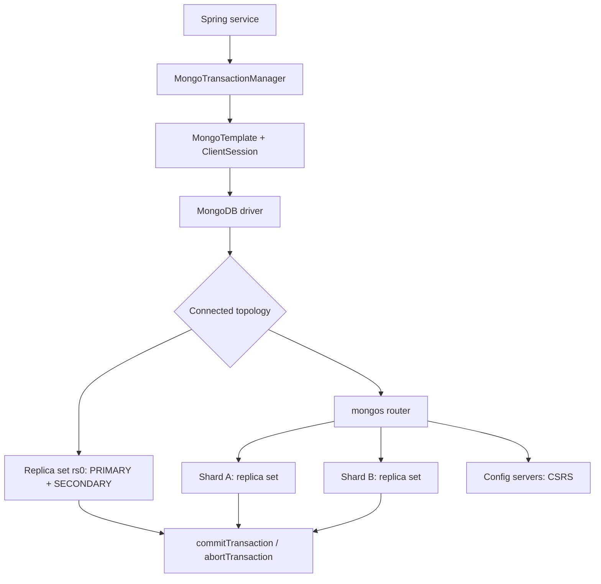
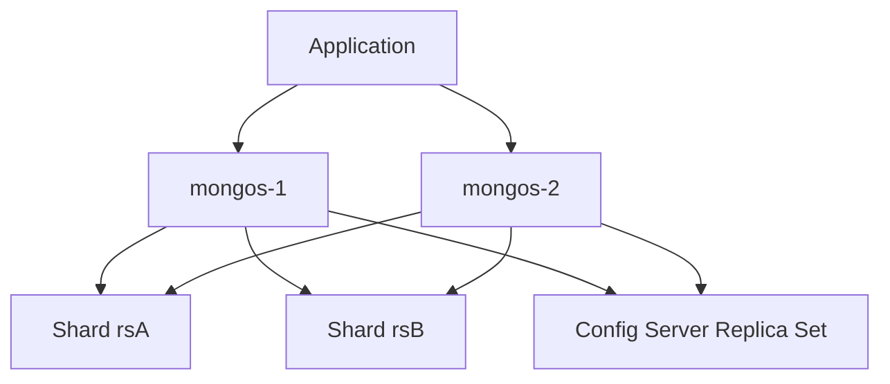

# Replica Set or Sharded Cluster Requirements for Transactions

## 1. Real-World Problem: `@Transactional` Does Not Turn Standalone MongoDB into a Transaction Server

An e-wallet application using **Spring Data MongoDB** stores balances and transfer history in two collections. Transferring 50,000 minor units from wallet A to wallet B requires three operations:

1. Deduct the amount from wallet A if it has sufficient balance.
2. Add the exact same amount to wallet B.
3. Write a transfer record with a unique transaction ID.

If deducting from wallet A succeeds but crediting wallet B fails, the system enters an inconsistent state. A developer adds `@Transactional` to the service expecting all three operations to **commit or roll back together**.

However, in MongoDB, **multi-document transactions only work on deployments that support transactions**. A `mongod` process running in **standalone mode** does not support this type of transaction, even if Spring Boot created the `MongoTransactionManager` bean and the Java code compiles cleanly.

Core requirements:

- **Replica set**: MongoDB supports multi-document transactions starting in version **4.0**.
- **Sharded cluster**: MongoDB supports distributed/multi-shard transactions starting in version **4.2**; the topology must be properly configured and applications typically connect through **`mongos`**.
- **Standalone `mongod`**: does not support multi-document transactions; if you need to test transactions on a single machine, use a **single-node replica set**, not a plain standalone server.

This lesson belongs to the **Sessions and Transactions** chapter of the **SPRING_DATA_MONGODB** module. We will inspect topology, connections, `MongoTransactionManager`/`ReactiveMongoTransactionManager` configuration, practice `MongoTemplate`/repositories, examine read/write concerns, retries, performance, indexes, and integration testing.

**Scope:** this lesson explains **infrastructure requirements** and how to verify that transactions work. It does not turn every single-document operation into a multi-document transaction; atomic updates on a single document already have MongoDB's built-in guarantees.

## 2. Distinguishing Atomic Updates, Sessions, and Multi-Document Transactions

Three concepts are easily confused:

| Mechanism | Scope | Topology Requirement | Example |
| --- | --- | --- | --- |
| **Single-document atomic write** | One document per write operation | Works even on standalone | `updateOne` with `$inc` and a conditional filter |
| **Client session** | Logical context for a sequence of operations; causal consistency/retryable writes where supported | Depends on deployment's logical session support | `MongoClient.startSession()` |
| **Multi-document transaction** | Multiple operations with shared commit/abort | Supported replica set or sharded cluster | Debit wallet A, credit wallet B, write ledger |

MongoDB guarantees atomicity **at the document level** for a single regular write operation. If the business only needs:

```javascript
db.inventory.updateOne(
  { _id: "sku-1", available: { $gte: 3 } },
  {
    $inc: {
      available: -3,
      reserved: 3
    }
  }
);
```

then updating both the `available` and `reserved` fields within the **same document** is atomic. Do not open a transaction just to do what a conditional update already solves properly.

Conversely, if you must modify two wallets **in two separate documents**, or insert an additional ledger document, a single `updateOne` cannot span the entire workflow. In that case, a multi-document transaction can be appropriate.

### 2.1. A Session Is Not Necessarily a Transaction

Creating a `ClientSession` or using Spring Data `ClientSession` does not automatically provide rollback across operations. A transaction must be **started**, operations must **participate in the same session/transaction context**, and then **committed/aborted** through the proper API.

In imperative Spring Data, `MongoTransactionManager` typically binds a session to the transaction context so `MongoTemplate` uses that session. In reactive, the session is bound through the **Reactor context**, not thread-locally as in imperative code.

## 3. Topology and Version Support Matrix

| MongoDB Deployment | Multi-Document Transactions | Key Conditions |
| --- | --- | --- |
| Standalone `mongod` | **No** | No replica set transaction topology |
| Single-node replica set | **Yes** | `mongod` started with `--replSet`, `rs.initiate()` run, PRIMARY present |
| Multi-node replica set | **Yes** | Valid replica set config, PRIMARY available, sufficient server version |
| Sharded cluster | **Yes** | `mongos`, config server replica set, suitable replica-set shards, compatible version/FCV |
| Sharded cluster where shards are standalone `mongod` | **Not a valid transaction architecture** | Must use a MongoDB-supported topology, not standalone shards |
| Only configuring `@Transactional` in Spring | **Not sufficient on its own** | Server must still support it and Spring must manage transaction/session properly |

Historical version milestones:

- MongoDB **4.0** introduced multi-document transactions for **replica sets**.
- MongoDB **4.2** extended transactions to **sharded clusters**.
- Later versions added capabilities and specific limits; do not assume every operation inside a transaction has identical support across every version.

**Binary version is not the only criterion.** On a multi-node cluster undergoing an upgrade, check **`featureCompatibilityVersion` (FCV)** and deployment status. Do not enable transactions on a cluster that is mid-upgrade or has incompatible nodes/routers.

### 3.1. A Single-Node Replica Set Suffices for Testing but Has No High Availability

A single-node replica set provides the transaction mechanism needed for lessons and integration tests. However, if that single node stops, there are no other members to elect a PRIMARY. It **does not replace** a production replica set designed with proper elections, redundancy, and backups.

Never conclude "transactions ran on my dev machine" means the system can survive production failover.

## 4. Architecture: Replica Set and Sharded Cluster



In a **replica set**, one PRIMARY member receives writes and coordinates transactions on the replica set's data. Secondaries replicate data; read/write concerns affect read/write guarantees, but do not turn a secondary into a primary for writes inside a transaction.

In a **sharded cluster**, the client connects via **`mongos`** to route to the relevant shards. When a transaction touches multiple shards, the cluster must coordinate commits across participating components. The cost of a distributed transaction can be higher than a transaction touching only one shard.

### 4.1. "Two Databases" and "Two Collections" Are Not Two Independent Transactions

A transaction can operate on multiple collections/documents within server and version limits. The number of Java repositories does not define transaction scope: two repositories using the **same `MongoDatabaseFactory`/session context** can participate in the same transaction; two operations using independent connections/sessions will not automatically share a transaction.

Conversely, sharing a single `MongoTemplate` bean is also **not enough** if the service is not inside an active transaction and lacks an appropriate transaction manager.

## 5. Checking Whether MongoDB Is Standalone, Replica Set, or `mongos`

Do not guess the topology from hostnames, Docker Compose files, or old connection strings.

### 5.1. Using `hello`

In `mongosh`:

```javascript
db.adminCommand({ hello: 1 });
```

Common indicators:

| Indicator in Result | Interpretation |
| --- | --- |
| `setName: "rs0"` | Node belongs to a replica set |
| `isWritablePrimary: true` | Currently the PRIMARY of a replica set |
| `hosts` or `passives` | List of configured replica set members |
| `msg: "isdbgrid"` | Talking to a `mongos` router |
| Neither `setName` nor `msg:"isdbgrid"` | May be standalone; verify against server/config |

Do not rely solely on `isWritablePrimary:true` to claim transactions are supported: a standalone server can also accept writes.

### 5.2. Inspecting the Replica Set

When connected directly to a replica set member with an account holding sufficient privileges:

```javascript
rs.status();
rs.conf();
```

You should see the replica set name, healthy members, and one PRIMARY. If the replica set is **uninitialized**, `--replSet` was enabled but `rs.initiate()` has not been run yet, so transactions are not ready.

`rs.status()` is **not** a direct diagnostic for a `mongos` router: routers have a different structure; use `sh.status()` or appropriate cluster commands with suitable privileges.

### 5.3. Checking FCV and Version

Example in an environment where administrative commands are permitted:

```javascript
db.version();

db.adminCommand({
  getParameter: 1,
  featureCompatibilityVersion: 1
});
```

If the command is rejected due to insufficient permissions, ask a DBA for the information or run in a test environment; do not request admin accounts for normal applications just to read FCV.

**Do not** choose new transaction options based solely on the Spring Data version. MongoDB Server, driver, router, FCV, and topology together determine actual support.

## 6. Creating a Single-Node Replica Set for a Development Machine

This is how to try transactions on a single MongoDB instance without deploying three nodes.

### 6.1. Starting `mongod` in Replica Set Mode

Docker example for learning/testing:

```bash
docker run --name mongo-rs-dev \
  -p 27017:27017 \
  -v mongo-rs-dev-data:/data/db \
  -d mongo:7.0 \
  --replSet rs0 --bind_ip_all
```

The command above is only a development-environment example. If your machine already has MongoDB on port 27017, change the port or stop the conflicting test service; never overwrite a production database. Check security policies and authentication/network settings before exposing access beyond localhost.

Initialize the replica set once the server is ready:

```bash
docker exec -it mongo-rs-dev mongosh
```

Then inside `mongosh`:

```javascript
rs.initiate({
  _id: "rs0",
  members: [
    { _id: 0, host: "localhost:27017" }
  ]
});

rs.status();
db.adminCommand({ hello: 1 });
```

Wait for the member to become **PRIMARY** before running transaction integration tests. `rs.initiate()` is not a command to run on every application startup; initialize the replica set **once** for that data volume.

### 6.2. Hostname Issues Due to Docker Networking

`host:"localhost:27017"` works when the **driver runs on the host** and MongoDB is published on localhost. However, another application container accessing MongoDB over a Docker network will **not** resolve `localhost` as the MongoDB container.

The MongoDB driver discovers the `hosts` list from the replica set configuration. Therefore:

- Hostnames in `rs.conf()` must resolve from **where the application actually runs**.
- Connecting via `mongodb://mongo-rs-dev:27017` while the replica set advertises `localhost:27017` can cause the driver to try connecting to the application container's own localhost.
- Design consistent hostnames/ports across host, containers, CI, and replica set members.
- Depending on the test, `directConnection=true` may be needed to connect to a single endpoint; that is a topology discovery option, **not a substitute** for `rs.initiate()`, and not a standard production HA configuration.

With authentication enabled, a replica set also requires a keyfile or proper internal security configuration. Never copy an unauthenticated example onto a network-accessible production server.

### 6.3. Using Testcontainers Is Usually Less Error-Prone

For CI, a MongoDB Testcontainers setup with **replica set mode** support is usually a better way to run transactions without manually managing `rs.initiate()` in every test. Pick an API and image matching your Testcontainers version and use the connection URI provided by the container.

**Avoid** using an embedded standalone MongoDB or uninitialized test instance and claiming `@Transactional` tests have proven rollback.

## 7. Production Replica Set: PRIMARY, Elections, and Write Concern

A multi-member replica set is the standard topology for HA, not just for enabling transactions.

An illustrative setup:

```text
rs-payments
  payment-db-1:27017  PRIMARY
  payment-db-2:27017  SECONDARY
  payment-db-3:27017  SECONDARY
```

When the PRIMARY fails:

1. The replica set must elect a new PRIMARY.
2. In-flight transactions may be interrupted or receive transient errors.
3. The client/driver performs server selection based on topology.
4. The application must handle safe retries and idempotency if commit status is unknown.

Do not assume an in-flight transaction will seamlessly continue on the new PRIMARY **from the exact interrupted statement**. You must rely on error labels, specific driver/framework retry/commit mechanisms, and business reconciliation logic.

### 7.1. Primary Read Preference and Read Concern

In transactions with writes, routing to the PRIMARY is the proper configuration; do not arbitrarily force transaction reads/writes through a secondary read preference. Read concern and write concern solve two different problems:

- **`readConcern: "snapshot"`**: determines the data view for the transaction where supported.
- **`writeConcern: "majority"` on commit**: requires majority write acknowledgment appropriate to the topology.
- **`readPreference: primary`**: chooses the source serving commands, aligned with transaction semantics.

Using `readConcern:"snapshot"` does **not** mean subsequent HTTP requests see the same snapshot. A snapshot is scoped to its corresponding transaction/session.

## 8. Sharded Cluster: Transactions Go Through `mongos`

A sharded cluster properly designed for distributed transactions typically has:

- **`mongos`**: routers that applications connect to.
- **Config Server Replica Set (CSRS)**: stores sharding metadata.
- **Shards**: replica sets holding sharded data.
- MongoDB Server/FCV supporting distributed transactions.

Architecture example:



**Do not connect directly to a single shard replica set** if your goal is a transaction accessing data across **multiple shards**. A direct connection to a shard does not act as the cluster-wide sharding router and can bypass the intended application routing path.

### 8.1. Why Are Distributed Transactions More Complex?

Suppose wallet A lives on shard 1, wallet B on shard 2, and the ledger on shard 2 or another shard. Committing the transaction must coordinate all participating shards. This introduces extra network round trips, error handling, and resources holding transaction state.

Factors that must be designed:

- **Shard key** to route queries to the right shard.
- Data placement so common transactions touch as few shards as possible.
- Indexes for `tenant_id`/IDs and business predicates.
- Short transaction durations with no unnecessary operations.
- Awareness of shard migration/chunk movement and corresponding DDL/version limits.
- Monitoring transaction errors during elections or topology changes.

Do not assume a transaction using the same Spring Data API has the **same cost** on a single replica set as across multiple shards.

### 8.2. Version, FCV, and Permitted Operations

Distributed transactions appeared in MongoDB 4.2, but rules around collection/index creation, metadata changes, shard keys, and certain stages have evolved across versions.

A safe operational rule:

- Create **collections and indexes before business transactions** whenever possible.
- Avoid relying on implicit collection creation during the first write inside a transaction, especially in a sharded cluster.
- Do not perform `createIndex`/`collMod` or sharding layout changes as part of routine transfers.
- Check the **Operations Restricted in Transactions** list for your actual MongoDB Server version.

For example, `template.insert(new WalletTransfer(...))` should write to a ledger collection **already provisioned** before the service accepts traffic.

## 9. Connection URI: Identifying Replica Sets and Routers

### 9.1. Replica Set

```properties
spring.data.mongodb.uri=mongodb://db1:27017,db2:27017,db3:27017/walletdb?replicaSet=rs-wallet
```

Notes:

- The name `rs-wallet` must match the exact `setName` returned by `hello`.
- Seed hosts must be reachable and have hostnames matching the advertised topology.
- Authentication, TLS, and credentials should be supplied via secret management, not hardcoded into docs or source.
- The driver discovers the PRIMARY via topology; do not statically hardcode the PRIMARY host.

A URI containing `replicaSet=rs-wallet` **cannot turn a standalone server into a replica set**. If the actual server lacks matching configuration, the driver may fail server selection or report a topology mismatch.

### 9.2. Sharded Cluster

```properties
spring.data.mongodb.uri=mongodb://mongos1:27017,mongos2:27017/walletdb
```

In clusters using SRV discovery or managed MongoDB, use the provider-supplied URI with TLS/auth and required options. Do not attach an individual shard's `replicaSet` name to a connection string meant for `mongos`.

### 9.3. Dev Single-Node Replica Set

```properties
spring.data.mongodb.uri=mongodb://localhost:27017/walletdb?replicaSet=rs0
```

This URI only works if the replica set named `rs0` has been initiated and its endpoint/advertised host is actually reachable. In Docker setups spanning separate networks, adjust hostnames as discussed in section 6.

**Connection errors should never be "fixed" by removing `replicaSet` from the URI** and skipping transaction tests. Doing so may mean you are simply talking to an unintended topology.

## 10. Installing the Transaction Manager in Spring Data MongoDB

Imperative Spring Data MongoDB requires a **`MongoTransactionManager`** bean when you want `@Transactional` to explicitly coordinate MongoDB transactions.

```java
import org.springframework.context.annotation.Bean;
import org.springframework.context.annotation.Configuration;
import org.springframework.data.mongodb.MongoDatabaseFactory;
import org.springframework.data.mongodb.MongoTransactionManager;
import org.springframework.transaction.annotation.EnableTransactionManagement;

@Configuration
@EnableTransactionManagement
public class MongoTransactionConfiguration {

    @Bean("mongoTransactionManager")
    public MongoTransactionManager mongoTransactionManager(
        MongoDatabaseFactory factory
    ) {
        return new MongoTransactionManager(factory);
    }
}
```

This bean uses `MongoDatabaseFactory` to open and manage `ClientSession`, then coordinates begin/commit/abort for transactions within Spring's scope.

### 10.1. Do Not Treat `@Transactional` as a Command Forcing Server Support

`@Transactional` is a declaration on the Spring side. If the application connects to a standalone `mongod`, a real transactional operation will fail when the server receives the command. The transaction manager bean can still be instantiated at startup without proving the topology satisfies the requirements.

Only a **real rollback integration test** or an intentional topology check provides useful proof.

### 10.2. Having Multiple Transaction Managers in an Application

An application using both JPA and MongoDB may have multiple transaction manager beans. Writing `@Transactional` without specifying a manager can cause the wrong one to be chosen or lead to ambiguity depending on Spring configuration.

For a MongoDB service:

```java
@Transactional(
    transactionManager = "mongoTransactionManager"
)
public void transfer(...) {
    // ...
}
```

This is a signature example; the full implementation is in section 12.

### 10.3. Only Operations Sharing the Factory/Session Participate in the Same Transaction

`MongoTemplate` and repository operations using the same `MongoDatabaseFactory` as the manager, invoked properly within the transaction context, generally participate in the Spring-managed transaction.

Cases that **may fail to participate**:

- Creating a second `MongoClient` and making raw driver calls without attaching the same session.
- Using a `MongoTemplate` configured with a different database factory without transaction coordination.
- Running work on a different thread outside the imperative context.
- Calling a `@Transactional` service via **self-invocation** within the same instance, bypassing the Spring proxy.
- Instantiating the service with `new` instead of obtaining the Spring-managed bean.

Do not pass `ClientSession` indiscriminately into commands when already using `MongoTransactionManager`; avoid mixing manual session lifecycle with Spring-managed transactions unless you thoroughly understand the commit/abort order.

## 11. Configuring `readConcern`, `writeConcern`, and Transaction Options

When business logic needs explicit consistency policies, driver `TransactionOptions` can be configured on the manager.

```java
import com.mongodb.ReadConcern;
import com.mongodb.ReadPreference;
import com.mongodb.TransactionOptions;
import com.mongodb.WriteConcern;

import org.springframework.context.annotation.Bean;
import org.springframework.context.annotation.Configuration;
import org.springframework.data.mongodb.MongoDatabaseFactory;
import org.springframework.data.mongodb.MongoTransactionManager;

@Configuration
public class StrictMongoTransactionConfiguration {

    @Bean("mongoTransactionManager")
    public MongoTransactionManager mongoTransactionManager(
        MongoDatabaseFactory factory
    ) {
        TransactionOptions options = TransactionOptions
            .builder()
            .readConcern(ReadConcern.SNAPSHOT)
            .writeConcern(WriteConcern.MAJORITY)
            .readPreference(ReadPreference.primary())
            .build();

        return new MongoTransactionManager(
            factory,
            options
        );
    }
}
```

Use **only one** of the two identically named bean configurations from section 10 and this section; do not register both classes in the same context and create duplicate beans.

Meaning:

- `ReadConcern.SNAPSHOT`: selects appropriate snapshot read semantics for the transaction.
- `WriteConcern.MAJORITY`: commit requires majority acknowledgment.
- `ReadPreference.primary()`: prevents secondary read preference inside the transaction.

Options do not replace validation, unique indexes, or idempotency. If the transaction triggers external changes such as HTTP calls or sending emails, `commitTransaction` cannot roll back those side effects.

### 11.1. Understanding Read Concern Limits on a Sharded Cluster

On a sharded cluster, `snapshot` is used when a synchronized view across participating shards is needed, whereas other levels have distinct semantics and may only be consistent per shard/per read.

For strict **majority-committed snapshot** guarantees, `readConcern` and `writeConcern` must be paired properly according to server version; MongoDB documents specific conditions when transactions commit with majority. Do not see the string `"snapshot"` and assert every client always sees durable state, or that reads outside the transaction share the same snapshot.

## 12. Full Example: Transferring Balance Between Two Documents and Writing a Ledger

This lesson uses minor currency units as `long` to illustrate exact integer arithmetic. Multi-currency applications or fractional-precision money require dedicated schema/currency policies.

### 12.1. Wallet Entity

```java
import org.springframework.data.mongodb.core.mapping.Document;
import org.springframework.data.mongodb.core.mapping.Field;
import org.springframework.data.mongodb.core.mapping.FieldType;
import org.springframework.data.mongodb.core.mapping.MongoId;

@Document(collection = "wallet_accounts")
public record WalletAccount(
    @MongoId(FieldType.STRING)
    String id,

    @Field("tenant_id")
    String tenantId,

    @Field("balance_cents")
    long balanceCents
) {}
```

### 12.2. Ledger Entity

```java
import java.time.Instant;

import org.springframework.data.mongodb.core.mapping.Document;
import org.springframework.data.mongodb.core.mapping.Field;
import org.springframework.data.mongodb.core.mapping.FieldType;
import org.springframework.data.mongodb.core.mapping.MongoId;

@Document(collection = "wallet_transfers")
public record WalletTransfer(
    @MongoId(FieldType.STRING)
    String id,

    @Field("tenant_id")
    String tenantId,

    @Field("from_wallet_id")
    String fromWalletId,

    @Field("to_wallet_id")
    String toWalletId,

    @Field("amount_cents")
    long amountCents,

    Instant createdAt
) {}
```

`WalletTransfer.id` acts as the business `transferId` and must be generated stably and uniquely per idempotency policy. MongoDB automatically maintains a unique index on the collection's `_id`; never treat querying before insert as sufficient concurrency protection.

### 12.3. Service Coordinating the Transaction

```java
import java.time.Instant;

import com.mongodb.client.result.UpdateResult;
import org.springframework.data.mongodb.core.MongoTemplate;
import org.springframework.data.mongodb.core.query.Criteria;
import org.springframework.data.mongodb.core.query.Query;
import org.springframework.data.mongodb.core.query.Update;
import org.springframework.stereotype.Service;
import org.springframework.transaction.annotation.Transactional;

@Service
public class WalletTransferService {

    private final MongoTemplate template;

    public WalletTransferService(MongoTemplate template) {
        this.template = template;
    }

    @Transactional(
        transactionManager = "mongoTransactionManager"
    )
    public void transfer(
        String trustedTenantId,
        String fromId,
        String toId,
        long amountCents,
        String transferId
    ) {
        if (trustedTenantId == null
                || trustedTenantId.isBlank()
                || fromId == null || fromId.isBlank()
                || toId == null || toId.isBlank()
                || fromId.equals(toId)
                || transferId == null || transferId.isBlank()
                || amountCents <= 0) {
            throw new IllegalArgumentException(
                "Invalid transfer parameters"
            );
        }

        // Early check only; does NOT replace unique _id.
        if (template.exists(
            Query.query(
                Criteria.where("id").is(transferId)
            ),
            WalletTransfer.class
        )) {
            throw new IllegalStateException(
                "Transfer ID already exists: reconciliation required"
            );
        }

        Query debitFilter = Query.query(
            Criteria.where("id").is(fromId)
                .and("tenantId").is(trustedTenantId)
                .and("balanceCents").gte(amountCents)
        );

        UpdateResult debit = template.updateFirst(
            debitFilter,
            new Update().inc("balanceCents", -amountCents),
            WalletAccount.class
        );

        if (debit.getMatchedCount() != 1L) {
            throw new IllegalStateException(
                "Source wallet does not exist or has insufficient balance"
            );
        }

        Query creditFilter = Query.query(
            Criteria.where("id").is(toId)
                .and("tenantId").is(trustedTenantId)
        );

        UpdateResult credit = template.updateFirst(
            creditFilter,
            new Update().inc("balanceCents", amountCents),
            WalletAccount.class
        );

        if (credit.getMatchedCount() != 1L) {
            throw new IllegalStateException(
                "Destination wallet does not exist in tenant"
            );
        }

        template.insert(new WalletTransfer(
            transferId,
            trustedTenantId,
            fromId,
            toId,
            amountCents,
            Instant.now()
        ));
    }
}
```

**Crucial point:** all three operations (`updateFirst + updateFirst + insert`) must be invoked within the **same Spring-managed transaction**, on a supported MongoDB topology, and with the same factory/session. When one step throws an unchecked exception, the transaction manager aborts instead of leaving the source wallet deduction standing alone.

The example does not generate HTTP responses itself; an outer controller/service must translate exceptions safely without leaking wallet data belonging to another tenant.

### 12.4. Why Keep the Balance Check Inside the Query?

Inside the transaction, the filter:

```java
Criteria.where("balanceCents").gte(amountCents)
```

enforces the business condition **at the exact time the server performs the update**. Do not merely read the balance in Java before deducting; with concurrent transactions, you still must handle write conflicts/transient transaction errors, while the precondition inside the atomic update keeps the business rule explicit.

### 12.5. Why Is a Unique Ledger Still Necessary?

Two requests with the same `transferId` can concurrently pass `exists(...)`. The unique `_id` on `wallet_transfers` is the final constraint; one transaction may abort due to a duplicate key or write conflict. Callers must **reconcile the recorded transaction**, never retrying with a new transferId if it represents the same business request.

Do not treat `exists` followed by `insert` as "exactly once" without a unique constraint and retry-handling mechanism.

## 13. Expected Results: Commit and Rollback

Assume initial data:

```javascript
db.wallet_accounts.insertMany([
  {
    _id: "wallet-A",
    tenant_id: "tenant-A",
    balance_cents: NumberLong("200000")
  },
  {
    _id: "wallet-B",
    tenant_id: "tenant-A",
    balance_cents: NumberLong("10000")
  }
]);
```

Execute:

```java
walletTransferService.transfer(
    "tenant-A",
    "wallet-A",
    "wallet-B",
    50000L,
    "transfer-001"
);
```

When **commit succeeds**:

| Document | Before | After |
| --- | ---: | ---: |
| `wallet-A.balance_cents` | 200000 | 150000 |
| `wallet-B.balance_cents` | 10000 | 60000 |
| `wallet_transfers["transfer-001"]` | Not present | One ledger document present |

If wallet B is missing or belongs to a different tenant, `credit.getMatchedCount()==0` triggers an exception and **rolls back the deduction from wallet A**, provided a transaction actually ran on a supported topology.

If the same code runs against standalone MongoDB with the transaction manager, expect **the transaction to fail with an error**, not for the system to silently fall back to three independent writes.

### 13.1. Do Not Conflate Database Rollback with External Side Effects

If the service sends a "transfer completed" email **before commit**, and the transaction then rolls back, the sent email cannot be recalled. Use the outbox pattern or a post-commit notification mechanism that handles disconnects/retries; do not assume `@Transactional` covers brokers/HTTP.

## 14. When Is a Transaction Actually Opened in Spring?

Spring uses AOP/proxies in standard transaction configurations.

```java
@Service
public class WalletApiFacade {

    private final WalletTransferService transfers;

    public WalletApiFacade(WalletTransferService transfers) {
        this.transfers = transfers;
    }

    public void execute() {
        // Invoked via Spring bean/proxy.
        transfers.transfer(
            "tenant-A",
            "wallet-A",
            "wallet-B",
            50000L,
            "transfer-001"
        );
    }
}
```

Pitfalls to avoid:

- **Self-invocation**: `this.transfer(...)` within the same class normally bypasses the Spring proxy.
- Method not invoked on a Spring-managed bean.
- Method executed from another thread outside the imperative transaction context.
- Exception caught and swallowed so the method returns normally, allowing the transaction to commit.
- Setting `@Transactional(readOnly=true)` while expecting business writes/commits.
- Selecting the wrong JPA transaction manager when multiple persistence stacks exist.

### 14.1. A Transaction Is Not a "Session for Every Query in the App"

When the method exits, the manager commits/aborts and closes the session according to its lifecycle. A subsequent HTTP request does not inherit the previous transaction. Do not store `ClientSession` in a singleton field to share across requests/threads; session lifecycle and thread safety must be respected.

## 15. Managing `ClientSession` Manually When Not Using the Spring Manager

In certain infrastructure tasks or when using the plain MongoDB Java Driver, developers may manage sessions manually. A `mongosh` example clearly illustrating begin/commit/abort:

```javascript
const session = db.getMongo().startSession();
const txDb = session.getDatabase(db.getName());

try {
  session.startTransaction({
    readConcern: { level: "snapshot" },
    writeConcern: { w: "majority" }
  });

  const debit = txDb.wallet_accounts.updateOne(
    {
      _id: "wallet-A",
      tenant_id: "tenant-A",
      balance_cents: { $gte: NumberLong("50000") }
    },
    { $inc: { balance_cents: NumberLong("-50000") } }
  );

  if (debit.matchedCount !== 1) {
    throw new Error("Source has insufficient balance");
  }

  const credit = txDb.wallet_accounts.updateOne(
    { _id: "wallet-B", tenant_id: "tenant-A" },
    { $inc: { balance_cents: NumberLong("50000") } }
  );

  if (credit.matchedCount !== 1) {
    throw new Error("Destination wallet does not exist");
  }

  txDb.wallet_transfers.insertOne({
    _id: "transfer-001",
    tenant_id: "tenant-A",
    from_wallet_id: "wallet-A",
    to_wallet_id: "wallet-B",
    amount_cents: NumberLong("50000")
  });

  session.commitTransaction();
} catch (error) {
  try {
    session.abortTransaction();
  } catch (_) {
    // Illustrative example: do not mask the original error.
  }
  throw error;
} finally {
  session.endSession();
}
```

This example **illustrates the transaction flow**, not a complete exactly-once API. If the commit response is lost, the `catch` block can encounter an **UNKNOWN COMMIT RESULT**: do not assume a subsequent abort command guarantees reverting an already-committed transaction.

**Do not mix** this manual session approach into a method already using `MongoTransactionManager` and call `commitTransaction()` yourself, unless you are deliberately building a custom framework and have verified session sharing.

## 16. Common Transaction Error When Running on Standalone

A typical MongoDB error when an application sends a transaction command to a standalone server:

```text
Transaction numbers are only allowed on a replica set member or mongos
```

The exact message and error code depend on the MongoDB/driver version, but the root cause is usually that **the server does not belong to a transaction-capable topology**.

Diagnostic steps:

1. Run `db.adminCommand({hello:1})` against the **exact endpoint URI the application actually uses**.
2. Verify there is a replica set `setName` or a `mongos` `msg:"isdbgrid"`.
3. If it is a replica set, verify `rs.initiate()` was executed and a PRIMARY exists.
4. Check whether the URI has the right `replicaSet` and reachable host/port from the JVM.
5. Check MongoDB Driver, Spring Data MongoDB, and server versions.
6. For a sharded cluster, verify connections go through `mongos` and shards are configured properly.
7. Run a small **transaction integration test** proving rollback rather than just testing connection ping.

**Never fix the error by removing `@Transactional`** when business logic truly needs multi-document all-or-nothing guarantees.

### 16.1. "Not Primary" / Server Selection Errors

If a replica set has not elected a PRIMARY yet, an election is underway, or an advertised hostname is unreachable, the driver can hit a server selection timeout. This differs from a standalone server rejecting transactions.

Uncontrolled retries can trigger a request storm during cluster failover. Use sensible timeouts, backoff, and readiness monitoring.

## 17. Error Labels and Retries: Transactions Do Not Eliminate Ambiguous Outcomes

The MongoDB Driver exposes transaction-related error labels, notably:

- **`TransientTransactionError`**: certain errors indicating the transaction can be retried **from the beginning** with fresh state.
- **`UnknownTransactionCommitResult`**: uncertain whether commit succeeded; handle commit retry/reconciliation per the driver contract.

Distinguish two actions:

| Situation | Recommended Handling |
| --- | --- |
| Error inside transaction with suitable transient label | Abort and retry the **entire transaction body** per policy |
| Commit has unknown result | Retry **commit of that same transaction** via appropriate driver/API mechanism; do not blindly re-run business effects |
| Duplicate `transferId` | Read/reconcile ledger; the earlier request may already have completed |
| Balance check fails | **Business rejection**, do not retry endlessly |
| Client timeout without proof | `UNKNOWN`; reconcile before resending |

Do not assume Spring's `MongoTransactionManager` automatically implements full retry and idempotency logic for business code. Verify the behavior of your Spring Data/driver version; if adding retries with `@Retryable`, ensure the retry wraps the right transaction boundary and does not duplicate side effects.

### 17.1. Ambiguous Outcome Example

```text
1. Service sends commitTransaction.
2. MongoDB commits successfully; wallets A/B and ledger are updated.
3. Connection drops before the application receives the response.
4. API returns a timeout error.
5. Client resends the request with the same transferId.
```

If the system generates a **new transferId** on every retry, it can transfer funds twice. Keeping `transferId` fixed and unique gives the system grounds to reconcile against the ledger and return `ALREADY_APPLIED` when the payload matches.

Versioning, transactions, and idempotency address **different** aspects. Transactions ensure a group of writes commit/abort together; idempotency handles repeated requests and lost responses.

## 18. Transactions Have Resource and Time Limits

Transactions hold state and resources on MongoDB. Do not use a transaction to:

- Hold a cursor open for hours for an export job.
- Call an external API and wait minutes while keeping the transaction open.
- Scan millions of documents before performing a simple update.
- Bulk-write huge datasets without checkpoints.
- Wait for user confirmation in the UI mid-transaction.

MongoDB has parameters such as **`transactionLifetimeLimitSeconds`** (often defaulting to around 60 seconds in many configurations), along with memory/cache limits, write conflicts, and lock wait times. Verify exact values/semantics for your server version and deployment.

When a transaction aborts due to resource limits, simply raising timeouts is rarely the solution. Reduce duration, the number of touched documents/shards, and commands inside the transaction.

### 18.1. Distinguishing Timeouts

| Timeout / Limit | Scope |
| --- | --- |
| Transaction lifetime | How long a transaction can live on the server |
| Lock acquisition timeout | How long an operation waits for a lock |
| Driver server selection/socket timeout | Client locating a server or waiting on I/O |
| Spring transaction timeout | Framework-level bound, dependent on driver/server integration |
| HTTP/gateway timeout | Request timeout outside MongoDB |

Configuring a timeout in Spring does not guarantee the server allows transactions to run indefinitely. Monitor p95/p99 and error labels to know real limits.

### 18.2. Sharding Increases Overhead

A transaction on a sharded cluster may touch multiple shards. Adding shards increases coordination, conflict potential, and diagnostic complexity. When business requirements allow, colocate frequently co-transacted documents by an appropriate shard key/partition to reduce fan-out, without skewing load distribution for a rare use case.

## 19. Indexes and Shard Keys Still Matter Inside Transactions

Transactions do not make `$match` faster and do not create indexes automatically.

For the `WalletAccount` example:

```javascript
db.wallet_accounts.createIndex(
  { tenant_id: 1, balance_cents: 1 },
  { name: "idx_wallet_tenant_balance" }
);
```

This index is only an option for queries by tenant/balance **when ID is absent**; it is not automatically needed for every CAS that matches `_id` by equality.

For updates specifying a unique `_id`, the default `_id` index usually suffices to locate the document; the server then checks tenant and balance conditions.

Equivalent read example for plan analysis:

```javascript
db.wallet_accounts.find({
  _id: "wallet-A",
  tenant_id: "tenant-A",
  balance_cents: { $gte: NumberLong("50000") }
}).explain("executionStats");
```

Monitor:

| Signal | Why It Matters |
| --- | --- |
| `IXSCAN` / `COLLSCAN` | Is it using an index or scanning the collection? |
| `totalKeysExamined` | Index scan cost |
| `totalDocsExamined` | Document read cost |
| `nReturned` | Did the filter select the exact document? |
| Write conflict rate | Are concurrent transactions writing to the same wallet? |
| Transaction abort rate | Are frequent rollbacks or infrastructure errors occurring? |
| Commit latency | Are shard count / write concern prolonging commits? |

`explain` on a `find` does not show total commit/replication/lock costs; also check metrics/profiler or benchmark write transactions.

In a sharded cluster, queries containing the **right shard key** typically route efficiently. If a transaction spans multiple shards, missing shard key predicates can cause broadcast/fan-out and increase cost.

## 20. Reactive Transactions: Same Topology, Different Session Context

In WebFlux, do not use the imperative `MongoTransactionManager` to manage reactive Publishers. Spring Data MongoDB provides **`ReactiveMongoTransactionManager`**.

```java
import org.springframework.context.annotation.Bean;
import org.springframework.context.annotation.Configuration;
import org.springframework.data.mongodb.ReactiveMongoDatabaseFactory;
import org.springframework.data.mongodb.ReactiveMongoTransactionManager;

@Configuration
public class ReactiveMongoTxConfiguration {

    @Bean("reactiveMongoTransactionManager")
    public ReactiveMongoTransactionManager transactionManager(
        ReactiveMongoDatabaseFactory factory
    ) {
        return new ReactiveMongoTransactionManager(factory);
    }
}
```

`ReactiveMongoTemplate` operations inside the transaction use the reactive context created by the manager. If an operation subscribes separately outside the chain or delegates to an imperative `MongoTemplate` without coordinating sessions, it will not join the same transaction.

### 20.1. `TransactionalOperator` in Reactive Code

```java
import org.springframework.data.mongodb.core.ReactiveMongoTemplate;
import org.springframework.data.mongodb.core.query.Criteria;
import org.springframework.data.mongodb.core.query.Query;
import org.springframework.data.mongodb.core.query.Update;

import org.springframework.transaction.reactive.TransactionalOperator;
import reactor.core.publisher.Mono;

public Mono<Void> transferReactive(
    ReactiveMongoTemplate template,
    TransactionalOperator tx,
    String tenantId,
    String fromId,
    String toId,
    long amount
) {
    if (amount <= 0 || fromId.equals(toId)) {
        return Mono.error(
            new IllegalArgumentException("Transfer invalid")
        );
    }

    Mono<Void> changes = template.updateFirst(
        Query.query(
            Criteria.where("id").is(fromId)
                .and("tenantId").is(tenantId)
                .and("balanceCents").gte(amount)
        ),
        new Update().inc("balanceCents", -amount),
        WalletAccount.class
    ).flatMap(debit -> {
        if (debit.getMatchedCount() != 1L) {
            return Mono.error(
                new IllegalStateException("Insufficient balance")
            );
        }

        return template.updateFirst(
            Query.query(
                Criteria.where("id").is(toId)
                    .and("tenantId").is(tenantId)
            ),
            new Update().inc("balanceCents", amount),
            WalletAccount.class
        );
    }).flatMap(credit -> {
        if (credit.getMatchedCount() != 1L) {
            return Mono.error(
                new IllegalStateException("Invalid destination wallet")
            );
        }
        return Mono.empty();
    });

    return tx.transactional(changes);
}
```

This is a **reactive transaction boundary illustration for two updates**, lacking the ledger/idempotency logic of the imperative service in section 12. Do not use it verbatim for production money transfers without adding transaction IDs, reconciliation, and tests.

A reactive flow only executes when subscribed; operations creating Publishers without chaining them may **never run**. Never call `block()` on the event loop. `TransactionalOperator` must be initialized with the right `ReactiveMongoTransactionManager`, not the imperative manager.

**The replica set/sharded cluster requirement remains identical.** Reactive APIs do not turn a standalone server into a transaction-capable topology.

## 21. Integration Testing: Do Not Just Mock the Transaction Manager

A test mocking `MongoTemplate.updateFirst(...)` does not prove rollback on MongoDB. To verify infrastructure, tests must run against a **single-node replica set** or supported sharded cluster.

### 21.1. Test Environment Requirements

- The MongoDB instance must be initialized as a replica set with a PRIMARY.
- The test connection URI must point to the right replica set/mongos.
- `MongoTransactionManager` must be registered in the Spring test context.
- Collections `wallet_accounts` and `wallet_transfers` must already exist, avoiding implicit collection creation inside transactions on environments/versions with restrictions.
- Tests should use a dedicated database; avoid dropping collections used by other tests.
- Test data must have deterministic balances, untouched by unrelated background jobs.

You can use Testcontainers MongoDB with replica set mode. Depending on the Testcontainers version, APIs such as `getReplicaSetUrl()` and container replica set initialization differ, so check the Javadoc of your test dependency.

### 21.2. `@DataMongoTest` Example Verifying Commit and Rollback

```java
import static org.assertj.core.api.Assertions.assertThat;
import static org.assertj.core.api.Assertions.assertThatThrownBy;

import org.junit.jupiter.api.BeforeEach;
import org.junit.jupiter.api.Test;
import org.springframework.beans.factory.annotation.Autowired;
import org.springframework.boot.test.autoconfigure.data.mongo.DataMongoTest;
import org.springframework.context.annotation.Import;
import org.springframework.data.mongodb.core.MongoTemplate;

@DataMongoTest
@Import({
    MongoTransactionConfiguration.class,
    WalletTransferService.class
})
class WalletTransferTransactionIntegrationTest {

    @Autowired MongoTemplate template;
    @Autowired WalletTransferService transfers;

    @BeforeEach
    void ensureLedgerCollectionExistsBeforeTransaction() {
        if (!template.collectionExists(WalletTransfer.class)) {
            template.createCollection(WalletTransfer.class);
        }
    }

    @Test
    void commitsAllThreeWritesTogether() {
        template.insert(new WalletAccount(
            "tx-wallet-A", "tx-tenant", 200000L
        ));
        template.insert(new WalletAccount(
            "tx-wallet-B", "tx-tenant", 10000L
        ));

        transfers.transfer(
            "tx-tenant",
            "tx-wallet-A",
            "tx-wallet-B",
            50000L,
            "tx-transfer-success"
        );

        WalletAccount a = template.findById(
            "tx-wallet-A", WalletAccount.class
        );
        WalletAccount b = template.findById(
            "tx-wallet-B", WalletAccount.class
        );
        WalletTransfer ledger = template.findById(
            "tx-transfer-success", WalletTransfer.class
        );

        assertThat(a.balanceCents()).isEqualTo(150000L);
        assertThat(b.balanceCents()).isEqualTo(60000L);
        assertThat(ledger).isNotNull();
    }

    @Test
    void rollsBackDebitWhenDestinationIsMissing() {
        template.insert(new WalletAccount(
            "tx-rollback-A", "tx-tenant", 200000L
        ));

        assertThatThrownBy(() -> transfers.transfer(
            "tx-tenant",
            "tx-rollback-A",
            "tx-missing-wallet",
            50000L,
            "tx-transfer-rollback"
        )).isInstanceOf(IllegalStateException.class);

        WalletAccount after = template.findById(
            "tx-rollback-A", WalletAccount.class
        );

        assertThat(after.balanceCents())
            .isEqualTo(200000L);

        assertThat(template.findById(
            "tx-transfer-rollback",
            WalletTransfer.class
        )).isNull();
    }
}
```

**Notes to run:** this is a test-logic example and omits Testcontainers/`@DynamicPropertySource` startup code. You must supply a real MongoDB replica set for the test. Tests using fixed IDs should run against an isolated database, clean up accurately, and avoid colliding on a shared collection.

If using Spring Boot 4 or newer releases, `@DataMongoTest` imports may change; verify against your project version.

### 21.3. Why Testing Rollback on Standalone Is False Evidence

If a test connects to standalone and merely verifies the service **throws an exception**, that is not proof of rollback. The transaction may fail on the very first command before any write happens, leaving the account unchanged — coincidentally looking like a successful rollback.

A valid test must:

1. Run on a replica set/mongos.
2. Observe the transaction actually executing **at least one valid write** prior to the subsequent error.
3. Verify after abort that the first write no longer exists.
4. Include a successful commit test proving the same environment can execute normal transactions.

The pair of tests above checks both **successful commit** and **rollback after debit**, giving much stronger evidence than relying on exceptions alone.

## 22. Additional Cases Worth Testing

| Case | Expectation |
| --- | --- |
| Standalone MongoDB | Transactions do not work; topology error is clearly detected |
| Single-node replica set, PRIMARY | Commit/abort work |
| Wrong `replicaSet` URI | Driver fails to select suitable topology |
| Unresolvable advertised host | Server selection timeout even though container is running |
| Missing `MongoTransactionManager` | `@Transactional` does not properly manage MongoDB transactions |
| Both JPA and Mongo managers present | Right transaction manager selected per service |
| Self-invocation `@Transactional` | Test detects call path bypassing proxy |
| Source wallet insufficient funds | No debit, no credit, no ledger entry |
| Destination wallet missing | Debit rolled back |
| Duplicate ledger transferId | Second transaction fails; idempotency reconciliation |
| PRIMARY failover | Appropriate transient error/retry handling |
| Unknown commit result | No double transfer on request retry |
| Read concern snapshot | Observed data aligns with version/contract |
| Write concern majority | Commit acknowledgment follows policy |
| Cross-shard transfer | Proper commit/abort on test sharded cluster |
| Reactive manager | Publisher uses same reactive transaction context |
| Write conflict/hot account | Bounded retries and monitoring in place |
| DDL inside transaction | Avoided or tested separately per server version |
| Data encryption/auth | Connection/TLS/keyfile compatible with deployment |

**Routine CI does not necessarily have to run a sharded cluster** if cost is prohibitive; however, if production uses distributed transactions, run periodic tests on a representative sharded environment.

## 23. Common Misconceptions

**Mistake 1 — "A standalone MongoDB still runs transactions if `@Transactional` is present."** False. The server must belong to a supported topology.

**Mistake 2 — "Just running `mongod --replSet rs0` is enough, no `rs.initiate()` needed."** False. The replica set must be initiated and have a PRIMARY.

**Mistake 3 — "A single-node replica set cannot run transactions because it only has one node."** False. It works for dev/testing; it merely lacks HA.

**Mistake 4 — "Connecting directly to one shard runs distributed transactions across shards."** False. Sharded apps must route through `mongos` under the proper architecture.

**Mistake 5 — "A replica set URI with `replicaSet=...` turns the server into a replica set."** False. The URI guides driver discovery/expectations, not server configuration.

**Mistake 6 — "Having a `MongoTransactionManager` bean guarantees the server supports transactions."** False. Topology and real operations must be tested.

**Mistake 7 — "Using a session means all operations automatically roll back together."** False. Sessions and transactions are different concepts.

**Mistake 8 — "`@Transactional` on a method called via `this.method()` always works."** Not under typical Spring proxy semantics.

**Mistake 9 — "Any `MongoTemplate` in the JVM shares the same transaction."** False if using different factories/sessions/contexts.

**Mistake 10 — "With transactions, balance-check filters are unnecessary."** False. Business preconditions remain critical; concurrent write conflicts must still be handled.

**Mistake 11 — "If commit times out, the transaction definitely rolled back."** False. The commit outcome may be **UNKNOWN**.

**Mistake 12 — "Retrying the whole business request with a new transferId is safe."** False. It can apply duplicate transfers.

**Mistake 13 — "`readConcern:"snapshot"` makes all requests see a single shared snapshot."** False. Transaction snapshots have individual scope.

**Mistake 14 — "MongoDB transactions roll back HTTP calls/emails sent outside the database."** False. Outbox/saga or separate coordination mechanisms are required.

**Mistake 15 — "MongoDB 4.0 already supported distributed transactions on sharded clusters."** False. Sharded transaction support arrived in 4.2.

**Mistake 16 — "Sharded transactions are as fast as a single-document `updateOne`."** Not by default. Coordinating multiple shards consumes extra resources.

**Mistake 17 — "Increasing transaction timeout solves all write conflicts."** False. You need to reduce transaction duration, contention, and improve design.

## 24. Diagnostic Procedure When `@Transactional` Fails to Roll Back

A checklist ordered from easiest to hardest:

1. **Verify the actual endpoint** the JVM connects to, not just the intended config file.
2. Run `hello`: replica set `setName` or `mongos` `msg:"isdbgrid"`.
3. Verify the replica set is initiated with a PRIMARY, or the sharded cluster is healthy.
4. Check MongoDB Server/FCV/driver/Spring Data versions.
5. Verify the transaction manager bean is registered and selected by the right name.
6. Verify the service is invoked through a Spring proxy, not via self-invocation.
7. Verify repositories/templates share the same factory/session.
8. Check whether exceptions are caught and returned normally.
9. Check whether the transaction is read-only, timed out, or otherwise constrained.
10. Use an integration test where **debit succeeds and credit fails** to verify rollback.
11. Inspect logs/metrics for transient/unknown commit errors while masking sensitive data.
12. On a sharded cluster, check shard routing, shard-key indexes, version/FCV, and operation restrictions.

Never "fix" an error by "deleting the annotation so it runs" when the data genuinely requires multi-document atomicity.

## 25. When to Use Transactions vs When Not To

| Need | Usually Suitable Solution |
| --- | --- |
| Updating two fields in one document | Atomic `updateOne`, no multi-document transaction needed |
| Reserving stock if sufficient quantity remains | Atomic `updateOne` with `$gte` and `$inc` |
| Debit wallet A, credit wallet B, write ledger | Multi-document transaction if all-or-nothing is required |
| Write data and send email | MongoDB transaction + outbox or external workflow |
| Multiple documents without shared commit requirement | Bulk writes/batches with idempotency |
| Large reports/long-running read aggregations | Appropriate queries/aggregations; avoid unnecessary long transactions |
| Transaction spanning MongoDB and PostgreSQL | Not automatically covered by `MongoTransactionManager`; requires separate distributed workflow strategy |
| Sharded transfer touching multiple shards | Distributed transaction, minimize fan-out if possible, test on cluster |
| Dev/test on a single MongoDB | Single-node replica set instead of standalone |

There is no rule saying "more `@Transactional` is safer." Transactions carry specific overhead, scope, and failure modes; apply them where the business has **multi-document invariants** to protect.

## 26. Hands-on Exercises

1. Connect to a standalone test MongoDB and inspect `db.adminCommand({hello:1})`.
2. Attempt a two-document transaction; observe the topology error when the server lacks support.
3. Run a single-node replica set with `--replSet` and `rs.initiate()`.
4. Inspect `rs.status()` for PRIMARY; verify `setName` and URI.
5. On Docker, test a URI with a mismatched hostname/port context to see why driver server selection fails; then fix the advertised host.
6. Create `WalletAccount`/`WalletTransfer` and both collections.
7. Configure `MongoTransactionManager` with the right `MongoDatabaseFactory`.
8. Write `WalletTransferService.transfer(...)` using `@Transactional`.
9. Run the commit scenario: deduct 50,000 from A, credit B, and write the ledger.
10. Run the missing-B error scenario: verify A rolls back.
11. Reuse the same transferId twice; design duplicate idempotency reconciliation.
12. Create a self-invocation method to observe how proxied vs direct calls differ.
13. Try transaction options `ReadConcern.SNAPSHOT` and `WriteConcern.MAJORITY` per version support.
14. Check connecting to `mongos` in a test sharded cluster if available.
15. Design a transfer touching two shards and measure duration vs a single-shard transaction.
16. Port two updates to `ReactiveMongoTemplate` and `TransactionalOperator`; avoid `block()`.
17. Simulate a transient transaction error or disconnect in a controlled test environment; distinguish transaction retry from unknown commit result.
18. Evaluate `explain`/metrics and pick required indexes for tenant/ID queries.
19. Set suitable timeout/monitoring thresholds; avoid long-running transactions.
20. Document the rollout architecture and production checklist for your environment.

## 27. Production Checklist

| Check | Question to Verify |
| --- | --- |
| Topology | Not standalone; proper replica set or sharded cluster? |
| Version | Replica set >= 4.0, sharded transactions >= 4.2; compatible FCV? |
| Replica set | Healthy PRIMARY, proper election/quorum and HA? |
| Sharded | Connecting through `mongos`, valid shard/config server layout? |
| URI | Seed list, `replicaSet`, TLS/auth, and advertised hosts accurate? |
| Factory | Repositories/templates sharing the right `MongoDatabaseFactory`? |
| Manager | `MongoTransactionManager`/reactive manager registered and selected? |
| Proxy | Is `@Transactional` invoked via Spring proxy? |
| Transaction options | Read concern, write concern, read preference matching requirements? |
| Business filter | Balance/status/tenant checked inside the update filter? |
| Ledger | Unique operation/transfer ID, idempotency, and reconciliation in place? |
| Retry | Transient errors distinguished from unknown commit results? |
| Side effects | Emails, brokers, HTTP handled separately/via outbox? |
| Collection/index | Pre-provisioned before transactions, proper shard keys/indexes? |
| Duration | Short transactions, never waiting on HTTP or user input? |
| Resources | Monitoring aborts, commit latency, lock/write conflicts? |
| Reactive | Same reactive context; imperative manager not mixed in? |
| Tests | Both commit **and** rollback after an executed write tested? |
| Security | Application not using admin credentials to inspect FCV/DDL? |
| Deployment | Failover and sharded transactions tested when production requires them? |

## 28. Official References

Topology, session, and transaction details must be verified against the exact **MongoDB Server, MongoDB Java Driver, Spring Data MongoDB**, and Spring Boot versions running in your project. Do not extrapolate from a standalone example or an old library release to assume all clusters behave identically.

- [MongoDB Manual — Transactions](https://www.mongodb.com/docs/manual/core/transactions/)
- [MongoDB Manual — Transactions and Operations](https://www.mongodb.com/docs/manual/core/transactions-operations/)
- [MongoDB Manual — Transactions on Sharded Clusters](https://www.mongodb.com/docs/manual/core/transactions-sharded-clusters/)
- [MongoDB Manual — Production Considerations for Transactions](https://www.mongodb.com/docs/manual/core/transactions-production-consideration/)
- [MongoDB Manual — Read Concern "snapshot"](https://www.mongodb.com/docs/manual/reference/read-concern-snapshot/)
- [MongoDB Manual — Replica Set Configuration](https://www.mongodb.com/docs/manual/replication/)
- [MongoDB Manual — Sharding](https://www.mongodb.com/docs/manual/sharding/)
- [Spring Data MongoDB — Sessions and Transactions](https://docs.spring.io/spring-data/mongodb/reference/mongodb/client-session-transactions.html)
- [Spring Data MongoDB — MongoTransactionManager API](https://docs.spring.io/spring-data/mongodb/reference/api/java/org/springframework/data/mongodb/MongoTransactionManager.html)
- [Spring Data MongoDB — Reactive Transactions](https://docs.spring.io/spring-data/mongodb/reference/mongodb/client-session-transactions.html)
- [MongoDB Manual — `hello` Command](https://www.mongodb.com/docs/manual/reference/command/hello/)

**Conclusion:** to use **multi-document transactions** with Spring Data MongoDB, the infrastructure must be an **initialized replica set with a PRIMARY**, or a **sharded cluster with `mongos`/replica-set shards and a compatible version/FCV**. Standalone MongoDB cannot be "upgraded" into a transaction-capable server merely with `@Transactional` or a `replicaSet` URI parameter. In Java, `MongoTransactionManager` (or `ReactiveMongoTransactionManager`) must manage the **same session/context** across all operations. Verify topology with `hello`, prove transactions with both **successful commits and rollbacks after an executed write**, and combine **write/read concerns, idempotency, retries distinguishing unknown commit, indexes, and monitoring** to operate transactions reliably under concurrency and failover.
