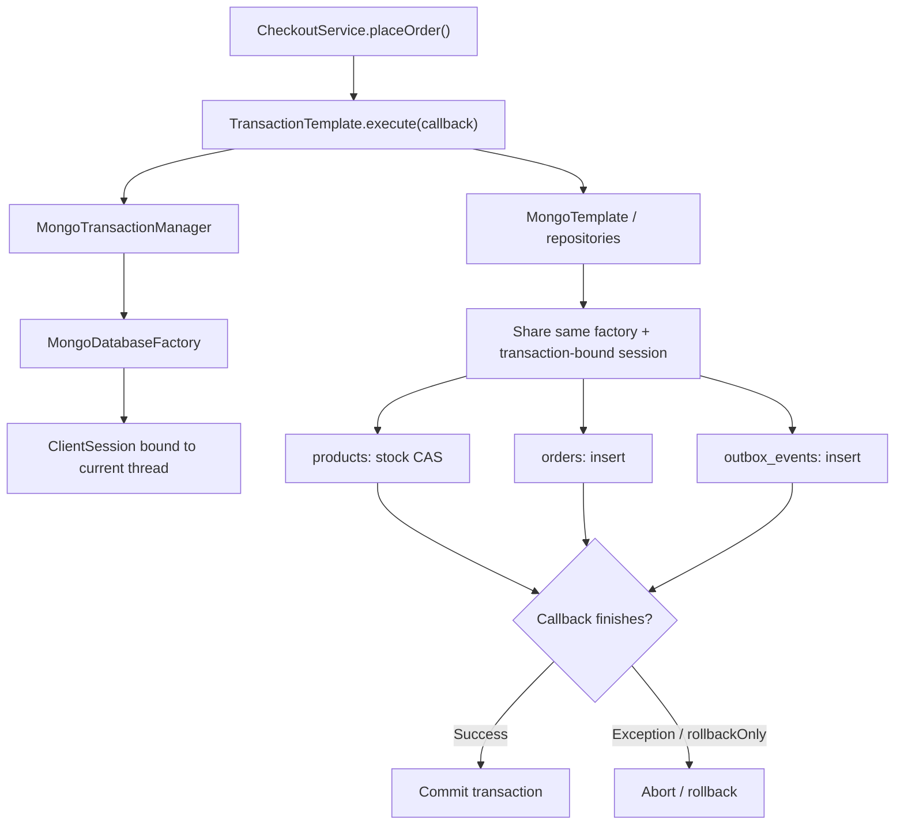
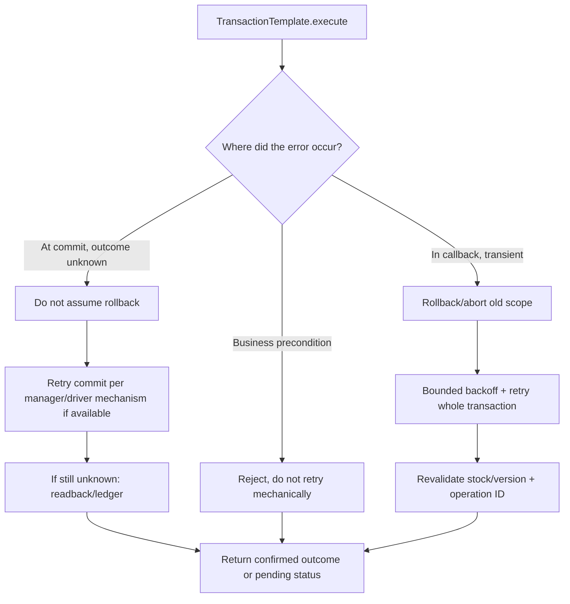

# TransactionTemplate and Programmatic Transaction Management

## 1. The Problem to Solve

MongoDB guarantees that an update operation on **a single document** is atomic. However, Mini Commerce often needs to update **multiple documents** in a single business operation. For example, when a customer places an order containing a keyboard and a mouse:

1. Check and decrement stock for two `Product` documents.
2. Create an `Order` with a unique order ID.
3. Write an `OutboxEvent` so the system sends a notification after commit.
4. Accept the result only if **all three parts** succeed.

If stock decrement succeeds but inserting the `Order` fails, the system "reserves inventory" with no order. If the `Order` is created and the second product is out of stock, the `Order` must not remain persisted. This is a case for a **multi-document MongoDB transaction**, rather than isolated CAS updates alone.

In **Spring Data MongoDB**, there are two common styles of transaction management:

- **Declarative**: placing `@Transactional` on an appropriate service method.
- **Programmatic**: using `TransactionTemplate.execute(...)` to explicitly define the code block running inside a transaction, its return value, and when to mark rollback.

This lesson **TransactionTemplate and Programmatic Transaction Management**, from the **Sessions and Transactions** chapter, focuses on the second style. The `SPRING_DATA_MONGODB` scope covers MongoDB connections, document mapping, `MongoTemplate`/repository operations, queries/CAS, indexes, transactions, reactive access, testing, and performance diagnostics.

### Objectives

After this lesson, you will be able to:

1. Explain the relationship among `ClientSession`, `MongoTransactionManager`, `PlatformTransactionManager`, and `TransactionTemplate`.
2. Configure the transaction manager with the exact `MongoDatabaseFactory` used by `MongoTemplate`.
3. Use `TransactionTemplate.execute(...)` for creating an `Order` + stock CAS + outbox in a single transaction.
4. Distinguish commit, rollback via exception, and `TransactionStatus.setRollbackOnly()`.
5. Avoid confusing `matchedCount=0` with an exception that automatically triggers rollback.
6. Understand `REQUIRED`, `REQUIRES_NEW`, and `NESTED` propagation and MongoDB's savepoint limitations.
7. Identify errors caused by queries not sharing a session, switching threads, switching `MongoDatabaseFactory`, or using the raw driver.
8. Handle `TransientTransactionError` and `UnknownTransactionCommitResult` with the right retry/idempotency strategies.
9. Control transaction duration, indexes, write concern, read concern, and external side effects.
10. Test actual commit/rollback on a replica set and apply `TransactionalOperator` in reactive code.

**Prerequisites:** Java 17+, Spring Boot with Spring Data MongoDB, a MongoDB **replica set or sharded deployment supporting transactions**, and familiarity with `@Document`, `@Id`, `Query`/`Criteria`, `Update`, and `MongoTemplate` basics.

## 2. Where Does TransactionTemplate Fit in the Architecture?



`TransactionTemplate` belongs to **Spring Framework**, not a MongoDB-specific class:

```java
import org.springframework.transaction.support.TransactionTemplate;
```

It uses a `PlatformTransactionManager` to open and close transactions. When that manager is `MongoTransactionManager`, the MongoDB transaction binds to a `ClientSession` and the session is bound to the **current thread**. A `MongoTemplate` using the same `MongoDatabaseFactory` detects that session and enlists eligible read/write commands into the same transaction.

### 2.1. Transaction Differs from Session

- **`ClientSession`** is the session context with MongoDB, supporting causal consistency and serving as the foundation for transactions.
- **Transaction** is a sequence of commands committed/aborted under multi-document rules inside that session.
- Having a `ClientSession` **does not mean** `startTransaction` has been called.
- Operations using a session **outside a transaction** do not share multi-document atomic guarantees.
- Spring-managed transactions automatically open, commit/roll back, and clean up the session via the configured transaction manager.

Do not mix a driver-created `ClientSession` with a `TransactionTemplate`-managed transaction without a clear reason and explicit session propagation rules.

### 2.2. Comparing Four Approaches

| Approach | Best Suited For | Session Management Responsibility | Pitfalls to Avoid |
| --- | --- | --- | --- |
| `@Transactional` | Relatively stable method boundaries | Spring transaction manager | Proxy/self-invocation, wrong manager |
| `TransactionTemplate` | Boundaries needing code/callback-level control | Spring transaction manager | Swallowing exceptions, wrong rollback marking |
| `ClientSession + withSession(...)` | Explicit control over driver session/start/commit | Application must close session and handle all errors | Forgetting abort/close, out-of-session commands |
| `TransactionalOperator` | Reactive `Mono`/`Flux` | Reactive transaction manager/Reactor Context | Using `TransactionTemplate` and subscribing after callback |

**Primary choice in this lesson:** `TransactionTemplate` for imperative Java, with reactive contrasted at the end.

## 3. MongoDB Server Prerequisites Before Writing Code

Multi-document MongoDB transactions require a compatible deployment version and topology: a **replica set** or **sharded cluster** supporting transactions. A standalone MongoDB instance is insufficient.

Example test replica set URI (adjust host and name for your environment):

```properties
spring.data.mongodb.uri=mongodb://localhost:27017/mini_commerce?replicaSet=rs0
```

Here `rs0` is an example: the actual MongoDB server must be configured and started as a replica set with that matching name. Never just append `replicaSet=rs0` to the URI of a standalone server and expect transactions to work.

### 3.1. Why Create Collections and Indexes Beforehand?

Before opening the checkout flow, ensure these exist:

- `products` with indexes for ID/tenant lookups and the approved schema.
- `orders` with a unique `_id` key and required idempotency constraints.
- `outbox_events` with a unique event key.

Spring Data MongoDB recommends preparing required structures **before transactions**; implicitly creating a collection on the first insert inside a transaction can fail depending on server/topology and version docs. Some newer MongoDB servers allow limited DDL in transactions, but **do not rely on implicit DDL** in the checkout path.

Creating collections/indexes belongs in migrations/bootstrap **outside business transactions**; never run `createCollection`, `ensureIndex`, or schema changes inside the checkout callback.

### 3.2. Testcontainers or Test Replica Set

Integration tests must use a real MongoDB instance with transaction capability. **Mocking `MongoTemplate` does not prove rollback.** If using Testcontainers, choose a supported replica set setup, such as the Testcontainers MongoDB module with an appropriate replica set configuration. Avoid `mongo:latest` arbitrarily when CI needs reproducible results.

## 4. Configuring MongoTransactionManager

Spring Data MongoDB **does not fully enable transactions simply because `MongoTemplate` is present**. Register a `MongoTransactionManager` explicitly:

```java
package com.example.minicommerce.config;

import org.springframework.context.annotation.Bean;
import org.springframework.context.annotation.Configuration;
import org.springframework.beans.factory.annotation.Qualifier;
import org.springframework.data.mongodb.MongoDatabaseFactory;
import org.springframework.data.mongodb.MongoTransactionManager;
import org.springframework.transaction.PlatformTransactionManager;
import org.springframework.transaction.TransactionDefinition;
import org.springframework.transaction.support.TransactionTemplate;

@Configuration
public class MongoTxConfig {

    @Bean("mongoTransactionManager")
    MongoTransactionManager mongoTransactionManager(
            MongoDatabaseFactory databaseFactory) {

        return new MongoTransactionManager(databaseFactory);
    }

    @Bean("checkoutTxTemplate")
    TransactionTemplate checkoutTxTemplate(
            @Qualifier("mongoTransactionManager")
            PlatformTransactionManager manager) {

        TransactionTemplate template = new TransactionTemplate(manager);
        template.setPropagationBehavior(
            TransactionDefinition.PROPAGATION_REQUIRED);
        template.setName("checkout.placeOrder");
        return template;
    }
}
```

A Spring Boot application typically already provides `MongoDatabaseFactory` and `MongoTemplate` beans. Do not create an extra `MongoClient`/`MongoDatabaseFactory` in this config if you want operations using the existing template to join the transaction.

### 4.1. The "Same Factory" Condition

`MongoTransactionManager` binds the session to the **`MongoDatabaseFactory` it manages**. A `MongoTemplate` built from a different factory will not join the same transaction. Similarly, when using multiple databases, multiple `MongoClient` instances, multiple templates, or multiple transaction managers, clearly delineate transaction boundaries and pick the right manager.

**Be careful:** two databases on the same MongoDB deployment do not guarantee that two `MongoTemplate` beans backed by different factories share one session. Do not treat "same MongoDB host" as proof that commands ran in one transaction.

### 4.2. SessionSynchronization

In supported Spring Data configurations:

```java
import org.springframework.data.mongodb.SessionSynchronization;

mongoTemplate.setSessionSynchronization(
    SessionSynchronization.ALWAYS);
```

`ALWAYS` lets `MongoTemplate` participate even in Spring transactions not backed by the native Mongo manager. **With a dedicated `MongoTransactionManager` sharing the same factory**, Spring Data provides session binding without arbitrarily mutating `SessionSynchronization` on a `MongoTemplate` in use by other threads.

If you must change the synchronization policy, configure it **at bean initialization time**, not back and forth per request: the docs warn that runtime mutation has thread-safety/visibility issues. Avoid configuring multiple managers where it is unclear which owns the session.

## 5. What Is the Contract of TransactionTemplate.execute?

Typical API:

```java
TransactionTemplate tx = new TransactionTemplate(manager);

String result = tx.execute(status -> {
    // MongoTemplate commands use the transaction-bound session.
    // Return a value when the callback completes.
    return "success";
});
```

Sequence when starting a new transaction:

1. The template requests a transaction from the manager.
2. The manager opens a `ClientSession` and starts a transaction.
3. The callback runs on the thread holding the transaction.
4. Callback returns normally -> manager attempts commit.
5. Callback throws an eligible exception -> manager rolls back.
6. If `status.setRollbackOnly()` was called, manager rolls back even if the callback finishes normally.
7. Session and thread-bound resources are cleaned up on completion.

**A value returned from the callback is not guaranteed to be committed.** For instance, a callback might return `"success"` only for the commit phase to throw an exception. Only treat the transaction as committed when **`tx.execute(...)` itself returns cleanly** without an uncertain outcome.

### 5.1. Execute Returning a Value

```java
String orderId = tx.execute(status -> {
    mongoTemplate.insert(order);
    return order.getId();
});
```

### 5.2. Execute Without a Return Value

```java
tx.executeWithoutResult(status -> {
    mongoTemplate.insert(auditMarker);
    mongoTemplate.insert(otherDocument);
});
```

`executeWithoutResult(...)` is a convenience method in modern Spring `TransactionOperations`; on older Spring Framework versions, use `execute(status -> { ...; return null; })`.

### 5.3. TransactionStatus and Rollback-Only

```java
Boolean accepted = tx.execute(status -> {
    if (!businessPrecondition) {
        status.setRollbackOnly();
        return false;
    }
    mongoTemplate.insert(document);
    return true;
});
```

`businessPrecondition` is a service-checked boolean and `document` is an application entity. Here the transaction **rolls back** when the condition is false even though no exception is thrown.

Never return `OrderReceipt(status="SUCCESS")` from a callback that called `setRollbackOnly()`; callers could mistake a business rejection for a committed transaction. If you need a rejection response with a clear reason, return an outcome type distinguishing `REJECTED` and `COMMITTED`, or throw a domain exception.

## 6. Mini Commerce: Data Model

### 6.1. Product and Inventory

```java
package com.example.minicommerce.domain;

import org.springframework.data.annotation.Id;
import org.springframework.data.annotation.Version;
import org.springframework.data.mongodb.core.mapping.Document;
import org.springframework.data.mongodb.core.mapping.Field;

@Document(collection = "products")
public class Product {

    @Id private String id;
    @Field("tenant_id") private String tenantId;
    private int stock;
    @Version private Long version;

    public Product() {}

    public Product(String id, String tenantId, int stock) {
        this.id = id;
        this.tenantId = tenantId;
        this.stock = stock;
    }

    public String getId() { return id; }
    public String getTenantId() { return tenantId; }
    public int getStock() { return stock; }
    public Long getVersion() { return version; }
}
```

In MongoDB, Java `tenantId` is stored under `tenant_id`. When using `Criteria` typed with `Product.class`, you can refer to the property name `tenantId`; when using raw `Document`, you must use the BSON key `tenant_id`.

`@Version` provides optimistic locking on supported entity-save paths. In the CAS example below, we update `version` **explicitly via `$inc`** rather than relying on implicit behavior across update overloads.

### 6.2. OrderLine and Order

```java
package com.example.minicommerce.domain;

public record OrderLine(
    String productId,
    int quantity
) {}
```

```java
package com.example.minicommerce.domain;

import java.time.Instant;
import java.util.List;
import org.springframework.data.annotation.Id;
import org.springframework.data.mongodb.core.mapping.Document;
import org.springframework.data.mongodb.core.mapping.Field;

@Document(collection = "orders")
public record Order(
    @Id String id,
    @Field("tenant_id") String tenantId,
    String status,
    List<OrderLine> lines,
    Instant placedAt
) {}
```

`Order` stores a snapshot of each order line; real applications may add `Decimal128` unit prices, customer ID, address, tax, and currency. Never recompute historical order totals from current catalog prices.

### 6.3. OutboxEvent

```java
package com.example.minicommerce.domain;

import java.time.Instant;
import org.springframework.data.annotation.Id;
import org.springframework.data.mongodb.core.mapping.Document;
import org.springframework.data.mongodb.core.mapping.Field;

@Document(collection = "outbox_events")
public record OutboxEvent(
    @Id String id,
    @Field("tenant_id") String tenantId,
    String aggregateId,
    String eventType,
    Instant occurredAt
) {}
```

Purpose of the outbox: **persist the intent to publish an event inside the same transaction as the `Order`**, while a separate worker **post-commit** dispatches the event to a message broker/email service. MongoDB transactions do not automatically roll back systems outside MongoDB.

## 7. Checkout Transaction Using TransactionTemplate

This is the core section. The service accepts a command with a stable order ID and line items, then:

1. Validates input **before** opening the transaction.
2. Inserts `Order` with caller-supplied `_id`, relying on `_id` uniqueness.
3. Executes **stock CAS** for each `Product` inside the transaction.
4. Inserts `OutboxEvent` in the same transaction.
5. Returns the receipt; `TransactionTemplate` commits once the callback completes.

### 7.1. Command and Result

```java
package com.example.minicommerce.service;

import java.util.List;
import com.example.minicommerce.domain.OrderLine;

public record PlaceOrderCommand(
    String tenantId,
    String orderId,
    List<OrderLine> lines
) {}
```

```java
package com.example.minicommerce.service;

public record OrderReceipt(
    String orderId,
    String status
) {}
```

`orderId` must remain **stable across retries of the same request**. Do not generate a new `UUID.randomUUID()` inside the callback on every attempt, or the application cannot distinguish new requests from replays.

### 7.2. Domain Exception

```java
package com.example.minicommerce.service;

public class InsufficientStockException
        extends RuntimeException {

    public InsufficientStockException(String productId) {
        super("Product unavailable or insufficient stock: "
            + productId);
    }
}
```

This exception can also occur when the `Product` does not exist or belongs to another tenant; messages should avoid leaking cross-tenant data. At the API layer, classify business outcomes within the authenticated tenant scope.

### 7.3. CheckoutService

```java
package com.example.minicommerce.service;

import java.time.Instant;
import java.util.HashSet;
import java.util.List;
import java.util.Objects;
import java.util.Set;

import com.mongodb.client.result.UpdateResult;
import org.springframework.beans.factory.annotation.Qualifier;
import org.springframework.data.mongodb.core.MongoTemplate;
import org.springframework.data.mongodb.core.query.Criteria;
import org.springframework.data.mongodb.core.query.Query;
import org.springframework.data.mongodb.core.query.Update;
import org.springframework.stereotype.Service;
import org.springframework.transaction.support.TransactionTemplate;

import com.example.minicommerce.domain.Order;
import com.example.minicommerce.domain.OrderLine;
import com.example.minicommerce.domain.OutboxEvent;
import com.example.minicommerce.domain.Product;

@Service
public class CheckoutService {

    private final MongoTemplate mongoTemplate;
    private final TransactionTemplate checkoutTx;

    public CheckoutService(
            MongoTemplate mongoTemplate,
            @Qualifier("checkoutTxTemplate")
            TransactionTemplate checkoutTx) {
        this.mongoTemplate = mongoTemplate;
        this.checkoutTx = checkoutTx;
    }

    public OrderReceipt placeOrder(PlaceOrderCommand command) {
        validate(command);

        // Return receipt only when execute (including commit) succeeds.
        return Objects.requireNonNull(
            checkoutTx.execute(status -> {

                // Insert first so unique _id blocks replays
                // early, before stock updates.
                mongoTemplate.insert(new Order(
                    command.orderId(),
                    command.tenantId(),
                    "PLACED",
                    command.lines(),
                    Instant.now()));

                for (OrderLine line : command.lines()) {
                    Query guard = Query.query(
                        Criteria.where("id")
                            .is(line.productId())
                            .and("tenantId")
                            .is(command.tenantId())
                            .and("stock")
                            .gte(line.quantity()));

                    Update change = new Update()
                        .inc("stock", -line.quantity())
                        .inc("version", 1L);

                    UpdateResult result = mongoTemplate.updateFirst(
                        guard, change, Product.class);

                    if (!result.wasAcknowledged()) {
                        throw new IllegalStateException(
                            "Unacknowledged stock write");
                    }
                    if (result.getMatchedCount() != 1) {
                        throw new InsufficientStockException(
                            line.productId());
                    }
                }

                mongoTemplate.insert(new OutboxEvent(
                    command.orderId() + ":placed",
                    command.tenantId(),
                    command.orderId(),
                    "ORDER_PLACED",
                    Instant.now()));

                return new OrderReceipt(
                    command.orderId(), "PLACED");
            }));
    }

    private static void validate(PlaceOrderCommand command) {
        Objects.requireNonNull(command, "command");
        if (command.tenantId() == null ||
                command.tenantId().isBlank()) {
            throw new IllegalArgumentException("Tenant required");
        }
        if (command.orderId() == null ||
                command.orderId().isBlank()) {
            throw new IllegalArgumentException("Order ID required");
        }

        List<OrderLine> lines = command.lines();
        if (lines == null || lines.isEmpty() || lines.size() > 50) {
            throw new IllegalArgumentException("Invalid line count");
        }

        Set<String> productIds = new HashSet<>();
        for (OrderLine line : lines) {
            if (line == null || line.productId() == null ||
                    line.productId().isBlank() ||
                    line.quantity() <= 0) {
                throw new IllegalArgumentException("Invalid line");
            }
            if (!productIds.add(line.productId())) {
                throw new IllegalArgumentException(
                    "Duplicate product in one order");
            }
        }
    }
}
```

**Why does this roll back properly?** If Product A's stock deduction matches but Product B's does not, the service throws `InsufficientStockException` **inside the callback**. `TransactionTemplate` rolls back, so the `Order` insert, Product A deduction, and `OutboxEvent` are all uncommitted.

**Why use CAS despite having a transaction?** The transaction ensures consistency across multiple checkout writes; `stock >= quantity` protects the **non-negative stock invariant** right at the update. When two transactions contend, MongoDB may report a write conflict/transient transaction error; the application must still retry in a controlled way and re-check outcomes.

### 7.4. Conditions for This Example to Run Correctly

- Every Product ID in the command is unique within a single `Order`; the example **rejects duplicate product lines** rather than silently deducting twice.
- `Order._id` and `OutboxEvent._id` must be unique; collections must exist before the transaction.
- `Product` documents must have numeric BSON `version` when using `$inc("version",1L)`; migrations must normalize legacy documents if missing or mistyped.
- `tenantId` in `Criteria` maps to BSON `tenant_id` when queries specify `Product.class`.
- `command.tenantId()` must come from verified identity/authorization; the service must not trust a tenant ID asserted in the HTTP body.
- Every command runs through the **same `MongoTemplate`/`MongoDatabaseFactory`** and **same imperative thread**.
- A successful MongoDB commit **does not prove the outbox event was published**; the outbox worker handles publishing later.

## 8. Two Execution Paths: Commit or Rollback

### 8.1. Happy Path

```text
Product A stock=5, Product B stock=4
Order ID: ord-demo-100
Command: A x 2, B x 2

BEGIN
  INSERT orders(ord-demo-100)
  UPDATE Product A: stock 5 -> 3
  UPDATE Product B: stock 4 -> 2
  INSERT outbox_events(ord-demo-100:placed)
COMMIT

Result:
  Order exists
  Product A stock=3, Product B stock=2
  Outbox event exists
```

### 8.2. Insufficient Stock on Product B

```text
Product A stock=5, Product B stock=1
Order ID: ord-demo-101
Command: A x 2, B x 2

BEGIN
  INSERT orders(ord-demo-101)
  UPDATE Product A: stock 5 -> 3
  UPDATE Product B: matchedCount=0
  THROW InsufficientStockException
ROLLBACK

Result:
  No Order ord-demo-101
  Product A still stock=5, Product B still stock=1
  No outbox event for ord-demo-101
```

**Never write `catch (Exception ignored) {}` inside the callback** and return success: the transaction manager cannot know a business error happened if you swallow the exception without marking rollback.

## 9. Exceptions, Rollback-Only, and Business Failures

### 9.1. Throw RuntimeException to Roll Back

```java
tx.execute(status -> {
    mongoTemplate.insert(order);

    if (!hasEnoughStock) {
        throw new InsufficientStockException(productId);
    }

    mongoTemplate.insert(event);
    return order.getId();
});
```

With `TransactionTemplate`, an exception escaping the callback causes the transaction to roll back. Unlike `@Transactional` rollback rules, the programmatic callback controls flow directly: checked exceptions generally must be handled or wrapped in runtime exceptions because the callback signature declares no checked throws.

### 9.2. Marking rollbackOnly When Returning an Outcome

```java
public boolean attempt(PlaceOrderCommand command) {
    Boolean accepted = tx.execute(status -> {
        // Some work may have happened here.
        if (command.lines().isEmpty()) {
            status.setRollbackOnly();
            return false;
        }

        // Operations may succeed.
        return true;
    });

    return Boolean.TRUE.equals(accepted);
}
```

This is an example of `setRollbackOnly`, not full checkout. When validation requires no database writes, it is better to check **before** starting the transaction to avoid holding sessions and locks needlessly.

### 9.3. Be Careful with Catch Blocks

**Wrong:**

```java
tx.execute(status -> {
    mongoTemplate.insert(order);
    try {
        reserveInventory();
    } catch (InsufficientStockException e) {
        logBusinessError(e);
        // Forgot rollback; callback still returns success.
    }
    return "SUCCESS";
});
```

**Right when you still want to return a rejection result:**

```java
tx.execute(status -> {
    mongoTemplate.insert(order);
    try {
        reserveInventory();
    } catch (InsufficientStockException e) {
        status.setRollbackOnly();
        return "REJECTED";
    }
    return "ACCEPTED";
});
```

The `order`, `reserveInventory`, and `logBusinessError` symbols here are illustrative. For actual write errors returned by MongoDB, the server may already have aborted the transaction; do not attempt further writes inside the callback after a serious error. Usually the simplest and safest pattern is to **let the exception propagate out** and translate it into an API response outside.

### 9.4. Rollback-Only Inside a Joined Transaction

When `PROPAGATION_REQUIRED` joins a caller-opened transaction, marking rollback-only in an inner scope forces the **entire outer transaction to roll back**. If the outer caller expects to commit, Spring may throw `UnexpectedRollbackException`. Do not expect partial JDBC-savepoint-style rollback just by nesting `TransactionTemplate.execute` calls.

## 10. Propagation: REQUIRED, REQUIRES_NEW, and NESTED

`TransactionTemplate` inherits settings from `DefaultTransactionDefinition`:

```java
import org.springframework.transaction.TransactionDefinition;
import org.springframework.transaction.support.TransactionTemplate;

TransactionTemplate tx = new TransactionTemplate(manager);

tx.setPropagationBehavior(
    TransactionDefinition.PROPAGATION_REQUIRED);
tx.setName("checkout.inventory-and-order");
```

| Propagation | Spring Meaning | Recommendation for MongoDB |
| --- | --- | --- |
| `REQUIRED` | Join existing transaction, or open a new one if none exists | **Sensible default** for a single use case |
| `SUPPORTS` | Join if present; otherwise run without a transaction | Unsuitable when multi-document atomicity is **mandatory** |
| `MANDATORY` | Caller must already have an active transaction | Use in components that must only run inside an existing transaction |
| `REQUIRES_NEW` | Request an independent physical transaction, suspending outer scope if supported | Consumes extra session/resources; verify manager/topology, usually unnecessary for checkout |
| `NESTED` | Expects a savepoint inside an existing transaction | **Do not design around JDBC savepoints** with MongoDB |
| `NOT_SUPPORTED` | Run non-transactionally, suspending active transaction if supported | Use only when business logic explicitly permits |
| `NEVER` | Reject execution if caller already has a transaction | Useful for operations disallowed inside transactions |

### 10.1. REQUIRED Does Not Create a Separate Commit for an Inner Callback

```java
TransactionTemplate outer = new TransactionTemplate(manager);
TransactionTemplate inner = new TransactionTemplate(manager);

outer.execute(status -> {
    mongoTemplate.insert(order);

    inner.execute(child -> {
        mongoTemplate.insert(outboxEvent);
        return null;
    });

    // Writes in the same REQUIRED transaction commit only
    // when outer commits.
    return null;
});
```

`order` and `outboxEvent` are valid constructed entities. Both templates default to `REQUIRED`. The inner callback **does not own a separate commit**; if outer rolls back, the outbox also rolls back.

### 10.2. Is REQUIRES_NEW Really What You Want?

When an inner callback opens an independent transaction, it is no longer atomic with the outer transaction. For example, writing an audit entry with `REQUIRES_NEW` before checkout rolls back leaves the audit record persisted even though no `Order` exists. That may fit **logging failed attempts**, but is wrong for an **Order-placed outbox event**.

Moreover, the MongoDB manager and session/thread resources must support suspension and creating a new session in your runtime context. An independent transaction can also conflict if it touches documents held by the outer transaction. **Never take JDBC propagation examples and assume every MongoDB deployment behaves identically.**

### 10.3. No JDBC-Savepoint-Style Partial Rollback

`PROPAGATION_NESTED` in Spring typically relies on transaction resource savepoints. MongoDB transactions do not provide a corresponding savepoint protocol enabling `MongoTransactionManager` to roll back a subset of statements and continue like JDBC.

If processing `Product A` succeeds and `Product B` fails, the right choice is normally to **roll back the entire checkout**, and design a separate business flow if partial fulfillment is desired. Never try to catch B's failure and "roll back from here" inside one transaction to commit A based on a nonexistent savepoint assumption.

## 11. How Do TransactionTemplate and @Transactional Differ?

`@Transactional` can express the exact same boundary:

```java
@Transactional(transactionManager = "mongoTransactionManager")
public OrderReceipt placeOrder(PlaceOrderCommand command) {
    // Insert Order, update stock, insert outbox.
    return receipt;
}
```

`TransactionTemplate` differs in that:

- The boundary is visible directly at the `execute(...)` call site, requiring no Spring AOP proxy on that method.
- It is easy to place **multiple separate transactional blocks** within a long workflow, keeping non-transactional work outside callbacks.
- Propagation, name, and timeout can be customized per use case.
- `TransactionStatus` is directly available inside the callback to mark rollback when needed.
- It works when invoked from helpers/services without going through an AOP proxy (though you still should not open transactions inside constructors).

Having an explicit boundary does not make `TransactionTemplate` automatically superior to `@Transactional`. For most straightforward services, the annotation is cleaner and less verbose. `TransactionTemplate` shines when you need **tightly scoped transaction blocks**, want to mix non-transactional and transactional steps, or want to return a structured outcome from the callback.

### 11.1. Avoid Wiring the Wrong Transaction Manager

If an application uses both JDBC and MongoDB:

```java
@Bean("checkoutTxTemplate")
TransactionTemplate checkoutTxTemplate(
        @Qualifier("mongoTransactionManager")
        PlatformTransactionManager mongoManager) {

    return new TransactionTemplate(mongoManager);
}
```

If you accidentally inject a JDBC `DataSourceTransactionManager` into `TransactionTemplate` while the callback only uses `MongoTemplate`, do not expect MongoDB writes to participate in the JDBC transaction. **Two independent transaction managers do not form a distributed transaction**; use a dedicated coordination pattern like outbox/saga when spanning multiple resources.

## 12. Session, Thread, and MongoDatabaseFactory

`MongoTransactionManager` binds the `ClientSession` to the **current thread**. `MongoTemplate` operations sharing the same `MongoDatabaseFactory` participate in that session.

### 12.1. Wrong: Switching Threads Inside the Callback

```java
tx.execute(status -> {
    mongoTemplate.insert(order);

    java.util.concurrent.CompletableFuture<Void> task =
        java.util.concurrent.CompletableFuture.runAsync(
            () -> mongoTemplate.insert(outboxEvent));

    task.join();
    return null;
});
```

This is an **anti-pattern**: `runAsync` executes the insert on another thread, while imperative session binding is thread-local. The outbox insert can run **outside the transaction** even though the caller waits with `join()`.

**Right:** keep all MongoDB writes belonging to the transaction on the **same imperative thread**:

```java
tx.execute(status -> {
    mongoTemplate.insert(order);
    mongoTemplate.insert(outboxEvent);
    return null;
});
```

If the workflow genuinely needs async work, use a post-commit outbox or a reactive transaction manager/Reactor Context; never hop threads assuming the context follows.

### 12.2. Wrong: Using Raw MongoCollection Without Passing the Session

```java
tx.execute(status -> {
    mongoTemplate.insert(order);

    // ANTI-PATTERN: raw driver call does not automatically carry
    // the ClientSession managed by MongoTransactionManager.
    mongoTemplate.getCollection("outbox_events")
        .insertOne(rawOutboxDocument);

    return null;
});
```

`getCollection(...)` returns a native driver collection; Spring Data docs note it is **not a session-proxied object** that binds the session for all calls. If you need the native driver, pass the active `ClientSession` to the driver overload or use an appropriate `MongoOperations.execute(...)` callback; the simpler path is `mongoTemplate.insert(outboxEntity)` so Spring manages the session.

### 12.3. Wrong: Opening a New MongoClient

```java
tx.execute(status -> {
    mongoTemplate.insert(order);

    // Do not do this inside checkout:
    // MongoClients.create(uri).getDatabase("mini_commerce")
    //     .getCollection("outbox_events").insertOne(...);

    return null;
});
```

Another `MongoClient`/`MongoDatabaseFactory` does not share the transaction-bound session just because it uses the same URI/database. Also avoid creating a new client per request: connection pools and session lifecycles belong at the configuration layer.

### 12.4. Spring Transactions Only Cover Participating Resources

Do not call an HTTP service or message broker inside the callback expecting Spring MongoDB to roll back the external request:

```java
tx.execute(status -> {
    mongoTemplate.insert(order);
    // BAD: paymentGateway.capture(...) may complete,
    // while the MongoDB transaction later rolls back.
    return null;
});
```

For payments, emails, or search indexing, use **outbox/saga** and idempotency. If an external read is required for validation, perform it before the transaction when semantics permit, keeping in mind data may change between check and commit.

## 13. TransactionOptions: Read Concern, Write Concern, Read Preference

MongoDB transactions have database-specific attributes; not every Spring `TransactionDefinition` setting maps one-to-one to the server.

### 13.1. Default Options on MongoTransactionManager

```java
package com.example.minicommerce.config;

import com.mongodb.ReadConcern;
import com.mongodb.ReadPreference;
import com.mongodb.TransactionOptions;
import com.mongodb.WriteConcern;

import org.springframework.context.annotation.Bean;
import org.springframework.context.annotation.Configuration;
import org.springframework.data.mongodb.MongoDatabaseFactory;
import org.springframework.data.mongodb.MongoTransactionManager;

@Configuration
class DurableMongoTransactions {

    @Bean("mongoTransactionManager")
    MongoTransactionManager mongoTransactionManager(
            MongoDatabaseFactory factory) {

        TransactionOptions options = TransactionOptions.builder()
            .readConcern(ReadConcern.SNAPSHOT)
            .writeConcern(WriteConcern.MAJORITY)
            .readPreference(ReadPreference.primary())
            .build();

        return new MongoTransactionManager(factory, options);
    }
}
```

**This replaces `MongoTxConfig` in section 4**; do not register two beans with the same name in one application. `ReadConcern.SNAPSHOT` and `WriteConcern.MAJORITY` are options to weigh against workload/topology and durability targets, not advice to turn on unconditionally for every system.

### 13.2. Meaning of Each Option

| Option | Meaning | What to Remember |
| --- | --- | --- |
| `readConcern` | Consistency level of reads inside the transaction | `snapshot` fits many snapshot needs, but does not create serializable isolation |
| `writeConcern` | Commit acknowledgment level | Choose for durability; does not handle idempotency |
| `readPreference` | Read target selection per transaction rules | Transactions have server routing/read preference rules, typically primary for write flows |
| `maxCommitTime` | Server-side time limit for the commit operation where supported | Distinct from total duration of the entire business callback |

**Do not confuse:** `TransactionTemplate.setTimeout(seconds)` is a Spring-level attribute, whose actual impact on the MongoDB server depends on manager/driver/version. To enforce max transaction lifetime, also check MongoDB's transaction lifetime/commit options and test in practice. Never use timeouts as a substitute for limiting batch size/document counts.

### 13.3. Labels in Modern Spring Data

Modern Spring Data MongoDB includes `MongoTransactionOptionsResolver` supporting labels like:

```text
mongo:readConcern=SNAPSHOT
mongo:writeConcern=MAJORITY
mongo:readPreference=PRIMARY
mongo:maxCommitTime=PT1S
```

Labels can be declared in transaction attributes on supported versions; with `TransactionTemplate`, passing labels must match your `TransactionDefinition`/Spring Framework API. Do not attach those config strings blindly without checking your library version; the stable, clearest way while learning is setting `TransactionOptions` on `MongoTransactionManager`.

**Propagation note:** if a `REQUIRED` callback joins an already-open transaction, new options **cannot alter the running physical transaction**. Set options at the scope that actually starts the transaction.

## 14. Isolation, Write Skew, and CAS Inside Transactions

Multi-document transactions ensure writes inside the transaction commit/abort together; however, they **do not automatically enforce every system-wide invariant** under every concurrency pattern.

A classic example:

```text
Invariant: at least one staff member must remain on duty.
Transaction A reads: both An and Binh are on duty.
Transaction B reads: both An and Binh are on duty.
Transaction A takes An off duty.
Transaction B takes Binh off duty.
```

If two transactions update **two different documents** based solely on an earlier snapshot read, **write skew** can occur under snapshot isolation. A transaction does not automatically turn a read-then-check into a lock over all related documents.

In Mini Commerce, `stock >= quantity` in the update prevents overselling **per Product**. Unique indexes or guard documents may be needed for other invariants. For cross-document invariants (such as capping total reservations in a group), design a **coordinator document, unique constraint, conflict point, or serialization mechanism**, rather than simply wrapping read/check/update in `TransactionTemplate`.

### 14.1. Write Conflicts

Two transactions updating the same `Product` can trigger a **write conflict** rather than one waiting quietly until completion. MongoDB may attach the `TransientTransactionError` label so the application can consider retrying the **whole transaction**, re-reading state, and re-evaluating business rules.

Never treat write conflicts as "insufficient stock": that is resource contention, distinct from `matchedCount=0` when the stock condition truly fails.

### 14.2. Separating Business Outcomes from Infrastructure Outcomes

| Outcome | Example | Action |
| --- | --- | --- |
| `COMMITTED` | All writes + commit acknowledged | Return receipt |
| `REJECTED` | Stock CAS `matched=0` | Roll back, return business error |
| `RETRYABLE_TRANSACTION_FAILURE` | Write conflict/transient label before commit | Eligible for bounded whole-transaction retry |
| `UNKNOWN_COMMIT_OUTCOME` | Commit response uncertain | **Reconcile / retry commit on the same session while possible**; do not blindly replay |
| `PERMANENT_ERROR` | Invalid schema, duplicate key from bad request | Do not retry indefinitely |

## 15. Retries: TransientTransactionError Differs from UnknownTransactionCommitResult

The MongoDB driver defines error labels for transactions:

- `TransientTransactionError`: transient failure during **transaction execution before commit**; retrying the entire transaction on a new session can succeed if business conditions still hold.
- `UnknownTransactionCommitResult`: failure during **commit** where the client cannot tell whether the transaction committed; prioritize **retrying commit while the session and contract permit**, or reconcile by operation ID if context is lost.

These are two **different** strategies.



### 15.1. Why Not Re-Run the Entire Checkout Immediately After a Commit Error?

Suppose:

```text
Order ord-100 and stock actually committed.
Client loses connection right at commit.
Caller retries checkout with a new Order ID.
=> Can deduct stock a second time and create a second order.
```

That is why `orderId`/idempotency key must stay stable across attempts. In the sample service, **`Order` is inserted before stock updates**, so a replay with the same Order ID hits a duplicate key; the client must then **look up the `Order` within the tenant and verify the request fingerprint/status**, rather than blindly treating duplicate key as "purchase failed." If an existing `Order` has a different payload under the same ID, reject the request.

### 15.2. TransactionTemplate Does Not Replace the Driver's Retry Callback

The MongoDB driver provides a **convenient transaction API** managing retries for certain errors, whereas `TransactionTemplate` uses Spring's `PlatformTransactionManager` and does not automatically implement the driver's entire retry state machine.

Spring Data docs note you can customize `MongoTransactionManager#doCommit(...)` for commit retries or use Spring Retry under controlled policies. **Never slap `@Retryable` blindly around checkout** if the callback makes HTTP calls/emails, generates new IDs, or lacks idempotency.

### 15.3. Wrapped Exceptions

A MongoDB driver error may be translated by Spring into `DataAccessException` or `TransactionSystemException`. To inspect error labels, traverse to the **appropriate driver cause** per your driver version and application policy; do not blindly cast every exception to `MongoException`.

Some errors are **not worth retrying**, such as validation failures, wrong collection names, duplicate keys from invalid input, or oversized transactions. Retries need max attempt bounds, backoff/jitter, metrics, and overload protection during incidents.

## 16. Outbox and Post-Commit Side Effects

In `CheckoutService`, the outbox record is inserted **in the same transaction** as Order/stock:

```text
BEGIN
  INSERT Order
  UPDATE Product A
  UPDATE Product B
  INSERT OutboxEvent
COMMIT
       |
       v
Background publisher reads OutboxEvent
       |
       v
Send message to broker
       |
       v
Mark dispatched (with retries + idempotency)
```

If the transaction rolls back, the outbox also rolls back. If the transaction commits and the publisher dies, the event remains in MongoDB for re-sending. Because the publisher may send the same event multiple times if an ACK is lost, consumers need **idempotent processing**.

### 16.1. Do Not Confuse afterCommit Callbacks with an Outbox

Spring provides transaction synchronizations and `afterCommit` hooks. They are useful to **wake up a worker/publisher**, but a post-commit callback alone is not durable event delivery: the process can crash between commit and publish. A persisted outbox record in MongoDB is queryable recovery proof.

### 16.2. Do Not Put Network Calls Inside the Callback

```java
checkoutTx.execute(status -> {
    mongoTemplate.insert(order);
    // Do not call paymentGateway.capture(...)
    // or emailService.send(...) here expecting
    // MongoDB to roll back external effects.
    return order.getId();
});
```

If payment must be coordinated with ordering, use a dedicated saga/state machine or workflow; MongoDB transactions do not cover external payment systems.

## 17. Performance: Keep Transactions Short

Multi-document transactions carry overhead for sessions, locks/concurrency, memory, and retaining version history. Never mechanically replace already-atomic single-document operations with transactions.

Recommendations:

1. Validate requests, parse input, resolve tenant, and prepare commands **before starting** the transaction.
2. Keep only MongoDB writes needing atomicity inside the callback.
3. Create indexes supporting CAS, unique Order ID, and outbox before runtime.
4. Cap the number of `OrderLine`/`Product` entries processed in a single transaction.
5. Never scan entire collections, export files, make HTTP calls, or sleep/backoff **inside the callback**.
6. When retrying, apply backoff **outside the transaction** and retry only eligible errors.
7. Measure transaction duration and conflict/abort/timeout rates; do not benchmark only a single `updateFirst`.

### 17.1. Do Not Open a Transaction "Just to Be Safe" When Unnecessary

Deducting stock on **one Product**:

```java
UpdateResult result = mongoTemplate.updateFirst(
    Query.query(Criteria.where("id").is(productId)
        .and("stock").gte(quantity)),
    new Update().inc("stock", -quantity),
    Product.class);
```

This is already an atomic update on one document (when the query includes proper guards/tenant). If no `Order` or other document needs to commit under the same invariant, a transaction only adds overhead without solving anything new.

### 17.2. Count and Aggregation Inside Transactions

Per Spring Data MongoDB, legacy collection-metadata-based `count` commands do not fit transactions; `MongoTemplate.count(...)` inside a transaction may be rewritten to an aggregation with `$match`/`$count`. Geo operators like `$near` have restrictions here. Never assume a count method inside a transaction uses the same query plan as outside.

## 18. Diagnosing Common Transaction Issues

| Symptom | Possible Cause | Resolution |
| --- | --- | --- |
| `Transaction numbers are only allowed on a replica set member or mongos` | Running on standalone MongoDB | Run a replica set or suitable test deployment |
| `No bean of PlatformTransactionManager` | `MongoTransactionManager` not registered or wrong qualifier | Configure the right bean/factory |
| Order rolls back, yet outbox persists | Raw driver call outside session or different thread | Use the same `MongoTemplate`/session |
| Some Products do not roll back | Different factory template or operation outside callback | Verify transaction participation |
| `createCollection` fails inside transaction | Collection not pre-created or topology restricts DDL | Bootstrap schema/indexes before traffic |
| Callback throws/fails yet commits | Exception swallowed or callback returned normally | Propagate exception or call `setRollbackOnly()` |
| Outer transaction rolls back unexpectedly | Inner `REQUIRED` marked rollback-only | Clarify boundaries/contracts, handle `UnexpectedRollbackException` |
| Used `REQUIRES_NEW` expecting shared atomicity | Independent scope from outer | Do not separate outbox from checkout transaction |
| `NESTED` does not work | MongoDB lacks JDBC savepoints | Avoid partial rollback assumptions |
| Commit times out, unsure if Order exists | `UnknownTransactionCommitResult` | Reconcile by `orderId`/idempotency key |
| Retry creates a new Order and deducts stock twice | Each retry generates a new ID | Stable operation ID, duplicate handling |
| Write conflicts spike | Concurrent transactions updating same Product | Shorten transactions, use CAS and bounded retries |
| `MongoTemplate` operations skip transaction | Same URI yet different factory/session | Check bean wiring and thread |
| Reactive pipeline does not roll back | Used `TransactionTemplate` around unsubscribed publisher | Use `ReactiveMongoTransactionManager` + `TransactionalOperator` |
| Long-running transaction, high resource use | Too many ops or external calls inside callback | Cap batch size and move non-DB work out |
| Count/near behaves differently transactionally | Aggregation count path and geo restrictions | Verify generated query and server limits |
| Mock tests pass, production loses atomicity | Never tested against real MongoDB | Integration-test on replica set including failure paths |

## 19. Reactive: Use TransactionalOperator Instead of TransactionTemplate

`TransactionTemplate` is an **imperative** API. With `ReactiveMongoTemplate`, database commands are expressed as `Mono`/`Flux` and execute only on subscription. If you build a publisher inside `tx.execute(...)` and return it, the callback finishes and the imperative transaction may commit **before the publisher even runs**.

### 19.1. Anti-Pattern

```java
// WRONG: TransactionTemplate ends before Mono is subscribed.
Mono<Order> work = imperativeTransactionTemplate.execute(
    status -> reactiveMongoTemplate.insert(order));

// Work may be subscribed after the callback already exited.
return work;
```

Never mix imperative `MongoTransactionManager`/thread-bound sessions with reactive chains assuming the session transfers across operators/threads.

### 19.2. Configuring ReactiveMongoTransactionManager

```java
package com.example.minicommerce.config;

import org.springframework.beans.factory.annotation.Qualifier;
import org.springframework.context.annotation.Bean;
import org.springframework.context.annotation.Configuration;
import org.springframework.data.mongodb.ReactiveMongoDatabaseFactory;
import org.springframework.data.mongodb.ReactiveMongoTransactionManager;
import org.springframework.transaction.ReactiveTransactionManager;
import org.springframework.transaction.reactive.TransactionalOperator;

@Configuration
public class ReactiveMongoTxConfig {

    @Bean("reactiveMongoTransactionManager")
    ReactiveMongoTransactionManager transactionManager(
            ReactiveMongoDatabaseFactory factory) {
        return new ReactiveMongoTransactionManager(factory);
    }

    @Bean("checkoutOperator")
    TransactionalOperator checkoutOperator(
            @Qualifier("reactiveMongoTransactionManager")
            ReactiveTransactionManager manager) {
        return TransactionalOperator.create(manager);
    }
}
```

This is a **configuration for reactive applications**, not code to blindly add to the imperative app above. If an app includes both stacks, use distinct bean names/qualifiers and keep both transaction paths clearly separated.

`ReactiveMongoTransactionManager` propagates the session via the **Reactor Context**, not purely via `ThreadLocal`. `ReactiveMongoTemplate` must be built from the same `ReactiveMongoDatabaseFactory`.

### 19.3. Reactive Checkout

```java
import com.mongodb.client.result.UpdateResult;

import java.time.Instant;

import org.springframework.data.mongodb.core.ReactiveMongoTemplate;
import org.springframework.data.mongodb.core.query.Criteria;
import org.springframework.data.mongodb.core.query.Query;
import org.springframework.data.mongodb.core.query.Update;
import org.springframework.transaction.reactive.TransactionalOperator;

import reactor.core.publisher.Flux;
import reactor.core.publisher.Mono;

public Mono<OrderReceipt> placeOrderReactive(
        PlaceOrderCommand command,
        ReactiveMongoTemplate template,
        TransactionalOperator operator) {

    Order order = new Order(
        command.orderId(), command.tenantId(),
        "PLACED", command.lines(), Instant.now());

    OutboxEvent outbox = new OutboxEvent(
        command.orderId() + ":placed",
        command.tenantId(), command.orderId(),
        "ORDER_PLACED", Instant.now());

    Mono<OrderReceipt> work = template.insert(order)
        .thenMany(
            Flux.fromIterable(command.lines())
                .concatMap(line -> {
                    Query filter = Query.query(
                        Criteria.where("id")
                            .is(line.productId())
                            .and("tenantId")
                            .is(command.tenantId())
                            .and("stock")
                            .gte(line.quantity()));

                    Update update = new Update()
                        .inc("stock", -line.quantity())
                        .inc("version", 1L);

                    return template.updateFirst(
                        filter, update, Product.class)
                        .flatMap(result -> {
                            if (result.wasAcknowledged() &&
                                    result.getMatchedCount() == 1) {
                                return Mono.just(result);
                            }
                            return Mono.error(
                                new InsufficientStockException(
                                    line.productId()));
                        });
                }))
        .then(template.insert(outbox))
        .thenReturn(
            new OrderReceipt(command.orderId(), "PLACED"));

    return operator.transactional(work);
}
```

This is an illustrative method inside a reactive service importing the right package entities/commands/exceptions, and input validation from section 7 must run **before constructing the workflow**. `concatMap` ensures each stock update executes sequentially inside the transaction flow; never run multiple operations in parallel on the same `ClientSession`.

**Note:** re-subscribing to the same `Mono` usually runs a **new transaction**. Stable `orderId`, unique keys, and idempotency remain essential. Reactive does not make checkout automatically exactly-once and does not fix a transaction missing indexes.

### 19.4. StepVerifier

```java
import reactor.test.StepVerifier;

StepVerifier.create(
    placeOrderReactive(command, reactiveTemplate, operator))
    .assertNext(receipt ->
        org.junit.jupiter.api.Assertions.assertEquals(
            command.orderId(), receipt.orderId()))
    .verifyComplete();
```

Tests require a real reactive MongoDB replica set; never call `block()` on a WebFlux event loop, and never replace `TransactionalOperator` with `TransactionTemplate` just because the API names look similar.

## 20. Manual SessionCallback: When Should It Be Used?

Spring Data provides `MongoTemplate.withSession(ClientSession)` for manual session control. At the driver level, you can manually:

1. Call `mongoClient.startSession(...)`.
2. Call `session.startTransaction(...)`.
3. Run **every command** through session-bound operations (or pass the session explicitly to the raw driver).
4. Call `session.commitTransaction()` or `abortTransaction()`.
5. Ensure `session.close()` in `finally`/try-with-resources.
6. Separately handle transient errors and unknown commit outcomes.

Manual sessions help when an integration forces direct `ClientSession` control or requires driver features outside Spring's transaction path. When a problem simply requires multiple `MongoTemplate` commands committing/aborting together, `TransactionTemplate` greatly reduces the risk of lifecycle leaks and mishandled rollbacks.

### 20.1. Do Not Randomly Mix SessionCallback with Managed Transactions

Suppose the caller is already inside `TransactionTemplate.execute`. If you manually call `startSession` and `withSession(newSession)`, commands inside it run in **another transaction or outside the managed transaction**. Never assume two client sessions against the same database automatically combine.

### 20.2. When You Need a Read-Only Transaction

`@Transactional(readOnly=true)` or a read-only transaction definition on `MongoTransactionManager` can still open a `ClientSession`/transaction per Spring Data policy; it is not merely a harmless comment on reads. When reading a single document without multi-operation snapshot requirements, there is no need to open a transaction just for a false sense of safety.

## 21. Integration Test: Proving Atomicity on Real MongoDB

Tests must run on a **real replica set** or transaction-enabled Testcontainers MongoDB. Use a **dedicated test database** and isolated fixture IDs; never touch production collections. Never put `@Transactional` on the test method itself and inspect state before commit: that masks service boundary bugs.

### 21.1. Fixture and Assertions

We want to test two scenarios:

| Scenario | Stock A | Stock B | Expected Result |
| --- | ---: | ---: | --- |
| Success: order A×2, B×2 | A=5, B=4 | After commit: A=3, B=2 | Order and outbox both exist |
| Failure: order A×2, B×2 | A=5, B=1 | After rollback: A=5, B=1 | Neither Order nor outbox exists |

Use raw `Document` inserts to seed outside the transaction; checkout writes still go through entity-mapped `MongoTemplate`. Pre-create collections before testing.

### 21.2. Complete Integration Test

```java
package com.example.minicommerce;

import static org.junit.jupiter.api.Assertions.*;

import java.util.List;
import java.util.UUID;

import org.bson.Document;
import org.junit.jupiter.api.BeforeEach;
import org.junit.jupiter.api.Test;
import org.springframework.beans.factory.annotation.Autowired;
import org.springframework.boot.test.context.SpringBootTest;
import org.springframework.data.mongodb.core.MongoTemplate;

import com.example.minicommerce.domain.OrderLine;
import com.example.minicommerce.service.CheckoutService;
import com.example.minicommerce.service.InsufficientStockException;
import com.example.minicommerce.service.PlaceOrderCommand;

@SpringBootTest
class TransactionTemplateCheckoutIntegrationTest {

    @Autowired MongoTemplate template;
    @Autowired CheckoutService checkout;

    @BeforeEach
    void prepareCollections() {
        // Run only on isolated test DB, outside checkout transaction.
        for (String collection : List.of(
                "products", "orders", "outbox_events")) {
            if (!template.collectionExists(collection)) {
                template.createCollection(collection);
            }
        }
    }

    @Test
    void commitsOrderBothStockUpdatesAndOutbox() {
        verifyCheckout(5, 4, true);
    }

    @Test
    void rollsBackEarlierWritesIfSecondProductHasNoStock() {
        verifyCheckout(5, 1, false);
    }

    private void verifyCheckout(
            int stockA, int stockB, boolean expectedSuccess) {

        String suffix = UUID.randomUUID().toString();
        String tenant = "tx-test-" + suffix;
        String aId = "p-a-" + suffix;
        String bId = "p-b-" + suffix;
        String orderId = "ord-" + suffix;
        String eventId = orderId + ":placed";

        var products = template.getCollection("products");
        var orders = template.getCollection("orders");
        var outbox = template.getCollection("outbox_events");

        try {
            products.insertMany(List.of(
                new Document("_id", aId)
                    .append("tenant_id", tenant)
                    .append("stock", stockA)
                    .append("version", 0L),
                new Document("_id", bId)
                    .append("tenant_id", tenant)
                    .append("stock", stockB)
                    .append("version", 0L)
            ));

            PlaceOrderCommand cmd = new PlaceOrderCommand(
                tenant,
                orderId,
                List.of(
                    new OrderLine(aId, 2),
                    new OrderLine(bId, 2)
                ));

            if (expectedSuccess) {
                var receipt = checkout.placeOrder(cmd);
                assertEquals(orderId, receipt.orderId());
                assertEquals(3, stockOf(aId));
                assertEquals(2, stockOf(bId));
                assertNotNull(orders.find(
                    new Document("_id", orderId)).first());
                assertNotNull(outbox.find(
                    new Document("_id", eventId)).first());
            } else {
                assertThrows(
                    InsufficientStockException.class,
                    () -> checkout.placeOrder(cmd));

                // Product A was decremented in callback,
                // but rollback restored its previous value.
                assertEquals(stockA, stockOf(aId));
                assertEquals(stockB, stockOf(bId));
                assertNull(orders.find(
                    new Document("_id", orderId)).first());
                assertNull(outbox.find(
                    new Document("_id", eventId)).first());
            }
        } finally {
            products.deleteMany(new Document(
                "_id", new Document("$in", List.of(aId, bId))));
            orders.deleteOne(new Document("_id", orderId));
            outbox.deleteOne(new Document("_id", eventId));
        }
    }

    private int stockOf(String productId) {
        Document saved = template.getCollection("products")
            .find(new Document("_id", productId)).first();
        assertNotNull(saved);
        return saved.getInteger("stock");
    }
}
```

**Technical requirements of the test:**

- `MongoTxConfig` provides the transaction manager/template matching `MongoTemplate`; no JDBC manager is mistakenly injected.
- The test MongoDB is a transaction-capable replica set.
- `products`, `orders`, and `outbox_events` are created **before** the callback runs.
- If schema validation in the test database requires additional Product/Order fields, populate valid fixtures or use an isolated test database with the matching schema.
- Raw `Document` seeds outside the transaction have `version` as BSON Int64, matching `$inc("version",1L)`.
- Each test uses unique IDs; cleanup targets only its own fixtures.
- The test does not open an enclosing transaction around `checkout.placeOrder`, allowing inspection **after commit/rollback**.

### 21.3. Testing Missing Manager or Wrong Factory

A negative/configuration test can intentionally instantiate a `MongoTemplate` from another factory, execute an "out-of-session" write, and trigger checkout rollback. If that write persists, you have proved that call path does not join the transaction. Perform such tests only on isolated test databases/collections; never run erroneous writes on production to "test."

### 21.4. Concurrency and Write-Conflict Tests

Two checkouts sharing a Product can enter transactions simultaneously and trigger a write conflict or fail on stock re-check. Tests must accept **protocol-valid outcomes**, without depending on which thread wins:

- If total stock is insufficient, there must never be two committed Orders and negative stock.
- If a transaction aborts, its Order and Outbox must not exist.
- When transient errors are bounded-retried, every attempt must use a **stable Order ID** and re-check business preconditions.
- Never invoke the service transaction from a test while ignoring commit errors; inspect the database only after outcomes are confirmed.

### 21.5. Do Not Only Test Rollback with Synthetic Exceptions

A test doing `throw new RuntimeException()` after insert helps verify basic rollback. However, you must also test **real application failures**: `UpdateResult.matchedCount=0`, duplicate Order ID, schema violations, transient conflicts, and unknown commit (if fault injection is available). In the checkout example, `matchedCount=0` is converted into an exception so the template knows to roll back.

## 22. Essential Test Matrix

| Scenario | Expectation |
| --- | --- |
| `MongoTransactionManager` on matching factory | Callback has a transaction-bound session |
| Standalone MongoDB | Transaction does not run; replica set required |
| Pre-created collections | Avoids implicit DDL issues in checkout |
| Two-Product checkout with sufficient stock | Stock, Order, and Outbox all commit |
| Second Product out of stock | First Product stock rolls back; no Order/Outbox |
| `matchedCount=0` without throwing | Test proves design flaw can partially commit |
| Using `setRollbackOnly()` | Rolls back even though callback returns normally |
| Callback throws `RuntimeException` | Rolls back before exception propagates out |
| Inner `REQUIRED` sets rollback-only | Outer cannot commit normally |
| Different thread / different factory | Proves operation does not join same session |
| Raw `MongoCollection` without session | Does not automatically join Spring transaction |
| Two checkouts contending on one Product | No overselling; controlled transient retries |
| Retry with same Order ID | No extra stock deduction; classified as duplicate/committed |
| Unknown commit outcome | Readback/ledger check, never baseless success |
| Outbox publisher fails post-commit | Event remains for retry |
| Reactive `TransactionalOperator` | Pipeline commits/rolls back on reactive session |
| Indexes and slow transactions | Metrics/`explain` pinpoint cause |
| Different tenant | Does not modify stock/Orders outside tenant scope |

## 23. Production Operational Considerations

### 23.1. Do Not Run Transactions with Excess Privileges

`TransactionTemplate` synchronizes data; **it does not replace authentication/authorization**. Resolve tenant/actor before the callback; filter every `Product` by tenant, and protect Order IDs and unique business keys. Never let clients control collection names or run a template with credentials able to modify the entire database unchecked.

### 23.2. Capacity and Observability Planning

Measure:

- Transactions started/committed/aborted per second.
- Callback execution latency and commit duration.
- Write conflict, transient retry, and unknown outcome rates.
- Average Products/OrderLines per checkout.
- Documents/keys examined by CAS filters and receipt lookup queries.
- Pending outbox count and oldest pending event age.

MongoDB imposes server-side transaction lifetime/cache/resource limits. Do not keep bumping timeouts instead of shrinking business scope, batch sizes, or contention on hot-selling Products.

### 23.3. Read Concern Does Not Replace Idempotency

Even with `readConcern=snapshot` and `writeConcern=majority`, a client retrying a committed request can still create a second order if the application generates a new ID. Use idempotency keys, unique indexes, and outcome reconciliation.

### 23.4. Transactions Only Wrap MongoDB Writes Sharing the Session

The single most important rule of this lesson:

```text
Same MongoDatabaseFactory
        +
Same Spring-managed ClientSession
        +
Same imperative execution scope
        +
No external side effect assumed transactional
        =
MongoDB operations participate as expected
```

If any of these conditions is violated, `TransactionTemplate` may still run and log "commit" while some writes occurred outside the transaction.

## 24. Practice Exercises

**Exercise 1 — Configuration.** Register `MongoTransactionManager` and `TransactionTemplate` with the same `MongoDatabaseFactory`. Test against standalone and replica set; record exact results.

**Exercise 2 — Multi-document rollback.** Create an Order with Products A and B where B lacks stock. Verify A returns to its original stock and no Order/Outbox exists.

**Exercise 3 — Matched count.** Intentionally skip checking `matchedCount` after CAS and observe how the callback can commit incorrectly. Fix it by throwing a domain exception.

**Exercise 4 — RollbackOnly.** Write a document inside the callback, then call `status.setRollbackOnly()` and return normally. Verify the document is absent after `execute`.

**Exercise 5 — Propagation.** Create outer and inner `TransactionTemplate` instances both using `REQUIRED`. Have inner request rollback; observe outer's behavior. Explain why `NESTED` cannot rely on JDBC-style MongoDB savepoints.

**Exercise 6 — Session scope.** Deliberately move a write into `CompletableFuture.runAsync` or a raw `MongoCollection` in an isolated test. Demonstrate that the write can escape the transaction, then fix it.

**Exercise 7 — Idempotency.** Retry the same `orderId` after an unknown commit outcome; design readback and request-fingerprint verification. Never create a new Order on a replay.

**Exercise 8 — Retries.** Build a bounded retry policy for `TransientTransactionError` with backoff outside the transaction. Contrast with `UnknownTransactionCommitResult` and explain why you must not immediately replay the entire workflow.

**Exercise 9 — Outbox.** Simulate the publisher dying post-commit before sending the message. Prove the outbox event persists; have a worker retry by event ID and ensure the consumer does not process twice.

**Exercise 10 — Transaction options.** Configure a `MongoTransactionManager` with `ReadConcern.SNAPSHOT`, `WriteConcern.MAJORITY`, and primary read preference; compare against defaults on a test replica set, measuring latency and aborts.

**Exercise 11 — Reactive.** Port checkout to `TransactionalOperator` with `ReactiveMongoTemplate` on the same factory; use `StepVerifier` to prove rollback when Product B lacks stock.

**Exercise 12 — Distinguishing CAS and transactions.** Demonstrate that `$inc` with `stock >= quantity` suffices for a single Product, yet is insufficient to commit together with Order and Outbox across three collections.

### Self-Check Questions

1. What roles do `TransactionTemplate` and `MongoTransactionManager` play?
2. Why does a MongoDB transaction require a `ClientSession`?
3. Why must `MongoTemplate` use the same `MongoDatabaseFactory` as the manager?
4. When should you pick `TransactionTemplate` over `@Transactional`?
5. Does `execute(...)` returning a value prove the callback committed?
6. How does `setRollbackOnly()` differ from throwing a `RuntimeException`?
7. Does `matchedCount=0` automatically roll back a transaction?
8. Why must the outbox be inserted in the same transaction as the `Order`?
9. Why should emails/payments not be executed directly inside the callback?
10. Why do nested `PROPAGATION_REQUIRED` calls not create separate commits?
11. Why is JDBC-savepoint-style `PROPAGATION_NESTED` not a MongoDB solution?
12. How can `REQUIRES_NEW` alter checkout atomicity?
13. How does switching threads with `CompletableFuture` affect the session?
14. Does a native `MongoCollection` automatically bind the Spring-managed session?
15. How does `TransientTransactionError` differ from `UnknownTransactionCommitResult`?
16. Why can retrying the whole transaction after an unknown commit be dangerous?
17. How does a unique Order ID support idempotency?
18. Does snapshot isolation prevent all write skew automatically?
19. Why is stock CAS still needed even inside a multi-document transaction?
20. Why does reactive need `TransactionalOperator` instead of imperative `TransactionTemplate`?
21. How do you verify real rollback instead of mocking the service?
22. Which metrics should be monitored when write conflicts occur frequently?

**Expected outcome:** learners can design **programmatic transaction boundaries** using `TransactionTemplate` and `MongoTransactionManager`; understand session/thread/factory participation, commit/rollback, propagation, error labels, idempotency, and outbox; use CAS to guard single-Product invariants; test multi-document transactions on real MongoDB; and know when to switch to `TransactionalOperator` for reactive flows.

## References

- [Spring Data MongoDB — Sessions and Transactions](https://docs.spring.io/spring-data/mongodb/reference/mongodb/client-session-transactions.html): `MongoTransactionManager`, `TransactionTemplate`, session synchronization, transaction options, reactive, and special transaction cases.
- [Spring Data MongoDB — MongoTransactionManager API](https://docs.spring.io/spring-data/mongodb/docs/current/api/org/springframework/data/mongodb/MongoTransactionManager.html): managing `ClientSession`, `MongoDatabaseFactory`, and commit hooks.
- [Spring Framework — TransactionTemplate](https://docs.spring.io/spring-framework/reference/data-access/transaction/programmatic.html): programmatic transactions, callbacks, rollback-only, and transaction definitions.
- [Spring Framework — Transaction Propagation](https://docs.spring.io/spring-framework/reference/data-access/transaction/declarative/tx-propagation.html): `REQUIRED`, `REQUIRES_NEW`, and `NESTED`.
- [MongoDB Manual — Transactions](https://www.mongodb.com/docs/manual/core/transactions/): multi-document transactions, topology, limits, and consistency guarantees.
- [MongoDB Manual — Handle Transactions in Applications](https://www.mongodb.com/docs/manual/core/transactions-in-applications/): callback/core transaction APIs, `TransientTransactionError`, and `UnknownTransactionCommitResult`.
- [MongoDB Manual — Atomicity and Transactions](https://www.mongodb.com/docs/manual/core/write-operations-atomicity/): single-document atomicity, conditional updates, and write conflicts.
- [MongoDB Manual — Retryable Writes](https://www.mongodb.com/docs/manual/core/retryable-writes/): limits of retryable writes and differences from transaction retries.
- [Spring Data MongoDB — Saving, Updating and Removing Documents](https://docs.spring.io/spring-data/mongodb/reference/mongodb/template-crud-operations.html): `MongoTemplate.updateFirst`, `UpdateResult`, `@Version`, and update semantics.
- [Project Reactor — Testing with StepVerifier](https://projectreactor.io/docs/core/release/reference/testing.html): testing publishers in reactive flows.
